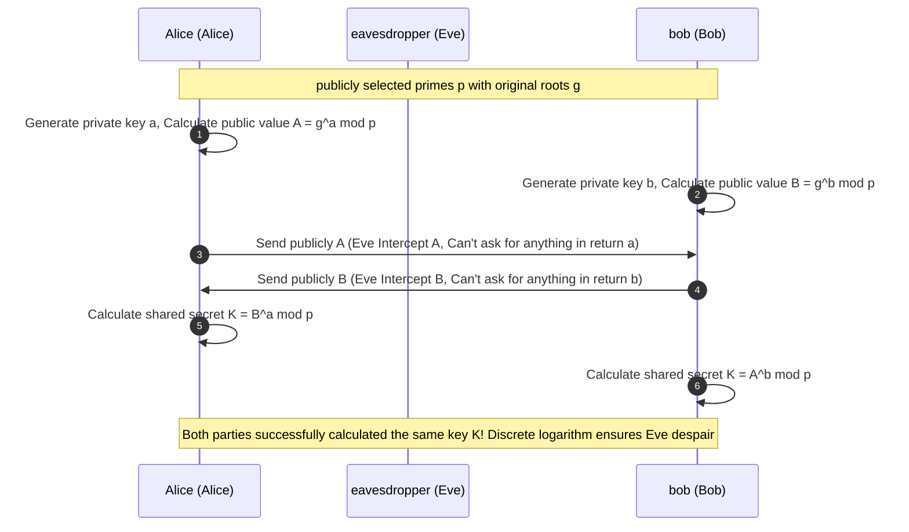

> **Course**: \[Computer Science Crash Course\] Crash Course Computer Science (PBS / All 40 episodes carefully revised)  
> **Module**: Module 5: Computer Networks & Security  
> **Keynote speaker**: Carrie Anne Philbin  
> **Video duration**: 12:33 ｜ **HD screenshots**: 4 blackboard writing/illustrations on core knowledge points  
> **Direct video**: [📺Watch the original video of this lecture on Bilibili (P33)](https://www.bilibili.com/video/BV1EW411u7th/?p=33)  
> **Full book navigation**: [← Previous lecture (P32)](/en/notes/cccs/lecture-32) ｜ [📚 Return to the full book catalog](/en/notes/topics/CCCS) ｜ [Next lecture (P34) →](/en/notes/cccs/lecture-34)

---

## Core Introduction and Concept Panorama

Comprehensively reveal the mathematical shield that protects confidentiality in the information world - the evolution history of cryptography, from Caesar classical substitution and Enigma mechanical cipher, to the Diffie-Hellman protocol that solves key distribution deadlocks, to the RSA asymmetric public key system that dominates the modern digital world.

---

## 1. The sharp edge of classical cryptography and letter frequency analysis

*(Reference time: 00:01:10 · [Video jump (P33 00:01:10)](https://www.bilibili.com/video/BV1EW411u7th/?p=33&t=70))*

\*\*Cryptography\*\* is the ancient art and esoteric science of secure and confidential communications in hostile environments.

- **Caesar Cipher**: A single-table substitution cipher used by Caesar the Great in ancient Rome when he was marching. Shift each letter in the alphabet forward or backward by a fixed number of positions (for example, 3 positions: `A`  change  `D`, `B`  change  `E`); 
- **The fatal blow to frequency analysis**: In the 9th century, the Arab mathematician Al-Kindi invented **frequency analysis**. In any human language, the probability of occurrence of different letters has an extremely stable statistical fingerprint (for example, the letters in English  `E`  The highest proportion, about 13%). The cracker only needs to count the most common ciphertext letters in the ciphertext, and he can decipher the translation offset instantly! The single-table substitution password is fragile in the face of mathematical statistics.

*⏱ Timestamp: 00:01:20 · 📷 Classroom screenshot · [Watch the corresponding clip on Bilibili (P33 00:01:20)](https://www.bilibili.com/video/BV1EW411u7th/?p=33&t=80)*

## 2. The Achilles’ heel of symmetric encryption: key distribution dilemma

*(Reference time: 00:05:40 · [Video jump (P33 00:05:40)](https://www.bilibili.com/video/BV1EW411u7th/?p=33&t=340))*

Entering the era of electronic computers, symmetric encryption algorithms (such as DES, AES-256) were born:
- **Symmetric Encryption**:Used for encryption and decryption **The same secret key (Secret Key)**; 
- Modern symmetric encryption is extremely powerful: the AES algorithm cuts the data into chunks and then performs complex byte substitution, row shifting, column obfuscation, and round key addition over multiple rounds. Even if all the supercomputers in the world are used to brute force for hundreds of millions of years, a 256-bit AES ciphertext cannot be cracked.

#### Fatal deadlock dilemma (Key Distribution Problem):
If Alice wants to send an encrypted file to Bob online, she must first have a key:
- But how does Alice get this key to Bob safely?
- If she sends the key to Bob via WeChat or email, if the channel has been intercepted by an eavesdropper and the eavesdropper gets the key, the encryption becomes meaningless;
- If the channel is inherently secure, why doesn't Alice just send the unencrypted file?
In the thousands of years of human cryptography history, **How to securely exchange the first top-secret key in an insecure channel with open mutual distrust**, has always been a seemingly unsolvable knot.

*⏱ Timestamp: 00:03:30 · 📷 Classroom screenshot · [Watch the corresponding clip on Bilibili (P33 00:03:30)](https://www.bilibili.com/video/BV1EW411u7th/?p=33&t=210)*

## 3. The solution: Diffie-Hellman key agreement protocol

*(Reference time: 00:07:30 · [Video jump (P33 00:07:30)](https://www.bilibili.com/video/BV1EW411u7th/?p=33&t=450))*

In 1976, Whitfield Diffie and Martin Hellman proposed a theory that shocked the mathematical world. **key exchange protocol**.

#### Paint Color Mixing Metaphor:
1. **Public base color**: Alice and Bob publicly pick an initial color (e.g. yellow) while the world watches;
2. **Private and unique color**: Alice picks a secret color in private (red, no one tells); Bob picks a secret color in private (blue, no one tells);
3. **Mix and Open Exchange**: 
   - Alice mixes yellow with her own red to get "orange," which she publicly throws to Bob;
   - Bob mixes yellow with his own blue to get "green," which he publicly throws to Alice;
   - Onlookers can only see yellow, orange and green; physically and chemically, it is extremely difficult to reversely separate the mixed colors into the original pigments!
4. **The ultimate key to the same goal through different paths**: 
   - Alice gets Bob’s green and adds her own red;
   - Bob gets Alice’s orange and adds his own blue;
   - **Both parties finally got the brown final key of "yellow + red + blue"!**
 Mathematically, they used modular exponentiation and discrete logarithm problems to synthesize the same top-secret symmetric key out of thin air on an open channel full of spies that only each other knew!

*⏱ Timestamp: 00:07:00 · 📷 Classroom screenshot · [Watch the corresponding clip on Bilibili (P33 00:07:00)](https://www.bilibili.com/video/BV1EW411u7th/?p=33&t=420)*

## 4. Asymmetric cryptography and RSA: the ultimate vault of modern digital civilization

*(Reference time: 00:10:10 · [Video jump (P33 00:10:10)](https://www.bilibili.com/video/BV1EW411u7th/?p=33&t=610))*

In 1977, three MIT scholars, Ron Rivest, Adi Shamir, and Leonard Adleman, invented the historic  **RSA algorithm**.

#### Asymmetric public key cryptography (Asymmetric Cryptography)
Each user has a mathematically exact pair of keys:
- **Public Key**: It is completely open to the public and can be seen by anyone. Anyone can use it to encrypt messages;
- **Private Key**: Absolutely private and stored in your own hardware, **Only the corresponding private key can decrypt the content encrypted by the public key.**!

#### Mathematics core: one-way trapdoor function for large prime number decomposition
- Convert two huge 1024-bit prime numbers  $P$  and  $Q$  Multiplying results in a huge 2048-bit composite number  $N = P \times Q$, the computer can complete the calculation in a few tenths of a microsecond;
- But if only for you  $N$, find its prime factors in reverse  $P$  and  $Q$, it will take hundreds of years for the world’s computing power to join forces!

#### Digital Signature: Anti-counterfeiting and non-repudiation
Asymmetric cryptography was used in reverse and was born **digital signature**: 
- The sender uses its own **private key** Encrypt the hash value of the file to generate a "signature";
- Anyone in the world can take the sender's **public key** Once tested, as long as it can be solved, it will be proved as hard as a mountain: **This document was definitely signed by the sender personally, and no one tampered with even a single punctuation mark during transmission!**

Today’s little green lock (HTTPS/SSL/TLS) on the browser address bar, blockchain Bitcoin transfers, and digital identity authentication are all built on the grand mathematical shield of RSA and elliptic curve asymmetric cryptography.

*⏱ Timestamp: 00:10:20 · 📷 Classroom screenshot · [Watch the corresponding clip on Bilibili (P33 00:10:20)](https://www.bilibili.com/video/BV1EW411u7th/?p=33&t=620)*

---

## Attachment: Knowledge mind map and review thinking of this lecture

This lecture serves as  **Module 5: Computer Networks & Security**  As the core component of the system, the system connects the thinking leap from the underlying hardware physical switch, the middle layer abstract protocol to the upper layer application. It is recommended to combine the original video of Station B with the graphic guide of this lecture for repeated verification to understand the engineering trade-offs and inevitable logic behind technological evolution.

[← Previous lecture (P32)](/en/notes/cccs/lecture-32) ｜ [📚 Return to the full book catalog](/en/notes/topics/CCCS) ｜ [Next lecture (P34) →](/en/notes/cccs/lecture-34)
