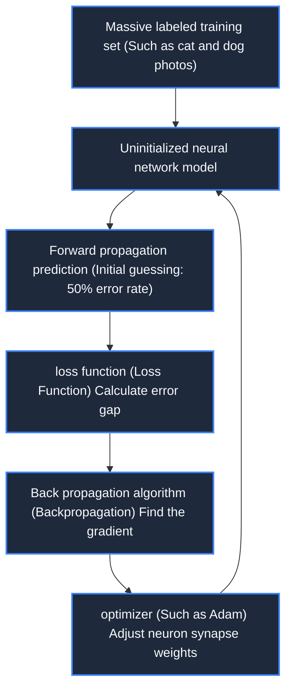

> **Course**: \[Computer Science Crash Course\] Crash Course Computer Science (PBS / All 40 episodes carefully revised)  
> **Module**: Module 6: Artificial Intelligence and Frontier Future (AI & Future Computing)  
> **Keynote speaker**: Carrie Anne Philbin  
> **Video duration**: 11:51 ｜ **HD screenshots**: 4 blackboard writing/illustrations on core knowledge points  
> **Direct video**: [📺Watch the original video of this lecture on Bilibili (P34)](https://www.bilibili.com/video/BV1EW411u7th/?p=34)  
> **Full book navigation**: [← Previous lecture (P33)](/en/notes/cccs/lecture-33) ｜ [📚 Return to the full book catalog](/en/notes/topics/CCCS) ｜ [Next lecture (P35) →](/en/notes/cccs/lecture-35)

---

## Core Introduction and Concept Panorama

Comprehensive perspective on the paradigm shift of artificial intelligence from classic symbolic rule reasoning to modern statistical machine learning, detailed analysis of feature classifiers, perceptrons, multi-layer neural network backpropagation training algorithms, and the prospects of weak artificial intelligence moving towards general strong artificial intelligence.

---

## 1. Paradigm shift: from explicit programming rules to statistical machine learning

*(Reference time: 00:01:10 · [Video jump (P34 00:01:10)](https://www.bilibili.com/video/BV1EW411u7th/?p=34&t=70))*

For the first fifty years of computers, programming followed the classic **Symbolism/Expert Systems Paradigm**:
Human beings must first fully understand every logical detail of solving the problem, and then write it line by line by hand  `if-else`  Conditional rules are fed to the computer.

But for many complex reality perception tasks, explicit rules completely fail:
For example, let a human write a set of rules to identify whether a photo contains a cat. Cats have various fur colors, may be standing, lying down, or curled up, and the light may be different... Humans use thousands of lines to describe cats.  `if`  It is never possible to exhaust all special cases!

\*\*Machine Learning (ML)\*\* brings revolutionary reverse thinking:
- **Programmers no longer write the rules, but the machine "learns" the rules itself from massive training data!**
- Programmers only need to design a general learning algorithm framework, feed millions of annotated images, and let the model automatically adjust internal parameters until the classification accuracy approaches that of humans.

*⏱ Timestamp: 00:01:20 · 📷 Classroom screenshot · [Watch the corresponding clip on Bilibili (P34 00:01:20)](https://www.bilibili.com/video/BV1EW411u7th/?p=34&t=80)*

## 2. Feature space and classifier decision boundary

*(Reference time: 00:03:20 · [Video jump (P34 00:03:20)](https://www.bilibili.com/video/BV1EW411u7th/?p=34&t=200))*

Take a simple fruit classifier as an example: How to distinguish apples from bananas?

1. **Feature Extraction**:
Extract key numerical features from each sample, such as feature 1: weight (grams), feature 2: color saturation or curvature;
2. **Feature space geometric mapping**:
In the two-dimensional coordinate system, each fruit becomes a data point  $(x_1, x_2)$. Apples are usually clustered in the upper left (heavier, less curvature), and bananas are clustered in the lower right (lighter, more curved);
3. **Finding Decision Boundary**:
Machine learning algorithms (such as support vector machine SVM, logistic regression) find a dividing line (or high-dimensional hyperplane) in space that can maximize the separation of two types of data. When an unknown new fruit is input, just by looking at which side of the dividing line it falls, a classification prediction can be given with a high probability.

*⏱ Timestamp: 00:03:30 · 📷 Classroom screenshot · [Watch the corresponding clip on Bilibili (P34 00:03:30)](https://www.bilibili.com/video/BV1EW411u7th/?p=34&t=210)*

## 3. Artificial Neural Network (ANN) and the magic of backpropagation

*(Reference time: 00:06:40 · [Video jump (P34 00:06:40)](https://www.bilibili.com/video/BV1EW411u7th/?p=34&t=400))*

Inspired by the synaptic electrical signaling of neurons in biological brains, scientists designed **Artificial Neural Networks (ANN)**: 

- **Neuron mathematical model**:
receive multiple inputs  $x_i$, each input is multiplied by a **Synaptic weight (Weight,  $w_i$)**, add the bias term (Bias) after the summation, and finally pass through a nonlinear activation function (Activation Function, such as Sigmoid or ReLU) to output the signal to the next layer of neurons: 
  $$y = f\left( \sum_{i} w_i x_i + b \right)$$
- **Multi-layer topology**: 
  - **Input Layer**: Receive original image pixels or text vectors;
  - **Hidden Layers**: Responsible for layer-by-layer abstract features (the first layer extracts edge lines, the second layer extracts facial features, and the third layer recognizes the entire face);
  - **Output Layer**: Output the confidence probability distribution of different categories.

#### Core training engine: Backpropagation algorithm
The initial weights of the network are random. After each prediction error, the algorithm moves from the output layer to the input layer according to the gradient of the loss function. **Reversely propagate the error signal layer by layer**, using the calculus chain rule to fine-tune the weight of each neuron, so that the network prediction error gradually approaches the global minimum.

*⏱ Timestamp: 00:06:50 · 📷 Classroom screenshot · [Watch the corresponding clip on Bilibili (P34 00:06:50)](https://www.bilibili.com/video/BV1EW411u7th/?p=34&t=410)*

## 4. Prospects of Deep Learning and General Artificial Intelligence (AGI)

*(Reference time: 00:09:00 · [Video jump (P34 00:09:00)](https://www.bilibili.com/video/BV1EW411u7th/?p=34&t=540))*

In 2012, the deep convolutional neural network AlexNet based on GPU parallel acceleration won the ImageNet championship, kicking off the modern era of deep learning (Deep Learning):

- **Dedicated tensor computing chip (TPU/NPU)**: Hardware evolution from general-purpose scalar CPUs to ultra-high-density systolic array chips designed for matrix multiplication throughput;
- **The Reign of Narrow AI**: In specific closed tasks such as playing Go (AlphaGo), speech-to-text, autonomous driving, and medical imaging lesion screening, AI has completely surpassed the limits of human experts;
- **The ultimate exploration of Artificial General Intelligence (AGI)**: Humanity is committed to building a strong artificial intelligence system with common sense reasoning, cross-domain transfer learning and self-cognitive evolution. This is not only the ultimate jewel in the crown of human science, but also poses the most profound philosophical challenge to human ethics and social structure.

*⏱ Timestamp: 00:09:10 · 📷 Classroom screenshot · [Watch the corresponding clip on Bilibili (P34 00:09:10)](https://www.bilibili.com/video/BV1EW411u7th/?p=34&t=550)*

---

## Attachment: Knowledge mind map and review thinking of this lecture

This lecture serves as  **Module 6: Artificial Intelligence and Frontier Future (AI & Future Computing)**  As the core component of the system, the system connects the thinking leap from the underlying hardware physical switch, the middle layer abstract protocol to the upper layer application. It is recommended to combine the original video of Station B with the graphic guide of this lecture for repeated verification to understand the engineering trade-offs and inevitable logic behind technological evolution.

[← Previous lecture (P33)](/en/notes/cccs/lecture-33) ｜ [📚 Return to the full book catalog](/en/notes/topics/CCCS) ｜ [Next lecture (P35) →](/en/notes/cccs/lecture-35)
