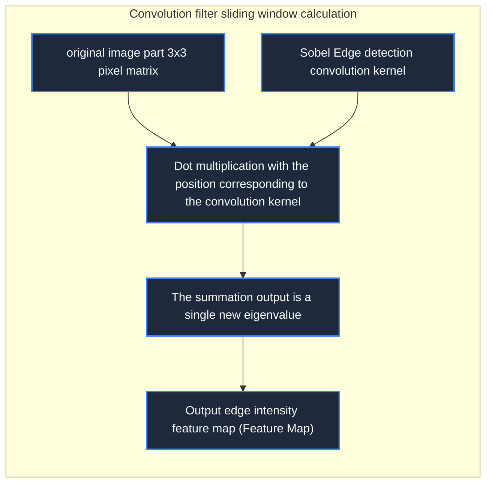

> **Course**: \[Computer Science Crash Course\] Crash Course Computer Science (PBS / All 40 episodes carefully revised)  
> **Module**: Module 6: Artificial Intelligence and Frontier Future (AI & Future Computing)  
> **Keynote speaker**: Carrie Anne Philbin  
> **Video duration**: 11:09 ｜ **HD screenshots**: 4 blackboard writing/illustrations on core knowledge points  
> **Direct video**: [📺Watch the original video of this lecture on Bilibili (P35)](https://www.bilibili.com/video/BV1EW411u7th/?p=35)  
> **Full book navigation**: [← Previous lecture (P34)](/en/notes/cccs/lecture-34) ｜ [📚 Return to the full book catalog](/en/notes/topics/CCCS) ｜ [Next lecture (P36) →](/en/notes/cccs/lecture-36)

---

## Core Introduction and Concept Panorama

Reveal how computers "understand" the visual world, from pixel matrix and color tracking, to the classic Sobel edge detection convolution kernel, to modern convolutional neural network (CNN) spatial feature extraction and facial key point tracking.

---

## 1. The nature of images in the eyes of computers: the cold digital matrix

*(Reference time: 00:01:10 · [Video jump (P35 00:01:10)](https://www.bilibili.com/video/BV1EW411u7th/?p=35&t=70))*

In the eyes of humans, a selfie contains a vivid face, a bright smile and warm sunshine; but in the eyes of a computer, **An image is just a giant, three-dimensional matrix of cold numbers**: 
- one  $1920 \times 1080$  A full-color picture composed of 2.07 million pixels;
- Each pixel consists of three integers between 0 and 255 (red R, green G, blue B intensity channels). For example  `(255, 0, 0)`  Represents pure red, `(255, 255, 255)`  Represents pure white.

The ultimate mission of \*\*Computer Vision\*\* is: **Teach the computer how to transcend the underlying meaningless discrete digital matrix and directly understand the high-level semantic objects and spatial geometry world contained in the image.**.

*⏱ Timestamp: 00:01:20 · 📷 Classroom screenshot · [Watch the corresponding clip on Bilibili (P35 00:01:20)](https://www.bilibili.com/video/BV1EW411u7th/?p=35&t=80)*

## 2. Classic visual operators: Sobel edge detection and convolution kernel

*(Reference time: 00:03:20 · [Video jump (P35 00:03:20)](https://www.bilibili.com/video/BV1EW411u7th/?p=35&t=200))*

Before deep learning became commonplace, image analysis relied on clever mathematics **Convolutional Kernels**: 

- **What are the edges of an object?**
   Mathematically, the contours and edges of an object are **The derivative extreme point where the pixel gray value suddenly jumps** (e.g. the dividing line between dark hair and light skin);
- **Sobel edge detection operator**:
design a tiny  $3 \times 3$  The weight matrix (convolution kernel) is added by sliding window point multiplication around each pixel of the original image: 
  $$\begin{bmatrix} -1 & 0 & +1 \\ -2 & 0 & +2 \\ -1 & 0 & +1 \end{bmatrix}$$
   When the convolution kernel slides through a flat and uniform area, the positive and negative offset result is 0 (black); and when it slides through the vertical boundary with dramatic changes in light and dark, the product surge is highlighted! Through the combination of horizontal and vertical convolution kernels, a line drawing-like object outline emerges instantly.

*⏱ Timestamp: 00:03:30 · 📷 Classroom screenshot · [Watch the corresponding clip on Bilibili (P35 00:03:30)](https://www.bilibili.com/video/BV1EW411u7th/?p=35&t=210)*

## 3. Convolutional Neural Network (CNN): Hierarchical self-healing of visual features

*(Reference time: 00:05:30 · [Video jump (P35 00:05:30)](https://www.bilibili.com/video/BV1EW411u7th/?p=35&t=330))*

Manually designed convolution kernels are prone to failure when encountering lighting shadows, occlusions and angle tilts. The absolute overlord of modern computer vision is **Convolutional Neural Network (CNN)**: 

1. **Local Receptive Fields**: Mimicking the mechanism of mammalian primary visual cortex, neurons only focus on small local areas of the image;
2. **Weight Sharing**: The same convolution kernel sweeps the entire image, so that the network has **translation invariance** (No matter whether the cat is in the upper left corner or the lower right corner of the screen, it can be accurately captured by the same convolution kernel);
3. **Pooling layer (Pooling/Subsampling)**: On the premise of retaining the most significant features, the feature map is compressed by halving the spatial size, reducing the amount of calculation and enhancing scale invariance;
4. **Feature Hierarchy Pyramid**: The shallow network automatically learns to detect lines and color blocks, the middle layer network automatically assembles textures, eyes, and contours, and the high-level fully connected layer comprehensively determines specific object labels.

*⏱ Timestamp: 00:05:40 · 📷 Classroom screenshot · [Watch the corresponding clip on Bilibili (P35 00:05:40)](https://www.bilibili.com/video/BV1EW411u7th/?p=35&t=340)*

## 4. Visual Miracles in the Real World: Face Recognition and Emotional Computing

*(Reference time: 00:07:40 · [Video jump (P35 00:07:40)](https://www.bilibili.com/video/BV1EW411u7th/?p=35&t=460))*

Relying on CNN and deep vision architecture, computer vision has achieved a comprehensive breakthrough:
- **Facial Landmarks Detection**: Accurately locate 68 or even hundreds of spatial feature anchor points on the facial features, and support seamless beauty filters and 3D face unlocking on mobile phones;
- **Affective Computing**: Based on micro-expressions such as eyebrow twitching and mouth curvature, the algorithm can predict in real time whether a human is in a state of concentration, joy, or anger and boredom;
- **Real-time 3D perception for autonomous driving**: The vehicle-mounted camera simultaneously completes semantic segmentation (identifying lane lines, pedestrians, obstacles) and three-dimensional bounding box ranging at a speed of 60 frames per second, giving human vision to steel cars.

*⏱ Timestamp: 00:07:50 · 📷 Classroom screenshot · [Watch the corresponding clip on Bilibili (P35 00:07:50)](https://www.bilibili.com/video/BV1EW411u7th/?p=35&t=470)*

---

## Attachment: Knowledge mind map and review thinking of this lecture

This lecture serves as  **Module 6: Artificial Intelligence and Frontier Future (AI & Future Computing)**  As the core component of the system, the system connects the thinking leap from the underlying hardware physical switch, the middle layer abstract protocol to the upper layer application. It is recommended to combine the original video of Station B with the graphic guide of this lecture for repeated verification to understand the engineering trade-offs and inevitable logic behind technological evolution.

[← Previous lecture (P34)](/en/notes/cccs/lecture-34) ｜ [📚 Return to the full book catalog](/en/notes/topics/CCCS) ｜ [Next lecture (P36) →](/en/notes/cccs/lecture-36)
