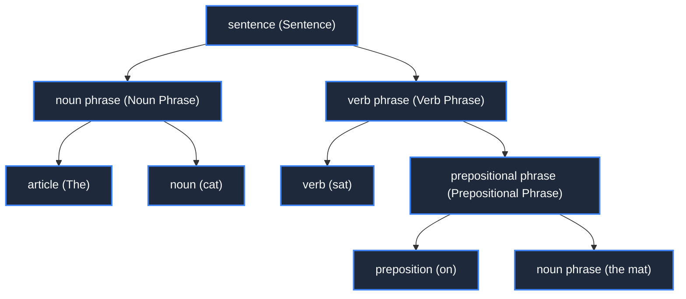

> **Course**: \[Computer Science Crash Course\] Crash Course Computer Science (PBS / All 40 episodes carefully revised)  
> **Module**: Module 6: Artificial Intelligence and Frontier Future (AI & Future Computing)  
> **Keynote speaker**: Carrie Anne Philbin  
> **Video duration**: 11:49 ｜ **HD screenshots**: 4 blackboard writing/illustrations on core knowledge points  
> **Direct video**: [📺Watch the original video of this lecture on Bilibili (P36)](https://www.bilibili.com/video/BV1EW411u7th/?p=36)  
> **Full book navigation**: [← Previous lecture (P35)](/en/notes/cccs/lecture-35) ｜ [📚 Return to the full book catalog](/en/notes/topics/CCCS) ｜ [Next lecture (P37) →](/en/notes/cccs/lecture-37)

---

## Core Introduction and Concept Panorama

Explore how computers transcend cold binary and understand the complex and ambiguous nature of human language. A semantic leap from syntactic parse trees and phoneme recognition acoustic models to word embedding high-dimensional vector spaces and modern large language models.

---

## 1. The marriage of computer science and linguistics

*(Reference time: 00:01:10 · [Video jump (P36 00:01:10)](https://www.bilibili.com/video/BV1EW411u7th/?p=36&t=70))*

Human language is an extremely wonderful invention: we can transmit complex thoughts, emotions, memories and wisdom to another person exactly through the faint sound waves emitted by vibrating the air with our lips, or the abstract symbols drawn on paper.

However, for computers that are good at rigorous mathematical logic, human language is a nightmare - the grammar is extremely irregular, full of metonymy, metaphor, and omission, and the same word has wildly different meanings in different contexts.

\*\*Natural Language Processing (NLP)\*\* is committed to building a bridge of understanding between human natural language and machine computing power.

*⏱ Timestamp: 00:01:20 · 📷 Classroom screenshot · [Watch the corresponding clip on Bilibili (P36 00:01:20)](https://www.bilibili.com/video/BV1EW411u7th/?p=36&t=80)*

## 2. The Dilemma of Grammar Rules and Parse Trees

*(Reference time: 00:02:15 · [Video jump (P36 00:02:15)](https://www.bilibili.com/video/BV1EW411u7th/?p=36&t=135))*

Early NLP attempts used Noam Chomsky’s **formal grammar theory** To parse the sentence:
- **Part-of-Speech Tagging**: Classify each word into noun (N), verb (V), article (Art), and adjective (Adj);
- **Syntax tree recursive parsing**: A noun phrase plus a verb phrase form a legal sentence ($S \to NP + VP$).

#### The fatal ambiguity of human language:
Look at a classic saying: "*Time flies like an arrow; fruit flies like a banana.*”
- In the first half of the sentence, "Time" is the subject noun and "flies" is the verb (time flies like an arrow);
- In the second half of the sentence, which has exactly the same vocabulary structure, "fruit flies" has become a noun phrase (fruit fly), and "like" has become a verb (like bananas)!
A parser based purely on static symbol rules will instantly crash into an explosion of ambiguity when faced with such daily human humor and polysemy. Modern NLP must rely on statistics and contextual probabilistic models.

*⏱ Timestamp: 00:03:30 · 📷 Classroom screenshot · [Watch the corresponding clip on Bilibili (P36 00:03:30)](https://www.bilibili.com/video/BV1EW411u7th/?p=36&t=210)*

## 3. Speech recognition: from acoustic physical waveforms to text symbols

*(Reference time: 00:06:40 · [Video jump (P36 00:06:40)](https://www.bilibili.com/video/BV1EW411u7th/?p=36&t=400))*

In order for Siri or a smart assistant to understand human speech, you must first cross the \*\*Speech Recognition\*\* level:

1. **Mathematical transition from time domain to frequency domain**: One-dimensional sound wave air pressure vibration curve collected by the microphone, through **Fast Fourier Transform (FFT)**, converted into an energy frequency distribution diagram showing changes over time——**Spectrogram**; 
2. **Phonemes recognition**: All human languages can be decomposed into dozens of the most basic pronunciation phoneme units (such as initials and finals in Chinese Pinyin, English  `/k/`, `/æ/`, `/t/`); 
3. **Hidden Markov Model and Acoustic Model**: Transition probability of matching spectrogram features and phonemes;
4. **Language model context correction**: If the system hears the homophones of "there" and "their", it determines whether it is "in their house" or "over there" through the probability distribution of the words before and after.

*⏱ Timestamp: 00:06:50 · 📷 Classroom screenshot · [Watch the corresponding clip on Bilibili (P36 00:06:50)](https://www.bilibili.com/video/BV1EW411u7th/?p=36&t=410)*

## 4. Word embeddings and large language models: semantic geometry in high-dimensional space

*(Reference time: 00:09:50 · [Video jump (P36 00:09:50)](https://www.bilibili.com/video/BV1EW411u7th/?p=36&t=590))*

The most amazing leap forward in modern NLP is to convert text into geometric space vectors——**Word Embeddings (such as Word2Vec)**: 

- Each word is no longer an isolated symbol, but is mapped to a point (dense vector) in a high-dimensional geometric space with hundreds or even thousands of dimensions;
- **The miracle of geometric operations of word meaning**: Words with similar semantics are extremely close in high-dimensional space, and even have a linear semantic vector addition and subtraction relationship: 
  $$\vec{v}(\text{国王 King}) - \vec{v}(\text{男人 Man}) + \vec{v}(\text{女人 Woman}) \approx \vec{v}(\text{女王 Queen})$$
 Subsequently, the self-attention mechanism (Self-Attention) and massive parameter large language models (LLMs) represented by the Transformer architecture were born. Computers were finally able to conduct multiple rounds of conversations, write complex codes, and write in-depth papers with a fluency comparable to that of human experts, setting off a new round of magnificent technological revolution.

*⏱ Timestamp: 00:10:00 · 📷 Classroom screenshot · [Watch the corresponding clip on Bilibili (P36 00:10:00)](https://www.bilibili.com/video/BV1EW411u7th/?p=36&t=600)*

---

## Attachment: Knowledge mind map and review thinking of this lecture

This lecture serves as  **Module 6: Artificial Intelligence and Frontier Future (AI & Future Computing)**  As the core component of the system, the system connects the thinking leap from the underlying hardware physical switch, the middle layer abstract protocol to the upper layer application. It is recommended to combine the original video of Station B with the graphic guide of this lecture for repeated verification to understand the engineering trade-offs and inevitable logic behind technological evolution.

[← Previous lecture (P35)](/en/notes/cccs/lecture-35) ｜ [📚 Return to the full book catalog](/en/notes/topics/CCCS) ｜ [Next lecture (P37) →](/en/notes/cccs/lecture-37)
