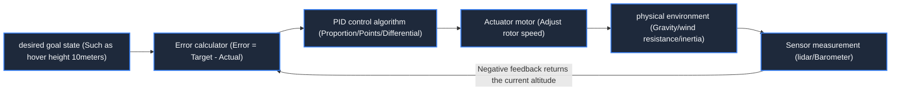

> **Course**: \[Computer Science Crash Course\] Crash Course Computer Science (PBS / All 40 episodes carefully revised)  
> **Module**: Module 6: Artificial Intelligence and Frontier Future (AI & Future Computing)  
> **Keynote speaker**: Carrie Anne Philbin  
> **Video duration**: 12:26 ｜ **HD screenshots**: 4 blackboard writing/illustrations on core knowledge points  
> **Direct video**: [📺Watch the original video of this lecture on Bilibili (P37)](https://www.bilibili.com/video/BV1EW411u7th/?p=37)  
> **Full book navigation**: [← Previous lecture (P36)](/en/notes/cccs/lecture-36) ｜ [📚 Return to the full book catalog](/en/notes/topics/CCCS) ｜ [Next lecture (P38) →](/en/notes/cccs/lecture-38)

---

## Core Introduction and Concept Panorama

Discuss how computing power breaks through the digital virtual world and enters the physical real space, and analyzes in detail the three cornerstones of robotics - perception (Sensors), planning control (PID closed loop), actuators (Actuators), as well as autonomous mapping navigation (SLAM) and robot ethics.

---

## 1. Definition of robot: an intelligent embodied entity in the physical world

*(Reference time: 00:01:10 · [Video jump (P37 00:01:10)](https://www.bilibili.com/video/BV1EW411u7th/?p=37&t=70))*

The word "Robot" was first coined by Czech playwright Karel Čapek in the 1920 science fiction play "Robot". It is derived from the Slavic word "Robota", which means forced labor or hard labor.

In computer science, the authoritative definition of a robot is: **A mechatronic integrated system that can sense the surrounding physical environment, make autonomous decisions based on internal calculations, and physically manipulate or move in the real world**.
It is not a software black box, but a system that integrates computing power, cybernetics, materials science, mechanical dynamics and the physical world. **Embodied AI**.

*⏱ Timestamp: 00:01:20 · 📷 Classroom screenshot · [Watch the corresponding clip on Bilibili (P37 00:01:20)](https://www.bilibili.com/video/BV1EW411u7th/?p=37&t=80)*

## 2. Control closed loop and negative feedback PID adjustment

*(Reference time: 00:03:15 · [Video jump (P37 00:03:15)](https://www.bilibili.com/video/BV1EW411u7th/?p=37&t=195))*

The essential difference between robots and open-loop automation equipment (such as timed toasters) is that **Negative Feedback Loop**: 
- **Sense-Think-Act Cycle (Sense-Plan-Act Cycle)**:
Sensors measure the current true state  $\to$  The difference between the controller comparison and the target desired state (error Error)  $\to$  The actuator exerts reverse physical force to reduce errors.

#### Classic PID controller (proportional-integral-derivative):
Take the drone hovering at a fixed height as an example:
1. **Proportional term (Proportional, P)**: The greater the error, the stronger the thrust when increasing the rotor throttle;
2. **Integral term (Integral, I)**: When there is continuous slight gravity or continuous downward and constant crosswind, historical errors are accumulated and steady-state compensation is given;
3. **Derivative (D)**: Forecast future error change rate. If the drone rises too fast and is about to reach the top, brake in reverse in advance to eliminate system oscillation and overshoot.
Thousands of tiny PID loops beat in the robot's underlying microcontroller at high frequencies of hundreds of hertz, maintaining the dynamic balance of the bipedal humanoid robot when it runs and jumps.

*⏱ Timestamp: 00:03:30 · 📷 Classroom screenshot · [Watch the corresponding clip on Bilibili (P37 00:03:30)](https://www.bilibili.com/video/BV1EW411u7th/?p=37&t=210)*

## 3. Sensor fusion and mechanical inverse kinematics solution

*(Reference time: 00:06:30 · [Video jump (P37 00:06:30)](https://www.bilibili.com/video/BV1EW411u7th/?p=37&t=390))*

#### 1. Sensor Fusion
No single sensor is perfect: cameras go blind in the dark, LiDAR scatters in rain and fog, and wheel encoders slip and create cumulative drift.
Modern robots use advanced mathematical algorithms such as Extended Kalman Filter (EKF) to integrate data from multiple sensors such as vision, laser, ultrasonic, inertial measurement unit (IMU) and GPS to build a robust and accurate environmental probability confidence model.

#### 2. Inverse Kinematics (IK)
The industrial six-axis robot arm needs to accurately pick up a chip on the conveyor belt:
- **forward kinematics**: Knowing the rotation angle of each joint, calculate the spatial coordinates of the gripper at the end of the robot arm (simple and direct);
- **inverse kinematics**: Given the three-dimensional space coordinates and grabbing orientation of the target chip, reversely calculate how many tiny angles each of the six mechanical rotating joints must rotate! This is an extremely fast numerical solution involving high-dimensional nonlinear equations, which is the core difficulty of robot motion planning.

*⏱ Timestamp: 00:06:50 · 📷 Classroom screenshot · [Watch the corresponding clip on Bilibili (P37 00:06:50)](https://www.bilibili.com/video/BV1EW411u7th/?p=37&t=410)*

## 4. Autonomous mobility and SLAM navigation technology

*(Reference time: 00:08:45 · [Video jump (P37 00:08:45)](https://www.bilibili.com/video/BV1EW411u7th/?p=37&t=525))*

When a sweeping robot or Mars rover is airdropped into a completely unknown enclosed space, it faces a classic chicken-and-egg dilemma: 
**“If you want to build a map, you must know your exact location; if you want to know your exact location, you must first have an accurate map!”**

#### SLAM (Simultaneous Positioning and Mapping):
- While the robot relies on laser ranging to sense surrounding obstacles and construct a local point cloud map, it also reversely corrects its own position and attitude odometry errors by comparing old and new observed landmarks;
- cooperate  $A^*$  With path search and local obstacle avoidance algorithms, the robot can achieve fully autonomous obstacle avoidance cruising and operations in indoor shopping malls, mines or on alien surfaces in space without any GPS signals. Asimov's Three Laws of Robotics are gradually moving from science fiction fantasy to serious engineering legal and ethical governance issues.

*⏱ Timestamp: 00:09:00 · 📷 Classroom screenshot · [Watch the corresponding clip on Bilibili (P37 00:09:00)](https://www.bilibili.com/video/BV1EW411u7th/?p=37&t=540)*

---

## Attachment: Knowledge mind map and review thinking of this lecture

This lecture serves as  **Module 6: Artificial Intelligence and Frontier Future (AI & Future Computing)**  As the core component of the system, the system connects the thinking leap from the underlying hardware physical switch, the middle layer abstract protocol to the upper layer application. It is recommended to combine the original video of Station B with the graphic guide of this lecture for repeated verification to understand the engineering trade-offs and inevitable logic behind technological evolution.

[← Previous lecture (P36)](/en/notes/cccs/lecture-36) ｜ [📚 Return to the full book catalog](/en/notes/topics/CCCS) ｜ [Next lecture (P38) →](/en/notes/cccs/lecture-38)
