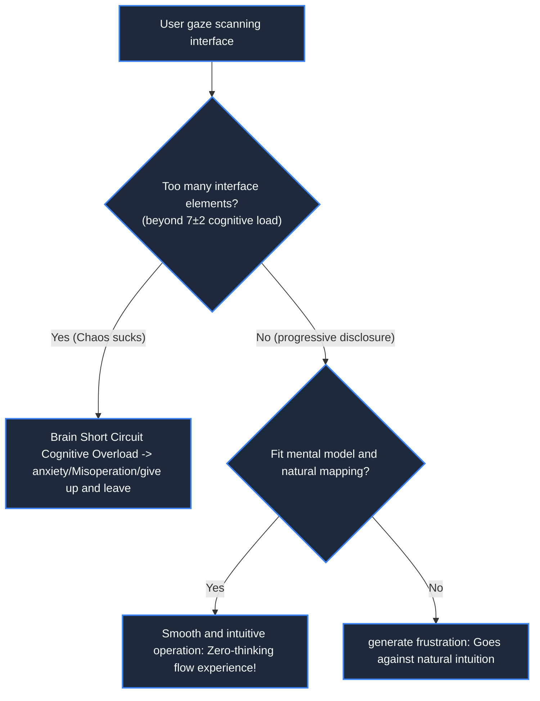

> **Course**: \[Computer Science Crash Course\] Crash Course Computer Science (PBS / All 40 episodes carefully revised)  
> **Module**: Module 6: Artificial Intelligence and Frontier Future (AI & Future Computing)  
> **Keynote speaker**: Carrie Anne Philbin  
> **Video duration**: 12:38 ｜ **HD screenshots**: 4 blackboard writing/illustrations on core knowledge points  
> **Direct video**: [📺Watch the original video of this lecture on Bilibili (P38)](https://www.bilibili.com/video/BV1EW411u7th/?p=38)  
> **Full book navigation**: [← Previous lecture (P37)](/en/notes/cccs/lecture-37) ｜ [📚 Return to the full book catalog](/en/notes/topics/CCCS) ｜ [Next lecture (P39) →](/en/notes/cccs/lecture-39)

---

## Core Introduction and Concept Panorama

Cross-border exploration of the in-depth intersection of computer science and cognitive psychology, detailed explanations of cognitive load theory, user mental models and natural mapping, fool-proof and fault-tolerant design rules, and the psychological mechanism of human anthropomorphism of digital entities.

---

## 1. Why do “bad software interfaces” drive people crazy?

*(Reference time: 00:01:10 · [Video jump (P38 00:01:10)](https://www.bilibili.com/video/BV1EW411u7th/?p=38&t=70))*

Have you ever experienced such a desperate moment:
Walking into a high-end office building, facing a transparent glass door, you push forward hard, but the door doesn't move at all - because there is a tiny "pull" written on the door;
Or in a certain software, you can't find the save button no matter what, until you accidentally close the window, and the results of the afternoon's hard work are completely wiped out.

Programmers often fall into the arrogance of engineers’ thinking: “The logic of this code is completely strict and there is nothing wrong with it. If the user finds it difficult to use, it must be because the user is too stupid and did not read the 500-page manual carefully.”

\*\*Computer Psychology and Ergonomics (HCI/Usability Engineering)\*\* completely overturns this absurd view: 
**If users feel confused, frustrated, or make mistakes when using software, the fault is not with the users, but with the designers who violated the cognitive and psychological laws of the human brain!**

*⏱ Timestamp: 00:01:20 · 📷 Classroom screenshot · [Watch the corresponding clip on Bilibili (P38 00:01:20)](https://www.bilibili.com/video/BV1EW411u7th/?p=38&t=80)*

## 2. Cognitive load theory and Miller’s law (7±2 effect)

*(Reference time: 00:02:50 · [Video jump (P38 00:02:50)](https://www.bilibili.com/video/BV1EW411u7th/?p=38&t=170))*

The human brain is an extremely complex biological computer with extremely severe bottlenecks:
- Our \*\*long-term memory\*\* has an almost unlimited capacity;
- But for people who are thinking about decisions **Short-term working memory (Working Memory) **Extremely narrow! Psychologist George Miller famously proposed** Miller's Law**: The average number of discrete information chunks (Chunks) that human working memory can hold simultaneously is only  **$7 \pm 2$  a**!

#### Golden design rules for reducing cognitive load:
1. **Chunking**: A long string of numbers must be segmented (for example, an 11-digit mobile phone number is displayed as  `138-xxxx-xxxx`, leaving a space for every 4 digits of the bank card number), instantly compressing the cognitive load into the working memory limit;
2. **Progressive Disclosure**: The ordinary user interface only displays 20% of the core commonly used high-frequency functions, and folds advanced unpopular parameters in "Advanced Settings" to avoid the interface being filled with hundreds of suffocating buttons.

*⏱ Timestamp: 00:03:10 · 📷 Classroom screenshot · [Watch the corresponding clip on Bilibili (P38 00:03:10)](https://www.bilibili.com/video/BV1EW411u7th/?p=38&t=190)*

## 3. Mental Models and Natural Mapping Principles

*(Reference time: 00:06:10 · [Video jump (P38 00:06:10)](https://www.bilibili.com/video/BV1EW411u7th/?p=38&t=370))*

The famous cognitive scientist Don Norman established the classic concept in "The Psychology of Design":
- **Conceptual mental model (Mental Model)**: The user’s expected model of how something operates in their past real-life experiences is built in their minds;
- **Natural Mapping**:
For example, there are four burners on a gas stove arranged in two rows and two columns. If the control knobs are arranged side by side in a straight line, the user will have to guess which knob corresponds to which pot every time he turns on the stove. If the knobs are also arranged in two rows and two columns, the physical space will be directly mapped one by one, and they can be operated blindly without any learning!

In a digital interface:
- To adjust the volume, push the pusher upward ("high" in physical space corresponds to "big" in abstract concepts);
- The trash can icon means complete smashing, the gear icon means system settings;
By making good use of human beings' existing mental models, software can achieve the goal of "self-explanatory without a single word".

*⏱ Timestamp: 00:06:30 · 📷 Classroom screenshot · [Watch the corresponding clip on Bilibili (P38 00:06:30)](https://www.bilibili.com/video/BV1EW411u7th/?p=38&t=390)*

## 4. Anthropomorphism and affective computing

*(Reference time: 00:09:20 · [Video jump (P38 00:09:20)](https://www.bilibili.com/video/BV1EW411u7th/?p=38&t=560))*

The human brain has extremely strong and irrepressible **Anthropomorphism**——As long as an inanimate object has two symmetrical dots (eyes) or can talk to us in human language, humans will immediately subconsciously treat it as a similar person with life, emotions and personality!

- **The Hard Lesson of Big Eye Clips (Microsoft Clippy, 1997)**:
Microsoft added an anthropomorphic paperclip assistant called Clippy to Office, which frequently tapped the glass on the screen to interrupt users: "It looks like you are writing a letter, do you need help?" Because it lacked social emotional intelligence and destroyed flow, it became the most annoying failure in the history of technology;
- **Modern social robots and digital companionship**:
Modern AI voice assistants (Siri, Xiao Ai) are well versed in human psychology: displaying modest humility, humor and empathetic listening. The computer is no longer just a cold arithmetic machine. It is penetrating into the spiritual and emotional hinterland of mankind and becoming a digital symbiotic partner accompanying civilization forward.

*⏱ Timestamp: 00:09:40 · 📷 Classroom screenshot · [Watch the corresponding clip on Bilibili (P38 00:09:40)](https://www.bilibili.com/video/BV1EW411u7th/?p=38&t=580)*

---

## Attachment: Knowledge mind map and review thinking of this lecture

This lecture serves as  **Module 6: Artificial Intelligence and Frontier Future (AI & Future Computing)**  As the core component of the system, the system connects the thinking leap from the underlying hardware physical switch, the middle layer abstract protocol to the upper layer application. It is recommended to combine the original video of Station B with the graphic guide of this lecture for repeated verification to understand the engineering trade-offs and inevitable logic behind technological evolution.

[← Previous lecture (P37)](/en/notes/cccs/lecture-37) ｜ [📚 Return to the full book catalog](/en/notes/topics/CCCS) ｜ [Next lecture (P39) →](/en/notes/cccs/lecture-39)
