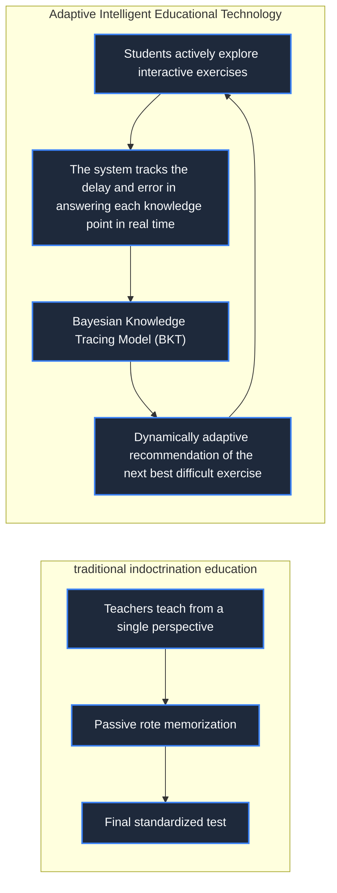

> **Course**: \[Computer Science Crash Course\] Crash Course Computer Science (PBS / All 40 episodes carefully revised)  
> **Module**: Module 6: Artificial Intelligence and Frontier Future (AI & Future Computing)  
> **Keynote speaker**: Carrie Anne Philbin  
> **Video duration**: 11:52 ｜ **HD screenshots**: 4 blackboard writing/illustrations on core knowledge points  
> **Direct video**: [📺Watch the original video of this lecture on Bilibili (P39)](https://www.bilibili.com/video/BV1EW411u7th/?p=39)  
> **Full book navigation**: [← Previous lecture (P38)](/en/notes/cccs/lecture-38) ｜ [📚 Return to the full book catalog](/en/notes/topics/CCCS) ｜ [Next lecture (P40) →](/en/notes/cccs/lecture-40)

---

## Core Introduction and Concept Panorama

Deconstruct how computer technology subverts the traditional education paradigm, from Skinner's behaviorist teaching machine, Papert Logo's linguistic constructivist revolution, to the Bayesian Intelligent Tutoring System (ITS), Khan Academy and MOOC's large-scale inclusive classroom evolution.

---

## 1. The dawn of mechanized teaching: Skinner and behaviorist teaching machines

*(Reference time: 00:01:10 · [Video jump (P39 00:01:10)](https://www.bilibili.com/video/BV1EW411u7th/?p=39&t=70))*

For two thousand years, the basic form of human education has hardly changed: a teacher stands on a podium and teaches the same knowledge to thirty or forty students below, and assigns the same homework after class. The fatal flaw of this model is that **Ignores the individual cognitive differences of each student**——Students who understood felt bored and lethargic, while students who didn’t understand couldn’t keep up and completely fell behind.

In the 1950s, psychologist B.F. Skinner built the world's first **Mechanical teaching machine (Teaching Machine)**: 
- Relying on gears and paper scrolls, students are presented with a very small slice of knowledge and accompanied by a multiple-choice question;
- The student moves the lever to choose the answer: if the answer is correct, the machine immediately sends out a mechanical reward feedback and switches to the next question; if the answer is wrong, the machine locks the lever and requires rethinking;
This is the initial physical embodiment of the \*\*Immediate Feedback\*\* educational concept.

*⏱ Timestamp: 00:01:20 · 📷 Classroom screenshot · [Watch the corresponding clip on Bilibili (P39 00:01:20)](https://www.bilibili.com/video/BV1EW411u7th/?p=39&t=80)*

## 2. The Constructivist Revolution: Seymour Papert and the Logo Language Turtle

*(Reference time: 00:03:15 · [Video jump (P39 00:03:15)](https://www.bilibili.com/video/BV1EW411u7th/?p=39&t=195))*

In the late 1960s, MIT artificial intelligence pioneer Seymour Papert proposed an educational philosophy that completely overturned Skinner: 
**Don't let the computer control and test students, but let the children command and control the computer through programming!**

Papert developed the world's first exclusive programming language for children -**Logo language**: 
- There is a cursor named "Turtle" on the screen, with a paintbrush hidden in its belly;
- Children only need to enter extremely intuitive English commands: `FORWARD 100` (walk 100 steps forward), `RIGHT 90` (turn 90 degrees to the right);
- By letting the little turtles draw squares, five-pointed stars, and complex fractal geometry, abstract and obscure plane geometry and algebraic formulas are transformed into realistic creations in the children's cheerful programming experiments!
Papert's \*\*constructivist learning theory (Constructionism)\*\* inspired the later LEGO Mindstorms robot system and the birth of the global children's programming Scratch.

*⏱ Timestamp: 00:03:30 · 📷 Classroom screenshot · [Watch the corresponding clip on Bilibili (P39 00:03:30)](https://www.bilibili.com/video/BV1EW411u7th/?p=39&t=210)*

## 3. Adaptive Intelligent Tutoring System (ITS): AI exclusive tutors with thousands of faces

*(Reference time: 00:06:40 · [Video jump (P39 00:06:40)](https://www.bilibili.com/video/BV1EW411u7th/?p=39&t=400))*

The core engine of modern educational technology is **Intelligent Tutoring Systems (ITS)**: 

- **Bayesian Knowledge Tracing (BKT) model**:
The system builds a sophisticated dynamic ability map for each student in the background. The system does not simply look at whether a question is answered correctly, but monitors the user's time spent on each attempt, the number of revocations, and the draft path in real time, and infers the user's response to "fractions" or "negative addition". **Mastery Probability**; 
- **Zone of Proximal Development matching**:
The algorithm automatically calculates the "optimal challenge ladder" that will neither make students frustrated and give up because it is too difficult nor boring because it is too easy, realizing the highest educational ideal that Confucius dreamed of two thousand years ago -**"Teaching without distinction, teaching students in accordance with their aptitude"**.

*⏱ Timestamp: 00:06:50 · 📷 Classroom screenshot · [Watch the corresponding clip on Bilibili (P39 00:06:50)](https://www.bilibili.com/video/BV1EW411u7th/?p=39&t=410)*

## 4. Flipped Classroom and MOOC Wave: Smashing the High Walls of Prestigious Universities

*(Reference time: 00:09:15 · [Video jump (P39 00:09:15)](https://www.bilibili.com/video/BV1EW411u7th/?p=39&t=555))*

Founded in 2006 by Salman Khan **Khan Academy**, setting off a \*\*Flipped Classroom\*\* storm:
- Students learn theoretical knowledge by watching famous teacher video clips at home, and can pause, replay, and play at 1.5 times speed at any time;
- When we come to the classroom during the day, the teacher no longer repeats lectures, but guides students to conduct group discussions, experimental explorations and in-depth explanations of doubts.

Then in 2012, \*\*Massive Open Online Classrooms (MOOC/Knowledge Zone)\*\* such as Coursera, edX, and Bilibili swept the world:
The life-long courses of top professors from Stanford, MIT, Harvard and Berkeley are open to all human beings around the world for free! As long as a young man who is seeking knowledge in a remote mountainous village has a network cable and a cheap device, he can cross class and geographical gaps and absorb cutting-edge scientific nutrition simultaneously with the geniuses from the world's top universities. This is the most profound and noble gift of educational technology to human civilization.

*⏱ Timestamp: 00:09:20 · 📷 Classroom screenshot · [Watch the corresponding clip on Bilibili (P39 00:09:20)](https://www.bilibili.com/video/BV1EW411u7th/?p=39&t=560)*

---

## Attachment: Knowledge mind map and review thinking of this lecture

This lecture serves as  **Module 6: Artificial Intelligence and Frontier Future (AI & Future Computing)**  As the core component of the system, the system connects the thinking leap from the underlying hardware physical switch, the middle layer abstract protocol to the upper layer application. It is recommended to combine the original video of Station B with the graphic guide of this lecture for repeated verification to understand the engineering trade-offs and inevitable logic behind technological evolution.

[← Previous lecture (P38)](/en/notes/cccs/lecture-38) ｜ [📚 Return to the full book catalog](/en/notes/topics/CCCS) ｜ [Next lecture (P40) →](/en/notes/cccs/lecture-40)
