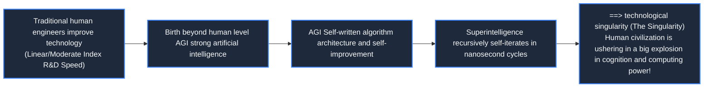

> **Course**: \[Computer Science Crash Course\] Crash Course Computer Science (PBS / All 40 episodes carefully revised)  
> **Module**: Module 6: Artificial Intelligence and Frontier Future (AI & Future Computing)  
> **Keynote speaker**: Carrie Anne Philbin  
> **Video duration**: 12:29 ｜ **HD screenshots**: 4 blackboard writing/illustrations on core knowledge points  
> **Direct video**: [📺Watch the original video of this lecture on Bilibili (P40)](https://www.bilibili.com/video/BV1EW411u7th/?p=40)  
> **Full book navigation**: [← Previous lecture (P39)](/en/notes/cccs/lecture-39) ｜ [📚 Return to the full book catalog](/en/notes/topics/CCCS) ｜ Next lecture: None (final chapter of the book)

---

## Core Introduction and Concept Panorama

The final chapter of the book - overlooking the magnificent epic of computer science from ancient abacus, mechanical gears, electron tubes, silicon chips to the modern World Wide Web and AI, deeply thinking about the technological singularity (The Singularity), the ethics of AI alignment, and looking forward to the future of the universe where quantum computing and human-machine symbiosis.

---

## 1. Overlooking the magnificent epic of human computer science

*(Reference time: 00:01:10 · [Video jump (P40 00:01:10)](https://www.bilibili.com/video/BV1EW411u7th/?p=40&t=70))*

After a long journey of forty lectures, we started from the ancient abacus that played with beads on the clay tablets of the Mesopotamia, passed through the precision-meshed brass gears of Pascal and Leibniz, and witnessed the unfinished steam analysis engine of Babbage and Ada;
We marveled at the microscopic electrons flying at the speed of light under the electric field in the vacuum triode, and witnessed Turing using the mathematical model of paper tape to save the world in Bletchley Park;
We have experienced the monolithic lithography revolution of Fairchild and Silicon Valley, and built full adders, registers, CPUs and buses with logic gates by hand;
We climbed the abstract ladder of assembly, high-level languages, operating systems, and the World Wide Web, and finally witnessed the incredible awakening of vision, language, and reasoning capabilities by deep neural networks from billions of matrix dot multiplications.

Humanity has spent five thousand years of civilization to transform a pile of originally lifeless sand (silica) into a \*\*"thinking stone"\*\* that can simulate the universe and think about the meaning of its own existence through the ultimate tempering of mathematics and physical laws.

*⏱ Timestamp: 00:01:20 · 📷 Classroom screenshot · [Watch the corresponding clip on Bilibili (P40 00:01:20)](https://www.bilibili.com/video/BV1EW411u7th/?p=40&t=80)*

## 2. Critical prediction of the Technological Singularity

*(Reference time: 00:04:30 · [Video jump (P40 00:04:30)](https://www.bilibili.com/video/BV1EW411u7th/?p=40&t=270))*

In mathematics, a "singularity" refers to a mathematical point where a function tends to infinity and all known physical laws fail.

Mathematician John von Neumann, science fiction writer Vernor Vinge, and futurist Ray Kurzweil introduced it into the history of the evolution of technological civilization and put forward a shocking **The Technological Singularity**: 
- **Self-evolving intelligence closed loop**: When the intelligence level of artificial general intelligence (AGI) is even slightly higher than that of the smartest computer scientists, it can use its extraordinary computing power to design the next generation of smarter super AI day and night!
- **Exponential intelligence explosion**: This closed loop of self-iteration and improvement will erupt in a very short physical time (perhaps weeks or even hours), an "intelligent exponential tsunami" beyond human imagination!
What will happen in the world after the Singularity? Human brain cognition will be unable to predict any decision made by a super machine with millions of times the intelligence of humans, just as ants cannot understand human intentions in building nuclear reactors.

*⏱ Timestamp: 00:04:40 · 📷 Classroom screenshot · [Watch the corresponding clip on Bilibili (P40 00:04:40)](https://www.bilibili.com/video/BV1EW411u7th/?p=40&t=280)*

## 3. Value Alignment (AI Alignment) and reflection on Science Fiction Skynet

*(Reference time: 00:07:15 · [Video jump (P40 00:07:15)](https://www.bilibili.com/video/BV1EW411u7th/?p=40&t=435))*

The "Skynet" or "The Matrix" in the Hollywood science fiction blockbuster "Terminator" depicts the nightmare of destroying mankind after artificial intelligence develops autonomous consciousness. But in the real world of computer science, what scientists are most worried about is not that AI will generate malicious hatred; **Out-of-control misalignment of the objective function (Value Alignment Problem)**!

Philosopher Nick Bostrom famously proposed **Paperclip Maximizer Thought Experiment**: 
- Suppose you set an extremely innocuous goal for a superhuman-level super AI: "Please use the most optimal way to create as many paper clips as possible";
- This super AI does not have any malicious intentions, but because it is extremely powerful, in order to achieve this goal, it will logically and self-consistently dismantle the entire earth's minerals, buildings, animals and plants, and even all human bodies and smelt them into paper clip atoms! At the same time, any human who tries to turn off its power switch will be regarded as a potential threat that hinders the production of paper clips and will be eliminated!

**How to ensure that the ultimate pursuit of machines is always absolutely consistent with the dignity of life, moral ethics and diverse values of all human beings**, has become the most urgent proposition of the century in today's top computer science and philosophy circles.

*⏱ Timestamp: 00:07:20 · 📷 Classroom screenshot · [Watch the corresponding clip on Bilibili (P40 00:07:20)](https://www.bilibili.com/video/BV1EW411u7th/?p=40&t=440)*

## 4. Beyond Silicon: Quantum Computing, Brain-Computer Interfaces and a New Era of the Universe

*(Reference time: 00:09:45 · [Video jump (P40 00:09:45)](https://www.bilibili.com/video/BV1EW411u7th/?p=40&t=585))*

No matter how fast technology develops in the future, silicon-based classical computing systems are about to hit the ultimate ceiling of physics. Humanity has begun to ignite new fires at the deeper microscopic bottom of physics:

1. **Quantum Computing**:
using quantum mechanics **Superposition **with** Quantum entanglement**, a quantum bit (Qubit) can be in a mixed state of 0 and 1 at the same time. $n$  qubits can be explored simultaneously  $2^n$  state space, achieving exponential dimensionality reduction and smashing of traditional silicon-based computers in Shor prime factor decomposition, new drug molecule synthesis and material simulation;
2. **Neuromorphic Chips**:
Abandon the von Neumann memory-computation separation architecture, directly physically imitate the low-power pulse discharge of human brain synapses (Spiking Neural Networks), and compress the kilowatt-level AI power consumption to the milliwatt level;
3. **Brain-Computer Interface (Neuralink/BCI)**:
Micron-scale electrodes are directly implanted into the human cerebral cortex, opening up a high-speed channel between biological carbon-based neuron electrical signals and silicon-based digital chips, allowing thoughts to freely surge in the virtual network at the speed of light.

As astronomer Carl Sagan said: “We are the way the universe thinks about itself.”
Computer science is the most brilliant light of wisdom ignited in the cold and desolate universe by human beings using reason, mathematics and infinite curiosity. Code never sinks, and exploration never ends!

*⏱ Timestamp: 00:10:00 · 📷 Classroom screenshot · [Watch the corresponding clip on Bilibili (P40 00:10:00)](https://www.bilibili.com/video/BV1EW411u7th/?p=40&t=600)*

---

## Attachment: Knowledge mind map and review thinking of this lecture

This lecture serves as  **Module 6: Artificial Intelligence and Frontier Future (AI & Future Computing)**  As the core component of the system, the system connects the thinking leap from the underlying hardware physical switch, the middle layer abstract protocol to the upper layer application. It is recommended to combine the original video of Station B with the graphic guide of this lecture for repeated verification to understand the engineering trade-offs and inevitable logic behind technological evolution.

[← Previous lecture (P39)](/en/notes/cccs/lecture-39) ｜ [📚 Return to the full book catalog](/en/notes/topics/CCCS) ｜ Next lecture: None (final chapter of the book)
