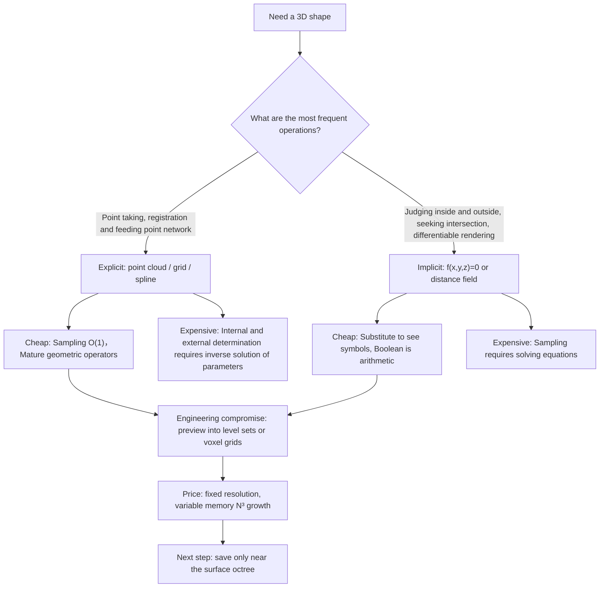
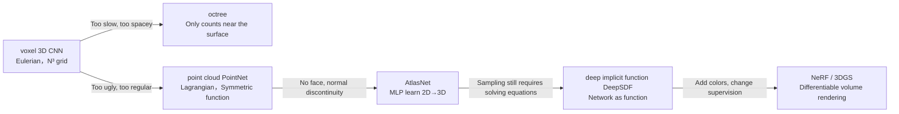
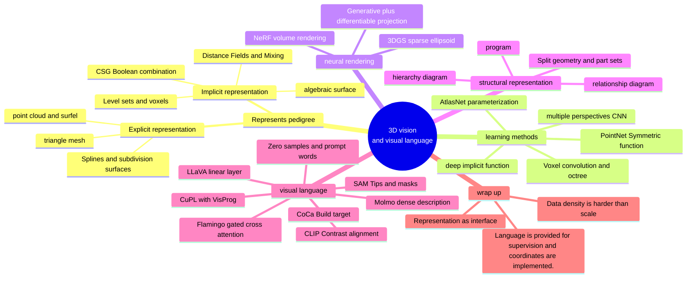

> **Course information**
>
> - **Course name**: Stanford CS231n: Deep Learning for Computer Vision(Spring 2025)
> - **This module covers**: Lecture 15. 3D Vision; Lecture 16. Vision and Language (253 slides in total)
> - **Lecturer (each lecture)**: Jiajun Wu(L15); Ranjay Krishna(L16)
> - **Teaching date range**: 2025-05-22 – 2025-05-27
> - **Course homepage**: [cs231n.stanford.edu/2025](https://cs231n.stanford.edu/2025/schedule.html)
> - **Official courseware**: [lecture_15.pdf](https://cs231n.stanford.edu/slides/2025/lecture_15.pdf) (105 pages), [lecture_16.pdf](https://cs231n.stanford.edu/slides/2025/lecture_16.pdf) (148 pages), with page-by-page illustrations in the book
> - **Subtitle source**: [cs231n_sp25_kor_sub · eng](https://github.com/lpaiu-cs/cs231n_sp25_kor_sub/tree/main/eng) (Publicly transcribed in English, Chinese rewritten by this book)
> - **Copyright statement**: The copyright of the slides and course materials belongs to Stanford University and the instructors; this book is an unofficial study note and is only used for study and research.

The two lectures were put together deliberately. Lecture 15 deals with a problem that does not exist in 2D vision: there is no default interface for 3D. Everything in two dimensions is based on a convention——$H\times W\times 3$  The tensor of , the row and column are addresses, and "adjacent" does not need to be defined; and the same cup can be written as millions of coordinate points, hundreds of thousands of triangles, or a line of equations  $x^2+y^2+z^2=r^2$, three ways of writing describe the same thing, but make completely different operations cheaper. Lecture 16 The battlefield has changed: the image is still there, but the task is no longer a label, but a sentence of natural language; what the model delivers is no longer a category, but an interface that puts pictures and sentences into the same space and can be reused by any downstream task.

On the surface, there are two topics, but on the bottom, they are two episodes of the same thing. On the three-dimensional side, "change representation" means **What inquiries can you make about it?**——The point cloud can be sampled but cannot judge the inside and outside, and the implicit function can judge the inside and outside but needs to solve the equation; on the language side, the "language" is changed to **What tasks can you put on it?**——The classifier can only answer one of 1000 categories, and the image-text alignment model can answer any description. Both lectures are pushing vision from "a label" to "a queryable and combinable structure", but the query key of the former is coordinates, while the query key of the latter is words. This module is rearranged according to this isomorphic relationship: first walk through the three-dimensional representation genealogy (Chapter 1-3), then calculate the data account and method account (Chapter 4-8), and then hand over "structure" to language in a junction chapter (Chapter 9), followed by four changes of visual language (Chapter 10-16), and finally conclude with "What does language provide to vision?"

## 1. 3D has no pixels: start by writing a list of objects

*(Reference time: 00:00:05 – 00:11:12｜Lecture 15)*

Jiajun Wu's opening did not give a definition, but first gave three photos to expand the denotation of the word "three-dimensional object". The first picture is a row of goblets and glasses: the mouth of the glass is as thin as a few millimeters, the material is translucent, and the outlines that block each other penetrate each other. The difficulty with this type of geometry is not in the overall shape, but in the details and materials - any "sampling by grid" representation will collapse into a mess if the resolution is even lower.

The second picture is the other way around: an aerial shot of Central Park. The scale spans from a few meters in the tree canopy to several kilometers in a block. The same set means that trees and buildings must be included at the same time. The third picture is a river delta (contributed by National Geographic reader, Adriana Franco). The main river channel bifurcates into tributaries, and the tributaries bifurcate again. The shape is isomorphic to trees and blood vessels - three-dimensional shapes often have multi-scale self-similarity. The three pictures combined give the first judgment of this chapter: **Choosing representation is essentially choosing "at which scale no information is lost"**, and there is no global optimal solution for this choice.

The slide spreads the options into two groups. **explicit** (Explicit) is "write the points directly": point cloud, polygon mesh, subdivision surface, NURBS. **Implicit** (Implicit) is "using a relational expression to filter out points": level set, algebraic surface, distance function - you can't get the point table, you can only ask "Is this point in it?" The last line is written with restraint: each option is suitable for different tasks and geometry types, and there is no one-size-fits-all.

Six things need to be answered when choosing a model for real engineering: how to save it into the computer (pixels are matrices, point clouds are irregular tables, and implicit functions must be clear about "what to save" first); how to create new shapes, whether the input is images, scans, or languages; what operations are supported - editing, simplification, smoothing, filtering, repair; how to render, whether rasterization, ray tracing, or neural rendering; how to animate, especially jointed objects such as human bodies and animals. This list will be used repeatedly later to score each expression, and this module also uses it as a scoring sheet.

### 1.1 Point cloud: $3\times N$  The list is missing a connection table

Point cloud is the most economical way to write: a  $3\times N$  The matrix of , the three rows are  $x,y,z$, $N$  Columns are points. The image is "each position stores a value", and the point cloud is "each point stores a position" - the storage object changes from value to coordinate, and the connection relationship is completely lost. To render, you need to add another column: normal. Light comes from a certain direction, and which way each point on the surface faces determines how bright it is. Without the normal direction, the point cloud can only be drawn as a fog without light and darkness. Points with directions have their own names in graphics——**surfel** (denominated).

The reason why point cloud cannot be avoided is that it is often the sensor's **raw output**: The first-hand data spit out by depth cameras, structured light scanners, and ARKit on iPhone are all points. But the original output cannot be used directly: a single scan only covers one perspective, is noisy, and has large areas missing, so multiple frames must be **Registration** (registration) to the same coordinate system and then merge. Calculate an account: one frame  $640\times480$  The depth map has about 307,000 points. Taking 100 frames around the object is 30 million points. Three float32s for each point save about 368 MB - this is only the intermediate product of one scan.

The advantage of point cloud is that "any geometry can be stuffed into it". Any shape can be represented by moving the points. It is not subject to topological constraints and is naturally suitable for large data sets. The shortcomings are equally clear: the undersampled area cannot be drawn (the rabbit's head is densely packed, the tail is sparse, and the rendering is just a hole), there are no mature operators such as simplification and subdivision, and there is no directional smooth rendering. The most terrible thing is that **No topology information**. The question mark in the lower right corner of the slide comes from the last item: the same bunch of points may be a torus or two rings nested together - the point set does not tell you how they are connected.

### 1.2 Triangular grid: make up the connections at the expense of irregularities

The polygonal mesh completes the connections: it not only stores points, but also stores surfaces. It is the most common representation in graphics engines, games, and film and television pipelines. Real-time rendering consumes almost all triangles. The price is irregularity: a face can have 3, 4, or 5 vertices. This variable-length structure directly conflicts with the assumption of "fixed resolution input" of early convolutional networks - the lecturer calls this a hidden line of cost, **Three-dimensional deep learning started late, largely due to inconsistent representation.**.

Complex meshes can reach exaggerated scales. This statue of David has 28,184,526 vertices and 56,230,343 triangular faces. The coordinates stored in float32 are  $2.82\times10^{7}\times3\times4$  bytes, about 338 MB; triangles are stored according to three 4-byte indices  $5.62\times10^{7}\times3\times4$, about 675 MB. The total size is about 1 GB, not including algorithm directions, UVs and textures. This is why the first step in mesh processing is often simplification rather than rendering.

Above that is Google Earth: a global grid reconstructed from satellite and aerial imagery, with trillions of triangles. According to the 12-byte index of each triangle, it is estimated to be more than ten TB. It cannot be installed on a single machine, and the details can only be obtained by streaming according to the viewpoint. **Whether it can be "simplified without collapsing" has therefore become the core competitiveness of grid representation.**, and point cloud does not even have this operation.

Three basic operations make up the grid's toolbox. **Segmentation** (subdivision) Insert new points on the edge, determine the position of the new points based on neighborhood weighting, divide a surface into four, and the resolution will increase without changing the shape; **Simplify** (simplification) In turn, the vertices are removed while maintaining the shape and appearance to change the frame rate; **regularization** (regularization) does not change the shape, only changes the sampling distribution, so that each face is a triangle, three vertices, and similar in size. The last one is the easiest to ignore: the scanned grid is often dense and sparse on one side, with long triangles all over the ground. The numerical algorithm is unstable on this grid; if the sampling is made uniform, the shape error will be almost unchanged, but every subsequent step will become cheaper. This is a typical example of "the quality of the representation is equal to the quality of the subsequent algorithm" in graphics.

## 2. Write the shape as a function: parameterization saves degrees of freedom and makes implicit decisions easier

*(Reference time: 00:11:14 – 00:21:30｜Lecture 15)*

If the shape is "designed" - a table has straight sides, a chair has a plane of symmetry, a car body has a streamlined surface - it is wasteful to approximate it with millions of points: a round table only requires radius and height. Parametric representation is to write this prior into the representation: **The degrees of freedom of the shape are much less than 3**. A surface is essentially two-dimensional, and a curve is one-dimensional. To "paste" them into a three-dimensional space only requires a mapping.

Use one slide first  $2\times2$  The classification diagram sets up the coordinate system: the horizontal axis is explicit and implicit, and the vertical axis is non-parametric and parametric. Only the two boxes in the upper left corner of this frame are filled in, and one box will be filled in for each category in the following chapters—it will be filled in once during the entire lecture, and then used as a road sign to reference again and again. This approach is worth learning: a self-complete picture can make people remember the location better than a catalog that is drawn in one go.

Parametric representation defines the surface as a function **like**(range): $S=\{f(u,v)\mid (u,v)\in D\}$, among which  $f:D\subset\mathbb{R}^2\to\mathbb{R}^3$. The degrees of freedom are 2 instead of 3 - the surface itself is two-dimensional, the third dimension is just the space in which it is embedded. It doesn't matter where the parameters come from, what matters is "you can locate a point on the surface with two numbers."

The simplest examples are circles and balls. Circle is written as  $f(t)=(\cos t,\ \sin t)$, $t\in[0,2\pi)$, one degree of freedom sweeps a circle; the ball is written as  $f(u,v)=(\sin u\cos v,\ \sin u\sin v,\ \cos u)$, $u\in[0,\pi]$, $v\in[0,2\pi)$, two degrees of freedom cover the entire spherical surface. There is no need to save points, it is enough to save this function - the number of parameters changes from "proportional to the resolution" to "proportional to the complexity".

More commonly used in engineering is  **Bézier curve**: Give several control points  $P_i$  and basis functions  $b_i(t)$, the curve is  $B(t)=\sum_i b_i(t)P_i$. The control points only give the "pull direction", and the curve itself always falls within the convex hull of the control points, so adjusting the shape is very intuitive - it is the curve that can be dragged in the industrial design software. One Bézier has limited expressive power, and the actual approach is **Segmentation Bézier**: Multiple segments are put together, and endpoints are shared between segments to ensure continuity.

A surface is a tensor product of curves: $S(u,v)=\sum_i\sum_j b_i(u)b_j(v)P_{ij}$, get one  **patch** (Patch); multiple patches are sewn together to form a complete surface. This explains why digital models of cars and airplanes are "curved patch puzzles" - each patch has only dozens of control points, but can create any smooth shell.

Another road alongside Bézier is **Segmentation** (subdivision, the slide indicates that the material is borrowed from Keenan Crane, and Crane borrowed it from Don Fussell): Without writing formulas, starting from a rough control grid, repeatedly executing the rule of "insert points at the edge midpoints and moving old points according to neighborhood weighting", and converge to a smooth limit surface after several iterations. It is easier to handle arbitrary topologies than tensor product surfaces like NURBS, which is why it has become the mainstay of animation pipelines.

By this frame, the two boxes in the lower half have been filled in: splines and subdivision surfaces are both "parametric" - the common point is that there is no point table saved, but a set of control quantities plus a set of generation rules. So far, the four representations (point, grid, spline, subdivision) are all standing **explicit** One side: No matter how it is generated, it will eventually give a specific point on the surface.

### 2.1 Explicit vs. implicit: a clean set of symmetries

The unified description of explicit representation is "**All points are given directly**", the general form is written as  $f:\mathbb{R}^2\to\mathbb{R}^3$——Give it two parameters and it will give you a three-dimensional point. This interface determines its strengths and weaknesses.

The strong point is sampling. The torus given by the slide is  $f(u,v)=((2+\cos u)\cos v,\ (2+\cos u)\sin v,\ \sin u)$. To pick points on this surface, randomly select a few  $(u,v)$  Just put it in and you'll get the points **Guaranteed on the surface**, this step is  $O(1)$, no need to solve any equations. When methods such as PointNet later require converting shapes into point clouds, they rely on this property.

The weakness is internal and external judgment. Given query point  $(3/4,1/2,1/4)$, and ask whether it is inside the object - for explicit representation, you have to first find a pair  $(u,v)$  such that  $f(u,v)$  is equal to this point, which means solving a **inverse problem**. This type of equation on the torus may have multiple solutions or no solution. Once the shape is complex, there will be no analytical solution. The lecturer paused here and said "I'm not sure myself" - this hesitation just illustrates the problem: it is not intuitive for people, and it is even less friendly to the rendering pipeline.

The implicit representation has changed direction: instead of listing points, give **Classification rules**. The sphere is all that satisfies  $x^2+y^2+z^2=1$  points; more generally, the surface is  $f(x,y,z)=0$  The zero level set of . $f$  The symbols of give the inside and outside: negative is inside, positive is outside. Use one slide  $-1$  Arrive  $+1$  The ribbon draws this thing - the surface is that zero line flanked by the two domains.

The price appears immediately: **Sampling becomes difficult**. The torus implicit function given in the slide is  $f(x,y,z)=(2-\sqrt{x^2+y^2})^2+z^2-1$. To pick a point on this surface, we have to solve  $f=0$——This example can be made up using high school mathematics, but if it is changed to any shape, there is no closed-form solution, and the root can only be found numerically. What implicitly throws away is exactly what explicit is best at.

But internal and external judgment has become substitution. same query point  $(3/4,1/2,1/4)$  Score unit goals: $9/16+1/4+1/16=7/8$, subtract 1 to get  $-1/8<0$, **inside**, one multiplication plus one subtraction is all. The slide intentionally places this number on  $-1/8$  Above: Accurate and verifiable, no need to believe in any approximations. If the same point is substituted into the torus function on the previous page, the positive number will be judged as external - the symbol itself has no meaning, and the symbol is relative to "the current one" $f$  The described shape" only makes sense.

So explicit and implicit form a set of clean symmetries, and all subsequent technical routes can be located on this table:

| Task | Explicit (point, grid, spline) | implicit($f=0$, distance field) |
| --- | --- | --- |
| Pick a point on the surface | It's easy, just substitute the parameters. $O(1)$, guaranteed to be on the surface | Difficult. To solve an equation, there may be many or no solutions. |
| Whether the judgment point is inside or not | Difficult, need to solve the parameters inversely | Easy, substitute and see the symbols |
| Boolean operations (union/intersection/difference) | Need to re-intersect and reconstruct the topology | Just do point by point arithmetic |
| Represents complex topology | Requires explicit maintenance of connections | Natural support for merging and splitting |
| Interfacing with neural networks | It needs to be discretized into a grid or graph first | The input is coordinates, which is naturally suitable for MLP. |

This table explains the motivations for all following routes: **What rendering requires is "querying the density of each point along a ray", which means a large number of internal and external judgments**, so neural rendering ends up on the implicit side; and **What registration, detection, and segmentation require is "given the points on the surface"**, so the point cloud route is on the explicit side.

### 2.2 Algebraic Surfaces: Closed Form Expression of Force Hitting a Wall

The implicit first level capabilities are **algebraic surface**: A surface is the zero set of multivariate polynomials. Quadratic surfaces (spheres, ellipsoids, and hyperboloids) can all be written in closed form, with controllable parameters and analytical solutions for intersection. The problem is also very straightforward: if you want the shape of a cow, you can't write the polynomial. The lecturer asked this question very specifically - "If I want to represent a cow, what does that function look like?" There is an insurmountable wall between closed-form expression and shape complexity.

## 3. How to calculate implicitly: Boolean, distance field, level set and voxel

*(Reference time: 00:21:34 – 00:28:40｜Lecture 15)*

The first way to get around this wall is not to write a complex function, but to use a simple function **combination** Create complex shapes. Implicit representations are particularly handy here, since combinatorial operations are point-wise arithmetic.

**Construct solid geometry** (Constructive solid geometry, CSG): Each shape is given a function value. Union, intersection, and difference are to perform point-by-point arithmetic on the values - take min for union, take max for intersection, and take difference.  $\max(f_1,-f_2)$  This type of combination. There is no need to re-intersect or reconstruct the topology. This has also been the standard practice of CAD (computer-aided design) for decades: the model of industrial parts is essentially a Boolean expression tree. The lecturer's original words were "Many of the complex parts in the manufacturing industry are designed this way."

The second trick is to upgrade "symbol" to "numeric value": **distance function** (distance function) stores the shortest distance to the object surface at each point, and the signed distance field encodes both the inside and outside and the distance. The amount of information is much larger than that of binary inside and outside, at the cost that the function value is no longer just 0/1.

With numbers you can do arithmetic. The slide uses a one-dimensional example: a vertical line is  $f_1(x)=0$, the left side is negative and the right side is positive; the other vertical line is  $f_2(x)=0$; Adding the two functions, the zero set falls between the two lines, forming a **Smoothly moving borders**. This is "blending": not a hard cut like a Boolean, but a transition between two shapes like two pieces of plasticine. The same addition in three dimensions can glue two balls into a peanut shape, with the width of the transition controlled by the scale of the distance field.

How far can this road go? The slide shows a scene map that is completely composed of distance functions - buildings, steps, and decorations are all there, all of which are a combination of several distance functions. The lecturer said that it is "not easy", but "if you are good at it, your expressiveness is very strong". It shows that the implicit upper bound is high, and also implies a lower bound: **Manually adjusting these functions is a craft**, which is why I later wanted to replace it with a neural network.

The classification diagram of this frame only has names added: algebraic surfaces and CSG are parametric implicits, but the corresponding grids are still empty - their diagrams will not be added until page 40, after the level set and voxels are finished. The slides use this "fill in the blanks frame by frame" rhythm to emphasize that this picture is not a catalog, but a knowledge map for this lecture. Each filled-in box corresponds to an expansion of ability.

### 3.1 From function to field: pre-checking and binarization

The advantage of implicit is that it is easy to merge and split. The disadvantage is that there is no closed form for complex shapes, and the function must be calculated for each query. The engineering compromise is **level set method** (level set): analytic functions are no longer retained, but on a three-dimensional grid **pre-check** The function value of each grid point is stored in a matrix. Where are the surfaces? Where one is positive and the other is negative in two adjacent cells, interpolate to find the zero crossing point. What this step brings is "explicit control": a three-dimensional scalar field is like a three-dimensional texture, which can be directly visualized and edited, and can also directly run isosurface extraction such as marching cubes.

The most mature battlefield for level sets is medical imaging. The data given by CT and MRI are originally volume data, and each voxel is a density value; by taking a certain isosurface (such as a constant tissue density), the organ boundary is obtained. There is no need for analytical functions or topological priors here, and isosurface extraction on the grid is directly available.

Just take a step back **voxel** (voxels): The level set only leaves symbols, positive ones are always marked as 1, negative ones are always marked as 0, and the three-dimensional scalar field becomes a three-dimensional binary matrix. This representation corresponds almost one-to-one to pixels - pixels are two-dimensional matrices and voxels are three-dimensional matrices, with only one more depth axis. The lecturer said that he deliberately took such a long way to talk about voxels: only by pushing down the implicit function can we see that the voxel is actually the product of the three steps of "implicit function + pre-check + binarization", rather than a representation that appears out of thin air.

to this frame, $2\times2$  The graph is finally filled with: non-parametric explicit (points, grids), parametric explicit (splines, subdivision surfaces), non-parametric implicit (voxels, level sets), parametric implicit (algebraic surfaces, CSG). This picture will appear repeatedly later. Every time the deep learning route is changed, the instructor will point the arrow from one grid to another - it is actually the "program counter" of this lecture.

The pre-inspection accounts must be calculated clearly: $100^3$  The grid is  **1 million function evaluations**; $256^3$  is 16.8 million times, $512^3$  That’s 134 million times. When saved, 1 byte per grid is calculated as 1 MB, 16.8 MB, or 134 MB; if each grid is compressed into 1 bit inside and outside, it is 0.125 MB, 2.1 MB, or 16.8 MB. These differences of several orders of magnitude determine later "why voxels cannot go far and why octrees appear."

## 4. Data is scarcer than methods: the ImageNet gap in 3D

*(Reference time: 00:29:20 – 00:35:45｜Lecture 15)*

Half of the credit for the success of AlexNet in 2012 lies with ImageNet. The same applies to three dimensions: the representation determines "what can be done", and the data determines "whether it can be learned". The lecturer did not talk about any network structure in this paragraph, but only settled accounts - turning the history of 3D data sets from before 2014 to the Objaverse, and using the number of models of each type to explain why 3D deep learning can only be used for chairs in the long term.

The slide title is just one line "AI + Geometry: Datasets". This juxtaposition is the entire argument of this chapter: geometry provides representation, AI provides learning, and a data inventory is owed in between.

The most commonly used benchmark before deep learning is  **Princeton Shape Benchmark** (PSB): 1814 models, 182 categories, an average of 10 per category. It seems pitiful today, but at that time it was already a scale that could "make up a paper" - because at that time there were almost no machine learning methods that could really use this data, so the demand was naturally not high.

This page quantifies "less". The table below shows the source data sets summarized by SHREC 2014:

| benchmark | Type | Number of models | Number of categories | average per category |
| --- | --- | --- | --- | --- |
| SHREC14LSGTB | Universal | 8,987 | 171 | 53 |
| PSB | Universal | 907+907 (training+testing) | 90+92 | 10+10 |
| SHREC12GTB | Universal | 1,200 | 60 | 20 |
| TSB | Universal | 10,000 | 352 | 28 |
| CCCC | Universal | 473 | 55 | 9 |
| WMB | Watertight (movable) | 400 | 20 | 20 |
| MSB | Movable | 457 | 19 | 24 |
| BAB | architecture | 2,257 | 183+180 | 12+13 |
| ESB | CAD | 867 | 45 | 19 |

Pay attention to the largest row: TSB has 10,000 models, and only 28 are left in 352 categories; CCCC is even more extreme, with only 473 models in 55 categories. The instructor's statement was "With ten models per category, you can't do anything." This is the starting point of three-dimensional deep learning - it’s not that the network is not good, it’s **There are not enough examples for the network to learn invariance**.

The turning point is  **ShapeNet** (Chang et al., arXiv 2015), a work led by Stanford (with participation by Leo Guibas and Silvio Savarese). There are 3 million models in total, but a subset is used daily.  **ShapeNetCore**: 51,300 models, 55 categories, with an average of 933 per category - an increase of nearly a hundred times from 10 in PSB. This is the level of "trainability". The cost is imbalance: chairs and cars are particularly large categories, so for several years papers only reported results on chairs and cars.

Further up are large-scale synthetic assets: collected by AI2 (Allen Institute for AI, Seattle)  **Objaverse**  About 800,000, **Objaverse-XL**  About 10 million. This type of data is characterized by more diverse categories, higher average quality, generally textured, and is all synthetic—no scanning noise, but no real-world statistical properties.

Synthetic data is easy to create, but real data is difficult to create. The object scan data set around 2016 has 10,933 RGBD scans, but only covers  **441 models**——On average, each object is scanned more than 20 times, which is enough for reconstruction, but far from enough for training classification.

**CO3D**  I changed my mind: don’t hire people to scan, use crowdsourcing. Meta has teamed up with Oxford to let ordinary people use their phones to take a 360-degree video of an object and upload it for a small fee. The first version had 19,000 videos in 50 categories, and subsequent versions expanded to about 90,000 videos. Its dual value lies in the appearance statistics of real objects, and the pairing supervision of "video ↔ 3D geometry" - with pairing, the reconstruction algorithm has a supervision signal.

Even so, the gap is still huge. The two orders of magnitude given by the lecturer are: **Real three-dimensional objects are approximately  $10^5$  magnitude, two-dimensional image data is billions of**. The difference is four orders of magnitude, and it cannot be made up by picking another batch - it explains the technical route for the next ten years: **Find ways to learn 3D from 2D images instead of waiting for more 3D data to become available**.

Object-level annotation is not enough, many tasks require part-level annotation. ShapeNet’s famous diagram breaks annotation into four layers: link to  **WordNet**  Classification (hypernyms of swivel chair are chair, seat, furniture), symmetry plane and alignment, part hierarchy (backrest / seat / base / leg / wheel), and correspondence of parts with the same function between different objects. Even the size, material, quality and function of the parts are marked: $50\times45\times5$  cm, foam and fabric, 5 kg, function: support.

**PartNet**  Make this thing into a system: fine-grained, instance-level, hierarchical, with additional annotations **Mobility** (mobility) - For example, a notebook can be opened and closed. The dimension of mobility is very critical. It turns "static geometry" into a "structure with joints", which will be used in subsequent robot operations and simulations.

Scenes are harder than objects. **ScanNet**  The approach is to carry a scanner into other people's homes and offices: 1,500 RGBD scans, 2.5 million views, with camera poses, surface reconstruction and instance-level semantic segmentation. In recent years, ARKitScenes and ScanNet++ (the latter adds SLR images) are of similar magnitude. The lecturer pointed out the ceiling: **As long as people have to scan, the amount of data will be locked up by man-hours.**——This is the real motivation of "learning 3D from 2D supervision".

Looking at these four generations of data sets side by side, what is more interesting than the scale is **How to get it**: The PSB era relied on manual modeling and donations, ShapeNet relied on crowdsourcing synthesis and online assets, ScanNet relied on carrying equipment to scan homes, and CO3D relied on crowdsourcing mobile phone shooting - the cost has been moving in the direction of "no need for experts". But moving to the Objaverse (800,000 to 10 million synthetic assets) is the end: no matter how many synthetic assets there are, they can't make up for the statistical properties of the real world; and the production capacity of real scanning is locked by man-hours. There is only one way out of this deadlock: **Stop learning 3D from 3D data, learn from 2D images instead**.

## 5. First compress 3D into 2D: multi-view, voxel convolution and octree

*(Reference time: 00:35:52 – 00:45:34｜Lecture 15)*

The method comes after you have the data. The first reaction around 2015 was very pragmatic: since the two-dimensional network is already very strong and the three-dimensional data is several orders of magnitude smaller, then **Rewrite a three-dimensional problem into a two-dimensional problem**. The three attempts in this chapter are getting closer to the native three-dimensional space each time, but they have not yet reached the end.

Spread out the tasks first. **Generative** Learn shape prior  $p(x)$  Generate with conditions  $p(x\mid z)$ (Condition is language, image or category), used for shape generation, completion, geometric data processing; **discriminant** Learn shape descriptors  $p(z\mid x)$, used for classification, segmentation, and perspective estimation; the third block is **Joint modeling 2D and 3D**——2D has massive data and strong pre-trained models, 3D has geometry, and the middle is connected by differentiable projection and neural rendering. The classification diagram on the second page adds implicit brackets: **Eulerian** (Eulerian type). These two words are borrowed from fluid mechanics - the Euler description is concerned with "the field value of each fixed point in the space", and the Lagrangian description is concerned with "where each particle goes"; voxels and level sets are Eulerian (values ​​are stored on a fixed grid), and point clouds are Lagrangian (following the particles). The diagram will appear again on page 69 with the "Eulerian → Lagrangian" arrow, and that's when the route switches.

### 5.1 Multi-view CNN: Outsourcing 3D recognition to 2D

The earliest solution was so simple that it was almost lazy: without touching the three-dimensional representation, the object **Rendered into a set of 2D images**, then when image classification is done (Su et al., ICCV 2015). In the first frame, there is only one chair, which is the input to be recognized; in the second frame, a camera is placed and a circle around the object is taken.  $N$  perspective. This step replaces the "three-dimensional shape" with a "set of two-dimensional observations" at the cost of a projection - the occlusion, back side, and internal structure are all invisible.

Next three steps. Each view passes through a convolutional network (CNN) $_1$) to extract features. This layer directly reuses ImageNet pre-training weights, which is the biggest bonus of the entire route: **Three-dimensional data is not enough, but two-dimensional features are enough**. For fusion  **view pooling**: put  $N$  The feature map of each viewing angle is maximized element by element to obtain the fusion feature of "the most significant response" - taking the maximum rather than averaging is because the discriminative components seen from a certain perspective (such as the curvature of the chair back) should not be diluted by mediocre responses from other perspectives. Finally, a convolutional network (CNN) $_2$) Turn the fused features into shape descriptors and connect to softmax. The entire link is trainable end-to-end, but only the CNN $_2$  It is truly "learned for three dimensions".

The results show that this path works (ModelNet40):

| method | Number of viewing angles | Classification accuracy | Retrieve mAP |
| --- | --- | --- | --- |
| SPH | — | 68.2% | 33.3% |
| LFD | — | 75.5% | 40.9% |
| 3D ShapeNets | — | 77.3% | 49.2% |
| FV | 12 | 84.8% | 43.9% |
| CNN | 12 | 88.6% | 62.8% |
| MVCNN | 12 | 89.9% | 70.1% |
| MVCNN+metric | 12 | 89.5% | 80.2% |
| MVCNN | 80 | 90.1% | 70.4% |
| MVCNN+metric | 80 | 90.1% | 79.5% |

Two numbers are worth keeping an eye on. First, **Classification** The jump from 77.3% for 3D ShapeNets to 88.6% is achieved by simply replacing voxels with renderings and adding ImageNet pre-training - almost all of the eleven points come from 2D pre-training. Second, **Search** Much more sensitive to fusion methods: with the same 12 views, ordinary CNN 62.8%, adding view pooling to 70.1%, and adding metric learning to 80.2%. Classification only asks "is it correct?", while retrieval asks "is the feature space arranged well?" The latter is more difficult to fool. The increase in the number of viewing angles from 12 to 80 only increases by 0.2 points, indicating that 12 has basically covered the discriminant information.

The lecturer's summary of this page is very flat: it is indeed easy to use and can leverage the entire image classification literature and pre-trained features; but it must have projection, and **If the input itself is a noisy, incomplete point cloud, the "rendering" step is already ruined.**. This sentence laid the foundation for PointNet’s motivation.

### 5.2 Voxel routing: 3D convolution, 3D-GAN and differentiable projection

The other path is "native 3D", but the starting point is still copying 2D:  $H\times W$  The convolution kernel is replaced by  $D\times H\times W$, two-dimensional convolution becomes three-dimensional convolution, and the network structure does not need to be changed. Princeton 2015  **3D Convolutional Deep Belief Network** (3D Conv DBN) does this, generating low-resolution voxel shapes - which is crude today, but quite amazing at the time.

This page shows two things at once. On the left are the generated results of sampling by category: seven samples each of sofa, bathtub, toilet, chair, bed, table, and bedside table. The shape is reasonable but the edges are all steps. The table on the right shows that the generative model can also distinguish: 83.54% (SPH 79.79%, LFD 79.87%) for ten-category tasks, 68.26% for retrieval MAP; 77.32% vs. 68.23% vs. 75.47% for forty-category tasks. The increase is not much, but it proves that the path of "voxel + deep network" itself is established. Following this idea, just move GAN over  **3D-GAN**: The generator generates voxels from shape encoding, and the discriminator determines whether they are true or false. The instructor's statement is "It's very simple, we just did it" - it is indeed simple, but it directly connects the mature tools of adversarial training to the three-dimensional.

The really interesting step is  **Visual Object Networks** (VON): Split shape and appearance into two networks. Shape networks generate 3D shapes from shape encodings, one after another **microprojection** Depth maps and silhouettes are obtained; the texture network generates two-dimensional images from texture encoding and perspective encoding. Therefore, the adversarial loss can be added to two places at the same time: the three-dimensional shape should be like the real shape, and the two-dimensional rendering should be like the real photo. The significance of this step is that **Treat 2D images as 3D supervision signals**, not just input. After disassembling the coding, controllability is naturally available: change the angle coding to change the camera, change the shape coding to change the style, change the texture coding to change the color; connect the texture coding of car A to the shape coding of car B, and you will get "B's shape + A's painting".

### 5.3 Octree: Eliminate empty space sampling

The biggest criticism of voxels is that they are slow: the entire space must be presampled, and **Most of the grid points are either empty or inside the object**, they are considered to have no information content. The idea of ​​​​an octree is to only spend computing power near the surface: cut a cube into eight, determine which sub-block intersects with the surface, and continue cutting only the intersecting sub-blocks. So there are fine grids near the surface and coarse grids in the cavity, and the storage capacity is reduced from "volume" to "area". The slides mark two works from the same period: OctNet (CVPR 2017) and O-CNN (SIGGRAPH 2017).

The curve on this page is the strongest evidence of this route: horizontal axis resolution  $16^3$  Arrive  $256^3$, vertical axis GPU memory. voxel CNN in  $64^3$  There are plenty of food nearby, O-CNN does it all the way  $256^3$——The resolution is increased by four times, the volume is increased by 64 times, and the cavity is saved. Double check with numbers: $256^3$  is 16.8 million grid points, while the surface only occupies  $O(N^2)$  On the order of magnitude, the surface grid points of a closed surface are only on the order of 100,000, which is less than 1% of the total. **More than 99% of the grids are empty or solid**, which is why the octree can save two orders of magnitude.

There are also corresponding modifications to the generation task: **Octree Generating Networks**  No more one-time output  $N^3$  voxels, but **Generate octree layer by layer**——First generate a rough layer to determine where refinement is needed, and then generate the next layer in the required sub-blocks. The amount of calculation is from  $O(N^3)$  Reduced to the same level as the surface, this is also the common skeleton of all subsequent sparse 3D generation methods.

## 6. From point sets to functions: symmetric functions, AtlasNet and deep implicit functions

*(Reference time: 00:45:38 – 00:58:43｜Lecture 15)*

The octree has optimized the voxel route to the limit, and the graphics community is still dissatisfied: Why use a representation that "just looks ugly"? Point clouds and meshes are obviously closer to the geometry itself. There is only one obstacle: **Points are unordered**,Convolution requires a fixed order of neighborhoods, which ,point clouds do not have. This chapter is four breakthroughs: using a symmetric function to solve disorder, using two set distances to solve loss, using MLP to learn parameterization, and finally letting the network act as a function by itself.

On page 69, the classification diagram is laid out again, with a thick arrow pointing from Voxels to Points, and the title is  **Eulerian → Lagrangian**: Switch from "storing field values on a fixed grid" to "following points". That’s the route switch after 2017.

**PointNet** (Qi, Su, Mo, Guibas, CVPR 2017) is the beginning of this road. The selling point is two "unifications": end-to-end learning for irregular point data, and using the same framework to do multiple tasks - object classification (is this blob of points a cup, a table, or a car), component segmentation (which points belong to the chair back), and scene semantic segmentation (which points belong to the wall, floor, chair). The lecturer emphasized that it came from Leo Guibas’ group, the same people who worked on ShapeNet——**The data and methods were recommended by the same people**.

Point cloud places two hard requirements on the network. **Replacement unchanged** (permutation invariance): The point cloud is a set, there is no "first point", and the renumbered output must be exactly the same. **Sampling unchanged** (sampling invariance): The output should only depend on the underlying geometry and not on which points you happen to pick - ten points on the rabbit's head and five on its tail, and vice versa, should give the same answer.

The mathematical grip is **Symmetric function** (symmetric function): The input order is randomly disrupted, and the output remains unchanged, including max, sum, and average. The question in the middle of the slide is the key——**How to use neural network to construct "global symmetric function"**, rather than just picking a few ready-made operators? The most direct way is to go through the same point-by-point transformation and then aggregate each point, but this has limited expressive power: it can only discover the extreme and total properties of geometry (the frontmost point, the highest point, the sum of all points), and cannot learn the relationship between points.

The key step of PointNet is to change the point-wise transformation into a learnable MLP  $h$, the aggregation remains symmetrical  $g$: $f(\{x_1,\dots,x_N\})=g\big(h(x_1),\dots,h(x_N)\big)$. As long as  $g$  Symmetry, $f$  symmetrical; and  $h$  is an MLP with shared weights that can be calculated independently for each point. It not only keeps the substitution unchanged, but also gives the expressive power to  $h$. Calculate a parameter account: $N=1024$  point, point-by-point MLP  $3\to64\to128\to1024$, the parameters are about  $(3\cdot64+64)+(64\cdot128+128)+(128\cdot1024+1024)\approx1.4\times10^{5}$, **with points  $N$  irrelevant**; If you are lazy  $3N=3072$  The dimension is directly connected to a 1024-dimensional fully connected layer, and the parameter amount is  $3.1\times10^6$, increased twenty times, and did not change at all.

The natural extension after PointNet is to treat point clouds as graphs: points are nodes, and their neighbors are edges. Using graph neural networks to pass messages on the edges, local structures can be explicitly modeled - PointNet++ takes this path. Another thing that must be addressed is losses. Cross entropy is enough for classification, but generation requires comparing the "output point cloud" and the "true value point cloud", and the point cloud is an unordered collection, and element-by-element subtraction is meaningless. **Chamfer distance** Find the closest one among the blue points for each red point, find the closest one among the red points for each blue point, and sum both sides. One-to-one correspondence is not required. The calculation is  $O(NM)$——$1024\times1024$  About a million distance calculations. **Earth Mover distance** (EMD) Finding the optimal matching of one-to-one correspondence is more in line with the intuition of "moving a pile of soil into another pile of soil", but it requires the same number of points on both sides. The solution is bipartite graph matching, which is implemented simply  $O(N^3)$  Magnitude - A thousand points is a billion operations, usually with approximations. Both measures are differentiable, so they can be directly backpropagated: **Without differentiable set distances, there is no point cloud generation**.

The arrow on page 77 changes direction: from Points to Splines on the Parametric line. This means that although the point cloud is flexible, the generated surface will always be rough because it does not have the concept of "surface"; to smooth the surface, you have to go back to parameterization. The problem is that the parametric analytical expression cannot be written - the sphere can be written as sine and cosine, but the chair cannot be written. **AtlasNet**  The idea is simple: since there is no closed formula, use an MLP to represent this mapping and input the two-dimensional parameters  $(u,v)$, output three-dimensional points, and the network learns by itself "how to bend a plane into this shape." One network cannot bend the entire chair, so use multiple networks: the lecturer compared **Origami**——There are several pieces of paper in my hand, each folded into different shapes, and put together to form a complete object.

The three-column comparison makes this evolution clear. **voxel** The reconstruction is locked by the resolution, and the edges are all steps; **point cloud** No longer limited by resolution, there are more details, but without faces, the rendering is just a layer of scatter points; **AtlasNet**  It gives a real curved surface with smooth edges and continuous normal direction, which can be directly entered into the rendering pipeline. The same input image, three representations, three "what can it be used for".

The arrow on page 80 goes from explicit to implicit, and the motivation lecturer puts it best: **The deep network itself is a function**. When doing ImageNet classification, the network learns the mapping from 250,000-dimensional pixels to 1000-dimensional categories - the input space is huge and the output space is extremely small. This mapping is so complex that it cannot be written in a closed form, so a network is needed. Looking at three dimensions in reverse: If what I want is "whether each three-dimensional point is in the object", that is a mapping from 3 dimensions to 1 dimension, and the output space is smaller than classification. **Then why not use the network as the implicit function directly?**  So there is the batch of jobs in 2019: network input  $(x,y,z)$, outputs a scalar—either inside or outside, or the signed distance to the surface. Training requires 3D supervision (knowing which points in the shape are inside), and inference is just a forward pass. The slide lists three articles: Liu et al.  *Learning to Infer Implicit Surfaces without 3D Supervision*(NeurIPS 2019), *Deep Level Sets*(2019), **DeepSDF**(CVPR 2019).

The lecturer singled out this year's coincidence: **Four papers did the same thing almost at the same time**. In addition to the above three articles, there are also  **Occupancy Networks** (CVPR 2019) with  *Implicit Fields* (CVPR 2019). They have different angles of entry (some output occupancy probability, some output SDF, and some do not require three-dimensional supervision), but their common judgments are consistent: voxels, point clouds, and grids each have shortcomings. **The correct interface is to send the query point into the network**. It is difficult for a single large network to express complex shapes, so AtlasNet's "multiple sheets" were moved to implicit: **a set of implicit functions**, each part is a small network, each responsible for an area, and they are put together to form the whole.

At this point, the representation roadmap of three-dimensional deep learning has completed a circle: voxel (Eulerian) → point cloud (Lagrangian) → parametric surface (AtlasNet) → implicit function (DeepSDF). Use a picture to wrap up this chain:

## 7. Neural fields and rendering: NeRF learns three dimensions into differentiable fields

*(Reference time: 00:59:06 – 01:07:05｜Lecture 15)*

The depth implicit function solves "Is this point in the object", but rendering has to answer another question: "What color do I see along this light?" This requires two things: every bit of **Density** (How much light is blocked) and each point **Color** (how much light is emitted), plus a rendering equation that makes the integral along the ray differentiable. NeRF only has two changes compared to DeepSDF, but both changes are in key positions.

The input of the network changes from three numbers to five numbers: spatial coordinates  $(x,y,z)$  add **Viewing direction** $(\theta,\phi)$;The output changes from "inside/outside" or "distance" to a quadruple  $(\mathrm{RGB},\sigma)$. Why give two more angles? Because the same point has different colors when viewed from different directions (specular reflection, transparent material), and density has nothing to do with direction. The top half of the slide is the mapping  $F_\Theta$, the lower part is the entire link from the camera to lighting, sampling along the light, and then comparing it with the true pixels.

The rendering model is volume rendering. a ray  $r(t)=o+td$  above, the pixel color is

$$
C(r)=\int_{t_n}^{t_f} T(t)\,\sigma(t)\,c(t)\,\mathrm{d}t,\qquad T(t)=\exp\left(-\int_{t_n}^{t}\sigma(s)\,\mathrm{d}s\right)
$$

$T(t)$  is **Transmittance**: From camera to  $t$  How much light is blocked in this section. After discretization, it becomes a summation: cut the ray into  $N$  Section, No.  $i$  segment weight  $\alpha_i=1-\exp(-\sigma_i\delta_i)$, eventually  $C=\sum_i T_i\alpha_i c_i$, among which  $T_i=\prod_{j<i}(1-\alpha_j)$. The lecturer emphasized that this is a standard part of graphics. **It is naturally differentiable**: Density and color are both network outputs, and the gradient can be directly passed through the summation and returned to the MLP. This is what "the rendering equation does not need to be changed, just connect it to the network".

The result is two large images: a section of a mosaic pool and the petals of an orchid. It's difficult for both **high frequency details**- The translucent edges of each tile, petal. NeRF can be reconstructed by dense sampling on each ray, rather than a larger network. Calculate an account: one  $800\times800$  The picture has 640,000 rays, each sampling dozens to hundreds of points. Based on 128 points, it is estimated that there are about 80 million MLP forward times; the MipNeRF360 rendering speed given on page 93 is 0.07 FPS. **Rendering a frame takes about 14 seconds**. That's the price of NeRF: extremely high quality, but every pixel has to look through the entire ray.

Return to the VON framework in Chapter 5. At that time, the shape network outputs voxels, which can then be micro-projected into depth maps and silhouettes, and the texture network complements the colors. Now replace the voxels: the shape network outputs an implicit field, which can be replaced by microprojection and volume rendering, leaving the rest of the structure unchanged. **Using the same adversarial framework and changing the geometric representation, the output quality will go up to a higher level.**  The more important benefit is on the data side: because it can be learned directly from two-dimensional images, **No longer need to be limited by "categories with three-dimensional data"**——The reason why chairs and cars dominated in the past few years is because only they have enough three-dimensional models; after being able to directly learn from iconography, any object with a photo can come in.

Change the arrow to bidirectional on page 89: Explicit and implicit are not two opposite ways, but two ways of writing that can be converted into each other - point clouds can be fitted into SDF, and level sets can also be extracted into grids. But the problem with NeRF is exactly the same as voxels, except that they change the position: it changes the scene **densely** Parameterized in the entire space, when light passes through an empty area, it still queries the network at each sampling point and gets a density of 0, which is a waste of time. The word the lecturer used was "waste" - the same word he used when criticizing voxels.

**3D Gaussian Splatting** (3DGS) The answer is "sparse". Instead of using a network to represent the entire space, we put a bunch of three-dimensional Gaussian ellipses (which can be understood as **Points with volume**): Each Gaussian has its own center, covariance (which determines how flat it is and in which direction), opacity and color. When light passes through, it only samples the interval covered by the ellipsoid - picture  $\sigma=0$  The asterisk is empty and does not participate in the calculation at all; $\sigma=0.5$  with  $\sigma=1$  The ellipsoid contributes color.

In terms of reconstruction quality, 3DGS is in the same category as NeRF. It is not a "worse approximation", but a different parameterization - the parameter is no longer "the density field of the entire space", but "only places a set of ellipsoids where there are things." The numbers are on this histogram (Kerbl et al., ACM TOG/SIGGRAPH 2023):

| indicator | Instant-NGP | MipNeRF360 | 3DGS (30K iterations) | 3DGS (7K iterations) |
| --- | --- | --- | --- | --- |
| SSIM ↑ | 0.72 | 0.80 | 0.83 | 0.78 |
| PSNR ↑ | 24.92 | 27.11 | 26.91 | 25.2 |
| Rendering frame rate (FPS) ↑ | 9.0 | 0.07 | 137.3 | 167.9 |
| Training time ↓ | 7.5 minutes | 48 hours | 38.3 minutes | 6.1 minutes |

The lecturer reminded that "the y-axis does not start from 0, this picture is a bit misleading" - SSIM from 0.80 to 0.83 looks like a big difference, but in fact it is only a small improvement. What really matters is efficiency: **Rendering from 0.07 FPS to 167.9 FPS, more than two thousand times**;Training from 48 hours to 6 minutes. The quality is equal to that and the speed is three orders of magnitude faster. This is the selling point of 3DGS.

## 8. Structure is harder than geometry: parts, diagrams, hierarchies and procedures

*(Reference time: 01:07:22 – 01:11:26｜Lecture 15)*

After talking about rendering, the lecturer spent the last five minutes talking about something that all the previous remarks ignored: **structure**. Point clouds, grids, and implicit functions all describe "element geometry"—where the surface is and where the normal direction is; but the reason why a chair is a chair is because it has four legs, an axis of symmetry, and the legs must touch the ground. These constraints are not in the geometry; **relationship between elements** inside.

Page 94 completes this picture for the last time: all six grids have pictures. Its function is to remind-all the content in this lecture is moved back and forth in these six grids.

This page gives an equation: a chair = **Element structure**(element structure)+ **element geometry** (element geometry). On the left is a rendering, in the middle is a structural diagram of the chair broken into colorful blocks (blue seat, orange rungs, gray columns, yellow legs), and on the right is a geometric detail with wood grain and chamfers. The first frame is highlighted on the geometry side, and the second frame is moved to the structure side - the meaning is very clear: the protagonist of this section is not "how to draw the surface correctly", but "how to get the relationship between parts correct". The same pile of colored blocks can be used to build a chair or a monster with four legs of different lengths. The difference lies in whether the structural constraints are expressed.

The slides are accumulated one by one in six pages, adding a sentence of "at what cost" for each additional layer. This arrangement is an argument in itself: **The ability and accessibility of structural representation are a pair of opposite indicators**.

**First layer: segmented geometry** (segmented geometry). Cut the shape into parts, each part is still a normal geometry. The advantage is that it is simple and can directly reuse all models that deal with unstructured geometry; the disadvantage is that **The integrity of atomic parts is not guaranteed**- It is entirely possible for the generative model to output "half a seat" because it is not forced to output coherent segments. **Second level: parts collection** (part sets). Each part is generated independently, and the integrity is naturally guaranteed (a part is a whole), but the differences between the parts **no relation**: There is nothing to prevent a chair leg from floating in mid-air, and nothing to ensure that the two legs are of equal height.

There are two representative works at this level. **collection of voxel primitives** (Tulsiani et al., CVPR 2017): Represent the shape as a number of cuboids with postures, the encoder compresses the voxels into latent vectors, the decoder outputs a set of primitive parameters, and the loss is calculated according to "the union of primitives ≈ true value shape" - the four legs of the deer, the seat and back of the chair are all made of rectangular blocks, abstract but controllable. A more expressive version is **local depth implicit function** (Local Deep Implicit Functions, Genova et al., CVPR 2020): Decompose the input shape into a set of oriented ellipsoids. The contribution of each ellipsoid is decoded by a latent vector into an implicit surface through the network, and put together to obtain the entire surface; for objects with more complex curved surfaces such as lamps and human bodies, it is much more natural to use ellipsoids as building blocks than cuboids.

**The third layer: relationship diagram** (relationship graphs). Parts are nodes and relationships are edges - connecting a "support" edge between the legs and the seat surface can constrain it from hanging in the air. The price is **The generation of graphs itself is still an open problem**: The number of nodes is variable, the number of edges is variable, and legality must be met, which is much more difficult than generating a fixed-length vector.

**The fourth level: hierarchical tree** (hierarchies). Chair → base/seat/backrest → legs/wheels. The advantage of trees is that the generative model is much more mature (both autoregressive and recursive networks can be used), but the disadvantage is that **Not all structures can naturally be written as trees**——The left and right legs are brothers, and the symmetry constraints between them cannot be expressed by the father-son relationship.

**Level 5: Hierarchy chart** (hierarchical graphs). Inside each layer is a graph (expressing horizontal relationships: symmetry, alignment, coplanarity), and between layers is a tree (expressing vertical combination). Both relationship systems can be installed together, and the pictures on each layer are very small, making it easier to generate than a large picture. The cost is transferred to the data side: **Annotation in this format is extremely expensive**.**StructureNet** (Mo et al., 2019) is a representative work of this layer: encoding/decoding with graph convolutional network **Variation node** (Variable-degree nodes) - The number of neighbors of each node is not fixed, which is the normal state of parts graphs; the decoder is expanded layer by layer, and the output parts have connection constraints and will not fall apart.

**Level 6: Program** (programs). Use a program (loop, variables, parameters) to describe the shape: four legs are a  `for`  Loop, leg length is a free parameter. The most expressive——**The program can generate all of the above representations**, and the free parameters naturally correspond to the degree of freedom of the object (leg length, backrest angle). The price is also the heaviest: **This kind of data is the most difficult to obtain**, it is almost impossible to manually annotate, and can only rely on inversion or synthesis.

The lecturer pointed out an ongoing direction at the end: Since the large language model has a good understanding of "what a chair should look like and what constraints it has", can the model directly output the program and then use implicit functions to fill in the geometric details of each part? His wording was very cautious - "This is a research trend that has emerged in the past year or two" and he did not give a conclusion. But this sentence fits perfectly at the end of the entire lecture: **The evolution of representation has not stopped. The next step may not be a new geometric representation, but to hand over the "structure" to the language model.**. This prediction is exactly what will be discussed in the next lecture.

## 9. Handover: Why "3D representation" and "visual language" are two adjacent lectures

*(Reference time: 01:11:30 – 01:11:43｜Lecture 15; 00:00:05 – 00:02:14｜Lecture 16)*

If we only look at the lecture names, Lecture 15 is about geometry and Lecture 16 is about text, there is no necessary connection between them. But talk about two things **Failure** Placed side by side, the seams are exposed: Lecture 15 is stuck on "Structure", Lecture 16 is stuck on "Supervision" - and these two pits are two sides of the same pit.

In the last table of Lecture 15 (parts, relationships, levels, programs), the most powerful representation is the program, and the most difficult data to obtain is also the program. The solution given by the lecturer is "let the language model write the program" - this sentence has crossed the boundary of geometry: it admits **Part of the knowledge about shapes is not in geometry, but in language**. "The chair has four legs, the legs must touch the ground, and the backrest and seat surface are at a certain angle." For these constraints, you need to ask experts to write the annotations, and you can get a candidate description by asking a question using the language model. The entire lecture 16 is about engineering this idea: CLIP proves that the language can provide an image **The coordinate system of the open vocabulary**, LLaVA proves that the language model can **read** For visual tokens, VisProg writes the model directly into the program as a function - that's the other half of what Lecture 15, page 105 wants.

In turn, the dilemma of Lecture 16 requires the vocabulary of Lecture 15 to describe it. The constitutive failure of CLIP (the inability to distinguish between a "cup in the grass" and "grass in a cup") is essentially **There is no structure in the representation**: What it learns is an additive bag of words, where objects and relationships are pressed into the same vector; and the relationship diagrams and hierarchical diagrams discussed on pages 101–104 of Lecture 15 are precisely providing a formal language for "separate representation of objects and relationships". Taken together, the two lectures form a complete main line: **The end point of vision is not to give each pixel a label, but to give a structured world model that can be queried, combined, and called by language.**.

| Compare dimensions | Lecture 15 (3D Vision) | Lecture 16 (Visual Language) |
| --- | --- | --- |
| something that was replaced | Geometric representation: point cloud / mesh / voxel / implicit field | Task interface: Tag → Natural Language |
| acquired ability | Differentiable rendering, arbitrary topology, sparse storage | Zero sample, open vocabulary, concatenable |
| Query key | space coordinates  $(x,y,z)$  or parameters  $(u,v)$ | A piece of text, a command |
| supervisory signal | Three-dimensional shapes, multi-view images, micro-projection | Web page image and text pairs, artificially intensive description, masking |
| scale bottleneck | Real three-dimensional objects are approximately  $10^5$, and is locked by scanning hours | Graphics and text are equivalent to billions of levels, but quality and coverage are uncontrollable |
| Typical failure modes | Lack of structural constraints: chairs can fall apart and legs can hang in the air | Lack of composition: word order and relationships are smoothed out by the bag of words |
| The "Next Step" of this Lecture | Let the language model output the shape program | Let the model nail the reasoning to pixels and string the model into a program |
| common bet | Indicates that determines queryability | Language provides free, open supervision |

The last line is what these two lectures really have in common. Lecture 15 repeatedly said "changing means is not changing networks, but changing interfaces"; Lecture 16 repeatedly said "the product of the basic model is not capabilities, but downgrading new tasks to interface problems". The two sentences are the same sentence in two scales: **When you choose the right representation, all that's left is querying**. The next lecture starts here - it first proves that the "one task, one model" set of accounts can no longer be calculated.

## 10. The debt of “one task, one model” can no longer be settled.

*(Reference time: 00:00:05 – 00:04:16｜Lecture 16)*

Ranjay Krishna started without defining what the course has been doing, and then spread out the cost of it.

The four grids are written exactly the same: Data, Task, Model, and Domain are each numbered, and models 1 to 4 each have their own responsibility. This is a recurring pattern in the first fifteen lectures - collect a training set and a test set, train a highly specialized model (classifier or descriptor, the two ones written in the homework), and then evaluate it on the test set. It does a good job in each grid, but nothing is shared between grids: the edges, textures, and parts learned by domain 1 are of no use to domain 4. After switching to the foundation model, the left half of the diagram collapses into a square: Large Scale and Diverse Dataset are fed to a Foundation Model, and Tasks 1 to 4 are branched out on the right. The line at the bottom is the key to the whole story——**Pre-training and fine-tuning/zero samples/few samples are two stages**: The cost on the left is paid in one lump sum and is extremely large, while on the right it is reduced to an extremely small cost.

The first example is GPT that everyone has used: Common Crawl on the left plus a huge pre-training stage, and the four arrows on the right point to math questions, symbolic reasoning, common sense questions and answers, and translation. These four tasks do not have their own data sets and models - they are "asked" by the same model with different prompt words; the data required to adapt to new tasks can be very small, **Often not a single sample is used**. This sentence should be read in the context of the previous lecture: Lecture 15: Changing a representation requires changing a whole set of downstream operators (point clouds are not simplified and subdivided, and implicit functions cannot be directly rasterized), and here the "downstream tasks" are downgraded to differences in input formats. The table on the right is the directory of the entire lecture. The five columns are Language (ELMo, BERT, GPT, T5), Classification (CLIP, CoCa), LM + Vision (LLaVA, Flamingo, GPT-4V, Gemini, Molmo), And More! (Segment Anything, Whisper, Dalle, Stable Diffusion, Imagen) and Chaining (LMs + CLIP, Visual Programming); at the beginning of each subsequent chapter, you will return to this table and light up the column of the current chapter.

The lecturer was candid: This definition is controversial in the community. But the layering he gave is very useful -**Essential** (Always see) There is only one: general, robust to many different tasks, the same model can be used in completely different scenarios; **common** (often see) are three accompanying features: large amount of parameters, large amount of data, and self-supervised pre-training objectives. The significance of distinguishing the two is that the latter is a means rather than a definition of the former: a model with small parameters and little data is still considered a basic model as long as it can be transferred across tasks; conversely, a model with large parameters but can only do one thing is not counted.

So the first column is excluded: ELMo, BERT, GPT, T5 are the starting point of this revolution, but belong to the natural language processing class. This clean cut also explains why all models later have an image encoder——**This lecture discusses "how vision is connected to language", not language itself**. The remaining four columns are the full scope of the lecture. "Multimodality" here means a wide range: there are CLIP, which only aligns and does not generate, and DALL·E, Stable Diffusion, Imagen, which generate pixels, and Whisper, which works in the opposite direction (speech to text). What they have in common is not the architecture, but that they both press a non-textual modality into a representation that can be retrieved and called by language.

In order, the lecturer starts from the cleanest column: classification only requires a judgment of "whether this picture and this sentence are a pair" and does not need to generate anything. **Get the alignment right first, then talk about generation and inference**, this is the methodological sequence of the entire lecture - the following chapters add things to the same alignment target (add templates, add decoders, add LLM, add data), and finally replace the output space.

## 11. A comparison goal is moved from "two views of the same picture" to "pictures and sentences"

*(Reference time: 00:04:26 – 00:14:42｜Lecture 16)*

CLIP is not a new invention, it is a direct generalization of the goal in self-supervised learning in Lecture 12. The instructor first spends five minutes teaching SimCLR again and then only changes one thing.

The slide splits SimCLR into two sentences: use self-supervised learning to learn good image features; use supervised learning to train a small classifier on these features - the label in the second sentence only appears on the last small classifier, which is why it can be generalized: as long as you can define "what should be similar to what should be similar", there is no need for artificial categories. The green arrow is "pull closer" and the red arrow is "push further": different enhanced versions of cats should be similar to each other, and other categories such as dogs and monkeys should be pushed far away, without any semantic labels involved in the process. The third page puts the bet in the title - hopefully the representation is general enough to see a **Sketch** of the cat when it still falls into a reasonable position. This "hope" will be tested repeatedly later: CLIP is considered meaningful precisely because it still holds up on out-of-distribution inputs such as sketches, cartoons, and adversarial perturbations.

The formulation of the question has changed: since images can be embedded, **Can sentences be embedded in the same space?**? The slide shows two pairs, A with "a cute fluffy cat" and B with "My favorite dog is a golden retriever"; if the space is established, the vector of A should be close to the first sentence and far away from the second sentence. The second page just separates two sentences and puts them in the space. The amount of information is in the hypothetical sentence of the title: **if** The representation space can also embed sentences and phrases, so "query" is no longer limited to images - the three tasks of retrieval, classification, and description become the same inner product operation in this space.

In order to see clearly what has been changed, the slide first restores the wiring of SimCLR: Image Encoder appears twice, representing two forwards of the same network (the two views share a set of weights). The only connection between the two branches is the final contrast loss, which is a typical siamese structure. In the second frame, the entire image encoder on the right is replaced and turned into a Text Encoder. The input is three unrelated sentences. **Only one block has been changed in the structure, and the objective function has not changed a word.**——This is the whole secret of CLIP: not a new loss, but a new pairing, replacing "two views of the same picture" with "the same picture and the sentence that describes it."

A picture and its corresponding text are positive sample pairs, and all other pictures and texts in the batch are negative samples, and this is **Two-way**’s: The picture should be closest to your text, and the text should also be closest to your picture. Loss will be calculated once in each direction and added together. This symmetry is the direct reason why the later "use text encoder to build a classifier" can be established - if there is only one direction to find text from images, there is no way to retrieve images by category name. Let’s formalize it: suppose a batch has  $N$  Yes  $(x_i,t_i)$, the two encoders give the normalized  $z_i^{I}$, $z_i^{T}$, the similarity takes the inner product, temperature  $\tau$  can be learned,

$$
\ell_{i}^{\text{image}\to\text{text}}=-\log\frac{\exp(\langle z_i^{I},z_i^{T}\rangle/\tau)}{\sum_{j=1}^{N}\exp(\langle z_i^{I},z_j^{T}\rangle/\tau)}
$$

Reverse the term that divides the numerator and denominator  $I$  with  $T$  Reverse, and the total loss is averaged. put  $N$  graph vectors  $N\times d$, $N$  text vectors  $d\times N$, one matrix multiplication yields  $N\times N$  Similarity matrix, the diagonal is the positive sample——**Training is to make this diagonal line brighter and the rest of the position darker**. Calculate an account: $N=32768$  The time matrix has  $1.07\times10^{9}$  Elements, it stores about 2.1 GB according to fp16, and it is only logits, excluding the backtransmission intermediate amount. This explains why CLIP must do distributed training and gradient checkpoints, and also foreshadows the shortcoming: **The larger the batch, the more negative samples and the more detailed concepts, but the video memory is eaten up by the square term.**.

The training data does not require manual annotation, only a weak association such as "the picture and the text next to it". The slide uses the Wikipedia entry for Mount Rainier as an example: there is caption below the illustration, which forms a pair; this type of data is plentiful on the Internet, so the model can be pushed to very large scales. After training, what you get is not a classifier or a generator, but a **Scoring function**: Given a picture and a sentence, output the similarity. This interface is narrower and more general than the classifier - narrow because it only scores, general because any task can be used as long as it can be reduced to "whether the picture and the sentence match."

### 11.1 Step 2: Connect a linear layer and first prove that the features are useful

This pipeline is carried over from the self-supervision lesson intact: the comparison target for pre-training, the downstream connectivity classifier, the detection head or the segmentation decoder. The first thing that made people excited when CLIP came out was **Add only one layer of linear probe** (linear probe) can bring about great improvements. The reading of the second picture is worth clarifying: the horizontal axis is not the amount of parameters but the amount of calculation (GFLOPs/image, logarithmic scale), and the vertical axis is the average score of 27 image classification data sets; the red asterisk is the CLIP-ViT series, and you can also see CLIP-ResNet (hollow star), EfficientNet, SimCLRv2, BYOL, MoCo, BiT, ResNet in the same column. Two conclusions are established at the same time: **CLIP is higher with the same amount of calculation**, **In the same family, the greater the amount of calculation, the higher the score.**——The scaling curve of pre-training is steeper than that of supervised pre-training.

### 11.2 Language models can achieve zero samples, why can’t CLIP

Language models are never retrained for downstream tasks because **All tasks can be written as completions**: Sentiment analysis adds a word, translation adds a sentence, and Q&A adds an answer. The pre-training goal (next word prediction) is completely isomorphic in form with the downstream task (arbitrary text task), which is the source of zero-shot capability. The problem of CLIP is exposed here: its pre-training goal is to "judge pairings", and the downstream classification is to "select one from K categories". The two are not isomorphic; you only have one scoring function in hand, and there is no "continue writing" interface. So the usage of the first version of CLIP is still linear probe——**It eliminates labels, but does not eliminate adaptation**.

### 11.3 A clever workaround: use the text encoder as a classifier

There is only one sentence to circumvent: **The category name itself is a string that can be encoded**. Since the image and text are aligned in the same space, "is this image a dog" is rewritten as "how close is the vector of this image to the vector of 'dog'". So the process becomes three steps: pass the category name of the new data set through the text encoder to get K vectors; pass the image to be classified through the image encoder to get a vector; find the nearest one among these K vectors. The slide gives specific values 0.13, 0.27, and 0.09. The maximum of the three is 0.27, which is judged as dog——**K category names are K "category centers" and do not require a training image.**, and there are no parameters to learn. The lecturer gave a very accurate analogy: This is essentially  **1 nearest neighbor (1-NN)**, except that each sample in the "training set" is not a picture but a word vector, and there is only one for each category. This perspective immediately points out the weakness: 1-NN is extremely sensitive to the position of the center point. If the center point is biased, the classification boundary will be biased.

The first improvement is to wrap the category name into one sentence. The reason is not mysterious: CLIP’s text encoder is trained on web page text, and there are almost no isolated words on web pages, and words are always in sentences——**Use an input format that is isomorphic to the training distribution so that the resulting vector is within the distribution.**, just this one change on ImageNet was about +1.3%. A single template will introduce bias ("a photo of a" is biased towards photos, and you will suffer when encountering sketches). The solution is to write multiple templates for each category, get multiple sets of vectors, and then take the average - this step is about +5%, which is much larger than the 1.3% of templated. The two sums together illustrate a counter-intuitive fact: **In the zero-sample setting, the way the prompt words are written is part of the model**, which determines where the category center falls in space.

At this point, the zero-sample classification closed loop is completed, without a single gradient update in the whole process. The instructor added an implementation detail: which vector is finally taken depends on the encoder architecture - ResNet takes the pooling vector of the last layer, and ViT or Transformer takes the output of the CLS token. This detail becomes a big issue in the next chapter: **When you want to connect CLIP to LLM, taking CLS is not the best choice.**.

## 12. Generalization comes from scale, but also from redundancy in language—and where it breaks

*(Reference time: 00:14:53 – 00:25:41｜Lecture 16)*

It’s not surprising that zero samples equal supervised training on ImageNet: ImageNet is the most common type of image in the CLIP training distribution. What really turned the community around was the next set of experiments——**It holds up on data sets CLIP has never seen before**.

On the left is the famous comparison chart in the CLIP paper, and on the right is a sentence: it tied the ImageNet accuracy of ResNet-101, and during training **Not a single human tag appears**. Note that the wording is "tied" rather than "surpassed" - within the distribution, no label does not win, its value must be realized outside the distribution. So the lecturer paused here deliberately: The data set on the next page is not a randomly divided test set, but **A new data set collected by another team in a different way**.

The structure of ObjectNet is very deliberate: the category remains unchanged, only the shooting conditions are changed - put the banana on the ground and take a rotten banana. For the model trained on ImageNet, these inputs fall outside the distribution, and the accuracy drops drastically; the reason is not mysterious: each category in ImageNet basically only appears in the "most typical appearance", and the model learns "typicality" rather than "category". For the same batch of images, CLIP's zero-sample accuracy is almost unchanged. The lecturer attributed the reasons to two points and emphasized that the first point is the key: **Text scraped from web pages contains much more than just category names**——A sentence of alt There are shapes, colors, materials, scenes, and actions in the text. These words also constrain the area around the concept of "banana", so the model learns a wider neighborhood instead of a point; the second point is scale. The two points together explain a counter-intuitive phenomenon: the "quality" of the supervision signal is not high (the web page text is extremely noisy), but the "coverage" is extremely wide - the classification label is a 1000-dimensional one-hot, which only says "this is the 207th category"; a description is a semantic constraint of hundreds of dimensions. The former is precise but narrow, the latter is vague but broad, and the generalization ability comes from the latter.

The generalization experiment is applied to three types of out-of-distribution data: graphic (graphics/clip art), sketch (sketch), and adversarial (against perturbation). The three categories point to the same conclusion: the characteristics of CLIP are not tied to pixel statistics, but to semantics - sketches only have outlines without texture, cartoons compress colors into color blocks, and adversarial samples add high-frequency noise invisible to the human eye. What the three destroy happens to be the "texture" route, and CLIP also has semantics available. Pay attention to the reading of the second picture: it is not comparing "CLIP vs supervision", but "CLIP zero sample vs CLIP plus linear probe"; green means that linear probe is better and there is still room for extraction, but there are also several data sets where zero sample wins directly, indicating that **Adaptation itself brings the risk of overfitting**——When there are only a few thousand downstream images, training a linear layer may be worse than not training at all.

The rhetorical question raised by the lecturer himself is: How can a model without labels defeat a model with labels? He gave two numbers. The first is the architecture replacement: from ResNet to ViT, the number of parameters is 307 million versus 44.5 million, about 6.9 times; what is changed here is not only the size, but also the inductive bias - convolution writes locality and translation changes into the structure, while ViT leaves it to the data to learn, and the latter is more suitable for tasks such as image and text alignment that require global semantics. The second is data: 400 million versus 1.28 million, about 312 times. Multiplying the two multiples, the total calculation amount on the training side differs by more than two orders of magnitude. The conclusion is straightforward: it’s not that “no labels are smarter than labels”; **Use 300 times more data to overwhelm the marginal value of "labeling"**. The adaptation methods of the two also diverge: the ImageNet side relies on fine-tuning, the CLIP side relies on linear probes, or simply does not count a gradient.

### 12.1 CoCa: add one more decoder, 10% more

A large number of variants emerged after CLIP, and the lecturer picked only one: CoCa (2022). The changes are very small - retain the original contrast loss, and add a generation loss: connect a text decoder to the output of the image encoder, use cross attention to read image features, and the training goal is standard description generation. So the same image encoder is constrained by two goals: the comparison goal requires it to match pictures and sentences together, and the generation goal requires it to retain enough details to explain the pictures clearly. The lecturer’s explanation is worth copying: **"This is a cat, not a dog" requires much less information than "describe this picture"**——The discrimination task allows the model to be lazy, as long as it finds clues that can distinguish 1000 classes; the generation task does not allow it, it must encode objects, attributes, quantities, and spatial relationships. So description is a stronger learning goal.

This table is the turning point of the entire lecture. In the list are ALIGN 88.6, Florence 90.1, MetaPseudoLabels 90.2, CoAtNet 90.9, ViT-G 90.5 (plus Model Soups 90.9), and the last two lines are CoCa: **Freeze 90.6, Fine-tune 91.0**; The line chart on the right climbs from GoogLeNet in 2016 to 2024, and the red box is CoCa. The lecturer said it was people **Abandon designing supervisory objectives for image encoders** Time point: Since self-supervised pre-training can win both freezing and fine-tuning, there is no point in continuing to adjust the supervision target.

There are three advantages, each of which is worthy of asking why it is valuable: **Be proactive and efficient**——Training can be scaled, and inference can be fast. For example, when retrieving 5 billion images, image vectors can be calculated offline and stored as indexes, and the inner product is only calculated once during query; **open vocabulary**——Any text description can be used as a query, no predefined category set is required; **Can be connected in series with other models**——The lecturer made a foreshadowing here, saying that he would talk about it specifically (CuPL and Visual Programming) later. The three actually share the same source: the output of CLIP is a **Aligned vector space**, rather than a classification decision; the decision can be arbitrarily rewritten downstream, but the space cannot.

### 12.2 Constitutive nature: shortcomings of CLIP

The counterexample comes very simply: for the same group of words, only the word order is changed, the similarity given by CLIP is almost the same—one picture shows a mug on the grass, and one picture shows grass in the cup, but the word bags are exactly the same. The lecturer traced the reason to the structure of the training target: the only thing that can be distinguished by contrast loss is **Negative samples appearing at the same time in the same batch**. When the batch is 4, the negative sample of the cat may be a truck, and the model can only learn "four legs with hair"; when the batch reaches 32,000, there is a high probability that there is another corgi in the batch, and the model is forced to distinguish the specific species. Therefore, the concept granularity learned through comparative learning is directly determined by the composition of the batch. The problem is that negative samples that can distinguish word order are in natural data **extremely sparse**: What you want is not "another dog", but another sentence of "the same group of words, different structure". The probability of such a sample appearing in a batch of 32,000 elements is almost zero; and a batch of 32,000 is simply not feasible for most laboratories.

These three benchmarks (many of which come from the lecturer's own laboratory) all test the same thing: whether the model can separate "objects" and "relationships" and then combine them, and the conclusion is the same - no. CLIP is represented more like a **additive bag of words**: Add the vector of "cup" and the vector of "grass", and the word order information disappears when added. The first reaction of the community was to manually construct the batch: since random sampling cannot encounter hard-to-negative examples, artificially put "horses eating grass" and "grass eating horses" into the same batch. This method is collectively called hard-to-negative fine-tuning (represented by NegCLIP), which has been popular for about a year.

The backlash came quickly. The slide gives three sentences: `A black cat and a brown dog` (positive sample), `A brown cat and a black dog` (Mismatch, should be pushed far), `A brown dog and a black cat`(**It’s also a mismatch, but it actually describes the same scene.**). The third sentence is the so-called hard positive: it is semantically equivalent and has different word order. Training with hard negative examples will push it away together, so the model learns that "if the word order changes, it is wrong", which makes it even worse in real scenarios. The lecturer said that there is no theoretical explanation for this matter - why after adding difficult negative examples, the generalization of the model across environments and data sets will be significantly worse. He left it as an open question to the audience, which is evidence that the matter of "constructing training signals" has not yet been solved.

The third disadvantage is related to data granularity. A picture of a living room is accompanied by the sentence "a living room". This sentence is true for the entire picture, but not for each piece of furniture in the picture - the slide is marked with a check mark and a cross  `living room` ✓, `house plants` ✗, `couch` ✗, the model cannot learn from this sentence "the sofa is in the lower left corner"**Positioning information**. The solution is to add regional-level supervision: give each box a description, so that the alignment occurs in the area instead of the entire image. This is also the starting point of the later "grounding" process - the model not only answers "is there", but also answers "where". The last one is the most fundamental: even if you capture 5 billion pictures, it still won’t cover what you really care about. The lecturer said that this was the starting point of his own research——**Data filtering has become a cutting-edge issue in this field**, how to filter out truly useful training data from the Internet is more difficult than the model structure. This sentence sets the stage for Molmo in the next chapter.

## 13. Add an eye to LLM: LLaVA’s linear layer and Flamingo’s gated cross-attention

*(Reference time: 00:25:51 – 00:41:31｜Lecture 16)*

The models in the previous chapters can only "judge" but not "answer". The visual language model (VLM) requires the third ability: eating in pictures and text, and spitting out text. This chapter talks about two connection methods. The only difference between them is that **Where do visual features enter the language model?**.

What this column has in common is "Two modes are input and one mode is output". But the same is true of "images and text in, text out". The layer at which visual information enters the language model will determine the training cost, context length and supported task formats - this is the point of difference between LLaVA and Flamingo.

The motivation is written very directly: the reason why language models are universal is because **All tasks can be written as "Go on"**;So if the image becomes "part of the context", can the image task also be written as "continue writing"? The answer is VLM. The lecturer deliberately made a historical correction: the 2019 ViLBERT has put the image model and the language model together for cross-task generalization; the problem is that it has not gotten rid of the old paradigm at the beginning of this lecture - each task has a set of fine-tuning and a set of task-specific techniques. The example in the slide is reference resolution on RefCOCO, which uses Mask-RCNN to first select candidate boxes and then rearrange them according to language scores. **The model can be cross-modal, but in engineering it is still one task and one model**. The significance of LLaVA is to replace "one task, one model" with "one model + different instructions".

This page is the matrix form of the attention mechanism. The lecturer uses it to explain what the constraints of "autoregression" are: Chapter 1  $i$  The output of positions can only be given by  $0..i$  The key value of the position is determined, and the future position is masked; in the figure  $a_{i,j}$  is the attention weight, $k_j$, $v_j$  is the key and value of the historical position, softmax is normalized on each row. It's easy to understand if you switch to the timeline: the input is the three words that have been written down, the model outputs the probability distribution of the next word, and the largest one is obtained.  `Cute`, then connect it back to the input and continue——**The entire conversation is just this one action repeated several times**.

### 13.1 Where do image tokens come from?

LLaVA's approach is so simple that it is almost crude: insert it in front of the text token  $N$  image token, and then let the Transformer process the entire sequence equally. The lecturer’s question at the time is written on the right side of the slide——**Which image tokens are best to use?**, the next three pages answer it. The reason why visual encoders choose CLIP is not that it is the strongest, but that it **Already aligned with language**: What LLM needs to understand is "what do these vectors mean in the language space". Although a purely self-supervised encoder (such as SimCLR) has good features, its space has no correspondence with word vectors, and the linear layer has much more to learn.

Following the usage of CLIP classification, the first intuition is to take the CLS token - it is the only vector in the entire encoder that is directly supervised by the contrastive loss. The problem immediately arises: the contrast loss only acts on CLS, and the patch token does not receive any gradient signal. **They can be random and the loss won't change at all**; The lecturer said it very bluntly. In experience, the characteristics of these tokens are not easy to use. The solution is to go back one level: the penultimate level ($L-1$) of the patch token has not been suppressed by the final pooling. It not only retains the spatial information of "which patch is where", but also indirectly carries the semantics because CLS is generated. The sentence at the bottom of the slide is a practical conclusion: **These tokens are best for LLM, and there is a slight improvement if you throw away CLS.**.

There are only three movable parts in the whole picture, and the recipe only has three steps: use a pre-trained language model (such as LLaMA) as the decoder, pre-trained CLIP as the image encoder, and the weights are initialized; add a new linear layer to map the CLIP features to the LLM input space, **This linear layer is the only part trained from scratch**; Then put LLM and linear layer together for fine-tuning. The bottom part gives the magnitude of the data volume: **Level 100,000 (\>100,000)**  The "input image + input command + output text" triplet can get usable effects - compared to CLIP's 400 million pairs, the difference is three orders of magnitude, because what we need to learn here is not "what an image is", but "how to answer questions about images". Another dimensionality calculation: CLIP ViT-L/14 cut out at 336 pixel input  $24\times24=576$  patches, each with 1024 dimensions, and the sentence "Cats are so" has only 3 tokens. The image occupies 576 positions and the text occupies 3 positions in the sequence, with a ratio of approximately 192:1. **The context is almost completely filled with images**: Video memory increases with the square of the resolution, and the long text reasoning that LLM was originally good at is squeezed out. Flamingo's two designs are aimed at these two consequences.

### 13.2 Flamingo: Instead of spelling at the input, insert in each layer

LLaVA treats image tokens as part of the input sequence; Flamingo thinks this is too crude - image information only enters once at the lowest layer, and later layers are more likely to be overwhelmed by text, so it requires visual features **Can be read at every level**. The first frame is marked with "immovable things": the squares with snowflake symbols are pre-trained and frozen visual encoders (two, processing two images respectively) and each layer of LLM; the motivation for freezing is to save money and preserve capabilities - the reasoning ability of the language model is trained at a high cost, and fine-tuning it will be forgotten. The second frame marks the trainable part, and there are only two places: Perceiver Resampler and GATED XATTN-DENSE. The innovation of the entire paper falls on these two squares.

The first block solves the length problem: images with different resolutions and different numbers of video frames require different numbers of patches, and the query side of cross-attention requires a fixed length; Perceiver Resampler uses a set of learnable query vectors to "read" any length of visual token and output a fixed-length representation——**This is a learning-style pooling that turns "variable length" into "fixed length"**, retains more information than average pooling. The second frame connects the two blocks together: the two visual paths on the left go through the encoder and Resampler respectively, and the LLM on the right. A GATED XATTN-DENSE is inserted in front of each layer. There is an additional line of description in the third frame, saying that the essence of Resampler is **Learnable downsampling**——This wording elevates "compression" from an engineering skill to a part of the model. The compression rate is determined by data rather than set by people. The fourth frame does not add any more annotations, but just lays out the complete wiring: text enters the LLM from the bottom, vision enters the cross-attention of each layer from the left, and the output is at the top; the parameter distribution is clear at a glance - most of it is frozen, and there are very few trainable parts.

### 13.3 Gated cross-attention: two lines of code, one switch

Enlarging the square, the structure is a combination of standard parts: first do a cross-attention (the query comes from the text, the key value comes from the image), and then one  $\tanh$  Nonlinearity is the door; pass through another layer of full connection, and then another  $\tanh$  Gate; both segments with residuals. The lecturer's explanation of gating control is very good——**It determines "whether and how much images should be viewed on this layer."**: $\tanh$  output in  $[-1,1]$, when initialized to 0, the entire module is equivalent to the identity mapping, so the behavior of the model in the early stages of training is completely consistent with the original LLM, and the visual information is gradually "opened". The second frame emphasizes this asymmetry: **There are only two or three more lines in the code, but there is a huge change in model capabilities.**, because now each layer can decide by itself "when to look and which piece to look at", instead of just passively receiving it once at the input.

Data is not a picture with a sentence, but **A long interleaved sequence with multiple images and segments**: A summary, the first picture, its description, the second picture, its description... The training goal is to complete the last description, so that the sequence length, number of images, and rounds seen by the model far exceed the settings of a single picture and a single sentence, so that it can support multiple rounds of dialogue. The key detail is in the second frame: there are multiple pictures in the sequence, but when generating the description of the first picture **Can't see the second picture**, otherwise the model will copy the subsequent answer; so the author manually constructed an attention mask, and each description can only attend to the visual token of its own picture. Switch to the matrix perspective to see it more clearly: the causal mask between text tokens is still the same (you can only see the left side), and additional restrictions are only added to the "text query → image key" area - this is a **Supervision signals forged by engineering means**, the price is that the data format must be strictly controllable. Stacking the four frames, the cost structure becomes clear: the trainable parameters only account for a small part, but **Each LLM layer has one more "query image" calculation**, the graphics memory and latency during inference are higher than LLaVA; in exchange, it has native support for multiple images, multiple rounds, and image-text interleaving.

The lecturer said that the significance of this page is not the fraction, but the **Changes in evaluation methods**: In the past, several classification benchmarks were submitted, but now any task that can be written as a question and answer - as long as it can be expressed as "give a picture + ask a question → give an answer", the benchmark can be constructed. The second page is the most beautiful page in the whole lecture. Each of the four lines of examples is "two pictures + answer, third picture + question": after Totoro and Shiba Inu, the flamingo is added; after the title and collection location of the two paintings, the answer is the city.  `Arles`; Read after London Underground signs and street signs  `Soulomes`;Handwriting  `2+1=3`, `5+6=11`  Then calculate  `3x6=18`. Four rows cover four completely different capabilities: fine-grained recognition, world knowledge, OCR, arithmetic——**You didn't train it to do these tasks, you just gave it a few examples of behavior**; Remove all examples, and the same set of weights becomes zero samples.

The reading of this table is worth learning: the three groups on the left are Flamingo-3B, 9B and 80B. Each group is expanded according to the number of examples 0, 4, 8, 16, 32. The columns of VQAv2, OKVQA, and COCO go up as the number of examples increases. **Haven’t stopped at 32 examples yet**, and 32 is the maximum value measured inside and outside the table. The bottom two rows are the control group: `Zero/Few shot SOTA` (The number of examples it uses is in parentheses) and  `Pretrained FT SOTA` (Nine-tuned sample sizes in parentheses, from 6K to 500,000). Two conclusions therefore hold true: Flamingo's zero-sample has exceeded the specially fine-tuned SOTA on several columns; it uses only 32 examples to approximate those models fine-tuned with tens to hundreds of thousands of samples. This also corrects the intuition that "few-shot equals high sample efficiency"——**What it saves is not examples, but fine-tuning**: Examples must still be given in the task format, but none of the weights will be updated.

## 14. Data is scarcer than architecture: 700,000 pairs vs. 6 billion pairs

*(Reference time: 00:41:41 – 00:54:07｜Lecture 16)*

At the end of the previous chapter, Flamingo had built a "universal visual assistant", but the weight was not made public. This chapter talks about the most realistic hurdle on this road: **Capabilities are locked by the APIs of a few companies**. The lecturer put his own work (Molmo) in to prove that this hurdle can be bypassed, and the way to bypass it is not a larger model, but better data.

The organization of the chart itself is an argument: the bars are divided into three groups by source (API Only, Open Weights, Distilled). The top group is circled in red boxes, which are seven closed-source models; the bottom group is circled in green boxes for 13B and 7B of LLaVA-1.5 (43.9 and 7B). 40.7), two dotted arrows point to seven small pictures on the right - human faces, pizza, street scenes at night, champagne, an economic chart, an animal relationship diagram, and a bill. These thumbnails are examples of benchmark questions that instructors use to remind: **The score axis ranges from 30 to 82, but the difficulty of these questions is not uniform**. The second frame puts a conclusion on the same picture. The wording is not "open models are bad", but "open models are distilled" - the difference is crucial: **The score is not low, but the source is questionable**.

There is only one line of questions on this page, which is the proposition of the entire chapter. The difficulty is that distillation is essentially a kind of "borrowing answers": you use the output of GPT as a supervision signal to train your own model, and you learn the score, but you don't learn "how to create this ability"; once the API is no longer open, the entire route is broken. In the second frame, three names were clicked: Alibaba’s Qwen, Intern VL, and Phi—they all have public weights and can be downloaded and run, but **No one knows how to reproduce them from scratch**. The lecturer's original words were "We can produce them, but only if GPT exists." This sentence defines what "open but non-reproducible" means.

This page breaks down "open" into four verifiable items: Open Weights (can download weights), Open Data (can download training set and evaluation set), Open Code (can train by oneself), Open Evals (can add evaluation by oneself). On the bar chart, Molmo's four sizes (72B, 7B-D, 7B-O, 1B) are ranked at the top, followed by the API Only group, the open weight group (Qwen VL2, Intern VL2, Pixtral, Phi3.5-Vision, PaliGemma), the distillation group (LLaVA OneVision, Cambrian, xGen-MM) and the bottom LLaVA-1.5. The specific score is worth copying down because it is the only set of comparable cross-sectional data in the entire lecture:

| model | 11 benchmark average | Belong |
| --- | --- | --- |
| Molmo 72B | 81.2 | completely open |
| Qwen VL2 72B | 79.4 | open weight |
| GPT-4o | 78.5 | API Only |
| Gemini 1.5 Pro | 78.3 | API Only |
| Molmo 7B-D | 77.3 | completely open |
| Intern VL2 LLaMA 76B | 77.1 | open weight |
| LLaVA OneVision 72B | 76.8 | distillation |
| Claude 3.5 Sonnet | 76.7 | API Only |
| Molmo 7B-O | 74.6 | completely open |
| MolmoE 1B | 68.6 | completely open |
| LLaVA-1.5 7B | 40.7 | open weight |

Two things to note. First, **The gap within the same family is wider than between families**: Qwen VL2's 72B is 79.4, 7B is only 73.7; LLaVA OneVision 72B is 76.8, while the LLaVA-1.5 7B a year ago is only 40.7. Second, Molmo 72B is 2.7 points higher than GPT-4o, but this "high" is only true on academic benchmarks and may not necessarily depend on human preferences.

This page gives the scale: **325,000 pairwise comparisons, 870 human annotators**, which was the largest human preference evaluation in the field of VLM at that time. Why do it? The academic benchmark tests "whether you can answer the questions correctly", and what users care about is "whether they are willing to use it". The result is that Molmo and GPT-4o on Elo are only 1 point apart - "almost a coin toss" in the words of the instructor. Note the difference between this page and the previous page: **Molmo is first on 11 academic benchmarks and second on human preferences**. This contrast itself is a lesson: there is a systematic bias between benchmark scores and true usability, and the direction of the bias depends on who performed the benchmark. The third page is more practical: the 7B model is ranked where only the 72B model should be -**A model that can fit a single GPU is already as good as the flagship from a year ago.**; Single-card operation means that researchers can fine-tune, students can experiment, and small companies can deploy. This is the actual meaning of "complete openness".

The first page is a collection of social media screenshots from the day of the release. The lecturer uses it to explain something that has nothing to do with scores: **A downloadable 7B model reaches a completely different audience than an API**——Can be modified, fine-tuned, and run locally. The second page quotes something that people at NVIDIA are also saying: No matter how well the private model does, eventually the open source community will catch up. This sentence has a specific meaning here - an academic laboratory used far less computing power than the industry to tie on the same list.

This is Molmo’s real technical point of difference. Ordinary VLM will just spit out a number when asked "how many ships". This number has no basis, so it is often an illusion; Molmo's approach is **First point out each ship (output point coordinates), and then give the number**. The lecturer's statement is "let decisions fall on pixels" - this sentence will appear again in the last chapter about SAM, because the action of "pointing" is a universal interface connecting language and pixels.

### 14.1 700,000 and 6 billion

The two circles are larger and smaller, and the area difference is close to four orders of magnitude: **6 billion versus 700,000, about 8600:1**. The lecturer didn't stop at the number, but explained why the smaller one worked better. The second page is the best summary of the whole lecture: the picture-text pairs on the Internet are generated "incidentally" - the uploader writes "pink, Japan, nice photo" and "likes this winter photo". These words describe **Uploader’s feelings**, not the image content; while the manually annotated data is "intentional": the annotator's task is to make the image content clear. The difference between the two is not the size of the noise, but the **missing types of information**. The lecturer gave a very specific example: no one will write "this thing is to the left of another thing" on the Internet, because this is nonsense to human readers; but for the model, this is the kind of spatial information it lacks the most.

You can see what "intentional" specifically looks like by reading this description: `desk is large and rectangular, made from a polished rich wood` (size, shape, material, surface treatment), `four distinctive A-shaped legs` (structure), `a tall, vertical screen placed behind and to the right of a wider, horizontal computer monitor` (relative position), `pinkish marble tiles` (Color and Material) - These attributes almost never appear together in web alt text. The second picture is even more extreme: In order to explain clearly a tablet home screen, the annotation must read  `time 11:48`, `battery 67%`, `four out of five bars`, `three-quarters Wi-Fi`, and then describe the folders, Gmail, YouTube, map icons and three navigation keys at the bottom one by one. **Descriptions of this density are not available from the internet, they can only be written by people**.

Seven questions constitute a collection protocol: `What is the image at first glance?`, `What are the objects and their counts?`, `What does the text say?`, `What are the positions of the objects?`, `What subtle details are noticeable?`, `What is in the background?`, `What is the style and color?`. Note that every question asks **The hardest thing for a model to learn spontaneously**: Quantity, text, location. The lecturer said that they spent two years doing this kind of elicitation research, repeatedly trying which method of asking could elicit the most information - this is no longer data annotation, but **data engineering**. The second page explains a counter-intuitive operation detail: if someone writes, he will unconsciously abide by the "Gricean Criterion" and not say anything too obvious, so sentences such as "The cup is on the left" will never be written; **By changing to dictation, these constraints will be loosened.**, people will talk about everything they see, including those "obvious" spatial relationships. 60 to 90 seconds of speech is automatically transcribed into text and goes directly to pre-training.

### 14.2 The model has not changed, what has changed is the data

The lecturer said something very important here: **The model structure of Molmo is no different from that of LLaVA**——The CLIP encoder comes in, and a connector connects it to the input space of LLM. The trainable parts, parameter amounts, and wiring methods are the same. If the architecture is the same but the results are more than 30 points different, then the difference can only come from the data. This also explains why "completely open data" is the most difficult and most critical of the four openings: **The weights can be downloaded and the code can be reproduced, but if the data is not open, others will not be able to reproduce your results.**.

This picture also exposes how cheap the implementation of "finger" is: the output is not a special structure, but a piece of text, with coordinates written as  `<point x="63.5" y="44.5">Mt Rainier</point>`  Such labels are generated by LLM together with ordinary tokens; the three screenshots above give three instructions - "point to the menu", "point to where to set search options", and "point to where to find medium-sized data sets". **The language model generates a string, and the parser turns those two numbers into pixel coordinates.**, without any new output headers in between.

These two pages treat "finger" as an output modality. The left side does not directly report the numbers, but points out the coordinates of each ship one by one (the slide shows that there are 35 ships), and then gives the total number; the right side is the positioning-asking "What is the route of this bus?" The model first points to the small area on the front display screen. On the second page, the same method is applied to the counting questions: 10 players on the red team, 40 people in the crowd, 2 cars in the right lane, and a series of dots in front of each number. Note that this is not a picture frame——**Boxes have four numbers, dots only have two numbers, and dots are a cheaper, more general reference.**; And it brings capabilities that other models cannot provide: telling you "where", not just "what".

This is the first time "tandem" appears in the entire series, although it appears in Molmo's chapter rather than the final chapter. The link is very short: **Molmo outputs a point → SAM 2 uses this point as a prompt → outputs a mask → the mask is tracked in the video**, each step is a ready-made model, and no step needs to be retrained. The embodiment page talks about the experiment played in the office: let Molmo point to the water bottle → simple motion planning to send the robot to the water bottle → then point to the dirty dishes and the sink → move over → then point to the empty space in the sink → put it down. No module in the entire chain is trained for "robots". This is the most practical value of the "base model": **It turns new applications into interface splices**. The last page is the demonstration address, and the lecturer answered an on-site question: If the image resolution is always fixed, can the model still point accurately? The answer is that modern VLM can accept any resolution, the position encoding changes with the image size, and the coordinate system of the pointing also changes -**Changing the resolution only requires recalculating the position and does not require retraining the output head.**, which is one of the reasons why "finger" is easier to migrate than "box".

## 15. The output is not necessarily words: SAM’s prompt interface and stringing the model into a program

*(Reference time: 00:54:12 – 01:07:05｜Lecture 16)*

The output in the previous chapters is text, category, or point coordinates. This chapter replaces the last constraint: **The output can be masked**. Once the output becomes a mask, "how does the user tell the model what he wants" becomes the core issue - this is the entire difficulty of SAM.

Segment Anything in this column represents the "output space swapped" category: it does not generate text, nor does it output categories, only pixel-level masks. The lecturer said that changing the output from "word" to "mask" exposed a problem that was covered up by the language tasks in the previous chapters——**Which one does the user want?**.

This page uses Mask R-CNN (He et al., 2017) as a comparison. The boundaries of its capabilities are locked by the number of categories in the training set: anything outside 80 categories, it will not give you a mask - not misclassification, but **I don't know how to divide it at all**. SAM writes the goal in two sentences: the training data must have a huge number of categories (the first sentence is a data problem), and the output must be able to target any object that the user cares about (the second sentence is an interface problem). The slide marked two question marks directly on the picture, which is equivalent to giving an outline of this chapter; the lecturer's choice was to answer the second one first because it is an architecture question and the first one is a data question.

This is where the ambiguity comes from. The sentence "Cats" is paired with a picture of two cats. There are two correct answers. **The task definition itself is not unique**; Any training method that uses a single mask for supervision will be forced to make a wrong choice here.

### 15.1 Three-stage architecture and “three masks”

Each of the three components does one thing: the image encoder  $H\times W\times 3$  Press it into a group of embeddings (heavy work, count once for each picture); prompt the encoder to encode user input (points, boxes, text, rough masks) into vectors (light work); the mask decoder combines the two to output a mask (light work, can be called repeatedly). **Separation of heavy work and light work** This is the key to SAM being able to do interactive segmentation: changing a prompt only requires re-running the decoder. The second frame lays out all four forms of prompts, which explains why the prompt encoder must exist——**The four input modalities need to be mapped to the same space**, otherwise the decoder cannot handle it uniformly.

Even if points are given, the ambiguity does not disappear: the same point can point to "the entire pair of scissors", "the grippable section", and "one of the handles", all three of which are reasonable answers. Using a single mask for supervision is equivalent to treating "the user's intention" as the only certainty. The model can only learn "the most likely one on average" and is punished for guessing wrong. The solution of SAM is to replace "an answer" with "a set of answers": decoder output **three** Masks of different granularities are each assigned a score; **The loss is calculated only for the one closest to the true value**, the other two unpenalized, models are also trained to predict the confidence of each mask. This is equivalent to returning the decision-making power of "which one to choose" to the user - the model is responsible for giving all reasonable answers, and the person is responsible for choosing. It has a direct consequence: the model will not be forced to average at ambiguities during training, and multiple candidates can be given during inference -**It is better to export uncertainty explicitly than to have it flatten out implicitly.**.

### 15.2 Image 6x, Mask 400x: Growth occurs in density

Two multipliers deserve separate mention: ~6x for the image and ~400x for the mask. The multiple of the mask is much higher than that of the image, indicating that the increase is not "more scenes", but **The number of annotated objects in each image**——From "one object in one picture" to "dozens of objects in one picture", this is exactly how "covering massive categories" is achieved. The next two pages look at annotation granularity: every distinguishable thing in a planogram has its own color; every cucumber in the vegetable pile and every color area in the painting can be a mask. This illustrates what a "category" is in SAM: not a semantic label like "cat/dog/car", but **any area that can be pointed out**——This kind of annotation does not rely on the semantic system, so it can be extended to any image. Where does the data come from? First mark a small part manually, train a model, use the model to mark the rest, and then let others correct the mistakes, and so on: **Model-in-the-loop**  Making masks of this scale humanly possible.

The convincingness of the results lies in the density: hundreds of instances, each with independent masks and boundaries. In this scenario, the traditional segmentation model will degenerate into "foreground/background". The third page is the focus of the whole chapter: the training data are natural images, and the test images are cells under the microscope——**The distribution is completely different, but the mask is still clean**. This shows that what SAM learned is not "what the object looks like", but the more abstract concept of "what is the area that can be separated"; the lecturer did not give numerical indicators, but used these two pages to explain the meaning of the "basic model" in segmentation: **It does not solve a certain segmentation task, it solves the "segmentation" itself**.

### 15.3 Concatenation: When CLIP doesn’t recognize those four words

The last column is not a model, but a usage: put together the models in the first three columns. The instructor said that this column has been the most active direction in the past two years because it does not require training anything.

The lecturer gave a test on the spot. The four pictures are rainbow parrot, marimba, viaduct, and butterfly dog, and the four words are marimba, viaduct, papillon, and lorikeet (the slide lists the four words in alphabetical order and does not align with the pictures, which itself is part of the title). The listener guessed correctly, but CLIP couldn't - it had few clues available for the four words and got all four wrong. The key observations are: **CLIP has not seen the "names" of these words, but it has seen sentences describing these things**. So the task was split into two steps: first ask GPT "What does papillon look like" and get a description; then use this description to calculate the similarity with the image.

This is CuPL. It replaces "A photo of a {category}" in the CLIP zero sample chapter with "A paragraph about {category} written by LLM" - the template changes from human writing to model writing, and the coverage immediately becomes wider, because LLM knows more things than the person who wrote the template. The improvement focuses on fine-grained classification: specific types of flowers, specific models of cars, specific types of pets. What these categories have in common is **The name itself contains no information**(`papillon`  The word has zero information to someone who has not studied French), while the description contains information ("a small dog with ears like butterflies").

Visual question answering is the first candidate: you can train a VQA model, or you can go another way -**Use existing specialized models to spell out the answer**. The title of VisProg is a sentence, but to judge it requires four counts (number of people in the left picture, number of people in the right picture, number of ships in the left picture, number of ships in the right picture) and then do arithmetic. The comparison between the left and right is very straightforward: "Train a new model" on the left can handle this type of task, but it requires retraining every time the question is asked; "Write a script" on the right calls VQA twice and adds them up, and can handle any number of pictures, but the script is written by a human. In the third frame, "people write scripts" is replaced by "models write scripts": the program output by GPT calls VQA twice and then adds them together. The execution result is  `False`——The model can not only answer questions, but also **Write a piece of code to answer the question**.

The three examples are all image editing tasks: `Hide the face of Nicole Kidman with :p`, `Create a color pop of the white Audi`, `Replace the red car with a blue car`, each paragraph demonstrates the same writing method - first  `Seg`  Leave the area and then  `Select`  Pick out the target and finally  `Replace`  or  `ColorPop`.**Examples don’t teach knowledge, they teach calling conventions**. The second table answers "how does the model know which functions are available": the function list itself should be given as part of the prompt, and each row is marked with implementation (`Select`  With CLIP-ViT, `Replace`  Using Stable Diffusion), the entire system is "a unified calling layer for a bunch of heterogeneous models".

The program only has seven lines, but it breaks down the tasks neatly: `ANSWER0`  with  `ANSWER1`  Count the people in the picture on the left and the picture on the right, `ANSWER2`  with  `ANSWER3`  Count the boats on the left and right, `ANSWER4`  use  `Eval`  Substitute the four numbers into  `{ANSWER0}+{ANSWER1}==6 and {ANSWER2}+{ANSWER3}==2`, finally  `RESULT=ANSWER4`, output  `False`  It means that the sum of the four counts does not match the statement. This page is the most convincing part of VisProg: **Errors are localizable**——All the intermediate quantities are printed, and you can immediately judge whether it is "the number of people is wrong" or "the number of ships is wrong"; if the wrong  `Vqa`  module, that means the problem lies in counting and has nothing to do with language understanding. In contrast, with an end-to-end VLM you have no clue when you answer incorrectly and can only change the prompt word and try again. The second page shows the usage of the knowledge retrieval module: `List(query='main characters on the TV show Big Bang Theory', max=7)`  Ask GPT-3 to spit out seven names, `Classify`  Match detected faces with names, `Tag`  Draw the label——**The language model is not the answerer here, but the knowledge base**. The third page pushes concatenation to the generative side: the image editing model is still in its infancy, and rather than expecting it to be corrected in one go, **First use segmentation to circle the area you want to change and only change that part of the pixels.**, and then synthesize it back; the three steps are all ready-made models, and the effect is much more stable than end-to-end editing.

## 16. Summary: Four "changes", one main line

*(Reference time: 01:07:10 – 01:09:44｜Lecture 16)*

The lecturer brought back the opening picture: the opening was "The paradigm should become like this", the ending was "The paradigm has become like this", and the five chapters in the middle were filled with "how to fill in this box".

The left side is the process: send the category name template to the text encoder to get  $T_1..T_N$, the image is encoded into  $I_1$, with each  $T$  Calculate the inner product to get the maximum. On the right is a comparison of six data sets:

| Dataset | ImageNet ResNet-101 | CLIP ViT-L (zero sample) |
| --- | --- | --- |
| ImageNet | 76.2 | 76.2 |
| ImageNet V2 | 64.3 | 70.1 |
| ImageNet Rendition | 37.7 | 88.9 |
| ObjectNet | 32.6 | 72.3 |
| ImageNet Sketch | 25.2 | 60.2 |
| ImageNet Adversarial | 2.7 | 77.1 |

The first row was a tie, and the last five rows were crushing - the most exaggerated was the confrontation set: 2.7 vs. 77.1. This is not "CLIP is more accurate"; **CLIP’s decision-making basis is different**: The texture features that ResNet relies on are eliminated by adversarial perturbations, CLIP and semantics.

The third frame reuses the in-context table of the 82nd picture to illustrate the evidence of "changing interfaces": the same set of frozen weights, four rows of different examples, and four different capabilities. The fourth frame is evidence of "exchanged output": a crowded commercial street, where every pedestrian and every distinguishable area is individually segmented. The density is higher than that of the shelf, which shows how fine the mask output can be. The fifth frame is two columns of evidence of "changing the combination method": CuPL on the left ("What does a platypus look like" → GPT-3 writes description → CLIP uses description to classify), and VisProg on the right (instructions → GPT-3 writes program → program calls split, select, and replace modules).

The next lecture is Robot Learning, where the example of "pointing to the water bottle → planning → grabbing" at the end of Chapter 14 will unfold. After this lecture, the four "changes" have been completed, and they are not four parallel models, but release constraints layer by layer - release labels, release tasks, release output space, release the capability boundaries of a single model:

- **Exchange loss**: CLIP replaces "select one from 1000 categories" with "determine whether the picture and sentence match", in exchange for zero samples and an open vocabulary; the cost is compositional defects and dependence on batch.
- **Change interface**: LLaVA uses linear layers to put images into the input, which is cheap and only requires 100,000 samples; Flamingo uses gated cross-attention to insert each layer, which is expensive, but natively supports image and text interleaving and multiple rounds of dialogue.
- **Change output**: SAM gives three candidate masks at a time instead of one category, returning the decision of "which one do you want" to the user; the cost is that a prompting protocol must be designed.
- **Change the combination**: CuPL allows LLM to write prompts, and VisProg allows LLM to write programs. The benefits are that errors can be located and modules can be replaced, at the cost of delay and engineering complexity.

## 17. What exactly does language provide to vision?

*(Reference time: 01:11:16 – 01:11:43｜Lecture 15; 01:07:10 – 01:09:44｜Lecture 16)*

Looking at the two lectures side by side, language appears in four different positions in the visual system, and each position solves completely different problems. These four things are often confused together by the word "multimodal", and it is only clear when you look at them separately:

| intervention position | representative work | What was replaced | cost |
| --- | --- | --- | --- |
| supervisory signal | Web page image and text pairing (CLIP), manual intensive description (PixMo) | Manual category labels | Too noisy or extremely expensive to collect; you can only choose one of the two |
| representation space | CLIP’s public embedding of graphics and text | Closed 1000-class classification header | Additive bag of words, word order and relationship lost |
| Model interface | LLaVA’s linear layer, Flamingo’s gated cross-attention | A dedicated header per task | The context is occupied by images, or there is one more query per layer |
| Output and combination | SAM's mask hints, CuPL and VisProg | Fixed output format, single model boundary | Requires manual design of prompt protocols and function libraries |

The four positions correspond to the four "things the language offers". **The first is free supervision**: What the three-dimensional world lacks is annotation, and the "pictures and text next to it" on the Internet are by-products, and the scale is three to four orders of magnitude larger than any three-dimensional data set - this is the exit from the impasse in Chapter 4. **The second is the open coordinate system**: Categories no longer need to be defined in advance. One sentence can be used as a query key, which is equivalent to changing the classification problem from "selecting one of 1000" to "finding the nearest one in space". **The third is the glue of the combination**: The language model can write "first divide, then replace" into a program, and assemble heterogeneous models into a pipeline - Page 105 of Lecture 15 wants to "use a program to describe the shape", and the VisProg of Lecture 16 is the same idea that grows from both ends. **The fourth is the structural a priori**: The large language model knows that "the chair has four legs and the legs must touch the ground". This kind of knowledge is not in the geometric data, but in the language.

But language also has things it cannot give. Chapter 12 explains the three failure modes: **Language is good at naming, but not at positioning and relationships.**. "There is grass in the cup" and "There is a cup in the grass" use the same batch of words, and the word order disappears after the word bags are added up; as for the spatial fact "the sofa is in the lower left corner", human authors think it is nonsense and do not write it at all. Molmo's "finger" is a direct patch to this gap - changing the output from words to coordinates, and letting the inference fall on pixels. This also explains why the three-dimensional representation in Lecture 15 did not fail due to VLM: **Masks and points still require a geometry container to hold them**, SAM gives "which pixels belong to the same thing", NeRF and 3DGS give "how these things are arranged in three dimensions", the two are complementary, not substitutes.

The part that language cannot provide happens to be the specialty of three-dimensional representation: position, occlusion, topology, and differentiable rendering. The two lectures combined are a complete judgment——**Semantics is left to language, geometry is left to coordinates**; And turning a vague intention into a set of executable coordinates is the only and most expensive interface between these two representations.

Finally, a cross-lecture data ledger is provided, and the recurring theme of "data is scarcer than method" in both lectures is placed on the same table:

| supervisory signal | scale | Amount of information in a single piece of information | acquisition cost | Cover |
| --- | --- | --- | --- | --- |
| ImageNet class labels | 1.28 million | an integer | Manual annotation | Narrow, Class 1000 |
| Web page image and text pair | 400 million pairs | One sentence often describes feelings | incidentally | Wide but noisy |
| Manually intensive description (PixMo) | 700,000 pairs | Hundreds of words, including spaces and attributes | 60–90 seconds dictation/piece | Deep but limited categories |
| three dimensional objects | approx.  $10^5$ | complete geometry | scan or composite | structural gap |
| Mask (annotation set for SAM) | Image ×6, Mask ×400 | Pixel level area | Model-in-the-loop annotation | no semantic system |

The reading of this table is: **Every row is exchanging "scale" for "information density", and no row gets both at the same time.**. Three-dimensional data has the highest density but the smallest scale; web graphics and text have the largest scale but the lowest density; dense description and masking are two compromises between these two extremes, and they have only been engineered in the past three years. The last sentence of Lecture 16, "Data collection and filtering must be intentional", is about this: when the scale reaches billions, **The only variable that can be improved is how much information is contained in each piece of data.**.

## engineering laws

*(Reference time: 01:09:31 – 01:09:44｜Lecture 16)*

**Law 1: Representation determines queryability, and the network only determines implementation cost.**  Point clouds are cheaper in sampling, implicit functions are cheaper in inside and outside judgments, and CLIP space is cheaper in cross-task retrieval. The difference between the three is not in the size of the model, but in "what questions can you ask it?" The first step in selection is always to list the most frequent queries, rather than choosing the most fashionable architecture.

**Law 2: Every time a representation is upgraded, something is changed from  $O(N^3)$  down to  $O(N^2)$  or  $O(1)$.**  Octree reduces voxels from volume to area, NeRF reduces rendering from explicit geometry to ray integration, 3DGS reduces dense sampling to sparse ellipsoids, and CLIP reduces classification from "retraining a head" to "computing an inner product". To judge whether a new representation is worth following depends on which curve it flattens.

**Law 3: When quality is equal, a three-order-of-magnitude difference in efficiency is enough to change dynasties.**  The SSIM of 3DGS is only 0.03 higher than MipNeRF360, but the frame rate is 167.9 vs. 0.07, and the training time is 6 minutes vs. 48 hours. The research community looks at PSNR, the industry looks at FPS - they are not the same optimization goal.

**Law 4: What is learned in comparative learning is determined by the composition of the batch.**  Negative samples are the only source of information: when the batch is 4, only "animals" can be learned, and corgis can only be distinguished when the batch is 32,000; and word order negative samples are almost non-existent in natural data, so the compositional defect is not insufficient training, but **The signal itself does not exist**. If you want to make up for it, you can only create data (it is difficult to be an example), and creating data will also damage the semantically equivalent hard positive.

**Law 5: When architectures converge, data becomes the only variable.**  The wiring of Molmo and LLaVA is almost the same, with a difference of more than 30 points on 11 benchmarks. The difference lies entirely in the trade-off between 700,000 manually intensive descriptions and 6 billion web page pairs. When everyone can use the same open source LLM and the same CLIP encoder, the only remaining moats are data and reviews.

**Law 6: What can be eliminated is never the example, but the gradient.**  The benefit of few-shot is not "less samples", but "unchanging weights": Flamingo uses 32 examples to approximate a model fine-tuned with hundreds of thousands of samples, relying on frozen backbone + gated cross-attention; conversely, once the weights are updated, the sample requirements immediately return to the 10,000 level.

**Law 7: Once the output space is changed, interface problems will surface.**  Classification only requires one argmax, but the mask requires answering "which one do you want" first - SAM uses three candidate masks to explicitly output the ambiguity, which is better than forcing the model to average out the uncertainty. Any work that changes the output from discrete tags to structured objects requires a redesign of "how users express their intentions."

**Law 8: Cross-modal bridges are built on "finger" in the end.**  Molmo uses a point to pin language to pixels, SAM uses points or boxes to turn intentions into masks, and VisProg uses function calls to string modules into programs - what the three approaches have in common is to reduce the dimensionality of vague language intentions into an executable coordinate or call. Language gives knowledge, and coordinates give implementation. Without either one, it won't work.

