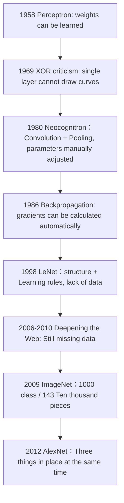
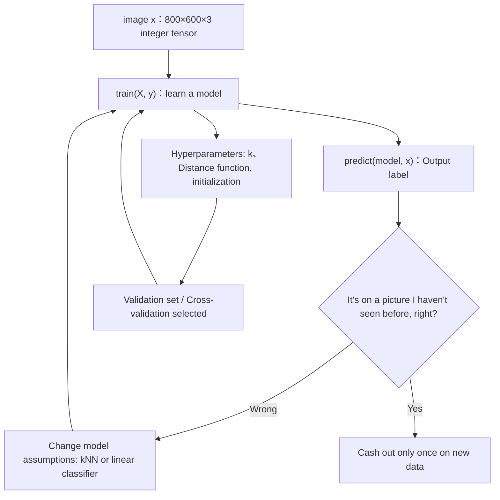
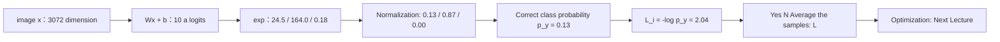
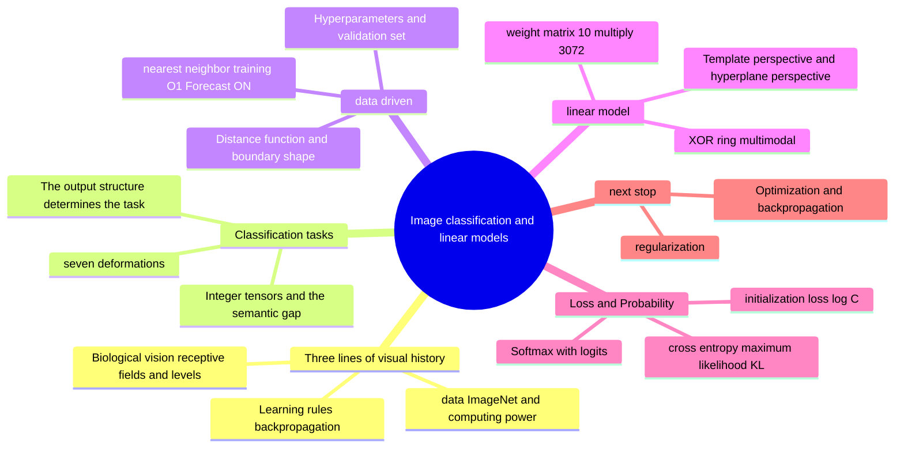

> **Course information**
>
> - **Course name**: Stanford CS231n: Deep Learning for Computer Vision(Spring 2025)
> - **This module covers**: Lecture 1. Introduction (119 pages); Lecture 2. Image Classification with Linear Classifiers (102 pages), total 221 pages
> - **Lecturer (each lecture)**: Lecture 1 — Fei-Fei Li, Ehsan Adeli (co-taught by Zane Durante); Lecture 2 — Ehsan Adeli
> - **Teaching date range**: 2025-04-01 – 2025-04-03
> - **Course homepage**: [cs231n.stanford.edu/2025](https://cs231n.stanford.edu/2025/schedule.html)
> - **Official courseware**: [lecture_1_part_1.pdf](https://cs231n.stanford.edu/slides/2025/lecture_1_part_1.pdf), [lecture_1_part_2.pdf](https://cs231n.stanford.edu/slides/2025/lecture_1_part_2.pdf), [lecture_2.pdf](https://cs231n.stanford.edu/slides/2025/lecture_2.pdf)
> - **Subtitle source**: [cs231n_sp25_kor_sub · eng](https://github.com/lpaiu-cs/cs231n_sp25_kor_sub/tree/main/eng) (Publicly transcribed in English, Chinese rewritten by this book)
> - **Copyright statement**: The copyright of the slides and course materials belongs to Stanford University and the instructors; this book is an unofficial study note and is only used for study and research.


The first assertion of this course is not about an algorithm, but about the difficulty: it is difficult to make a machine "see" because there is no semantic meaning in the pixels. Lecture 1 breaks this sentence into a piece of history - a sensor event 540 million years ago, the electrode inserted into the cat's brain in 1959, the differentiable learning rule in 1986, the 1.43 million pictures in one thousand categories in 2009; Lecture 2 compresses it into an action that can be scored: enter a  $800 \times 600 \times 3$  An integer tensor that outputs a word in {dog, cat, truck, plane, …}.

Combining the two lectures into one book, the main line is not "history first, method later", but the two implementations of the same causal chain: **Definition of visual tasks** (What can the model output)→ **data driven** (Don’t write rules, write  `train` / `predict`)→ **neighbor** (The cost is bet on the predicted moment) → **Parametric linear model** (Cost push-in parameters)→ **Loss and Probability** (Replace "Which  $W$ "better" becomes an answerable question). Those failures in Lecture 1 that looked like a prequel—lack of nonlinearity, lack of learning rules, and lack of data—happened to be the reasons for every choice in Lecture 2.

## 1. The entire scope of this course is the small patch painted red on the Venn diagram

*(Reference time: 00:00:05 – 00:07:35｜Lecture 1)*


The first thing to do at the beginning is to draw the range. This course does not talk about "all of AI", but only the intersection of computer vision and deep learning. This limitation is drawn as a Venn diagram with continuous circles in the next seven pages, but when it first appears, it is just one sentence: Vision is not just a part of intelligence, it is the cornerstone of intelligence.


A page of group photos arranged by year reveals the age of the course: the years marked on the page are 2015, 2016, 2017, 2018, 2020, 2021, 2023, spanning eight years. For first-time lecturers, this page is useful for calibrating expectations: you are not facing a makeshift handout, but a path that has been traversed by tenth-grade students.


The tenth anniversary page lists the faculty as a tenure table: Fei-Fei Li 2015–2025, Andrej Karpathy 2015–2016, Justin Johnson 2016–2019 and 2025, Serena Yeung 2017–2019, Ranjay Krishna and Danfei Xu each 2020–2021, Jiajun Wu 2022, Ruohan Gao 2022–2023, Yunzhu Li 2023, Ehsan Adeli and Zane Durante take over from 2024 onwards. These people later spread out into inspection, video, 3D, robotics - the course coverage flowed with them, which is why CS231n continues to expand every year.


From here it's a continuous build, one frame plus one circle. The first frame has only one ellipse: the artificial intelligence. There is no definition, no subfield, just a boundary - things outside the circle are not discussed.


The second frame presses into two circles simultaneously: machine learning falls within AI, and computer vision significantly intersects with it but is not included. This detail is worth pausing for a moment: it means that there is "vision that can be done without machine learning" (geometric calibration, filtering), and there is also "machine learning that has nothing to do with vision."


The third frame adds the circle of deep learning, which is drawn as a proper subset of machine learning and overlaps with computer vision. The definition of deep learning here is very simple - a collection of technologies built around the family of neural network algorithms - it does not claim to be a new paradigm, but is just placed in the position of set theory.


The fourth frame is the most important operation in the whole lecture: paint the small area "Computer Vision ∩ Deep Learning" in red and mark This class with an arrow. The red patch is just a small flap at the intersection of two large circles - this is exactly the proportion to remember: this course does not cover the whole of vision, nor the whole of deep learning, just the overlap. All subsequent disclaimers of "We don't talk about X" can be traced back to this frame.


In the fifth frame, neighbors begin to be added. The first thing to come in was natural language processing: it intersected with machine learning and also overlapped with the circle of computer vision—later graphics and text tasks grew out of this overlap area. The red block has not become larger at this time, and adding neighbors is not to expand the scope of the course.


The sixth frame adds speech recognition. After the three neighbors are placed side by side, a pattern emerges: each subfield of AI is "a certain type of signal + machine learning". The difference is only in the nature of the signal - pixels are two-dimensional and physically constrained, speech is one-dimensional time series, and language is discrete symbols.


The seventh frame adds robotics, which overlaps with computer vision in a large area. The overlap is the embodied intelligence section later in the course; the entire AI ellipse is also drawn skewed, indicating that the field itself is deforming. After seven frames, the red block has not changed in size from beginning to end—once the scope is delineated, it will no longer expand with the topic.


The last frame is a different kind of addition: instead of adding subfields of AI, we add supporting disciplines—mathematics, neuroscience, computer science, physics, psychology, and biology. The picture has changed from a "domain map" to a "knowledge source map", which also explains why we need to talk about a history of biological vision first: the design of each layer of the convolutional network can almost be found in the outer circle of this picture.


There are only two items on the agenda: a brief history of computer vision and deep learning, and an overview of the course. History accounts for nearly half of the time, and this ratio itself is an argument - if the history of a technology has repeatedly seen three ways of death: "insufficient data", "insufficient computing power" and "no differentiable learning rules", then understanding them has more transfer value than memorizing a certain network structure.

### Why history begins 540 million years ago


History does not begin in the 1950s, but 540 million years ago. Fossil studies show that the number of animal species exploded during a window of about 10 million years in the Cambrian period—an extremely short period of time in evolutionary terms. Before that, life basically floated in the water, and there were no animals on land. In the words of the lecturer, it was "quite leisurely."


There are many hypotheses that ignited this explosion (climate, chemical composition of seawater), the most convincing one is that "light came in": trilobites evolved photoreceptor cells. It's not a complex organ with a lens and a retina, it's just a pinhole that collects light. The four types of eyes on this page illustrate that the same thing has been solved by nature more than four times - the eye is not a rare invention, but a solution that evolution has repeatedly selected.

The lecturer gave a stronger argument than the timeline here: without sensors, life is just metabolism, passively coming and going; with sensors, animals become participants in the environment - if they want to survive, other animals may become its dinner, and it may also become the dinner of others. Vision drives nervous system development, and humans are particularly visual: more than half of cortical cells are involved in visual processing.


From photoreception to imaging, humans make up the other half. The principle of the camera obscura has been recorded in ancient Chinese and Greek literature, and was painted by Leonardo da Vinci and Gemma Frisius: light passes through a small hole and casts an inverted image on the back wall of the darkroom. The purpose of this page is not to provide textual research, but to point out a boundary - having an imaging device does not mean having vision.


Cameras are everywhere today: on mobile phones, cars, satellites, and microscopes. The lecturer then gave a limitation: the camera does not "see", just like the eyes themselves do not "see", they are just front-end devices; the real question is how visual intelligence occurs. This sentence is the fuse for the entire course - Lecture 2 page 008 will turn it into a concrete number: $800 \times 600 \times 3$  Among the integers from 0 to 255, there is no number called "cat".

## 2. Two legacies: Receptive fields, levels, and why “seeing” is a pathological problem

*(Reference time: 00:07:38 – 00:17:09｜Lecture 1)*


The 1950s was the starting point of this line, and it started not in computer science departments but in neuroscience laboratories. This page only asks one question: where do we come from. The answer is divided into two groups - one studies "how living things see" and the other studies "how machines learn". The two will not merge into one stock until 2012.

### 1959: An electrode inserted into the primary visual cortex of an anesthetized cat


The experimental method is still crude and effective today: electrodes are inserted into the primary visual cortex of anesthetized cats, the cats are shown bright bars in different directions, and the discharge of single neurons is recorded. The first conclusion is that each neuron has its own **receptive field**——It is only responsible for a small area in the visual field, which is very small, and in the primary visual cortex, it mainly responds to oriented edges and moving oriented edges. The Response / No response in the lower left corner of the page is the criterion: if the direction is right, there will be discharge, if the direction is wrong, there will be silence.

The second conclusion is more like engineering intuition and more important: the visual pathway is **layered** of. Simple cells respond to specific orientations; complex cells maintain orientation preferences while achieving a certain degree of translational invariance; further up, neurons receive the output of lower-layer neurons, and the receptive fields become larger and the selectivity becomes more complex—from edges to corners to objects. The instructor specifically stated that this was an "oversimplification," but what she wanted was the concept: neurons feed each other to form a huge computational network.


Computer vision as a discipline is often traced back to Larry Roberts' 1963 doctoral thesis "Machine Perception of Three-Dimensional Solids." What he did today seems very small: given a photo of stacked blocks, he calculated the orientation, edges and vertices of each face. The three grid images are the original image, the difference image, and the feature points selected from them - a pipeline from pixels to geometric structures. The entire paper only studies "shape", but this is the first time that someone has written "seeing" into an executable algorithm.


This page places Hubel-Wiesel and Roberts side by side on the same timeline, with a link to the MIT Dissertation Library at the bottom. The intention of the juxtaposition is clear: biological vision and machine vision started on the same axis, only four years apart. Over the next sixty years they intersected repeatedly—neural networks borrowed inspiration from biology, and biology in turn used networks to explain the brain.


In the 1970s, David Marr attempted to break down "seeing" into ordered levels of representation. \*\*Primal sketch\*\* extracts zero crossings, spots, edges, line endpoints, virtual lines, groupings and curve boundaries; **2½-D sketch **Complement the discontinuity of local surface orientation, depth and surface orientation; finally** 3D model representation**, using surface and volume primitives to organize complete objects hierarchically. The four-frame picture of the basketball on the page materializes this chain: the original picture, the edge picture, the cut-out foreground disk, and the sphere with light and dark.

Marr's framework has an implicit requirement: each level of representation must be consumed by the next level and be independent of specific objects. This requirement was unachievable in the 1970s—2½-dimensional sketches require reliable depth cues, and depth information in a single image is inherently uncertain. The problem was then pushed to a more fundamental position: restoring the three-dimensional world from two-dimensional images is a **ill-posed problem**.

### Three solutions to ill-posed problems: multi-objective, a priori, or giving up precision

Photons project the three-dimensional world onto an approximately two-dimensional surface (a patch on a trilobite, or our retina), and information is lost in the projection; to restore it, additional assumptions must be made. The natural solution is **multiple eyes**: Most animals have two, and a few have more, relying on parallax triangulation to restore depth - but two eyes are not enough, and corresponding point matching must be solved. Humans are also imprecise: the instructor said she knew the object's three-dimensional shape roughly, but not with geometric precision. Only after admitting this can we understand why the subsequent three-dimensional vision is so difficult.

The other difference is more subtle: language and vision are ontologically different. Language does not exist in nature. You cannot point to something and say "there is language there" - it is generated by the human brain, one-dimensional and serialized; vision faces a real physical world and obeys the laws of physics and materials. This difference explains a phenomenon in the era of large models: part of the reason why language can be so successfully modeled by autoregression is that it is itself a sequence; vision tasks are much looser in form.

## 3. Thirty years without data: parts, edges, grouping, matching

*(Reference time: 00:17:19 – 00:25:40｜Lecture 1)*


The pioneers in the 1970s had no data, no computing power, and no mathematical tools today, but they were already struggling with "object recognition." Stanford is represented by Rodney Brooks and Tom Binford **generalized cylinders**: Decompose the object into several columnar primitives with cross-section changes; another work in Palo Alto is **pictorial structures**, representing people or objects as a combination of components and geometric constraints. Both routes share the same assumption—that objects can be assembled from parts. This assumption was later overturned by data-driven end-to-end methods, but "composability" is back in today's scene graphs and 3D part generation.


In the 1980s, digital photos began to appear. For the first time, images could be processed digitally, and edge detection became the main battlefield. John Canny's 1986 edge operator and David Lowe's 1987 work formed the standard piece of visual front-ends for the next two decades. The lecturer put in a very honest statement here: Looking at these results, you will be a little disappointed - all you get are sketches and outlines, "it seems like you can't go anywhere."


Disappointment accumulated into a cold winter. The slide lists four items: enthusiasm and funding for AI research have shrunk; "expert systems" have failed to fulfill their promises; but the subfields of AI are still growing - computer vision, natural language processing, robotics, and computational biology. This last point is important: what freezes in the cold winter is commitment, not research.


Parallel to the cold winter is another line that is completely unaffected by the funding cycle: cognitive science and neuroscience continue to produce. The value of this passage is that it answers the "what to do question." The engineering community is struggling with the threshold of edge detection, and psychologists are asking "what information do humans use when identifying objects?"


Irv Biederman's experiment published in Science in 1972 is a beautiful comparison: the same bicycle, one picture has a normal background, and the other picture has a disrupted background. From a photon perspective, the image of a bicycle on the retina is almost the same, but the difficulty of recognition is completely different. The conclusion is: seeing an object is not a local operation, and it is not just the pixels of that object that are used to identify it - the rest of the entire image is also involved in the judgment.


The second experiment measures speed. The RSVP paradigm of Potter et al. in the 1970s: a series of natural images were flashed at a rate of 10 frames per second, and subjects were asked to detect whether a certain type of target appeared in them. 10 Hz means that each picture only lasts 100 milliseconds. The observer has never seen these pictures before, and does not know at which frame the target will appear, what it looks like, and what posture it is - but it can almost all be reported.


The speed was quantified by Simon Thorpe using electrophysiological methods: subjects were put on EEG caps to watch natural scenes, and the task was just to judge whether there were animals in the picture; the results were approximately  **150 milliseconds**, distinguishable differences appear in the EEG signals. Don’t underestimate this number: it’s ridiculously slow compared to today’s GPUs, but biological neurons operate at a much lower frequency than transistors, and 150 milliseconds is only enough for a few hops in the neural pathway—this is already the ultimate speed that wetware can achieve.


Furthermore, the brain not only “recognizes”, but also develops specialized areas for this purpose. Kanwisher et al. reported the fusiform face area (FFA) in 1997, and Epstein and Kanwisher reported in Nature in 1998 that the parahippocampal place area (PPA)—selective responses to faces and scenes respectively. The significance of this type of discovery is that visual recognition is not hard-calculated by a general cortex, but has been divided by evolution.


Putting the above together, we get a directional judgment: since the core ability of human vision is to "recognize objects in natural scenes", then computer vision should **Object recognition in natural scenes** Treat it as the main battlefield instead of continuing to draw squares and edges. This page is the midpoint of the entire historical narrative—from here on, the problem definition changes.


The first step in the 1990s was to separate the foreground from the background. Shi and Malik's \*\*Normalized Cuts\*\* in 1997 wrote image segmentation as a graph partitioning problem: pixels are nodes, similarity is edge weight, and the objective function simultaneously minimizes the similarity between clusters and maximizes the similarity within the cluster. Note the timeline: This is still the AI ​​winter, but research is advancing.


The second step is characterization. David Lowe's SIFT in 1999 packaged "key point detection + scale space + direction histogram descriptor" into a set of reusable processes: the same object can still be matched under different scales, rotations, and partial occlusions. Before deep learning, SIFT plus nearest neighbor matching was the default solution for image retrieval and three-dimensional reconstruction, and it was also the first lesson for many people to enter the industry.


The first case that truly "entered the industry" was face detection. The slides have only one sentence to describe Viola and Jones' 2001 work: one of the earliest successful applications of machine learning in vision. The lecturer added a personal memory - this paper was published when she was a graduate student, and five years later the first consumer-grade digital camera used its autofocus. This is the first time that the short path "paper → product" appears in this lecture.


In the early 2000s, the Internet began to become popular, and digital cameras began to become popular. The two things superimposed to create a new thing: data. The scale of research increased from thousands of images to tens of thousands of images, and then the Caltech 101 and PASCAL Visual Object Classes challenges appeared - the latter turned "detection + classification" into a unified evaluation protocol for the first time. The lecturer presses pause here: this line of vision has been discussed here, and now we have to go back and talk about another parallel line.

## 4. Another line: The learning rules are in place, but the data has not yet arrived.

*(Reference time: 00:25:51 – 00:31:42｜Lecture 1)*


Another line starts from a single neuron. Rosenblatt's \*\*Perceptron\*\* was proposed in the late 1950s (page superscript ~1957, timeline 1958): input weighted summation, passing a threshold, and outputting a category. It already has the prototype of "learning weights from data". On the timeline, there is only one year between it and Hubel-Wiesel’s cat experiment, and the two lines actually started at the same time.


Frustration comes quickly. Minsky and Papert pointed out in 1969 that a single-layer perceptron cannot express XOR: in the truth table on the left, (0,0) and (1,1) output 0, (0,1) and (1,0) output 1. There is no straight line between these four points on the two-dimensional plane that can separate the two categories. A single-layer perceptron can only draw a straight line, so it can't do it. This conclusion is mathematically impeccable, but in the communication it was read as "the path of neural networks is not going to work", which directly led to this direction being left out for more than ten years.


The turn came from Japan. Kunihiko Fukushima 1980's  **Neocognitron**  It is a computing model based directly on the Hubel-Wiesel hierarchical structure: convolution is performed on the simple cell layer, and pooling is performed on the complex cell layer. The two layers are alternately stacked five or six layers. The farther back, the larger the receptive field and the more abstract the selectivity. It already has the skeleton of a modern convolutional network, but there is only one thing missing——**No practical training algorithm**. All parameters are designed by hand, and hundreds of parameters need to be adjusted little by little to recognize numbers and letters. It's an astonishing engineering achievement and an unscalable path.


1986 **Backpropagation **That piece of the puzzle was completed. The method is to introduce an error correction objective function: given the input and the correct answer, calculate the difference between the network output and the answer, and transmit the error back along the network. Each layer can accordingly determine which direction it should adjust its parameters. Mathematically it is just the repeated application of the chain rule; in engineering it means** No need to manually adjust parameters anymore**——As long as the network is differentiable, the gradient can be calculated automatically. The schematic diagram in the middle of the page, drawn by Lane McIntosh, illustrates this error return path.


The first successful implementation was the convolutional network built by Yann LeCun at Bell Labs: backpropagation was applied to a Neocognitron-style architecture. The network size was about seven layers and was used to recognize handwritten numbers and letters. The engineering is stable enough - it was made into a commercial system by NEC to process handwritten checks from banks. The slide gives a summary: it is very similar to today's convolutional network, the only difference is scale, computing power and data.


In the 2000s, a small group of people continued to push the network deeper—Hinton and Salakhutdinov 2006, Bengio et al. 2007, Lee et al. 2009, Glorot and Bengio 2010. There is an embarrassing fact on this road: it was not a mainstream research topic at the time. What was discussed at the meeting was SVM, feature engineering, and kernel methods. Neural networks were considered to be unable to produce good results.


The second frame adds the third reason, which is also the most fatal one: **No suitable data set**. Number and letter recognition is barely usable, but when you put the same system on photos of nature (cats, dogs, microwaves, chairs, flowers), the effect immediately falls apart. This is not "inconvenient", but a mathematical problem: these are high-capacity models, and the larger the capacity, the greater the need for a large amount of data to be constrained, otherwise what is learned is just a coincidence on the training set. The lecturer gave a sentence that was quoted repeatedly later - data is the first-class citizen of machine learning.



## 5. 2012: Three things happen at the same time

*(Reference time: 00:32:24 – 00:35:55｜Lecture 1)*


In the early 2000s, Fei-Fei Li and her students bet on data. They first collected about one billion candidate images, and after cleaning, they obtained about 50 million images. They then sorted out annotated data of about 15 million images covering 22,000 categories—the number of categories refers to "the magnitude of categories mastered by young humans" in the cognitive science literature. Then cut out a subset from it to run the competition: **ImageNet Large Scale Visual Recognition Challenge (ILSVRC)**, 1,000 categories, 1,431,167 pictures, contestants are not limited to methods, only recognition accuracy.


This picture draws two lines on the same timeline: the upper row is a visual milestone (1959 Hubel-Wiesel, 1963 Roberts, 1970s Marr, 1979 Generalized Cylinder, 1986 Canny, 1997 Normalized Cut, 1999 SIFT, 2001 Viola-Jones, 2004/2007 PASCAL, 2009 ImageNet), the lower row is the milestones of learning (1958 Perceptron, 1969 Minsky-Papert, 1980 Neocognitron, 1985 Backpropagation, 1998 LeNet, 2006 Deep Learning), with a blue AI Winter across the middle. The upper part of the figure also hangs the ILSVRC championship error rate over the years. This curve is the hardest accounting material in the entire module:

| Year | championship system | Top-5 error rate |
| :--- | :--- | ---: |
| 2010 | NEC-UIUC (Lin et al.) | 28.2% |
| 2011 | Sanchez & Perronnin | 25.8% |
| 2012 | AlexNet (Krizhevsky et al.) | 16.4% |
| 2013 | Zeiler & Fergus | 11.7% |
| 2014 | VGG(Simonyan & Zisserman) | 7.3% |
| 2014 | GoogLeNet (Szegedy et al.) | 6.7% |
| 2015 | ResNet (He et al.) | 3.6% |
| 2016 | SENet (Shao et al.) | 3.0% |
| 2017 | SENet (Hu et al.) | 2.3% |
| — | Human baseline (Russakovsky et al.) | 5.1% |

Two numbers are worth remembering: in 2012, the error rate was reduced from 25.8% to 16.4% (a relative decrease of about 36%). ResNet in 2015 has left the human baseline of 5.1% behind. The lecturer mentioned that humans are about below 3% when dictating, which is a different evaluation caliber than the 5.1% on the slide, but the conclusion is consistent: **On this curve, human level is no longer the upper limit**.


In the first year of the competition, the error rate of the best algorithm was close to 30%; there were no surprises in 2011; in 2012, Hinton and his students used convolutional networks to compete, and the error rate was almost cut in half. This timeline has one more block this year: AlexNet. The lecturer said that many people regard this year as the historical moment of the rebirth of modern AI.


The structure itself is not mysterious: input  $224 \times 224 \times 3$, use first  $11 \times 11$, the convolution with step size 4 reduces the resolution to  $55 \times 55$, 48 channels, and then stack  $5 \times 5$  with  $3 \times 3$  Convolution plus maximum pooling, the number of channels increased to 128, 192, 192, 128, and finally two fully connected layers and 1000-dimensional output.

According to the size marked on the picture, you can estimate a parameter account: first layer  $11 \times 11 \times 3 \times 48 \approx 1.7$  Ten thousand; and put  $6 \times 6 \times 128 = 4608$  activations are connected to 2048-dimensional fully connected, a matrix is  $4608 \times 2048 \approx 944$  Ten thousand, multiply the two 2048-dimensional layers by another  $\approx 420$  Thousands. In other words, "five convolutional layers plus three fully connected layers" sounds like just a ratio of the number of layers, but almost all the parameters are placed in the later stages. This distribution explains why early networks are so sensitive to video memory, and also explains why structures such as global average pooling are later used to dismantle large matrices.


The lecturer put the two pictures side by side and asked a good question: If the structural similarity is so high, why didn't it work in 1980 but not in 2012? The answer is two things. One is **Backpropagation**: A learning rule that is correct in principle and mathematically strict, so that parameters no longer need to be adjusted manually. The second is **data**: High-capacity models need to be driven by massive data to generalize, and ImageNet provides this magnitude. She also added a forward-looking statement: The number of parameters of these models was in the millions at the time, and this road will eventually lead to the trillions.

## 6. After 2012: The task spectrum is expanding and bills are accumulating.

*(Reference time: 00:36:04 – 00:41:45｜Lecture 1)*


The first measurable change after 2012 was the number of papers. On the left is the submission and acceptance curve of CVPR: it basically lay flat in the 1990s, started to rise in the mid-2000s, and steepened after 2012. On the right is the number of monthly papers on machine learning and AI on arXiv, which has risen from nearly zero in 1994 to thousands per month in 2020. The two curves are the most direct evidence of "a field suddenly becoming hotter."


This page has the highest information density. The NEC-UIUC in 2010 was a purely manual pipeline: dense descriptor grid (HOG, LBP) → local coordinate encoding and super vector → pooling and spatial pyramid → linear SVM; SuperVision in 2012 was replaced by a convolutional network; two branches appeared in 2014 - GoogLeNet used parallel multi-scale branches (Inception) to build a narrow and deep network, and VGG used continuous  $3 \times 3$  The convolution stacks up a regular deep structure, and the number of channels 64→128→256→512→512 is doubled step by step, and the end is connected to fc-4096, fc-4096, fc-1000 and softmax; ResNet in 2015 added cross-layer connections, allowing gradients to bypass multiple layers and be returned directly. The fourth generation systems do the same thing: replace "human-designed features" with "network-learned features."

### For the same network, changing the output structure is a new task


The same set of convolution features can be transferred to other tasks. The first one to be verified is retrieval: send the image into the network, take the activation of a certain layer as the descriptor, and use nearest neighbors to find similar images. The significance of this step is that it proves that what the network learns is not a "label" but a reusable representation - which is the starting point for transfer learning to become the default practice.


One step further is positioning. **Target detection** To output boxes and categories (the Faster R-CNN series of Ren, He, Girshick, and Sun 2015 are representative), **Semantic segmentation** Each pixel is given a class label (the multi-scale convolution approach of Farabet et al. 2012 is an early representative). From "What is this picture" to "Where is everything?", the output structure changes, and the network structure also changes accordingly.


Beyond the static image is the dimension of time. Video classification needs to determine what a clip is doing (running, jumping, playing ball), and human activity recognition needs to give more detailed action categories. Simonyan et al.’s 2014 dual-stream network is a classic solution: look at the RGB (appearance) of a single frame all the way, look at the optical flow (motion) of consecutive frames all the way, and finally fuse the two scores.


The same technology has also been moved to very different places: Toshev and Szegedy used the network to directly return the coordinates of human body key points in 2014; Guo et al. in 2014 let the network learn to play Atari games from screen pixels. The latter has moved beyond "recognition" and into "decision-making" - for the first time vision has become the input end of the control loop.


Three cross-domain cases illustrate generalization capabilities. Medical imaging is an inherently visual problem - the daily work of radiology and pathology departments is to look at pictures; whale identification comes from the Kaggle competition, using whale photos for individual identification (Levy et al. 2016); galaxy classification (Dieleman et al. 2014) uses the same convolutional network on astronomical images. The lecturer made a point here: Scientific discoveries have also reaped dividends. Computational photography and vision technology were behind mankind’s first black hole photo.


\*\*Image captioning\*\* turns visual output from labels into sentences. The four sets of results on the slide are "a white teddy bear sitting on the grass", "a man in a baseball uniform pitching a ball", "a woman holding a cat in her hands" and "a man stepping on a surfboard". This is done by a convolutional network encoding the image and a recurrent network decoding it into a sequence of words (Vinyals et al. 2015; Karpathy and Fei-Fei 2015). After this step, the output of the vision system is no longer restricted to the predefined category table.


One step further is relationships. The triplet given in the slide includes taller than (a person is higher than a person), left of, wear on (a person wears a shirt), and snow ski. This type of annotation comes from work like Visual Genome (Krishna, Lu, Bernstein, Fei-Fei, ECCV 2016), which represents images as scene graphs: nodes are objects and edges are relationships. Compared to category labels, scene graphs are closer to the everyday usage of the word "understanding".


The first amazing results for generating directions are **style transfer**: Take a content picture and a style picture, and optimize a new picture that has both the original composition and the oil painting strokes (Gatys et al. 2016). Also on the slide were Inceptionism-style results, the kind of graphs that reveal what mid-level features in a network are "seeing." The instructor specifically mentioned that the pioneering work in this part came from Justin Johnson, the guest lecturer in this class.


\*\*Generative Adversarial Network (GAN)\*\* pushes face generation to the point where it is difficult to distinguish with the naked eye. The slide uses Progressive GAN (Karras et al., ICLR 2018): The Progressive Growing in the title of the paper is the key to it - the resolution is doubled step by step from low to high, and each level is only responsible for filling in a layer of details that have not yet been drawn. The training is therefore much more stable than directly generating high resolution.


The turning point from text to image is DALL·E (Ramesh et al. 2021). Enter a description and the model generates a picture that did not exist before. This step advances "generation" from style transformation to semantic combination: the model must understand nouns, attributes, quantities, and spatial relationships at the same time.


Another frame from the same set of results gives a more difficult example: combining the shapes and materials of two objects (such as an avocado-textured chair). The instructor said that this kind of graph is nothing today—systems like Midjourney have long since passed this level—but in 2021 it is a watershed moment.

### Three forces: computing power, algorithm, and data


At this point, the lecturer gave the central argument of the whole lecture: this outbreak is not a single breakthrough; **Three forces are in place at the same time**. On the left is the computing power - rows of GPU cabinets; in the middle is the algorithm - a two-layer small network diagram; on the right is the data - a wall made of countless pictures. Without one of the three, it would not have happened in 2012; with all three in place at the same time, it explains why a similar network structure failed in 1980 but succeeded in 2012.


There are hard indicators for this line of computing power: the vertical axis is the GFLOPs that can be purchased per dollar, and the horizontal axis is from 2004 to 2020. The blue dot of the CPU is almost touching the ground; the red dot of the GPU (FP32) started to rise after 2007, and became steeper after 2012. The anchor points on the graph range from GeForce 8800 GTX and GeForce GTX 580 (labeled AlexNet era) to GTX 1080 Ti, RTX 2080 Ti, RTX 3080 and RTX 3090, with the upper limit of the vertical axis being 50. According to the lecturer: progress was relatively stable before 2020. Once deep learning begins to drive chip design in turn, the curve will completely take off.


The second frame adds a third curve: the GPU’s Tensor Core. This type of dedicated unit performs hardware-level optimization (low precision, high throughput) for matrix multiplication and addition, raising the "GFLOP per dollar" by another order of magnitude, and re-marking the upper limit of the vertical axis to 200. The annotation on the slide is very straightforward - "Special hardware prepared for deep learning." This also explains why the same network can be trained an order of magnitude cheaper with a different generation of cards.


The third set of pictures focuses on the industry: the number of AI conference attendees, the number of startups developing AI systems, and enterprise-level AI application revenue. The three curves are rising at the same time. The lecturer used an exaggerated but easy-to-remember metaphor - we have emerged from the AI ​​winter and are now in a period of "AI global warming".

## 7. Beyond success: harm, benefits, and “things I still can’t do”

*(Reference time: 00:42:02 – 00:44:40｜Lecture 1)*


After talking about growth, the lecturer immediately turned to the opposite side. There's only one twist on this page: Despite its fruitful results, computer vision is still far from a "solution." The next three pages explain why it's dangerous, why it's useful, and why it's not enough.


The first form of harm is prejudice. All large-scale AI systems are driven by data, and data is the product of human activities and naturally carries historical biases; biases are learned by models and then applied to people in the name of "objective algorithms." The example on the slide is an automatic video interview scoring system (courtesy of Timnit Gebru for marked example on the page). The lecturer added something even more devastating: The bias shown by the facial recognition algorithm is the same as the bias of humans themselves.


The flip side is earnings. Medical imaging is the most direct application: film reading, screening, and follow-up. One of the research directions of the lecturers, Adeli and Zane is to use visual technology to provide care for the elderly population and patients. Her questioning method is juxtaposed: the same technology may be harmful when used in recruitment, but may be life-saving when used in diagnosis - "Is it completely bad? Is it completely good?" There is no engineering solution to this kind of question.


The last page is the simplest: two photos (one of which is of children playing), with the sentence "There are many things we don't know how to do" (page credit Andrej Karpathy). The subtleties, ambiguities, humor, and emotions in human vision are basically incapable of being captured by today’s models. The lecturer said she hoped students would leave class with a sense of "not enough"—not a sense of frustration, but a sense of problem.

## 8. Course map: Among the four sections, this main line stands in the first grid

*(Reference time: 00:44:48 – 00:49:31｜Lecture 1)*


On the first page after Adeli took over, the agenda was brought back exactly as it was, with both items present - the first item had already been covered and the second item was about to begin. It's effective when the same page appears again in a long lesson: it tells the audience where they are now and how much is left.


The title page of Part II clearly indicates the lecture times. The entire course is divided into four sections. The following explains one by one "what tasks are to be solved and what models are used" according to the sections. Finally, it comes to the operation of the course.


Four core teachers took turns to take charge of the lectures: Fei-Fei Li gave the first and last lectures (human-centered AI), Ehsan Adeli and Zane Durante covered the basics and perception parts, and Justin Johnson was responsible for the "mechanical" lectures such as convolutional networks, Transformers, and generative models. You can understand how the course is organized when you see this list - it is not a textbook written by one person, but several researchers each talking about the passage they are most familiar with.


Guest lecturers correspond to four specialized directions: Jiajun Wu (3D Vision), Ranjay Krishna (Vision and Language), Ruohan Gao (Video and Multimodality), and Yunzhu Li (Robot Learning). This arrangement reveals the design logic - the later sections rely more on specialized researchers rather than general lecture notes.


For the first time, four sections appear as a list: Fundamentals of Deep Learning, Perceiving and Understanding the Visual World, Generative and Interactive Visual Intelligence, and Human-Centered Applications and Impacts. This division is not based on technology, but on "problem level": first learn to make tools, then use tools for perception, then generate and interact, and finally discuss its role in society.


The first section starts with the most basic tasks: **Image classification**. Give the model a picture of a cat and output the string cat. The task definition is as short as one sentence, but it is the foundation for everything that follows - detection, segmentation, description generation, which are essentially based on the ability to "map images to semantics." The instructor calls it "deceptively simple."


first frame plus **linear classifier**: Represent each picture as a point in the feature space (the slide is shown in two dimensions). Classification is to find a straight line (a hyperplane in high dimensions) to separate the two types of points. Its limitation is written in the same frame: when the data is not linearly separable, no matter how you draw the straight line, it will not be correct.


Second frame plus **Regularization and optimization**. If the model is too simple, it will be underfitted, and if it is too complex, it will be overfitted; regularization controls the complexity, and optimization is responsible for finding the most appropriate parameters under a given complexity. These two things are the entire engineering connotation of "being able to train something" - not just fitting the training set, but also standing up on new data.


The third frame plus **neural network**. There is only one difference from linear classifiers: nonlinearity is sandwiched between layers, and multi-layer stacking can represent complex boundaries of piecewise linearity. The lecturer pointed out its practical status - from Google Photos to ChatGPT's visual capabilities, this type of model is behind it. The remaining lectures in this section are to break down this conclusion: how to define, how to train, and how to adjust.


The four-panel section pages appear repeatedly throughout the paragraph, and the text does not change word by word. The function is to draw attention from the previous section back to the map. When this page appeared, the first section had just been finished - and this ladder of "Classification → Linear → Regularization and Optimization → Neural Network" is exactly the next step in this module.


The immediately following third occurrence corresponds to the second plate. The real new content is on the next page: In this section, we must first distinguish between the two concepts of "task" and "model".

## 9. The task determines the output structure, and the model determines the inductive bias.

*(Reference time: 00:49:49 – 00:59:53｜Lecture 1)*


There are only two words on this page: tasks and models. The definition is very clean -**Task** is the specific problem to be solved (detection, segmentation, action recognition), **model** is the computational framework used to solve it. The two must be aligned: if the classification model is used for pixel-level segmentation, the output structure will not match. This principle of "the task determines the output structure" will run through all subsequent lectures.


The three tasks are lined up together, and the difference is visible at a glance. **Semantic segmentation** Give each pixel a category label (grass, cat, tree, sky), but do not distinguish the number of individuals of the same type - two dogs are labeled dog; **Target detection** Output the bounding box and category to answer "what is there and where is it"; **Instance splitting** At its finest, give each object instance an independent mask. The output dimensions of the three increase in sequence: a label, a set of boxes, and a pixel-by-pixel image.


Three tasks in the time dimension: **Video classification** Determine what is being done in the clip (running? jumping?); **Multimodal video understanding** Use images and sounds at the same time (the example in the slideshow is of someone playing the vibraphone. It is difficult to judge by just looking at hand movements, but adding audio makes it clearer); **Visualize and understand** In turn, ask the model where it is looking - using an attention heat map to explain the basis for a classification.


The model part starts with Convolutional Neural Network (CNN). A picture comes in, and after several convolutions, downsampling (pooling) and full connections, the classification result is finally obtained. This page uses LeNet’s classic schematic diagram, which is the structure discussed in the history part—the first time the course turns “history” into “something to be realized by hand.”


In addition to convolution, there are two types of structures: \*\*Recurrent Neural Network (RNN)\*\* processes sequences (video frames, word sequences), **Attention mechanism and Transformer** Replace local convolution with global weighting, which is good at long-range dependence. The three are not substitutions, but different inductive biases: convolution assumes that locality and translation are equivariant, and attention assumes that "any two positions may be related."


This page is new this quarter. Three goals: train large models faster on larger data sets, break through the upper limit of a single card and a single machine, and explain the method clearly. Two methods: **data parallelism** Copy the model to each worker and split the data; **Model parallelism** Cut the model itself to different devices and share data. Both paths have to answer the same additional question - whether gradient synchronization is synchronous or asynchronous, the former is consistent but slow, the latter is fast but introduces lag.


The section page appears again, pointing to the third section: Generative and Interactive Visual Intelligence.


After the fifth section page, the course begins to leave the comfort zone of "two-dimensional recognition". The next five directions must go beyond the premise of "input a picture and output a label".


This page is a pure transition page: all the previous tasks are based on two-dimensional images, and the following self-supervision, generation, visual language, three-dimensional, and embodiment each need to dismantle one of the premises.


The motivation for \*\*self-supervised learning\*\* is that labels are too expensive, so training signals are constructed from the data itself. The schematic diagram shown in the slide is a twin network: two pictures of the same dog, one in color and one in grayscale.  $x_1$, $x_2$  Send shared weights separately  $\theta$  encoder, get  $z_1 = \theta(x_1)$  with  $z_2 = \theta(x_2)$, and then use the distance function  $D(z_1, z_2)$  Output a scalar - the training goal is to make "two enhancements of the same picture" judge to be close on this scalar. It makes it possible to "pre-train with massive unlabeled data" and is also one of the main fuels for visual breakthroughs in the past decade.


Generate part from **style transfer** Let’s talk about: Repaint a photo of Stanford campus into the brushstrokes of Van Gogh’s “Starry Night”. Technically it's an optimization problem - minimizing both content differences and style statistical differences simultaneously. The purpose of this page is to give an intuitive definition of "generate": instead of retrieving an existing image, it generates a picture that did not exist before.


Text-to-image goes a step further: given a prompt ("Teddy bear doing new AI research under 1990s technology, underwater"), the model generates the entire picture. The ability of this type of system is not just to draw likenesses, but to turn the combination relationship in language into pixels - the subject, scene, style, and sense of time are all satisfied at the same time.


\*\*Diffusion model\*\* is the current mainstream of image generation. The principle is to learn a reverse process: first gradually add noise to the image to pure noise, and then train the network to remove the noise at each step; when generating, start from pure noise, repeatedly denoise, and finally obtain the image. The slide also previews assignment three—implementing a model that generates emoji from text prompts. An example is "face wearing a cowboy hat."


**visual language model** Map images and text into the same representation space. The left side is a two-way mapping: generating a photo of a dog for the sentence "Labrador sitting near water", and in turn generating a description for the photo. The source of the annotation is the retrieval-enhanced multi-modal language model (Yasunaga et al. 2022). The right side is the comparative pre-training of CLIP: the text encoder and the image encoder each produce a batch  $N$  vectors, do the inner product of each pair to get  $N \times N$  similarity matrix, on the diagonal  $N$  blue squares are positive samples, and the rest  $N^2 - N$  For negative samples, the training goal is to push the diagonal up and push the rest down. The common point is that once images and texts share a space, retrieval, question and answer, and description generation all become different ways of asking the same question.


**3D vision** It is the geometry that is to be output, not the labels. The slide lists three works: 3D-R2N2 (Choy et al. 2016) uses recurrent networks to reconstruct voxels from multiple views; Point-Voxel Diffusion (Zhou et al. 2021) does shape generation and completion; Mesh R-CNN (Gkioxari et al., ICCV 2019) predicts meshes from a single image. Its value lies in allowing "understanding" to fall into the physical space, which is a necessity for robots and AR/VR.


The last direction is **embodied intelligence**: The agent must sense, plan, and execute. The slide shows two representative works: BEHAVIOR-1K (Li et al. 2022) provides a simulation benchmark of 1,000 daily activities; and the work of Mandlekar and Xu et al. 2020 studies how to generalize from human demonstrations to long-range tasks. The difficulty here is not in recognition, but in the "consequences of actions" - the environment will change because of your actions.


The sixth section page corresponds to the last section: human-centered applications and impacts. The entire map ends here.


The seventh appearance is the end, followed by the introduction of this section - what recognition this field has received and what it means to people's lives.

## 10. Recognition and operation: from Turing Award to a report card

*(Reference time: 01:00:05 – 01:02:45｜Lecture 1)*


The first recognition was in 2018 **Turing Award**——The highest technical award in the field of computing, awarded to "significant contributions of lasting importance to computing." The winners are Geoffrey Hinton, Yoshua Bengio, and Yann LeCun for their conceptual and engineering breakthroughs that have made deep neural networks a key component of computing. For a class, the effect of this message is to confirm that the methods on the podium are no longer laboratory toys.


The second recognition was even more unexpected: the 2024 Nobel Prize in Physics was awarded to Hinton and John Hopfield "for discoveries and inventions that laid the foundation for machine learning using artificial neural networks." The physics prize was awarded to a neural network, which is quite controversial, but it shows that the source of this method is indeed statistical physics - the Hopfield network is essentially an energy function minimization system.


The third is an award in the field: IEEE PAMI’s  **Longuet-Higgins Award**, awarded annually to only one paper published ten years ago that has had a significant impact on vision research. At CVPR 2019, it was awarded to the 2009 ImageNet paper (Deng, Dong, Socher, Li, Li, Fei-Fei). The phrase "That's Fei-Fei" on the page is a rare self-reference in the audience, and it also brings the previous data line to an end - it was finally recognized posthumously by the academic community.


This page quantifies "the field becomes larger". On the left are CVPR's submission and acceptance statistics: 1,131 submissions and 318 acceptances in 2006; 3,309 submissions in 2018; 9,155 submissions and 2,359 acceptances in 2023 - the number of submissions has increased approximately eightfold in seventeen years, with a threefold increase in the five years from 2018 to 2023. On the right are photos of the venue and city for CVPR 2025 (Nashville, June 11–15). For those who are just getting started, this set of numbers is both an opportunity and a reminder: with a conference of this magnitude, it is impossible to follow the hot spots.

### Curriculum Affairs: Ten pages compressed into one table


Starting from this page is the course operation. **Editor's note**: This paragraph in the recorded subtitles does not correspond to the dictation (the lecturer jumped directly from the award to the learning objectives). The following is organized according to the content of the slide page, and only the rules that are useful to readers are retained as a record of the 2025 spring semester.

| matters | Rules for Spring 2025 Semester |
| :--- | :--- |
| class | Tuesday and Thursday 12:00–13:20, NVIDIA Auditorium; no Zoom live broadcast, Panopto real-time broadcast; after-class recording into Canvas |
| discussion class | Friday 12:30–13:20 Six times in total: 04/04 Python/NumPy, 04/11 Backpropagation, 04/18 Project Specifications, 04/25 PyTorch/TensorFlow, 05/02 RNN and Transformer, 05/09 Midterm Review |
| communicate | Course website (outline/lecture notes), Ed (assignments and grading), course email, Gradescope (assignment submission), Canvas (video) |
| Homework | All completed in Google Colab; Assignment 1 is released on 4/9 and ends at 23:59 on 4/23. The content happens to be kNN, Softmax, two-layer network, image features, and optimizer. |
| Rating | Three assignments 12% + 18% + 15% = 45%, midterms 20%, projects 35%, participation up to an additional 3% |
| late | Four free late submission days, with a maximum of two days for each assignment; 25% deduction for each subsequent day; no late submissions will be accepted for project reports |


Four pieces of hard information: class time and location, no live broadcast but real-time broadcast via Panopto, slideshow online before class, and all video recordings on Canvas after class.


The course website is the only main entrance: the syllabus, handouts, and homework download links are all here. The page will be continuously updated, so remember to refresh.


The six discussion classes are positioned as "step-by-step tutorials that are more practical than the main class." The first one is Python/NumPy/Colab.


Assignments, projects, midterms, and logistical issues should all be submitted to Ed (Canvas → Deep Learning for Computer Vision → Ed Discussion); CGOE students must use @stanford.edu email address to register.


Q&A begins in the second week: offline in the basement of Huang Building, and online using Zoom and QueueStatus to queue up. When it’s your turn, the teaching assistant will pull you into a one-on-one meeting room.


The five channels have a clear division of labor: the course website provides materials, Ed provides discussions, the course email is used for formal affairs, Gradescope collects assignments and grades, and Canvas plays videos. Use Ed's private questions only when the honor code is involved.


The content list of assignment one is basically the knowledge points from the previous lectures: k-nearest neighbor, linear classifier (Softmax), two-layer neural network, image features, deep network and optimizer - "implementation from scratch" and "training with framework" are packed into one assignment.


Grading is done using Gradescope’s automated grading system. There are two sets of tests: the public test allows students to see the results immediately, and the private test is a promotion of the public test and is used to thoroughly check boundary conditions-this is why "local pass" does not equal a full score.


See the table above for weighting and late submission rules. Worth noting separately is the 29% of the project report: it is almost equivalent to assignment one plus assignment two (12% + 18% = 30%), which also explains why proposals and milestones only account for 1% and 2% - the process is very lightly scored, and the results are heavily weighted.


Four rules: Do not read other people’s solutions or codes; do not share your own solution code, but discussion of ideas and overall strategies is not only allowed but encouraged; indicate people who have collaborated with you in your submission; do not submit AI-generated answers. The last sentence on the page is the point - it is better to submit late or incomplete than to violate the honor code.


There are only three prerequisites: proficiency in Python (all assignments use Python and NumPy, and later use PyTorch/TensorFlow), college calculus, and linear algebra. Not listed are "deep learning priors" - this course assumes you are starting from scratch.


Three optional textbooks: "Deep Learning" by Goodfellow, Bengio, and Courville (free online version available, Chapters 5, 6, and 7 cover vector calculus and continuous optimization), "Mathematics of Deep Learning" (free online version), and "Dive into Deep Learning" (based on the NumPy interface, with code and discussion).

### Learning objectives and handover


Learning objectives are divided into three levels. The first layer is **Formalization**: Write a vision application as a task, define input and output, and estimate how much data and computing power is required. The second layer is **Take action**:Write code, debug, and train convolutional networks. The third layer is **judgment**: Know what has happened in this field in the past 0-5 years, where are the open issues, and what ethical and social factors should be considered before deployment.


Four reasons correspond to four types of people: those who want to do vision research (CVPR 2025, ICCV 2025 and Stanford on-campus opportunities); those who want to do vision engineering in the industry (Google AI Perception Team, Google Cloud Vision, Meta AI, Amazon AWS, and Nvidia, Apple, Microsoft, OpenAI, Salesforce); those who want to use vision in other disciplines; and those who are purely interested.


This picture shows the correspondence between lectures and sections: Fundamentals of Deep Learning (Lecture 2–4), Perceiving and Understanding the Visual World (Lecture 5–12), Reconstructing and Interacting the Visual World (Lecture 13–17), and Human-Centered Artificial Intelligence (Lecture 18). Comparing page 073, you will find that the name of the third block is slightly different (it is called "Generative and Interactive Visual Intelligence"). These are two versions of the same outline, and the lectures are divided into the same order. This module only covers the first two lectures of the first block - that is, the bottom two levels of the entire ladder.


Let’s get to the point in the next lecture: **k nearest neighbor (kNN) **with** linear classification**. The former is the simplest "remember the training set and vote", and the latter is the starting point of the parametric model - one is a representative of the parameter-free method, and the other is a representative of the parametric method. They are put together to make it clear "what is learning". The decision boundary diagram on the page is drawn by Wolfram Cloud.


Only one email address is left on the last page: cs231n-staff-spr25@stanford.edu. The whole lecture ends here.

## 11. Handover: Why should we narrow the scope to one label in the next lecture?

*(Reference time: 01:02:30 – 01:02:45｜Lecture 1; 00:00:05 – 00:00:17｜Lecture 2)*


Lecture 1 ends with an increasingly long list of tasks: retrieval, detection, segmentation, video, description, generation, 3D, embodiment. Lecture 2 narrows the lens all the way and only processes the narrowest frame-give a picture and output a word. This is not a step back, but choosing a minimal closed loop that can be completely calculated: its input is a certain tensor, and its output is  $C$  Numbers, dimensions and formulas can be written at each step.

| Task (where Lecture 1 appears) | Model output | CIFAR-10 caliber output dimensions | Whether this module is expanded |
| :--- | :--- | :--- | :--- |
| Image Classification (074; L2 page 007) | a label | 1 integer, $C=10$ | Yes, the main line of all modules |
| Image retrieval (050) | A descriptor + neighbor list | 3072-dimensional vector or layer activation | borrow nearest neighbor frame |
| Target detection (051) | A set of boxes + categories | $4K + K$($K$  box) | No |
| Semantic Segmentation (051) | Pixel-by-pixel label | $32 \times 32 = 1024$  tags | No |
| Instance Splitting (081) | One mask per instance | $M \times 1024$ | No |
| Image Description (055) | a sequence of words | become longer | No |
| Video classification (052) | a fragment tag | 1 tag, input is  $T$  frame | No |

The first column is the task pedigree inherited by this module from Lecture 1, and the third column is the output size calculated by putting it into CIFAR-10 caliber. After looking at this table, you will understand why classification must be done first: only if the output dimension of this grid is constant, it is possible to write an auditable equation such as "prediction = one matrix multiplication"; the output dimensions of other tasks change with the image content, and we must first have a set of reliable features before we can talk about structured output.

The second reason is cost. Lecture 1 repeatedly shows the subtext of "training can be slow, but inference must be fast": training can be spread offline and run slowly on the cluster, but one forward has to be responsible for every click. Lecture 2 Turn this subtext into a calculable criterion - training  $O(1)$, prediction  $O(N)$  The kNN of  $10 \times 3072$  The submultiplicative-add linear classifier is judged to be available. **Which side to put the cost on is the real technical content of this lecture.**, which is also the first account to be calculated at the beginning of the next section.

## 12. A 144-dimensional integer tensor, and a word

*(Reference time: 00:00:30 – 00:04:43｜Lecture 2)*


The first three pages were administrative information, and the lecturer did not expand on it. What is worth noting about this list is not the deadline, but the ordering: the things to be handed in this week cover exactly the main points of this lecture and the next three lectures, which shows that the course treats "from kNN to optimizer" as an indestructible minimum closed loop.


Project proposals are due on April 25. Each group will be assigned a TA, and the team will go through Google Form; "whether a certain question is a qualified 231n project" will go through Ed's private message or Q&A time.


The first discussion class was led by Emily Jin and assisted by Matthew Jin. The content was Python/NumPy and Google Colab-all the code of the assignment must be run in this environment.


The syllabus page cuts the entire course into three parts: basics of deep learning, perceiving and understanding the visual world, reconstructing and interacting with the visual world, and finally falls on human-centered AI and fairness ethics. The lecturer said that today he only wants to take the top three items of the first block: data-driven methods, linear classification, k nearest neighbors - they are the bricks of all subsequent models.


Two sentences on the agenda: define the image classification task; introduce two basic data-driven methods - k-nearest neighbors and linear classifiers. The lecturer also added: There are other methods on the backup page, you can check them out after class.


The definition of the classification task is short enough to be read in one breath: given an image, and given a predetermined set of labels {dog, cat, truck, airplane, …}, the system outputs one of the labels. There is zero cost for humans because the visual system is born with a holistic understanding. "This is a cat" is almost a by-product of perception. For machines, it is another matter. There is no unit of "cat" in the things it gets.


The difference is written in numbers. one piece  $800 \times 600$  The color picture is essentially a  $800 \times 600 \times 3$  Tensor: Each of the three channels is a grayscale table, and each grid contains an integer between 0 and 255. Calculated as an 8-bit integer, this "cat" occupies 1,440,000 numbers, approximately 1.44 MB of raw data - not a single number is called "cat".

The range from 0 to 255 has a specific origin: mainstream images are stored in RGB, 24-bit format (32-bit with alpha channel), and the three channels of red, green, and blue are divided into 8 bits to combine all colors. In other words, the semantic gap is not about “not enough data”; **Wrong selection of presentation layer**——Use three 8-bit integers to carry "cat", separated by the bridge that this lecture will build.

## 13. After the seven transformations, the path of "writing rules" will not work.

*(Reference time: 00:04:59 – 00:16:39｜Lecture 2)*


Let’s start with the most underestimated one: perspective. The camera only needs to pan a little, $800 \times 600 \times 3$  Every pixel in it will change a value, even if the cat is sitting motionless. To a human, it's still the same cat in the picture, but to a machine, it's a **Brand new data points**- Not a single number remains as a clue.


Lighting troubles are more insidious. The RGB value of each pixel is not an attribute of the object, but a function of "surface material × color × light source" - the lecturer specifically pointed out that this is an old conclusion in graphics and image processing classes. The numbers in the tensor can differ significantly between the same cat in a dark room and in the midday sun, but the labels should not change.


Then there’s background clutter: the subject may only occupy a corner of the frame, and the rest is distraction. The lecturer asked the audience, "What else will change the pixel value?" The student added background clutter, scaling, and resolution. His answer to the resolution was very practical: the model usually normalizes the image to a fixed size first, so the impact of the absolute resolution is limited. The real discomfort is **scale changes**.


Occlusion is the one in which instructors spend the most time. The three pictures are of a complete cat, a half-blocked cat, and a cat with only a tail and a few claws left. It is almost impossible to judge the third picture by itself - it may be a tiger, or it may be a "raccoon with a small tail" - people relied on the context of "this is on the sofa in the living room" to make it back to "cat".


The deformation is particularly deadly for molluscs like cats: the same cat stretches and curls up, but there is almost no correspondence between the outlines. Such changes are disastrous for any "pixel-by-pixel comparison" distance function, because there is no stable correspondence between pixels.


Intra-category differences are another dimension: sizes, coat colors, patterns, and breeds are all different, but they are all labeled "cat." It is a pair with deformation: deformation occurs in the same cat, and intra-class difference occurs between different cats. Both allow "the same label corresponds to a large pixel pattern."


The last one is context. The same partial picture will be read as a tiger if it is removed from the scene. Only when it is placed in a real scene and the shadow relationship is added, will it be read correctly as a cat. This one has the most severe implications for the algorithm: **Some judgments must rely on the entire picture or even information outside the picture.**, and "pixel-by-pixel comparison" cannot obtain this kind of information by definition.


These deformations explain why "modern vision algorithms" deserve a separate page: Today's accuracy and robustness are not brought about by a clever rule, but by large-scale benchmarks such as ImageNet and subsequent larger-scale data and models. Note the structure of this sentence - it turns the historical conclusion of Lecture 1 (data are first-class citizens) directly into the methodological premise of Lecture 2.

### Why hard coding doesn’t work


So the question becomes: Can the steps for identifying cats be written as if-then-else like a sorting algorithm? The answer is no, and the reason is very simple - there are clear comparison rules for sorting (who is bigger and who is smaller), and there is no written criterion for identifying cats.


Historically, people have actually tried it. Canny's 1986 edge detection set was used as the first step: first find edges, get a lot of contours, then find corner points on the contours, count the number of corner points of a specific type, and finally use these features to map to categories. This approach can work on images with minimal changes, but there are two dead ends: Every time you add an object, you need to rewrite a whole set of rules, and "coming up with a set of rules for each object" is another difficult task in itself.

### Replace a set of rules with two functions


The data-driven method is put in another way: instead of writing rules, write two functions. `train(X, y)`  Eats in images and tags and spits out a model; `predict(model, X_test)`  It eats in models and unseen images and spits out predicted labels. Three steps: collect data sets and labels, train the classifier, and evaluate on new images. The lecturer recalled that more than ten or twenty years ago, image search engines were used to collect data one by one. Now the data sets are basically ready-made.



These three steps may seem mundane, but they determine all subsequent engineering constraints: **Training can be slow, prediction must be fast**; **Parameter adjustment can only view the validation set, and the test set can only be used once.**. These will become Section 14 Specific Costs and Section 15 Specific Disciplines respectively.

## 14. Nearest neighbor: training is reduced to O(1), and the cost is all-in prediction.

*(Reference time: 00:16:50 – 00:29:17｜Lecture 2)*


The first classifier is so simple that it’s almost a joke: it does nothing during the training phase and just stores the training set in memory as it is; during the prediction phase, it finds the training image that is most similar to the query image and copies its label. The algorithm to be discussed in this section has only two rules, but it clearly demonstrates the counter-intuitive trade-off of "training is cheap and prediction is expensive".


There are only two sentences on the page: remember all data and labels; predict the labels of the most similar training images. The lecturer's statement is that "the training function has no other action except retaining the data" - it does not even move the data, but only saves a reference.


To make "most similar" an executable judgment, there is still a distance function missing: give it two pictures and return a number. The smaller the number, the closer the two pictures are. The example on the page is five labeled training images (deer, bird, plane, cat, car) and a query image, with the task of calculating distances pairwise.


The most commonly used options are  $L1$  Distance, that is, subtract pixel by pixel, take the absolute value, and then add them all up:


$$
d_1(I_1, I_2) = \sum_{p} \left| I_1^{(p)} - I_2^{(p)} \right|
$$


Among them  $p$  Run through all channels of all pixels. It has only one requirement for the two images: the shape must be the same - there are two on CIFAR-10  $32 \times 32 \times 3$  Tensors are subtracted element-wise.


Written in NumPy, it only takes a few lines: `train`  put  `X`  and  `y`  Store into member variables; `predict`  Calculate the distance of all training samples for each test image, take the subscript of the minimum value, and check the label back.

```python
class NearestNeighbor:
    def train(self, X, y):
        # 训练阶段唯一的动作：把数据留住
        self.Xtr = X
        self.ytr = y

    def predict(self, X):
        num_test = X.shape[0]
        Ypred = np.zeros(num_test, dtype=self.ytr.dtype)
        for i in range(num_test):
            # L1：广播成 (N, D)，沿 D 求和得到 N 个距离
            distances = np.sum(np.abs(self.Xtr - X[i, :]), axis=1)
            min_index = np.argmin(distances)
            Ypred[i] = self.ytr[min_index]
        return Ypred
```


The first frame isolates the training: two assignment statements, no loops, no matrix multiplications, no gradients. At this point the word "training" has been hollowed out - it has degenerated into a memory write.


The second frame  `predict`  Expand into a three-step loop: calculate the distance vector for each test image, obtain  `argmin`, copy the label of the nearest neighbor. Note  `np.sum(..., axis=1)`  This line of work  $N$  The comparison is compressed into a broadcast operation. It seems that there is no loop, but  $N \times D$  Subtraction, absolute value, and addition every time—**Vectorization changes the constant factor but does not change the complexity.**.


This leads to the first moment of reckoning in the whole lecture. Assume that the training set has  $N$  pictures, each  $D$  Dimensions: training is  $O(1)$, because indeed nothing is counted; the prediction is  $O(N)$——Each test picture must be compared with all training pictures. into CIFAR-10 ($N = 50000$, $D = 3072$), a test picture is  $1.54 \times 10^8$  Element-by-element operation, 10,000 test images are  $1.5 \times 10^{12}$  magnitude. The lecturer used ChatGPT as an analogy: If every time you ask a question, you have to compare all the possible answers on the Internet and answer it again, it will be several years after the calculation is completed.

The opposite direction is the key. Training can be run offline all night, it doesn't matter if it is slower or more expensive; prediction happens in front of the user, which is what the product must afford. This preference will continue to the convolutional network: no matter how expensive the training is, it can be spread to the cluster, but the delay of forward propagation is directly written in the user experience.


To make up for the "slow prediction", the engineering community has taken another path: it does not require accurate nearest neighbors, as long as **Approximately** Nearest neighbor. The lecturer mentioned that there are many such methods and is beyond the scope of this course, but gave an implementation that can be directly used - Meta's faiss. The corresponding paper is "Billion-scale similarity search with GPUs" by Johnson et al. in 2017.


Back to the algorithm itself: what exactly is the nearest neighbor doing? Think of each training image as a point, and the entire space will be cut into several pieces: whichever piece it falls on will inherit the label of the owner of that piece. 1-The division of neighbors is like this - each training point occupies a small territory, and the boundary is the power boundary between it and its neighbors.


This picture immediately exposed the problem: there is a small patch of yellow in the middle, surrounded by green. It comes from an isolated yellow dot - either noise or mislabeled, but the 1-neighbors believe it unconditionally. Change to  $k$  neighbor, let  $k$  If each neighbor votes, the enclave will be swallowed up by the surrounding green; the price is a white area: no decision can be made when each of the three categories has one vote. The lecturer reversed this side effect——**The white area just tells you where to fill in the data**.

## 15. Boundary drawn by distance function: rhombus and circle

*(Reference time: 00:29:22 – 00:41:29｜Lecture 2)*


$k$  It’s decided, but there’s still a second option that’s still undecided: how to calculate the distance. $L2$ (Euclidean) distance converts the absolute value into a square, and finally takes the root:


$$
d_2(I_1, I_2) = \sqrt{\sum_{p} \left( I_1^{(p)} - I_2^{(p)} \right)^2}
$$


The page juxtaposes the two intuitions of distance: $L1$  Like walking along the streets in a grid city (Manhattan distance), $L2$  Like a bird flying in a straight line (Euclidean distance).


The difference between the two formulas is not just whether they can open the root sign; **The shape of an isometric surface**. The page is counted again with the same set of points: origin  $O(0,0)$, point  $A(1,0)$, point  $B$. use  $L1$  Time to take  $B(0.5, 0.5)$, $d_1(O,B) = 0.5 + 0.5 = 1$, with  $d_1(O,A) = 1$  equal; use  $L2$  Time to take  $B(1/\sqrt{2}, 1/\sqrt{2})$, $d_2(O,B) = \sqrt{1/2 + 1/2} = 1$, also with  $d_2(O,A) = 1$  equal. That is to say: a point with a distance of 1 from the origin is at  $L1$  It forms a rhombus at the bottom, with  $L2$  Form a circle below.

This shape difference can be quantified. point  $(0.5, 0.5)$  falls exactly on the edge of the rhombus ($L1$  The distance is 1), but its  $L2$  only distance  $\sqrt{0.5} \approx 0.707$, falling firmly within the circle. In other words, $L1$  The unit sphere is an inscribed rhombus of a circle: they are equally far apart along the coordinate axis and diagonally  $L1$  But it is obviously "tightened" - the points on the diagonal are measured farther away.


put  $K=1$  The two divisions of are placed side by side, and the difference in shape is visible at a glance: $L1$  The boundaries are almost all parallel to the coordinate axis and run in a stepped shape; $L2$  The borders are slanted and smooth. The lecturer asked a more essential question here: Why  $L1$  Sensitive to features? Because its isometric surface is a rhombus, once the characteristic axis is rotated, the rhombus rotates, and the distance from the same point to the origin immediately changes; while the circle remains itself after rotation, $L2$  The distance remains unchanged.

| nature | $L1$ (Manhattan) | $L2$ (Euclidean) |
| :--- | :--- | :--- |
| unit sphere shape | rhombus | round |
| After rotating the feature axis | Distance changes, strongly dependent on coordinate axes | The distance remains unchanged |
| Decision boundary shape | Steps parallel to the coordinate axis | Smooth slash |
| suitable characteristics | Sparse, interpretable, every coordinate has meaning | Arbitrarily embedded continuous features |


The course website has an online demonstration that can be dragged  $k$  With the distance function, you can see how the boundary deforms in real time. The value of tools like this is in turning the abstract word "hyperparameter" into an actionable slider - you'll see for yourself  $k$  From 1 to 5, the jagged edges of the border are smoothed out.


to here, $k$  Neighbors already have two knobs that must be customized: $k$  and distance function. The lecturer gave this kind of thing a name——**hyperparameter**, that is, "the choice about the algorithm itself", as opposed to the parameters learned during the training process. The trouble with it is that there is no universal answer: $k$  How much and which distance to use depends strongly on the data set and problem.

### There are four ways to choose hyperparameters, only the last two can be taken.


Idea 1: Pick the best performing hyperparameters on the training set. Yes  $k$  For our immediate neighbors, this is a losing game—$k=1$  It is always 100% correct on the training set because it copies the training samples back unchanged.


The page directly judges it as BAD: $k=1$  It is always perfect on the training set, so this criterion is uninformative. What it actually tests is “whether the model can be memorized” rather than “whether the model has been learned.”


Idea 2: Pick the best performer on the test set. This may seem smart, but it's actually cheating - you're effectively using the test set to participate in model selection, and then there's no clean data to estimate the true generalization ability.


The verdict on the page is just three words: Never do this. The test set is used for final cash-out. Once it is used to look at hyperparameters, its estimates will be optimistically biased and cannot be undone.


Idea 3: Cut out a piece of the training set to make a verification set, train on the training set, select hyperparameters on the verification set, and finally evaluate it on the test set. This is the standard answer, but the cost is that the validation set is usually much smaller than the training set, and the selected hyperparameters have sampling noise.


Idea 4: Cross-validation. Cut the training data into  $K$  Fold (the page uses 50% fold), each fold will be used as a verification set in turn, and the rest will be used as a training set. Run  $K$  Take the average round. The lecturer added a very realistic footnote: This is almost necessary for small data sets, but it is not commonly used in large-scale deep learning - if you repeat 50% training five times, the computing power bill will persuade you to quit first, so in practice it is more common to use "single validation set + experience".

## 16. 28% ceiling: Pixel distance carries no semantics

*(Reference time: 00:41:45 – 00:45:58｜Lecture 2)*


Put the above onto real data. CIFAR-10 has 10 classes, 50,000 training images, and 10,000 test images. Each  $32 \times 32 \times 3$, from a 2009 technical report by Alex Krizhevsky. It's small enough to run on a laptop and difficult enough to expose the differences between methods - both of which make it a proving ground for the entire field.


Run the nearest neighbor again, and line up the first 10 nearest neighbors of each test image in a row: the first column is the query graph, and the ten columns on the right are its neighbors. This diagram is more intuitive than any formula - some lines seem quite reasonable and some are completely outrageous.


Next is a very standard step: scan it with five-fold cross-validation  $k$. The horizontal axis is  $k$ (drawn to 100), the vertical axis is the cross-validation accuracy (0.24 to 0.32), each point is a separate result, the polyline passes through the mean, and the vertical line is the standard deviation. on the picture  $k \approx 7$  At best, accuracy falls around 28%–29%; $k$  No matter how large it is, the mean drops all the way to about 26%, and the variance also becomes larger.

The 28% number needs to be put in the right frame of reference: the random guess for a 10-type question is 10%, so it does learn something; but it's still far from usable. The lecturer did not rush to explain, but first went back to the search results and pointed out what was wrong - for example, in the fourth line, the query image is a frog, but the neighbor ranked first is more like a dog. The reason is not difficult to guess: the pixel color distribution of the two objects is inherently close. **Pixel-level distance cannot distinguish between "look alike" and "are of the same category"**.


This page is the same batch of search results, but without any annotations. Its function is to let readers discover for themselves: without drawing the red and green boxes, it is difficult for you to judge which line is wrong - this is the psychological origin of "28% looks okay".


After adding the red and green boxes, the errors are immediately apparent: the guesses in the green boxes are correct and the guesses in the red boxes are wrong. The slide uses two frames of the same picture to compare, indicating that there is an "annotation" between the evaluation indicators and the naked eye judgment-this also explains why all subsequent experiments must first pick out the wrong samples.


This page nails it. The left is the original image, and the three on the right are the blocked version (eyes and mouth are covered by black blocks), the overall right-shifted version by one pixel, and the overall dyed version. From a human perspective, the difference between these three images and the original image is huge - the masked version has lost a large chunk of information, while the translated version is almost exactly the same. But in terms of pixel distance, they are closer to the original image  $L2$  The distances are exactly the same: occlusion only changes the value of a few pixels, translation only moves the entire image one frame, and staining only adds a constant to each channel.


So the conclusion is not "$k$  Neighbors are not good enough”, but more precisely: **Distances defined on pixels themselves carry no semantics**. This sentence is the motivation for the next section - instead of continuing to find smarter neighbors in the pixel space, it is better to change the assumption: let the model learn a set of parameters by itself and map the pixels into category scores.

## 17. Parameterization: replace 150 million numbers with 30,730 numbers

*(Reference time: 00:46:26 – 00:54:52｜Lecture 2)*


Change the hypothesis: Instead of saving samples, save a group **parameters**. The image comes in and goes through a function  $f$, directly spit out 10 numbers - each number is the score of the corresponding category, and the higher the score, the more similar it is. The lecturer calls this approach a parametric approach, and the parameters are denoted as  $W$, also called weights. This section will explain "parameterization" thoroughly: first look at  $W$  How is the shape forced out by the dimensions? Let’s look at the same  $W$  How it can be read—algebraic dot product, visual template, geometric hyperplane—finally depends on which distributions it must fail.


There are only three elements in the picture: the picture on the left (3072 numbers), the picture in the middle  $f(x, W)$, 10 scores on the right, labeled parameters or weights below. The difference between it and kNN is not in accuracy, but in **Model size decoupled from training set**: The "model" of kNN is the training set itself, and the model of the linear classifier is  $W$.


The linear classifier defines this function in its simplest form: $f(x, W) = Wx$. This choice is not because it is the strongest, but because it is analyzable - every term can be written as a dot product, every gradient can be calculated by hand, and all subsequent nonlinear models are added on top of it.


Dimensions must be aligned. A picture of CIFAR-10 is flattened into  $3072 \times 1$  column vector of , the output is  $10 \times 1$  fraction vector of , so  $W$  can only be  $10 \times 3072$——This shape is not a convention, it is forced out by matrix multiplication.


Add another offset  $b$($10 \times 1$), $f(x, W) = Wx + b$. The lecturer emphasized that it is **Regardless of input** is an item whose function is to raise or lower the overall score of each category a little; geometrically, it pushes the decision-making surface away from the origin. This will be seen more clearly in the geometric perspective.


More important is composability. Stacking linear functions layer by layer is a neural network; the lecturer put it directly: This is the most important brick in almost all architectures of deep learning.


In the structural diagrams of AlexNet (Krizhevsky et al., 2012) and ResNet (He et al., 2015), linear layers can be seen everywhere - the convolutional layer and the fully connected layer are essentially "multiplying a matrix and adding a bias", but the convolution reuses the same matrix in the spatial position.


To settle the accounts clearly, let’s go back to the dimensions of CIFAR-10: per image  $32 \times 32 \times 3 = 3072$  Number, 50,000 training images, 10,000 testing images, 10 categories.

![Four-pixel toy example: Flatten a 2×2×1 tensor into \[56, 231, 24, 2\]](</attachments/cs231n-df08257118a0dfe349a93a57.png>)

Then reduce the problem to as small as possible: a picture with only 4 pixels and 3 categories (cat, dog, boat). The graph is flattened into a 4-dimensional vector  $[56, 231, 24, 2]$, so  $W$  is  $3 \times 4$, $b$  is  $3 \times 1$. The value of this toy example is that all dimensions are small enough to be calculated by hand, and all conclusions can be scaled up to 3072 dimensions.


From an algebraic perspective, everything is just a three-row dot product. Take this behavior of a cat as an example:


$$
s_{\text{cat}} = 0.2 \times 56 + (-0.5) \times 231 + 0.1 \times 24 + 2.0 \times 2 + 1.1 = 11.2 - 115.5 + 2.4 + 4.0 + 1.1 = -96.8
$$


The dog row gives 437.9 and the boat row gives 61.95. Dog is the highest among the three numbers, so the current one  $W$  I will judge this picture as a dog - note that this is just "a certain  $W$ "The reading below" is not a conclusion.

Now the accounts of the two methods can be calculated side by side. The same CIFAR-10 class 10 questions:

| Method (source) | What is stored in the model? | What does it cost to predict once? | Scale (CIFAR-10) | boundaries that can be drawn |
| :--- | :--- | :--- | :--- | :--- |
| Manual Rules (L1 page 024; L2 page 018) | There are no parameters to learn, only code written by people. | Several edge operators and if-then judgments | The amount of code increases linearly with the number of categories | Designed by humans and cannot override natural images |
| kNN (L2 pages 020–048) | All training samples | $O(N \cdot D)$, about  $1.5 \times 10^8$  operations | $1.536 \times 10^8$  Number, about 614 MB (float32) | Piecewise linear (Voronoi partition) |
| Linear Classifiers (L2 pp. 049–082) | 30,730 parameters | $10 \times 3072 = 30{,}720$  multiplication and addition | 30,730 numbers, approximately 120 KB (float32) | One hyperplane per class |
| AlexNet (L1 page 046) | approx.  $10^7$  parameters | 5 layers of convolution + 3 layers of fully connected | Hundreds of millions of forward multiplications and additions | Highly nonlinear |

$W$  Yes  $10 \times 3072 = 30{,}720$  number, $b$  There are 10, for a total of 30,730. Compare kNN to save  $1.536 \times 10^8$  Number: **Thirty thousand numbers versus 150 million numbers**, a difference of about 5000 times - this is what "parameterization" brings: the model size no longer grows with the training set, and the prediction degrades to one  $10 \times 3072$  of multiplication.

### Three reading methods: algebra, template, hyperplane


I have already seen the dot product of algebra, and the lecturer will talk about the remaining two reading methods separately - they are not three algorithms, but the same one  $W$  three viewing angles.


**Visual perspective.** $W$  Each row of has 3072 numbers, which is exactly the same shape as a picture, and can be reshaped into  $32 \times 32 \times 3$  Look at the "picture". It is not a training sample, but a sample of this category **Template**: A high score means that the inner product of the input and this template is large. At the bottom of the page, draw all 10 lines trained on CIFAR-10: there is a red mass at the bottom of the car grid (the front of the car), the airplane grid is a bluish sky color block, and the horse grid can see the outline of the side. A linear model does learn "what does this class look like on average".


**Geometric perspective.**  each line  $W_k$  defines a hyperplane  $W_k x + b_k = 0$, the fraction is the signed distance from this point to the plane. In the two-dimensional representation, three lines cut out airplanes, cars, and deer from other categories respectively; in the 3072nd dimension, these lines become hyperplanes and cannot be drawn, but the principle is the same. bias  $b$  It shows its effect here: without it, all planes must pass the origin, which is equivalent to forcing "all zero inputs to score 0 for all classes", which is obviously unreasonable.


The boundaries of the linear model are also clear: **It can only draw straight lines (hyperplanes)**. The page gives three counterexamples - the first type occupies the first and third quadrants and the second type occupies the second and fourth quadrants (XOR type); the first type is a ring "with a distance from the origin between 1 and 2"; the first type has three scattered modes. These three distributions cannot be cut by any straight line.

This is why the title of this section is "replacement" rather than "improvement": the linear model is not a better version of kNN, it replaces the entire hypothesis space. In exchange for 5000 times model compression and  $O(1)$  prediction, the price is that the boundary is locked into a hyperplane - to break through this geometric ceiling, there are only two ways: transform the features into a linearly separable space, or stack the model deeper.

## 18. From fractions to losses: write “much difference” as a scalar

*(Reference time: 00:54:57 – 00:57:20｜Lecture 2)*


So the question converges into one: how to find a good  $W$? The lecturer gave a two-step recipe and made it clear that the second step is the content of the next lecture:

1. Define a loss function (loss function), convert "current  $W$ "How bad is it on the training set" is quantified into a number.
2. Find an efficient way to  $W$  Adjust to minimize this number - that is, optimization.


In order to talk about loss, a specific example is needed: 3 training samples, 3 classes (cat, car, frog). The three rows of the table are the three training samples (the true values ​​are cat, car, and frog respectively), and the three columns are the scores of the three categories (the column order is also cat, car, and frog). someone  $W$  The readings given are - first column (True Cat) 3.2, 5.1, −1.7, second column (True Car) 1.3, 4.9, 2.0, third column (True Frog) 2.2, 2.5, −3.1. All loss calculations below start from this table.


The way to define the loss function is to write down the "degree of dissatisfaction": give it the  $i$  A vector of scores and true labels for samples, it returns a scalar, the smaller the better. The instructor used the word unhappiness - loss is not accuracy, it is the model's self-assessment of how wrong it was.


Formally, the data set is  $\{(x_i, y_i)\}_{i=1}^{N}$, $x_i$  is an image, $y_i$  is an integer label, $f(x_i, W)$  is a fractional vector. The loss of a single sample is recorded as  $L_i$, it is only determined by the score and true value of this sample.


The loss over the entire dataset is the average loss across samples:


$$
L = \frac{1}{N} \sum_{i=1}^{N} L_i
$$


divide by  $N$  This step seems inconsequential - it does not change the optimal  $W$, only changes the magnitude of the loss; but without it, the loss will drift with the data set size, and hyperparameters such as learning rate cannot be reused across data sets. The lecturer's original words are "We usually normalize by the number of samples, although it is not that important" - this sentence is actually very important in engineering: it changes the "loss" from a quantity that depends on the size of the data set to a quantity that can be compared across experiments.

## 19. Softmax: Score is not probability, cross entropy is the ruler

*(Reference time: 00:57:26 – 01:06:54｜Lecture 2)*


Now only one last thing remains: $L_i$  What exactly does it look like. The lecturer chose the Softmax route and first explained the motivation - the score output by the linear function is unbounded. $-96.8$  and  $437.9$  can appear, this kind of number is difficult to read and difficult to compare; if you can read it as "the probability of belonging to this category", things will go smoothly.


Softmax classifier is also called multinomial logistic regression: it compresses the original score of each class into  $[0, 1]$, and let the probabilities of all classes add up to 1. The "multinomial" here corresponds to multiple categories, and "logistic regression" corresponds to the familiar framework of two classifications - the lecturer specifically pointed out that this is the multi-category version of logistic regression.


The function itself has only two steps. Take the index first:


$$
p_k = \frac{e^{s_k}}{\sum_{j} e^{s_j}}
$$


Take the first column of the table in verse 18 (cat  $3.2$, car  $5.1$, frog  $-1.7$): $e^{3.2} = 24.5$, $e^{5.1} = 164.0$, $e^{-1.7} = 0.18$. The exponent guarantees that the result is always positive—the first requirement of probability is satisfied.


Then divided by the sum of the three  $188.7$, get  $0.13$, $0.87$, $0.00$. The three probabilities are non-negative and add up to 1, which is a legal distribution. Note that the model's judgment can already be read here: it thinks that 87% of this picture is a car - and the correct answer is a cat, so this  $W$  Making mistakes.


The terms need to be aligned here: the numbers after indexation and before normalization (3.2, 5.1, −1.7) are called **Unnormalized log probability**, the more common name is  **logits**. The reason why it is called "log probability" is because after taking the softmax and then taking the logarithm, it will return exactly to them (with a difference of a constant).


Next define the loss. Since we want to "maximize the probability of the correct class" and the optimizer is used to minimizing, we reverse the sign and take the logarithm - taking the logarithm not only makes the numerical values easier to handle, but also turns the continuous multiplication of probabilities into continuous addition from the perspective of maximum likelihood:


$$
L_i = -\log p_{y_i} = -\log\!\left(\frac{e^{s_{y_i}}}{\sum_j e^{s_j}}\right)
$$


In this example, the correct class is cat. $p_{\text{cat}} = 0.13$, so  $L_i = -\log 0.13 = 2.04$. The better the score, the smaller the number; when  $p_{y_i} \to 1$  when it approaches 0.


The lecturer incidentally pointed out the name of this writing method in other classes: it is equivalent to **Maximum Likelihood Estimation**——Choose weights to maximize the probability of the observed data appearing. CS 229 talks about the same thing.

### Negative logarithm, KL divergence and cross entropy: three ways of saying the same formula


Why is "negative logarithm" reasonable? Looking at it from another perspective: the correct label can be written as a one-hot distribution  $(1, 0, 0)$, the model gives  $(0.13, 0.87, 0.00)$. Putting the two distributions together, the question becomes "how to measure the difference between them." Pay attention here  $0.13$  with  $1$  worse than  $0.87$  with  $0$  The difference is more fatal - because the term of the correct class is the only one forced to 1.


The information-theoretic answer is KL divergence (Kullback–Leibler divergence): it measures  $q$  to approximate  $p$  How many more bits to pay. Minimizing the KL divergence means making the two distributions overlap as much as possible.


One step further is cross entropy: $H(p, q) = H(p) + D_{\mathrm{KL}}(p \| q)$. because  $p$  is one-hot, its entropy  $H(p) = 0$, so the cross entropy is exactly equal to the KL divergence, which is also exactly equal to  $-\log p_{y_i}$. This is the origin of cross entropy / BCE that appears everywhere in deep learning - three roads lead to the same formula.


Collapse the whole chain: linear functions turn graphs into logits, Softmax turns logits into probabilities, negative logarithms turn probabilities into losses, and you can get what you want by minimizing the loss.  $W$.




There are two oral questions at the end of the class, both of which are suitable for self-examination. The first question: What is the value range of Softmax loss? The lower bound is 0 - as long as the score of the correct class is much higher than the other classes, $p_{y_i}$  can be infinitely close to 1, $-\log$  It is infinitely close to 0 (but cannot be obtained); the upper bound is  $+\infty$——The probability of the correct class can be pushed to 0, and the negative logarithm explodes.


Second question: What happens during initialization? $W$  When very small, all logits are almost equal, and Softmax degenerates into a uniform distribution.  $1/C$, so  $L_i = -\log(1/C) = \log C$.$C = 10$  time is approximately equal to  $2.3$. This is a very practical physical examination indicator: at the beginning of training, if the loss is not  $\log C$  Nearby, it indicates a bug in initialization, label alignment, or data pipeline - it is earlier and more sensitive than looking at accuracy.


Time runs out here. The last text page is the closing pointer to the entire deck: Next is **regularization** with **Optimize**——The former answers "How to make the model stand outside the training set", and the latter answers "How to really make the model stand up even outside the training set" $L$  Come down." At this point in this module, we have finished talking about "what does the model look like" and "how to measure how bad it is", but these two things are missing.

## Appendix: After-class reading page (SVM loss)

The recording ends at 01:06:54, with the last line about  $\log 10 \approx 2.3$ 's Q&A; deck moves to after-school reading starting on page 83. The title of page 83 itself reads Reading Assignment – ​​SVM Loss. Pages 84–97 review multi-type SVM losses from the beginning with six follow-up questions. Page 98 provides a code skeleton. Pages 99–102 compare Softmax and SVM side by side. These pages are not discussed page by page in class. They are included here according to the agreement of this book. Each page still only appears once.

### Another loss: multi-class SVM (083–088)


SVM loss and Softmax eat the same set of scores, but the reading is completely different: it does not construct a probability, it only asks "how much higher is the correct class than the wrong class". There will be no penalty if it is higher than 1, otherwise there will be a linear penalty based on the difference.


$$
L_i = \sum_{j \neq y_i} \max\left(0, s_j - s_{y_i} + 1\right)
$$


that  $+1$  It is a safe margin: the model cannot just be satisfied with "the highest correct class score", it must be at least 1 point higher to pass.


In the first frame, each item in the summation sign is drawn separately: the horizontal axis is the "wrong class score minus the correct class score", and the vertical axis is the loss of this item. The score difference is less than  $-1$ (that is, the correct class leads by more than 1 point), the loss is truncated to 0.


The second frame marks the slope: the slope on the left side of the inflection point is always 1, and the slope on the right side is 0. This polyline is **Hinge**, the name comes from its shape.


In the third frame, the safety margin of "1" is clearly marked on the horizontal axis: it is the width of the free interval, and it is also the most essential difference between SVM and Softmax - one only requires "enough", and the other always wants to be more confident.


Back to the definition: $L_i$  It is the sum of several polylines, each polyline is flattened at "the correct category is 1 point ahead". Sum only run  $j \neq y_i$, the correct category's own item does not participate.

### Three-column arithmetic: 2.9, 0, 12.9 (089–092)


Cat column (truth value 3.2): The penalty for the two error classes is  $\max(0, 5.1 - 3.2 + 1) = 2.9$  with  $\max(0, -1.7 - 3.2 + 1) = 0$, a total of 2.9. The first term is 2.9 because the car is 1.9 points ahead of the cat, 0.9 beyond the safe margin.


Both items in this row of cars were  $\max$  Truncated into 0 - the correct class 4.9 is more than 1 point higher than the cat's 1.3 and the frog's 2.0. The margins have already been met, the model is "satisfied", and the loss is 0. This is the most critical difference between SVM loss and Softmax: it does not pursue pushing the probability to 1, and stops when it is enough.


The frog is the worst one: the correct category  $-3.1$  It lags behind the two error classes (2.2 and 2.5) by a large margin, with two margins of 6.3 and 6.6 respectively, for a total of 12.9.


Average of three columns: $(2.9 + 0 + 12.9)/3 = 5.27$, this is this  $W$  loss over the entire dataset.

### Six Questions (093–097)


Three questions crammed into one page. Q1 asked "What will happen if the overall score of the car is reduced by 0.5" - the answer is unchanged: the two margins are originally 0, and the correct category is reduced by 0.5, and the difference becomes  $-2.1$  with  $-1.4$, $\max$  It will still be 0 after that. Q2 asks about the minimum and maximum values: the lower bound is 0, and the upper bound is infinity. Q3 asks about initialization: all  $s \approx 0$  When each item is  $\max(0, 1) = 1$, a total of  $C-1$  item, so  $L_i = C - 1$($C=10$  time is 9).


Q4 asked "What if  $j = y_i$  It is also considered as a summation” - there will be one more item  $\max(0, 1) = 1$, the overall loss is moved up by 1, optimal  $W$  No change, but the initial health check value changes from 9 to 10.


Q5 asks "summation and conversion into average" - each column has  $C-1$  term, averaging is divided by  $C-1$, the loss during initialization changes from 9 to 1; the optimal solution remains unchanged, only the scale of the quantity changes.


Q6 Change to a square hinge: put a square outside the margin item. The larger the error, the faster the penalty increases. It's flatter when margins are close to 0 and harsher when errors are large.


This frame stacks the square hinge and the original definition on the same page and compares them. The difference between the two formulas is only one square sign. The purpose of this side-by-side page is to make visible what will happen if a line of formula is changed.

### Comparison of code and two losses (098–102)


The code page does not give a complete implementation, leaving only a four-step skeleton: first calculate the fraction, then calculate the margin  $s_j - s_{y_i} + 1$, put  $j = y_i$  is set to zero (because the summation only runs  $j \neq y_i$), the last edge  $j$  Sum. This "zero the diagonal" trick avoids writing a loop in NumPy - just erase the diagonal and sum it up once.

```python
# 1. 算分数：scores = X @ W + b
# 2. 算边距：margins = scores - scores[range(N), y][:, None] + 1
# 3. 把 j = y_i 的位置置零，保证不把正确类算进去
# 4. 沿类别维求和，再对样本取平均
```


The last set of pages puts both losses on the same pipeline: the same set  $W$, $x_i$, $b$  get points  $[-2.85, 0.86, 0.28]$, the correct class is 2. Hinge side: $\max(0, -2.85 - 0.28 + 1) + \max(0, 0.86 - 0.28 + 1) = 0 + 1.58 = 1.58$. Softmax side first takes the exponent ($0.058, 2.36, 1.32$), normalized into  $(0.016, 0.631, 0.353)$, and then take the negative logarithm of the correct class.

**Editor's note**: What is written on the page is  $-\log(0.353) = 0.452$, this number is actually the result of changing the base to 10 ($-\log_{10} 0.353 \approx 0.452$); according to the natural logarithm used uniformly throughout the book, it should be  $1.04$. There is no difference between the two loss formulas themselves, the only difference lies in this base.


It should be reminded that these two numbers cannot be compared horizontally: there is no upper bound for SVM loss, and the lower bound for Softmax loss is 0. The numerical scales of the two are inherently different.


The page also leaves three sets of comparison scores ($y_i = 0$): $[10, -2, 3]$, $[10, 9, 9]$, $[10, -100, -100]$. The SVM loss is 0 on all three groups (the correct class is ahead by more than 1 point), while the Softmax is approximately  $0.001$, $0.55$, $\approx 0$——The gap is all in the 9 in the second group that is "only 1 point ahead".


Doubling the correct class score from 10 to 20, the SVM loss is still all 0 (the difference has not changed, the margin has already been met), but the Softmax will drop significantly, and the second group will fall to  $10^{-5}$  magnitude. This page describes two kinds of loss tempers: one only cares about "enough", and the other always wants to be more confident.

| control item | Multi-class SVM loss | Softmax / cross entropy |
| :--- | :--- | :--- |
| input | same group of fractions  $s$ | same group of fractions  $s$ |
| intermediate steps | Only calculate margins, do not construct probabilities | First index and then normalize to probability |
| safe margin | Yes, fixed at 1 (adjustable) | No explicit margins |
| Value range | $[0, +\infty)$ | $(0, +\infty)$ |
| Initialize physical examination values | $C - 1$($C=10$  time is 9) | $\log C$($C=10$  Time approx. 2.3) |
| Score overall translation | Unchanged (only related to the difference) | Invariant (Softmax is invariant to translation) |
| Sample of "already very confident" | stop punishment | Continue to reduce losses |

## Summary

*(Reference time: 01:02:30 – 01:02:45｜Lecture 1; 01:06:00 – 01:06:54｜Lecture 2)*

- The difficulty of vision is not in imaging but in interpretation: restoring the three-dimensional world from two-dimensional projection is an ill-posed problem. The solution in nature is multi-view plus priori, and the solution in engineering is data plus inductive bias.
- Neural networks came close to success three times, but were blocked by the same shortcoming three times: lack of nonlinearity in 1958, lack of learning algorithms in 1980, and lack of data in 1998; 2012 was the first time that these three things were in place at the same time.
- The cost of a classification task is either on the training side or on the prediction side: kNN training  $O(1)$, prediction  $O(N)$, the linear classifier is the other way around - the product wants the latter.
- The distance function is not a detail but part of the model: $L1$  The unit ball is a rhombus with a stepped boundary. $L2$  The unit sphere is a circle with a diagonal boundary. This difference in shape directly determines who can be separated.
- Hyperparameters can only be selected using the validation set: they must be selected on the training set.  $k=1$, selecting on the test set is equivalent to spending the only clean estimate in advance, and cross-validation is a compromise for small data sets.
- Pixel distance does not carry semantics: the three changes of occlusion, translation by one pixel, and coloring are very different in human eyes. $L2$  The distance is exactly the same - this is the death sentence for kNN on images.
- The gain of parameterization is decoupling: 30,730 parameters replaced  $1.536 \times 10^8$  training pixels, the model size no longer grows with the data, and the prediction degenerates into one  $10 \times 3072$  of multiplication.
- The loss function takes "which  $W$ "better" becomes an optimizable scalar; cross-entropy becomes the default because it is the maximum likelihood, KL divergence, and information-theoretic encoding length at the same time.

## engineering laws

*(Reference time: 01:01:48 – 01:02:45｜Lecture 1; 01:04:50 – 01:06:54｜Lecture 2)*

**Law 1: Costs will not disappear, they will only be transferred.**  kNN moves the cost to the prediction time (each picture  $1.5 \times 10^8$  operations), the linear classifier moves the cost into parameters (30,730 numbers). Before choosing a model, ask: Who will be responsible for this account in the end - the offline cluster, or the 200 milliseconds that the user waited for.

**Law 2: The size of the data determines how constrained the hypothesis space can be.**  The structure of Neocognitron in 1980 and AlexNet in 2012 are very similar. The difference is that the latter has 1,431,167 labeled images and learning rules that can automatically find gradients. When a high-capacity model lacks data, all it learns are coincidences on the training set.

**Law 3: If the representation is wrong, no amount of data can save it.** $800 \times 600 \times 3$  There is no number in the integer tensor called "cat"; the three changes of occlusion, translation, and coloring can make  $L2$  The distance is exactly the same. exchange loss, adjust  $k$  They are all spinning around in the old representation, and the real progress comes from replacing the representation - this is the entire history from pixels to features, and from features to networks.

**Law 4: Only things that can be drawn geometrically can be diagnosed.**  The boundary of the linear model is a hyperplane, so the three distributions of XOR, ring, and multimodal can be judged to death at a glance on paper; the loss of Softmax is  $[0, +\infty)$  has a clear interval, so the loss during initialization must be close to  $\log C$. Equipping the model with an interpretable geometric or numerical reference saves time rather than running several sets of experiments.

**Law 5: The validation set is a discipline, not a process.**  Selecting hyperparameters on the training set will inevitably overfit ($k=1$  Always 100%), if the test set is selected, it will be cashed out in advance. The only clean order is: learn parameters for the training set, select hyperparameters for the validation set, and use the test set only once.

**Law 6: Calculate the magnitude first, then write the code.**  The three numbers of 3072 dimensions, 10 categories, and 50,000 samples determine  $W$  is  $10 \times 3072$, the model of kNN is 614 MB, the initial loss of softmax is 2.3. These magnitudes can be calculated before starting work, and they can expose design errors in advance better than parameter adjustment.

**Law 7: Each module is preparing an interface for the next module.**  The interface prepared for classification is the "input tensor + output score", the linear layer is prepared for the building block "matrix multiplication + bias", and the cross-entropy is prepared for the optimization goal of "scalar loss". Understanding the interface is more valuable than memorizing a certain formula.


