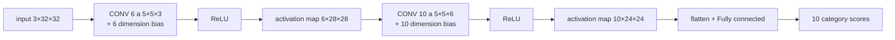
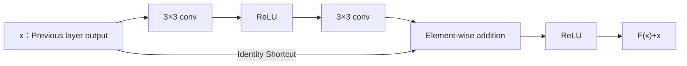
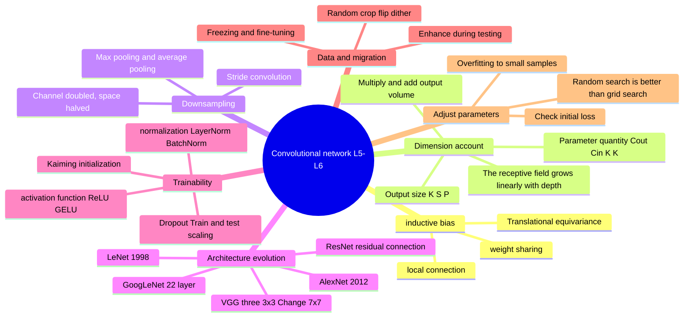

> **Course information**
>
> - **Course name**: Stanford CS231n: Deep Learning for Computer Vision(Spring 2025)
> - **This module covers**: Lecture 5. Image Classification with CNNs｜Lecture 6. CNN Architectures (238 slides in total)
> - **Lecturer**: Justin Johnson(Lecture 5); Zane Durante(Lecture 6)
> - **Teaching date range**: 2025-04-15 – 2025-04-17
> - **Course homepage**: [cs231n.stanford.edu/2025](https://cs231n.stanford.edu/2025/schedule.html)
> - **Official courseware**: [lecture_5.pdf](https://cs231n.stanford.edu/slides/2025/lecture_5.pdf) (141 pages), [lecture_6.pdf](https://cs231n.stanford.edu/slides/2025/lecture_6.pdf) (97 pages), with page-by-page illustrations in the book
> - **Subtitle source**: [cs231n_sp25_kor_sub · eng](https://github.com/lpaiu-cs/cs231n_sp25_kor_sub/tree/main/eng) (Publicly transcribed in English, Chinese rewritten by this book)
> - **Copyright statement**: The copyright of the slides and course materials belongs to Stanford University and the instructors; this book is an unofficial study note and is only used for study and research.


After a 32×32×3 image is flattened into a 3072-dimensional vector, the "adjacent" relationship disappears: pixels  $(0,0)$  with  $(0,1)$  3 subscripts are separated in the vector, and  $(31,31)$  There are 3071 distances apart, and the fully connected layer treats these four distances equally. Lecture 4 has turned the "Tensor → Loss → Gradient" pipeline into a universal tool. What this module wants to answer is: Since the nodes in the calculation graph can be designed by yourself, then **What should a node designed for an image look like?**, and **How should these nodes be arranged into a trainable network?**.

The answer is given by the division of labor between two lectures. Lecture 5 only adds two operators - the convolution layer and the pooling layer - and then splits them to the dimension level to calculate three accounts: where the parameters come from, how big the output is, and how wide the receptive field is. Lecture 6 then answers the assembly questions: how to arrange the layers (VGG, ResNet), and how to train after being arranged (initialization, normalization, dropout, enhancement, migration). There is a causal chain between the two lectures that has been repeatedly verified: **How deep the architecture can be stacked depends on whether the gradient can be passed to the first layer alive.**; VGG replaces three 3×3 with one 7×7 in order to save parameters under the same receptive field. ResNet’s identity shortcut is to make "at least no worse than shallow layers" an easy optimization task, while Kaiming initialization and normalization ensure that these layers do not collapse or explode numerically. Understand this chain, and the backbone networks that appear in subsequent lectures on detection, video, and generation are just variations of the same set of arithmetic.

## 1. Three representations of a graph: pixels, hand-made features, and adjacencies destroyed by flattening

*(Reference time: 00:00:05 – 00:22:59｜Lecture 5)*

This chapter must first explain "what is the input" thoroughly, because all the legitimacy of convolution is based on one premise: the input is not a series of numbers, but a two-dimensional grid with adjacency relationships. The course uses three pages of review to explain the pipeline, two pages of counterexamples to illustrate that the linear classifier is not strong enough, and then six pages of manual features to explain where the "human design representation" road has been. Finally, a comparison chart is used to separate the end-to-end and two-stage systems. The order is not arbitrary: **First prove where the assumption of the fully connected layer is wrong, and then we will know what the convolution needs to fix later.**.


Assignment 1 is due at 23:59 on April 23. The test points are k nearest neighbor (kNN), linear classifier (SVM and Softmax), two-layer neural network, and **Image features**. This last item deserves a separate note: it is the object of criticism in the second half of this chapter, and it is also the last official appearance of the "human design representation" route in the course.


Project proposals are due on April 25, and the teaching assistant’s research direction is listed on the office hours page of the course webpage. These two pages of administrative information together marked a shift: the assignment changed from "implementing operators" to "designing systems", and the course also shifted from the basics of deep learning to perceiving and understanding the visual world.


The lecturer’s self-introduction took less than a minute, but he laid out the timeline: he taught this course at Stanford from 2015 to 2018, the same course at Michigan from 2019 to 2022, then went to Facebook AI Research, and recently worked on World Labs. The sentence "Stanford CS231n 10th Anniversary" in the footer indicates that this is the tenth year of the course - the timeline "2012 to 2020 Convolution Dominates Vision" repeatedly cited later in this lecture just covers the lifespan of this course itself.


The course is divided into four sections: Deep Learning Fundamentals (Lectures 2–4), Perceiving and Understanding the Visual World (Lectures 5–12), Generative and Interactive Visual Intelligence (Lectures 13–16), and Human-Centered Applications and Impact (Lectures 17–18). The first three lectures are about a general machine, and the next seven lectures will be used to plug this machine into specific visual tasks, so the first half of lecture 5 is review and the second half is replacement of parts.


The scoring function is still  $f(x,W)=Wx+b$: Pull the image into a 3072-dimensional column vector, multiply by  $10\times3072$  The weight matrix is used to obtain scores for 10 categories. The value of review is not in the formula itself, but in its classification of images **Encoded into a mapping from input tensor to output tensor**——Later to judge "what has been changed by the convolutional layer", the baseline is this picture.


The second step is loss: given the data set  $(x,y)$  With the scoring function, a scalar measures how bad the current weight is. Softmax loss is commonly used for classification problems, while complete loss is data loss plus regularization terms. The interface conventions here should be remembered——**Loss is always a scalar**, which will be used repeatedly when deriving the gradient shape later.


The third step is to search: SGD, SGD+momentum, RMSProp, Adam line up. The lecturer inserted an on-site anecdote here - just the day before, ICLR 2025 awarded the Test of Time Award to the 2015 paper that proposed Adam. This detail shows that these "standard parts" in the course are not teaching toys, but work that is still being cited ten years later.


A problem arises. **visual perspective**: Each row of the weight matrix can be restored to a picture of the same size as the input, so each category is a whole picture template. The judgment of a cat depends on "whether the inner product of this picture and the cat template is large." The example given by the lecturer is very puzzling - the "car" template learned is a ball of red, but the car does not have to be red. **geometric perspective**: Each sample is a point in high-dimensional space. Linear classifiers can only use hyperplanes to cut the space, and there is no reason to believe that image data will match this.


The remedy is not to use just one weight matrix. The two-layer network inserts a 100-dimensional hidden layer in the middle: $x\in\mathbb{R}^{3072}$  Take first  $W_1$  Become 100 dimensions, pass through ReLU, and then multiply  $W_2$  Get 10 points. There is only one more step in algebra, but the expressive ability is completely different - it no longer requires only one template for each category, but first combines a batch of intermediate "parts" and then uses the parts to vote. The parameters range from  $3072\times10+10=30{,}730$  rise to  $(3072\times100+100)+(100\times10+10)=308{,}310$, increased by ten times; adding the hidden layer to 1000 dimensions is on the order of three million, and the input is still only a 32×32 image.


After the number of parameters increases and the number of layers becomes deeper, it is unrealistic to push the partial derivative of each parameter by hand, so a calculation graph is introduced: each node is a small function primitive (matrix multiplication, ReLU, hinge loss...), the loss is calculated forward from left to right on the data, and the gradient is calculated in the reverse direction. on slide  $x$  with  $W$  Import the rating node, and import the rating and label into the hinge node to get the data loss, and at the same time  $W$  Also divided into a regular term  $R$, the sum of the two is the final loss. This picture also illustrates another thing: **Regular terms are also part of the graph**. It is not an extra line of judgment in the training loop, but a node hung on the weight, so its gradient is also calculated by backpropagation, but this path does not pass through the data. Put it in the picture so it's not easy to miss.


The key to backpropagation is that it is **local**. Each node only does two things: in the forward direction, it calculates the output from the input, and in the reverse direction, it receives the "upstream gradient" (the loss of the partial derivative of the node's output), multiplies its own "local gradient", and spits out the "downstream gradient" (the loss of the partial derivative of the node's input). Nodes do not need to know where they are in the entire graph, nor do they need to know where the upstream gradient comes from - it is this "ignorance" that makes the framework possible.


Replace the scalar with a vector and the local gradient becomes the Jacobian matrix. If node  $f:\mathbb{R}^{D_z}\to\mathbb{R}^{D_y}$, the local Jacobian is  $D_y\times D_z$  The matrix of  $(i,j)$  item answer "$z$  of the  $j$  Move each element, $y$  of the  $i$  How much does each element move?" The sentence repeatedly emphasized in the slide is: the loss is still a scalar, so **The shape of the upstream gradient is always equal to the shape of the output, and the shape of the downstream gradient is always equal to the shape of the input.**——If the shape is right, the implementation will basically be correct.


One level further up is the tensor. like  $x$  is  $D_x\times M_x$, $y$  is  $D_y\times M_y$, the theoretical local Jacobian size is  $(D_xM_x)\times(D_yM_y)$- A monster that grows with the square of the tensor size. The slide shows it just to let people see clearly "why it can't really be constructed": a  $1000\times1000$  If the matrix multiplication of the Jacobian really constructs  $10^{12}$  elements, but actually only the step of "transpose of the upstream gradient times the weight" is needed. $10^6$  Times multiplication and addition, the difference is six orders of magnitude.

> **Editor's note**: In actual implementation, the Jacobian is never explicitly constructed, but the vector-Jacobian product is calculated directly. Matrix multiplication, convolution, and pooling backpropagation are all in this form, so the memory overhead is of the same order as the forward activation, not the square of the parameter amount. This is also the implicit premise when discussing "How to train the 152nd floor" in Lecture 6.


The course officially changes here. The slide is marked with an orange arrow: Lectures 2–4 are complete and the last three sections are grayed out. This seemingly redundant animation prompts the audience to make a mental switch - the previous content is about general machines, and from here on we will discuss "what are the special characteristics of data such as images".


In the second frame, the arrow moves one line to the right and falls on lectures 5–12. The seven lectures in this section deal with classification, architecture, sequence models, detection and segmentation, video, and large-scale training in sequence, and this lecture is its entrance: first explain the "image-specific operators" thoroughly, and then there will be something to pile up later.


The drawing method of the slide is very straightforward: the upper part is the fully connected layer that has been seen before ($x\to h\to s$) and activation function (a ReLU curve), with "We have already seen these" written next to it; the lower half is temporarily blank, with "Today: Image-specific operators" written. Today, no new training algorithms or new losses are introduced, only two new ones are introduced. **operator**.


In the second frame, fill in the lower half: the convolution layer is drawn as "a local window connected to a neuron", and the pooling layer is drawn as  $224\times224\times64$  The volume is reduced to  $112\times112\times64$. Four building blocks are complete - fully connected layer, activation function, convolution layer, and pooling layer. The lecturer specifically emphasized that the convolutional network "actually just adds a little bit to the existing framework." The real workload lies in understanding the shape and cost of these two operators.


The lens is pulled back to the task itself: given a picture, assume a set of categories  $\{dog, cat, truck, plane,\dots\}$  OK, output one of the categories. This seems simple, but it is the prototype of almost all visual tasks - detection is to add a frame on the picture, and segmentation is to assign categories to pixels. They are essentially based on "judging categories from pixels".


The approach taught in the previous chapters is to let  $f(x)=Wx$  Eat pixels directly: $x$  It is the literal value of the three-channel pixel value, $W$  Each row of is an entire image template. This road can work, but its assumption is very strong - it assumes that the concept of "cat" can be summarized by a pixel template with a fixed position, but in reality, cats can appear in any position, in any posture, and under any lighting.


So there is another way: let people first design a feature extractor  $f$, transform the image into a "more meaningful" representation, and then feed the representation to the classifier. This was the mainstream approach from the 2000s to around 2010. The core assumption is that "people know what features are useful, and the network only needs to learn to draw boundaries on the features." The key is **Feature extractors are not learnable**——It is a fixed piece of code and will not adjust itself just because the classification is wrong. Therefore, the upper limit of the entire system is fixed when that piece of code is written.


The first example is a color histogram: discretize the color space into a bunch of buckets and count the number of pixels that fall into each bucket. It works because some problems really only look at color - to judge whether an apple is ripe or not, the proportion of red pixels is a strong signal. But it also exposes the cost of such features: **The space structure was completely destroyed**, whether the red is in the upper left corner or the lower right corner, the histograms are exactly the same.


The second example is the Histogram of Oriented Gradients (HoG), which can be regarded as the dual of the color histogram: basically not looking at the color, only looking at the local edge direction. The method is to cut the image into 8×8 pixel areas, and quantize the edge direction to 9 bins in each area. The slide gives a specific account: the 320×240 image is cut into 40×30 bins, each bin contains 9 numbers, and the feature vectors total  $30\times40\times9=10{,}800$  dimension.


The third example is Bag of Words. The first step is to randomly select a large number of small patches from the training images for clustering to obtain a "visual dictionary"; the second step is to encode each image into a histogram of "how many times each word appears in the dictionary". This idea comes from text retrieval, which turns the image into an unordered word frequency vector - also losing position, but retaining certain local pattern statistics.


A common routine in that era was to "put it all together": calculate the color histogram, HoG, and bag of words each, connect them end to end to form a very long vector, and then train a linear classifier on it. These features are basically not used today, but it is worth taking a whiff, because what we will compare later is the two worldviews of "features designed by humans" and "features designed by gradient descent". Two common problems are also buried here: **dimension explosion** (The more you spell, the easier it is to overfit) and **Information selection depends on guessing** (Which should be kept and which should be discarded depends entirely on the designer's judgment. Wrong judgment cannot be corrected during training).


This comparison chart is the turning point of the whole lecture. The upper half is the old system: image → feature extraction (a bunch of manual C code or MATLAB code) → linear classifier → 10 scores, the blue arrow only covers the classifier; the lower half is the convolutional network: also from image to 10 scores, but the blue arrow covers from pixels to scores **entire link**. The interfaces of the two systems are exactly the same, the difference is only in the range covered by the blue arrow. In the upper set, the gradient is passed back to the classifier, and the feature extractor receives no signal, so it will never adjust to "separate cats from dogs." In the lower set, the gradient is passed all the way back to the first layer, and the features are automatically deformed for the task. This is the structural reason why end-to-end almost always wins when there is enough data: it's not "smarter features" but "features that can be corrected by the task".


So what's the problem? Back to the only kind of network we can build: stretch 32×32×3 into 3072 dimensions, multiply  $W_1$  To 100 dimensions, ReLU, then multiply  $W_2$  to the 10th dimension. There's nothing mathematically wrong with it, the problem lies in the first step - flattening.


The slide has red text: "Problem: The spatial structure of images is destroyed!". Pixel  $(0,0)$  with  $(0,1)$  separated by 3 subscripts in the vector, and  $(1,0)$  There are 96 pixels apart, and the fully connected layer must learn from the data that "subscript 0 and subscript 3 are neighbors" - each pair of adjacent pixels occupies a separate parameter. This knowledge has no structure in the weight matrix that can be used. The lecturer summarized the division of labor between the two systems in one sentence: In the era of artificial features, humans designed **Concrete function**;In the end-to-end era, humans design **function family**. He also added a very important sentence: Gradient descent may be a better programmer than you, and a large amount of data may understand this problem better than you.

## 2. What separates 1998 and 2012 is not algorithms, but GPUs

*(Reference time: 00:23:17 – 00:30:25｜Lecture 5)*

Before talking about operators, the course first uses four frames of schematic diagrams to determine the overall shape of the "convolutional network", and then uses a timeline to explain why it has waited for fourteen years. The purpose of this chapter is to give a sense of place to the arithmetic that follows: **The space becomes smaller layer by layer, and the channels become more numerous layer by layer.** This outline and all the following formulas explain why it must be like this.


The method of this drawing is very simple: the left side is the input image, and a string of "thin slices" in the middle represent the feature maps generated by convolution and pooling. To the right, the spatial size becomes smaller and the channels are more, and finally it is connected to the fully connected layer. Remember this outline first, it is the common skeleton of every subsequent architecture diagram (including VGG and ResNet in Lecture 6).


Add a key comment to the second frame: when the convolution and pooling operators extract features **Preserves the two-dimensional structure of the image**. This is the watershed between them and the fully connected layer - the fully connected layer requires the image to be flattened first, while the convolutional layer requires keeping  $H\times W$  The input is a three-dimensional volume, and the output is also a three-dimensional volume, but the height, width and depth have changed.


The third frame is added to the end: the convolution part is followed by a fully connected layer to form a multi-layer perceptron to predict the category score. This splits the network into two parts with different responsibilities - the first half is the feature extractor, which turns pixels into a set of compact responses; the second half is the classifier, which turns the responses into 10 scores. This division is only for understanding, and there is no stage-by-stage training.


The last frame is added with "end-to-end training using backpropagation and gradient descent", which strings the first three frames into a whole: convolution, pooling, full connection, and loss are all in the same calculation graph, and the gradient is passed back from the loss all the way to the bottom filter. Looking at the four frames separately, each proposition is not new - maintaining the two-dimensional structure, connecting the end to the header, and end-to-end training - together they are the complete architecture definition, and these four were already in place in 1998.


This picture corresponds to the 1998 paper "Gradient-based learning applied to document recognition" (LeCun, Bottou, Bengio, Haffner). The task is to recognize handwritten digits in documents. It worked well back then, and its structure was "basically the same" as the mainstream networks in the 2010s: convolution, pooling, full connection, and backpropagation. The real problem is that it is expensive - there is no GPU, no TPU, and the computing power is only a fraction of today's; the input is only 32×32, and the number of channels is single digits. To enlarge to 224×224, 64 channels, the number of pixels alone is 49 times more. Multiplied by the increase in the number of channels and layers, the total computing power requirement is two or three orders of magnitude higher.


Jumping from 1998 to 2012, it’s AlexNet (Krizhevsky, Sutskever, Hinton). There is no revolution in the structure: it is still a convolutional layer plus a fully connected layer, but it is deeper, wider, and has more parameters. The loss function is still simple, and the training method is still end-to-end backpropagation. What has really changed are external conditions—GPUs can count, and the Internet and ImageNet provide enough data. These two pages are put together to make one thing clear: **The success or failure of an architecture is often not determined by the architecture itself**.


From 2012 to 2020, convolutional networks swept almost all visual tasks. The left side is detection: not only judging the category, but also drawing a frame on the picture and labeling the frame (Faster R-CNN, Ren, He, Girshick, Sun, 2015); the right side is segmentation: placing the label on each pixel (Farabet et al., 2012). The output spaces of the three tasks are worth comparing - the classification output length is  $K$  vector, detection output  $N$  boxes (4 coordinates per box plus  $K$  category scores), segment and output a category map of the same size as the input. The more complex the output, the higher the spatial resolution required, which is why the segmentation network must connect shallow high-resolution features back to the deep layers.


The language direction has not been spared either. Image captioning requires inputting a picture and outputting a sentence. One of the most successful early solutions was "convolutional network to extract features + recurrent network to generate sentences" (Vinyals et al. 2015; Karpathy and Fei-Fei 2015). The six generated subtitles on the slide - "A white teddy bear sitting on the grass", "A man in a baseball uniform pitching", "A woman holding a cat in her hand" - are examples that the lecturer used Neuraltalk2 to run live.


The reverse is also true. Vincent Diagram requires inputting a sentence and generating a picture. The early and really useful version is also built on a convolutional network; this picture comes from the paper Stable Diffusion (Rombach et al., CVPR 2022). Examples include a watercolor style "half rat and half squirrel eating a burger", a Picasso style zombie, and a T-shirt with "I love generative models!" printed on it. This technology has advanced rapidly in the past two years, and will be dealt with specifically in the following lectures.


When this course was founded in 2015, it was called "Convolutional Neural Networks for Visual Recognition" - convolutional networks and computer vision were almost synonymous at the time. The sentence "This class used to be focused on ConvNets!" on the slide is a self-deprecation: the course name was later changed because the field changed; the proportion of chapters also changed, with convolution taking up only two lectures, followed by detection, video, generation, 3D and robotics.


The change happened in 2017. Vaswani et al.'s "Attention is all you need" proposed Transformer, which initially only processes text sequences. The fundamental difference between it and convolution is "where to look": the field of view of convolution is determined by the kernel size and number of layers, while attention can see the entire sequence at once and dynamically assign weights according to the content.


In 2021, "An Image is Worth 16x16 Words" by Dosovitskiy et al. used an almost identical Transformer on images: cut the image into 16×16 patches, and treat each patch as a "word". The result is that for many problems originally solved by convolutional networks, replacing CNN with Transformer and keeping the rest unchanged, the performance is actually better, and it consumes more data and computing power - which happen to be the two most indispensable things in these years.


The slide adds a line "Wait until Lecture 8!" here, pushing the details of the Transformer to the back. The lecturer was very honest: he did not want to talk about convolution as the only truth in the years when convolutional networks are obviously no longer the only answer; but he gave four reasons to continue learning - historical significance, still being widely used in engineering, being able to build intuition for image operators, and today's systems are often a mixture of convolution and attention. A more common approach in engineering is to mix them: using convolution to extract local features in the shallow layer, and using attention in the deep layer for global interaction, or directly inserting the attention module into the convolutional network. So what really needs to be grasped is not "which one is better", but "what are the respective inductive biases and when are they useful?" Whether an operator can survive for a long time depends on whether its inductive bias still matches the data and computing power - the bias of convolution is "locality + translational equivariance", which is a huge advantage in the era of little data and tight computing power; when there is an excess of data and computing power, this bias becomes a limitation, which is exactly what will happen after 2021.


After the history is finished, the screen cuts back to a pure title page. There is only one thing to do in the next 60 minutes: dismantle the convolutional layer to the dimension level and see how each of its numbers comes from.

## 3. Convolution layer: A small template slides over the entire image and slides out 6×28×28

*(Reference time: 00:30:28 – 00:49:43｜Lecture 5)*

This chapter is the focus of Chapter 5. It starts from "the single output of the fully connected layer is a dot product of the entire image", rereads the dot product as template matching, and then only changes one thing: the template no longer covers the entire image, but shrinks to  $5\times5\times3$  of small pieces, and **The same set of weights is reused at all locations**. All the remaining details—depths must be aligned, biases are one per filter, and the output is a 3D volume—are direct consequences of these two changes.


The screen returns to the four-square grid, this time only the upper half is lit: the fully connected layer and activation function, with "We have already seen these" written next to it. This arrangement of "putting out the known first, then filling in the unknown" corresponds to the following order of description: first reinterpret the fully connected layer, and then grow the convolutional layer from its limitations.


In the second frame, the convolutional layer and the pooling layer are added and marked "Today: Image-specific operators". The so-called "image-specific" means that the connection mode of these two operators is designed for two-dimensional grids - their parameter sharing method, output shape, and even the way of writing back propagation all rely on the premise that "the input is a graph with spatial structure."


In the third frame, the pooling layer turns gray and the convolution layer remains highlighted. Here's a visual reminder: Let's talk convolution first, leave pooling for later. The rhythm of the whole lecture is indeed "convolution accounts for 70%, pooling accounts for 20%, and the rest is equivariance and summary."


The method of fully connected layer has been seen before: $32\times32\times3$  The image is drawn into  $3072\times1$  column vector of , multiplied by  $10\times3072$  The weight matrix is obtained and 10 scores are obtained. The slide specially labels "input activation" and "weights" separately, because it is the shape relationship between the two that will be moved next.


Focusing on a single output: each of the 10 scores is  $W$  The dot product of a row of and the entire 3072-dimensional input. And the dot product can be read as **template matching**——The more consistent the directions of the two vectors, the greater the value. When they are orthogonal, they are 0, and when they are in opposite directions, they are negative. Therefore, the fully connected layer is equivalent to "preparing 10 templates of the same size as the input, and comparing each one with the entire image." This interpretation is the key to convolutional layers.


The first thing a convolutional layer does is refuse to flatten. The input is still  $32\times32\times3$  The three dimensions of the volume have names: height 32, width 32, and depth 3 (depth is also called channel). Retaining these three dimensions is equivalent to retaining the information of "who is next to whom", and this is exactly what the fully connected layer loses.


Then introduce the filter: a  $5\times5\times3$  The small volume is only 5×5 in space, but the depth is the same as the input. The wording of the slide is "Slide the filter over the image and do a dot product point by point." Note the role reversal here - the template is no longer the same size as the entire image, but a small "partial pattern".


The slide adds an easily overlooked constraint: **The depth of the filter is always equal to the depth of the input**. This is not a convention, but a requirement of the dot product - to calculate the inner product, the two tensors must have the same number of elements. Therefore, a 3-channel image can only be equipped with a 3-channel filter. $5\times5\times3$  filter with  $5\times5\times3$  There is a one-to-one correspondence between exactly 75 elements of the image block.


Calculate a scalar at a single drop: $\sum_{c=1}^{3}\sum_{i=1}^{5}\sum_{j=1}^{5} W[c,i,j]\cdot X[c,i,j] + b$, that is, 75-dimensional dot product plus bias. The question answered by this number is: "How much does the image at this position look like this filter?" The larger the value, the more aligned the image is with the template. One number is obviously not enough to describe an image - 75 numbers in the window are compressed into one degree of freedom. To describe more aspects, multiple filters must be used.


Put the window in the first position, get a number, and draw it as a small dot on the right. This frame only has "one input block and one output" to make "one output only depends on one local window" intuitive - compared with "one output depends on all 3072 pixels" in the fully connected layer, the difference is clear at a glance.


In the second frame, move the window one space to the right, keep the weights completely unchanged, and calculate the dot product again. Here are the two core properties of convolution: **Parameter sharing** (The same filter reuses the same set of weights at all locations) vs. **local connection** (Each output is only connected to a small piece of input). The former compresses the parameter size from "image size × number of categories" to "filter size", and the latter allows the output to naturally contain position information.


The third frame continues to pan. It is worth noting that each calculation is independent: no intermediate results are shared between positions, and they do not affect each other. This "position-wise independence" makes convolution extremely easy to parallelize on the GPU - essentially it is a batch of small matrix multiplications that can be implemented as a large matrix multiplication (im2col's idea), but that is an implementation detail and does not change the semantics.


By the fourth frame, the window has swept across most of the picture, and the responses on the right side gradually become connected. Here the lecturer does not count the squares one by one, but jumps directly to the next step: instead of caring about a single square, it is better to care about "what you get after sliding all the positions."


The answer is activation map. $32\times32$  input configuration  $5\times5$  filter, both horizontally and vertically can place  $32-5+1=28$  times, so the output is a  $28\times28$  On the plane, each grid records "how similar the corresponding position of the original image is to this template." The space size was reduced from 32 to 28 for a simple reason: the filter cannot be suspended, and the full 5×5 window cannot be placed on the side.


Next add a second filter (painted in green), the size is still  $5\times5\times3$, but the weights are a different set. It also slides across the whole picture and gets the second one  $28\times28$  activation map. The two pictures answer two different questions: the first one may be looking at "is there some kind of edge", and the second picture may be looking at "is there some kind of color contrast".


Stacking the results of the 6 filters, the output is  $6\times28\times28$: Two spatial dimensions come from sliding, and the third dimension comes from the number of filters. At the same time, the 6 filters themselves form a four-dimensional tensor  $6\times3\times5\times5$——The first dimension is the "number of filters", and the last three dimensions are the shape of a single filter. This is the complete input and output contract of the convolutional layer: input three-dimensional volume, output three-dimensional volume, and weight four-dimensional tensor. The accounting method of four-dimensional tensors is worth memorizing separately, because the parameter quantities, FLOPs, and video memory estimates in each subsequent lecture are all algebraic on this table:

| object | shape | This example |
| --- | --- | --- |
| Input (leaflet) | $C_{in}\times H\times W$ | 3×32×32 |
| filter bank | $C_{out}\times C_{in}\times K\times K$ | 6×3×5×5 |
| bias | $C_{out}$ | 6 |
| Output (single) | $C_{out}\times H'\times W'$ | 6×28×28 |
| Batch input | $N\times C_{in}\times H\times W$ | 2×3×32×32 |

Note that the second dimension of the filter bank must be  $C_{in}$: This is not a design choice, but a direct result of "each filter looks at all input channels". Once this dimension does not match, the dot product cannot be performed.


Like the linear layer, the convolutional layer also has a bias. The difference is in the granularity: the linear layer has one bias for each output neuron, and the convolutional layer has a bias. **One bias per filter**, here is a 6-dimensional vector. When adding, the first  $k$  bias is broadcast to the  $k$  All 784 positions of the activation map - so it only occupies 6 numbers in the parameter table, but participates in 4704 additions in the calculation.


Reading the output volume in another direction gives you another useful intuition: $28\times28$  There are three spatial positions, and each position is hung with a 6-dimensional vector, which stores the responses of 6 filters at that position. In other words, the convolutional layer transforms each position from a "pixel patch" into a "feature vector" - this is the source of all the "feature map" statements later. Read by "position", convolution is a bunch of small dot products that are independent of each other, suitable for understanding; read by "channel", each position is a feature vector, suitable for subsequent fully connected layers.


The actual training will not be counted one by one. Stack 2 pictures into  $2\times3\times32\times32$, the convolutional layer is calculated once and outputs  $2\times6\times28\times28$. The batch dimension just reuses the same set of filters on more samples without introducing any new parameters - this is why the memory overhead of convolutional networks mainly comes from activations rather than weights.


So there is a common way of writing: input  $N\times C_{in}\times H\times W$, weight  $C_{out}\times C_{in}\times K_w\times K_h$, bias  $C_{out}$, output  $N\times C_{out}\times H'\times W'$. Four hyperparameters - number of filters  $C_{out}$, core size  $K$, step size  $S$, filling  $P$— determines the shape of all weights; and  $H'$  with  $W'$  It is determined by the input size and these three spatial hyperparameters.


$$
H'=\left\lfloor\frac{H-K+2P}{S}\right\rfloor+1,\qquad W'=\left\lfloor\frac{W-K+2P}{S}\right\rfloor+1
$$


The parameter quantity is  $C_{out}\times(C_{in}\times K\times K+1)$——in brackets  $+1$  is an offset per filter. Use the following example in Chapter 4 to check the calculation: $10\times(3\times5\times5+1)=760$, consistent with the numbers on the slide.


With convolutional layers, the network can be stacked. The simplest version has only one layer: $3\times32\times32$  Enter, 6  $5\times5\times3$  filter, out  $6\times28\times28$. This layer only has  $6\times(3\times5\times5+1)=456$  parameters, and the corresponding fully connected layer requires  $10\times3072+10=30{,}730$  The difference in parameter efficiency is not several times, but two orders of magnitude.


The second layer of convolution follows, using 10  $5\times5\times6$  filter. Note the 6 here: it must be equal to the number of output channels of the previous layer, because the input of this layer is the 6 activation maps of the previous layer. Space size continues to shrink, $28\to24$;The number of channels increases from 6 to 10. This law of "the space becomes smaller and the channels become more" will be repeated in every subsequent lecture - it is not aesthetic, but the embodiment of the conservation law of "every time you downsample, use more channels to compensate for the lost spatial resolution."


But there is a bug in this heap, and it is a serious bug. The lecturer posed the question to the students in class: "What's wrong with this architecture?" Some answered about size, some answered about receptive field, and some asked about video memory, and finally landed on the correct answer——**It's all linear**. Convolution is a dot product, and dot product is a linear operator; the combination of two linear operators is still a linear operator, so the two layers of convolution are directly connected, and the expressive power is equivalent to one layer, and the middle layer is added in vain. The remedy is exactly the same as for multilayer perceptrons: insert a nonlinear activation function (here ReLU) between the two layers. The order is not random - convolution first and then ReLU, which means that nonlinearity acts on the "matching score": first calculate how similar the image is to the template, and then press the negative similarity to 0; conversely, first ReLU and then convolution, which is equivalent to truncating the input first, and then matching. Both can be trained, but the former has clear semantics and is also the convention adopted by all subsequent architecture diagrams.



This picture puts the links in this chapter into one line: convolution is responsible for "local template matching + parameter sharing", ReLU is responsible for "nonlinearity", and stacking is responsible for "combining components from edges and then combining them into objects". Without any link, the network will either degenerate into a linear model, or it will not be deep at all - when talking about VGG and ResNet in Chapter 6, the default "one convolution block" is the two steps of conv → ReLU.


Back to the original question: What exactly are convolutional filters learning? Let’s first make an analogy with a linear classifier. The weight of each row of the linear classifier can be restored to a picture of the same size as the input, which is the "whole picture template" of this category - what is learned is "what the average cat looks like." Its limitation has been mentioned before: one template cannot summarize all postures and colors.


The multi-layer perceptron is better because it has a whole row of templates (hidden layer units) and can split the entire image into several "whole-image-level patterns" and then combine them. But each template is still full image size and still requires the pattern to appear at a fixed location. These two pages are put together to illustrate: **There is nothing wrong with template matching itself, but what is wrong is that the template is too big and too rigid.**.


The answer to convolution is "small template + sliding". This picture shows the 64 filters in the first layer of AlexNet. Each  $3\times11\times11$, you can understand it by rendering it directly as a small picture: some are looking for directional edges (vertical, horizontal, diagonal), some are looking for opposite colors (green and red, blue and yellow), and some are colored patches. The lecturer emphasized that this is not a special case of AlexNet or ImageNet - the first layer of almost any convolutional network will learn something similar, as long as the task is reasonable.

By the way, let’s distinguish the two concepts. **parameters** is the quantity that will be rewritten by the gradient during training - every number of filters, every bias. **hyperparameters** It is a quantity that is determined before the start of training and remains unchanged during training - the number of filters, kernel size, step size, and padding. The former determines "what this operator will become in the end", and the latter determines "how big this operator is." Mixing up the two will waste a lot of time when adjusting parameters: the value of the filter cannot be adjusted manually, but can only rely on data; the number of filters can only be determined by experimentation, and the gradient will not tell you how many to add.


The deeper you go, the harder it is to visualize directly, because the input to a deep filter is no longer pixels, but the activation map of the previous layer. The slide works in reverse: you take a bunch of input images and stimulate the network, picking out the patches that give the strongest response to a certain filter and lining them up (visualization from Springenberg et al., ICLR 2015, taken from layer 6 of an ImageNet model). So you can see that some filters are specialized for eyes, some are specialized for text, and some are specialized for wheels or arcs——**Deep layers learn larger, more abstract structures**. There is another pitfall that is easily overlooked: random initialization must allow **Each filter is different**. If the initial values ​​of the six filters are exactly the same, they will calculate the same activation in the forward direction and receive the same gradient in the reverse direction, so they will always remain the same, and the six filters will actually degenerate into one. The solution is to give each filter an independent random initial value, which is symmetry breaking.

## 4. Three accounts: output size, receptive field, and number of multiplications and additions

*(Reference time: 00:49:47 – 00:59:29｜Lecture 5)*

After talking about what a filter looks like, the course switched to arithmetic. There is only one thing in this chapter: put  $C_{out}$, $K$, $S$, $P$  The relationship between these four hyperparameters and the three result quantities - output size, parameter amount, and number of multiplications and additions - is written as a formula, and then addition, subtraction, multiplication and division are done on the formula. The three accounts respectively correspond to three engineering constraints: video memory, model size, and computing power; they are determined by different quantities, so "how big the model is" and "how slow it runs" often do not match up.


It’s still the same one on the left side of the slide  $3\times32\times32\to6\times28\times28$  The link, the two parameter tensors of this layer are marked on the right: $W_1$  is  $6\times3\times5\times5$, $b_1$  It is 6 dimensions. The next dozen pages only do one thing - write the relationship between these numbers into a formula.


In order not to be interfered by the channel dimension, the slide "rotates the convolution 90 degrees and loses the depth", leaving only one  $7\times7$  plane and a  $3\times3$  of the core. This simplification is safe: convolution is a summation in the channel direction and does not affect the spatial size, so the laws of spatial size can be completely pushed up in two dimensions.


$3\times3$  The window is pressed into the upper left corner, covering rows 1–3, columns 1–3. This position is legal because the window completely falls within the image.


Moving the window one space to the right, covering rows 1–3 and columns 2–4, is still legal. Continue moving right along this line until the right edge of the window touches the right edge of the image.


When the left edge of the window falls on column 5, it covers columns 5–7, and the right edge just touches the border; further to the right, there is a column that is hanging, which is illegal. So there are 5 positions in total in the horizontal direction - this is exactly  $7-3+1=5$.


Similarly, there are 5 positions in the vertical direction. The combination of the two directions is  $5\times5=25$  output. The slides deliberately ask the audience to count them by themselves, because the intuition of "how many times can be played" is more important than the formula itself: **Output size = number of legal drop points**.


Written as a formula, it is  $W-K+1$. This formula can be read like this: The left edge of the filter can take positions from 1 to  $W-K+1$, a total of  $W-K+1$ . The larger the kernel, the fewer places it can be placed; the larger the input, the more places it can be placed.


The formula brings a side effect: every time a convolution is performed, the feature map shrinks  $K-1$. A 3×3 kernel eats 2 pixels per layer, and a 5×5 kernel eats 4 pixels per layer. After stacking ten layers of 3×3, $32\times32$  The only pictures left  $12\times12$;Pile it twenty layers and it will be gone. This is not a theoretical problem, but a practical constraint that must be dealt with when designing the network - the reason why VGG in Lecture 6 can stack 16 layers still maintain  $224\to7$  The size table relies on the alternation of "same size convolution + periodic pooling".


The solution is called padding: padding around the input  $P$  Circle zero, "expand" the image and then convolve it. After zero padding, the output becomes  $W-K+1+2P$. The example on the slide is  $7\times7$  Make up one circle to become  $9\times9$, $3\times3$  The core slides just right to get  $7\times7$——Dimensions remain unchanged. The lecturer left a warning here: from the perspective of signal processing, zero padding will introduce artificial discontinuities at the boundary and "will cause some problems at the boundary"; but most practices choose to ignore it because the engineering convenience brought by zero padding (predictable size, simple implementation) far outweighs the boundary effect.


So there is a set of the most commonly used combinations: $K$  Take an odd number, $P=(K-1)/2$.$K=3$  Match  $P=1$, $K=5$  Match  $P=2$, can make "same padding" true - the output height and width are the same as the input, only the number of channels changes. This convention makes "how big is the feature map of which layer" a simple question that only needs to look at the number of downsampling. The cost is still hidden at the boundary: zero padding is equivalent to claiming that "the outside of the image is all black", and some content usually continues beyond the boundary of the real image, so the input distribution seen by the output close to the boundary is not the same as the center position. An intuitive test is: if the same texture is placed in the center and edge of the image, the response intensity of the first layer of convolution is often different. The solution is to let the network learn to handle the boundaries on its own, or to use a larger graph to make the boundaries smaller - these are engineering compromises, not theoretical solutions.


In a single-layer convolution, each element of the output depends only on a piece of the input.  $K\times K$  area, this area is called **receptive field**(receptive field).$3\times3$  The kernel means that each output "sees" 9 input pixels, and the remaining pixels have no effect on it.


But the network is stacked. Each element of the second layer depends on an element of the first layer  $K\times K$, and each element of the first layer depends on a piece of input  $K\times K$, after expansion, the receptive field of the second layer to the original input is  $K+(K-1)$. With each additional layer, the receptive field increases  $K-1$; $L$  After the layer is  $1+L(K-1)$. The slide mentions a confusing point here: "The receptive field in the input" and "the receptive field in the previous layer" are two different quantities, and you must keep an eye on the reference system when calculating.


$$
R_L = 1 + L\,(K-1)
$$


It shows that the receptive field is **Depth** function, rather than a function of parameter quantities. one  $3\times3$  The kernel has only 9 weights, but stacking 112 layers can cover 224 pixels; conversely, a  $11\times11$  The large core has only one layer and the receptive field is only 11. This explains why modern networks prefer small kernels and deep stacks - for the same receptive field, small kernels have much fewer parameters and more nonlinearities (Lecture 6 will calculate this reason into the specific number of 55%).


This linear growth spells trouble. Assume the input is  $224\times224$, use all  $3\times3$  Convolution, to cover the entire image requires  $1+2L\ge224$, that is  $L\ge112$  layer. The 112-layer pure 3×3 convolution was an order of magnitude untrainable in 2015—not that it couldn’t be calculated, but that the gradient couldn’t be transmitted back. Receptive field is the prerequisite for "global decision-making", and linear growth makes this prerequisite too expensive.


The solution is **Downsampling within the network**: First reduce the spatial size, and then perform convolution on the small image, so that the same number of layers can cover a larger original area. There are two approaches to downsampling—convolution with stride, or pooling; the former is the subject of this section, and the latter is the subject of Chapter 5.


There is only one change to the stride: the window no longer moves one space at a time, but  $S$  Grid. $S=2$  When , the window position changes from 1, 2, 3, 4, 5 to 1, 3, 5, and the positions in the middle are directly skipped.


In the second frame, the window falls in column 3, covering columns 3–5; in the next frame, it falls in column 5, covering columns 5–7. It can already be seen here: the number of legal landing points has changed from 5 to 3.


Get it after sliding  $3\times3$  The output-space size is reduced from 7 to 3, which is a little more than half. This is not an "incidental" effect, but a step-length effect. **purpose**: Use one convolution to complete both "feature extraction" and "downsampling" at the same time.


Combining padding and step size, we get the formula that the instructor calls "a bit ugly": $H'=\lfloor (H-K+2P)/S\rfloor+1$. Each of the three items performs its own duties——$K$  Deduct the part eaten by the core, $2P$  Fill in the filling, $S$  Do division, last  $+1$  It is a "fence post" type of position counting. It's more important to remember the structure than the symbols: **Calculate the available range first, then count the grids according to the step size**.

Let’s check a set of numbers: $H=7,K=3,P=0,S=2$  Shi De  $(7-3)/2+1=3$, and on the slide  $3\times3$  agree; agree  $S$  Change it back to 1 to get 5; add more  $P=1$  Got 7.

Stacking convolutions with stride will bring about a qualitative change: the receptive field grows from linear growth to exponential growth. to  $3\times3$, $S=2$  For example, layer 1 receptive field 3, layer 2  $3+2\times2=7$, layer 3  $7+2\times4=15$, the general term is approximately  $2^{L+1}-1$.

| Number of layers  $L$ (3×3 convolution) | Receptive field with step size 1 | Receptive field of step size 2 |
| --- | --- | --- |
| 1 | 3 | 3 |
| 2 | 5 | 7 |
| 3 | 7 | 15 |
| 4 | 9 | 31 |
| 5 | 11 | 63 |
| 6 | 13 | 127 |

This table is one of the arithmetic core of the entire module: with the same number of layers, only changing one hyperparameter, the receptive field changes from "only partial view" to "almost full view". The trade-off is a reduction in spatial resolution—each time you downsample, half the accuracy of positional information is lost. ResNet in Lecture 6 makes the most ruthless use of this rule: stride 2 is performed between each of the four sets of residual blocks, the space is reduced from 56 to 7, and the receptive field is accumulated in 152 layers to far exceed the image size.


The slide shows a complete example question: input  $3\times32\times32$, 10  $5\times5$  filter, step size 1, padding 2. Three questions are required to be answered - how big is the output, how many learnable parameters are there, and how many multiplications and additions are required. These three problems correspond to three engineering constraints: video memory, model size, and computing power.


The number of output channels is equal to the number of filters, so it is 10; the spatial size formula is: $(32+2\times2-5)/1+1=32$. Note that the 32 here is the same as the input 32 but has different meanings - the former is the output height and width, and the latter is the input height and width. The slide is distinguished by two blue colors to prevent people from confusing this account.


Second question: How many learnable parameters are there in this layer? The key is to calculate "how many parameters each filter has" and "how many filters there are in total" separately, and don't include spatial position - parameter sharing means that no matter where you slide, the same set of weights is used.


A single filter is  $3\times5\times5=75$  weight, plus 1 bias, for a total of 76; 10 filters equals 760. Compare fully connected layers with inputs of the same size: $10\times3072+10=30{,}730$  parameters. **With the same input and output interface, the convolutional layer is only 2.5% of the fully connected layer.**, this is the direct benefit of parameter sharing.


The third issue is most easily underestimated: computing power. A small amount of parameters does not mean a small amount of calculation - the parameters of the convolution are shared, but the dot product must be recalculated at each position.


The account is calculated like this: output volume  $10\times32\times32=10{,}240$  elements, each element is a 75-dimensional dot product ($3\times5\times5$), total  $75\times10{,}240=768{,}000$  times multiplication and addition. This number is three orders of magnitude different from the parameter amount of 760——**Parameter sharing saves storage, not calculations**.

| Configuration | output | Parameter quantity | Number of multiplications and additions |
| --- | --- | --- | --- |
| 3×32×32 → 6 5×5 | 6×28×28 | 456 | 352,800 |
| 3×32×32 → 10 5×5, P=2 | 10×32×32 | 760 | 768,000 |
| 64×56×56 → 64 3×3, P=1 | 64×56×56 | 36,928 | 115,605,504 |
| 128×28×28 → 256 3×3, P=1 | 256×28×28 | 295,168 | 231,211,008 |

The last two rows of the table are the norm in modern networks: there are hundreds of millions of multiplications and additions at one level, but the number of parameters is only a few hundred thousand. So the bottleneck of reasoning is computing power, and the bottleneck of training is video memory (forward activation must be reserved for backpropagation) - neither bottleneck is determined by the amount of parameters. This judgment will appear in another form in Lecture 6: The reason why ResNet 152 layers can be crammed into a GPU relies on "doubling the channel + halving the space" to make the volume of the activation body roughly constant.


This page collects all the previous symbols into a table: input  $C_{in}\times H\times W$;The hyperparameter is the kernel size  $K$, number of filters  $C_{out}$, filling  $P$, step size  $S$;The weight is  $C_{out}\times C_{in}\times K\times K$, the bias is  $C_{out}$;The output is  $C_{out}\times H'\times W'$, among which  $H'=(H-K+2P)/S+1$. Four common combinations are also listed on the right: $K=3,P=1,S=1$; $K=5,P=2,S=1$; $K=1,P=0,S=1$; $K=3,P=1,S=2$ (Downsampled by a factor of two). These four groups basically cover 90% of the convolutional layers in the classic architecture - the VGG in Lecture 6 uses only the first group for the entire network, and ResNet only uses the fourth group for downsampling.


Corresponds to PyTorch, `nn.Conv2d`  In addition to the above four parameters, there are two more that the lecturer did not expand: `groups`  with  `dilation`. His judgment is very straightforward - dilated convolutions are not used much now, grouped convolutions are occasionally encountered, and the details will be left to a later time. All you need to know here is that they do not change the essence of "local dot product + sliding", they just change "which input channels are connected to which output channels" and "the spacing between elements in the core".


So far, all we have talked about is two-dimensional convolution: sliding in two spatial dimensions, and summing the channel dimension. its weight shape  $C_{out}\times C_{in}\times K\times K$  Here, the first two dimensions are "channel mapping" and the last two dimensions are "spatial range".


Removing one spatial dimension results in a one-dimensional convolution: input  $C_{in}\times W$, weight  $C_{out}\times C_{in}\times K$, sliding in only one direction. It is common in speech, text, and time series signals - essentially "local patterns repeat in sequences" and "local patterns repeat in images" are the same assumption.


Adding another dimension is a three-dimensional convolution: input  $C_{in}\times H\times W\times D$, weight  $C_{out}\times C_{in}\times K\times K\times K$, each output position corresponds to one in the volume  $C_{out}$  dimensional vector. Video, medical imaging (CT/MRI), and point cloud voxelization will all use it; parameters and computing power also increase cubically, which is the main cost source of three-dimensional convolution in practice. The three meanings combined: convolution is not an "image-specific" operator, but the carrier of a set of assumptions of "local connection + parameter sharing + translation and sliding" - as long as the data has a grid structure, this set of assumptions can be used.

## 5. Pooling and translation equivariance: Why does downsampling not change the conclusion?

*(Reference time: 00:59:33 – 01:07:56｜Lecture 5)*

Convolution solves "what template to use", step size solves "how far to look", and the last chapter adds "should the result of looking be affected by position". Pooling has only two hyperparameters and zero learnable parameters, but the property it provides - insensitivity to small translations - is the implicit premise for almost all accuracy improvements in classification tasks. It is also the theoretical basis for VGG and ResNet in Lecture 6 to insert downsampling every few layers.


The title changed from "Today: Convolutional Networks" to "Convolutional Networks", the convolutional layer is still bright, and the pooling layer is still gray. This picture appears in the position of "Convolution is over and pooling is about to be explained". Its function is to shift the attention from "how to extract features" to "how to downsample".


In the next frame, the highlights are reversed: the convolution layer turns gray and the pooling layer lights up. The lecturer's attitude towards Chihua was very relaxed - "Thank God, Chihua is easy". It's really simple: there are no learnable parameters, just two hyperparameters and an aggregation function.


The input to pooling is a  $C\times H\times W$  The volume of **Independent processing on a plane-by-plane basis**: put 64  $224\times224$  The planes are pulled out one by one, downsampled each, and then stacked back in the original order. Therefore, pooling never changes the number of channels, only the spatial size - which is exactly the opposite of convolution (convolution can also change the spatial size by changing the number of channels). The three hyperparameters are kernel size, step size, and aggregation function.


The most commonly used is max pooling. Cut individual depth planes into non-overlapping ones  $2\times2$  Small blocks, take the maximum value in each block: upper left block  $\{1,1,5,6\}$  Take 6, upper right block  $\{2,4,7,8\}$  Take 8, lower left block  $\{3,2,1,2\}$  Take 3, lower right block  $\{1,0,3,4\}$  Take 4 and output  $2\times2$. There is not a single multiplication in the entire process, and there is not a single parameter. The action of "taking the maximum" brings a side effect: **Insensitive to small translations**. If the entire image is translated by one pixel, the output of the maximum pooling is likely to remain unchanged - because the maximum value in the window is often still it. The slide says this "gives invariance to small spatial shifts." This is why pooling is useful in classification tasks: the category should not change just because the cat moved two pixels to the right.


The formula is simpler than convolution: $H'=(H-K)/S+1$, no padding (padding is rarely used in practice), and the number of parameters is 0. Common settings are  $K=2,S=2$, exactly reducing each spatial dimension by half. The lecturer mentioned that he occasionally uses  $4\times4$, step size 2, this kind of "overlapping pooling", but in most cases it is "dropped by twice". There are clear answers to the three frequently asked questions in the class. **Do you want filling?**  Usually not; for max pooling, zero padding is equivalent to doing a ReLU at the boundary. If there is already a ReLU in the network, this operation is redundant. **Should we add non-linearity?**  Look at the aggregation function: Maximum pooling itself is non-linear, and a ReLU can be omitted; average pooling is linear, and is usually followed by ReLU. **Where to put it?**  Alternately placed with convolution, the typical mode is  `[CONV CONV POOL] × N → FC`, allowing the space size to decrease step by step. There's another engineering detail worth noting: pooling (and convolution) requires images in the same batch to be of the same size. If the aspect ratios in the data are different, a common approach is to uniformly scale, zero-padding to the same size, or do aspect ratio bucketing - group the samples according to the aspect ratio, and only take the images from the same bucket to form a batch in each iteration.


This last concept sounds scary, but it's actually just a swap diagram. The above path: enter  $H\times W\times C$  Obtained by convolution or pooling first  $H'\times W'\times C'$, and then translate the result as a whole. The following path: first translate the input, and then pass the same operator. The question is: do these two paths have the same outcome?


The answer is the same "under the premise of ignoring boundary conditions", written as a formula:  $\mathrm{Conv}(\mathrm{Translate}(X))=\mathrm{Translate}(\mathrm{Conv}(X))$. This property is called **translational equivariance** (translation equivariance): The output is translated as much as the input is translated, and everything else remains unchanged. Note that it is different from "translation invariance" - invariance requires that the output does not change at all, while equivariance only requires that the output moves along with it.


Why is this happening? Because the convolutional weights are shared: the same filter does the same thing anywhere in the image, so "cat in the upper left corner" and "cat in the lower right corner" produce exactly the same response, except for location. The lecturer used a very simple example - the same group of people are sitting on a bench. When viewed from the left and from the right, they are "people and benches". The position has changed, but the content has not changed. Equivariability is to write this intuition into the operator. This also explains the meaning of the sentence at the beginning of this lecture: **Respect the two-dimensional structure** Not just "don't flatten", but to encode the "position independent" prior into the operator - the fully connected layer spends a lot of parameters to learn this from the data, and the convolutional layer has it written in from the beginning. Looking at the biases of the four operators side by side, the whole main line will be clear:

| operator | Where to look at each output | Whether the weight is shared | nature of commitment | cost |
| --- | --- | --- | --- | --- |
| Fully connected layer | entire input volume | Not shared, each output has one set | No position prior | Parameters grow with the square of the image size |
| convolution layer | one  $K\times K$  window | Full image sharing | Translational equivariance | The receptive field grows linearly and needs to be compensated by downsampling. |
| Pooling layer | one  $K\times K$  window | no parameters | Small translation remains unchanged | Loss of position accuracy |
| self-attention | Entire sequence or entire picture | Shared projection matrix | Replacement and other changes, the position needs to be coded separately | The cost increases with the square of the number of tokens |

> **Editor's note**: The first three lines in the table are the original words of Lecture 5; the line of self-attention only takes the qualitative description of Chapter 2 "See the entire sequence at once and dynamically assign weights according to the content". "Permutation equivariance" and "square cost" are supplements to popular textbooks and are not discussed in class. The specific derivation is left to Lecture 8.

The lecturer poured cold water on him at the end: This commutative graph is an interesting mathematical fact. **Don’t actually translate the feature map in code**. Its value lies in explaining "why convolution is suitable for images", rather than providing an operation that can be called. Mathematicians call this kind of diagram a commutative diagram, and the comment given in class was that "mathematicians like this kind of thing very much."


The last picture summarizes the whole lecture into a puzzle: fully connected layer, activation function, convolution layer, and pooling layer. The four building blocks are spliced in order to get the convolutional network. The lecturer did not repeat it piece by piece, leaving only one judgment - there are only two new pieces today, and the remaining work is to put them together in the correct order and size.


The slide ends with "Next time: CNN Architectures". This is not a courtesy: this lecture solves "how to calculate a single operator", and the next lecture solves "how to arrange operators". The two lectures combined are a complete convolutional network, and the sentence "how to arrange" in the middle is the entire content of the second half of this module.

## Appendix A: 19-page archive of Lecture 5 – Old Cheat Sheet, 1×1 Convolution and Neuron Perspective

These two chapters are included in the 33-page "Appendix (Slides from Previous Years)" at the end of the Lecture 5 courseware. According to the book's convention that "the slides must maintain the original order of the deck", they can only be arranged before page 97 of Lecture 6, so they appear in the middle of the module rather than at the end of the book. The value of the archive page lies not in new knowledge, but in another layout of the same arithmetic: the old version of the quick reference used different symbols ($F$  Note the core size, $K$  (Remember the number of filters), 1×1 convolution supplements the third convolution omitted in the text, and the neuron perspective translates "local connection + weight sharing" into "constrained fully connected layer". The concept of "convolution block" that is repeatedly cited in Lecture 6 has the most straightforward illustrations in these pages.


The separator page itself has no content, only indicating that starting here is an archive of previous years' slides.


This frame is the old version of the four-square grid of "Today: Convolutional Networks". It has the same origin as the one at the beginning of Chapter 3 of the text, and is used to bring the audience back to the operator level.


The writing method is slightly different from the main text: assuming the input is  $W_1\times H_1\times C$, the convolutional layer requires four hyperparameters - the number of filters  $K$, filter size  $F$, step size  $S$, zero padding  $P$;output  $W_2\times H_2\times K$, among which  $W_2=(W_1-F+2P)/S+1$;Parameter quantity  $F^2CK$  add  $K$  an offset. This set of symbols is consistent with the text  $C_{out},C_{in},K$  One-to-one correspondence, just write the "core size" as  $F$. You will encounter both sets of symbols when reading papers. It is more important to identify "who takes whom" than to identify the letters.


The second frame adds common settings: $K$  Raise to a power of 2 (32, 64, 128, 512); $(F,S,P)=(3,1,1)$, $(5,1,2)$, $(5,2,\text{任意可整除值})$, $(1,1,0)$. Note that the third one is the classic way of writing "downsampling twice", and the fourth one is the 1×1 convolution mentioned below.


1×1 convolution looks like a joke: the kernel only has one pixel, how to extract spatial features? The answer is that it doesn't extract spatial features at all - it does a 64-dimensional dot product at each location, linearly combining the 64 channels into 32 channels. The size of the space remains unchanged, but the number of channels changes. This account can be understood by calculating it using the formula in the text: $K=1,P=0,S=1$  time  $H'=H$, the parameter quantity is  $32\times(64\times1\times1+1)=2080$.


To put it another way: 1×1 convolution is equivalent to "running a fully connected layer independently at each spatial position", and the weights are shared at all positions. Its main uses are dimensionality reduction and cross-channel information fusion: changing the number of channels without touching the spatial resolution, the cost is only  $2080$  parameters. In the following lectures, most of the structures of "first reducing the dimension and then increasing the dimension" appear in this way.


This page gives  `nn.Conv2d`  The typical calling form is to put the four hyperparameters into specific parameter names. The note below the slide states that PyTorch is released under a BSD 3-clause license—this type of license information appears in the courseware to indicate the source of the code screenshots.


Split the convolutional layer into neurons: each output is a neuron, and its input is  $5\times5\times3=75$  Number, weight is 75 dimensions, do a dot product plus bias. The only difference from a fully connected neuron is that "it only looks at a small part of the picture."


So a precise analogy can be given: the convolutional layer is a "fully connected layer with local connections and weight sharing." Local connections determine how large each neuron is, and weight sharing determines how many neurons reuse the same set of weights. This analogy is very useful when adjusting parameters - if you change the convolution kernel, you change the range of "local connections"; if you change the number of filters, you change "how many different templates there are."


If there are 5 filters, the convolutional layer is  $28\times28\times5$  A three-dimensional grid of neurons arranged; five neurons at the same spatial position look at the same area in the input, but with different weights. This sentence clearly explains the abstract dimension of "channel": channel = multiple different templates calculated in parallel at the same location.


The control page lays out the fully connected layer again: 3072-dimensional input, 10 neurons, each connected to all 3072 pixels. Comparing the two groups, the difference between the two groups of "local vs. global" and "shared vs. independent" is clear at a glance.


There is no text on this page, only a flow chart: a car picture passes through CONV, RELU, and POOL in sequence. The feature map gradually changes from clear edges to abstract patches, and finally connects to FC to output the score bar of "car / truck / airplane / ship / horse". It compresses the visual results of all previous formulas into a horizontal line——**Look at the edges at the shallow level, look at the components at the middle level, and look at the semantics at the deep level.**.


The old version is shorter: pooling makes the representation smaller, more manageable, and operates independently on each activation map. These two sentences are completely consistent with Chapter 5 of the main text, but the formula is missing.


Perform max pooling again on the same 4×4 numerical example and output  $2\times2$. The archive page cuts it out separately because this 16-number grid chart is the only pooling example in the courseware that can be verified manually.


The second frame adds two properties: there are no learnable parameters and spatial invariance is introduced. These two together explain why pooling is "cheap and useful" - it does not increase model capacity, but only changes the spatial accuracy of the representation.


The old version summary uses  $F$  with  $S$  Two symbols, output  $W_2=(W_1-F)/S+1$, the parameter quantity is 0. Equivalent to the pooled quick reference page of the main text.


This page gives the standard paradigm around 2015: `[(CONV-RELU)*N - POOL?]*M - (FC-RELU)*K - SOFTMAX`, among which  $N$  Usually no more than 5, $M$  Very big $K$  Between 0 and 2; and points out that ResNet/GoogLeNet are already challenging this paradigm (deeper convolutional stacking, less pooling and fully connected). This sentence is the hidden thread leading to Lecture 6 - the three question marks in the paradigm ($N$  How big, whether POOL is needed, and whether FC is needed at the end) are what we will answer one by one in the next lecture.


Definition page of a fully connected layer: Each neuron is connected to the entire input volume, no different from an ordinary neural network. It is kept in the archive so that the "four building blocks" are still complete in the appendix.


This page is a link to a browser demo (ConvNetJS's CIFAR-10 training visualization) where you can see loss reduction and kernel evolution in real time. There is no demonstration in the class, but it is the most intuitive material to understand "training is a cycle".

## Appendix B: 14-page archive of Lecture 5 – Five-step methodology and a set of histories of visual neuroscience

The remaining 14 pages are divided into two halves: one half rearranges the "Five Steps of Deep Learning", and the other half is the biological origin of convolutional networks. The former is isomorphic to the pipeline in Chapter 1, and the latter explains why the two words "local receptive field + hierarchical organization" appear repeatedly in architecture papers.


The first step is to write the problem as  $y=f(x)$, among which  $x$, $y$  It's all digital grid - in image classification  $x$  is  $32\times32\times3$, $y$  are scores in 10 categories.


The second step is to define the loss. What is written on the slide is Softmax loss: $L(s,y)=-\log\frac{e^{s_y}}{\sum_i e^{s_i}}$, among which  $s$  is  $n$  a vector composed of fractions, $y$  is  $[0,n)$  The integer label inside. Ideally the score for the correct category should tend to  $+\infty$, the rest tend to  $-\infty$.


The third step is to use learnable weights to construct the  $x$  Arrive  $y$  The calculation diagram, the example given in the slide is a linear classifier  $f(x,W,b)=Wx+b$. Note that this step is just to write down "which operators are connected in which order", the specific values ​​have not yet been determined.


The content of this frame is the same as the previous frame. It is a stop frame of the animation and is used to illustrate the position of the concept of "computation graph" in the entire slide.


The fourth step is to use backpropagation to calculate  $\mathrm{d}L/\mathrm{d}w$, the fifth step is to use the optimization algorithm to find the one that minimizes the loss.  $w$. These five steps are another layout of the assembly line in Chapter 1 of the main text, and are also the general table of contents for the "How to Train" half of Lecture 6.


Rosenblatt's perceptron (ca. 1957) was the first trainable classifier; the Mark I machine was connected to a  $20\times20$  The camera is composed of a cadmium sulfide photosensitive element. The input is a 400-pixel image, and the task is to recognize letters. Its update rule is the prototype of today's gradient descent.


Widrow and Hoff's Adaline/Madaline (about 1960) stacked linear units into multiple layers and was a representative of early neural network hardware.


The work of Rumelhart et al. (1986) made backpropagation really popular, and the training of multi-layer networks has since had a universal algorithm - the engineering of the "local gradient + chain rule" in Lecture 4 has its source here.


The deep belief network of Hinton and Salakhutdinov (2006) proved that deep networks can be pre-trained layer by layer, which rekindled the academic community's interest in "depth". This route was later replaced by end-to-end training, but the question it left behind—why deep networks are difficult to train—has remained with ResNet.


Between 2010 and 2012, deep networks simultaneously achieved breakthroughs in speech recognition (Mohamed, Dahl, Hinton 2010; Dahl et al. 2012) and ImageNet classification (Krizhevsky, Sutskever, Hinton 2012)—this was the moment when the “deep learning renaissance” truly took hold.


This page traces the source to neuroscience: Hubel and Wiesel recorded the receptive fields of single neurons in the cat visual cortex in a series of papers in 1959, 1962, and 1968, and found that some cells only responded to edges in specific directions. This is where the "directional selectivity" of convolution filters comes from - most of the 64 AlexNet filters in Chapter 3 are edge detectors in various directions.


Another piece of evidence is retinal topological mapping: adjacent cells in the visual cortex correspond to adjacent areas in the visual field. This "preserving spatial adjacency" organization is exactly what the convolutional layer uses weight sharing to simulate.


The slide shows a schematic diagram illustrating that the early visual pathway is layered: Retina → LGN → V1 → V2… Each layer extracts increasingly complex features. The structural intuition of deep convolutional networks largely comes from this picture.


Fukushima's Neocognitron (1980) engineered the above findings: the S layer (simple cells) has modifiable parameters and is responsible for responding to local patterns; the C layer (complex cells) is pooled and is responsible for tolerating position changes; the two are alternately stacked to form a sandwich structure of "S C S C S C...". This is almost the direct ancestor of modern convolutional networks - convolution + pooling + stacking, the skeleton has not changed in forty years. In Lecture 6, VGG and ResNet only replaced "how deep the stack should be and how to connect shortcuts." This skeleton has not moved a step.

## 6. From operator to assembly: why the next lecture must answer "how to arrange" first and then "how to train"

*(Reference time: 01:07:40 – 01:07:56｜Lecture 5; 00:00:05 – 00:16:11｜Lecture 6)*

The last sentence of Lecture 5 is: "In the next lecture, we will see how to put these together into a CNN architecture." This sentence explains the division of labor between the two lectures more clearly than any catalog -**Lecture 5 is about operators, Lecture 6 is about assembly rules**. The sentence "ResNet/GoogLeNet has challenged this paradigm" on the archive page foretells the difficulty of assembly in advance: in the paradigm  `[(CONV-RELU)*N-POOL?]*M`  There are three degrees of freedom ($N$  How big should it be, whether it should be pooled, whether it should be fully connected at the end), the answer after 2015 is completely different from before 2015. Lecture 6 cuts the entire content in half. The overview page reads side by side: How to build CNNs? (layers, activation functions, architecture, weight initialization) and How to train CNNs? (data preprocessing, data enhancement, transfer learning, hyperparameter selection). The lecturer's own evaluation is that the second half is "much less dense" and mainly contains operational suggestions that can be directly copied into the project; the derivation that really requires brain use is concentrated in the first half. This overview page appears ten times in this lecture. Every time it comes back, it moves down one space in red - it is not a directory, but a progress bar.

The real causal chain between the two lectures is here: Lecture 5 proved that "convolution + pooling + nonlinearity" can be stacked, and what Lecture 6 wants to prove is **What determines how deep the pile should be?**. The answer is the alternation of three things - the receptive field must be large enough (VGG uses 3×3 stacking to buy), the parameters must be few enough (also uses 3×3 stacking to save), and the gradient must be able to be passed to the end (ResNet uses identity shortcuts to buy). Whether these three things can be realized depends on the techniques of "not increasing capacity" such as initialization and normalization. So the order of the second half of this module is: first make up the list of layers (this chapter and Chapter 7), then look at the architecture (Chapter 8 and 9), and finally return to the training process (Chapter 10 to 12) - the order is the same as the slides, but the cause and effect is reversed: **It’s the depth of the architecture that forces those training techniques**.


The title page lists two topics side by side: Training CNNs and CNN Architectures, and the footer is "10th Anniversary Lecture 6". The lecturer Zane Durante is one of the teachers teaching this course. This lecture is his second time on stage - he also lectured on regularization and optimization in lecture 3, so the training suggestions in the second half are the same vocabulary as those in lecture 3.


Assignment 1 is due at 23:59 on April 23, and project proposals are due on April 25. This page is the same batch of information as the two pages at the beginning of Lecture 5. The position where it appears illustrates the positioning of this lecture - as soon as the homework is finished and the project starts, it happens to be the node that turns "can build a CNN" into "can train a CNN".


The overview page cuts the lecture in half. The first half of "How to build CNN" has four lines: layers in the network, activation function, CNN architecture, and weight initialization; the second half of "How to train CNN" has four lines: data preprocessing, data enhancement, transfer learning, and hyperparameter selection. In the first frame, the first half is marked red, and the entire second half is gray.


The next frame flips the emphasis: red falls on "How to train CNNs?" The purpose of this frame is to mark the second half first, lest the audience think that "training" is mentioned in passing - in fact it takes up half of the eight lines.


The third frame cuts back to the first half, and the first of the four lines, Layers in CNNs, is lit alone. From here on, this page becomes a progress bar for the entire lecture: it comes back once after each section, and the red color moves down one space.


The review is completed in one page: a 3×32×32 RGB image, equipped with 6 5×5 filters, slide each filter on it once, do "element-wise multiplication and summation, add bias" at each position, sweep out a 28×28 activation map, stack six of them to form a 6×28×28 output volume, and finally connect a ReLU. Two reminders are specially added on the page: "Don't forget bias terms!" and "Activation Function!" - these two are the most commonly missed when implementing by hand. Each of the three numbers has its own division of labor: **The depth of the filter must be equal to the depth of the input** (Here it is 3 because the image has three channels), **The number of filters determines the depth of the output** (here 6), and the space size is determined by 32, 5, step size 1, zero padding 0, $32-5+1=28$. The lecturer asked: If there is another layer of convolution, what should its depth be? The answer is 6 - each filter in the next layer must span all six activation maps. This "depth alignment" rule is the premise for all subsequent architecture diagrams to be understandable: VGG's block has increased from 64 filters to 512. The increase is the number of filters, and the input depth of each layer is exactly equal to the output depth of the previous layer, so the entire network is a tightly coupled chain in the depth direction.


The pooling layer is much simpler than the convolution: it is still a sliding window, but the window is 2×2, the stride is 2, and there is no overlap between the windows, so the height and width are each halved, and the depth remains unchanged. On the same 4×4 value table, max pooling gives  $[[6,8],[3,4]]$, average pooling gives  $[[3.25,5.25],[2,2]]$. The lecturer's attitude is very pragmatic: both are commonly used. When creating a new architecture, try both to see which indicator is better. It is a choice of "no prior, only experimentation".


This board is worth remembering because it is the structure of the entire lecture. The three in the upper row (convolutional layer, pooling layer, fully connected layer) have been dismantled in Lecture 5; the three in the lower row (normalization layer, dropout, activation function) are to be supplemented in this lecture. The legend of the fully connected layer is very straightforward: $x \to h \to s$, one matrix multiplication plus an activation function, that’s all. The lecturer's original words were: There are actually only three layers in these classic models, but they have defeated all methods that people have tried before.


The red box is moved to the "normalization layer" and the formula is given:


$$
\hat{x}_{i,j}=\frac{x_{i,j}-\mu_j}{\sqrt{\sigma_j^2+\varepsilon}}
$$


This is the first step common to all normalization layers: subtract the mean, divide the standard deviation, and move the data to zero mean and unit variance. $\varepsilon$  Just a small constant to prevent division by zero. The differences that appear repeatedly throughout the whole lecture are all in  $\mu_j$  and  $\sigma_j$ "What numbers are used to calculate these two statistics?"


The second step is the key: do not stop after normalization, but multiply by a learnable scaling and add a learnable translation, and let the model decide by itself "what is the most comfortable distribution of this layer." The slide puts the high-level idea into two sentences: first normalize the input data, and then use the learned parameters to scale and translate. This step  $\gamma$  with  $\beta$  It is a parameter learned by gradient descent, not a human-determined super parameter - this also explains why the normalization layer still has parameters although it "does not increase expressive power".


Dimension accounts are written on the same page. input  $x$  is  $N\times D$ (N samples, each is a D-dimensional vector), statistics  $\mu,\sigma$  is  $N\times 1$——Each sample is counted as a set, so it is called "sample-by-sample"; learned  $\gamma,\beta$  is  $1\times D$——One set for each feature dimension, shared by all samples. The output is  $y=\gamma(x-\mu)/\sigma+\beta$, the parameter quantity is  $2D$, has nothing to do with the number of samples, which is why it can be stuffed into any layer.


The lecturer said that "understanding this picture means understanding all the normalized layers." Think of the input as a  $N\times C\times H\times W$  cube, each normalization just selects a different subset to calculate the mean and variance:

- **LayerNorm**: Each sample is processed separately, and the statistics cover the sample  $C\times H\times W$  For all values, a sample has only one mean and one standard deviation.
- **BatchNorm**: A set of statistics for each channel, covering the entire mini-batch  $N\times H\times W$, which is what the lecturer calls "averaging across samples within the batch."
- **Instance normalization (InstanceNorm)**: To be more detailed, each channel of each sample is counted as one set, and the range is only  $H\times W$.
- **Group Normalization (GroupNorm)**: Divide the channels into several groups. Each sample and each group of channels is counted as one set. The granularity is between LayerNorm and InstanceNorm.

The formula skeleton of the four is exactly the same, the only difference is "which dimension is the blue part of the cube". A classmate asked three questions in class, and the lecturer's answer can be summarized in two sentences: LayerNorm is a set of statistics for each sample, and BatchNorm uses channel statistics across samples in mini-batch; the "channel" here is depth, that is, how many values ​​there are at each spatial position.

> **Editor's note**: BatchNorm uses the statistics of the current batch during training, and instead uses the accumulated sliding average during training during inference. This is another engineering difference between it and LayerNorm/InstanceNorm; this layer is not expanded in the classroom. This also explains why BatchNorm will be unstable when the batch size is too small - the number of statistical samples is not enough.


After the discussion is over, the screen switches back to the component board, and the red frame remains in the normalized grid. This board is like a page of loose-leaf notes in this lecture: wherever the red box goes, the box moves from "To Be Learned" to "Learned". It is also a review tool - if you can't tell the difference between the four normalizations, don't look at the formulas yet, go back to the cube diagram and ask "which dimensions are shaded?" and the answer will come out immediately.


From normalization to dropout, the lecturer only said one sentence: This is the last layer that needs to be learned. After learning it, you can start to look at the architecture built by others. The red box falls on Dropout, and there is a "(sometimes)" hanging next to it - not every architecture has it, which is different from normalization.


One sentence of the mechanism itself: each forward propagation, with probability  $p$  Randomly set some activation values of this layer to zero. $p$  It is a fixed hyperparameter, 0.5 is the most common, and 0.25 is also commonly used. After setting to zero, the contribution of these units to the next layer is 0, so in engineering, you can use a mask to skip the calculation directly - 0 multiplied by any number is 0. The objective function given by the lecturer is very straightforward: **Make the model more difficult to fit to the training data and thus generalize better**.


Why is this a good idea? The lecturer's answer was "more about experience than theory." The most intuitive explanation lies in the list of cat characteristics: ears, tail, fur, claws, and cunning eyes. Each item is voted for "cat". If two features always appear together in your data set, "having ears and being furry" is almost equivalent to a cat, and the model will stick to this pairing. Dropout randomly mines half of them so that the pairs no longer always appear together, and the model is forced to learn a broader set of correspondences—a term called blocking feature co-adaptation. Some students in class asked: If it is the category "tree", how do you decide which features to discard? The answer is that this question is not valid - the discarding is completely random, and people do not make any choices. Precisely because they do not make choices, the model cannot predict which features will be absent. The cost is that the model only sees a part of the features during training, and the performance on the training set will become worse; but when testing, it no longer discards all the features, and the performance is better.


The second interpretation is more like accounting: each binary mask corresponds to a sub-network, and Dropout is equivalent to training an exponentially large ensemble at the same time, and these sub-networks share the same set of parameters. The numbers given on the page are impressive - a fully connected layer with 4096 units has  $2^{4096}\approx 10^{1233}$  kind of mask, and the atoms in the universe "only" have about  $10^{82}$ . This also explains why it can only be considered an "approximate" integration: it is impossible to really  $10^{1233}$  The models are averaged.


The rule for testing is a corollary to this idea: no more units are discarded, but the output of each neuron is equal to its expected output during training. Because only half of the units are working during training and they are suddenly fully turned on during testing, the value entering the next layer will be overall larger, so it must be multiplied by the retention probability  $1-p$  Bring the magnitude back.


The summary page compresses the entire section into two lines: drop during training and scale during testing. The lecturer said here "I won't talk about the specific code", because the code just translates these two things into a few lines. The real pitfall is not the writing method, but the **Don't forget the second one**: If only drop is implemented without scale, the indicator will drop inexplicably during inference, and it is difficult to check. Some students also asked about the problem of backpropagation: What to do with the units that are set to zero? The answer is the same as the negative semi-axis of ReLU - the gradient of that path is 0, this path on the calculation graph does not need to be walked again, and the weights connected to it will not be updated at this step. It’s not that there are “little updates”, it’s that this step is not updated at all.

## 7. Nonlinearity: Sigmoid dies from saturation, and ReLU uses half the domain for efficiency.

*(Reference time: 00:16:13 – 00:21:45｜Lecture 6)*

Chapter 3 said that "without nonlinearity, two layers of convolution are equal to one layer." This chapter finishes talking about "which kind of nonlinearity to use": convolution and full connection are both linear operators, pooling is piecewise linear and has zero parameters, and the expressive ability of the entire link is fully supported by the activation function. There is only one clue to evolution——**Don’t let the gradient equal zero over most of the domain**.


Go back to the overview page and highlight the Activation Functions line in red. So far, the layers of CNN have been talked about. The remaining question is: these linear operators are still linear when stacked together, and where does the nonlinearity come from.


The red box moves to the activation function in the lower right corner. Convolution is multiplication and addition, full connection is matrix multiplication, and pooling is maximizing or averaging - the first two are linear, and pooling is piecewise linear and has no parameters. This means that if the activation function is not inserted, the entire link is still mathematically just a large linear mapping, and the depth is completely lost.


This frame only has one more line than the previous frame: Goal: Introduce non-linearities to our model. The motivation for the activation function in the entire section is this sentence. The next five candidate functions are all answering "which nonlinearity is least likely to lose the gradient."

![The first frame of Sigmoid: push the value to \[0,1\] and saturate at both ends](</attachments/cs231n-6e81267ec9912ddce199b478.png>)

Sigmoid's historical status comes from a beautiful explanation: it is like the "firing rate" of neurons, pressing any real number into  $[0,1]$. But the lecturer used it as a negative teaching material - when multiple layers of sigmoid are stacked up, the gradient will be smaller one layer at a time during back propagation. The slide throws the question to the class here: In which regions does the sigmoid have a small gradient?


The answer lies in the very positive and very negative ends of the spectrum. It can be seen more clearly from the picture: only the derivative near 0 is obviously non-zero, and it becomes flatter toward both ends, and it quickly approaches 0. This means that as long as the value entered into the sigmoid is too large or too small, the returned gradient will be close to zero, and the deep network will become "dumb" before it even starts to learn. "Activation distribution must be stable" that appears repeatedly later in Lecture 6 is aimed at this symptom.


The first advantage of ReLU is that the positive interval is not saturated at all - the derivative is constant 1, whichever is passed back. The second advantage is that it's cheap: a max is much cheaper than an exp. The measured conclusion given on the slide is that the convergence speed is about 6 times faster than sigmoid. These two things combined are why it took over so quickly after 2012.


The problems with ReLU are also on the same page: the output is not zero-centered, and the gradient in the negative interval is always 0. Once these neurons fall in, they will no longer receive gradients. The term is dead ReLU. The lecturer made a very accurate comparison: sigmoid is "except for a small section in the middle, almost the entire domain gradient is close to 0"; ReLU is "half of the domain gradient is 1 and half is 0". The latter is obviously better, but is still a dead end for half the domain.


GELU is here to fill this blind spot. it counts  $f(x)=x\cdot\Phi(x)$, among which  $\Phi$  It is the cumulative distribution function of the standard normal - the instructor explained it using the "area under the Gaussian curve": $x$  When it is very negative, the area is 0 and the output approaches 0; $x$  When the area approaches 1, the output approaches  $x$. So it converges to ReLU at both ends, but is smooth near 0 and has non-zero gradients everywhere. There will be no "sudden gradient break at the inflection point" during training. The cost is more expensive than ReLU, and the gradient at large negative values ​​still approaches 0. The conclusion of the slide is: it is now the workhorse activation function in Transformer.


This page draws five candidates side by side: ReLU is  $\max(0,x)$, Leaky ReLU is  $\max(0.1x,x)$, ELU is used on the negative half axis  $\alpha(e^x-1)$  Change to a gentle slope, GELU is  $x\cdot\Phi(x)$, SiLU is  $x\cdot\sigma(x)$. The lecturer said, "If you squint your eyes, they all look the same": the left section is flat, and the right section gradually becomes  $y=x$  The only difference is how to deal with the corners and how to save the negative half axis. He also mentioned a slip-of-the-speech level detail - this was mentioned in class  $x\cdot\sigma(x)$  It is pronounced SELU, but what is written on the page is actually SiLU; the shapes of the two functions are very similar ($\sigma$  with  $\Phi$  It is similar), but the name should be based on the page.


The question is written on the page: Where is the activation function inserted in CNN?


The answer is "follow all linear operators": after the fully connected layer, after the convolutional layer. The lecturer conveniently clarified the terminology - feedforward layer, linear layer, and fully connected layer are the same thing, and they are all matrix multiplication and addition activations. This position convention will be used repeatedly later: say "a 3×3 convolution block", the default is conv → ReLU.

## 8. Depth’s first victory: VGG traded three 3×3 for a 7×7

*(Reference time: 00:21:45 – 00:28:57｜Lecture 6)*

The last piece of the puzzle in the first half is "What does the network that others have built look like?" This chapter only talks about one model, but it singles out the variable "depth": the entire design of VGG has only two rules - only use 3×3 convolution (stride 1, padding 1), and every two to three layers of convolution followed by 2×2 pooling. The fewer the rules, the easier it is to see why it is more cost-effective to have smaller nuclear reactors with deeper cores.


The overview page is back again, this time marked in red with CNN Architectures. Now that we have finished talking about layers and activation functions, the next step is the network that others have already built.


This page draws two things on the same graph: the blue column is the top-5 error rate of each year's champion on ImageNet, and the orange triangle is the number of layers of the model. In 2010, Lin et al. 28.2%, and in 2011 Sanchez and Perronnin 25.8%, all were "shallow" methods; in 2012, AlexNet reduced the error rate to 16.4%, using only 8 layers; in 2013, ZFNet 11.7%, still 8 layers; in 2014, VGG achieved 7.3% with 19 layers, and GoogLeNet 22 layer achieved 6.7%; in 2015, ResNet 152 layers achieved 3.6%, surpassing 5.1% of humans for the first time; later, it reached 3.0% in 2016, and SENet 2.3% in 2017. The number of layers stopped at 152 and did not increase.


The red frame first encircles the 2012 pillar. The historical significance of AlexNet is not "deeper", but "the first CNN to actually run on ImageNet, and it was trained on GPU" - the lecturer clearly stated that this history has been discussed in Lecture 3, and is only used as a comparison here.


The red box moves to the two pillars in 2014: VGG (19 layers, 7.3%) and GoogLeNet (22 layers, 6.7%). Two models in the same year are on the list, which is information in itself - stacking depth is not the only way, but the way chosen to explain in detail in this lecture is VGG, because it separates the variable "depth" and everything else (filter size, number of layers) is as regular as possible.


Reading an architecture using a block diagram is a fundamental skill in this course: a block represents a layer or group of layers. The orange block is a 3×3 convolution, stride 1, padding 1 – stride 1 means it visits every position without skipping, padding 1 means the spatial dimensions are unchanged after convolution. The pooling uniformity is 2×2 and the stride is 2. Finally, three segments of full connections are connected: 4096, 4096, and 1000, where 1000 is the number of ImageNet categories. **The last layer of the classification network is always equal to the number of your categories**. The difference between VGG16 and AlexNet is, in the words of the lecturer, "an enlarged version of AlexNet": all convolutions are replaced by 3×3, and two to three layers of repooling are performed at a time instead of one layer and one pooling. There are only three layers of repetition in the entire network, but the top-5 error rate has been reduced from 11.7% to 7.3%.


The question is written next to the architecture diagram: Why 3×3? The lecturer admitted that he did not know whether the author had intuition first or found reasons afterwards, but he was sure of another thing - the ResNet article was "first have a thought experiment, and then do the experiment." This distinction is important: explanations in architecture papers are sometimes design motivations, and sometimes are post hoc rationalizations.


To answer "Why use 3×3", you must first calculate the receptive field: a value on the activation map, how much of the input image is seen. This page strings three 3×3 convolutions into Input → A1 → A2 → A3. The question is how large a square on the input corresponds to a value on A3. Note that the formula from Chapter 4 is used here.  $R_L=1+L(K-1)$, just draw it as a geometric diagram.


The best number in the first layer: Each value of A1 comes from the previous 3×3 window of the input, so the receptive field of A1 is 3×3.


Each value of A2 is calculated from 3×3 values ​​on A1, and each of these 9 values ​​covers the input 3×3, which together is 5×5—the extra circle than 3×3 is the overlap of adjacent windows.


Going back one level: a value of A3 → 3×3 of A2 → 5×5 of A1 → 7×7 of the input.


The last frame fills the entire footprint, and the answer is 7×7. The rules are also very clean: **3×3 convolution with stride 1, adding 2 receptive fields for each layer** (Expand one space each time to the left, right, up and down), the three floors are  $3+2+2=7$.


The conclusion is stacked below the same figure: a stack of three 3×3 convolutions (stride 1) has the same effective receptive field as a 7×7 convolution.


The real reason lies in the parameter account. Assume that the number of channels in each layer is  $C$, a 3×3 convolution filter has  $3\times3\times C$  weights, total  $C$  a filter, that is  $9C^2$;The third floor is  $27C^2$. And a 7×7 convolution is  $49C^2$. That is to say, **The same receptive field, small convolution only needs 55% of the parameters**, and there are two more ReLUs in the middle - more nonlinearity and more complex relationships that can be represented. This "fewer parameters + more nonlinearity" is the entire legacy of VGG to future generations.

Extending the same account to different kernel sizes, the receptive field formula in Chapter 4 and the parameter formula in Lecture 6 are combined into a table:

| Scheme (the equivalent receptive field is the same) | Number of layers | Non-linearity per layer | Parameter quantity ($C$  channel) | Parameter ratio relative to 7×7 |
| --- | --- | --- | --- | --- |
| a 3×3 | 1 | 1 | $9C^2$ | 18% |
| a 5×5 | 1 | 1 | $25C^2$ | 51% |
| a 7×7 | 1 | 1 | $49C^2$ | 100% |
| Three 3×3 stacks | 3 | 3 | $27C^2$ | 55% |

The second and third rows of the table illustrate the cost of "big core", and the fourth row illustrates the cost-effectiveness of "small core stacking": the receptive field is the same as 7×7, the parameters are only 55%, and the nonlinearity is twice more. This is also the reason why all subsequent architectures (including ResNet's residual block) use 3×3 by default - it is not an aesthetic preference, but the only solution to this account.

Some students in class asked: How much of this explanation is intuition at the time of design, and how much is retrospective recognition? The lecturer said that he could not answer VGG for the author, but he was sure about the ResNet article - it was a typical example of making a hypothesis first and then designing an experiment. The question itself is worth remembering: when reading an architecture paper, "why it is designed this way" and "why this design works" are two different things.

## 9. The second victory of depth: ResNet changes "learning mapping" to "learning residuals"

*(Reference time: 00:29:02 – 00:41:37｜Lecture 6)*

VGG proved that "heap depth is beneficial", ResNet then asked a more basic question: **Is stack depth necessarily better?**? The answer is "yes in terms of expression ability, but no in terms of optimization". The entire reasoning in this chapter has only four steps: first give a counterexample (the 56th layer loses to the 20th layer, and the training error also loses), then eliminates overfitting, then locates the problem to optimization, and finally uses an identity shortcut to turn "learning the identity mapping" into "learning zero".


The red frame moved for the last time, encircling the three pillars after 2015, with the sentence "Revolution of Depth" marked next to it. From here on, the protagonist of this lecture has changed positions with VGG: it is no longer "how to pile it deeper and more efficiently", but "why it is worse to pile it deeper".


The question is written as it is on the page: What happens if you continue to stack layers on top of a "plain" (no tricks) convolutional network?


The answer is a counter-intuitive curve: for the two models of 20 and 56 layers, whether looking at training error or test error, the 56-layer model is worse than the 20-layer model.


If you only look at the test error, the first reaction is overfitting. But the training error is also high, which eliminates over-fitting - the definition of over-fitting is that it is good on the training set and gets worse on the test set, and here it is bad on both sides. The lecturer emphasized that this sentence was the turning point of the entire lecture: **It’s not that you can’t remember the model, it’s that you can’t learn it.**.


Hence the reasoning that was cited repeatedly later: the set of representable functions of the deep model is a superset of the shallow model (setting the extra layers to identity mapping will degenerate into a shallow model), so the expressive ability will only increase rather than decrease; since there is no problem with the expressive ability, the problem must be optimization - deep models are more difficult to train.


The following thought experiment is very beautiful: How to make a deep model "at least as good as" a shallow model? According to the construction method, the layers learned by the shallow model are copied as they are, and the extra layers are set to identity mapping, so that the output is equal to the input. The problem is——**It is not easy for gradient descent to let a bunch of convolutional layers learn to "do nothing"**. This "not easy" is the starting point of the entire paper, not a technical detail.


The solution to ResNet is to change the fitting object: do not let these layers directly fit the desired  $H(x)$, but let them fit the residuals.


The specific method is to input  $x$  Copy these two layers of convolution as they are and add them at the exit: $H(x)=F(x)+x$. So "learn to be equal" becomes "to put  $F(x)$ "Learned to 0" - As long as the convolution kernel all learns to 0 (in practice, it learns to a very small value), the output is  $x$. This branch road passing by is called **residual connection** (residual connection), this pair of convolutions plus a shortcut is called **residual block**(residual block).



The order of this picture is worth remembering: ReLU is adding **after**, rather than before adding. In this way, the output on the trunk can be any real number (including negative numbers), passed through the shortcut  $x$  Also not truncated - if ReLU is placed before addition, $x$  The negative semi-axis of will be erased, and the identity map will no longer be identity.


The lecturer summed up the physical implications of this in one sentence: **What is learned in the block is no longer the feature itself, but the increment of the feature relative to the input** (delta). It turned out that we had to go all the way  $x$  become  $H(x)$, now just learn this difference; the difference is usually much smaller and much easier to optimize. The intuition of the abstraction level has not been lost - each block is still moving towards a higher-level representation, but its output is "add a little more to the previous layer". There are two technical questions in class that are worth writing down. First, addition requires that the shapes of the two tensors are exactly the same. This is why all convolutions use 3×3, stride 1, and padding 1: the shape is unchanged so that the addition is easy; once the size changes after pooling, the simple addition does not hold, so the residual block is placed before pooling. Second, since it is just "adding a line", can we achieve the same effect by training for a while? The lecturer's answer is no - plain the network is not converging slowly, but is stuck on a very poor solution, and cannot catch up with the shallow model no matter how long it is trained; what the residual connection changes is whether it can reach a good solution, not how fast it goes.


Stacking the residual blocks together is ResNet. The line on the picture that goes around each pair of convolutions is  $x$  The position that is added back; each residual block is fixed with two 3×3 convolutions, the first convolution is followed by ReLU, and the addition is followed by a ReLU. The bar chart on the right shows that the channel numbers of the four blocks are 64, 128, 256, and 512 respectively.


This design rule deserves its own note: **After each set of residual blocks, the number of filters is doubled and the spatial size is halved.**, the volume of the activation body remains roughly unchanged. The visual impression given by the lecturer is: the input is a thin and large picture. As the number of layers increases, it becomes smaller and thicker, and finally it is compressed into a vector for classification. This rule also explains why the "computing power account" in Chapter 4 will not get out of control in deep networks - every time the resolution is lowered, the doubling of channels just equalizes the amount of calculation.


Another detail is the 7×7, stride 2 convolution (stem) at the beginning. The lecturer said that this layer is a purely empirical product: with it, the indicators are better, and there is no deeper theory. It is responsible for cutting 224×224 to 112×112 before entering the residual block, saving all subsequent calculations - the table in Chapter 4 refers to this position as "one layer of multiplication and addition is hundreds of millions of times", so downsampling first and then stacking blocks is the only feasible sequence.


The same set of building blocks can create different depths. The commonly used levels on ImageNet are 18, 34, 50, 101, and 152 layers.


The results page gives three numbers: 152 layers, ILSVRC'15 classification champion, 3.57% top-5 error rate, and all the classification and detection tasks of ILSVRC'15 and COCO'15 were scanned in the same year. The lecturer added something about the atmosphere at that time: In those two years, almost all visual tasks used ResNet as the backbone network by default. Some students in class asked how the number 152 was determined. The lecturer's answer was very honest: he didn't know the author's original considerations, but the general approach is to start from small to large - first train 18 layers, then add 34 layers to see the indicators, and increase until the benefits are no longer obvious (the difference between 101 and 152 is only about 1%). At the same time, it is also subject to the limitation of video memory: the more parameters, the smaller the model that can be crammed into one card. He also added an engineering detail: These models of different depths are trained independently and are not "cut" from one model.

Combining the historical lines of this chapter with that of Chapter 2, the differences between the four generations of networks can be arranged into a table:

| Year | model | Depth | top-5 error rate | Dealing with "Deeper" | questions left |
| --- | --- | --- | --- | --- | --- |
| 2012 | AlexNet | 8 floors | 16.4% | Starting with the large core (11×11), directly widen and deepen | Parameters and computing power are both tight |
| 2014 | VGG | 19th floor | 7.3% | Replace all 3×3, rely on stacking to change the receptive field | The final three segments of full connection account for a large number of parameters. |
| 2014 | GoogLeNet | 22nd floor | 6.7% | Juxtaposed in the same year, its internal structure was not unfolded in class | There are other degrees of freedom besides depth |
| 2015 | ResNet | 152 floors | 3.6% | Residual connection makes "deeper" feasible for optimization | Depth benefits saturate after level 101 |
| — | human | — | 5.1% | — | surpassed for the first time in 2015 |

The last two rows of the table are worth looking at together: the figure of 5.1% for humans is a horizontal line on the graph, and ResNet's 3.6% falls below it for the first time; and the difference between 101 and 152 is only about 1%, indicating that the "heap depth" road reached an inflection point of diminishing returns in 2015 - after that, SENet's 2.3% relied on something else (channel attention), not the number of layers.

## 10. Initialization and input normalization: Let the activation of layer 152 neither collapse nor explode

*(Reference time: 00:42:02 – 00:50:23｜Lecture 6)*

The first half ends here. The lecturer added a truth here: The architecture is already established, but if the same architecture is chosen incorrectly with the initial value of the weight, it will be completely impossible to train. What this chapter wants to solve is a numerical problem, and there is only one mechanism——**Keep the activation distribution of each layer roughly the same**; initialization does this on the parameter side, input normalization does the same thing on the data side.


The overview page comes back, and red falls on the last line of the first half, Weight Initialization.


The question is thrown as it is: What should the weights of a network layer be initialized to? The answer is not "just random", because randomness also has a magnitude - and if the magnitude is wrong by one step, the 152 layers will amplify or shrink the error to the point where it cannot be trained.


The experimental setup is very clean: 6-layer fully connected network, each layer has 4096 dimensions, the weights are standard normal and multiplied by 0.01, each layer is followed by ReLU, and then the mean and standard deviation of each layer activation during forward propagation are plotted.


The result is a monotonically declining curve: the first level still has a decent mean and variance, and then it gets smaller and smaller, and in the end it almost all collapses to near 0. The lecturer added an ideal state: **We hope that the activation distribution of each layer is similar**, because the distribution is stable, the optimization problem is easy to solve. The reason why 0.01 "looks small and safe" is precisely because it scales down each layer a little, and it disappears when multiplied by six times.


Adjusting the standard deviation from 0.01 to 0.05 changes only one number.


The curve immediately turned over: each layer was enlarging, and later the mean and standard deviation became huge numbers. The lecturer's original words were "Imagine you are training a 152-layer ResNet." This amplification process is repeated 152 times, and the value has long overflowed. 0.01 will collapse, 0.05 will explode, and the "just right" value in the middle is about 0.022 - but this is just a lucky number under a specific setting, and it will become invalid if you change the dimension. In class, some students asked about the mechanism of the explosion. The lecturer explained with a recursion relationship: each layer is "random matrix multiplied by vector and then ReLU". If the average gain of this multiplication is greater than 1, it will be amplified layer by layer; ReLU will cut off the negative half, and the remaining ones will be all positive, and the mean will continue to drift in the positive direction. Conversely, gains less than 1 are attenuated layer by layer. The ideal initial value is to make this gain exactly equal to 1.


So the initialization cannot be a constant, it must be a function of the dimension of this layer: a 4096-dimensional fully connected layer and a 2048-dimensional one require different standard deviations.


The answer is Kaiming initialization (also called MSRA initialization): the standard deviation is  $\sqrt{2/D_{\text{in}}}$, among which  $D_{\text{in}}$  is the input dimension of this layer, and coefficient 2 is a correction made specifically for ReLU - if ReLU is cut in half, the variance will be reduced by half, so the variance must be doubled first.

```python
dims = [4096] * 7
hs = []
x = np.random.randn(16, dims[0])
for Din, Dout in zip(dims[:-1], dims[1:]):
    W = np.random.randn(Din, Dout) * np.sqrt(2 / Din)
    x = np.maximum(0, x.dot(W))
    hs.append(x)
```

On the performance page is a histogram of six layers: mean 0.57, 0.57, 0.56, 0.55, 0.55, 0.55, standard deviation 0.83, 0.83, 0.83, 0.81, 0.81, 0.81 - the six layers are almost a horizontal line. Each histogram is an "L" shape: half of the mass is piled at 0 (the half cut off by ReLU), and the other half decays half-normally.

The lecturer's attitude towards the derivation is very frank: the process does not unfold. "You can treat it as a magic formula and plug it in to get the properties you want." If you want to get to the bottom of it, read the 2015 article by He et al. He also gave two boundaries: the convolution layer uses the same set of formulas, but  $D_{\text{in}}$  To press  $K\times K\times C_{\text{in}}$  To calculate (kernel area multiplied by the number of input channels); if one day you invent a new layer that no one has done before, the formula is not guaranteed to be effective, and you can only try a few sets of initializations.

At the end of the class, someone asked: Since the normalization layer can bring the activation back to the standard distribution, does it mean that we don’t have to worry about initialization? The lecturer admitted that normalization can indeed block the specific symptom of "explosion", but optimization may still be more difficult - initialization solves the starting point, normalization solves along the way, and the two cannot replace each other.


The overview page cuts to the second half, and red falls on Data Preprocessing. The first half (how to build) ends here, and the remaining four pieces are all about "how to train".


The preprocessing on the image is simple enough to be said in one sentence: calculate a mean and a standard deviation for each channel (three RGB channels), and then subtract the mean of this channel and divide by the standard deviation of this channel for each pixel. It requires you to calculate the statistics of the entire data set before training, and **Statistics are data set dependent**. The common practice in engineering is to directly use the mean and standard deviation of ImageNet, even if you are not training ImageNet - the lecturer admits that this is not rigorous, but it is a de facto standard, and it is only worth recalculating when your data distribution is far away from natural images.

## 11. Regularized unified sentence pattern: inject randomness during training, and average out the randomness during testing

*(Reference time: 00:50:25 – 01:07:14｜Lecture 6)*

There are four parts left in the second half. The first two parts talk about "How to prevent the model from memorizing the training set", and the last two parts talk about "How to take advantage of insufficient data." The lecturer first gave a sentence that can cover all the techniques: inject some randomness during training, and average out this randomness during testing (sometimes it can only be approximated). Dropout is the first example of this sentence pattern. Data enhancement is to move the same set of logic to the input, while Cutout is to move it to pixel blocks; transfer learning is slightly different - it does not borrow randomness, but the weights trained by others on larger data.


The overview page is back, this time all four rows in the second half are lit, and the red stops at Data augmentation. From here to the end of the lecture, the content is all operations that can be directly copied into the project.


The instructor first gave a sentence pattern that can be applied to all subsequent techniques: inject some randomness during training, and average out this randomness during testing (sometimes it can only be approximated). This sentence puts Dropout, data augmentation, and Cutout under the same name, and explains why they can all promote generalization - they change "the data distribution seen by the model", not the model itself.


Dropout is a standard example of this sentence: randomly drop half of the activations during training, enable them all during testing, and then scale according to the retention probability. The same set of logic is moved to the input, which is data enhancement.


The flow chart is very short: take an image and its label (cat) from the data set, transform it before sending it to the network, and then calculate the loss. The lecturer said that this is almost unconditionally enabled in modern deep learning - "basically always". There are two levels of income: one is **Equivalently enlarged data set**, the same picture is seen in a different version every time; secondly, the model cannot pass the test by memorizing questions, and the training loss will be higher, but the generalization is better.


The simplest enhancement is horizontal flipping. It is almost free for everyday objects, because most objects are symmetrical; but for the task of "reading text", it is a disaster - after flipping it, it is like looking in a mirror, and the words are all reversed. Vertical flipping is another story: everyday objects almost never appear upside down, so they are generally not used; however, it is completely reasonable in microscope images and overhead images. This criterion applies to all enhancements: **After this transformation, can humans still recognize the categories?**


The most commonly used one is called random resized crop, and the complete parameters of ResNet are given on the page. During training: first  $[256,480]$  Pick one randomly from  $L$, scale the short side of the image to  $L$ (Maintaining the aspect ratio), then randomly cut a piece of 224×224 from the inside. When testing, perform test time augmentation (TTA): scale the graph to  $\{224,256,384,480,640\}$  Five scales, each scale takes 10 224×224 crops (four corners + center, and then flips each), and averages all predictions. The lecturer’s evaluation of TTA was very honest: **Steady improvement of 1% to 2%**, the cost is that the inference runs 50 times forward (5 scales × 10 cuts), and it is only worth using in situations where "really care about the last few tenths of points". He also explains why random scaling is useful: it changes scale, position, and effective resolution simultaneously, and humans still recognize these variations as cats.


Color jitter takes another route: randomly adjusting contrast and brightness to make the picture grayer or brighter. This type of transformation is traditional image processing. How to determine the parameters? The lecturer gave the same criterion - adjusting the intensity until it "still looks like the same distribution and people can still recognize it" is the appropriate intensity.


The last one is Cutout: set random rectangular areas of the image to zero (black blocks or gray blocks) during training, and use the complete image during testing. The lecturer said that it is not mainstream, but it illustrates that "enhancement can be customized according to the scene" - if your camera is often blocked and only part of the object is exposed, this kind of enhancement is a preview for the deployment environment. The slide also points out the relationship between the three: Dropout, data enhancement, and Cutout/random cropping. Essentially, they are all doing the same thing in different positions. The page also adds a scope of application: it works well on small data sets like CIFAR, but is less common on large data sets like ImageNet.


The overview page comes back, and the red color falls on Transfer Learning. This is the most "usable" part of this lesson: most people's data sets don't have a million pictures.


The question is very straightforward: If there is not much data, can we still train a convolutional network? The lecturer said the answer is yes, but you have to be smart.


Based on the hierarchical features mentioned in Lecture 5: the first layer of filters (AlexNet is 64 3×11×11) learns edges, color blocks, and small patterns, and the higher they go up, the more abstract they are. this means **The underlying features are almost universal**, has little to do with your specific tasks - this is the whole reason why "borrowing weight" can be established.


Stronger evidence is on the next page: Send the image into the network, take the vector before the classification layer (4096 dimensions or 2048 dimensions), calculate the L2 distance in the feature space to find the nearest neighbor, and images of the same category will be tightly clustered together. In other words, this vector itself is a good feature representation - if you put a linear classifier or kNN on it, the effect is already good. This is equivalent to treating CNN as a **Predefined feature extractors**, occupying the same position as those hand-designed features (color histograms and the like) in the old paradigm, except that it is much stronger.


The standard process has three steps. The first step: train a large model on a very large data set (ImageNet or Internet-level data), or directly download the model trained by others. Two papers that make this a "baseline" are marked on the slide: Donahue et al.'s DeCAF (ICML 2014) and Razavian et al.'s "CNN Features Off-the-Shelf" (CVPR Workshops 2014).


Step 2 (small data set): Freeze all layers except the last layer - the parameters are kept as they are, and the gradients are not returned - then replace FC-1000 with FC-C (C is the number of your categories) and initialize it with Kaiming to train only this layer. The lecturer said that this step is mathematically equivalent to: first using the entire network to turn each image into a 4096-dimensional vector, and then training a linear classifier on this vector. This is the literal meaning of "use the pre-trained model as a feature extractor".


Step 3 (larger data set): Unfreeze all layers and fine-tune the entire network starting from the pre-trained weights. The lecturer said that he takes this step in almost all his projects: he has one million to ten million pictures in hand, starting from a model trained on billions of pictures, and then fine-tuning it on a small data set. The effect is stable and better than training from scratch - because the model has seen a lot of data, the feature extractor is better, and fine-tuning allows it to adapt to your specific problem.


The lecturer spreads the choices into a 2×2 matrix: the horizontal axis is "how similar your data set is to the pre-training data", the vertical axis is "how much data you have", and the four grids are empty first. There is also a sense of direction marked on the left: the higher up (the less data), the more "general" features should be used, and the lower down, the more "more specific" you can use.


Similar + less data: Use a linear classifier on the last layer (step 2). Similar + lots of data: fine-tune all layers (step 3).


Dissimilar + less data: The most uncomfortable grid, you can only change to a closer pre-trained model, or collect data. Not similar + lots of data: Both training from scratch and "pre-training + fine-tuning" are worth trying. There is no conclusion on which one is better, so we can only experiment. The instructor made it very clear about the boundaries of this matrix: only the "dissimilar + less data" cell has no reliable answer, and the other three cells are all stable in practice. He also mentioned the third way between "only training the last layer" and "full training" - only training part of the layer, or using methods such as LoRA to only learn low-rank increments (this is the same idea as "learning differences instead of learning values" when he talked about residuals earlier), but the specific details are left to Transformer.


The page ends with two suggestions: find a similar big data training large model, and then migrate it to your data; and don’t train it yourself from scratch - PyTorch  `torchvision`  with Hugging Face  `pytorch-image-models` There is a ready-made model zoo in (timm). Putting this chapter together with the symptoms in previous chapters, the training technique is actually a table of "prescribing the right medicine to the case":

| Symptoms | means | mechanism | Appear in |
| --- | --- | --- | --- |
| Stacking two layers of convolution is still equivalent to one layer | Activation function (ReLU/GELU) | Inserting nonlinearity after affine transformation | Lecture 5 Chapter 3, Lecture 6 Chapter 7 |
| Deep activation collapses to 0 or explodes to overflow | Kaiming initialization | Let the gain of each layer be exactly 1 | Lecture 6 Chapter 10 |
| The input distribution of each layer drifts with training | BatchNorm / LayerNorm | After fixing the statistics, learn to zoom and translate | Lecture 6 Chapter 6 |
| Features co-adapt to each other and the training set is overfitted. | Dropout | Randomly dig holes and destroy feature combinations | Lecture 6 Chapter 6 |
| Insufficient data volume and memorized model questions | Random cropping, flipping, dithering, Cutout | Inject random into training and average out in testing | Lecture 6 Chapter 11 |
| The amount of annotations is far less than the task complexity | transfer learning | Borrowing common underlying features from big data | Lecture 6 Chapter 11 |

This table has one thing in common: except for the activation function, the other five items do not increase the expressive power of the model. They only do one thing - so that the existing capacity can really be used by gradient descent. This also explains why Lecture 6 puts them after the architecture: **We must first have a structure worthy of training before we can talk about how to train it.**.

## 12. Parameter adjustment: first prove that the model can overfit, and then decide where to adjust it

*(Reference time: 01:07:14 – 01:10:34｜Lecture 6)*

The last piece of content is the least dense, but the most practical. The instructor's framework is not "search for hyperparameters", but "troubleshooting + search": the first three steps are to confirm that the code is correct and the model can be learned, and the last four steps are to find the optimal configuration. This order is very important——**When doing a hyperparameter search on a model that cannot be learned at all, all that is found is noise.**.


The overview page comes back for the last time, with red falling to Hyperparameter Selection.


The first three steps of the process are walkthroughs, not searches. The first step is to look at the initial loss: when it has just been initialized and has not been trained yet, the loss should fall near the theoretical value (the loss of random guessing). A far difference indicates that the initialization or loss function is written incorrectly. The second step, **Overfitting to a small sample**: Take one or two samples or even a picture, and the training loss should drop to close to 0; if it cannot drop, there is a bug in the code, or the model cannot express your problem at all. The lecturer said that this step can also tell you the magnitude of the learning rate. The third step is to use all the data, turn on a little weight attenuation, and find a learning rate that can significantly reduce the loss within about 100 iterations. The commonly used gear is  `1e-1`, `1e-2`, `1e-3`, `1e-4`, `1e-5`.


The fourth step is to lay out a coarse grid near the learning rate, and each configuration only runs 1–5 epochs; the fifth step is to make the grid thinner and train for longer; the sixth step is to start looking at the curves - the next set of slides are four typical shapes.


The first shape: both training and verification accuracy are still going up. There is no need to adjust parameters at this time, just continue training.


The second shape is the question page of this lecture: the training accuracy goes all the way up, and the verification accuracy reaches a peak and then starts to decline - the gap in the middle is overfitting.


The prescription given by the lecturer is to choose one of two: increase regularization (Dropout, weight decay, data enhancement), or get more data. If you can't do both, you can only stop early at the peak. He also reminded of an easily contradictory statement: looking at **Accuracy** The shape of the curve; if you look at the loss, the training loss decreases and the verification loss increases.


The third shape: the two curves are almost touching each other, and neither is high. This is not overfitting, but underfitting - the model has insufficient capacity or insufficient training. You can train for longer, or you can change to a larger model. The four frames combined are a criterion table: if the curve rises, continue training, if the gap opens, add regular or data, and if the two lines are close, add capacity.


The seventh step has only one line: GOTO step five. Parameter adjustment is not a one-time process, but a cycle of "coarse adjustment - refinement - look at the curve - refine again" until the verification indicators no longer improve.


The last question: When multiple hyperparameters are adjusted together, should all combinations be exhausted? The lecturer’s answer is no, **Random search is better than grid search**. The reason is that schematic diagram: there are two vertical and horizontal axes, one is important super parameters and the other is unimportant super parameters. Grid search only takes a few discrete values ​​for important parameters each time, and the rest of the points are wasted on repeated values ​​of unimportant parameters; randomly scattering points allows important parameters to be taken more densely and finely. Therefore, the correct approach is to set an interval for each hyperparameter, and then randomly sample from the interval until the indicator no longer improves.

## 13. Summary

*(Reference time: 01:10:38 – 01:10:59｜Lecture 6)*


The first half of the page lists four things about "how to build": layers (Conv, FC, Norm, Dropout), activation functions (ReLU, GELU, etc.), architecture (VGG, ResNet), weight initialization - the last one is summarized in one sentence, "Maintain activation distribution." These four words are all the test points in the first half.


The second half of the page is about "how to train" four things: data preprocessing (subtracting the mean, dividing the standard deviation), data enhancement (cropping, dithering), transfer learning (first training on ImageNet), and hyperparameter selection (checking loss + random search). The eight topics combined on the two pages are exactly the eight lines on the overview page of this lecture.

- What convolution replaces is not "linear", but the connection mode: only one of each output is looked at  $K\times K$  window, and all positions share the same set of weights; this results in decoupling of parameters and image size.
- Each of the three accounts is determined by a different amount: see the output size.  $K,S,P$, depending on the amount of parameters  $C_{out}C_{in}K^2$, the number of multiplications and additions depends on the output volume - so "how big the model is" and "how slow it runs" often don't match up.
- The receptive field is a function of depth and step size: $1+L(K-1)$  It is linear and close to exponential after inserting stride 2; this is why "downsampling" is indispensable in the architecture.
- With the same experience, small core stacking is always more economical: three 3×3 only require 55% of the parameters of one 7×7, and two more nonlinearities; this arithmetic is the common base of all architectures after VGG.
- "Deeper is worse." First rule out overfitting (look at the training error), and then suspect optimization; residual connection replaces "learning from identity" to "learning from zero". What changes is whether you can reach a good solution, not how fast you go.
- The normalization layer shares a set of two-step formulas. The only difference between the four subtypes is "which dimensions the statistics cover"; the starting point of the initialization solution and the normalization solution along the way, the two cannot replace each other.
- Dropout, data augmentation, and cutout are three positions of the same sentence: training injects randomness, and testing averages out randomness; the only difference is whether randomness is added to activations, images, or pixel blocks.
- The correct order when there is insufficient data is: first enhance (change the data distribution), then migrate (borrow other people's weights), and finally adjust the parameters - parameter adjustment can only work if the model can already learn.

## engineering laws

*(Reference time: 01:10:51 – 01:10:59｜Lecture 6)*

Eight rules of thumb extracted across two lectures, sorted by "Architecture → Value → Process". The first four are about "whether the Internet can express", and the last four are about "whether this expression can be trained."

1. **Do the math first, then draw the picture.**  Any layer, use it first  $C_{out}(C_{in}K^2+1)$  To estimate parameters, use  $C_{out}H'W'C_{in}K^2$  When evaluating multiplication and addition, it is normal for two numbers to differ by three orders of magnitude. Parameters determine model size and memory usage, and multiplication and addition determine training and inference time. If the two are confused, the optimization will be biased.

2. **The receptive field is a function of depth, not kernel size.**  A single 11×11 core has a receptive field of only 11×11, while 112 layers of 3×3 can cover 224; conversely, the receptive field growth brought about by the heap depth is linear and only approaches exponential after inserting stride 2 or pooling. If you want the network to "see the whole picture", first ask how many times it has been downsampled.

3. **With the same experience in the field, small core stacking is always more economical.**  Three 3×3 vs. one 7×7 is  $27C^2$  Yes  $49C^2$, the parameters are only 55%, and the nonlinearity is twice more. This inequality explains why almost all architectures after VGG default to 3×3.

4. **"Deeper and worse" first look at the training error.**  Both training and testing deteriorate at the same time, indicating that the problem is being optimized rather than generalized; adding regularization and adding data at this time are both wrong medicines. The reason why the identity shortcut is effective is that it replaces "learn a mapping" with "learn an increment close to zero", turning "at least no worse than shallow" from a structural argument into an optimizable problem.

5. **Normalization only unifies formulas, not statistics.**  LayerNorm has one set for each sample, BatchNorm has one set for each channel across batches, InstanceNorm has one set for each sample and each channel, and GroupNorm is somewhere in between. Which one you choose is equivalent to choosing "in which dimension the distribution is assumed to be consistent."

6. **Initialization and normalization are two sides of the same coin.**  Kaiming's  $\sqrt{2/D_{\text{in}}}$  Let the gain of each layer be 1, solving the starting point; normalizing brings each layer back to the standard distribution, solving along the way. The latter cannot be saved when the former fails (and vice versa), so both are needed.

7. **Inject randomness into training, and average out the randomness in testing.**  Dropout, random cropping, color dithering, and cutout are all in the same sentence; forget about scaling or averaging on the test side, the indicator will inexplicably drop off during inference, and it is extremely difficult to troubleshoot.

8. **When the data is not enough, the order is enhancement → migration → parameter adjustment.**  Enhancement changes the data distribution, while migration borrows other people's characteristics. Parameter adjustment can only be fine-tuned on the premise that the model can already learn; reversing the order will waste all computing power on a model that cannot be learned at all.


