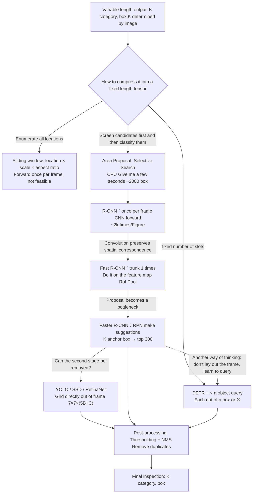
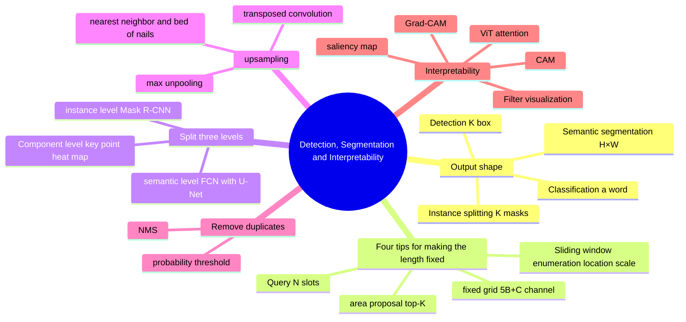

> **Course information**
>
> - **Course name**: Stanford CS231n: Deep Learning for Computer Vision(Spring 2025)
> - **This module covers**: Lecture 9. Object Detection, Image Segmentation, Visualizing and Understanding (178 slides)
> - **Lecturer**: Ehsan Adeli
> - **Teaching date range**: 2025-04-29
> - **Course homepage**: [cs231n.stanford.edu/2025](https://cs231n.stanford.edu/2025/schedule.html)
> - **Official courseware**: [lecture_9.pdf](https://cs231n.stanford.edu/slides/2025/lecture_9.pdf) (178 pages, page-by-page illustrations in the book)
> - **Subtitle source**: [cs231n_sp25_kor_sub · eng](https://github.com/lpaiu-cs/cs231n_sp25_kor_sub/tree/main/eng) (Publicly transcribed in English, Chinese rewritten by this book)
> - **Copyright statement**: The copyright of the slides and course materials belongs to Stanford University and the instructors; this book is an unofficial study note and is only used for study and research.

The first eight modules dismantle the "one image in, one label out" pipeline to the bottom: scoring function, loss, backpropagation, convolution operator, backbone architecture, and sequence model. This assembly line has a premise that has never been questioned——**The output is fixed length**. The scores of C categories are hard-coded in the weight matrix of the last layer. Whether it is 10 numbers or 1000 numbers is decided at the moment the network is defined. For the three types of tasks to be handled in this module, the first action is to dismantle this premise. Semantic segmentation needs to output H×W labels; target detection needs to output several "categories + boxes", and the number of "several" is determined by the image content; interpretability asks in turn: Since the score is a fixed-length vector, which piece of the image is it supported by? As soon as the output becomes longer, the project accounts all fall into the same place——**How to encode variable-length answers into fixed-length tensors**. This module is organized according to this account and will not be repeated in the order of the slides: Chapter 1 first establishes the "readout" mechanism of Transformer, which is the foundation of DETR at the end of this lecture; Chapters 2-3 deal with the segmentation branch, the core contradiction is resolution; Chapter 4-6 deal with the detection branch, the core contradiction is the output length, four sub-questions (how many, where, what, how to remove duplicates) are answered by fixed-length encoding, box regression, classification header and non-maximum suppression; Chapter 7 Chapter 8-9 separates the two synthetic instances; Chapter 8-9 changes direction and asks why the network answers this way.

This page has no technical content, but marks the pace of the course: Assignment 2 is followed by midterm and project milestones. The lecturer made an arrangement at 00:03:21 - stop to answer questions after reviewing ViT, and ask homework-related questions together at that time. Therefore, the first half of the following chapter is spoken at a fast pace. It is to catch up with the progress, not to talk about new things.

## 1. The readout end of ViT has only two interfaces: a learnable classification token, or average pooling of patches.
*(Reference time: 00:00:28 – 00:15:53｜Lecture 9)*

Put Transformer at the beginning of the detection module, not because it ranks on the first page, but because it answers the ultimate question of this module. Detecting this line until 2020, the answer is a pure Transformer model: fixed-length does not rely on grids or anchor boxes, but on **a fixed number of query vectors**. To understand "why the query can replace the anchor box", you must first see clearly how Transformer reads an answer from a string of tokens - this is exactly what the seven pages of ViT are doing.

The reason why this picture is replayed is because the last model of this lecture will remove it as it is: the feature map produced by the convolutional backbone becomes the token sequence of the encoder, the detection head becomes the decoder, and the set of "queries" at the input of the decoder will appear again in Chapter 6 under the name of object query. There is only one thing to remember at this moment - the decoder does not copy the output of the encoder, but uses it as a key value and uses queries to retrieve information.

Separately calculate "expensive" and "good", this page is an accounting table. The recurrent network requires O(N) hidden state memory, and must be serialized moment by moment, and cannot be parallelized; convolution can be parallelized, but the receptive field of a single output is limited, and many layers must be stacked to see the distance; self-attention allows each output to be directly connected to all inputs, at the cost of O(N²) calculation and O(N) memory. The advantage is that four matrix multiplications can be completed in parallel. The lecturer's judgment was straightforward: it is more expensive, but its modeling capabilities are obviously better, so it is selected by default for today's application. There is an inference buried here that will be used later. After the image is cut into patches, the sequence length N is only about 196 (224/16 squared), and O(N²) is completely affordable; but in pixel-level tasks, N will become tens of thousands, and self-attention is unaffordable. **The feasibility of the same operator at two resolutions is completely different**——This constraint will determine why DETR in Chapter 6 must stand on the CNN feature map instead of the original image.

There is only one picture and one line of labeling on the entire page. The next seven frames all do the same thing: turn a two-dimensional grid of pixels into a one-dimensional sequence of vectors.

Dicing is the whole secret of this route and its only source of loss. The sequence model can only see "which token", but cannot see "whether this token was originally in the upper left or lower right of the picture" - the position is actively lost in this process.

224/16 = 14, 14 pieces cut out on each side, N = 196. This digital slide is not written, but it is the benchmark for all subsequent calculation calculations: 196 tokens, each 768 dimensions, and the tensor before entering the Transformer is 196×D.

3×16×16 = 768 is an arithmetic result, not a super parameter; the real super parameter is only D, which is the width of the entire Transformer. This step is the same as word embedding in text - table lookup is replaced by matrix multiplication.

The positions are lost by dicing, so they must be explicitly compensated: each position is assigned a D-dimensional learnable vector, which is directly added to the corresponding token. The lecturer added that there is freedom in implementation - position coding does not need to be learned, and can also be specified manually, such as numbering in sequence 1, 2, and 3, or using two sets of (x, y) coordinates to compile one set each and then add them together. The effect is not much different.

By this frame, the input shape is completely isomorphic to the word vector sequence of a natural language sentence, and there is no need to change a single line in the subsequent layers. The only change is the mask: the language model must cover the future, the image has no "future", and each patch can see all patches.

How to read the classification results? The most common method is to shoehorn an additional token, which does not correspond to any piece of the graph and is only responsible for "collecting" global information in layers of self-attention. The lecturer answered a very natural question: it is not a bias, but an independent trainable vector, which will eventually be mapped into a class C probability by a feedforward layer or linear layer. This sentence is worth remembering because the object query in Chapter 6 uses exactly the same construct.

The patch's own output vectors are discarded at this step - they are not wasted, the information has been funneled into the classification token through self-attention. What this architecture diagram really wants to say is "one token represents the entire picture": only one position is left on the reading end, and the remaining positions are sacrificed during reading.

From here, Slide redraws the entire assembly line just to replace the last head. The first frame is still input and cut, no different from the previous one.

This step is exactly the same as the previous one, except this time it is re-accounted as the first step in the "pool head" version.

The stringed D-dimensional vector is clearly marked as the input of Transformer in this frame. Up to this point, the two routes are identical, with the divergence occurring only at the output.

The wording is more straightforward than before: instead of telling it the serial number, tell it the coordinates. This difference will be magnified in the detection - the regression of the frame depends on the coordinates, and the serial number is useless for regression.

This is a taboo in language models, but it is the default in images: there is no causal order between pixels, and covering a part will not make the task more meaningful, but will only lose information in vain.

The output is N D-dimensional vectors, one per patch, with no additional summary positions. The value of this frame is to turn "reading" into an obvious fact: all information is in N vectors, and how you read it is up to you.

There is only one engineering difference between the two routes: classification tokens allow the network to learn to summarize information into one place, making it more expressive; average pooling forces the assumption that each patch contributes equal weight, has fewer parameters, and is less likely to overfit. The instructor said that both are supervised exactly the same way - backpropagation plus Softmax or binary cross-entropy. This pronunciation of "pooling + full connection" is worth remembering first. When talking about CAM in Chapter 8, the premise of the entire derivation is that the classifier follows the global average pooling; in other words, the establishment of CAM relies on this inconspicuous pooling header on this page. Pooling is optional in ViT, but must be used in CAM - same thing, two fates.

The next nine pages are the only part of this lecture that has nothing to do with testing. Their function is to explain "what the Transformer will look like in 2025." The reason it's worth spending nine pages is because the DETR for Chapter 6 is from this edition, not the 2017 edition.

The original version places normalization after the addition of residuals, which means that no matter what the sub-layer learns, the output will be re-normalized once, and the network cannot learn a strict identity mapping. Identity mapping is precisely the premise for deep networks to be trained - if a certain layer is really useless, at least it can do nothing. This argument is the same as the motivation for ResNet residuals in the convolution module: **First ensure that the path of "not getting worse" exists, and then talk about getting better.**.

The residual backbone therefore becomes a clean path, and the gradient can pass through it unchanged; the price is that the backbone value is no longer subject to normalization constraints, and training must be stabilized by means such as warmup. The slide only gives one conclusion: training is more stable.

$y_i = x_i/\mathrm{RMS}(x)\cdot\gamma_i$, among which  $\mathrm{RMS}(x)=\sqrt{\varepsilon+\frac{1}{N}\sum_{i=1}^{N}x_i^2}$. One less averaging and one less subtraction is a real savings in computing power on large models. The lecturer's attitude towards such changes is very honest: most of them are empirically more stable, and the theoretical explanation is an afterthought.

$Y=\sigma(XW_1)W_2$, $W_1$  is D×4D, $W_2$  It’s 4D×D. The width of the middle layer is four times the input, which is the most parameter-intensive part of Transformer - the number of parameters of MLP in a block is usually more than twice that of self-attention.

$Y=\sigma(XW_1)\odot(XW_2)W_3$: One branch is considered activated, and the other is used as a switch. Multiply element by element to determine how much to release. When H is 8D/3, the total number of parameters is the same as the 4D version, but the linearity is stronger - using the same parameter budget for more complex gates.

The fourth change is to change "one MLP" into "a group of MLPs", with each independent set of weights called an expert.

Routing is the core of this trick: each token is only sent to A of E experts (A \< E). Therefore, the number of parameters increases by E, and the amount of calculation only increases by A. This is currently the main means to achieve both "large model" and "inference is not too expensive".

The third frame makes it clear: GPT-4o, GPT-4.5, Claude 3.7, Gemini 2.5 Pro. This model will almost certainly use MoE, with parameter amounts above 1T, but the details will no longer be announced. The lecturer added two pieces of experience in the Q&A: experts train in parallel and are randomly initialized, so they will be naturally differentiated to learn different aspects; the number of experts E and the number of actives A are both super parameters, which are usually predetermined and not fine-tuned.

The summary page juxtaposes these four: Pre-Norm is to move normalization into the residual, RMSNorm is to change the normalization layer, SwiGLU is to change the MLP, and MoE is to learn E MLPs and only use A for each token. The four together represent all the structural differences between the “2017 architecture” and the “2025 model.” For this book, what this chapter takes away is not these four terms, but two things that will be reused in the following chapters: **The readout can be a learnable vector** (classification token → object query), **The position of normalization determines whether the gradient can cleanly pass through the residual backbone.** (Pre-Norm → trainability of deep detectors). Why should we start over from "Output Shape" in the next chapter? Because Transformer gives a fixed-length tensor, and detection requires a variable-length list - the seam between the two is what will be dealt with in the next six chapters.

## 2. The output shape determines the architecture: the four types of tasks are actually four additional conditions of the same classifier.
*(Reference time: 00:15:57 – 00:25:04｜Lecture 9)*

In this section, the lecturer first lays out a four-frame picture, and then lights up each frame one by one. This picture is worthy of being regarded as a map of the entire module: the difference between the four tasks is not how deep the network is, but the shape of the output - one word, H×W words, several (words, boxes), several (words, boxes, masks). Once the shape changes, the loss function, labeling cost, and post-processing methods all change accordingly, while the backbone of the network can remain motionless.

The agenda divides the entire lecture into two parts: Computer Vision Tasks (semantic segmentation, object detection, instance segmentation) and Visualization & Understanding (layer visualization, saliency map, CAM and Grad-CAM). The first part takes up three-quarters of the time, and the second part is only ten minutes. The lecturer himself said that this is "going through the most important parts."

The most critical of the four lines is the sentence "No objects, just pixels" below the semantic segmentation. It explains two things at the same time: why object detection is needed after semantic segmentation (individuals are needed), and why instance segmentation is needed after detection (shape is needed). The classification box says "No spatial extent", and detection and instance segmentation share the bracket "Multiple Object" - the difference between them is not whether there are multiple objects, but whether there is a pixel-level mask.

Going back to the first lecture: given a label set like {dog, cat, truck, plane, ...}, output a word for a cat picture. This picture is not a review here, but a target - all subsequent tasks are obtained by adding and subtracting conditions to this sentence.

For the same four-frame picture, the highlight is moved to the second frame. The desired output is not "there are grass, cats, trees, and sky in the picture", but which category each pixel belongs to. This is equivalent to copying H×W copies of the classification problem and spreading it on one picture at once.

The formalization has only two lines: classify each pixel of a new image during testing, and each image must have pixel-by-pixel semantic annotation during training. The lecturer mentioned the historical cost by the way - in the early years, such data sets were marked by people sitting down one by one, which was very expensive; now there are tools to assist, but labeling is still the main cost of this route. The differences between the four tasks can be compressed into a table. Note the last column: **The form of the loss function is entirely determined by the output shape**, the network structure is not that important.

| Task | Output shape | Is the output fixed length? | Label cost | loss |
| --- | --- | --- | --- | --- |
| Image classification | 1 label (C-dimensional score) | is | one word per picture | Softmax cross entropy |
| Semantic segmentation | H×W tags | Yes (same size as input) | One pixel label image per image | Pixel-by-pixel Softmax summation |
| Target detection | K (categories, boxes) | No | Several frames per picture | Softmax + L2 (Classification + Regression) |
| Instance splitting | K (category, box, mask) | No | box + one binary mask per instance | The above two items + mask pixel-by-pixel binary loss |

The "fixed length" column in the table is the lever for the entire chapter. The output of semantic segmentation looks very large, but it is actually of fixed length - H×W is determined by the input size, and the network can still spit it out at once; the output of detection looks small, but it is of variable length, and K is determined by the image content. **big and fixed** You can calculate it hard, **small and floating** Instead, redesign the architecture, which is the starting point for all the techniques in the next five chapters.

The simplest idea is to only look at this one pixel. The first frame only has a picture and a question mark, and the problem has not been exposed yet.

The answer is no: you can’t tell what a pixel value is by looking at it out of context. A patch of green might be grass or a patch of tree canopy. So we need to introduce context, that is, look at the area around it.

The question mark at this frame becomes "How to model this context" - take a patch centered on the target pixel and send it to the classifier as a small image.

Specific method: patch through CNN and output the category of the central pixel. The slides cite Farabet et al.'s 2013 scene annotation work and Pinheiro and Collobert's 2014 circular convolution version. The lecturer emphasized that you can choose any network - CNN, ResNet, or ViT, because it does something that is familiar to you: classify a small picture.

The cost is stated in the fifth frame: an H×W picture requires H×W forward runs, and adjacent patches overlap significantly, and the overlapping area is calculated repeatedly countless times. This is not an accuracy issue, it is pure waste - the motivation for all subsequent segmentation architectures starts from here.

The first step to improve is to replace "run the network once for each pixel" with "run the network once for the entire image". But the page also points out obstacles: in order to make the classification architecture deeper, the spatial size of the feature map is usually reduced midway, while semantic segmentation requires the output to be as large as the input.

So there is a fully convolutional network (FCN): there is only convolution in the entire network, no pooling and no strided convolution. The input is 3×H×W, D×H×W is maintained in the middle, the score of C×H×W is output, and the last argmax gets the prediction of H×W.

The cost is added to the second frame of the same page: D channels are maintained for convolution at the original resolution, and the video memory and computing power are linearly expanded according to H×W. The lecturer recalled that in the early years, GPU memory was small, which almost directly sentenced FCN to death - which also explains why the split architecture eventually moved towards "first lowering the resolution and then raising it back up."

This picture is the main skeleton of the segmentation in this lecture. The left side is already done: D1×H/2×W/2 to D2×H/4×W/4, the channel becomes thicker, the space becomes thinner, and the receptive field becomes larger; the right side needs to go from low resolution back to D1×H/2×W/2 and then to C×H×W. The slide only has a skeleton in this frame, and no operator has been specified yet - the shape is determined first, and then how to fill it in.

The left side is completed: pooling and strided convolution are all operators that have been calculated in the second module. The right side is still empty, with "Upsampling: ???" written on the page——**There is a whole set of ready-made tools for downsampling, but none for upsampling.**. This asymmetry is the technical core of the entire chapter and the reason for the existence of the next chapter. The lecturer stopped here and asked: This network starts from a picture and ends at a picture. How to write the loss function? The answer in class was pixel-by-pixel classification loss. The instructor confirmed: Calculate the Softmax loss once for each pixel on the image, and then sum up all pixels. $L=\sum_{i}\ell_{\text{softmax}}(s_i, y_i)$, and then backpropagates as usual. This explains two things: why such tasks must have pixel-by-pixel ground truth label maps; and why the training cost of segmentation is much higher than that of classification - each pixel in a batch is a training sample.

## 3. Semantic segmentation: Lower the resolution and then raise it back up. The shortcut in the middle determines the boundary.
*(Reference time: 00:25:13 – 00:33:07｜Lecture 9)*

There is no ready-made operator for upsampling, which is a gap left by the previous chapter. This chapter arranges the answers in three levels: "no parameters → borrowing encoder information → having parameters": nearest neighbor and bed of nails are purely geometric rearrangements, maximum depooling borrows the positions recorded by the encoder, and transposed convolution turns upsampling into a layer of trainable network. After completing the third level, the horizontal arrow of U-Net has a place to fall.

Nearest neighbor copies each element of the 2×2 input into a 2×2 block in the output; the “bed of nails” only puts the original value in the upper left corner of each block and fills the rest with zeros. The latter seems more wasteful, but with the subsequent convolutional layers, these zeros will be gradually "filled" with the effective values ​​​​of the neighborhood, which is equivalent to letting the network learn how to interpolate by itself. Both have no parameters and are fixed index mappings.

If the encoder uses max pooling, the decoder can be more accurate: when pooling, record the position of the maximum value in each window (switch), when unpooling, put the value back to that position, and set the rest to zero. The slide marks this pair of operations with "Remember which element was max!" - this is the only additional information that needs to be passed between the encoder and the decoder, at the cost of an index tensor as large as the feature map.

The second route is to make upsampling also parameterized. The review starts with the most common convolution: 3×3 filter, stride 1, padding 1, input 4×4, output still 4×4.

In the second frame, the word "dot product" is marked at the position where the filter and the input overlap: each grid output of the convolution is the sum of the element-wise products of the filter and a certain 3×3 window of the input.

When the window slides once, the output will grow by one grid. A stride of 1 means that every time the input moves one frame, the output also moves one frame, so the input and output sizes are the same - this is the literal meaning of "convolution without subsampling".

Change the step size to 2, and the same filter becomes a downsampler: the input is 4×4, and the output is only 2×2.

The position of the tab is marked in this frame. The effect of step size 2 is: two adjacent cells in the output correspond to positions two cells apart in the input.

The third frame gives this key interpretation: the step size is the ratio of the input movement amount to the output movement amount, so the strided convolution can be read as "learnable downsampling" - it compresses 4×4 into 2×2, and the compression method is determined by the 9 weights, rather than fixed pooling rules.

Reverse this relationship, and you get transposed convolution: input 2×2, output 4×4. The lecturer fast-forwarded this set of pages in class, citing lack of time, and left only one sentence: "It is the inverse operation of conventional convolution. The convolution is applied to the transposed version of the input, so the output is larger." The frame-by-frame construction process was left in the slide. Complete it here because it is the default part for all subsequent decoders.

The roles are reversed: in ordinary convolution, the filter sweeps over the input and each output takes a weighted sum; in transposed convolution, each value of the input is multiplied by the entire filter, and a whole block is "printed" on the output. The annotation of this frame is "Input gives weight for filter", which is what it says.

The direction of the step size is reversed at this frame: the filter moves 2 spaces on the output at a time, corresponding to the input advancing 1 space. So the step size changes from "compression ratio" to "amplification ratio", and 2×2 is enlarged to 4×4.

There will inevitably be overlap after enlarging: the areas of two adjacent "prints" will collide with each other, and the solution is to add them together.

The completion of superposition is the final 4×4 output. Looking at the five frames connected, transposed convolution is not mysterious - it "multiplies each input value by the filter, spreads it to the output according to the step size, and sums up the overlap." It shares the same set of weights as ordinary convolution, but the order of traversal is reversed. This also explains why it is called "transpose": convolution can be written as matrix multiplication, and transposed convolution is simply multiplying the transpose of the same matrix (the appendix on pages 151–152 gives this algebraic version).

The one-dimensional example clears things up: the inputs are just a and b, and the filter is (x, y, z). The three copies of a occupy the output cells 1–3, and we get (ax, ay, az); the three copies of b are moved to the 3–5 cells in steps of 2, and we get (bx, by, bz). The third cell collides with the third cell of a, so the final output is (ax, ay, az+bx, by, bz). Input 2 numbers and output 5 numbers, which is exactly the amplification ratio of "kernel size 3, step size 2": $(2-1)\times 2+3=5$. Given the input length, kernel size, and stride, the output length can be checked immediately.

Returning to the skeleton diagram, both columns are filled: downsampling is pooling or strided convolution, and upsampling is unpooling or transposed convolution. At this point, FCN's calculations are completed - it uses one network and one forward pass to output the entire segmentation map, which is several orders of magnitude faster than the sliding window. The real difference between the four upsampling methods is not "who is more advanced", but "who needs the information passed by the encoder": only the maximum unpooling requires the position recorded during pooling, and precisely because of this need, it recovers the boundaries most accurately; nearest neighbor and nail bed have no parameters at all, and the cost is that a large number of positions in the output are zero, which must be filled in by subsequent convolutions; transposed convolution has parameters, leaving "how to interpolate" to training, at the cost of multiplying the kernel once for each output pixel.

U-Net is the best-known example of this route. The whole picture is U-shaped: the left half is the downsampling path, the number of channels increases from 64 to 1024, and the resolution drops all the way from 572×572 to 32×32; the right half rises back symmetrically, and finally outputs a segmentation map of the same size as the input. The lecturer emphasized that it is still a strong baseline in medical imaging - when you don't want to go to the basic model, U-Net and its variants can still give close to the best results.

The left half is characterized in this frame: downsampling makes the receptive field larger, and the model can see larger structures; the cost is that spatial information is discarded and the boundary position becomes blurred. These two things are the same coin - if you want to correctly judge "this is a cat", you have to look far enough; if you look far enough, you will inevitably lose "which pixel the cat's ears are at".

The task on the right side is therefore clear: reconstruct high-resolution maps from low-resolution, semantically strong features. But the information has been lost, and upsampling alone cannot make it up, and the boundaries will be blurred.

The solution of U-Net is the horizontal gray arrow: copy the high-resolution feature map of the same resolution on the left, concatenate (concatenate) with the upsampling result on the right, and then convolve them together. This is the form of skip connection in segmentation - it does not change the depth of the network, it just passes the "lost spatial details" to the opposite side unchanged. Note that it is not the same thing as the residual of ResNet: the residual is added, retaining the numerical path; here is splicing, retaining the feature content.

The summary page condenses the entire chapter into one sentence: a segmentation network is a set of convolutional layers with downsampling and upsampling sandwiched in between. The lecturer answered another question here - are the transposed convolution filters trained? Yes, it is no different from other convolutional layers, and the gradients are returned as usual.

The last page points out what this route cannot do: the output only has pixel categories. If there are two dogs on the picture, the model will say that both of them are dogs, but it does not know that they are two. The reason is not network capacity, but **There is no concept of "individual" in the supervision signal.**——The two dogs in the label map share the same category number, and the model has no basis to separate them. To answer "Is this the same one or two?", we must first have the concept of "object", so the topic turns to target detection.

## 4. The first problem of detection is the output length, and the sliding window is the first failed attempt at it.
*(Reference time: 00:33:29 – 00:38:37｜Lecture 9)*

The output of semantic segmentation is large and fixed, while the output of detection is small and floating. The latter is really troublesome. This chapter first defines the trouble accurately (one object has 4 numbers, three objects have 12 numbers, and any more is "many numbers"), and then looks at the two most simple fixed-length attempts-single-objective regression and sliding window-at which step each died. They die in different ways, but they lead to the same conclusion: **There must first be a cheap way to screen out "where"**.

The first two columns were pressed into gray after the explanation, and the images in the third and fourth columns were still dark. Only the brackets of the "Multiple Object" below lit up first - it reminded them of what these two columns have in common: the output quantity is no longer fixed.

The third column lights up: In the same living room photo, two dogs and a cat are surrounded by three different-colored frames, with the labels DOG, DOG, and CAT underneath. Classification only outputs one word, while detection outputs three (category, box) pairs, and the number "three" is unique to this picture.

Assume that there is only one object in the picture, and the problem immediately degenerates into "classification + positioning". After the trunk, there are two parallel heads: full connection 4096→1000 for the category score, full connection 4096→4 for the box (x, y, w, h). The key understanding is that positioning can be regarded as a regression problem, and the four numbers in the box are four continuous variables.

The loss is also divided into two paths: Softmax cross entropy is used for categories, and L2 distance is used for frames. Because the frame coordinates themselves are real numbers, you can directly calculate the Euclidean distance between the prediction frame and the true value frame. The sentence "Treat localization as a regression problem!" on the page is the only thing you need to remember in this section.

Add the two paths to get the multi-task loss  $L=L_{\text{cls}}+\lambda L_{\text{box}}$, a scalar, a backpass. The lecturer did not expand  $\lambda$  How to determine, but this structure remains almost unchanged in today's detectors: the classification head and the regression head share the backbone, and each has its own loss.

Once there is more than one object in the picture, the output becomes a list like CAT: (x,y,w,h), DOG: (x,y,w,h), DUCK: (x,y,w,h). The length of the list is not fixed, and the output layer of the network is a fixed-length matrix multiplication - this is the core contradiction to be solved in the entire chapter.

The slide draws this contradiction in three lines: 4 numbers for a single object, 12 numbers for three objects, and "many numbers" for more. The number of outputs required for each picture is different, so the path of "setting the output dimension to 4N" will not work - no amount of N is correct: if it is smaller, detection will be missed, if it is larger, it will be wasteful, and during training, the matching problem of "which slot corresponds to which object" must first be solved. Before going any further, it’s worth breaking down “detection” into four sub-questions that can be asked independently. Each subsequent chapter only advances one or two of them, and readers can use this table as a progress bar.

| subproblem | a word | What answer | In which chapter to advance? |
| --- | --- | --- | --- |
| There are several | The output length is determined by the image content, and the network will only spit out fixed-length tensors. | Fixed grid, fixed number of queries, top-K proposals, three fixed-length encodings | Top-300 in Chapter 5, Grids and Queries in Chapter 6 |
| where | The box is four real numbers and cannot be directly used as a category label. | Offset regression relative to proposal box, offset relative to anchor box, direct regression of DETR | Chapter 5 |
| what is | Give each box a category | Classification head, per-class SVM for R-CNN, class score for YOLO | Chapter 5–6 |
| How to remove weight | The same object is answered correctly by many boxes at the same time | Threshold filter + non-maximum suppression (NMS) | End of Chapter 6, Appendix page 170 |

The most underestimated aspect of this table is the last row. Deduplication seems to be just the finishing work, but in fact it bears the side effects of fixed-length encoding: the sliding window will answer the same object thousands of times, YOLO spits out 98 boxes in a picture, and RPN gives 2700 candidates at a time. **The denser the encoding, the more aggressive the deduplication must be.**, the two are two ends of the same account.

The first remedy is to turn detection into multiple classifications: take various crops on the image and let the CNN determine whether this is an object or background. The first frame is an empty box with three questions answered NO, NO, and YES in sequence.

The box slides over to the dog, and the answer flips over: Dog? YES, Background? NO. The detection is thus split into "enumerating all frames + classifying frame by frame".

In the third frame, the frame is only moved a little, and the answer is still Dog? YES. This detail illustrates the hidden cost of the sliding window: adjacent positions are highly redundant, the same object is repeatedly confirmed as YES, and these YES require additional effort to merge into one in post-processing.

Cat? YES when the box falls on the cat. A question is thrown in the lower right corner of the page: What is the problem with this method?

The problem is written in one sentence: CNN needs to be run on a huge number of positions, scales and aspect ratios, which is completely computationally unacceptable. This is the same disease as the sliding window of semantic segmentation - splitting "one forward" into "tens of thousands of forwards". The difference is that the sliding window for segmentation is H × W times (two-dimensional enumeration), and the sliding window for detection is position × scale × aspect ratio (three-dimensional enumeration), which is more expensive.

So there is a region proposal: first use a method that does not require a neural network to find the "blocked, object-like" areas on the map. The slide shows a selective search - about 2000 proposal boxes are given in a few seconds on the CPU. The footer also lists three contemporaneous routes of objectness, BING and EdgeBoxes by Alexe et al. This step does not determine the category, but only determines "there may be something here", so it can be done quickly and roughly. The lecturer said that this was the mainstream idea around 2014: split "where" and "what" into two problems, and use the most appropriate tools to solve each problem. The price also comes -**The proposed algorithm and the detection network are two independent systems. The errors of the former cannot be corrected by the latter, and the gradients of the latter cannot be transmitted back to the former.**. This crack won't be patched until the RPN at the end of Chapter 5.

## 5. From R-CNN to RPN: Incorporate "where" from external algorithms into the same feature map
*(Reference time: 00:38:48 – 00:43:12｜Lecture 9)*

With suggestions, detection becomes a three-step process of "cutting out, classifying, and fine-tuning the frame." Each of the three iterations of this chapter reduces repeated calculations: R-CNN calculates the same convolution 2000 times, Fast R-CNN only calculates it once, and Faster R-CNN simply inserts the proposal into this time. Behind the three changes is the same observation——**Convolution preserves spatial correspondence, so the position on the feature map can be used as pixel coordinates**.

The first frame of R-CNN only has the input image. This picture is from Girshick et al.'s 2014 paper, and the next seven frames are added to it with components.

Regions of interest (RoI) are added at this frame, numbering about 2k. Note that these boxes are of different sizes, and CNN requires a fixed input size, so it must be deformed in the next step.

The third frame forcibly stretches the pixels in each frame to 224×224. This warp would destroy the aspect ratio - a slender dog would be fattened - and was one of the details that R-CNN was later criticized for, but at the time it allowed "arbitrary boxes" to be fed into the standard classification network.

The most expensive step occurs in the fourth frame: each area after the warp must pass through the convolutional network completely. 2000 boxes is 2000 forwards, and a large number of pixels among them are duplicates—neighboring proposal boxes often overlap by more than half.

The fifth frame connects an SVM classifier to each region and outputs the category. R-CNN does not use Softmax but one SVM for each class, which was the practice of that era; it means that the classifier and the convolutional network are trained separately, and the gradients are not shared.

The sixth frame is supplemented with frame correction: it does not directly predict the absolute coordinates, but predicts four correction amounts (dx, dy, dw, dh) relative to the proposed frame, and "moves a little, shrinks a little" the frame. The reason for using relative quantities instead of absolute quantities is that the same object must be correctly returned at different positions. Absolute coordinates will force the network to remember the position. This idea of ​​"predicting relative quantities" will appear twice in different forms in anchor boxes and DETR.

In the seventh frame, the cost is written out: each picture requires about 2k independent forward passes. This is the reason why R-CNN is an engineering death sentence and the starting point for all improvements in the next section.

There is only one idea to break the situation: convolution retains spatial information, and there is a clear correspondence between the position on the feature map and the pixel position, so why not wait until the entire image is convolved before cropping? This page is marked with red letters "Idea: Pass the image through convnet before cropping! Crop the conv feature instead!" - 2000 forwards become 1. The premise for this idea to be established is the translational equivariance of convolution: the pixel coordinates divided by the total step size are the feature map coordinates.

The six frames of Fast R-CNN are layer-by-layer construction of the same architecture diagram. In the first frame, the old architecture is placed on the left for comparison, and the right is the position that the new pipeline will occupy.

Add the backbone to the second frame: the entire image is passed through ConvNet once to obtain the conv5 feature map. The backbone can be any one of AlexNet, VGG, and ResNet. The slide lists them side by side under "Backbone network" - the accuracy and speed of the detector are largely determined by this choice. This is also the starting point for the "backbone network" to become an independent research direction later.

The RoI is projected onto the feature map at this frame. Because convolution is translationally equivariant, the relative position of a box on the two images is the same, so the projection only needs to be divided by the total step size.

In the fourth frame, do "cropping + scaling features". This step is the prototype of RoI Pool. Specifically, how to compress a feature area of ​​any size into a fixed size. The slides are left in the appendix (pages 153–159). The core is "cutting the grid + taking the maximum of each grid", at the cost of the dislocation caused by two quantizations.

The fifth frame is Per-Region Network: each RoI feature is connected to a very small header, one linear + Softmax output category, and one linear output frame offset. At this point, each picture only passes through the main trunk once, and the cost is reduced from 2000 forward times to 1 time plus 2000 small heads - the calculation amount of the small heads is not of the same order of magnitude as that of the main body.

The sixth frame puts the entire pipeline together. The lecturer's evaluation of this line is that it advances detection from "impossible in real time" to "can talk about speed", but there is still one bottleneck that has not been solved - the 2,000 proposals still come from an algorithm that has nothing to do with the network. The actual measurement numbers in the appendix make this calculation very clear: Fast R-CNN takes 2.3 seconds end-to-end, and only 0.32 seconds when proposals are removed. **Proposals eat up 85% of the time**.

The third bottleneck is the proposal itself. Since the backbone has turned the picture into a 512×20×15 feature map, why not directly predict “where there may be objects” on this picture? This is how RPN comes about: input 3×640×480, output 512×20×15, each spatial position corresponds to a 32-pixel square grid on the original image (640/20 = 32).

The anchor box (anchor) was introduced in this frame: a fixed-size box is placed at each point on the feature map. Its function is to turn the "prediction box" into "predicted offset relative to the anchor box." This is the same idea as R-CNN's (dx, dy, dw, dh), except that this time the reference frame is pre-laid, not given by an external algorithm.

Add the first head to the third frame: perform two classifications for each position, determine whether there is an object in the corresponding anchor box, and output a 1×20×15 objectness map. Note that there are no specific categories here, only "object/background" - completely separating "is there" and "what is" is the reason why RPN can be done cheaply.

Add the second header to the fourth frame: For the positive box, return it to the four corrections of the true value box, and output 4×20×15.

The number of anchor boxes changes from one to K, covering different scales and aspect ratios. So the channel numbers of the two output images are multiplied by K respectively: the objectness is K×20×15, and the frame transformation is 4K×20×15. This step changes "multi-scale" from a network structure problem to a channel number problem - the same feature map is explained by K sets of different reference frames.

The sixth frame is the ending: sort the K × 20 × 15 boxes by objectness, and take the top 300 as proposals. Calculating K=9, 20×15=300 positions, there are a total of 2,700 candidate boxes, of which only about 300 enter the second stage——**RPN here suppresses "dense prediction" into "sparse proposal"**, and these 300 boxes are the first formal answer to the sub-question "How many are there?": it is not counted, but the first K ones are sorted. At this point, the calculation of the two-stage detector is completed: the first-stage proposal and the second-stage classification regression share the same feature map and the same forward direction. The lecturer gave a very practical evaluation in the Q&A: This type of model is rarely used today because they still essentially need to be run twice (once to generate proposals and once to classify by region), which is too computationally intensive; but understanding how it got to this point is the prerequisite for understanding all subsequent single-stage models.

## 6. Single stage and query: YOLO uses grid to replace speed, DETR uses query to replace anchor box
*(Reference time: 00:44:35 – 00:57:38｜Lecture 9)*

The remaining question at the end of the previous chapter is: can the second stage also be eliminated? If it could, the proposal wouldn't have to be turned into 300 boxes and then sorted one by one, but the categories and boxes could just be spit out at each location. This chapter gives two answers, in completely opposite directions: YOLO uses **fixed grid** To hardcode "where" into the subscript of the output tensor, DETR uses **Fixed number of queries** Turn "how many" into a learnable slot array. The former writes the prior in geometry, while the latter leaves the prior to training.

Taking the idea of RPN one step further is a single-stage detector: it is no longer divided into two stages: "proposal" and "classification", and the frame and category are directly displayed on each grid at the same time. The account given in the slide is very clear: the image is cut into a 7×7 grid, each grid has B reference boxes, each box has 5 numbers (dx, dy, dh, dw, confidence), plus C category scores, the output tensor is  $7\times7\times(5B+C)$. Taking B=3 and C=20, there are a total of 7×7×35 = 1715 numbers - a fixed-size tensor, and the problem of variable length is completely eliminated. The last comment on the page is spot on: it's a lot like RPN, but category-related.

YOLO (You Only Look Once) is the most famous name of this route, and the title says real-time object detection. The lecturer said that even today, it is still widely used as a baseline in industrial applications because it is fast and accurate; he also reminded that the literal meaning of the name is its design philosophy - look at the entire picture only once.

The secret is all in this frame: divide the picture into an S×S grid (this version is 7×7). Each grid is only responsible for the small area it covers. The allocation problem of "which box belongs to which object" is directly decided by the grid position - no proposal or Hungarian matching is required. The price is that objects on the grid boundary are easily missed or repeated. This defect is later alleviated by multi-scale features and anchor boxes.

The third frame lists three outputs for each grid: the probability that there is an object in the box P(object), the B bounding boxes (x, y, h, w), and the probability of belonging to each category P(class). These two items are separated: the former answers "Is there something here?" and the latter answers "What is that thing?" The multiplication is the confidence that this box belongs to a certain category.

B is set to 2 in this frame. This number is small, meaning that each grid is responsible for at most two objects - enough for a 7×7 grid, since the centers of objects usually fall in different grids.

The fifth frame shows the respective probabilities of two boxes in the same grid. They are output in parallel, and the network does not need to choose between the two boxes, the choice is left to post-processing.

All grid frames are stacked back to the original image, and the thickness of the line is the probability. At this point, an image yields 7×7×2 = 98 boxes, the vast majority of which are background or repeats – this is the price a single-stage detector pays for speed: **The answer is full of redundancy and needs to be squeezed out later.**.

The seventh frame is the result of post-processing: first filter by probability threshold, then use non-maximum suppression (NMS) to remove overlapping duplicate frames, and the rest is the final detection. The lecturer did not expand on the details of NMS, only saying that it is the standard finisher of this type of detector; its rules are actually very simple - sort by score, take the highest-scoring box each time, delete all the boxes whose IoU exceeds the threshold, and repeat until the list is empty.

The third route deletes the entire "anchor frame". The pipeline of DETR is: CNN extracts features → Transformer encoder-decoder → directly outputs a set of boxes; during training, bipartite matching is used to pair the prediction box with the true value box, and then return the coordinates. The sentence "No anchors, no regression of box transforms" on the page is the key point of this page - it does not even require the concept of "relative anchor box offset". This step is connected to Chapter 1: the decoder input of DETR is the promotion of the classification token in ViT. Classification token is a learnable vector, responsible for collecting global information and outputting a category; object query is a set of learnable vectors, each responsible for collecting **an object** information and output (category, box) or "no object". From "one slot" to "N slots" is the entire difference from classification to detection.

Starting from this frame, the slide zooms in on each of the three components of the pipeline. First zoom in on the backbone: the feature map output by the CNN must be added to the position encoding, otherwise the Transformer cannot distinguish the spatial position - this is the same problem as the position embedding in ViT, except that the token here comes from each spatial position of the feature map.

The interior of the backbone is completed in the third frame: the feature map and the position encoding are merged at the plus sign. At this point, a picture has been turned into a string of tokens with positions, which is consistent with the input form of ViT.

The camera moves one layer closer and falls on the encoder: multi-layer self-attention plus MLP, the input and output are the same string of tokens. The number of tokens here is determined by the feature map (the scale of the previous RPN page is 20×15 = 300), which is much smaller than the number of pixels, so the self-attention of O(N²) is affordable here - this is where the inference in Chapter 1 that "the feasibility of the same operator is different at two resolutions" comes into effect.

The fifth frame adds the decoder: it uses the output of the encoder as a key and the input is a small set of learnable query vectors (object queries). The lecturer emphasized this point repeatedly - these queries are not image blocks, nor are they pre-laid frames, but a bunch of trainable parameters, and the network learns "what to focus on for each query" by itself.

The last frame is supplemented with the prediction head: the output of each query is passed through an FFN, and a category plus a box is obtained, or it is judged to be no object (∅). The picture on the right is the final result - two seagulls claimed by two queries. The instructor explained the capacity implications of this design: **The number of queries is the maximum number of objects you allow the model to detect in a picture.**, objects exceeding this number can only be discarded, so they must be adjusted according to the data set. There are three boundaries worth remembering during class Q&A. First, there is no explicit one-to-one correspondence between queries and objects. They are naturally staggered through layers of self-attention and cross-attention, and supervision solidifies this division of labor. Second, DETR only uses category labels and frames for training, and does not require pixel-level segmentation; conversely, when there are segmentation labels, it can be converted into frames to feed it. Third, fully supervised detectors cannot generalize to categories that have not appeared in the training set and can only output "no objects" - zero-shot detection is another line of research. Arranging the five generations of models in a table, it can be seen that the only change in each iteration is the "fixed length" move, while the solutions to the two sub-problems of "where/what" are almost unchanged.

| model | Year | How to make variable-length output fixed-length | per picture forward | Do you want external proposals? | main bottleneck |
| --- | --- | --- | --- | --- | --- |
| R-CNN | 2014 | Give 2k suggestions externally and output one frame at a time | about 2000 times | Yes (selective search) | The convolution is recomputed 2000 times |
| Fast R-CNN | 2015 | Same as above, but features only count once | 1 time + small head per area | Yes (selective search) | Proposals account for 85% of the time end-to-end |
| Faster R-CNN | 2015 | RPN produces 2700 candidates, and selects top-300 | 1 time | No | The second stage still needs to be calculated regionally |
| YOLO / SSD / RetinaNet | 2016–2017 | fixed grid  $7\times7\times(5B+C)$ | 1 time | No | There are many redundant boxes and weak small targets. |
| DETR | 2020 | N queries each appear in a box or ∅ | 1 time | No | The number of queries is the upper limit of capacity. If it exceeds the capacity, it will be lost. |

There is an easily overlooked dotted line in the picture: DETR does not evolve from YOLO. It bypasses the entire "frame-regression offset" technology stack and only retains the idea of "a fixed number of output slots". This is also the reason why this module is placed at the end - it proves that fixed-length optimization does not necessarily rely on geometric priors, but can also rely on a set of learnable parameters.

## 7. Instance segmentation: Add a 28×28 branch next to the detection head, and align the boundaries by the way.
*(Reference time: 00:58:01 – 01:01:31｜Lecture 9)*

The detection answers "how many, where, and what", and the rest is "shape". The lecturer's approach to this chapter is very simple: instance segmentation does not require a new architecture, it only requires an additional output on the detector. The real technical content is not in the action of "adding a branch", but in two details - why the mask must be output by class, and what exactly RoI Align has changed compared to RoI Pool. These two details determine whether the border of the mask is clean or blurry.

The fourth column requires both: individual classification and pixel-level masking. Note that it shares the brackets "Multiple Object" with detection. The only difference is that there is an extra mask in the output - this is what this chapter will prove.

This page has only one line of title, which is used to treat the end of the previous chapter as the starting point of this chapter. The lecturer's logic is: R-CNN's "backbone → proposal → region-by-region classification and regression" pipeline does not move, and only hangs another head in each region.

So there is Mask R-CNN: in addition to the original classification head and box regression head, a small branch is added to each RoI, and a small fully convolutional network is used to predict a 28×28 binary mask. The lecturer emphasized that this mask is "one per RoI" and has nothing to do with the size of the object in the input image - 28×28 is a fixed resolution. For a person who fills half of the image and a person in the distance, the mask is 28×28.

In the second frame, the account at the input end is clearly written: the backbone plus RPN gives the RoI, and RoI Align aligns and samples the features of each RoI into 256×14×14. Use Align instead of Pool because pooling requires the frame to be "adsorbed" to the integer grid. Two quantizations will cause a few pixels to be misaligned. For classification, a few pixels don't matter, but for masks, misalignment is a blurred boundary.

The third frame is supplemented with a mask branch: the 256×14×14 features are passed through two layers of convolution, and the output is C×28×28—one mask for each category, rather than one shared by all categories. In this way, the mask branch is decoupled from the classification branch. If the classification is wrong, the mask will not be drawn incorrectly; computationally, it only needs to change the output channels of the last two convolutions from 1 to C, which is very costly.

The true value of the mask is not a semantic label map, but a binary map of "which pixels belong to this object inside this RoI." The first set of examples makes the source clear: the red frame on the left encircles a chair between the bed and the cabinet, and the image on the right is the binary shape of the chair on a 28×28 grid, with jagged edges - this is the quantization brought about by fixed low resolution.

The second frame has another set stacked below: the same room, the frame has been moved slightly, and the edges of the mask have also changed. The lecturer used this to explain the learning goal of the mask branch - it learns "who does this pixel in the frame belong to", rather than memorizing the shape of the entire class of objects.

The third frame fills in the third group, and the page changes from vertical layout to grid layout. Putting the three groups together, it becomes clear that "the mask is one-to-one with the frame, not one-to-one with the image."

The four groups are complete: the upper right group of frames is relaxed, and the mask becomes wider; the lower two groups are replaced by the people on the bed and the bed itself. These four pairs of samples explain the design of "one 28×28 for each category" - in the same frame, different categories should have different masks (a person is sitting on a bed, and there are both human pixels and bed pixels in the frame), so the mask header must output C images by category, not just one.

The results page is the persuasiveness of this chapter: people and objects in the same picture are framed and masked separately, and the occlusion relationship can be handled. The lecturer's original words were "results have been very, very good", but he immediately added a realistic comment - this type of two-stage model is rarely used today because it is too computationally intensive.

The same framework can also be used for pose estimation: replace the mask branch with a key point heat map, one for each person, and you will get the human skeleton. This shows that "one small full convolution branch per RoI" is a universal interface, and what is output depends on how you connect the branch - masks, key points, and even coarse-grained versions of segmentation are all different plug-ins for the same slot.

There are ready-made projects for implementation: TensorFlow Detection API includes Faster R-CNN, SSD, RFCN, and Mask R-CNN; Detectron2 (PyTorch) includes Mask R-CNN, RetinaNet, Faster R-CNN, RPN, Fast R-CNN, and R-FCN. In both places, you can use the pre-trained model to fine-tune your own data - this is also the standard posture of transfer learning on detection tasks.

The review page puts the four types of tasks side by side on the same picture. The lecturer gave a very practical starting point here: the combination of these tasks still appears on industrial assembly lines, such as sorting rotten tomatoes - first detect each tomato, and then classify whether it is good or bad. The two tasks are strung together to form a usable production line. Arrange the split branch line according to "output granularity". This lecture actually goes to three levels. Each time the granularity goes down, the output has one more dimension, and the network only needs one more branch.

| Granularity | output | Individually? | What labeling is needed | This lecture corresponds to |
| --- | --- | --- | --- | --- |
| semantic level | One category per pixel | No | Pixel-by-pixel class map | Chapter 3: FCN and U-Net |
| instance level | One 28×28 mask + one box per instance | is | box + instance mask | Chapter: Mask R-CNN |
| component level | A set of keypoint heatmaps per instance | is | Key point coordinates | Posture branch on page 123 |

The relationship between the three levels is not a substitution, but a superposition: the frame for instance segmentation comes from detection, the backbone of detection comes from classification, and the loss of classification comes from the first module. This also explains why the order of the lecturer is classification → semantic segmentation → detection → instance segmentation - each level treats the output of the previous level as its own input.

## 8. Interpretability: Point gradients to pixels and weights to feature maps
*(Reference time: 01:01:37 – 01:10:14｜Lecture 9)*

The first half asked "What does the network output?", and the second half changed the direction: Why does the network output like this? The motivation given by the lecturer is very practical - in medical imaging, no one cares about the sentence "Is there a tumor?" but what they care about is where the tumor is; and the latter question can only be answered through visualization. The three tools in this chapter are progressive: filter visualization looks at weights, saliency maps find gradients over pixels, and CAM multiplies fully connected weights back into feature maps. The common confidence among the three is the same nature——**Convolutions are spatially consistent, so positions on the feature map can be traced all the way back to the input image**.

The agenda page appears for the second time, and the remaining ten minutes belong to the second block. The lecturer himself said that this was originally content that could be taught in a separate class. Here I only select the most important ones.

Returning to the linear classifier in the first lecture: each row of the weight matrix can be reshaped into a graph, which is a template of this type. The template of the car category looks like a front-facing car, because most of these samples in the training set have this posture. This page gives an analogy - if the weights of the linear model can be seen, the weights of the convolution kernel should also be visible.

The convolution kernel of this layer is 64 3×11×11 filters: 64 is the number of filters, which determines the number of output channels; 3 is exactly equal to the number of input channels, so each filter can be directly displayed as an 11×11 color picture. What you see are edges, stripes, patches of color—the most basic detectors of direction and frequency.

Switching to ResNet and DenseNet, the core of the first layer becomes 64 3×7×7, and the drawing is still a bunch of stripes and color blocks. Three networks with an order of magnitude difference in depth, but the first layer looks very similar——**The first layer eats pixels directly. What can be learned is limited by the input statistics and has nothing to do with the subsequent depth.**. The lecturer also pointed out the boundaries of this method: only the layer with the number of channels equal to 3 can be directly drawn into an RGB image. The middle layer often has hundreds of channels and cannot be viewed directly.

Start with this page and ask a different question: Which pixels on the image contribute to this score? In the first frame, only the forward direction is performed, turning the picture into the probability of the category "Dog".

The key step is to change the object of derivation. What is sought during training is the gradient of the loss versus the weight. What is sought here is the gradient of the category score versus the pixel - "If this pixel moves a little, how much will the dog's score change?" The obtained tensor is of the same shape as the input (3×H×W). The absolute value is taken and the maximum of the three channels is taken, and compressed into an H×W grayscale image, which is the saliency map. In the picture in the lower right corner, the outline of the dog is faintly visible. This step is performed on the same machine as the backpropagation of the second module, but different questions are asked: At that time,  $\partial L/\partial W$  Update parameters, now use  $\partial S_c/\partial x$  Interpret input. Gradient doesn't have to be just for training.

Looking at several pictures, the saliency map can generally outline the subject, but the edges are very fragmented and the background is also responsive. The lecturer commented on it as "very effective in many cases", but did not say that it was reliable - the gradient tells you which pixels are sensitive, but does not tell you which area the network has established a category concept. To answer the latter question, a different weighting method is needed.

CAM has changed its perspective: it does not change the network, only the reading method. It requires the network to use global average pooling (GAP) at the end to compress the H×W×K feature map into K dimensions, and then pass through a fully connected layer to obtain C scores. This structural constraint is both the reason why CAM works and why it can only be used at the last level. Note that this step has the same structure as the pooling head of ViT in Chapter 1: GAP averages out the spatial information and obtains a fixed-length vector. All derivation of CAM is based on this "average" - precisely because each spatial position pair  $F_k$  Only when the contributions are equally weighted can the summation be broken down and the weight be multiplied back to each position.

The first step is the definition of GAP: $F_k=\frac{1}{HW}\sum_{h,w} f_{h,w,k}$  K feature maps become K numbers, and the spatial information is averaged here - but precisely because it is averaged, each spatial position is  $F_k$  The contributions are equally weighted, which leaves the door open for subsequent pushback.

The second step is to write the score as the weighted sum of the pooled features: $S_c=\sum_k w_{k,c}F_k$. At this point, the C category scores are already the weighted sum of K pooling numbers, and the spatial information is not yet visible.

The second frame  $F_k$  Substitute the definition of: $S_c=\frac{1}{HW}\sum_k w_{k,c}\sum_{h,w}f_{h,w,k}$. At this time, the outer layer is still the channel summation, and the space summation is still included in it.

The third frame only does one thing - exchange the summing order: $S_c=\frac{1}{HW}\sum_{h,w}\sum_k w_{k,c}f_{h,w,k}$. This step is the key to the entire CAM. Once the spatial index is outer, the term in parentheses is used for each  $(h,w)$  It can be calculated individually, and after calculation, one pixel is a score. The lecturer explained here the confidence of "why we can recover the image space all the way": convolution is spatially consistent, and the position on the feature map has a fixed correspondence with the center of the receptive field on the input map.

The fourth frame  $w_{k,c}f_{h,w,k}$  Frame it separately: the kth feature map is at the position  $(h,w)$ ’s activation, multiplied by its importance weight for class c. After this step, there is only a summation distance between the "category score" and the "spatial position".

The last frame gives the definition: $M_{c,h,w}=\sum_k w_{k,c}f_{h,w,k},\qquad M\in\mathbb{R}^{C\times H\times W}$. The entire CAM is based on this line of formula - treat the K weights belonging to the c-th category in the fully connected layer as the weighting coefficients of K feature maps, add them and then upsample them back to the original image size. It's not a new network; **A reinterpretation of existing weights**.

The results page is the most convincing: For the same building photo, the heat map falls on the roof and facade when asked about "palace", the dome when asked about "dome", and the interior when asked about "altar". For the same feature map, changing a set of weights results in a different interpretation. This just shows that the weights encode "which types of features are important to which types."

The problem is also written on the same page: this derivation requires the classifier to follow the GAP, so it can only be applied to the last layer of convolution. After the last layer of modern CNN, there are often several layers of fully connected or other operators, and CAM has no way to start there. In addition, the resolution of the feature map of the last layer is inherently low, and the heat map is naturally very thick.

## 9. Grad-CAM and attention: removing the restriction of “only seeing the last layer”
*(Reference time: 01:10:15 – 01:13:11｜Lecture 9)*

The constraints of CAM come from the way it is proved - it must know the exact weights  $w_{k,c}$. The solution of Grad-CAM is to replace the "weight" with a real-time quantity: the gradient of the category score to the activation of a certain layer. So "which layer" is changed from a hard constraint to an adjustable knob: the further back the layer is selected, the stronger the semantics and the lower the resolution; the further forward the layer is selected, the higher the resolution and the weaker the semantics.

The first move is to remove the restriction of "last layer": pick any layer and record its activation as  $A\in\mathbb{R}^{H\times W\times K}$.

Step 2: Calculate  $\partial S_c/\partial A$. The shape of the gradient is the same as the activation, and the meaning is "how sensitive is this feature map at this location to the score of class c".

Step 3: Average the gradients over space to obtain K scalars  $\alpha_k=\frac{1}{HW}\sum_{h,w}\frac{\partial S_c}{\partial A_{h,w,k}}$. The shape of this step exactly corresponds to the GAP of CAM - except that CAM uses fully connected weights  $w_{k,c}$, Grad-CAM calculates one using gradient. **The same formula, two weight sources**, this is the most beautiful reuse in the entire chapter.

Step 4: $M^c_{h,w}=\mathrm{ReLU}\left(\sum_k \alpha_k A_{h,w,k}\right)$. ReLU is not a decoration - it suppresses all the evidence "against this category" and leaves only positive contributions, so the heatmap looks cleaner. The price is that negative evidence is lost. If the model is judged by "the lack of a certain feature", this picture will be misleading.

The results have the same origin as CAM but have a much wider applicability: any layer can produce a graph, and any network structure can be used, because only one backpropagation is required. The lecturer's original words are that this method is one of the most commonly used tools for understanding CNN and the most worth learning first.

For models such as Transformer, this matter is simple: the self-attention matrix already contains the weight of "which inputs each output depends on", and it can be spread back to the image according to the patch position. No gradient is required, and no need to change the structure. The columns on the left are attention maps of different objects, and the four on the right are examples with confidence levels: basketball 95.13%, beacon 99.81%, American\_black\_bear 92.99%, basketball 87.74%. The lecturer's summary of this comparison is: Transformer has its own interpretation interface, and CNN only needs plug-ins such as Grad-CAM. Five interpretation tools can be compared side by side. Which one you choose depends on how much structural constraints you can accept and how fine a spatial resolution you need.

| Tools | weighted/derivative objects | Applicable network | Heatmap resolution | Do you want to change the network structure? |
| --- | --- | --- | --- | --- |
| Filter visualization | Look directly at the weights without asking for derivatives | First few layers with channel count 3 | Same size as convolution kernel | No |
| saliency map | Gradient of class score with respect to input pixels | Any differentiable network | Original image resolution | No |
| CAM | Fully connected weight × last layer feature map | Must end with GAP | The last layer feature map | Yes (structural constraints) |
| Grad-CAM | Gradient of category scores to arbitrary layer activations | Any differentiable network | The resolution of the selected layer | No |
| ViT attention map | self-attention weight itself | Transformer | patch grid | No |

## Summary: four output shapes, three levels of granularity, five interpretation tools
*(Reference time: 01:13:19 – 01:13:36｜Lecture 9)*

The agenda page appears for the last time, with both large blocks crossed out. The lecturer said that he originally thought that the content would be endless.

The last page leads to Lecture 10: Video Comprehension. It is actually an extension of all tasks in this lecture on the timeline - classification, detection, and segmentation must be consistent from frame to frame, and "consistency" is the theme of the next lecture. Compress the entire module into a few judgments that can be taken away:

- The output shape precedes the network structure. Fixed-length output (classification, semantic segmentation) can be calculated by hard calculation, while variable-length output (detection, instance segmentation) must first design a fixed-length encoding, and then talk about how to build the network.
- There are four methods of fixed-length, with different costs: sliding window pays for computing power, proposal pays for delay, grid pays for redundancy, and query pays for capacity limit. There is no free one, only the conversion method is different.
- In the four iterations of detection, only the "fixed length" trick was changed, and the core of "regression box + classification" was almost unchanged - so if you understand R-CNN, the next four models are just its variants.
- The three levels of segmentation (semantics → instances → components) are superpositions rather than substitutions: each level takes the output of the previous level as input, and each level only receives one more small branch.
- Transpose convolution is not a new operator, it is a reverse traversal of the same set of weights; its output size can be used  $(N-1)\times s+K$  Check directly.
- The entire derivation of CAM has only one action - exchanging the summation order; Grad-CAM replaces "weights" with gradients, so any layer can be interpreted.
- Interpretability is not an afterthought, but a by-product of the structure: you can explain which layer you can find the gradient for; Transformer just makes this free.

## engineering laws
*(Reference time: 00:00:05 – 01:13:36｜Lecture 9)*

1. **Ask first about the shape of the answer, then about the shape of the network.**  What the last layer of a model looks like is determined by the semantics of the output. The reason why the detector has evolved three completely different heads: grid, anchor box, and query, is because they give three different answers to "how long is the output?"
2. **The only lever for acceleration is reuse, the rest are corollaries of it.**  R-CNN to Fast R-CNN compresses 2000 forward times into 1 time, relying on "the convolution has already calculated this picture"; RPN and then single-stage, relying on "the proposal can also be calculated on this feature map". Any time "the same tensor is calculated repeatedly" is the place to start.
3. **If you can predict relative quantities, don't predict absolute quantities.**  Frame offset (dx, dy, dw, dh), anchor frame offset, and the stride ratio of transposed convolution are essentially the same trick: replacing "where the target is" with "how much it moves relative to the reference system", the network does not have to carry the position into the weight.
4. **Resolution and semantics are incompatible quantities.**  Downsampling changes the receptive field, while upsampling does not return the lost information; therefore, any architecture that "must have both accurate positioning and strong semantics" will eventually have a shortcut to deliver high-resolution features to the decoder (U-Net's splicing, FPN, DETR's multi-scale).
5. **The readout method is a design choice, not an implementation detail.**  Classification tokens, global average pooling, object query, and top-K proposals are all different ways of compressing variable-length or high-dimensional features into fixed-length vectors. Which one you choose determines whether the model can explain it and to what level it can explain it.
6. **The intensity of post-processing is proportional to the density of encoding.**  The denser the grid and the more anchor boxes there are, the more redundant boxes there will be and the more indispensable NMS will be. Any architecture that "outputs all candidates at once" must set aside a budget for deduplication.
7. **Interpretability comes from the structure, not from add-on modules.**  The saliency map can be used because the network is differentiable, the CAM can be used because the last one is GAP, and the attention map can be used because the attention weight is inherently in the forward direction. To interpret the model at a certain granularity, first make sure there is a readable tensor at that granularity.

## Appendix: Slides not shown in class

The lecturer explained twice at 00:31:42 and 00:42:42: He deleted the details of coordinates, dimensions and RoI from the text, and put them all at the end of the deck for everyone to read after class. The following 29 pages are these backup pages, which are explained page by page in the original order of the deck. The two groups of RoI Pool and RoI Align are the key to understanding Chapters 5 and 7.

This page is the entrance to extended reading. The text is not expanded and only the title is left on the page.

After writing convolution as matrix multiplication, "downsampling" corresponds to multiplying the input vector by a sparse matrix: the number of rows is less than the number of columns, and each row only has those non-zero items that overlap with the kernel.

This is the algebraic explanation of the three words "transposed": when the transpose of the same matrix is multiplied back, the dimensions naturally become larger, and the overlaps are naturally added - the geometric process of the five frames in Chapter 3 becomes a matrix transpose here.

The cropping details of Fast R-CNN start here, first laying out the size relationship between the input and the feature map.

The projection relies on the total step size: the pixel coordinates divided by the step size are the feature map coordinates.

"Adsorption" is to align the frame with the grid of the feature map, at the cost of an alignment error of up to half a grid.

Fixed size is necessary because the fully connected layer later requires the input dimension to be fixed.

Segmentation does not require integer division, and the sub-region boundaries can fall between grids, which is also one of the sources of errors.

Max pooling ensures that the output size is the same no matter how big the input area is - this is what RoI Pool is all about.

The superimposition of two levels of quantization (first adsorbing the frame, then segmenting) will cause the feature to be offset from the real object by a few pixels, which will have little impact on detection, but will be a disaster for masking.

The modification of Mask R-CNN is simple: remove the adsorption step.

The coordinates of the sampling point can be decimals, and the value is interpolated from the surrounding four grid points, so there is no quantization error.

This frame gives the definition of bilinearity, and the weight is determined by the distance from the sampling point to the four grid points.

Each of the four corner points is a 512-dimensional vector, and interpolation is performed independently for each channel.

The process is exactly the same as RoI Pool, the only difference is that the sampling points are no longer quantized - this is also the direct reason why Mask R-CNN's mask boundary is cleaner.

The picture on the left is the training time: 84 hours for R-CNN, 25.5 hours for SPP-Net, and 8.75 hours for Fast R-CNN. The picture on the right shows the test time: R-CNN 49 seconds, SPP-Net 4.3 seconds, Fast R-CNN 2.3 seconds; after excluding the time of region proposal, Fast R-CNN only takes 0.32 seconds. This set of numbers is the measured evidence of Chapter 5 "Three iterations reduce double calculations".

Putting these two sets of pillars together reveals the next bottleneck: Fast R-CNN only takes 0.32 seconds after removing the proposals, and the remaining 2 seconds are almost entirely spent on proposals.

After the proposed network is built into the backbone, the remaining process is exactly the same as Fast R-CNN: feature cutting and region-by-region classification.

The four losses are RPN's object/non-object classification, RPN's box regression, final classification, and final box regression. Four channels of reverse transmission at the same time are the implementation methods of "one forward, two supervision".

The same test time histogram adds the last one: Faster R-CNN 0.2 seconds, another order of magnitude faster than Fast R-CNN.

How to remove duplicates in NMS, how to determine anchor frames, how to collect positive and negative samples, and how to parameterize frame regression - these four things determine the success or failure of the implementation, but they are all engineering quantities rather than new ideas. Chapter 4 lists it as the fourth "sub-problem" precisely because although it is skipped, it determines whether a detector can be used.

The first stage is run once for each image (backbone plus RPN), and the second stage is run once for each region (feature cutting, classification, regression offset). The name "Two Stages" comes from these two lines.

This question is the starting point for single-stage detectors - the answer to YOLO and SSD in Chapter 6 is "no".

The three conclusions are straightforward: Faster R-CNN is slower but more accurate, SSD is faster but less accurate, and the larger and deeper the backbone is, the better. This table breaks down the "detector" into four independently selectable knobs, which still holds true today.

This supplementary review (Zou et al., Object Detection in 20 Years) strings together the detection routes before 2019 and is suitable for extended reading.

The method is the same as that of the saliency map, except that the object of derivation is changed from the category score to the value of an interneuron - the question asked is changed from "Which pixels make a dog more like a dog" to "Which pixels make this channel more exciting".

This is the meaning of guided: negative gradients are always truncated, and the resulting graph is cleaner, at the cost of no longer being a real gradient - it is more like a reconstruction that "only retains supporting evidence".

The left side is the real image patch that makes the neuron respond the strongest, and the right side is the synthetic pattern deduced. Comparing the two can tell what the neuron is looking for.

Each row corresponds to a neuron, and the difference between rows is evidence of the division of labor between different channels. This is also a way around the restriction that "the middle layer cannot be directly viewed": instead of drawing weights, draw "what excites it."
