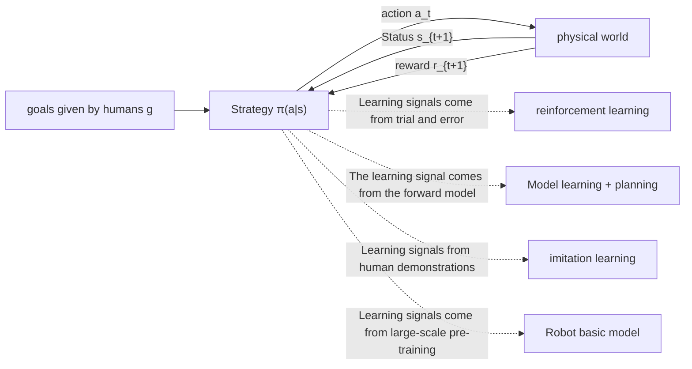
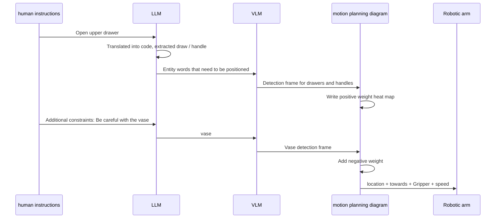
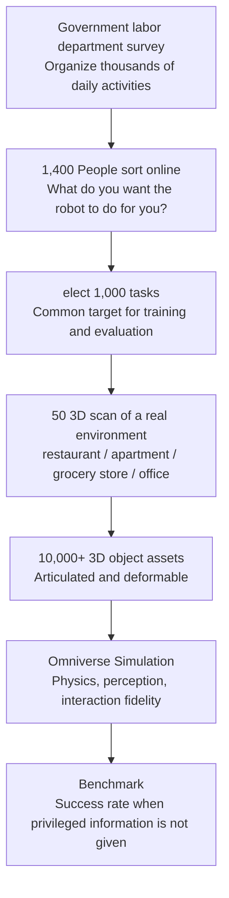
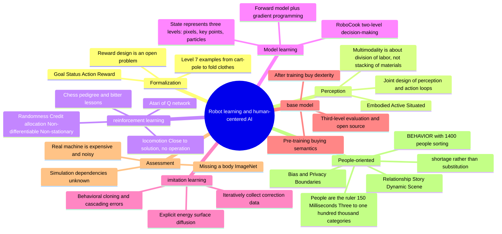

> **Course information**
>
> - **Course name**: Stanford CS231n: Deep Learning for Computer Vision(Spring 2025)
> - **This module covers**: Lecture 17. Robot Learning (103 slides); Lecture 18. Human-Centered AI (no open courseware)
> - **Lecturer (each lecture)**: Yunzhu Li(L17); Fei-Fei Li(L18)
> - **Teaching date range**: 2025-05-29 – 2025-06-03
> - **Course homepage**: [cs231n.stanford.edu/2025](https://cs231n.stanford.edu/2025/schedule.html)
> - **Official courseware**: [lecture_17.pdf](https://cs231n.stanford.edu/slides/2025/lecture_17.pdf) (103 pages, page-by-page illustrations in the book). Lecture 18 has no public courseware - the slides links that should be taught in the 2025 course schedule are commented out, and those in 2024  `lecture_18.pdf`  It belongs to another lecture "3D Vision", so this module does not contain any illustrations from Lecture 18. The content of this lecture is entirely reconstructed based on the classroom subtitles. The oral framework is repeated using Mermaid and tables and marked "Oralized based on the speaker's narration".
> - **Subtitle source**: [cs231n_sp25_kor_sub · eng](https://github.com/lpaiu-cs/cs231n_sp25_kor_sub/tree/main/eng) (Publicly transcribed in English, Chinese rewritten by this book)
> - **Copyright statement**: The copyright of the slides and course materials belongs to Stanford University and the instructors; this book is an unofficial study note and is only used for study and research.

These two lectures are the two ends of this course. Lecture 17: Write "action" into the model: prediction is no longer just describing the world, but changing the world. Lecture 18 includes "people" in the definition of the problem: in addition to ability, there are also fairness, privacy and who benefits. The previous sixteen lectures all answered "what you saw", while these two lectures answered "what to do" and "for whom".

The two speakers are not strangers either. The host said in the opening introduction that Yunzhu Li taught this course in 2023, when he was working as a postdoc at Stanford, and his co-supervisors were Fei-Fei Li and Jiajun Wu; half of the work "done in our laboratory" in Lecture 17 came from this circle. Read together, the two lectures are actually calculating the same account. Lecture 17 What is repeatedly weighed? **How much real interaction is exchanged for how much generalization?**: Trial and error is the most expensive, learning the model requires the least samples, copying the demonstration is the fastest, and the basic model is the most comprehensive but poorly evaluated. Lecture 18 It is the other end that is weighed——**To whom do these abilities end up?**: For whom the model looks, for whom, and for whom it excludes. One is cost and the other is allocation; without any of them, the robot is just a demonstration video.

## 1. A causal edge: the action will rewrite the input of the next step

*(Reference time: 00:01:36 – 00:05:05｜Lecture 17; 00:00:05 – 00:04:46｜Lecture 18)*

The success of the first sixteen lectures can be summarized into one sentence: given input, predict the output. The speaker first spreads the sentence pattern across two pages and then breaks it down on the third page.

Classification, regression, detection, segmentation, and description all fall into this template: the loss measures the distance between the prediction and the label, and the gradient changes the parameters along this distance. It has a premise that it is not written out - the data is given by others, the labels are marked by others, and the model cannot touch how the data is generated.

Self-supervision crosses out the label item and uses the auxiliary loss constructed by the data itself to learn representation. The utilization efficiency of unlabeled data is the main source of visual progress in the past few years. But both pages share the same worldview: **The model is a bystander**. The distribution it reads is fixed, and the predictions it writes do not in turn change that distribution.

Robot learning adds an extra arrow to this picture: action  $a_t$. The speaker's statement is very straightforward - whatever action you decide to take in the real world, the world will change because of this action. So the problem changes from "fitting a label" to "maximizing an objective function under physical constraints", and the data is no longer given, but sampled by your own strategy.

This picture is the skeleton of the whole lecture: the loop in the middle remains the same, what changes is **Where does the signal come from?**. The four paradigms are not four fields, but the line "learning signal" is replaced on the same picture.

The speaker used not papers to prove that "this field is growing" but video frames: two frames showed two-arm robotic arms stacking cartons and grinding coffee on a wooden table, one frame showed a humanoid robot walking around in the laboratory, and one frame showed two humanoid robots in a home scene. The double-speed mark itself is a signal - these films are played at an accelerated pace, and the real rhythm is much slower, which he himself will bring up as a problem when talking about π0 in Chapter 13.

The second page puts the funding titles directly together: Physical Intelligence \$400 million (November 2024, Bezos and OpenAI participated), Figure \$675 million (February 2024, Microsoft, NVIDIA, OpenAI participated), Skild AI \$300 million (July 2024), The Bot Company \$150 million, 1X’s \$100 million Series B (2024 January). These numbers do not point to valuations, but to cost structures: general robots have to build their own data collection links and iterate their own hardware, and robot data cannot be crawled from the Internet like text. Money is mainly spent on “creating data”.

The third page is changed to a big factory. The purpose of the two pages side by side is not to compare who has more money, but to show that the structure of the participants has changed: both start-up companies and the research departments of large companies are betting in this direction. It is already an industrial track, not a subject of several laboratories.

The order of the seven items in the outline itself is very particular: first formalization (write "doing actions" as an object that can be optimized), then perception (where the input of the action comes from), then three learning methods that are increasingly less real-interaction-friendly, and finally fall into the "this road is not over yet" part. Every time you enter a new topic, this outline will appear again and the red box will move. There are a total of 8 times in the whole lecture, which is the progress bar of this class.

Zooming out again, the opening of Lecture 18 gives this line a history of 500 million years: 540 million years ago, trilobites grew photoreceptor cells, and for the first time, life could actively detect the outside world. Zoologist Andrew Parker explains that once vision emerged, survival became an arms race - either evolve better eyes and faster reactions, or be eliminated. The explosion of species brought about by this competition was the Cambrian explosion. The "Summer Vision Project" in the 1960s envisaged allowing a few undergraduates to spend a summer building "an important part of the visual system." The speaker commented that the North Star was very clear and the distance was seriously underestimated. This problem probably still exists today.

According to the speaker's oral summary, the main lines of the entire 18th lecture are three: visible (creating object recognition at the same level as the human eye), invisible (fine-grained recognition beyond human resolution, as well as human beings' own biases and upper limits of attention), and wanting to see (connecting perception to action, and then asking whether AI is an amplifier or a substitute). These three lines **Acceptance criteria are completely different**: The first criterion is defined by humans. If humans can do it, it will pass if the model can do it. The second criterion must go beyond the ceiling marked by humans. At this time, "aligning with humans" is no longer the goal. The standards of the third criterion are not in the model at all. Who benefits, who is seen, and who is replaced. These quantities are not included in the loss, but determine whether the technology can be implemented. Confusing the standards of the three lines is the most common misunderstanding outside of this course.

## 2. Formalization: four words, an underestimated boundary

*(Reference time: 00:05:34 – 00:12:20｜Lecture 17)*

The speaker gave the only "definition" comparison here: Computer vision is mainly about learning the representation of high-dimensional input; robot learning is about solving a constrained optimization problem. The constraints are the physical world, the objective function is defined by goal, and the solution is a series of actions. This sentence explains why there is almost no discussion of network structure later in this lecture, only how the signal comes and how much it costs.

Four things determine the problem: \*\*goal\*\* can be a language instruction, or it can be a scalar function that measures good or bad; \*\*state\*\* is the agent's estimate of the current situation of the environment; \*\*action\*\* is the instruction given to the executor; \*\*reward\*\* is the environment's score for this step. The four together define a sequential decision-making problem.

Expand this sentence into a table, and you can see clearly where the dividing line between the two disciplines is:

| Dimensions | Visual tasks (Lectures 1–16) | Robot Mission (Lecture 17) |
| :--- | :--- | :--- |
| Where does the input come from? | Others pick it up, label it well, and the distribution is fixed. | Sampled by one's own actions, the distribution drifts with the strategy |
| what is the output | label, box, mask, sentence | A sequence of actions, the length of which is determined by the task |
| objective function | Sample-by-sample loss, differentiable and decomposable | The scalar reward at the end of the trajectory is non-differentiable and difficult to apportion |
| The price of one mistake | If the indicator drops a little, you can run again | Knocking over things and hitting people is irreversible |
| success criterion | Accuracy on fixed test set | Mission success rate on real machines, expensive and noisy |

The last row of this table is the foreshadowing of the entire lecture: the first three rows can all be solved algorithmically, but the last row cannot.

### 2.1 Seven examples: same template, different reward shapes

The most classic entry-level example is cart-pole: four dimensions of state (angle of the pole, angular velocity, position of the cart, horizontal speed), one dimension of action (horizontal force exerted on the cart), and 1 point for each time step when the pole remains upright. Its value lies in the fact that all three conditions are met - the state is completely observable, the rewards are dense, and the dynamics are known, so it is only worthy of being used as a toy for calibrating intuition.

Switching to a quadruped robot, the same template immediately becomes heavier: the state is the angle, position, and speed of all joints, the action is the torque applied to each joint, and the reward is 1 for each step when "keeping upright and moving forward". The source is marked in the footer (Schulman et al., "High-Dimensional Continuous Control Using Generalized Advantage Estimation", ICLR 2016) - this is a key step in pushing the policy gradient to high-dimensional continuous control, and is also the predecessor of a series of subsequent PPO work.

Atari changed the nature of states: states are raw pixels on the screen, actions are discrete up, down, left, and right, and rewards are instantaneous increases and decreases in scores. Its significance is to plug perception and decision-making into the same network - as you will see in Chapter 4, this setting directly led to the practice of using convolutional networks to fit the Q function.

This page only contains goals, leaving status, actions, and rewards blank. The speaker deliberately left "Want to Win" on a separate page, and then added it to a machine-readable form on the next page.

Go is the opposite extreme: the state is the position of all the pieces on the board (discrete, huge), the action is the position of the pieces, and the reward **Only given in the last hand**, win 1 and lose 0. The reward changed from "one for each step" to "only one for the whole game", and the credit allocation puzzle in Chapter 4 grew out of here.

The prompt itself is a joke, but it lays out the meaning of the word "state" in the language: the state is the words that have been written down.

Large language models are also plugged into this template: the state is the existing word, the action is the next word, and a correct guess is worth 1, and a wrong guess is worth 0. This mapping may look like it was forced together, but it actually points out one important thing——**Autoregressive language models are a special case of "rewards are immediately available at every step"**, so it can be trained in a purely supervised manner; once the reward moves to the end of the trajectory, supervised learning becomes ineffective.

"Being a good companion" is a goal that even humans can't explain. This is the reason for choosing it: the more difficult it is to write a goal into a formula, the more it can only be scored by people.

The chatbot hands over rewards to humans: +1 for satisfaction, -1 for dissatisfaction, and 0 for neutrality. This is the purest form of "rewards are not differentiable and can only be sampled", and it also explains why this type of system requires people to continuously mark preferences in the loop.

Beginning on this page the goal becomes a physical action: fold a piece of cloth. The real difficulty is not in the action of "folding", but in the state of an object like "cloth" which can hardly be described by low-dimensional vectors.

This page is closest to a real robot: the state is a multi-view RGB or RGB-D observation (not a low-dimensional vector, but an image), the action is the movement of the end effector plus the opening and closing of the gripper, and the reward is a human judgment of whether the clothes are folded. The speaker specifically emphasized that "whether to close or open the gripper" is also part of the action - the gripper is not a tool, but a dimension of the action space.

> Editor's note: The State line on page 20 follows the "Current conversation" from the previous page, which is a copy of the remains of the courseware production. According to the lecturer, the state here should be multi-view RGB/RGB-D observation, as well as the robot's own posture and gripper state.

Put the seven examples side by side, and you'll see an axis from "toys" to "real problems":

| Example | Status | action | reward density | the difficulties it exposes |
| :--- | :--- | :--- | :--- | :--- |
| Cart-Pole | 4-dimensional low-dimensional vector | 1 dimensional horizontal force | 1 per step | Almost nothing, used to calibrate intuition |
| quadruped locomotion | Angle, position, speed of all joints | Moment of each joint | 1 per step | High-dimensional continuous control, sim-to-real gap |
| Atari | Screen original pixels | 4 discrete keys | Score increase or decrease for each step | Perception and decision-making must enter the same network |
| Go | All chess piece positions on the chessboard | position | Only in end game 1 or 0 | credit allocation |
| text generation | words already written | next word | Instant right or wrong at every step | The rewards are the most dense, so they can be eaten by pure supervision. |
| chatbot | current conversation | Next reply | Manual +1 / 0 / -1 | The reward is non-negligible and can only be sampled |
| fold clothes | Multi-viewing RGB/RGB-D | End movement + jaw opening and closing | artificial 1 or 0 | The state cannot be described by low-dimensional vectors |

### 2.2 Reward design: the part that cannot be explained in one sentence

The formalization only stopped when it said "there will be rewards". The speaker then added a piece of content that is rarely covered in courses: how to determine rewards is an open question in itself. In the same case of autonomous driving, "arrive as quickly as possible" and "passengers can sit comfortably" are two opposite rewards; in the same case of folding clothes, some people require the smallest area after folding, while others require the surface to be as smooth as possible. Even the same piece of clothing can have completely different criteria according to different people's preferences.

This paragraph foreshadows a judgment that will appear repeatedly later: the most expensive thing in robot learning is often not the network, but the **Translate a vague human intention into a scalar that does not bias the strategy**. The non-stationarity in Chapter 4 and the evaluation difficulties in Chapter 14 are essentially the sequelae of this matter - you set a reward, and the strategy will optimize it accurately, including side effects you did not expect.

## 3. Perception: The robot is not a reader, but a sampler

*(Reference time: 00:12:38 – 00:18:22｜Lecture 17)*

For the same outline, the red box moves down one space. What this chapter wants to answer is: What is the difference between the observation obtained by the robot and the picture in the data set.

The speaker’s definition is very simple: the physical world provides high-dimensional observations (RGB, RGB-D, or maybe touch), and what the robot needs to do in perception is to extract information from it. **Structured knowledge useful for downstream decisions**——Not to describe the scene more completely, but to bring out the part related to the action.

The slide lists three realities. **incomplete knowledge**: Occlusion, sensor noise, only seeing one side of the object. **Imperfect movements**: Grasping may not be successful. Slipping something with your hand will in turn change the environment. The perception system must be able to handle the state after "I messed up the situation."**The environment will change**: Not only rigid bodies, but also deformable objects such as cloth, ropes, and particles, as well as dogs, children, and other people moving around in the same space.

All three together explain an engineering fact: robots don’t just have a camera. As long as some kind of sensor can provide useful information, install it - the tactile sensation will tell you whether you have a good grip, the camera will tell you the overall situation, and the sound will make up for the moment when the vision is blocked. The real design difficulty is not to "install a few", but to make them complement each other in the same representation: the touch gives the local contact state, the vision gives the global pose, and the time scales of the two are different.

What this picture wants to say is the specific meaning of "multimodality" in robots - it is not about piecing together several types of data and feeding them to a large network, but that each sensor is responsible for a segment of data. **It can only be measured physically** information. The depth camera cannot detect contact force, and the tactile array cannot detect steps three meters away.

This page gives a concrete platform to achieve the ultimate in multimodality. It can read all the accounts of a real machine: two fisheye cameras on the head; a 3D laser scanner plus a binocular camera in the multi-sensor head; three Intel Core i7s forming a perception computer; Robotiq three-finger adaptive gripper; six-axis force/torque sensor; IMU; strain gauge pressure sensor; 30 degrees of freedom driven by 24 hydraulic actuators and 6 motors; 3.7 kWh lithium battery; running Linux + ROS.

What this picture really wants to say is: perception is not a model, but the bandwidth and power supply of a machine. With so many channels of data entering the same computer at the same time, the key to the project lies in calibration and synchronization - all sensors must fall on the same coordinate system and the same timeline, otherwise "complementarity" will turn into "mutual interference."

This page is the sharpest comparison in the entire lecture. On the left is the familiar instance segmentation from the course: given a 2D image, label each pixel as an instance and draw an outline. On the right is what the same type of task looks like in a robot: there is a pile of things on the table that look like "one object", or it may be several parts set together——**You can't tell the difference just by looking.**. The robot must decide on its own "what action should I take to see clearly": push it, dial it, change its perspective, and use actions to exchange information.

Three adjectives, each worth noting:

- **embodied**: The robot has a physical body and directly experiences the world; its movements are part of the dynamics of the world and are immediately fed back to its own feelings.
- **active**: The robot is an active perceiver; it knows why it wants to perceive, and it chooses what to see and where to see. The speaker's example is an everyday one - if you want to know what's behind the desk, just stick your head over it.
- **situated**: When robots are in the world, they are not dealing with abstract descriptions, but "here and now"; the world directly shapes the behavior of the system.

In contrast, the vast majority of computer vision data sets are **Passive collection** Of: Someone took the photos and marked them in advance, and the model was only responsible for reading. This is not a philosophical rhetoric, it determines who controls the distribution of training data - in the passive data set, the things the model has seen are the same ones it will encounter; the things the robot encounters are picked out by its own strategy.

The first frame only contains photos and documents. What the three examples have in common is that perception is never an independent module, it is embedded in a cycle of "seeing-moving-looking again".

In the second frame, there are two circles on each photo: the drone frame, the sensing ring is around the belly camera, and the action ring is on the rotor; the PR2 frame, the sensing ring is around the head camera, and the action ring is around the gripper; the arms frame, the sensing ring is around the head, and the action ring is around the wrist. An arrow is connected between the two rings, pointing to the conclusion of the next frame.

In the third frame, a sentence was added to the original picture: A key challenge in robot learning is to close the perception-action loop. The lecturer gave a very practical criterion here: the robot does not need to know the complete state of the environment. When buttoning a shirt, one only needs to know the local area around that button; so the accuracy, range, and frequency of perception should be consistent with the task and downstream decisions. **joint design**, instead of making a general perceptron first and then connecting it to the strategy.

This sentence will be repeated in different forms in each subsequent chapter: what should the model represent, where should the strategy be looked at, and where should the data be collected? The answers are all determined by the task.

## 4. Reinforcement learning: Write "trial and error" into an algorithm, and then hit four walls

*(Reference time: 00:18:31 – 00:25:06｜Lecture 17)*

The most straightforward solution is to let the robot interact with the world as much as possible: collect experience, observe "this action leads to high reward, that leads to low reward", and then move the behavior in the direction of high reward. Reinforcement learning formalizes this—the agent constantly interacts with the environment and uses trial and error to maximize rewards (or minimize costs).

This diagram unfolds on the timeline: the environment gives  $s_t$, the intelligent agent generates  $a_t$, environment return  $r_{t+1}$  with  $s_{t+1}$, repeat. Note that it is almost structurally identical to the supervised learning loop - both are loops of "input in, output out, and feedback received". The difference lies entirely in the nature of the feedback.

With two pages side by side, the instructor asked a question: \*\*Why is reinforcement learning different from ordinary supervised learning? \*\*This question hangs on the page, and is answered one by one on the next four pages.

### 4.1 Four differences, one more fatal than the other

| difference | Specific performance | direct consequences for algorithms |
| :--- | :--- | :--- |
| stochasticity | For the same action, the environment may give different next states and different rewards. | You cannot assume that "one failure = this action is wrong", you can only estimate expectations |
| credit assignment | reward  $r_t$  Not necessarily directly dependent on actions  $a_t$, and may even appear only in the final game | It is necessary to spread the scalar value at the end back to dozens or hundreds of actions. |
| nondifferentiable | It cannot be reflected back to the world, it cannot be calculated  $\partial r_t / \partial a_t$ | Zero-order gradient estimation can only be done by relying on large-scale sampling. |
| nonstationary | What the agent experiences depends on how it moves. | The distribution of training data drifts with the policy, i.i.d. assumptions fail |

The lecturer used pushing boxes to explain randomness: for the same push, if the distribution of the ground support force is slightly different, the angle at which the box turns may be different. Therefore, "whether this action is good or not" itself is a random variable, and the strategy should optimize expectations rather than a certain result. This is also the reason why robot strategies need to be robust by nature - it's not about engineering mystique, it's about the noise in the problem definition.

The classic scenario is Go: you don’t know whether you won or lost until the last move; and this 0/1 result may have been buried in the first move. It is one of the core difficulties in reinforcement learning theory to fairly distribute a scalar value of the end game back to hundreds of decisions in the middle game or even the beginning.

The third point is the most critical in engineering: in supervised learning, the entire chain is differentiable, and the gradient is returned all the way to the parameters; while the environment (the real world or a game simulator) is usually not differentiable. $\partial r_t/\partial a_t$  Doesn't exist at all. The speaker mentioned the industry's approach - relying on large-scale sampling to make zero-order estimates of gradients, and using "perturb it to see how the reward changes" to approximate the direction. The price is sample size, and sample size on real robots is time and wear.

The fourth is the most hidden: in supervised learning, what you predict will not affect the next sample in the data set; in sequential decision-making, your actions determine what state you will see next. Once the strategy changes, the data distribution changes. The "training set" and "test set" are no longer two batches of independent samples, but the same timeline that is constantly being rewritten by itself.

### 4.2 Atari: Stuffing the Q function into a convolutional network

The Atari setting appeared in Chapter 2, and is revisited here as the first "end-to-end" sample: the state is the raw pixel, the action is the four discrete button presses, and the reward is the score change for each step. The footer marks the deep reinforcement learning work of Mnih et al. in 2013, which was the predecessor of DQN.

This page is worth remembering every number, because it is the most classic engineering configuration of deep reinforcement learning: the input is  $4\times84\times84$——The last 4 frames of grayscale images are stacked (first do RGB→grayscale, downsampling, and cropping). The purpose of stacking 4 frames is to allow the network to see the speed and direction from the differences between frames; the first layer  `Conv(4→16, 8×8, stride 4)`, second floor  `Conv(16→32, 4×4, stride 2)`, then  `FC-256`, finally  `FC-A`  Output the Q value for each action. When there are four actions, the last layer gives  $Q(s_t,a_1),\dots,Q(s_t,a_4)$  Four numbers.

The definition of the Q function is "in the state  $s$  Execute action next  $a$  Afterwards, the discount builds up to the expectation of future rewards”. The usage is extremely simple: feed the current state, get four numbers, and execute the largest one. The entire set of decisions is therefore compressed into a single forward propagation - this is the biggest engineering attraction of Q-learning: **Training can be expensive, inference must be cheap**.

The speaker clearly stated the trade-off here: there is too much material to cover today, and we will not go into the details of reinforcement learning. So the next chapter is not to explain the algorithm thoroughly, but to answer a more general question - under what conditions does this set of things really win?

## 5. When did RL really win: Breakout, the fourth generation of AlphaGo and “bitter lessons”

*(Reference time: 00:25:06 – 00:31:14｜Lecture 17)*

The video of Breakout’s training was shown in class. The lecturer explained it in three stages: after 10 minutes of training, the agent was able to touch the ball, but often missed the ball; after 2 hours of training, the ball became stable and could continue to score points by rebounding; after training for longer, the agent discovered a strategy rarely used by human players - hit the ball above the left wall, let the ball bounce back behind the bricks, and eliminate a large area at a time. This is where reinforcement learning is most convincing: **It can find solutions that humans never thought of**.

The first frame only has one AlphaGo entry. Note that its formula is "three things put together": imitation learning for initialization, tree search for decision-making, and reinforcement learning for self-improvement. Among them, the imitation learning aspect will be developed separately in the form of "copying demonstrations" in Chapter 10.

There is an extra line in the second frame: AlphaGo Zero removes the entire imitation learning module and starts playing against itself from scratch. The instructor calls this step an example of "the bitter lesson" (Richard Sutton) -**Sometimes the simplest recipe wins**, because it is more compatible with scaling. The fewer modules there are, the easier it is to scale.

The third frame adds the decoupling of algorithms and games: instead of writing heuristics for each type of chess, the rules are the interface. The amount of information added in this step is smaller than the previous frame, but it is the first time that the three words "universality" have been realized.

The fourth frame is the most critical shift in the genealogy: MuZero no longer assumes that the rules of the game are known, but learns a dynamic model of latent space and makes plans in this model. Pay attention to the correspondence between this step and the four paradigms in Chapter 1 - it moves from "pure trial and error" to "learning model + planning", and that is the theme of Chapter 7.

The lecturer inserted a personal experience here, which is a rare "why do I do this" in this lecture: When AlphaGo came out in January 2016, he was deciding the research direction. He had previously done computer vision. After seeing this news, he turned to decision-making problems and worked all the way to today's robot learning. The reason was that he was not satisfied with only processing passively collected data sets.

The fifth frame adds a photo of a person. Two quotes are: "With the emergence of AI in Go, I realized that even if I try my best to become the first, I am not the best"; "Even if I become the first, there is an existence that cannot be defeated." The lecturer did not comment on this passage, but just placed it after the fourth generation system - the end of a technical genealogy and a person's career.

After that are two more complex games. The lecturer's judgment on this step was very straightforward: as long as the computing power is sufficient and the training infrastructure is properly designed, games several orders of magnitude more complex than Go can be conquered; conversely, **If the rules of a domain can be accurately simulated, sooner or later it will be eaten up by reinforcement learning**. This judgment is the baseline for all subsequent "why real robots are different".

## 6. Real robot: locomotion is close to being solved, but the operation is still an order of magnitude away.

*(Reference time: 00:31:14 – 00:37:02｜Lecture 17)*

The paper on the left changes the way instructors think about reinforcement learning. Prior to this, the success of RL basically stayed in games, because games can be infinitely copied, and training and testing are equally distributed; while real robots have a sim-to-real gap. The conclusion of this work is: **The simulation does not have to simulate bushes and snow. As long as the parameters such as friction and geometry are randomized wide enough, the real world is just a sampling point in this distribution.**. The Unitree demonstration on the right uses the same set of ideas to make more extreme dynamic actions.

From this, he made the boldest judgment in this lecture: In the subfield of locomotion, the problem is close to being solved, and the solution is reinforcement learning. He also added restrictions - in these demonstrations, there are still people giving high-level instructions (which direction to go, whether to turn around), and the robot is responsible for translating the high-level instructions into the torque of each joint.

Manipulation is less optimistic. In 2019, OpenAI allowed a dexterous hand to learn to turn a Rubik's Cube in simulation, and then transferred it to a real machine; the lecturer specifically pointed out two facts behind the video: the success rate was very low, and the number of trials actually tested in the paper was also very limited. Visual Dexterity (Science Robotics 2023) on the right advances this matter to "in-hand reorientation of arbitrary-shaped objects", but is still classified as "success in isolated tasks" and is not a general ability.

The slide begins collecting. The first is the learning method: pure trial and error means that every bit of progress must be exchanged for real interaction. The second one is magnitude: AlphaGo Zero is equivalent to learning three thousand years of human Go knowledge in 40 days. It sounds very romantic, but converted to a robot, it is equivalent to decades of computer time; if this task still has a huge sim-to-real gap and can only be practiced on a real machine, this magnitude will directly be a death sentence.

Three lines were added to the second frame. **safe**: The class showed a video of a humanoid robot learning to walk, and there were a lot of weird gestures in the middle - these gestures would be a disaster if they happened on a real machine. **Interpretability**: Strategy is a black box. When a problem occurs, it is difficult to locate which decision-making step was bad. **Correction**: When the behavior is wrong, there is no intuitive interface to tell it "what it should be".

The control system was replaced in the third frame. People don’t just learn by trial and error. We have a knowledge about the world. **intuitive model**, I can "imagine" the result before taking action, so I can learn the same thing once or twice, and can transfer it to scenes I have never seen before. This frame is the turning point of the whole lecture - it changes the question from "How to make trial and error more efficient" to "Can I also learn a model?"

## 7. Model learning: first train the "imagination", and then reversely interpret the actions

*(Reference time: 00:37:15 – 00:45:26｜Lecture 17)*

The red box has moved from the intelligent agent to the physical world. What we want to learn in this chapter is the state transition function  $P(s_{t+1}\mid s_t,a_t)$: Give me the current state and action, and predict the next state. With it, decision-making changes from "trying" to "calculating".

The slide writes the plan as a three-step cycle. The left side is geometric intuition: the gray dot on the left is the current state, the four dotted lines are the trajectories of different action sequences in the model, the green solid line is the one with the smallest cost, and the red dot in the lower right corner marks the target. On the right is the algorithm: **Execute the first action → get the new state from the environment → re-optimize the entire action sequence using gradient descent**. The reason why we only perform the first step is because the model must be inaccurate. It is safer to recalibrate after taking one step than to go all the way to the dark side.

There are two "Keys" on this page that are worth remembering separately. `Key: GPU for parallel sampling / gradient descent`——Because the model is differentiable, the cost of the entire trajectory can be derived from the action, and the GPU can simultaneously sample hundreds of candidate trajectories and calculate gradients in batches. This is the direct reason why this type of method suddenly became practical after 2017. `Key question: what should be the form of s_t?`——The entire remaining chapter is devoted to answering this question: What should the state be represented as?

### 7.1 Three status representation, three generations of work

The earliest option is "state is image". Deep Visual Foresight (Finn & Levine, ICRA 2017) uses an encoder-decoder with LSTM to predict the next frame: the input is  $64\times64\times3$  The current frame, action and terminal state (5 dimensions each) are tiled into feature maps and then put into the middle layer. The decoder uses the CDNA kernel to generate 5 sets of transformed images, and then uses compositing masks to synthesize the final prediction. Its historical status lies in: this is the first batch of work to prove that "pixel-level forward models can be used for planning", and it is also the starting point of the subsequent "world model" line.

The planning method is very straightforward: feed the candidate action sequence to the model, get a series of predicted frames, calculate the pixel distance between them and the target frame, and select the one with the smallest distance for execution. The lecturer pointed out two hidden costs of this type of method: the pixel distance is not equal to the task distance (a slight change in the background will swamp the displacement of the object), and the error will accumulate after predicting multiple frames.

## 8. Three levels of state representation: pixels, key points, and particles

*(Reference time: 00:45:26 – 00:48:32｜Lecture 17)*

The second generation shrinks the representation from "all pixels" to "a few key points": mark a number of key points on the object, track their position in the three-dimensional space, and learn a model of "given thrust and contact points, how the key points move". The state dimension is reduced from tens of thousands to dozens, making the model easier to learn and faster to plan. The price of this step is: the key points are chosen by people, and if you choose the wrong ones, it is equivalent to writing in the inductive bias.

This is a video frame: the KUKA robotic arm pushes a paper box on a wooden platform. The fourth candidate trajectory is marked in the upper left corner, and the colored trajectory lines of key points can be seen in the small window in the lower right corner. What it shows is the actual rhythm of "planning-execution-replanning" - each frame is re-solved using the current key point position, rather than following a pre-calculated trajectory.

The third generation is aimed at objects with a higher degree of freedom: particles, dough, and cloth. The method is to represent the object as a set of particles, and the state is the position of all particles. The slide lists four moments horizontally: In the real scene, the robotic arm pushes a pile of dark particles from the lower right to the circular target area in the upper left corner (the target area is marked with a goal mask). The lower line is the corresponding particle representation - the distribution shape of the particles corresponds one-to-one with the outline of the real particle pile.

The same set of models must handle particles of different scales. The purpose of this page is to illustrate the versatility of particle representation - it does not assume that the object is a rigid body, nor does it assume that the particles are of uniform size. As long as the observations can be converted into a set of points, the model can be used. The differences between the three generations can therefore be condensed into one sentence: **How much priors you write into the state depends on how much data the model needs to fill in the rest.**.

This is the effect display, mark  `24x speed`: The robot pushes piles of particles from one shape to another, eventually spelling out letters. The task is divided into two stages - first do non-trivial overall redistribution (move most particles to the target area), and then align the details (edges, strokes). The lecturer emphasized that this type of task relies on "feedback + re-planning" to be reliable: model predictions will be biased, but new observations can be obtained from the environment at every step, and errors will not accumulate out of control.

## 9. RoboCook: two-level decision-making, and a state machine that can jump back

*(Reference time: 00:48:32 – 00:54:49｜Lecture 17)*

This system (Shi, Xu, Clarke, Li, Wu, CoRL 2023, Best System Paper Award) uses particle models to make dumplings: there are 15 3D printing tools (numbered 1–15, including platens, rollers, hooks, molds) on the workbench, four RGBD cameras reconstruct the geometry from different angles, and the red box is the dough and fillings. Robots have to decide for themselves **Which tool to use**, and **How to use**.

This page is the most technically dense in the entire lecture. The model is a graph neural network (GNN): initial state  $s_0$  Expand gradually along the timeline, taking in an action at each step  $a_t$, output  $s_{t+1}$, after five steps we get  $s_5$. In the visualization, the red particles are tools and the blue particles are objects. The three pictures on the left are the initial configurations seen from the top view, side view and perspective view respectively; the upper row of the 5 columns on the right is the prediction and the lower row is the true value. The task of this frame is "grabbing". It can be seen that the deformation of the particle pile when the tool is pressed down is predicted to be quite close to the true value.

The second frame is changed to "Press": the red plate is pressed down from above, and the pile of blue particles is flattened and spread to both sides. Compared with the previous frame, the new difficulties are the large contact area and strong deformation nonlinearity - but the prediction column and the true value column are still consistent, indicating that the particle representation is also valid for large-scale contact.

In the third frame, the tool is changed again: the cylindrical roller presses on the blue thin layer, and the deformation is transmitted along the rolling direction. Looking at the three frames together, the selling point of this model is not “accurate prediction”; **There is no need to retrain when changing tools, actions, or materials.**——The physical semantics of particles are universal, tools are just another set of particles.

This frame has the most dense information, don’t be fooled by its “no title”. The upper left corner is marked  `12x speed`; There is a piece of dough in the center of the countertop, on the upper left wooden board are several already wrapped dumplings, in the middle is a metal dumpling mold, and on the right side are 15 tools neatly arranged. The key is the stage axis at the bottom: `Initial dough → Knife → Gripper → Press → Roller → Circle cutter → Pusher → Skin spatula → Filling spatula → Hook → Dumpling`, a total of eleven stages.

This axis explains why decision-making is split into two levels in the ledger: the entire task is a long-term pipeline. At each step, the robot must decide not only "which stage it is at now and which tool to use" (discrete, few options), but also "how to use this tool specifically" (continuous, multiple degrees of freedom). It also explains how "recovery" is achieved - after a person destroys his face, the senior management judges that the current observation is more consistent with a certain stage upstream, so they turn the pointer back and start going down again from there. The so-called robustness in this system is a stage state machine that can jump back.

### 9.1 The ledger of this method

The speaker added three project details in the Q&A, which was more informative than the slides themselves.

- **No physical simulation**. There is no simulator based on physical equations in the system; the control group used the best deformable body simulator at the time, MPM (Material Point Method). Even though a lot of system identification was done to estimate material parameters, the accuracy was still obviously not as good as a model learned directly from real interactions. The speaker's statement is that "our open-loop predictions align well with the true values, more accurately than any physics simulator."
- **Sampling is done offline, and only strategies are run online.**. Sampling hundreds of trajectories for each decision during testing was too slow, so they did large-scale sampling in the offline phase and used the data to distill a policy network; only one forward propagation was performed during deployment. This is still a neural network strategy, but the training signal comes from the model's predictions rather than human demonstrations.
- **Two-level decision making is trained separately**. The high-level is the classifier of "which tool to use", which is trained on data collected 10 times by a human operator; the low-level is the strategy of "given the tool, what to do next". The advantage of separate training is recovery ability: after a person destroys the dough that has been kneaded, the high-level classifier can judge from the current observation to "return to an earlier stage" instead of going on.

This also explains the most dramatic scene in the video in the class: people keep adding ingredients to the table, pushing the dough away, and even destroying the entire finished product, but the robot can still start over. What supports this scene is not patience, but re-evaluating the status, re-selecting tools, and re-planning every step of the way.

## 10. Imitation learning: folding “how to do it” into a supervision signal

*(Reference time: 00:54:49 – 00:59:39｜Lecture 17)*

This time the red box falls on  `Agent`  on. The speaker’s positioning is one sentence: **Imitation learning is supervised learning from demonstration data sets**——The state is the input and the action is the label. Chapter 7 uses supervised learning to "learn the world", and this chapter uses supervised learning to "learn strategies"; both share the same premise, that is, the data has been collected.

The lecturer explained that this matter is not new - humans have learned a large number of physical movements and social behaviors through imitation from a very young age, and robots have just moved this process to robotic arms. This also explains why imitation learning has been studied in the field of robotics for decades, but has only really become useful in recent years: what has changed is the ability to express the strategy, not the idea itself.

The most classic algorithm is behavioral cloning (BC): learn an algorithm from observations  $o_t$  to action  $a_t$  mapping  $\pi_\theta(a_t\mid o_t)$. The picture on the left shows how it breaks down: the black line is the training trajectory, and the red line is the actual trajectory of the strategy. They almost coincide at the beginning, and then diverge sharply after a certain position - because the input of the strategy there has slightly deviated from the training distribution, the actions it gives are even more biased, and the deviation is magnified. The picture on the right draws this matter as a runway: the yellow band is the data coverage area near the expert's trajectory. Once the strategy deviates outside the band, it is directly written on the picture.  `No data on how to recover` (There is no data to teach it how to recover), and finally hit a red cross.

this is **cascading error**: The single-step error is small, but it pushes the state outside the training distribution, and the error in the next step is larger, amplifying along the time axis. The fundamental difference between it and supervised learning is that in supervised learning, each sample is independently and identically distributed, and the wrong prediction of one sample does not affect the next one; and here the third  $t$  The output of step is  $t+1$  step input.

> Editor's note: In classic analysis, the expected cost of behavioral cloning increases with round length.  $T$  submit  $O(T^2)$  Cumulative (single step error  $O(\epsilon)$, but in  $T$  (subject to distribution shifts sequentially at each moment); this is also the starting point of the later "ask the experts while running" method such as Dagger.

The engineering solution is to close this loop: first use experts to demonstrate and train a version of the strategy, run it in a real environment, specifically collect failed positions, and then ask experts to provide corrective actions at these positions (or people directly take over the demonstration), and add the corrected data to the training set for retraining. The slide depicts exactly this cycle - experts provide feedback and demonstrations, generate training data, supervised learning obtains strategies, the strategies are rolled out in the environment to generate trajectories, and the trajectories return to the experts. The lecturer said that this is the standard life cycle of "any imitation learning system in the real world."

### 10.1 The other way around: learn rewards first, then learn actions

Behavioral cloning has an implicit penalty: it throws away the task itself. The demonstration only wrote "how to do it" but not "why to do it", so what the strategy learned was the surface statistics of the action, not the goal. Inverse reinforcement learning (IRL) goes in the opposite direction: first derive a reward function from the demonstration, and then use this reward to run standard reinforcement learning. The slide uses two arrows to make this very clear - RL is "rewards are algorithmically rewarded for behavior", and IRL is "behavior is algorithmically rewarded".

This page is a video placeholder: the embedded video is not rendered when exporting the PDF, leaving only a black box on the page. The lesson was about Stanford’s early helicopter aerobatic flying work - the work of Pieter Abbeel, Andrew Ng and others, which allowed model helicopters to learn radical maneuvers such as inverted flight and roll. The lecturer specifically emphasized that this was very old work, but at the time it was amazing to be able to make such an action on a real machine; its methodological significance was to prove that the path of "reversely deducing rewards from human demonstrations" can be closed-loop.

## 11. Three expressions of strategy: regression, energy surface, and diffusion

*(Reference time: 00:59:39 – 01:03:08｜Lecture 17)*

The slides divide the strategies into two categories. **explicit strategy** (explicit policy) is a function  $F_\theta(o)$, calculate actions directly from observations - behavioral cloning is this category, and are trained using regression or classification. **implicit strategy** (Implicit policy) does not give actions directly, but gives an energy function  $E_\theta(o,a)$, the action is  $\arg\min_{a\in\mathcal{A}} E_\theta(o,a)$  Find it during inference.

This change solves one of the most embarrassing failure modes of behavioral cloning: **Multimodal presentation**. For the same task, people may go around from the left or from the right; using L2 regression to fit the two demonstrations, what is learned is the average of the two - a middle route that no one has walked, often directly hitting an obstacle. The energy function does not require a single answer, it only requires that "the actions used by experts have low energy", so multiple modes can exist at the same time.

This page shows the effect of IBC on a real machine: there are two black trays on the table, with blue blocks on the left and yellow blocks on the right. The robot arm needs to sort the mixed blocks into colors. This kind of task with "rich contacts and varied initial configurations" is where explicit regression is most likely to collapse - each initial placement corresponds to a slightly different trajectory, and fitting with a single mean will keep hitting the edge of the tray.

The third grid is the most quoted picture in this lecture. It lays out three generations of strategies side by side:

- **(a) Explicit strategy**:Action by  $F_\theta(o)$  Work it out in one go. Three types of output parameterization are drawn in the dotted box - scalar regression, mixed Gaussian, and classification histogram; all three are "using one distribution to suppress multiple modes", and when there are more modes, they pull each other away.
- **(b) Implicit strategy**:Learn an energy aspect  $E_\theta(o,a)$, action is the lowest point of energy. The heat map in the middle is the energy terrain, and the white curve is the energy contour; the problem is to perform inner-layer optimization during inference, which is slow and may fall into a local minimum.
- **(c) Diffusion strategy**: Instead of finding the lowest point directly, learn the gradient of the energy field  $\nabla E(a)$, iterating from a noise action  $K$  Step by step "push" it to a low energy area. The arrow diagram on the right is the learned gradient field, the white curve is the target manifold, and the arrows point to it everywhere.

Where this analogy falls is: **Policy learning can borrow the entire toolbox of generative models**. Behavioral cloning corresponds to regression, IBC corresponds to energy model, and diffusion strategy corresponds to diffusion model; every time the generation model is changed, a type of failure mode is replaced. The lecturer added that the work was originally done at Columbia University and that the principals now teach at Stanford.

The last page is a full-screen video frame: a white robotic arm is suspended above a white material bin, and green and orange instance masks are superimposed on the screen, indicating that the input to the strategy is indeed pixel-level perception, rather than a structured list of objects. It only appears once in the book and serves to pass the scene to the next chapter.

## 12. Basic model of robot: a strategy, an exam with no questions yet

*(Reference time: 01:03:08 – 01:11:02｜Lecture 17)*

The lecturer first draws a clear boundary: the basic model of the robot **No** explicit status representation, also **No** Explicit transition function; it is a strategy, the input is the observation (or state) plus the goal, and the output is the action. This is important - the world model of Chapter 7 is abandoned here, and everything about the world is packed into weights.

So what is the difference between it and the previous imitation learning and reinforcement learning? The answer is **There is no essential difference, only scale and generalization requirements**. The representative of the imitation learning side is Diffusion Policy, and the representative of the reinforcement learning side is OpenAI's one-handed Rubik's Cube operation. They use the same type of function approximator, but the difference is that the basic model needs to work on a large number of tasks and a large number of embodiments.

The speaker gave a very useful definition - analogy to the current visual language model: the output of VLM is not always perfect, but it will always generate **something reasonable**. The goal of the basic robot model is the same: the synthesized actions are not always optimal, but the generated trajectories are always "beautiful and reasonable." He took apart these two words and explained them on the spot: `beautiful`  Refers to no twitching or shaking, smooth and continuous; `reasonable`  Refers to understanding verbal instructions. Alias ​​are also listed at the end of the page: Vision-Language-Action Models (VLA), Large Behavior Models (LBM).

The timeline lays out the rhythm: RT-1 started in December 2022, and there will be a new model approximately every six months thereafter - RT-2 (July 2023), RT-X (October 2023), OpenVLA (June 2024), π0 (October 2024), and 2025 will be an explosion. Only the name is written on the page without the month. The lecturer's evaluation of this paragraph was very restrained: this field is "noisy" because once you call it a basic model, you promise "wide generalization", and this requires a lot of evidence to prove - evidence is exactly what is lacking.

### 12.1 π0: pre-training + post-training, two stages

The lecturer chose π0 as the only expansion example, and the reason is very straightforward: this is a piece of work that convinced him that "this type of model can perform reliable and dexterous operations in real environments." The six grids are for laundry, wiping countertops, folding cartons, clearing the table, grinding coffee, and cleaning up debris. Each grid is marked with  `autonomous`  And double speed - note that the double speed here is mostly 1x to 2x, which is close to the real rhythm, rather than the common accelerated promotional video.

The left column of the panorama is data: π’s own trans-embodied data set, labeled in the grid  `bus table`, `pack bottles`, `bag groceries`, `open popcorn`, `load dishes`, `sort legos`, `make coffee`, `sweep table`, `empty dryer`, `set table`, `pack shelf`, `flatten box`  and other tasks, from a variety of different robotic arm platforms. The lecturer's statement is: Any model that wants to be called a basic model must have fuel, and the fuel is data.

The red frame moves to the middle. The key design of pre-training is **Don't start from scratch**: The base is a VLM that has been trained on massive visual-language data, and an action expert is connected to the right. The two are trained together with two types of goals - one is action prediction, and the other is a goal moved from the visual question and answer task. The former type allows the model to take actions, while the latter type allows the model to not lose semantic knowledge. The lecturer emphasized the significance of this combination: generalization at the semantic level is "free" because VLM has already learned it; what needs to be supplemented by robot data is generalization at the action level.

The red box moves to the "high-quality post-training data" below. The logic of this piece is borrowed from the large language model community: the base model gives a good starting point, but to do a good job on a specific task, you must use the data of the task for post-training. The slide separates the post-training data into two piles - high dexterity tasks and unseen tasks.

On the next three pages, the red box continues to move on the same picture, this time marking the evaluation gear. The first gear is **Zero-sample in-distribution tasks** (zero-shot in-distribution), the top of the page is marked "Simple in-distribution task" - run directly with the base model, an example is clearing the dining table. The lecturer's statement is: These tasks have most likely seen similar forms in the pre-training stage, and the base model is enough.

The second gear is **Specialized post-training for difficult tasks** (specialized post-training to difficult tasks), the top of the page is marked "Complex distributed tasks", examples are emptying the apartment dryer and folding shirts in batches. The tasks are still distributed, but the requirements for dexterity and long-range consistency are much higher and must be fine-tuned with task data.

The third gear is **Efficient post-training for unseen tasks** (efficient post-training to unseen tasks): Putting things back in drawers, replacing paper towel rolls. The key word for this level is "efficiency" - instead of retraining the model, it uses a small amount of task data to quickly adapt. The three levels together are actually three budgets for the same problem: **Buy as much performance as you have task data**.

## 13. From office shots to open source: three constraints when π0 is implemented

*(Reference time: 01:11:02 – 01:13:59｜Lecture 17)*

This page was taken by the lecturer with his mobile phone in the Physical Intelligence office the day before: two black robotic arms folded a cardboard box on a wooden table, next to an open notebook. Its function is to bring all the previously refined demonstration videos back to the scene - no lighting, no editing, and the camera is still shaking.

The last page is the open source announcement: Released on February 4, 2025, repository  `Physical-Intelligence/openpi`,Apache-2.0 license. The README states that the warehouse contains two types of models - π0 (flow-based diffusion VLA) and π0-FAST (autoregressive VLA based on FAST action tokenizer), and provides pre-trained base checkpoints on more than 10,000 hours of robot data, as well as examples of out-of-box use and fine-tuning on your own data set. There is also a very practical disclaimer in the announcement: π0 was developed for their own robots, unlike common platforms such as ALOHA and DROID. "It may not apply to you, but you are welcome to try it."

The speaker added three questions and answers, which contained more information than the slides:

- **Why is it slower than others?**. The demonstration data was collected by humans remotely operating the same robot. However, remote operation itself is slower than using one's own hands - the body shape is unfamiliar, the robotic arm is far away from the body, and there is obstruction. The operator has to constantly change the perspective to confirm "should we enter the next stage now?" Strategies are learned from this kind of data, and the speed limit is locked by the data collection method.
- **How far can a long-range mission go?**. He was satisfied with the performance on a long-term task like folding cardboard boxes, but made it clear that he didn't believe in "one giant strategy" that could cover everything in a domestic scenario (folding laundry, making beds, cleaning floors). His judgment is that high-level abstractions - scene graphs, symbolic representations and the like are needed as conditions to feed VLA to assign tasks.
- **Where does generalization come from?**. Generalization at the semantic level comes from pre-trained VLM, which is free; generalization at the action level must be supplemented by post-training on robot data, and there is no shortcut in this part.

## 14. Evaluation: The real bottleneck in this line of work is the “embodied ImageNet”

*(Reference time: 01:13:59 – 01:17:10｜Lecture 17)*

The lecturer puts evaluation first among all challenges on the grounds that it determines whether "common progress" can be achieved in this field. The current situation is that evaluation is mainly done in the real world: the picture shows the ALOHA 2 station array of Google Robotics. Rows of remote control stations are arranged in a grid, which is used for both data collection and evaluation. The price is **Expensive and noisy**: The results depend on how the initial configuration is placed, how the lights are turned on, and how much friction the table has. If someone else does the same evaluation, the numbers will be different. He quoted the other party's words - "Our budget is big enough to keep moving forward" - this sentence itself is a commentary on the current situation.

Even more terrible is the second one: **There is only a weak correlation between training loss and true success rate**. In supervised learning, the loss directly measures the quality of the model. The loss here measures the accuracy of single-step action prediction, and the success of the task depends on the accumulation of dozens or hundreds of steps; the training goal is the single-step likelihood, and the evaluation indicator is the task success rate; the short-range is looked at during training, and the long-range is tested during testing. If the three dislocations are stacked together, no cheap indicator can replace the real machine evaluation.

Can the review be moved to simulation? The slide lists five stuck points: the sim-to-real gap is completely different in rigid bodies, deformable bodies, and cloth; asset generation efficiency is low (a scene takes a long time to build); the digitization of the real world itself is a difficult problem; procedural generation must ensure authenticity and diversity at the same time; and finally and most importantly -**Does the ranking in the simulation correlate with the ranking in the real world?**, no one can guarantee this. The figure gives two representatives: the BEHAVIOR benchmark made by the Stanford Physics Laboratory (virtual scenes of a large number of family activities), and Meta's Habitat 3.0 (family simulation with humanoid robots and humans).

There is a red box in the upper right corner of the slide that says  `ImageNet in Embodied AI?`——This is the landing point of the whole section. ImageNet was successful because for a few years "progress in ImageNet" was almost equivalent to "progress in computer vision"; what embodied intelligence lacks is such a platform: a benchmark on which any progress can be measured and is strongly related to the real world.

This question cannot be answered in Lecture 17 because half of it is not in technology. **Where did the ruler come from?**  The answer given in Lecture 18 is not a better emulator, but a survey of people - first look at the history (how people's vocabulary became ImageNet), and then look at the method (how 1,400 people compiled a to-do list).

## 15. From basic strategy to basic world model to system engineering

*(Reference time: 01:17:10 – 01:18:25｜Lecture 17)*

The lecturer gave his own definition here: the world model is **Future prediction of action conditions** (action-conditioned future prediction). The slide shows a very economical structure: the same batch of "robot interaction data of action conditions" is fed to the basic strategy all the way, and the basic world model is fed all the way, with two-way arrows between the two.

The reason he gave was an observation that should not be wasted: now everyone collects large-scale action condition interaction data in order to train strategies; these data contain a lot of dynamic knowledge. If it is only used for strategy learning, "it would be too wasteful." In turn, the world model can provide an imaginary rollout to the strategy, and the strategy can provide a more relevant data distribution to the world model - this is the replay of Chapter 7 "Learning Model + Planning" on the basic model scale.

On the left is the famous illustration of World Models (a cyclist is thinking about himself riding a bicycle) - the core of the world model is this ability to "go through it in his mind first"; the upper right corner is the three-frame prediction of the foyer scene by the 1X world model; the lower left is the structure of DayDreamer (hidden state)  $h_t$  Recursion, encoder/decoder reconstructs observations, predicts next frame  $\hat{x}_t$); The lower right is NVIDIA’s basic model of the Cosmos world.

Listed on the right side of the slide are four unanswered questions that are worth copying down as a research list: Do you want 3D? Do we need structural priors? How much does study and physics account for? How to ensure relevance to the real world? These four questions appeared in Chapter 7 in the form of "What should the state be represented as", but on a larger scale.

The instructor clearly said "I can skip quickly" on the next three pages, so I just walked through them, but the judgment on the page still holds. The argument on this page is that the existing basic models are not designed for embodied agents - LLM/VLM will fail on tasks involving geometry, embodiment, and physical interaction; the corresponding research direction is to promote "reinforcement learning from human feedback" (RLHF) to "reinforcement learning from embodied feedback." At the bottom of the page are three iconic models: GPT, Segment Anything, and DINOv2, which means: the success of general vision and language models has not yet been automatically transformed into embodied capabilities.

The second page talks about adaptation: adapting to new scenarios, adapting to human preferences, self-improvement/lifelong learning. The middle picture is very interesting - the horizontal axis is the activity ranking (1 to 2090), the vertical axis is the preference score, the blue area is marked BEHAVIOR-1K, and the bubble says "How much can you benefit if the robot does this for you." It is actually asking a question beyond evaluation: **Among the more than two thousand activities, which ones are really worth doing by robots?**.

The third page is the one that the lecturer thinks is most easily ignored: **Every robot job is a system job**. The left picture is Figure's Helix: System 2 is 7B's pre-trained VLM, running at 7-9 Hz for semantic reasoning; System 1 is an 80M transformer, running at 200 Hz for fast response control; the two communicate through latent vectors, with robot images at 20 Hz, joint angles at 7-9 Hz, and finger positions at 20 Hz. The picture on the right is PI's Hi-Robot: the high-level strategy (VLM) outputs "low-level language instructions", and the low-level strategy (VLA) combines joint status to output actions. What the two pictures have in common is that **frequency stratification**——Think slowly and act quickly. Latency, computing power, and how modules talk to each other are not implementation details, they determine the entire architecture.

The penultimate page is eight AI-generated pictures of home robots, with the words " `Images generated using AI`. The lecturer ended it in a very restrained way - this is not a roadmap, but a list of requirements: only a handful of these scenarios can currently be reliably completed by existing systems.

The last page is a preview of the next lecture: Human-Centered AI, presented by Fei-Fei Li. It is not just a course matter - handing over a person who has talked about one hundred and three pages of technology to a person who is ready to talk about "who should use these technologies", this handover itself is design.

## 16. People are the ruler: 150 milliseconds, a number from 30,000 to 100,000, and a division of 22,000

*(Reference time: 00:04:48 – 00:14:57｜Lecture 18)*

When I handed over the microphone in Lecture 17, I was left with two questions: where did the ruler come from, and who are these abilities ultimately for? The first paragraph of Lecture 18 first answers the historical version of the previous question——**Who originally drew the ruler of vision?**. The answer is not engineers, but human eyes and brains; this line determines what the target of the entire field looks like for sixty years, and also explains why there is no answer to the red box in Chapter 14.

Two experiments, one half a century ago and one at the turn of the century. In the former, subjects watched a never-before-seen video played at 10 Hz—each frame stayed on the screen for only about 100 milliseconds—and were tasked with identifying a person in a complex scene with no prior knowledge. The human eye has no difficulty. What the speaker emphasizes is not "find it quickly" but **How stable is object-centered understanding?**: The frame rate is pushed to a critical value and the scene is completely unfamiliar, but human object-level understanding still does not require hesitation.

The latter uses an EEG cap to measure brain electrical signals and asks subjects to distinguish between "animals" and "non-animals" - a conceptually quite complex judgment - which is completed about 150 milliseconds after the stimulus appears. This speed is astonishing given the physical constraints of the wetware beneath the skull. For those who do engineering, the real meaning of these two numbers is: the human eye is a reasoning pipeline that has been compressed to the extreme by evolution. It does not have an explicit stage of "detect first and then classify", but reaches a conclusion in one forward step.

Neuroscience has also given us a stronger evidence: there are specialized corresponding areas in the brain for object understanding—face area, scene (location) area, and body parts area. The fact that evolution is willing to carve out a separate space for "recognizing objects" shows that it plays an extremely important role in survival. (Editor’s note: These three areas in the literature are usually written as fusiform face area, parahippocampal place area, and extrastriate body area; the subtitles only describe the functions and do not give abbreviations.) This also explains the path dependence of computer vision: Since there is a part of human intelligence dedicated to object recognition, the first step for a machine to acquire visual intelligence is naturally to recognize objects.

### 16.1 Two failures and a paradigm shift

The task definition is almost innocuous: given an image, let the computer tell what objects are in the image. But once formalized, trouble immediately arises - lighting, texture, background, occlusion, perspective, scale, each item is a continuously changing dimension, and the combination is an infinite variety of possible inputs; the same object can fall at any distance in the pixel space. The speaker's statement is: This is a fundamentally difficult task in mathematics, rather than a problem of "re-adjusting parameters".

The first wave of attempts (1970s–1990s) was inspired by psychology, and it was a somewhat self-deprecating psychology: People rely on self-introspection to speculate on how they work, and sometimes the introspection goes too far. The conclusion of introspection is "first see the geometric components, and then combine the components into objects according to the configuration." Therefore, we have a modeling route of preset components and configurations. The speaker’s comments were very simple: Mathematically beautiful and simple, but it doesn’t work—the components are specified by humans, the configurations are designed by humans, and the rules themselves do not learn anything from the data; as soon as the posture, occlusion, and texture of the real world change, the configurations that need to be enumerated explode.

The second wave (2000s) was a truly important shift in the field of AI. The speaker described it as "the marriage of computer programming and statistical modeling." It brought three insights, each of which overturned some of the first wave of assumptions: the world is too complex, and it is impossible to generalize the model by hand; parameters must be learned, and a learnable model family and corresponding learning rules must be designed; data must be available - I didn’t know how much was needed at the time, I just knew it was needed. As a result, random fields, Bayesian nets, and support vector machines blossomed at the same time. There was an international benchmark competition for object recognition, but the number of categories was very small. We first compared the algorithms on the same small field. The speaker's wording was "inching together".

The lecturer's criticism of the introspection route is actually very sharp: we "sometimes over-introspect" and treat our own cognition as a design drawing. The problem with component models is not just that the wrong components are selected; **It mistakes "how people describe what they see" for "how people see"**. People can say "handle, cup body, cup lid", but speaking these words is the product of the language system, not the calculation steps within the visual system. This distinction was later repeatedly verified by deep learning: the features trained end-to-end are not consistent with the manually named components.

### 16.2 Biederman numbers and the ImageNet division

The last unlocking point comes from cognitive science. Psychologist Irv Biederman has long suspected that people can recognize an extremely large number of object categories - he assigned a number to this conjecture, and children aged 6 to 7 can recognize approximately  **30,000 to 100,000** Different visual categories. The numbers come from a composite of two sources of evidence: the number of nouns in dictionaries, and studies of children's behavior in identifying objects. The speaker said she privately called it the "Biederman number."

This number was a sign of cold water for computer vision at the time: Halfway through the first decade of the 21st century, the field was still dealing with dozens of categories and tens of thousands of images, and the "training set" of a seven-year-old child was of this magnitude. Data scale then became the next bottleneck that must be overcome - it points directly to ImageNet.

The ImageNet project took this number seriously: approx.  **22,000 object categories, over 15 million images**. Do a simple division: 15,000,000 ÷ 22,000 ≈ 680, which is an average of less than 700 pictures per category. This number shows that ImageNet’s contribution is not “more pictures”, but **For the first time, the granularity of categories approaches human daily vocabulary**; The density of a few hundred images per class is not extravagant, it is just enough for a high-capacity model to learn the boundaries between classes.

Let’s do another calculation in the opposite direction. If we use ImageNet's average density of about 680 images per category to cover the upper limit of Biederman's number (100,000 categories), about 68 million images are needed - nearly five times larger than ImageNet. This is a magnitude estimate, assuming the density of each class is the same; in a real long-tail distribution, rare classes will only be sparser. This account explains why ImageNet stopped at 22,000 classes instead of 100,000: **The number of classes and the density of each class are a pair of quantities that must be compromised simultaneously.**, any data set can only choose a point between the two, and the way of selecting the point determines what the algorithm will look like in the next ten years.

| frame of reference | Number of visual categories | image size |
| :--- | :--- | :--- |
| Children aged 6–7 years (Biederman conjecture) | 30,000–100,000 | From daily experience, uncountable |
| ImageNet (since 2009) | Approximately 22,000 | More than 15 million |
| If the ImageNet density covers 100,000 categories | 100,000 | About 68 million (estimated) |
| Benchmark competition before deep learning | A small number of categories (the speaker only said tiny, without giving a number) | few images |

### 16.3 The door in 2012 and the long tail behind it

The ImageNet Challenge provided data, the convolutional network provided the algorithm, and two GPUs provided computing power. The three converged in 2012, which the speaker called the birth of deep learning. If any of the three items is absent, the door will not open: the scale of the data determines how many changes the model can see, the computing power determines how deep it can run, and the algorithm determines whether the gradient can pass through so many layers and have signals.

(Editor’s note: Two GPUs were used in that submission. The direct reason was that a single card’s video memory could not hold the parameters and activations of the network at that time. Cutting the model to two cards was an engineering choice forced by the video memory, rather than a set of parallel training methodologies. All parallel strategies discussed in Chapter 11 of this book start from the same constraint.)

Today, you can use algorithms to look at any picture in the world and recognize objects that are large or small and oriented in any direction. Is it 100% reliable? No, there are always long-tail problems waiting to be solved. But in terms of industrial applications, object recognition has gone very far. The speaker used the word "a mature problem." This sentence gives the entire course a coordinate: Most of the technologies in the previous seventeen lectures - better normalization, less attention, stronger data enhancement - are all used to make marginal improvements in accuracy and efficiency in this already mature track.

For robots, the most thorny part of this history is in the last column: the visual category table is **vocabulary of people**, 22,000 nouns can cover daily life; there is no such public vocabulary list for the actions of robots, and there is no "action version ImageNet" to unify the evaluation. The blank row of the "Success Criteria" line in the table in Chapter 2 only shows its origin here.

## 17. A name is not enough: relationships, stories, and undetermined truths

*(Reference time: 00:15:05 – 00:23:26｜Lecture 18)*

The speaker used two pictures to illustrate the difference: both pictures have an alpaca and a person; if only object labeling is done, the two pictures will get exactly the same set of labels. But when I looked at the second picture, the story completely changed—not that the species had changed, nor that the number of people had changed, but that **The spatial and semantic relationship between humans and alpacas has changed**. The labeling system is unaware of this change. A representation that only outputs category names throws away all the information about "how objects are organized into scenes", which is what humans rely on to understand a picture.

Psychologist Jeremy Wolfe has written a very clear paper arguing that understanding complex natural scenes requires encoding relationships between objects into representations. Computer vision then followed this suggestion. The representative work was the thesis of Ranjay Krishna, who was still a doctoral student at the time: using \*\*scene graph\*\* as a representation - nodes are object entities, edges are relationships between entities, and attributes are hung on nodes to describe specific forms.

The density of the scene graph is worth noting. A photo of "two people, one of whom is feeding the other a cake" has only three or four entities at the object level, but because actions, postures, body parts, food, and containers can all become nodes, a fairly dense picture can be generated in the end. This also explains why the cost of annotating this type of data is high: the size of the graph grows super-linearly with the complexity of the scene, and natural scenes are always more complex than they appear.

Visual Genome was later built on this line, putting objects, relationships, and longer story descriptions in the same data set. One of the speaker’s favorite jobs is **Zero-shot learning of uncommon relationships**: People riding horses are common, people wearing hats are common, horses wearing hats are uncommon; people sitting on chairs are common, fire hydrants are common on lawns, and people sitting on fire hydrants are uncommon. The latter type of combination is extremely rare in natural images and cannot be collected by repeated sampling of big data. However, using the combined scene graph representation, you can first learn the common relationships, and then recombine the "subject-relationship-object" in the representation space to derive unseen combinations. The mechanics worth remembering here are: **Zero-shot capability comes from the decomposability of the representation, not from more data**.

Relationships are not enough. Being able to tell a richer story and tell it in natural language is the next big goal, and the time point is 2014 - only two years after AlexNet's breakthrough. The approach is to put together a convolutional network and a language model: CNN extracts features, and LSTM generates word by word. Andrej Karpathy's doctoral thesis was one of the first systematic works in this line, showing both image captioning and dense captioning - the latter bringing description down to the regional level, with contributions from Justin Johnson, who later became a co-instructor of this course.

| Task form | Model output | Where does truth value come from? | Main evaluation methods |
| :--- | :--- | :--- | :--- |
| Object classification | a category name | Manually annotated class names | Accuracy/Top-5 |
| scene graph | Entity + Relationship + Attribute | Manually labeled dense graphs | Relation recall, graph matching |
| Image description | One or more sentences of natural language | Manually written reference sentences | BLEU / CIDEr class text indicator |
| Dynamic activity understanding | Who did what when | Time sequence action annotation | Joint accuracy of actions and relationships |

Reading this chart from top to bottom, you see that two things get worse at the same time: true values become increasingly difficult to write, and evaluations become increasingly unreliable. At the level of dynamic scenes, even the "correct answer" needs to be judged by people - "What is he doing" in a video may have three or four reasonable answers at the same time. This is also the second reason why the speaker said it was "unsolved": it's not just the model that doesn't work, **The review itself hasn’t been finalized yet**.

The difficulty of dynamic scenes is on another level: the relationships are more complex, the movements are more complicated, the camera itself is moving, and the actors in the scene are doing different things. The work of the speaker and collaborators (Ehsan Adeli, etc.) is called multi-object multi-actor activity understanding (multi-object multi-actor activity understanding), which was published only a few years ago; it is still unresolved in her judgment that it is necessary to grasp "who", "what is being done", "with whom" and "what may be done next" at the same time.

The engineering consequences of this judgment are straightforward. If you are in Silicon Valley, you will hear a lot of excitement about robots; but if there are really robots that can live with people in daily environments, they must be able to understand who is doing what in this scene and what is the next step. In Chapter 13, the speaker said that π0 needs a "high-level abstraction such as a scene graph" to allocate tasks. This chapter tells you what that level of abstraction looks like and why it is not strong yet - the two lectures overlap here.

At the end of this section, the speaker gave two summaries: Data, computing power, and neural network algorithms truly converged around 2012/2013, and modern AI began. This was not the victory of a certain curve, but the intersection of three curves at the same moment; the definition of almost every problem along the way came from cognitive science, psychology, and neuroscience, and in turn, AI is also helping brain research. Taken together, the two sentences actually define the matter of "creating vision as strong as the human eye": it is never a pure project, the target is drawn by someone else (the brain).

## 18. Seeing what others cannot see: superhuman discernment, human loopholes, and a light path that does not collect identity

*(Reference time: 00:23:37 – 00:38:17｜Lecture 18)*

The title of the second paragraph is pushing AI beyond human capabilities. The cleanest example is fine-grained classification: most people can't recognize a few dinosaurs, let alone tens of thousands of birds and tens of thousands of car models - except for a few children who have memorized illustrations. This line is called fine-grained object categorization. The speaker’s judgment is two-fold: it’s still not fully solved, and in the era of generative AI and multimodal large models, it’s been left out in the cold because it’s not part of the mainstream narrative. But she thinks it will become relevant again sooner or later.

An early experiment trained a classifier on a data set of about 4,000 bird species and then looked at error rates by level of the classification tree. The result is monotonic: **The more specific the name (go to "species"), the higher the error rate; the more general the name (go to "head" and "outline"), the lower the error rate.**. This monotonic relationship is a diagnostic tool in itself - it tells you that the bottleneck is not in feature extraction, but that the difference between classes is so small that it is close to imaging noise. The further down the classification tree, the smaller the differences between classes, while the differences within classes (posture, lighting, individual differences) do not decrease with the level; at the "species" level, the signals required for discrimination may only be a few pixels different in beak length and one color level in feather color, which are of the same magnitude as imaging noise and compression artifacts. At this time, the model is not "not learned", but **Usable signal-to-noise ratio is approaching its limit**.

Another example that the speaker prefers is car model identification. The lab trained a fine-grained vehicle classifier classified by make/model/year; after the 1970s, there were thousands of different make, model, and year combinations. Then they didn't stop at recognition: they took Google Street View images, covering about 100 to 200 major cities in the United States, used a classifier to read out the specific model of each car on the street, and then aligned these distributions with social indicators. The correlation between the results is very strong - vehicle model distribution is highly correlated with education level, income level, voting behavior, and environmental indicators.

The significance of this matter is not the recognition accuracy, but the **Measurement capabilities**. No single person, or even any group of human censors, could do a car-by-car tally of hundreds of city streets on this scale. Vision here is not "seeing on behalf of people", but allows people to see a quantity that would otherwise be impossible to see. The speaker thus gives the central sentence of this paragraph: AI is pushing the boundaries of "what people can see".

### 18.1 Three human loopholes and deviations written in the visual system

But human vision also has hard limits. **Stroop test**: You can read all the words, but if you are asked to "say the color of the word as quickly as possible" instead of the word itself, you will find that it fights with you - red is written as "green" and yellow is written as "purple". This is a competition between visual attention and automatic reading. **change blindness**: Two pictures flash alternately, and there is a considerable change in the middle (the example given by the speaker is the hood of a car). It takes you a few seconds to notice it; if your attention is not focused there, the change does not exist.

**medical errors** This one is no longer a fun experiment. Medical errors are the third leading cause of death in the U.S. medical system. The iconic image is "scissors left inside the patient's body," but the reality is more trivial: stitches, needles, a small piece of gauze. Today, most hospitals rely on manual counting and listing; if the numbers do not match, the operation must be suspended, and the average suspension time is close to an hour - the patient is exposed to bacteria and bleeding risks for an extra hour just to retrieve one thing. AI’s place here is specific: a demonstration system for counting gauze intraoperatively. The speaker specifically emphasized that this is a demo, not a deployable system, and the fidelity is not enough; but the direction is clear——**It does not make judgments for doctors, but provides "eyes that will not tire" for doctors.**.

The speaker said that one of her favorite optical illusions is that of a checkerboard: the grayscales of squares A and B are actually exactly the same. She gives you the answer directly. If you look at the picture again, you will still "see" that they are different - even though the two gray patches are placed side by side below. The reason is that evolution has pre-installed a set of common sense physics about the world into vision: objects have shapes, light sources have directions, and shadows have generation rules. The brain first assumes illumination, and then infers surface reflectivity; this set of priors is too deep, and you cannot overwrite it with your will.

This leads to the most critical judgment of this lecture: **There are biases in the human visual system**. Bias can come from evolutionary constructs, it can come from social experience, it can come from the data you're exposed to. Some biases are harmless illusions, while others can turn into unfairness - facial recognition algorithms from a few years ago were significantly worse on certain skin colors and genders, and such errors will fall into high-risk scenarios such as autonomous driving and medical care. Her observation for 2025 is: the problem is not solved, but at least academia and industry are looking at it, which is much better than "no one was paying attention" a few years ago.

If you put people and machines in these two sections side by side, you will see a very asymmetrical set of numbers:

| Dimensions | people | Today's model |
| :--- | :--- | :--- |
| Object-level judgment delay | Approximately 150 milliseconds (EEG measured animal/non-animal judgment) | Forward at a time, millisecond to tens of milliseconds, but requires dedicated hardware |
| The number of categories that can be distinguished | 30,000–100,000 (Biederman conjecture) | ImageNet has about 22,000 categories; fine-grained to "kind" is still unreliable |
| Long working hours | Will be tired and miss things (change blindness, counting errors) | No fatigue, this is its stable advantage in the ward scene |
| Source of bias | Evolutionary prior + social experience + exposed data | Training data + objective function + selection of evaluation set |

The fourth row is the real point of this table: human deviations are written in the visual system, and model deviations are written in the data. Neither of them will disappear because the "model is bigger".

### 18.2 Privacy is a design constraint, not an afterthought

There is a third kind of "invisibility" in the second paragraph, and it is intentional: some information should not be seen in the first place. Going back to her lab's paper on smart cameras in wards: the camera needs to help doctors see better, and at the same time it has to process not just faces, but also entire body information, and even the room itself (the layout of the home will reveal living habits). Privacy here is not a switch, but a set of boundaries that need to be decided on a case-by-case basis: which pixels are allowed to leave the device, which ones can only stay locally, and which ones should not even be stored locally.

| means | What is protected | What available information is retained | main cost |
| :--- | :--- | :--- | :--- |
| Blurry / out of focus | identity, facial details | Scene layout and approximate location | Action details are erased altogether |
| masking | designated area | Everything outside the zone | You must first know where to cover |
| Dimensionality reduction | Identity level details | Low-dimensional structures and statistics | Decreased accuracy of downstream tasks |
| federated learning | The original data does not come out | Gradient/model update | Increased communication and system complexity |
| Encryption | Transmission and storage | Ciphertext domain computing power | Computing power overhead |

The first line best illustrates the conflict: **Blur and loss of focus protect privacy, but they also erase "what this person is doing" - and for many applications, that is the only useful information.**. This isn't an engineering detail, it's a conflict of goals: the object being protected falls on the same pixels as the desired signal.

The speaker used a piece of work that she admired very much to explain how to get around it (she specifically stated that this was not work in her laboratory, but was led by students in the collaborative team). The method is a joint design of hardware and software: a customized lens is used to filter the picture in a specific way at the optical level - in the picture actually captured by the camera, neither the face nor the appearance of the body can be seen; because this lens is specially designed for the supporting software, the software can still recover motion and activity information from the filtered signal. So the system keeps "what this child is doing", but cannot get "who this child is".

The value of this idea lies in the level: privacy protection is put into the optical path, instead of coding after getting the high-definition image. The former does not physically collect identity information, while the latter just hides the collected information.

The three things in the second paragraph—superhuman discrimination, human bias, and reverse constraints on privacy—finally converge into one sentence: AI can both amplify our capabilities and amplify our problems. If we have biases, AI will amplify them; if we have an attention limit, AI can make up for it; if we don’t want to be seen, AI must learn not to look. Therefore, when building AI, we should not only take a technical perspective, but also a human perspective. This is the second take-home of the whole lecture, and it is also the step from "technology" to "people".

## 19. From seeing to action: shortage is closer to reality than “substitution”

*(Reference time: 00:38:23 – 00:47:23｜Lecture 18)*

The title of the third paragraph is "Creating things that humans want to see," and it goes beyond seeing—it must connect seeing with doing. The entry point is today’s society’s biggest anxiety about AI: labor. The speaker's attitude is to lay out both ends: it is wrong to deny job changes. Every technological change in human history has changed the labor market. Some changes are very painful, and in some cases they even lead to civil wars and wars; but on the other hand, such changes are sometimes inevitable. The headline-like “robots taking jobs” simplifies the picture.

And then a counter-intuitive addition: The biggest impact of generative AI in the past two years has not been manual labor, but white-collar jobs, especially software engineering and analytical work in offices. The long-standing narrative of “machines replacing manual workers” is misaligned with what is actually happening this time.

If we only look at alternative narratives, we miss the other half of the picture - there is a shortage of labor, and the shortage is where people are needed most: elderly care and medical care. The chain is like this: the progress of modern medicine has increased life expectancy, and society as a whole is getting older, which is a good thing; but at the same time, young people have to work so that society can be dynamic. So who will take care of the elderly and who will take care of patients with chronic diseases? The turnover rate of nursing staff in American hospitals has reached such a level that "there are not enough hands, ears and eyes to care for patients." The speaker's conclusion is: instead of using replace to describe it, it is better to use augment.

There are a number of places in the medical system that are chronically short of human attention: operating rooms, wards, pharmacies, and patients’ homes. The speaker gave them a name - healthy **dark spaces of health**. What these spaces have in common is not that there is no data, but that there are not enough people to continuously interpret the data. The corresponding technical route is called ambient intelligence: it combines smart sensors with machine learning algorithms to extract signals critical to health from these scenarios and alert patients, family members or doctors in a timely manner. This line is led by Ehsan Adeli et al.

**hand hygiene**: Hospital-acquired infections are one of the leading causes of death in the United States. The speaker gave a comparison: it kills three times as many people as traffic accidents in the United States every year. These germs are mainly spread through the movement of people between wards and then multiply in the environment, so hand hygiene is a key aspect and this project started long before COVID. The difficulty lies in "how to test": the hospital has tried manual examiners, but there are not enough nurses, and it is impossible to hire enough examiners, and people are tired and have limited attention. They have change blindness as mentioned earlier; they have tried RFID badges, which are recorded once when they are close to the hand sanitizer dispenser. The problem is that it is too unspecific - the wards and corridors are very narrow, and standing next to the hand sanitizer does not mean washing hands. Their plan is to install smart sensors that only collect depth information into the ward (the picture is a blue depth video, without color texture), and then use a visual algorithm to classify actions: This person is washing his hands or not. There are no facial details in the depth map, which is already a low-cost privacy design. As a result, compared with artificial truth, the algorithm is more accurate and stable than humans; the speaker gave a very convincing conversion: to achieve similar quality to the algorithm, almost four people would have to watch the same video, which is completely unfeasible in terms of operation.

**ICU**: Intensive care units are where patients struggle with life and death, and where money is spent — about 1% of U.S. GDP. One of the goals of the ICU is to safely transfer patients out, and one of the key actions in recovery is early mobilization—getting the patient moving, and it has to be done right. The process of this matter is extremely complicated: it requires the assistance of nurses, the doctor's orders, execution according to the specified time, and evaluation of whether the actions are in place; for healthy people, it is instinct, but for ICU patients, it is treatment. They worked with Stanford and Intermountain Hospital in Utah to install sensors in the ICU to monitor four types of movements: getting out of bed, getting in bed, getting out of the chair, and entering the chair.

**aging in place**: The elderly want to live independently and healthily in their own homes. The speaker pointed to lessons learned in the early days of COVID—high death rates among the elderly were largely due to hospitals being overwhelmed and systems being overloaded, so keeping people safely at home was a medical capability in itself. Sensors can do a lot of things: use thermal imaging for early detection of infections, monitor mobility, and understand sleeping and eating patterns. But the speaker then pointed out the ceiling of this road: the sensor is an information collection system. It cannot go over and turn the patient over, carry water, or deliver medicine to the elderly. After the information is in place, a pair of hands are still needed.

| scene | What the sensor can provide | What sensors can’t do | Who needs to make up for it? |
| :--- | :--- | :--- | :--- |
| operating room | Inventory of instruments and gauze, identification of process nodes | Handing instruments, suturing | Nurses and Surgeons |
| Ward | Classification of hand hygiene actions and infection risk signals | Remind and correct current behavior | On-site medical care |
| ICU | Detection and trends of four types of activities | Help patient to stand and assess pain | nurse |
| home | Early signs of infection, sleep, diet, mobility | Bring water, deliver medicine, turn over | family or robot |

This table is a one-way gap when read from left to right: **The output of the perception system is "information", and the output of care is "action"**. Information can be copied on a large scale, but actions cannot - this is the reason why embodied intelligence exists, and also explains why it is an order of magnitude more difficult than perception: if the perception is wrong, you can re-read it, but if the action is wrong, it will hurt people.

## 20. Embodied Intelligence: Open Instructions, Zero Score Benchmarks, and Preference Rankings of 1,400 People

*(Reference time: 00:47:29 – 01:04:23｜Lecture 18)*

The reason why the speaker is excited about embodied intelligence is not that “robots are cool”; **Close the loop between perception and action**. She pulled the loop back to the Cambrian: as soon as eyes appeared, animals began to move, and seeing and action were evolutionarily two sides of the same coin, rather than two modules. The reality is difficult: robots are slow, clumsy, and difficult to adapt to scenarios that require generalization; today, the field of robot learning has made great progress, and Stanford is one of the centers, but most work is still limited to triple constraints-short-term tasks (grabbing, placing), case-based experimental settings, and lack of standard benchmarks. These three items correspond to three things: where the tasks come from, how to build the environment, and how to compare the results.

### 20.1 Open instructions: LLM writes code, VLM locates, and heat map does planning

The first constraint is where the tasks come from. If the set of tasks had to be specified in advance, the robot would always be trapped in a closed world; today's LLM is completely open - you can talk to it about anything. The speaker's students wanted to fill this gap: could a robot be given a command it had never been trained on and it would do it?

The setting of the example is small: "that kind of gate" is in the training set, "this kind of gate" is encountered in the wild, and the goal is to generalize in the wild. The technical route is to treat LLM and visual language model (VLM) as two-level translators: the instruction comes in (such as "open the upper drawer"), LLM translates it into code, and the code appears  `draw`, `handle`  Such entity words; hand these entity words to VLM, and VLM detects the positions of drawers and handles in the scene; the detection results update a motion planning map - using a heat map to indicate where the robotic arm should exert force and where not to touch; add another constraint ("Be careful about that vase") and follow the same link. This time, the result is a negative weight, which is superimposed on the previous map; the planning map not only encodes the position, but also encodes the end orientation, gripper opening and closing, and speed, and finally gives it to the robotic arm for execution.

According to the speaker’s oral summary, the timing relationship of this closed loop is:

The key is that there is no link in this link that requires "training a policy for this task." LLM is responsible for splitting natural language into executable symbols, VLM is responsible for dropping symbols into pixel coordinates, and the planner is responsible for turning these coordinates into fields with positive and negative weights; each of the three modules is a general model, and the combined generalization ability comes from the open vocabulary of language and vision, rather than from the coverage of robot data. The same system can also perform hinged object operations (opening and closing cabinet doors, drawers), spreading paper towels, sweeping the floor, taking toast, setting the table, and responding to online disturbances.

From a system design perspective, this approach shifts the burden of "generalization" from the policy network to the general model. The generalization boundary of traditional imitation learning is determined by the distribution of teaching data; here, all objects that can be named by LLM and positioned by VLM can enter the planning map, and the boundary is determined by the knowledge of the general model. The cost is equally clear: the entire link is open-loop symbol transfer. If the code generated by LLM has the wrong entity name, VLM will faithfully detect a non-existent object and give a heat map. The system has no mechanism to detect that the "language layer is wrong." What is missing is the layer of correction using execution feedback—that is the home of strategic learning.

### 20.2 Who decides what the robot should do: Ranking of 1,400 people

The second constraint is environment and performance. Robot research still lacks good benchmarks: experimental conditions in the laboratory are controllable, but the real world is more complex, more uncertain, more variable, more dependent on interaction and sociality, and multi-tasking. The contrast is stark: both natural language processing and computer vision have benefited greatly from the creation of large-scale data sets, and the field of robotics has no equivalent. The laboratory's project is called BEHAVIOR - Benchmark for Everyday Household Activities in Virtual, Interactive, and Ecological Environments, which literally translates to "a benchmark for virtual, interactive, and ecological daily housework activities." The three adjectives in the name are the design goals: daily household chores (not grabbing building blocks), interactive (not watching videos), and ecological (not isolated scenes).

There is a value issue before establishing a benchmark. The speaker specifically singled it out: Why should we decide what tasks the robot should do? She started with a joke: Every graduate student working on a robot only wants two tasks - laundry and a dishwasher. That’s fine, but outside of graduate school, who makes the to-do list?

What they did was not to slap themselves on the head, but to conduct a people-oriented survey: first, they compiled the results from government surveys of labor departments in the United States, Europe and other places. **Thousands of daily activities**; Then recruit as many people as possible online (1,400 people were eventually found), ask them to judge "what do you want the robot to do for you", and then rank the results. The conclusion is partly consistent with and partly contrary to intuition. The consistent part: the cleaning category is overwhelmingly at the top - mopping the kitchen floor, scrubbing the toilet, mopping the floor, people really want it. The opposite is more telling: You don’t want a robot to play squash for you, buy you a wedding ring, or even make baby cereal for you. The speaker’s explanation is: Some actions have emotional or social significance to us, and their value lies not in “being done” but in “who does it.” She also conducted a live poll - mopping the kitchen floor, shoveling snow, folding clothes, many people raised their hands; making breakfast, the answers began to split; opening Christmas gifts, almost no one was willing.

The speaker also took the initiative to explain the limitations of this survey: she wanted to include as diverse a group of people as possible, but she said that "there is still room for improvement." 1,400 people made judgments on thousands of activities. The sample size and coverage are just starting points; more importantly, different cultures may have different answers to "what should be done by machines", and this version of the survey mainly covers Europe and the United States. In other words, **This ranking is a priori with a position, not an objective task list.**——It writes "human preferences" into the benchmark's genes, and this is precisely where its value lies.

### 20.3 50 Scenes, 10,000 Assets, Omniverse, and a Zero Score

With sorting, there is a ruler that can be used to make decisions: choose from thousands of items **1,000 items** The tasks that people most want help with are used as training and evaluation targets. Next is building the environment. The workload of this part is often underestimated - scanning or acquiring 50 three-dimensional scenes of real environments, covering restaurants, apartments, grocery stores, and offices; collecting more than 10,000 three-dimensional object assets (the speaker said this number is outdated, but it is actually more), each with attributes: whether it is articulated, whether it is deformable; and NVIDIA's Omniverse The goal of teamwork is to achieve high fidelity in terms of physics, perception, and interaction, including thermal conductivity, transparency, and deformability of cloth and liquid. Finally, we use human subjects’ perceptual realism research to compare with other simulation environments.

According to the speaker’s oral summary, there is a one-way assembly line from “what people want” to “whether they can do it”:

Subtraction occurs at every level of the pipeline: thousands of activities reduced to 1,000 tasks, 50 real environments reduced to simulated scenes, 10,000 assets reduced to rigid and soft bodies with physical properties. The basis for subtraction is always "people want it" rather than "engineering is easy to do" - this is the biggest difference between it and the general benchmark.

Here are the most important numbers to remember. Throw today's robot algorithm into BEHAVIOR, and do not give any privileged information - you are not allowed to know where the object is, you are not allowed to know the success determination, just put it directly into the environment -**Success rate is 0**. This is worth saying more, because this is not a collapse of the model, but a refusal to take tricks in the task definition: BEHAVIOR's task is long-term, requiring finding objects, sorting among multiple sub-goals, and recovering after failure; and "not giving privileged information" means that you are not allowed to directly read the object pose in the simulator. Most robot strategies today are trained on the premise of "knowing where the object is." If this premise is removed, it is not surprising that the success rate returns to zero - what it exposes is the gap between the training settings and the evaluation settings, not that a certain network structure is not deep enough.

Once you start giving privileged information, or using assumptions that make the task easier (magic motion, perfect memory, etc.), the scores start to move. There are two sides to the speaker's reading: just looking at the line "No privileged information" would make you very frustrated with today's robots; but this is good news for graduate students, because it means there is still a lot of space. The robot in the demonstration also confirmed this point: it moved very slowly when tidying up the room (the speaker specifically stated that the playback was not accelerated), could not pick up bottles, walked in the wrong direction, and put things in the wrong place. The same set of tasks has a "digital twin" in the digital environment and the real environment, which is used to measure the migration from simulation to reality (sim2real); her judgment is still: it has not been solved and there is still a long way to go. This environment is also used to study visually impaired patients - putting patients into a safe virtual environment for research is itself an ethical improvement.

The last demonstration was closer to science fiction: They worked with psychologists and doctors to use an electroencephalogram (EEG) hat to control a robotic arm. A student wore the hat, and the robotic arm made a Japanese meal "based on ideas." The speaker emphasized that this is non-invasive and the signal comes from scalp electrical signals, not implanted electrodes. The prerequisite is calibration: "ideas" need to be pre-trained and aligned with action primitives (lift, place, drop, etc.) before continuous EEG signals can be used to drive the entire task. She positioned it in the clinic - the real future of this technology is to help severely paralyzed patients regain the ability to use their hands, and this happened just last year.

Putting the benchmarks in this section side by side with the assessments in Chapter 14, the differences between the three “rulers” become clear:

| Dimensions | ImageNet-style static benchmark | Simulation Benchmark (BEHAVIOR/Habitat 3.0) | Real machine evaluation (ALOHA 2 workstation) |
| :--- | :--- | :--- | :--- |
| truth source | Manually annotated class names | Emulator status + task success determination | Human eyes judge success or failure |
| cost per trip | Extremely low, can be run repeatedly | Medium, expensive to build but cheap to run | Extremely high, requires people, opportunity, and venue |
| recurring noise | almost zero | Depends on asset and physical parameters | The initial configuration, lighting, and surface friction are all changing. |
| real world relevance | High (same distribution) | Unknown, sim-to-real gap is an open problem | Definitely 1, but there are too few samples |
| Can we achieve common progress? | Yes, just the ranking list | If the correlation is established, then | No, only a few laboratories can afford it |

The second column of this table is the answer for the past ten years, the third column is the answer for where BEHAVIOR wants to be, and the fourth column is where it is today. Chapter 14 That  `ImageNet in Embodied AI?`  The red box here has a candidate for the first time - its name is not called a data set, but **Interactive environment with human preference ranking**.

The purpose of the BEHAVIOR project is three words: augmenting people, large-scale and diverse, real and ecological physics and perception. These three together are her definition of embodied intelligence - not to build a more flexible robotic arm, but to build an environmental intelligence agent that can share tasks for people in the human environment. The source of the task list must be human preference, not the convenience of engineers.

> Editor's note: This lecture does not use the term "spatial intelligence". The speaker calls it "closing a loop between perception and action." The industry later used spatial intelligence to refer to the same set of abilities - three-dimensional understanding plus acting in three-dimensional space - this book follows the speaker's statement and only notes it when it needs to be distinguished from "two-dimensional recognition".

## 21. Summary: Why robots are the ultimate stress test of visual intelligence

*(Reference time: 01:04:29 – 01:05:00｜Lecture 18)*

- The difference between the two lectures is not in the difficulty; **causal direction**: The output of the classifier does not change the input, and the robot's actions will rewrite the world it sees next; non-stationary, credit distribution, and non-differentiability are all inferences from this causal edge.
- The four learning routes are "learning signals" on the same loop diagram: trial and error is the most expensive and has the highest upper limit; the learning model saves the most samples but relies on representation; copying the demonstration is the fastest to implement but will be affected by distribution deviation; the basic model is the most general but lacks evaluation.
- The state representation is the method itself: three levels of pixels, key points, and particles, corresponding to three solvable object complexities; if you choose the wrong representation, you will not be able to learn the subsequent optimization no matter how much you adjust it.
- "The simulation does not have to be perfect, the randomization just needs to be wide enough" has been verified on locomotion, but it is still an open problem in operation. The root is contact and deformable bodies.
- Evaluation is the real bottleneck in this industry: real machines are expensive and noisy, simulation correlation is unknown, and training loss is weakly correlated with success rate; before the emergence of "embodied ImageNet", progress is difficult to measure collectively.
- The legitimacy of the ruler comes from people: ImageNet's category table is a vocabulary of people, and BEHAVIOR's 1,000 tasks are the ranking of 1,400 people; technical issues here become a value choice.
- Capabilities and boundaries must be delivered together: 150 milliseconds, 30,000 to 100,000 categories define the target, Stroop, change blindness, and checkerboard illusion remind us that the target itself is biased; privacy must be resolved before collection, rather than coding after getting high-definition images.

So why are robots the ultimate stress test of visual intelligence?

Because only in robots, every link of vision is connected by the same timeline, and no regrets are allowed: perception determines the state, the state determines the planning, the planning determines the action, and the action rewrites the observation of the next second; if the model is wrong, it cannot be rerun, because it has pushed the world a little bit. The static benchmark can only test one layer, while the robot tests the entire chain - whether the representation is adequate, whether the model is accurate, whether the strategy is stable, whether the evaluation is trustworthy, and who will fall on it in the end. There is no layer that can be skipped here that is solved in the first sixteen lectures. The seventeenth lecture welds these layers into the same circuit, and the layer added in the eighteenth lecture is who these answers will ultimately be handed over for acceptance.

## engineering laws

*(Reference time: 00:01:36 – 01:18:25｜Lecture 17; 00:00:05 – 01:05:00｜Lecture 18)*

1. **Actions are the only supervisory signals that rewrite the data distribution**. Any assumptions that hold true on the static data set (i.i.d., training and testing are identically distributed, loss can be decomposed) must be re-verified in the closed loop.
2. **Representation precedes algorithm**. Pixels, key points, and particles are not three implementations, but three "problem solvability"; changing the representation can change the results more than changing the optimizer.
3. **The simulation does not have to be perfect, the randomization just needs to be wide enough - but this has only been verified in rigid body dynamics.**. When it comes to contacts, cloth, and particles, whether randomization can cover the true distribution is still an open question.
4. **The failure of imitation learning is a data coverage problem, not a loss function problem**. The cascading error will not disappear by replacing it with a more beautiful head, it will only disappear by adding the corrective data of "what to do if it goes off the track".
5. **Pre-training buys semantics, post-training buys dexterity**. Semantic generalization can be given away for free, while action generalization must be exchanged for robot data; "Buy as much performance as you have task data" is the pricing method of this type of model.
6. **Fields without rulers will not make progress together**. When the training loss is weakly related to the task success rate, the only thing that can align the community is the benchmark; and who issues the benchmark questions determines where the field will grow.
7. **Perception gives information and execution gives actions. The gap between the two is the definition domain of embodied intelligence.**. Sensors can be scaled up, but hands cannot; this is the fundamental reason why robots are an order of magnitude harder than perception.
8. **Both bias and privacy must be addressed in the first line of system design**. The bias in the data will not disappear because the model is larger. Once the identity information is collected, it cannot be truly returned by coding.

### Full module map

