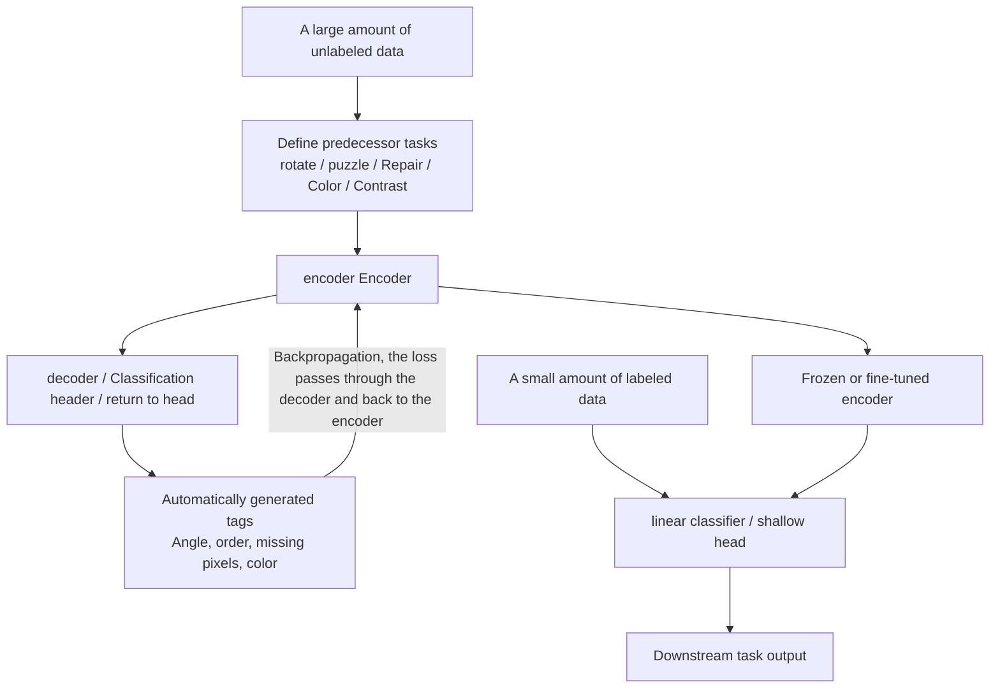
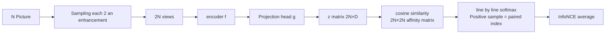
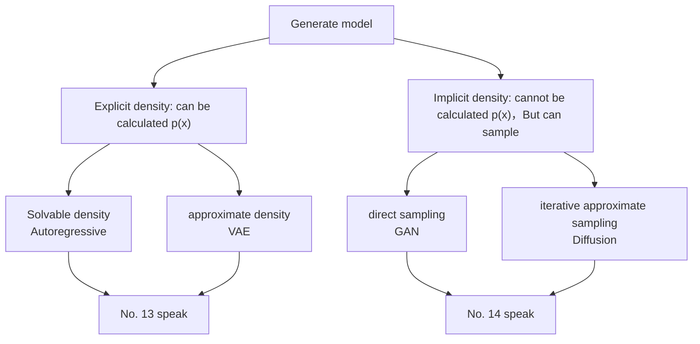
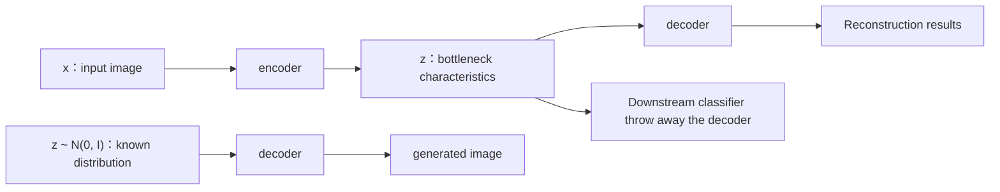
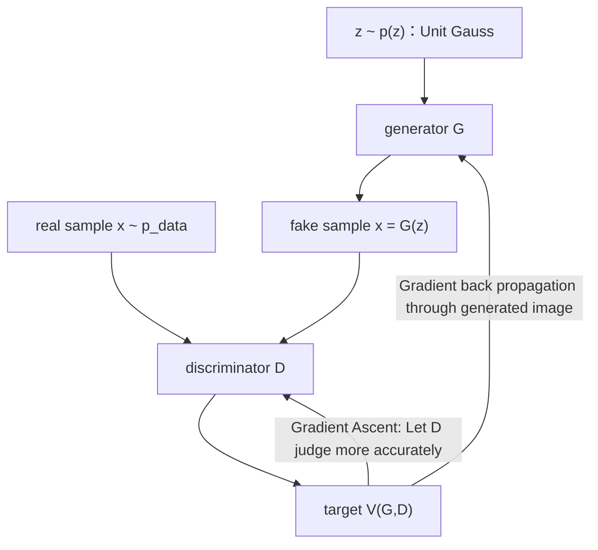
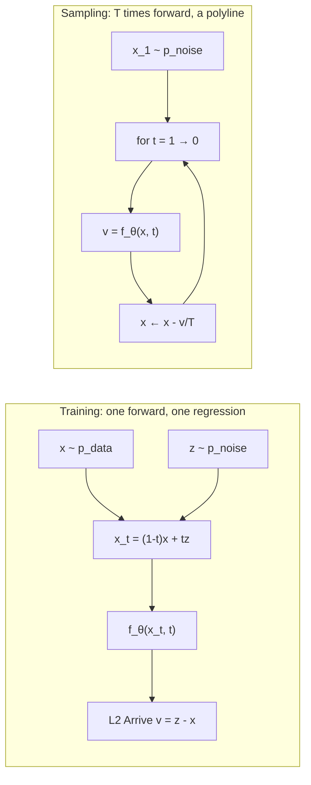
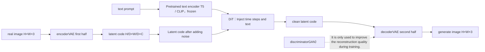
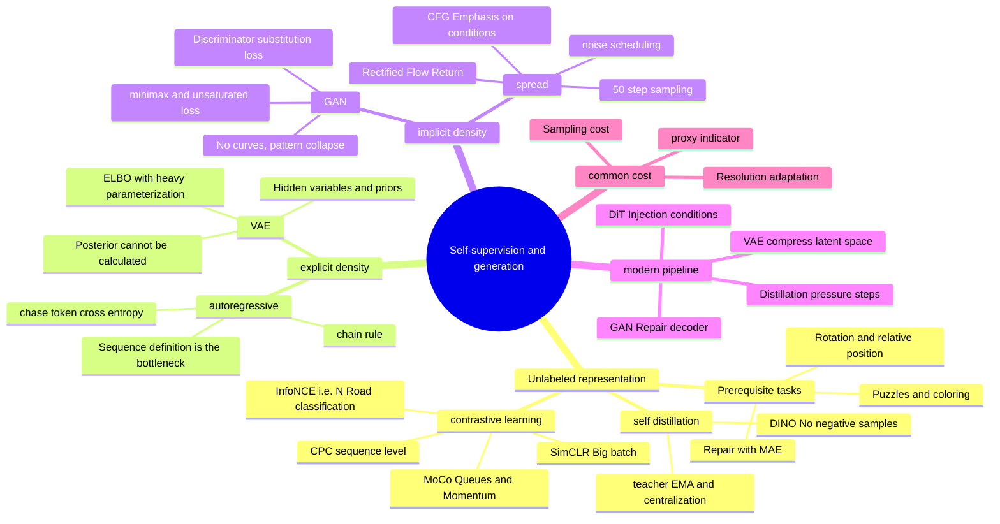

> **Course information**
>
> - **Course name**: Stanford CS231n: Deep Learning for Computer Vision(Spring 2025)
> - **This module covers**: Lecture 12. Self-Supervised Learning; Lecture 13. Generative Models 1; Lecture 14. Generative Models 2 (354 slides in total)
> - **Lecturer (each lecture)**: Ehsan Adeli(L12); Justin Johnson(L13, L14)
> - **Teaching date range**: 2025-05-08 – 2025-05-20
> - **Course homepage**: [cs231n.stanford.edu/2025](https://cs231n.stanford.edu/2025/schedule.html)
> - **Official courseware**: [lecture_12.pdf](https://cs231n.stanford.edu/slides/2025/lecture_12.pdf) (115 pages), [lecture_13.pdf](https://cs231n.stanford.edu/slides/2025/lecture_13.pdf) (116 pages), [lecture_14.pdf](https://cs231n.stanford.edu/slides/2025/lecture_14.pdf) (123 pages), with page-by-page illustrations in the book
> - **Subtitle source**: [cs231n_sp25_kor_sub · eng](https://github.com/lpaiu-cs/cs231n_sp25_kor_sub/tree/main/eng) (Publicly transcribed in English, Chinese rewritten by this book)
> - **Copyright statement**: The copyright of the slides and course materials belongs to Stanford University and the instructors; this book is an unofficial study note and is only used for study and research.


The three lectures are put together into one account. Lecture 12: Find a way to eliminate the cost of "labels" from the budget: do not give labels, only give pixels, and let the model create a four-category question, a puzzle question, a coloring question, or simply bring the two perspectives of the same picture closer and push others' perspective away. There is only one deliverable - the encoder, or more accurately, what the encoder spits out  $z$. Lecture 13 immediately points out this gap in the deliverable: $z=f(x)$  I only answered "What should this picture be pressed into?" but did not answer "What kind of  $z$  Only then can we generate a picture." To answer the latter, you have to write  $p(x)$, and write  $p(x)$  than learn one  $f$  Much harder. Lecture 14 welds two difficulties together: in today's Vincentian graph system, the codec for compressing images is a VAE (a product of Lecture 13), the backbone for denoising is a Transformer (the architecture of Lecture 12), the discriminator for compensating sharpness is a GAN (the right half of the family tree of Lecture 13), and the conditions come from a frozen pre-trained encoder (a direct descendant of self-supervision in Lecture 12). Therefore, this module is not three parallel pieces of knowledge, but a causal chain: **When there are no labels, you can only learn representation; once you learn representation, you will find that it cannot be generated in reverse; if you want to generate it, you have to choose between "density can be calculated" and "sample can be obtained"; in the end, no one in engineering was willing to make the trade-off, so the four paradigms were put together into an assembly line**. Each lecture ends with a debt owed to the next lecture, and this chapter is rearranged according to the order in which this debt is repaid.

## 1. Labels are the only resources that cannot be expanded: from 4096-dimensional coordinates to predecessor tasks

*(Reference time: 00:00:05 – 00:08:20｜Lecture 12)*


The transaction page has only three lines: Midterm exam is next Tuesday, 5/13, during class time, review class is on 5/9 at 12:30 pm, and project proposal feedback has been sent to Gradescope. It marks the time coordinate of this lecture - this is the last lecture before the midterm, and it is also the only time in the entire course that "where does the data come from" is treated as a topic rather than a premise. The previous lecture addressed "calculation": how to use graphics cards, how to apply gradients to dozens of cards, and how to expand batches. This lecture deals with the other half of the same thing: computing power can be bought, rented, or stacked, but labeling cannot. It only took a few years for the model parameters to increase from one million to one billion, while the productivity curve of manual labeling is almost flat - this scissor difference is the entire reason for the existence of self-supervision.


This motivational image hides the cost in the typography. The four grids are classification, semantic segmentation, target detection, and instance segmentation. The following three lines of small words describe the supervision granularity: classification "No spatial extent", one label for each picture; semantic segmentation "No objects, just pixels", one category for each pixel (grass, cat, tree, dog, sky); instance segmentation "Multiple objects", and similar objects must be separated one by one. one piece  $224\times224$  The image has 50,176 pixels, classification only needs 1 label, and semantic segmentation theoretically requires 50,000 - a difference of four orders of magnitude. Any method that can bypass manual labeling and maintain accuracy is worth a try in the face of this price difference. Back to last week’s “Looking In”: saliency maps, class activation maps, and projecting intermediate layer responses back to pixels. What this lesson is about is not these tools, but the fact they expose - the numbers in the middle of the network are structured, not gibberish.


The left column is the query graph, the middle left is the L2 nearest neighbor in the pixel space, the middle right is the L2 nearest neighbor in the feature space, and the network profile icon on the far right is red fc7. The neighbors in the pixel space are all blur images of the same color and texture; each query image in the feature space is followed by similar objects. The difference comes from the boxed one: the 4096-dimensional vector output by fc7. Two images can be very far apart in terms of pixels, but they can be very close in this 4096-dimensional space - the meaning of "learned representation" in engineering is this: a coordinate system that can be used as a distance measurement. The same slide appears again, with the title changed from "Last Week: Visualization and Understanding" to "Learned Representations." This renaming is a turning point in this lecture: in the previous lecture, it was used to prove that "the model has learned something." In this lecture, we will ask "Can this thing be used directly?" - If 4096 dimensions are used as features and a linear classifier is used to generate categories, then we already have a label-independent and reusable intermediate product.


The arrow continues to extend to the right: 4096 dimensions → Class Labels. Only here does the question come to the table: What are the difficulties in large-scale training? The answer is that a large amount of labeled data is needed. The reason why this 4096 dimension is useful is precisely because the entire link is trained by the label; as soon as the label is removed, the link is broken. So the core question becomes a sentence that can be written on the whiteboard: Is there a way to train a neural network without massive manual annotations and still get good features? The self-supervised answer is to split the link into two parts. On the left is the pretext task: the task is defined by the data itself, without manual annotation. It is unsupervised in form, but the objective function of supervised learning - classification or regression is used for training. On the right is the downstream task: the application you really care about does not have a large data set, but the batch of data has labels. There is only one thing shared between the two segments: the encoder. The Trained Encoder in the picture is all the deliverables.



This graph is worth remembering for its shape: the upper one is the closed loop (self-supervised training), the lower one is the open loop (transfer). It deliberately did not write "the performance of the pre-task is better" - the same sentence will appear repeatedly later: We don't care about the accuracy of the model in rotation prediction or puzzle, only how easy it is to learn the encoder in the downstream. Please note what is missing from this picture: the encoder only delivers  $z$, nowhere does it tell you “how  $z$  Can generate a picture." This gap is left until Lecture 13 to be addressed head-on.


Disassemble the first paragraph: the image enters the encoder and is compressed into a learned representation. The subsequent modules map the representation to the output space, and the labels there are not human-marked, but are automatically generated by the data. This post-module can be called a decoder, classifier or regressor, depending on how the task is defined - to reconstruct pixels is the decoder, to predict four types of angles is the classifier, to regress continuous angles is the regressor. The lecturer added something that is easily overlooked: when the post-module is a decoder, the whole thing is closer to an autoencoder. This sentence is the longest foreshadowing in this module: it is MAE in Lecture 12, VAE in Lecture 13, and the pair of frozen codecs in latent space diffusion in Lecture 14. What is done in the downstream stage is just replacement: the encoder is retained, the decoder is replaced with a classifier (FC is written on the picture), and the label source is replaced with real annotations. Only the last segment needs to be trained, and the encoder can be frozen or fine-tuned along with it. The establishment of this process requires only two conditions, and they are intertwined with each other: the prerequisite task must be difficult enough to be worth learning, otherwise the encoder will not learn anything; and it must not require manual annotation, otherwise nothing will be saved. The rest of the entire lecture is essentially a matter of repeatedly checking how well these two conditions are met on different tasks.

## 2. Acceptance criteria for pre-tasks: Task accuracy is the most deceiving indicator

*(Reference time: 00:08:37 – 00:14:57｜Lecture 12)*


Defining prerequisite tasks is not simple. The lecturer's original words are "not that straightforward". This page gives four running examples: image completion (covering a part and predicting the covered content), rotation prediction (outputting the angle it has been turned by)  $\theta$), puzzle (shuffle patches, output the correct order), coloring (give grayscale images, predict colors). The four articles share the same set of legal arguments, written at the bottom of the page: The process of solving these tasks will force the model to learn good features; the labels for these tasks can be completely automatically generated. The first determines the upper limit - you can do the task correctly without understanding the object, and the learned features will not understand the object; the second determines the cost - as long as labels can be automatically generated, the amount of data can be infinitely expanded. There are five items listed on the evaluation page, which the instructor has rearranged in order of importance: pre-task performance (easiest to measure, but also the most deceptive - when the task is simple, the accuracy can be very high but the features are useless); representation quality (linear evaluation protocol, clustering, t-SNE three methods); robustness and generalization; computational efficiency; transfer and downstream performance. He named them clearly: the most important of the five is the last one. The reason is very engineering - the accuracy of the pre-task is a proxy indicator, and only the downstream indicators are what you pay for; and the correlation between the proxy indicator and the real target is precisely the most uncontrollable part of self-supervised research.


There is a lot of unlabeled data on the left, self-supervised learning plus a feature extractor (a convolutional network) in the middle, and the upper right corner is the output of the rotation task: the image is rotated 0/90/180/270, and the network outputs one of four categories. The product of this step is not the four-classifier, but the encoder. The second frame connects the downstream: a linear classifier (conv + linear classifier is written on the picture) is hung behind the feature extractor, trained with a small amount of annotations of the target task, and finally evaluated on the target task. Note that the fc and four-category headers in the first frame have been removed entirely. The lecturer emphasized that what is needed here is a shallow network, and the reason is very straightforward: if the features are really good, complex mapping is not required to read the categories; if a deep network is required to read the categories, then the information is not in the features, but has been learned again in the new layers you added. This is the entire logic of the linear evaluation protocol, which will appear again in Chapter 6 (linear probing of MAE) and Chapter 7 (linear probing of SimCLR).


This page takes the field of vision beyond computer vision: vision (Doersch et al., 2015), language modeling (GPT-4, 2023), speech synthesis (Wavenet, van den Oord et al., 2016), robotics/reinforcement learning (Dense Object Net, Florence and Manuelli et al., 2018). The grid in the middle marked Today's lecture is the coverage of this lecture. The lecturer made the most important judgment here: the paradigm that makes today's large language models possible is self-supervision - most of the training corpus is original text, and no one annotates it sentence by sentence. He also gave a very specific example: self-driving cars running data on the roads in the Bay Area. Part of the business logic is that the data can be collected by oneself and does not need to be labeled by oneself. This sentence also explains why the conditional signal in Lecture 14 should be given to a pre-trained text encoder: that type of encoder itself is mostly self-supervised. The agenda is divided into two parts: the first half is the pre-process tasks of image transformation (rotation, repair, rearrangement, coloring), plus the latest form of reconstruction route MAE; the second half is contrastive representation learning (intuition and formalization, SimCLR and MoCo, CPC, DINO). The second frame of the same page changes only one thing: the second half becomes gray. This is the lecturer's usage of the progress bar. This agenda will appear again in the opposite form on page 67. It is important to think of the agenda as two paragraphs instead of four - the key word in the first half is "I design a transformation", and the key word in the second half is "I define a relationship". The different levels of abstraction of these two things also determine whether they can be reused across modalities later.

## 3. Geometric transformation tasks: rotation, relative position, puzzle

*(Reference time: 00:15:26 – 00:26:25｜Lecture 12)*

### 3.1 The bet of rotation prediction is all on "visual common sense"


This is the cleanest assumption in the whole talk: a model can only recognize the angle it has been turned if it has visual common sense of "what this object should look like when it is upright." This sentence ties together the difficulty of the task and the quality of the features - to get it right, the model must know that a bird's beak faces forward, a person's head faces up, and a car's wheels face down. The implementation is very straightforward: an original image  $X$, using four deterministic functions  $g(X,y)$  Rotate 0, 90, 180 and 270 degrees respectively to get  $X^0,\dots,X^3$, the label is  $y\in\{0,1,2,3\}$. The instructor specifically pointed out that this is not a regression - not predicting the exact angle, just choosing among four categories. The advantage of four classifications is that the task is stable and the categories are balanced: each picture must and only generate four samples, and each category accounts for 25%.


The second frame fills in the training half: four rotated versions enter the same ConvNet  $F(\cdot)$, the next four target boxes say Maximize prob.  $F^y(X^y)$. Shared weights are the only subtlety here - training a network from each of the four angles will learn four unrelated features, and there is no "universal representation" at all. The amount of data is also easy to calculate: originally  $N$  The picture becomes  $4N$  samples, labeling costs zero. This is a common bonus for all image transformation tasks - data augmentation has been upgraded from regularization to label factory. CIFAR-10 is used for evaluation: do rotational self-supervised pre-training on the entire training set, freeze conv1 and conv2, and only use a small part of the labeled data to learn conv3 and linear layers. The horizontal axis is the number of labeled samples (20, 100, 400, 1000, 5000), and the vertical axis is the test accuracy. There are two things in the curve: there is a huge gap in the low labeling interval - the semi-supervised version is already around 65% with 20 labeled samples, random initialization is only around 39%, and 26 percentage points all come from pre-training; the two lines in the high labeling interval converge - both climb to 92%–93% with 5000 samples. This just delineates the applicable boundaries of self-supervision: **What it buys is the slope of the low marked interval, not the upper limit.**.


This table is the first hard number in this lecture. The task column is classification (%mAP), detection (%mAP) and segmentation (%mIoU) of VOC 2007: ImageNet fully supervised (upper limit reference) is 78.9 / 79.9 / 56.8 / 48.0 (classification fc6-8, classification all, detection, segmentation); random initialization is 53.3 / 43.4 / 19.8; rotating self-supervision raises the floor to 72.97 / 54.4 / 39.1 - Classification has increased by nearly 20 points, and segmentation has directly doubled, but it is still 2–9 points away from full supervision, and these points are obtained by 1000 categories of manual labels. The lecturer's original words are: rotation pre-training "is not equivalent to pre-training on all ImageNet, but it is very close." There is a row of other self-supervised methods in the table. RotNet ranks first in all three columns, but the ranking in the table is not stable: the classification column Jigsaw’s 67.6 exceeds the Split-Brain’s 67.1, and the detection column ColorProxy’s 65.9 surpasses Jigsaw. The selection of pre-task will systematically favor a certain type of downstream task, which is the foreshadowing of the turning point in Chapter 7. The third evaluation angle is to project features back to pixels and see where the model is looking. Fully supervised models tend to be more focused - it only needs to solve classification, grabbing the eyes and the shapes around them; self-supervised models have significantly wider coverage because they don't know what's downstream and can only build a more holistic understanding of the entire image. This is not evidence that "self-supervision is better", but a structural difference: **The narrower the supervision signal, the easier it is for features to be squeezed into a shape that only serves that task.**. This sentence will appear in another form in contrastive learning - the reason for the existence of the projection head is to prevent contrast loss from compressing the features too narrowly.

### 3.2 From "which patch" to "which arrangement"


The second task is relative position (Doersch et al., 2015): the graph is cut into a 3×3 grid, the center patch is taken as a reference, and the model is asked "Where is this patch relative to the center?" The eight non-central locations correspond to eight categories, again an 8-way classification. It splits "understanding the image" into "understanding the spatial relationship between components" - this splitting method is more detailed than rotation, because rotation only uses a global scalar, and the positional relationship must fall on two specific areas. Noroozi and Favaro took this idea to the extreme in 2016: the same 3×3 grid, all 9 patches were scrambled, so that the network predictions were correctly arranged. The lecturer asked on the spot how many arrangements there were for such a setting, and the students shouted  $9!=362{,}880$. Directly doing 360,000-way classification is neither necessary nor stable, because many permutations only differ by one adjacent exchange and are almost the same visually. The author's approach is to build a lookup table and retain only 64 permutations that are most different from each other. The task becomes 64-way classification.

The lecturer added a very practical comment: The number 64 is almost arbitrary. It was not chosen as a result of theoretical derivation, but to make the task fall on a controllable classification scale——$\log_2 64=6$  The amount of information in bits is not small for a picture. The migration results are evaluated according to the same set of VOC protocols. Ours in the figure is the puzzle feature, and the comparison is the relative position method of Doersch et al. The lecturer did not read the numbers one by one, but only gave the conclusion: Jigsaw puzzle surpassed the previous framework in three types of tasks. This is worth noting - the two tasks use the same 3×3 grid and the same batch of images. The difference is only "predicting the position of a single patch" or "predicting the arrangement of the entire group of patches." The latter advances the task from identifying local content to identifying the global layout, and the feature quality has reached a higher level. The boundaries are also clear: a network that can only judge 90-degree rotations does not understand what the object is, only its orientation; similarly, a network that can judge puzzles understands the layout, not the semantics.

## 4. Repair and coloring: Can pixels and colors themselves be used as labels?

*(Reference time: 00:26:30 – 00:37:04｜Lecture 12)*

### 4.1 Cover a piece and let the model write back the missing pixels


The third task is inpainting, Context Encoders of Pathak et al. (2016). The masking strategy couldn't be simpler: cover up a rectangular area on the input image and let the model fill it in. Its legitimacy comes from the fact that the blocked content exists in the original data, so there is always a standard answer on hand, but this answer never needs to be marked. This is also the most literal explanation of the term "self-supervision": the supervision signal is already in the data, you just cover it up and let the model guess. The structure is an encoder-decoder: the encoder presses the obscured image into the feature space, with several fully connected layers in between. The decoder restores the features to pixels in the missing area, and the loss compares the output with the real pixels. The lecturer classified it as an autoencoder, but added a qualifier - this is an "autoencoder trained with a mask target". It reconstructs not the entire picture, but the obscured part. This restriction determines what the encoder must learn: when the target is the entire image, the network can learn the identity mapping and understand nothing; when the target only falls in the missing area, the identity mapping fails and the network must infer the content from the context.


However, there is a natural trouble in the evaluation of repair. The lecturer stopped to say: there are countless reasonable ways to fill the same gap. The sky can be made into blue or gray, the grass can be made into green or yellow, there is no wrong calculation. When measured by L2, the model will tend to output the average of these reasonable answers - so early reconstruction results are generally weak, blurry, and the edges are smoothed. The value of this diagnosis extends far beyond this page: **This is not because the model is not large enough, but because the loss function encourages averaging**. The VAE in Lecture 13 will repeat the same thing with another mechanism (Gaussian likelihood + diagonal covariance), and the latent space diffusion in Lecture 14 will specifically use GAN to fill this hole. The solution is to add an adversarial term so that “it doesn’t look real” also enters the loss:


$$
L(x)=L_{recon}(x)+L_{adv}(x),\qquad L_{recon}(x)=\left\|M*\left(x-F_\theta((1-M)*x)\right)\right\|_2^2
$$


$M$  is a mask (covered areas are taken as 1 and unobstructed areas are taken as 0), $*$  is element-wise multiplication, $F_\theta$  It is an encoder plus a decoder. So  $(1-M)*x$  It means that only the visible part is fed in, $x-F_\theta(\cdot)$  is the pixel-by-pixel error, multiplied again by  $M$  Just count the covered area——**The loss is only calculated on the gap, not a single pixel in the visible area.**. This is entirely consistent with MAE’s approach and can be seen as a repeat of the same recipe on a larger scale. The adversarial term is written in the standard GAN way. The lecturer clearly said that it will be left to the next lecture. All you need to know here is that it solves "ambiguity". Please note that this part appears three times in this module: here it is an item to repair the loss, in Lecture 13 it becomes the GAN on the right half of the family tree, and in Lecture 14 it becomes the discriminator that adds clarity to the decoder in latent space diffusion.


Four columns side by side are all the evidence for this argument: input (gap context), pure reconstruction, pure confrontation, reconstruction plus confrontation. Pure reconstruction is smooth but has no details; pure confrontation can generate texture but may go off track; the addition of the two gives both structure and texture. The lecturer only added one judgment on this page: After adding the confrontation item, the reconstructed part looks better. This sentence will be amplified into an engineering principle in LDM seven years later - the ambiguity of the decoder must be cured by the discriminator. Under the same set of VOC migration protocols, the repair features also gained gains, and they were distributed in the three columns of classification, detection, and semantic segmentation. The lecturer buried a kickback here: "I will return to the reconstruction-based framework and mask later, because this is one of the most commonly used models or pre-training tasks at present" - he is referring to the MAE starting on page 52. From Context Encoder in 2016 to MAE in 2021, the same clue has been followed for five years. What has changed in the middle is the occlusion strategy, encoder skeleton, and scale. What remains unchanged is the loss: only the gaps are counted.

### 4.2 Coloring: Separate brightness and color, and you will have a pair of free supervision signals


The fourth task is coloring. Color images are usually stored in RGB, but the three channels are mixed together, and the brightness and color are entangled; they can be separated by changing to LAB color space: $L$  is the brightness, $a$, $b$  are two chroma channels. So the task becomes input  $X\in\mathbb{R}^{H\times W\times 1}$, output  $\hat{Y}\in\mathbb{R}^{H\times W\times 2}$. The lecturer inserted a narration here: There are many kinds of color spaces. RGB is the most commonly used in computer vision, but to separate brightness and color, you have to change to a space such as LAB; stack the three channels back to restore the color image. This passage explains why coloring is a legitimate task: **The color is in the data, just split into two other channels.**. The second frame takes the result back: the grayscale input is  $F$  Output ab, and then compare it with  $L$  Spliced into  $(\mathbf{X},\hat{\mathbf{Y}})$, the image on the right changes from a pseudo-color channel visualization to a true color photo. The significance of this frame is to translate "predict two channels" into "generate a color picture", and also conveniently illustrates the evaluation method: whether the color is correct or not, the human eye can tell at a glance - the advantage of this type of task is that the evaluation cost is close to zero.


Following the "given one part of the channel, predict the other part", you will naturally ask: Why can we only L → ab? The same holds true in the opposite direction. This is the split-brain autoencoder (Zhang et al.): the input is divided into two channels: L channel and ab channel, and the network  $\mathcal{F}_1$  Learn L → ab, $\mathcal{F}_2$  Learn ab → L, put the two outputs back into the original image, and calculate L2 with the input. The instructor said that the two functions are trained together during training, and finally merged to generate the entire image and then calculate the loss. Any distance function can be used. The subtlety is **The two groups supervise each other**: The input of one branch is the goal of the other branch, so there is no need for external labels or the need to design two sets of tasks. The second frame abstracts it into a common form: the input graph  $X$  cut into two sets of channels  $X_1$ (blue) with  $X_2$ (yellow), two paths perform cross-channel prediction respectively.  $X_1\to\hat{X}_2$, $X_2\to\hat{X}_1$, put together to get  $\hat{X}$.

Once this form is established, "color" is no longer a necessary condition - any data that can be naturally grouped can be included. This is also the first step in the self-supervised method from "inventing transformations" to "utilizing data structures", and Chapter 7 will take this step to the end: replace "grouping" with "two perspectives of the same object." The example given by the lecturer is an RGB-D sensor: a frame of data has both an RGB channel and a depth channel (HHA depth encoding is marked on the picture), so RGB can be used to predict depth and depth can be used to predict RGB, and the two are combined to form a predicted RGB-HHA image. He said that this type of cross-modal prediction is a very successful downstream task in robotics applications, and explained the origin of the name split-brain: an autoencoder is split in half, each responsible for half of the channels.

### 4.3 Two by-products of coloring: a usable tool and a picture that can tell a story


The evaluation method is to perform self-supervised pre-training on the entire ImageNet training set, and use it downstream  $F_1$  with  $F_2$  The splicing features, the evaluation data are labeled with Places (Zhou, 2016). The conclusion is: these features have pretty good accuracy in predicting categories, but still not as good as fully supervised - because there are no labels involved here. The action of splicing is worth noting: each of the two channels has viewed different channels, and the features carry complementary information; joining the two channels is equivalent to combining the "shape learned from the brightness" and the "semantics learned from the color" together. This is the only structural advantage of split-brain over unidirectional coloring. The instructor talked about the value of coloring from a different angle here: it is not only a pre-training method, but also a useful tool in itself - it can colorize photos and videos that do not have color versions. The example on this page is an old black and white photo. The color given by the model is tan fur and gray-green background. Even more telling is this picture: Yosemite's Half Dome, bridge, trees, and complete reflection on the water. Not only the objects themselves are colored in the model, but also the mountains, trees, and bridges in the reflection are given colors consistent with the real objects. The model is not explicitly told that "water reflects", it learns this from massive amounts of data. The lecturer followed up with a qualification: These models all appeared before the big language model and the big vision model, and were trained for specific tasks, not to "solve everything"; when you see signs of "understanding the physical world", treat it as an interesting by-product, rather than evidence of general capabilities. This limitation also applies to the entire lecture: self-supervision proves that "unlabeled pre-training is feasible", but does not prove that "one task can do it all".

## 5. Video coloring: Temporal consistency makes tracking a by-product

*(Reference time: 00:37:09 – 00:44:46｜Lecture 12)*


By pushing coloring to video, there is an additional degree of freedom and an additional constraint in the task description. The settings are: $t=0$  The reference frame is in color, $t=1,2,3,\dots$  The target frame is grayscale, and the task is to color these frames; the question in the middle of the page is the whole difficulty - "How to color these frames?" When coloring a single frame, each frame can independently guess a reasonable color. This is not possible in videos, because the clothes of the same person in the same video will not suddenly change color. The second frame writes the answer: Should be the same color. From this we get the hypothesis of this section——**Learning to color video frames should allow the model to learn to track regions or objects without labels**. The reason is very straightforward: to give  $t=3$  To match the correct color to the person in the frame, the model must first  $t=0$  Find the same person in the frame, and then move the color of that position over. Tracking is not explicitly supervised; it is a necessary intermediate step to complete the task. Vondrick et al.'s approach is to establish mappings between the reference frame and the target frame in the learned feature space, treat these mappings as "pointers", and use them to copy the color (LAB space) on the reference frame to the target frame. The instructor emphasized that this mechanism is the same thing as attention - for each target pixel, calculate its attention weight relative to all pixels in the reference frame. Please note that this statement is not a metaphor in the context of 2025: in Lecture 14, DiT used cross-attention to inject text tokens into image tokens, which is the same type of "transporting information based on similarity" operation, except that it moves semantics instead of color.


The first step is the attention map: for a pixel in the target frame, use CNN features to calculate the similarity between it and each pixel of the reference frame, and output a weight map of the same size as the reference frame. The second step is weighted summation: write the predicted color of this pixel as the weighted average of the colors of all pixels in the reference frame, and the weight is the attention of the previous step. Dimensionally this is a very light operation: $H\times W$  target frame, each pixel needs to be compared to the reference frame  $H\times W$  The position is calculated as the weight, and the cost is  $O(H^2W^2)$;The actual implementation will be done on low-resolution feature maps, which is why it can run. The third step is the training signal: calculating the loss between the predicted color and the real color. Note that what is being supervised here is **Color**, not "correspondence" - in order to make the colors match, the network forced the correspondence out. This is the standard recipe for self-supervision: supervise a cheap, automatically available target, and let the really desired representation become a by-product. This page also clearly explains the cost of the entire method: there are no additional annotations, no optical flow, no detection frames, and the only supervision is the video itself.


Three-column arrangement is the standard display method for this type of paper: reference frame (color) in the left column, target frame (grayscale) in the middle column, and prediction in the right column. What the lecturer wants the audience to see is not "whether the color is accurate", but "whether the front and back frames are consistent." He gave a counterexample for comparison: if each frame was colored independently, the color of the character's shirt would jump because there is no constraint requiring it to remain consistent. In the second scene, the character in the yellow training suit maintains the same color between multiple frames, while the posture changes and the position moves - this shows that the attention is indeed locked on "that person" rather than on a fixed coordinate.


Since the attention gives "which pixel of the reference frame corresponds to this pixel of the target frame", it can not only transmit the color: map the segmentation mask on the reference frame with the same weight to get the segmentation of the target frame; move the marked posture key points there, and it becomes key point tracking. The instructor's exact words were that because you're counting attention to a reference frame, you can actually track objects, track clips, and even identify key points in the video. This chain of results is the most convincing part of the whole lecture: a task designed for "coloring", and what is finally delivered is the three capabilities of tracking, segmentation propagation and key point propagation, and their training labels are only the video itself.

## 6. MAE: Mask out 75%, turning reconstruction into scalable pre-training

*(Reference time: 00:45:41 – 00:54:16｜Lecture 12)*


MAE (He et al., 2021) is of the same family as the previous restoration, but the scale is pushed up. The repair on page 28 only covers a rectangle, while the MAE covers a large number of irregular patches, and the masking is more severe: 50% and 75% are given side by side on the page. Why cover up so much? Two reasons: **difficulty**——The more masked, the less context is left, and the less likely the task is to be fooled by texture. The model must truly understand the object structure; **data**——The more masking, the more masked versions of the same picture can be created, and the amount of data can be doubled several times. The entire pipeline is drawn on one page: the input image is cut into grids and most of the grids are covered; only the visible patches are sent to the encoder (gray large blocks); the encoder outputs a string of tokens; at the decoder entrance, the obscured positions are filled with gray tokens to form a sequence equal to the number of patches; the decoder outputs the reconstruction of each patch; on the right is the comparison of the reconstruction results with the target. Note that there is an asymmetry in this chain: **The encoder only sees part of the token, the decoder sees all**. This is the watershed between MAE and classic autoencoders, and it is also something that will be discussed repeatedly in this section - the latent space diffusion in Lecture 14 will reverse this "asymmetric" principle: the encoder is large and expensive but only runs once, and the decoder is only responsible for restoring the latent code.


The design instructions are composed of four key points on the page: ViT is used for segmentation, and the image is divided into non-overlapping patches; uniform random sampling is 75% masked; a high occlusion ratio is a necessary condition for the task to be meaningful - too little masking, the model can rely on adjacent pixel interpolation for intersection; the most technical one is **The encoder does not put the mask token**, feeding only the visible 25%, which is exactly why the encoder can do so much. The third item is worth expanding on: There is a natural shortcut for reconstruction tasks. When the gap is small, the convolutional receptive field can interpolate the answer from the neighbor. The model does not need semantics at all; the occlusion ratio essentially cuts off this shortcut. The work of the encoder is divided into three steps: the visible patch is linearly projected into the embedding space; adding position coding (consistent with ViT, except that the position index corresponds to the original grid position); and sending a series of Transformer blocks. Because only 25% of the tokens are input, the calculation amount of each token of the encoder can be much greater than that of the decoder - the number given on the page is **The amount of calculation per token of the encoder exceeds 9 times that of the decoder.**. This 9 times can be cored by yourself: cutting a 224×224 image into a 16×16 patch results in a total of 196 patches. After 75% occlusion, the encoder only processes 49 patches and the decoder has to process 196 patches. By making the encoder deeper and the decoder shallower, the total cost is kept within a controllable range. This is the core account that MAE can scale.


The decoder does the opposite: it first puts the encoder output back into the grid in its original order, and inserts a **Shared learnable mask token**, and then add position coding to all tokens; then through several Transformer blocks, the last layer of linear projection maps each token into pixels. The lecturer's explanation of the mask token is very honest: it is a learnable parameter, and there is no way to strictly explain what it encodes. It can only be said that it is roughly equivalent to the occupancy of "an average patch"; the key is that it is shared - all obscured positions use the same vector, and the parameter amount is decoupled from the occlusion ratio. The last sentence of the page is structural judgment: the decoder is only responsible for reconstruction, and the entire segment is discarded after training, so it is completely decoupled from the encoder design and does not require symmetry on both sides like traditional autoencoders or UNet. This is an asymmetrical autoencoder. The loss is the mean squared error in pixel space, and **Only calculated for obscured patches**——The reconstruction of the visible area is an identity map, and counting it will only dilute the gradient. This article has the same idea as repairing damage on page 31, except that a mask is used there.  $M$  To do element-wise multiplication, here we directly use the patch collection to filter. Using MSE instead of perceptual loss or adversarial loss is a clear trade-off: pixel-level MSE will lead to smoother reconstruction, but it is simple, stable, and scalable; while the goal of MAE is not to generate good-looking images, but to train a good encoder. This is not inconsistent with the diagnosis of "L2 encourages averaging" in Chapter 4 - the same ambiguity is a defect in the generation task but can be tolerated in the pre-training task.


After the encoder is trained, there are two downstream routes, and the page is drawn into two boxes. **linear probing**: The pre-trained model is frozen and only a linear layer prediction label is added at the end to evaluate the representation quality. **fine-tuning**: The pre-trained model is not frozen and is trained together with the newly added layer or layers. The lecturer's positioning of the two is very clear: linear probing measures "how well the representation itself is under restricted conditions", while fine-tuning explores "what level the model can achieve when it is close to its true potential." Both numbers must be reported in the paper. The former is the lower bound of quality, and the latter is the upper bound of practical performance. This dichotomy will appear under other names later in this module: the text encoder in Lecture 14 is frozen (T5, CLIP only do forward), while the diffusion backbone is trained end-to-end. This page lists the choices that need to be made: occlusion ratio, decoder depth, decoder width, whether the encoder uses mask token, reconstruction target, data enhancement, mask sampling method, training plan. The lecturer's original words were "so many modeling and hyperparameter selections", with a tone of helplessness - this type of method has too much room for adjustment, and the persuasiveness of the paper must be achieved through ablation.

He chose two to talk about: occlusion ratio, 75% gives a high accuracy, which is why it was selected, not a priori; sampling method, mainly comparing random occlusion and grid/block occlusion. The conclusion is that random occlusion is the best, because block occlusion will erase the entire area, and the remaining patches have too strong spatial correlation, while random occlusion will scatter the neighbors of each visible patch. The last page is a comparison. The lecturer said that MAE was significantly better in this set of comparisons, including the stronger contrastive learning methods DINO and MoCo v3 at the time; his evaluation of this reconstruction route was also very straightforward: Nowadays, MAE is one of the most commonly used frameworks for pre-training on the original data set. Note that the opponents in this comparison are all discriminative methods (DINO and MoCo v3 both use contrast or self-distillation), while MAE uses reconstruction - the difference between the two routes is not in the form of loss, but in "where the labels come from": contrastive learning takes labels from the relationship between samples, and reconstruction takes labels from obscured pixels. Chapter 12 has squeezed the "tags can be free" thing to the limit, but it still only delivers one encoder; in order for this encoder to spit out new images in reverse, you have to answer "$p(x)$  What does it look like,” and that’s the first sentence of Lecture 13.

## 7. Comparative learning: Write "whether it is the same object" as an N-way classification

*(Reference time: 00:54:22 – 01:13:34｜Lecture 12)*

### 7.1 Two diseases of pre-tasks: manual design and not universal


The summary of the first half first gives three judgment chains: pre-process tasks focus on "visual common sense" (predicting rotation, repair, rearrangement, coloring); in order to understand these tasks, the model is forced to learn good features about natural images; and we usually **Don’t care about the performance of these pre-tasks themselves**, only care about how useful the features are to downstream users. The second frame adds two questions, which is a turning point in this lecture: It is tedious to design pre-tasks for each task separately, and you have to redesign them every time you change a field; the learned representation may not be universal - the features you learned on the rotation task are for "judging orientation". Both problems are not efficiency issues, but methodological issues: if each downstream task requires a specially designed pre-task, then self-supervision does not get rid of manual design, but only moves manual design from the labeling stage to the task design stage. This page puts the four tasks side by side. The two lines at the bottom are the second turning point of the whole lecture: the learned representation may be tied to a specific pre-task; can a more general pre-task be designed? The lecturer did not give an answer immediately, but first turned it into an operational question: If "universal" means that it can be used for any task, then this task at least cannot rely on a specific transformation (rotation, occlusion, color), it must come directly from the relationship between objects in the data.

### 7.2 Three-piece suit: Two perspectives of the same object should be closer, and other people’s perspectives should be farther away.


The answer begins to take shape in a relationship. We always have two relationships on hand: the same image is still the same object after different transformations; other images in the data set are **different** object. The former is free, unlimited, and does not require any semantic annotation. The comparison is added in the second frame, and the task changes from "predicting the parameters of a certain transformation" to "determining whether the two perspectives are the same object" - it does not depend on the specific rotation or cropping, nor does it depend on the color space or patch order, but only relies on the concept of "object identity". The third frame gives the action: the representation of the same object in the feature space **bring closer** (attract), representation of different objects **Push away** (repel). At this point, the design of the pre-task has changed from "inventing a transformation" to "defining a relationship", and the abstraction level has increased. This is why it can be used universally for images, videos, audios, and texts. Back to the agenda, this time it is the first half that is grayed out. The four lines in the second half: intuition and formalization, instance-level comparison (SimCLR and MoCo), sequence-level comparison (CPC), and label-free self-distillation (DINO).


This page is the same picture as page 66. The lecturer played it again before entering into formalization, fixing "pull in/pull out" as a visual anchor point - all the following formulas are essentially writing cost functions for these two arrows. Formally only three roles are needed: **reference**  It is a reference sample  $x$; **positive**  is a transformed version of it  $x^+$; **negative**  Is a sample of other objects in the data set (or current batch)  $x^-$. The lecturer emphasized that intra-batch learning is used here: the transformed versions of other samples in the same batch are naturally negative samples, and no additional construction is required. This also planted the seeds of all subsequent engineering problems - the quality and quantity of negative samples, which has since become something that needs to be purchased with graphics memory.

### 7.3 From scoring function to InfoNCE: a Softmax with a different name


The starting point for formalization is a scoring function  $s$. Given encoder  $f$, we hope  $s(f(x),f(x^+))$  high, $s(f(x),f(x^-))$  low. Note that there are no rules here  $s$  There is no rule about what it looks like.  $f$  What is the network - this is a constraint only **relative size** The goal, all specific comparison methods are to fill in these two blanks. To write it as an optimizable loss, there is only one step: put the scores of the positive samples and the scores of all negative samples into the same softmax, and then take the negative logarithm.


The second frame expands the sum in the formula into a long string with ellipses. This step is visually inconspicuous, but it is the key to understanding InfoNCE: each item in the denominator is a negative sample. The more negative samples, the larger the denominator, and the harder it is for the positive samples to win - the difficulty will automatically increase with the number of negative samples. In the third frame, color labels are added to the formula. The complete form is


$$
L=-\mathbb{E}_x\left[\log\frac{\exp\left(s(f(x),f(x^+))\right)}{\exp\left(s(f(x),f(x^+))\right)+\sum_{j=1}^{N-1}\exp\left(s(f(x),f(x_j^-))\right)}\right]
$$


The sentence This seems familiar... at the bottom of the page is a reminder left by the instructor in class.


The answer is revealed: this is  $N$  Cross entropy of softmax classifier. put  $N$  candidates (1 positive sample + $N-1$  negative sample) as  $N$  categories, the positive sample is the correct category, and the rest are wrong categories, so "contrastive learning" = "in  $N$  Find the positive samples among the samples." The lecturer talked about this equivalence relationship twice, because it determines all subsequent engineering choices: since it is classification, the numerical stability of softmax is needed; since the category is "other samples", the number of categories is equal to the number of samples in the batch; since you want to train well, you have to let  $N$  Big - This is the fundamental reason why SimCLR stacks batches like crazy. **This is also the first hidden line of this module: both self-supervision and generative models apply a ready-made classification/regression loss to a batch of automatically generated labels.**  In Lecture 14, the discriminator solves the true and false classification, and the diffusion solves the velocity regression. The three are three shells of the same routine.

This page gives the name and its theoretical identity. The loss is called InfoNCE (information noise contrastive estimation), from van den Oord et al. 2018. Two properties: it is  $f(x)$  with  $f(x^+)$  a mutual information between **Nether**;Number of negative samples  $N$  The larger the value, the tighter the bound; see Poole et al. 2019 for detailed derivation. The lecturer was very careful about the "lower bound": negative InfoNCE is the lower bound of mutual information, so minimizing InfoNCE is equivalent to maximizing mutual information. In theory, "the tighter the boundary," this sentence is directly translated into a hard constraint in engineering: larger  $N$. The lecturer put it very bluntly - training the network with this loss requires a huge batch size. The more negative samples, the better and faster the convergence. This sentence is the source of all disagreements between SimCLR and MoCo.

### 7.4 SimCLR: A batch is a 2N classification problem


SimCLR (Chen et al., 2020) combines all the previous parts into a framework as simple as possible. The three parts on the page correspond to three design decisions: how to get positive samples (two random data enhancements on the same picture - random cropping, random color distortion, random blur); how to calculate the similarity (cosine similarity as a scoring function  $s$); in which space the feature is compared (not directly compared to the encoder output  $h$, but first through the projection network  $g(\cdot)$, in  $z=g(h)$  for comparison). The third decision is the projection head that will be discussed separately later. The first two decisions explain why SimCLR's enhancement strategy is taken so seriously - enhancement is the label generator. If the enhancement is not strong enough and the positive sample pair is too easy, the task will not be difficult.


A one-page diagram illustrates the data flow: an original image enters the enhancement pipeline, and two different enhancement combinations are sampled to obtain two views. The lecturer specifically emphasized that "all kinds of transformations make sense" - in the settings of SimCLR, the choice of enhancement is not derived theoretically, but is adjusted experimentally. The second frame writes this thing into a formula: sampling from the family of enhancement functions  $t_1,t_2$, acting on the same picture, we get  $\tilde{x}_i=t_1(x)$, $\tilde{x}_j=t_2(x)$. There is a red text reminder in the lower right corner of the page, and the instructor also read it again in class: Assignment 3 uses a slightly different writing method, please follow the assignment instructions.


In the second frame, the loss is connected: InfoNCE is calculated for each positive sample, and the negative sample is  **All non-positive samples in batch**. This is the first watershed between SimCLR and MoCo - the negative samples come entirely from the current batch, with no queue and no history. The third frame is supplemented with traversal: there are in the batch  $N$  The original picture was transformed into  $2N$  Views; each view takes turns as a reference, calculates the loss once, and finally averages it. So each batch contributes  $2N$  loss item.


Matrix form makes the whole thing very clean: $2N$  A view is obtained through an encoder and a projection head  $\mathbf{z}\in\mathbb{R}^{2N\times D}$; Calculate cosine similarity between two pairs  $s_{i,j}=z_i^\top z_j/(\|z_i\|\|z_j\|)$, get one  $2N\times2N$  The affinity matrix of . Pairing rules are fixed: No.  $2k$  person and number  $2k+1$  Each is a pair of positive samples; the diagonal is itself and itself, the similarity is always 1, and must be shielded. The second frame completely connects this matrix and classification: each row is a classification label, and the  $i$  The task of the line is "in  $2N$  Pick my paired view among candidates", the correct answer is  $p(i)$, the rest  $2N-2$  All are negative categories:


$$
\ell_i=-\log\frac{\exp\left(s_{i,p(i)}\right)}{\sum_{k\neq i}\exp\left(s_{i,k}\right)}
$$


The loss of the entire batch is  $i$  Take the average. This also explains why the bigger the batch, the better: $2N$  The larger the value, the more candidates there are for each question, the more difficult the question is, and the richer the signals in the gradient.



This picture is worth remembering, because MoCo only changed two things later: replacing "2N views" with "a batch + a queue", and replacing "calculating gradients in the same batch" with "only the query path calculates gradients". This is also the first time in this module that the idea of ​​"replacing computing power with data structures" appears. The LDM in Lecture 14 will use the exact same method - replacing pixels with latent codes to decouple the calculation amount from the data scale.


Evaluation follows the standard protocol: train the encoder with SimCLR on the ImageNet corpora, freeze it, and train a linear classifier on the features using labeled data. The conclusion is: SimCLR does not use any labels and relies only on linear classifiers to surpass all previous self-supervised methods and even approach fully supervised results. He added a very important limitation: because it is learning more general features, the network itself needs to be larger; and in terms of accuracy, it is still only "comparable", not "exceeding". The MoCo v3 page below will show the other side of this limitation: the parameter increases from 86M to 632M, and the linear probe only goes from 76.7 to 79.1. Another way to evaluate: Instead of freezing, fine-tune the entire encoder with 1% or 10% of the labels on ImageNet. This is a semi-supervised setting, which is closer to actual usage than a linear probe - in reality you always have a little label on your hand, the question is how much you can leverage with this little bit. The lecturer did not read out specific numbers, but the setting itself illustrates the business logic of self-supervision: **What you buy for pre-training is "can be used with a small number of labels", not "no labels at all"**.


The first design choice is the projection head. The lecturer specifically answered a question: Why not directly use the encoder to output  $h$, but to go around one layer  $g$  get  $z$? The explanation given in the slide can be broken down into three steps: the goal of comparative learning will be **discard** Information useful downstream but not required for comparison tasks; representation space  $z$  is trained to be invariant to data transformation, so transformation-related information is in  $z$  was pressed out; and through the projection head  $g$, this information can be retained in  $h$  inside. In other words, $z$  It is "a sign of sacrificing for the mission", $h$  It is a "representation left to the downstream", and the projection head draws an isolation zone between the two. This explanation is a bit counterintuitive - usually we think that adding an extra layer will only introduce more nonlinearity, but here it plays the role of a "discarded container". Because of this, the downstream uses  $h$  instead of  $z$, this is often mistaken by implementers. The text encoder in Lecture 14 takes the same principle to the extreme: the entire encoder freezes and only feeds its output to the generator as a conditional vector. The second design choice is large batch, and the instructor used an exclamation point: large training batch size is crucial for SimCLR. The reason has been discussed before - the number of negative samples is equal to  $2N-2$, if the batch is not large enough, the boundaries of InfoNCE will be loose and the features will be blurred. The cost is written in the lower part of the page: large batches need to save a large number of intermediate activations during back-transmission, occupying a huge amount of video memory. In the ImageNet experiment, distributed training must be done on TPU. This puts SimCLR into an awkward position: the method is extremely simple and the threshold for reproduction is extremely high - not everyone has a TPU pod.

### 7.5 MoCo: Use a queue to decouple negative samples from the batch


The starting point of MoCo (He et al., 2020) is the above embarrassment. Three changes are written on the right side of the page: Maintain one **key queue** (queue of keys), which stores negative samples of historical batches; the gradient is only returned through the query path, and the key path is marked no\_grad; compare the min-batch size with the number of keys **decoupling**, so a small batch size can be used to support a large number of negative samples. The third item is where all the value lies: the number of negative samples in SimCLR = $2N-2$, the two are tied together; in MoCo, the number of negative samples = the queue length. How big you want to set it is linearly related to the video memory only through the queue itself, and the queue only stores  $D$  dimensional vector, not activations. no\_grad is also worth clarifying: the keys in the queue are used by several batches in the past **old parameters** Calculated, if you calculate the gradient for them, it is equivalent to optimizing an outdated goal, and the gradient direction will conflict; simply do not return it and let them only participate in the denominator as constant negative samples. But the key encoder cannot stay still forever, otherwise the keys in the queue will be out of touch with the current encoder's representation space. MoCo's solution is momentum update:


$$
\theta_k\leftarrow m\,\theta_k+(1-m)\,\theta_q
$$


Among them  $\theta_q$  is the query encoder (normal SGD update), $\theta_k$  is the key encoder (only does exponential moving average), $m$  Take a value close to 1. The lecturer's original words are: training only affects the query encoder, using momentum over time  $m$  Update key encoder. The meaning of this formula is **Represents a slow drift in space**:key encoder follows the query, but very slowly, so the old keys in the queue are still roughly valid in the current space. This is the whole neat thing about MoCo - it replaces "recompute all keys" with a first-order lag. This technique will appear in another capacity later in this lecture: DINO's teacher network is also updated by EMA, but what is smoothed there is the entire teacher model, not just a negative sample encoder.


The entire pipeline can be drawn in one page: sampling enhancement generates positive sample pairs; query passes  $f_q$, key passed  $f_k$ (No gradient); use keys in the queue as negative samples to calculate InfoNCE; $f_k$  Updates with momentum; the queue replaces the oldest keys on a first-in, first-out (FIFO) basis. The instructor commented that this framework was very successful in implementation, and there are many subsequent versions - the FIFO queue is simple to implement and hardly increases the code complexity, but it turns the "negative sample budget" into an independent super parameter. MoCo v2 is a pure engineering merger: taking the nonlinear projection head and stronger data augmentation from SimCLR; retaining the queue of momentum updates from MoCo to train on a large number of negative samples **No TPU required**. The lecturer described this logic as a "hybridization of two routes": SimCLR proved that projection heads and strong enhancement are useful, and MoCo proved that queues can replace large batches. The two did not conflict, so they were put together.


The three frames stacked up are a complete ablation table (ResNet-50 backbone, ImageNet linear classification plus VOC detection). The linear probe of the baseline MoCo v1 is 60.6; the MLP head alone is added to 66.2, an increase of 5.6 points; the single reinforcement enhancement only reaches 63.4, an increase of 2.8 points; both are added to 67.3; the cosine learning rate plan is added to 67.5, and 800 epochs are trained to 71.1. The conclusion of the second frame is that after decoupling the batch size from the number of negative samples, MoCo v2 surpassed SimCLR with a smaller batch (256 vs. 8192); the third frame adds the last sentence: all this is done with a much smaller memory footprint, and the page also specifically explains that end-to-end here refers to SimCLR. Putting 256 and 8192 together is the entire argument of this section: SimCLR needs a batch size 32 times larger to get the same amount of negative samples, and MoCo uses queues to move this budget out of the video memory.

## 8. From instances to sequences to self-distillation: Four transfers of negative sample budgets

*(Reference time: 01:13:40 – 01:14:17｜Lecture 12)*


At this point, all variants of contrastive learning are answering the same question: where do negative samples come from. This page gives the taxonomy: **instance level** (instance-level) contrastive learning is based on positive/negative instances, represented by SimCLR and MoCo; **sequence level** (Sequence-level) contrastive learning is based on sequence and time order, represented by CPC (Contrastive Predictive Coding). The difference lies in the definition of "positive sample": the instance level says "two views of the same picture are positive", and the sequence level says "adjacent or future segments in the same sequence are positive". The latter has a much wider range of applications - audio, text, video, and even image patch lines can be used as long as they are in order.

The name of CPC itself explains the method: **Contrastive**  Contrastive learning is used to compare the “right” sequence with the “wrong” sequence; **Predictive**  is a pattern that predicts the future given the current context; **Coding**  It is to learn useful feature vectors (codes) for downstream use. The structure on the picture is a row of inputs  $x_{t-3},\dots,x_t,x_{t+1},\dots,x_{t+4}$, each passes first  $g_{enc}$  get  $z_t$, and then by  $g_{ar}$  Summarize context vectors along time  $c_t$; $c_t$  Emit multiple dotted arrows pointing to the future  $z_{t+1}$  Arrive  $z_{t+4}$.


The first step is just one sentence: encode all samples in the sequence into vectors  $z_t=g_{enc}(x_t)$. This step is completely the same as SimCLR's encoder. The difference is that the input is no longer a single image, but fragments in the sequence. The second step is unique to CPC: using an autoregressive model  $g_{ar}$  Summarize a piece of context into context code  $c_t$, The footnote of the slide explains that the original paper uses GRU-RNN here. The physical meaning of this step is "memory": $c_t$  Enough historical information must be compressed to support subsequent predictions for multiple time steps. This is also the most essential difference between CPC and instance-level methods - its positive sample is not another view at the same moment, but **future**. The third step is to connect the loss: in  $c_t$  code with the future  $z_{t+k}$  Calculated between InfoNCE, the scoring function is time-dependent:


$$
f_k(x_{t+k},c_t)=\exp\left(z_{t+k}^\top W_k\,c_t\right)
$$


Among them  $W_k$  is a trainable matrix. Note the subscript  $k$: What is used after one step of prediction and after four steps of prediction? **different** $W_k$, because the corresponding relationships at different time distances are different; if this subscript is missing, the model will degenerate into "only learning to predict in one step." Negative samples come from other sequences in the same batch  $z_{t+k}$——So the negative sample of CPC is "the future of other time series", not "other pictures".


The first experiment of the paper is audio: the original waveform is cut into short frames, and each frame is encoded into  $z_t$, context code to predict the coding of several frames in the future. There are no labels for the task itself - the speech signal itself is the supervision. This setting makes intuitive sense: to predict future sound clips, the model must understand phonemes, intonation, and speaker characteristics, which are all things that speech recognition really needs. Evaluation or linear classification: Freeze the representation and train a linear classifier on LibriSpeech. The advantage is that the representation itself is evaluated, rather than a fine-tuning technique. CPC can also be used on images: cut the image into a grid of patches, **Each line of patch is treated as a time step in the sequence**, use the upper rows to make contextual predictions for the lower rows. In this way, a static image is read into a sequence, and the CPC mechanism is transferred over intact. This idea has a common intuition with MAE - the two-dimensional structure of the image can be flattened into a one-dimensional order, and then "predict the future" to force the model to understand the spatial layout; the difference is that CPC predicts the representation (compared in the feature space), and MAE reconstructs the pixels.


MoCo v3 appears here a bit anomaly: the first sentence of its abstract is This paper does not describe a novel method. What it did was an empirical study - it took apart the training formula of self-supervised ViT one by one and found that instability is the main problem, and this instability will be masked by "looking good" results. Numbers on the slide (ImageNet linear probe): ViT-B (86M) 76.7, ViT-L (304M) 77.6, ViT-H (632M) 78.1, ViT-BN-H (632M) 79.1, ViT-BN-L/7 (304M) 81.0; ViT-B 79.9, ViT-L under end-to-end fine-tuning 84.1.

Note the last line: the 304M model outperforms the 632M model on the linear probe, indicating **Training stability determines results more than parameter size**. DINO (Caron et al., 2021) has a completely different target. Figure 1 on the homepage of the paper is worth taking a closer look: it is the self-attention map of the last layer \[CLS\] token of ViT in unsupervised training, 8×8 patches. The model has never seen any labels, but its attention accurately falls on objects - birds, boats, giraffes, airplanes - and can provide unsupervised object segmentation. The lecturer has only one sentence to position DINO: The architecture is similar to MoCo, but it is not comparative learning because it has a student network and a teacher network.


This page shows the entire mechanism of DINO: the same picture  $x$  Generate two views  $x_1,x_2$;student  $g_{\theta_s}$  Process  $x_1$, teacher  $g_{\theta_t}$  Process  $x_2$; Pass softmax on both sides to get the distribution  $p_1,p_2$;The loss is cross entropy  $-p_2\log p_1$. There are three special treatments along the way for teachers: **centering** (minus a center vector), **sharpening** (making the distribution sharper with lower temperatures), and stop-gradient (labeled sg on the graph). The teacher parameters are not updated via gradients, but rather exponential moving averages  $\theta_{\text{teacher}}\leftarrow\tau\theta_{\text{teacher}}+(1-\tau)\theta_{\text{student}}$.

The right half of the picture clearly illustrates the purpose of these two actions: centering prevents a certain dimension from dominating (otherwise all samples will collapse to the same output), and sharpening prevents the collapse into a uniform distribution. The two check and balance each other so that "students chase teachers" do not collapse. This is also the fundamental difference between self-distillation and comparative learning——**It does not require negative samples**, collapse is prevented by centering and sharpening. So four transfers of the negative sample budget were completed: SimCLR used large batches to buy negative samples, MoCo used queues to save negative samples, CPC used time order to exchange negative samples, and DINO simply did not need negative samples. The slide directly posted Algorithm 1 of the paper. The core is that  $H(t,s)$  Function:

```python
def H(t, s):
    t = t.detach()                      # 教师一侧：停梯度
    s = softmax(s / tps, dim=1)         # 学生：自己的温度
    t = softmax((t - C) / tpt, dim=1)   # 教师：先减中心 C，再用更低的温度
    return -(t * log(s)).sum(dim=1).mean()
```

The companion update has only three lines: `update(gs)`  Update students using SGD; `gt.params = l*gt.params + (1-l)*gs.params`  by momentum rate  `l`  Update Teacher; `C = m*C + (1-m)*cat([t1, t2]).mean(dim=0)`  The center is updated with a sliding mean of the two teachers' outputs. Two momentum rates (network  `l`, center  `m`) plus two temperatures (`tps`, `tpt`), which are all the adjustable knobs of DINO.


DINO v2 shows another visualization: do PCA on all patches of the same column image, and dye the first three principal components into RGB. The result is that "the same parts still match when the posture, style and even object category change" - the wings of an eagle, the trunk of an elephant, the limbs of a horse, and the wheels of a truck can all match, and the background is filtered out by the threshold of the first principal component. The persuasiveness of this picture is that it does not show the classification accuracy, but the **Semantic alignment capabilities of dense features**——This is exactly what is needed for dense prediction downstream tasks, and it is also why the Vincentian graph system in Lecture 14 is willing to directly use a frozen encoder as a source of conditions.


The first of the four summary pages converges comparative learning into one line of formula: InfoNCE is done between positive and negative samples  $N$  road classification, while it is  $f(x)$  with  $f(x^+)$  The lower bound of mutual information between them; all methods in the first half are essentially different negative sample construction methods of this loss. The second picture gives three comments to SimCLR: the nonlinear projection head makes representation learning more flexible; it is simple to implement and effective in learning visual representation; but it requires a large batch to be effective, and the graphics memory overhead is high. The first two of the three sentences are its advantages, and the third sentence is the direct reason why it was replaced by MoCo.


The third picture is for MoCo: using the momentum encoder for comparative learning; decoupling the number of negative samples from the minibatch to enable large batches without using a TPU; MoCo v2 has moved the nonlinear projection head and strong enhancement of SimCLR - the three pictures correspond to the three changes of 7.5. The fourth picture is for CPC: using "right sequence" to compare "wrong sequence"; InfoNCE is equipped with a time-related scoring function; it can be applied to many learning problems, but it is not as effective as instance-level methods in image feature learning. The last sentence is the honesty of this section: the sequence-level method is very natural for audio and text, but when it comes to images, you have to create a sequence first (such as cutting patches by rows). This "creation" process itself loses information.

## 9. Handover: The two debts owed in Lecture 12 are exactly the entire content of Lecture 13

*(Reference time: 01:14:17 – 01:14:35｜Lecture 12; 00:00:05 – 00:10:23｜Lecture 13)*


The last page is a transition: the next lecture is about generative models. The two lines buried in this lecture converge here - the adversarial loss on page 31 that is explicitly left to the next lecture, and the pixel reconstruction "only calculated on the gap" on page 57, are the two most basic types of parts in the generative model. But the more fundamental account is not these two parts, but **product**: What self-supervision delivers is an encoder that can compress the image into  $z$, but did not give "$z$  What distribution does it obey?" "How to follow  $z$  Sample back a picture." Each page of Lecture 12 could be read as “How to  $x$  become  $z$”, each page of Lecture 13 should be read as “How to  $z$  change back  $x$, and ensure that the sampled things can be regarded as samples." The four pages covered in less than a minute of class deserve their own mention, because they are the only quantitative ending to this lecture.

This page gives the evaluation conclusion of the CPC image version: on the ResNet-V2 backbone, CPC's ImageNet top-1 reaches 48.7, which is the highest self-supervised result in the table (the highest value of the AlexNet conv5 group in the same table is Jigsaw's 38.1, Colorization is 35.2); but the "accuracy-parameter amount" scatter plot on the right shows that SimCLR, MoCo, CPCv2 These instance-level methods are already listed above it. A picture illustrates both the contribution and the ceiling of sequence-level methods.


The Dense Object Net of Florence et al. (2018) moves contrastive learning from "whole image" down to "pixel-level feature descriptors": four settings: background randomization, cross-object loss, direct multi-object, and synthetic multi-object. Green arrows are used to mark corresponding pixels on the same object (positive samples), and red arrows are used to mark corresponding pixels on different objects (negative samples). It answers the question that the robotics field is more concerned about - not "what is this picture", but "which object does this pixel belong to". Qualitative results of the same method: every two rows, the upper row is the original frame, and the lower row is the visualization of the pixel-by-pixel features after PCA coloring - the feature colors of the same object in different frames and different positions remain consistent, indicating that the descriptor has indeed learned "this is the same thing."


The last page is a counter-example test: there is only a blank hole board in the picture without any identifiable objects, and the pixel-by-pixel feature map still gives a smooth and consistent color field. It wants to show that this dense descriptor does not rely on "detected objects", but gives a stable embedding to each pixel. Lecture 13 begins by completing the unfinished parts of the previous lecture - this is the only time in this module that "the next lecture first reviews the previous lecture", and it is also the real juncture between the two lectures. The lecturer's original words were that the comparative learning part of the previous lecture was not finished, so the first ten minutes were completed. From the content point of view, these ten minutes are exactly the branch line of "replacing negative samples with momentum and self-distillation" of MoCo, DINO, and DINOv2.


There are only two lines on the transaction page: Assignment 3 will be released tomorrow, 5/16, and project milestones will be due at the same time. There is no mention of these two lines in the entire oral broadcast - the lecturer's opening line is Welcome back to CS231N lecture 13. I record it here because it marks the time coordinate of the course: Assignment 3 and the project milestone both fall on May 16, and the generative model line will not end until the next lecture. The first page of the review only drew the skeleton: the left side is a data set without labels, and the intermediate encoder extracts feature representations. The right side is divided into two paths - one is the decoder, which predicts some kind of target automatically generated from the data itself; the other is the classifier or regressor, which is connected when downstream tasks arise. No manual annotation appears on the entire page because the tags do not exist at this stage.


In the second frame, only one FC is added next to the decoder, but the entire two-stage process is added: first train the encoder-decoder on all unlabeled data, and then **Throw away the decoder**, connect the encoder to a possibly small fully connected network, and fine-tune it on small labeled tasks. The scale account assigned by the lecturer to this process is very specific: one billion unlabeled images captured from the Internet are switched to downstream tasks that only label tens, hundreds, or thousands of samples, so that the performance of the latter can be improved by the general knowledge learned by the former. The common point of the pre-processing tasks is explained in one sentence: first perform a geometric perturbation on the input pixels, and then let the model restore the information before the perturbation from this destroyed version. Rotation is to predict how many degrees it has been rotated; rearrangement is to cut the picture into patches and let the model restore the relative position; reconstruction is to dig out a piece and then replace it. This is the path MAE takes. The slide also lists two variants: inpainting and coloring, which are essentially reskinned versions of the same thing.


This page is the table of contents for the comparative learning part of the previous lecture: intuition and formalization, instance-level comparison (SimCLR and MoCo), sequence-level comparison (CPC), and label-free self-distillation (DINO). The location where it appears says one thing - the agenda page for Lecture 12 is relit here, and both lectures share the same progress bar. The mechanism of contrastive learning can be summarized in one sentence: similar ones bring people closer, and dissimilar ones push them away. When it comes to implementation, a cat picture is cut out from two perspectives, a monkey picture is cut out from one perspective and then converted into black and white; all enhanced versions are passed through the same feature extractor, and then a huge similarity matrix is ​​calculated. The lecturer reported a number here that is easy to remember incorrectly: $n$  Each picture is enhanced twice to obtain  $2n$  samples, the matrix is  $2n\times2n$, that is  $4n^2$  elements, all compared pairwise.


Only one line of text was added to this frame: Problem: Need large batch size with lots of negatives. The reason is not that the video memory is insufficient, but that the task is too easy - when there are only a few negative samples in a batch, the model can easily identify two cat perspectives as a pair by relying on cheap clues such as color and texture. To make the problem difficult enough to provide effective learning signals, you have to increase the batch size; if the batch size is larger, you will return to the large-scale distributed training in Lecture 11. What MoCo wants to cut off is the "number of negative samples = batch size" tie. It maintains a key queue, which contains samples seen in the past several iterations; the current batch uses the normal query encoder and back-transmits it as usual, and the keys in the queue use another momentum encoder. Because the amount of data in the key is too large and cannot fit into the video memory, so **Don't pass it back**- The weights of the momentum encoder do not rely on gradient descent, but are an exponential moving average of the current encoder weights: the old weights are multiplied by 0.99, and 1% of the new weights are added. The lecturer originally said that he did not have a good intuition to explain why this update must be true, but the empirical evidence was very strong. The by-product is the key: the number of negative samples is decoupled from the batch size, and a small batch can compare thousands of keys.


The skeleton of DINO has the same origin as MoCo: a normal backpropagation encoder plus a momentum encoder. The difference lies in the loss - instead of using the dot product after softmax, KL divergence is used to match the output distribution of the two branches; the backbone is also changed from ResNet to visual Transformer (ViT). The lecturer made its positioning very straightforward: you don’t need to remember the details, just know that it exists, because the next model is more commonly used in practice. The key change of DINOv2 is not the loss, but the data scale: it has been expanded from 1 million images of ImageNet to about 142 million images, and a set of self-supervised recipes that can stably converge at this scale have been found. The result is that the feature quality is good enough that many people today directly use it as a ready-made visual backbone and then fine-tune it to their own tasks. The lecturer incidentally introduced the formula for progress in this field: larger networks, more data, more GPUs, more FLOPs - these are the real changes in the past ten years, not those few lines of probability formulas.

## 10. Label axis and probability axis: unsupervised is not equal to generation

*(Reference time: 00:10:34 – 00:15:01｜Lecture 13)*


Turning to this page, the lecturer gave a very broad judgment: the generative model "didn't work at all" ten years ago - the sample was a low-resolution mess, and you had to squint to see any hope; now language model, image generation, and video generation are all downstream of it. What is more worth remembering is the following addition: the basic idea has not changed much in the past ten years. What has changed is computing power, more stable training formulas, larger data sets and distributed training; the real changes in the algorithm mainly occur in the diffusion model in the next lecture. This sentence sets the tone for the entire module: most of the formulas taught in Lectures 13 and 14 can be traced back to ten years ago, and being able to run them is a bonus for engineering. The instructor takes a step back and nails the terminology first. Supervised learning data sets are paired  $(x,y)$, $x$  is data, $y$  is a label, and the goal is to learn a  $x$  Arrive  $y$  Functions; classification, regression, target detection, semantic segmentation, and image description all fall into this box. Start filling in the examples box by box on the right side of the same page. The first cell is classification: input a photo of a cat and output a category label.


In the second box, replace the label with a sentence: the input is still the picture, and the output is a description text (the page indicates that this sentence was generated by neuraltalk2). The supervision signal changes from a category to a string of words, but the shape of the task remains the same - it is still a given  $x$  predict a  $y$. The third grid is target detection: the output is no longer a label, but a set of boxes plus categories (DOG, DOG, CAT). The predicted objects range from the entire picture to each object on the picture. The fourth grid is semantic segmentation: assigning a category to each pixel. The four grids connected together explain one thing - supervised learning  $y$  It can be a scalar, a sentence, a collection of boxes, or a pixel-by-pixel map. The shapes vary widely, but they all require a human to label it. This also rebates the annotated granularity diagram on page 4 of Lecture 12: the tasks further to the right, $y$  The more expensive. After the two columns are side by side, the difference is only two lines: the data starts from  $(x,y)$  become  $x$ (just data, no labels), the goal changes from "learning a mapping" to "digging hidden structures from data". The lecturer's description of unsupervised comes with obvious reservations: it's vaguer, harder to define, and doesn't even have a clear task—you just hope to hit something good along the way, usually a representation that can be transferred.


The first type of example is K-means clustering: there is no label, only the data is divided into several clusters, and the structure of the clusters grows out of the original pixels. The second type is dimensionality reduction, and the page is demonstrated using PCA.  $3\to2$: Find an artificially specified low-dimensional subspace or manifold so that the data can maintain its original structure in it. The lecturer specifically reminded that clustering and dimensionality reduction often have probabilistic explanations, but **Not necessary** Considered as probabilistic models - they belong to the "unsupervised" axis and are not equal to the "generated" axis. The third category is the main topic of this lecture: density estimation. The upper part is the one-dimensional density (scatter points plus fitting curve), the lower part is the two-dimensional density (the left is the surface, the right is the heat map). The copyright of the upper left one-dimensional image belongs to Ian Goodfellow, 2016, and is reproduced with permission. The question here for the first time becomes "What probability function generates the samples I see?" This axis is orthogonal to "generation/discrimination": you can do unsupervised but non-probabilistic learning (clustering), or you can do supervised probabilistic modeling (softmax classifier). This orthogonality is the fulcrum of the structure of this lecture - many readers equate "generative model" with "unsupervised", but in fact the two are two independent coordinate axes.

## 11. Normalized objects determine difficulty: p(y\|x) lets labels compete, p(x) lets images in the universe compete

*(Reference time: 00:15:10 – 00:26:40｜Lecture 13)*


The lecturer separated "generation vs. discrimination" into a separate axis because this axis is inherently probabilistic: we assume that there is a probabilistic structure behind the data, and the three models just choose different variables to do the conditions. There are three lines written side by side on the page: Discriminant Modeling  $p(y|x)$ (data  $x$, label  $y$); Generative modeling  $p(x)$;Conditional generative modeling  $p(x|y)$. The symbols of the three equations are almost the same, the only difference is who is placed to the right of the vertical line - and this position determines who is fighting for the probability mass. The second frame adds the most critical constraint of the entire lecture: density function  $p(x)$  to every possible  $x$  Assign a positive number, the larger the value, the more likely it is to occur; and it is normalized, $\int_X p(x)\,dx=1$. The lecturer calls this constraint the source of power of the probabilistic model: the total quantity is fixed to one unit, and writing a distribution is equivalent to cutting this mass into all possible  $x$  on, so any one  $x$  The density of is raised, other  $x$  The density must be reduced. This "same budget table" is the key to understanding all subsequent trade-offs - the encoder in Lecture 12 never needs to deal with this coupling, it just maps each image individually into a vector.


In the third frame, this budget falls on the discriminative model: given a cat picture, the model outputs  $P(\text{cat}\mid\cdot)$  with  $P(\text{dog}\mid\cdot)$, the two add up to 1. Note that "given" here means **Each picture has a set of distributions**, there is no shared budget between graphs. In the fourth frame, another photo of a dog is superimposed. At the same time, the two definition boxes of "Generative Model" and "Conditional Generation" on the left are turned gray, leaving only the discriminant in sight. Each of the two pictures is equipped with a set of pillars: the group of cat pictures  $P(\text{cat})$  high, $P(\text{dog})$  Low, the order of the pillars in the dog picture is completely reversed.

The conclusion in the lower right corner of the page is: possible labels compete for probability, and there is no competition between images. This sentence is the whole secret of the discriminative model - it creates a separate small-scale competition for each input, and the competition does not interfere with each other. This also explains why the discriminative pre-training in Lecture 12 can train features so narrowly: narrowness is its advantage and also its ceiling. In the fifth frame, an abstract painting is inserted into the input position, and the problem is immediately exposed: the label space is fixed to the two words cat/dog during training. The model has no outlet for "this is neither a cat nor a dog", and can only bite the bullet and give an alternative distribution. The lecturer said that this can be seen as a shortcoming, but it is more important to understand the mechanism - the discriminant model **Must** It gives a set of label distributions for every possible input and has no waiver grammar.


Replace with  $p(x)$, the contestants have changed: all possible images compete for the same quality, and the page annotation is All possible images compete for probability mass. The paragraph added in the second frame is the most philosophical part of the whole lecture: Since all the images are on the same budget sheet, the model is forced to answer "is a dog more likely to stand or sit" and "is a three-legged dog more likely to appear than a three-armed monkey?" The lecturer's judgment is that the three-legged dog should get more mass - a dog losing a leg is something that happens in reality, while a three-armed monkey can almost only appear in science fiction pictures. To make this kind of judgment, the model must actually understand the structure of the visual world, rather than remember pixel co-occurrences. The third frame translates this matter into engineering language: Since the quality is limited, the model can suppress unreasonable inputs to extremely low or even zero probability. Suppose you only want a generative model of "zoo animals", then an abstract painting should have zero mass - this is the "reject" switch that the discriminative model lacks. This switch has a direct counterpart in today's practice: a well-trained diffusion model will also give low-quality output for obviously unreasonable prompt words. In essence, it spreads the probability mass very thin.


The fourth frame is replaced by conditional generation  $p(x|y)$: one line each for the given cat and the given dog  $P(\cdot\mid\cdot)$, inside each row are all images competing, so the organization of the competition becomes "grouping by tags". The lecturer took advantage of the situation  $y$  Pushing towards more complex forms: if  $y$  If it is a paragraph of text, a whole paragraph, or even another picture plus a paragraph of text, then what the model has to solve is a rather morbid problem - it has to make deep inferences about the objects in the picture. Three models are not three islands. Bayes' formula gives the conversion relationship: with the discriminant  $p(y|x)$, data edge  $p(x)$  with label prior  $p(y)$, you can spell out the conditional generation  $p(x|y)=p(y|x)p(x)/p(y)$. The lecturer's statement is broader: just move the terms of Bayes' formula any way you want, and you can get the third if you take any two of them. This formula will appear in another form later in the lecture - the derivation of ELBO starts from the Bayesian expansion, except that the "uncalculated term" is changed from the denominator to the posterior.


The second frame labels the three blocks in the formula: conditional generative model, unconditional generative model, and label prior. The page also gives a qualification: In theory, it is possible to build a conditional generation model from other components, but it is not common in practice. In practice, everyone generates models directly from zero training conditions; the exception is the diffusion model in the next lecture, where sometimes the conditional and unconditional versions are jointly trained - this is the technical premise of CFG. Purpose This page starts with the discriminant, because creativity is least needed: after training, labels can be assigned to the data; a by-product is that in the process of predicting labels, the middle layer often grows a transferable feature representation - this is how the backbone network trained on ImageNet comes from.


The second frame adds three lines to the generative model: detection of outliers (see if the density of a certain image is too low), label-free feature learning, and sampling to generate new data. The lecturer's evaluation of the last two items was quite unkind: Unconditional density estimation in self-supervised learning **Has never been very successful**, in practice it is far inferior to the contrastive learning in Lecture 12; and unconditional sampling is basically useless because it has no control over what is generated. This judgment is important, and it explains why Lecture 14 hardly talks about unconditional generation and starts directly from conditional Rectified Flow. The third frame is two lines of conditional generation: giving labels while rejecting outliers (traversing all  $y$  look  $p(x|y)$  are both too low), and sampling by label. The former lecturer said that it is rarely used in practice; the latter is the real main battlefield——$y$  When it's a paragraph of text, you can write "A cat wearing a hot dog-flavored T-shirt stands on the moon" and get a brand new picture. Today all Wenshengtu products live in this line.


Closing of the fourth frame: When the literature talks about "generative models", both unconditional and conditional are counted, but conditional generation accounts for the absolute majority in practice. The lecturer reminds readers to pay attention to a writing habit - many papers use conditions to make formulas look good.  $y$  Omit it and just write  $p(x)$; He himself has been doing this in the slides of this lecture, so every time he sees one  $p(x)$, given should be automatically added in the mind  $y$. This reminder is particularly useful in this module: Lecture 14  $v_{cfg}$  The reason why this is true is that the same model can do both conditional and unconditional generation at the same time. The lecturer has only one answer: the output is ambiguous. Many mappings in discriminative tasks are deterministic (there are several cats in the picture, the answer is a number), but as long as the same input corresponds to an entire output space, it is necessary to model the distribution rather than the modeling function. The first example is language modeling: input "Write a short rhyming poem about the generative model". There are countless possible poems, and the model can only sample one of them. The short poem on the slide itself tells the story—They sample from a learned P, / A distribution—structured, free.


The second example is Vincentian pictures: for the same prompt word, the lecturer sees one picture, and ChatGPT gives another picture, both of which are correct. The value of a generative model does not lie in selecting the "only correct" one, but in that it models the entire space in principle, and can sample from it as needed. The third example is Tusheng’s video: the picture shows him holding AirPods above a cardboard box, and then he may let go, may remove his hand, or the AirPods may deform. These three futures are all reasonable. What the model needs to model and sample is the set of "possible futures". From "a poem" to "a picture" to "a video", the dimensions and modes of the output space are changing, but the problem structure is exactly the same - this is the reason why Lecture 14 dares to use the same set of Rectified Flow to process images and videos.

## 12. Family tree: cut out four leaves with two knives

*(Reference time: 00:27:07 – 00:34:26｜Lecture 13)*


The family tree picture is the skeleton of this lecture (the picture is adapted from Ian Goodfellow's 2017 GAN tutorial). The first frame only has the root node, because the first step in classification is to ask: Can this model calculate  $p(x)$  value. The second frame falls on the left branch: explicit density, labeled Model can compute P(x). The whole job of this team is to write  $p(x)$  or  $p(x|y)$  The analytical form can be used to extract values from any sample. Note that "can be calculated" is a strong requirement: it means that given a specific picture, the model can tell you a number.


The third frame adds the right branch: implicit density, labeled Cannot compute p(x) but can sample from P(x). There is no density function inside the model that can take values, but you can still sample from it - the density is learned "implicitly". The very existence of this branch is a refutation of the "generation must model density". In the fourth frame, the second cut is made under the explicit density: it can be calculated accurately  $p(x)$  is called tractable density, which represents an autoregressive model.


Add another leaf in the fifth frame: only an approximation can be given  $p(x)$  It's called approximate density, which represents a variational autoencoder (VAE). It gives a lower bound, not a true value—that’s the whole account of Chapter 16. The sixth frame goes to the right branch: a method that can spit out samples directly in one network evaluation is called a direct method, which represents a generative adversarial network (GAN).


The seventh frame adds the fourth leaf: an iterative process is required to approximate the sample, which is called the indirect method (indirect), which represents the diffusion model. The lecturer specifically explained here that the word indirect was a temporary word he coined the day before, and there is no recognized name - the important thing is not the name, but the property of "there is no analytic function that can generate samples in one forward pass." Only two labels are added to the last frame: Today falls under autoregression and VAE, and Next Time falls under GAN and diffusion. The lecturer is quite proud of this four-part division - two branches, four leaves, which is exactly half of the lecture in a day.



There are three follow-up questions worth remembering in class. First, why is it written on the whole page?  $p(x)$  instead of writing  $p(x|y)$? The lecturer admitted that he did this on purpose, just to let people ask; all the following  $p(x)$  Both should be read as conditional versions. Second, can we treat the iterative process as a black box and pretend it is direct sampling? In principle, it is possible, but the sample can only be approximate - the diffusion model has to go through infinite steps to get the real sample. In fact, it can only go through a limited number of steps. MCMC methods also had the same properties in the past. Third, what is the difference between approximate density and implicit direct sampling? The difference lies in the former **At least one value can be taken out** (Even if it is a boundary), the latter cannot find density values anywhere and can only sample. Together, these three answers illustrate that the classification criterion for genealogy is not “model structure” but “what you can get.”

## 13. Autoregression: The chain rule does not require any assumptions, and the cost is to split a generation into T predictions

*(Reference time: 00:34:59 – 00:45:16｜Lecture 13)*


The first leaf on the family tree is the autoregressive model, which is solvable density: $p(x)$  Not only can you write analytical formulas, but you can also calculate exact numerical values for any sample. Its entire technical content lies in how to write this matter in a teachable way. The first step is only one line: the goal is to write an explicit function for density  $p(x)=f(x,W)$, among which  $W$  is the weight of the neural network. In other words, the network takes in a picture and spits out the number "How likely is this picture to appear?" The data set is only available in the second step: given  $x^{(1)},\dots,x^{(N)}$, find the most likely weight of the entire data


$$
W^{*}=\arg\max_{W}\prod_{i=1}^{N}p(x^{(i)})
$$


This line is noted on the page as "maximizing the probability of training data", which is maximum likelihood estimation (MLE). Note the superscript  $i$  Refers to the  $i$  Sample - This notation convention will be emphasized repeatedly in the next section.


Add the log trick to the third frame: after taking the logarithm, the maximizing object remains unchanged (log monotonic), but continuous multiplication becomes continuous addition.


$$
W^{*}=\arg\max_{W}\sum_{i=1}^{N}\log p(x^{(i)})
$$


The lecturer gave two reasons: continuous multiplication quickly underflows numerically, and summation is easy to handle and derivation, and can be split into multiple samples in parallel. These two reasons will appear in a more extreme form in Lecture 14 - the entire training of the diffusion model is a sample-by-sample L2 regression, not even normalization.


The fourth frame  $p$  Replace it with network output to get a truly runnable form.  $W^{*}=\arg\max_W\sum_i \log f(x^{(i)},W)$, it says This is our loss function in the lower right corner of the page. At this point, generative modeling degenerates into a normal training loop: forward calculation  $\log f$, backtransmission, update. Here are two details that are easily skipped: **The difference between likelihood and probability**——When talking about probability, the distribution is fixed and you are moving  $x$; When talking about likelihood, the sample is fixed and you are moving the distribution. and the underlying assumption: that there is a true distribution of the universe used to generate the data  $p_{\text{data}}$, we can never see it, we can only get the limited samples it spits out; and then superimpose the independent and identical distribution assumption, the joint probability can be factorized into the product of sample-by-sample probabilities. The price of MLE itself not assuming any data structure is that it also cannot give any calculation path——$p(x)$  It is still a function defined on the entire graph. The first assumption added to the autoregressive model is very simple: there is some standard way to convert the sample  $x$  cut into a sequence  $x_1,\dots,x_T$. The lecturer here reminds you of the notation trap: superscripts are different samples, and subscripts are different fragments of the same sample. The two cannot be mixed. Apply the chain rule of probability to the second frame:


$$
p(x)=p(x_1)\,p(x_2\mid x_1)\,p(x_3\mid x_1,x_2)\cdots=\prod_{t=1}^{T}p(x_t\mid x_1,\dots,x_{t-1})
$$


This equation holds for any joint distribution and requires no assumptions - it just replaces "predict the entire image at once" with "predict  $T$  a smaller conditional distribution". There is only one real assumption: the cutting method of the sequence (such as in scan line order).


Only one annotation was added to the third frame: Language modeling with RNN, plus the sentence "We have seen this before." The structure of RNN naturally matches the chain rule - the hidden state is propagated forward in time, Chapter  $t$  The hidden state of the step only contains the previous  $t-1$  The information of a segment, from which the distribution of the next segment is predicted, is exactly  $p(x_t\mid x_{<t})$. In the fourth frame, the annotation is changed to Language modeling with masked Transformer, and the title is also changed to conclusion: LLMs are Autoregressive Models. Transformer achieves the same causality by masking attention - by covering the upper right triangle of the attention matrix, only the prefix can be seen at each position, so the conditional probability of the entire sequence can be calculated forward at once. Why must it be demolished? The lecturer gave a hard account: the size of the word list is  $V$, the sequence length is  $T$  When , directly modeling the joint distribution requires  $V^T$  entries, exponential explosion; after splitting into conditional distributions, each step only requires one  $V$  Dimensional distribution, the parameters are reduced from exponential level to linear level. The price is that it must be generated in order, $T$  A fragment is required  $T$  Subforward (can be parallelized during training because the ground truth prefix of each position is known).


The text is naturally suited to autoregression: it is inherently one-dimensional and inherently discrete, which lends itself to the softmax cross-entropy used throughout the semester. Images occupy neither of those two dimensions - they are not one-dimensional, and they are often treated as continuous values. The lecturer's "hammer in hand" solution is to rasterize the image: the common format is 8 bits per channel, and one pixel is three integers from 0 to 255, so the entire image becomes a one-dimensional sequence, each element is a sub-pixel value, and predicting it is a 256-category classification problem. In the lower right corner of the page, a whiteboard photo is used as a nested description (it is the one with "a person talking about generative models in front of the whiteboard"). A total of six RGB cubes in the lower two rows mark the scan line sequence: first walk along the channel to complete one pixel, and then go to the right one pixel. The second frame adds the question: Too expensive.

$1024\times1024$  The picture has  $3\times1024\times1024\approx3.1\times10^6$  Sub-pixels, the sequence length is three million. Today's models can indeed consume millions of sequences, but the cost increases rapidly with length, and high resolution simply cannot scale like this. The two articles cited on the slide are representative works of this road: PixelRNN and PixelCNN (van den Oord et al., 2016). The third frame gives a preview of the solution: instead of modeling based on sub-pixels, model based on tiles - first use some process to compress the image into a series of one-dimensional tokens, and then perform autoregression on the token sequence. The lecturer said that this road has returned in the past two years and will be discussed in the next lecture. The value of this frame is not in the answer, but in that it points out the real bottleneck of the autoregressive model on images: **How a sequence is defined**, rather than the likelihood target itself. At the end of Lecture 14, "discrete latent code + autoregression" will be used to reconnect this road.

## 14. Autoencoder: First replace a bottleneck with a hidden space

*(Reference time: 00:45:21 – 00:52:51｜Lecture 13)*


The second leaf of the family tree is the VAE, which is an approximate density. It sacrifices the accurate value of density in exchange for something that the autoregressive model cannot give. This page puts the trade-offs together. The first half is PixelRNN/PixelCNN: Explicitly Parameterized Density with Neural Networks  $p_W(x)=\prod_t p_W(x_t\mid x_1,\dots,x_{t-1})$, the training goal is the likelihood of the training data. The next two lines are VAE: it defines a **incomprehensible** (intractable) density can neither be explicitly calculated nor directly optimized, but we will be able to directly optimize a lower bound on the density. The lecturer made the motivation unambiguous: since autoregression can already calculate accurate density, giving up it must be replaced by something else - hidden variables. In the process of learning, VAE will naturally grow "vectors that can represent this picture". These vectors themselves are useful (retrieval, editing, downstream tasks) and are worth replacing with precise density.


The second frame of the same separator page has a text animation: Variational and VAEs turn light gray, and Autoencoders are underlined. The lecturer's explanation was "let's remove a few pages of V" because the autoencoder has not been formally taught in this course. The goal of the autoencoder is the same as that of unsupervised learning: without labels, from the input  $x$  extract features from  $z$, hope  $z$  It encodes object identity, appearance, scene type and other information useful to downstream. The encoder can be MLP, CNN, Transformer, whatever you choose.


The second frame only adds one sentence: Problem: How can we learn without labels? This is the recurring question in the previous lecture, but this time it has a dumber answer. The third frame is supplemented with the decoder: $z$  is mapped back to a  $\hat{x}$, the training goal is to make  $\hat{x}$  as close as possible  $x$. The page has a pun for this approach - Autoencoding = Encoding yourself. The lecturer himself complained: This is probably the stupidest loss function ever. We spend a lot of computing power to learn a known identity mapping.


The fourth frame writes the loss to death: $\mathcal{L}=\lVert\hat{x}-x\rVert^2$, the page specifically marked two sentences - this item **without any tags**, only eats the original data, which is why it counts as self-supervised. The fifth frame is the old routine of self-supervision: throw away the decoder after training, connect the encoder features to a softmax classifier and output the predicted label. Please note the relationship between this step and MAE in Lecture 12: both throw away the decoder, but the decoder of MAE is only a scaffolding during the training period, while the decoder here will be used soon - it is the entrance to Chapter 15.


In the sixth frame, the arrow is reversed: only the decoder is left. If a new one can be built  $z$, a new image can be generated, which is exactly what the generative model wants to use. The seventh frame throws cold water: Problem: Generating new z is not any easier than generating new x. You just replaced "sampling in pixel space" with "sampling in latent space". If  $z$  The distribution of is also unknown and has no analytic form. The problem has just been moved. The eighth frame gives the core action of VAE: forcing all  $z$  All come from a known distribution. As long as this constraint holds, one can be drawn directly from the distribution during inference.  $z$, through the decoder, a new sample is obtained - the sampling problem is completely eliminated. This step may seem crude, but it’s actually the smartest move in the whole story: it doesn’t “learn” $p(z)$, but **announce** $p(z)$  What is it, and then transfer all the learning pressure to the encoder, requiring the encoder to squeeze the data into this predetermined shape.



This picture draws two ways out together: the previous one is self-supervision (using  $z$  Do downstream tasks), the next step is generation (collecting from a known distribution  $z$  decode again). Traditional autoencoders can only take the upper path - the entrance to the lower path  $p(z)$  is empty. This is why the lecturer said "generate new  $z$  no better than generating new ones  $x$ "Easy": It is this item that is missing in the brackets.

## 15. VAE: If the posterior cannot be calculated, train another network to guess it.

*(Reference time: 00:53:00 – 01:02:59｜Lecture 13)*


The title page of this section only gives one source of information: the footer reads Kingma and Welling, Auto-Encoding Variational Bayes, ICLR 2014 - the derivation that follows is a popular restatement of this paper. The lecturer only said "it's a long story" about why the word variational is called this. This lecture does not go into the etymology, but only how the three-line formula came about. The page first gives two goals: learn latent features from raw data  $z$, and can sample and generate new data from the model. Note that only the first of these two items is fulfilled in the autoencoder, and the second item is what VAE needs to make up for.


The second frame is supplemented with probability hypotheses: each  $x^{(i)}$  are composed of an invisible latent variable  $z$  Generate, the data is "first draw a  $z$, and then by  $z$  generate  $x$” The product of this two-step process. The intuition given by the lecturer is: $x$  is an image, $z$  It is the factor that determines the properties and orientation of this picture - it contains all the information needed to generate this picture, but you can never observe it. The third frame draws the sampling process after training: pick one from the prior  $z$, and then from the conditional distribution  $p(x\mid z)$  Rich one  $x$. The only prerequisite for this process to be established is that  $z$  is known a priori. The fourth frame nails the prior: hypothesis  $p(z)$  is a simple distribution, in practice it is almost always the standard Gaussian  $\mathcal{N}(0,I)$. This step is the fulcrum for the entire method to be implemented - it replaces the "unknown latent space distribution" with an analytical object that can be sampled at any time. Compare this to the autoencoder from Chapter 14: there  $z$  The distribution of is known only after training, and often does not have an analytical form, so sampling cannot be started.


In the fifth frame, we return to the familiar path: the basic idea is still maximum likelihood. If the data set except  $x$  Also comes with  $z$, then you can directly train a conditional generation model  $p_\theta(x\mid z)$, the problem ended there and then; but we did not  $z$  label. The sixth frame  $z$  Points lost:


$$
p_\theta(x)=\int p_\theta(x,z)\,dz=\int p_\theta(x\mid z)\,p_\theta(z)\,dz
$$


There is no approximation in this step. It just splits the joint distribution according to the chain rule and then marginalizes it.


The seventh frame begins item-by-item acceptance: $p_\theta(x\mid z)$  It is the decoder - a neural network prepared to be trained with maximum likelihood. This is no problem. The second item of the eighth frame acceptance: $p_\theta(z)$  Even if the Gaussian prior just assumed is known and the analytical formula is known, there is no problem. The ninth frame is a death sentence: Problem, we can't integrate over all z. $p_\theta(x\mid z)$  It is a complex function parameterized by a neural network. There is no closed-form solution to the analytical integral of the entire latent space. Using finite sampling to approximate a high-dimensional integral and stuffing it into the inner loop of training is unacceptable in cost and variance. The lecturer explains the general routine of generative models thoroughly on this page: write down a number of probability terms, hoping that some of them are simple distributions that can be calculated by hand, and the other part is the network to be trained - and now one of them happens to be neither the former nor the latter. This sentence can be used as the criterion for all subsequent trade-offs: VAE throws away accuracy in favor of lower bounds, GAN throws away density in favor of sample quality inspection, and diffusion throws away one-step sampling in favor of regression targets. They are all the same type of "changes."

### 15.1 Change the path: Bayesian moves the problem to the posterior


Bayes' formula gives another way of writing:


$$
p_\theta(x)=\frac{p_\theta(x\mid z)\,p_\theta(z)}{p_\theta(z\mid x)}
$$


The page arranges these three pieces vertically, preparing to check and accept them one by one. This action is worth learning: expand the same quantity in two ways. If you get stuck on one way, just change to the other way to see where you are stuck - this is the only problem-solving strategy in the entire lecture.


first term of numerator  $p_\theta(x\mid z)$  It is also a decoder and can be calculated; the second term of the numerator  $p_\theta(z)$  It is still a Gaussian prior, which can be calculated. There are no integrals in the entire equation - it looks like the problem is solved. Problem with the denominator: $p_\theta(z\mid x)$  is the posterior of the latent variable given the image. To calculate it, you have to calculate it again.  $p_\theta(x)=\int p_\theta(x\mid z)p_\theta(z)dz$——Go back to the starting point. The lecturer said that this was the whole motivation for introducing Bayesian in the first place, and this is where it failed. Please pay attention to the shape of this failure: it is not "cannot be calculated", but "calculating it requires calculating another thing that cannot be calculated", which is a circular dependency.


The solution is the real trick of VAE: since it cannot be calculated later, train a neural network to approximate it. Remember this approximate network as  $q_\phi(z\mid x)$, parameters  $\phi$  with decoder  $\theta$  Independent of each other; it inputs a picture and outputs a distribution in the latent space. Note the nature of this step: it is not a mathematical approximation (such as a Taylor expansion); **Learnable alternatives**——Use a network to replace an uncalculated probability quantity. This idea will appear again in Lecture 14: the "unconditional model" in CFG is also replacing an uncalculated quantity (classifier gradient). put  $q_\phi$  Substituting back into the Bayesian formula, we get a computable approximation:


$$
p_\theta(x)\approx\frac{p_\theta(x\mid z)\,p(z)}{q_\phi(z\mid x)}
$$


This step is just a replacement, there is no guarantee——$q_\phi$  It may not really equal a posteriori. All the derivation in the whole lecture is essentially dealing with this "not necessarily".

### 15.2 Two networks, and the trick of "how the network outputs a distribution"


The page clearly states the responsibilities of the two networks: the decoder inputs the hidden code  $z$, output data  $x$  distribution on; encoder input data  $x$, output hidden code  $z$  distribution on. Both have independent weights and are trained jointly. The instructor reminded that this step is not trivial: $q_\phi(z\mid x)\approx p_\theta(z\mid x)$  This condition cannot be directly enforced and can only be approached through training. A side note was added in the second frame, asking about the most common place where beginners get stuck: the output of a neural network is a vector, how can it be a distribution? The answer is to let the network output distribute **parameters**, fixing the shape of the distribution into the selected family. The third frame gives the specific form:


$$
p_\theta(x\mid z)=\mathcal{N}\big(\mu_{x\mid z},\ \sigma^{2}\big),\qquad q_\phi(z\mid x)=\mathcal{N}\big(\mu_{z\mid x},\ \Sigma_{z\mid x}\big)
$$


The decoder only outputs the mean  $\mu_{x\mid z}$, variance  $\sigma^2$  Fixed; the encoder outputs two vectors, one is the mean  $\mu_{z\mid x}$, the other is the diagonal covariance  $\Sigma_{z\mid x}$. The lecturer specifically explained why it must be **Diagonal**: $h\times w$  To model the covariance between pixels in an image, you need  $(hw)^2$  elements, which cannot be accommodated and have no data support; after diagonalization, the covariance degenerates into one and  $z$  For vectors of the same shape, the network can output two vectors of the same shape. This "can't fit" account deserves to be calculated by yourself: $256\times256$  The image of has 65,536 pixels and the full covariance is  $4.3\times10^9$  The number of files alone can only be stored in more than ten GB.


The fourth frame expands the likelihood:


$$
\log p_\theta(x\mid z)=-\frac{\lVert x-\mu_{x\mid z}\rVert^{2}}{2\sigma^{2}}+C
$$


When the variance is fixed, maximize it for  $z$  The likelihood of is completely equivalent to minimizing  $x$  The L2 distance from the network output mean - the "silliest loss" of the autoencoder reappears here, but this time it is deduced from the probability hypothesis rather than determined by taking a shot. The lecturer added a very practical boundary here: the decoder could have also output the pixel-by-pixel variance, but that would be meaningless - since the inter-pixel correlation is not modeled, sampling from such a distribution is equivalent to adding a layer of pixel-by-pixel independent noise to the mean map, which looks like noise rather than like a new image. So the practical approach is: put the decoder **pretend** into a distribution, but always only uses its mean and never actually samples from it. This is a clear engineering compromise worth remembering when reproducing code.


The last frame returns to the origin, and the question is thrown to the next page: With the encoder, decoder, and approximate posterior, what is the training goal?

## 16. ELBO: Throw away the KL that cannot be calculated, and the remaining two items can be trained

*(Reference time: 01:03:03 – 01:11:58｜Lecture 13)*

The lecturer said that this was the only page in the entire lecture that required some serious math. There are only five steps in the derivation, but each step does the same thing: move something that cannot be calculated into a term that can be thrown away.

### 16.1 Five-step derivation


The starting point is maximum likelihood itself, expanded using Bayes' formula:


$$
\log p_\theta(x)=\log\frac{p_\theta(x\mid z)\,p(z)}{p_\theta(z\mid x)}=\log\frac{p_\theta(x\mid z)\,p(z)\,q_\phi(z\mid x)}{p_\theta(z\mid x)\,q_\phi(z\mid x)}
$$


The second step is identity deformation: multiplying the numerator and denominator  $q_\phi(z\mid x)$, the value remains unchanged.


This frame just marks the action of the previous step - multiplying the upper and lower parts by the same amount in order to create a shape that can be recognized later. The lecturer's original words were "Now let's do something stupid", but this step is the key to the entire derivation: without this multiplication, neither KL nor expectations can be obtained later. The third frame takes apart the logarithms and rearranges them:


$$
=\log p_\theta(x\mid z)-\log\frac{q_\phi(z\mid x)}{p(z)}+\log\frac{q_\phi(z\mid x)}{p_\theta(z\mid x)}
$$


The colors of the three items correspond on the page, making it easier to keep track of who is who. The order of arrangement seems random, but it is actually to prepare for the next step of "recognizing KL".


The fourth frame is the key observation: $\log p_\theta(x)$  itself and  $z$  irrelevant (all  $z$  will be eliminated), so you can give it a layer of expectations for any distribution without changing the value: $\log p_\theta(x)=\mathbb{E}_{z\sim q_\phi(z\mid x)}[\log p_\theta(x)]$. Choose here  $q_\phi(z\mid x)$  As an expected distribution, it is precisely to match the three terms on the right. The fifth frame allocates expectations to three items:


$$
=\mathbb{E}_{z}\big[\log p_\theta(x\mid z)\big]-\mathbb{E}_{z}\Big[\log\frac{q_\phi(z\mid x)}{p(z)}\Big]+\mathbb{E}_{z}\Big[\log\frac{q_\phi(z\mid x)}{p_\theta(z\mid x)}\Big]
$$


Up to this point it is still an exact equation and no approximations have been introduced.


The sixth frame identifies the last two terms - they are the definition of KL divergence:


$$
=\mathbb{E}_{z\sim q_\phi(z\mid x)}\big[\log p_\theta(x\mid z)\big]-D_{\mathrm{KL}}\big(q_\phi(z\mid x)\,\|\,p(z)\big)+D_{\mathrm{KL}}\big(q_\phi(z\mid x)\,\|\,p_\theta(z\mid x)\big)
$$


KL divergence measures the difference between two distributions, is non-negative, and only takes 0 when the two distributions are identical.

### 16.2 What are the three items and why can the third item be thrown away?


first item  $\mathbb{E}_{z\sim q_\phi(z\mid x)}[\log p_\theta(x\mid z)]$  is a reconstruction item, and the process can be read out:  $x$  Send to the encoder to get  $q_\phi(z\mid x)$, pick one from this distribution  $z$, and then send it to the decoder, asking it to restore the  $x$. due to  $p_\theta(x\mid z)$  is a diagonal Gaussian, given a sampled  $z$, this term is the L2 in Chapter 15 (only the difference is a constant factor); the expectation itself can be estimated with one sampling. Second item  $D_{\mathrm{KL}}(q_\phi(z\mid x)\|p(z))$  Is the prior term: the distribution predicted by the encoder for each picture should be close to the preset prior (standard Gaussian). The KL between two Gaussians has a closed-form solution and does not require sampling estimation - this is why the prior should choose a Gaussian, not just a "simple distribution": it must be simple enough to calculate KL with any diagonal Gaussian.


The third item  $D_{\mathrm{KL}}(q_\phi(z\mid x)\|p_\theta(z\mid x))$  Is the posterior approximation term: it requires that the approximate posterior really sticks to the true posterior. The true posterior is the quantity that could not be calculated at the beginning, so this term has no closed-form solution to Gauss. The fourth frame makes the most cost-effective step in the whole lecture: KL forever  $\ge0$, so throw away the third item, and the remaining two items must be  $\log p_\theta(x)$  the lower bound. This is not an approximate equation; **Inequality**——The error will be as big as the lost part, but the direction is always on our side. In the fifth frame, write the final training goal:


$$
\log p_\theta(x)\ \ge\ \mathbb{E}_{z\sim q_\phi(z\mid x)}\big[\log p_\theta(x\mid z)\big]-D_{\mathrm{KL}}\big(q_\phi(z\mid x)\,\|\,p(z)\big)
$$


Maximizing the right side is maximizing a lower bound of the true likelihood. Lecturer reminds the mentality here: we never really optimize  $\log p(x)$, what is optimized is its lower bound; raising the lower bound does not guarantee that the true value will be raised simultaneously, but this is the only thing that can be calculated. This mentality will reappear in another form in Lecture 14: the loss of the diffusion model is not the likelihood itself, but a calculable regression target.


This page wraps up the notation: Jointly training encoders  $q_\phi(z\mid x)=\mathcal{N}(\mu_{z\mid x},\Sigma_{z\mid x})$  with decoder  $p_\theta(x\mid z)=\mathcal{N}(\mu_{x\mid z},\sigma^2)$, a variational lower bound that maximizes the likelihood of data; it is also more commonly known as the evidence lower bound (Evidence Lower BOound, ELBo). evidence refers to  $\log p(x)$  itself, the Nether is its replacement.

### 16.3 Five steps of the training loop, and two mutually pulling losses


The training process starts from a page with only formulas: there are only two lines of formulas for "maximizing the variational lower bound" on the screen, and the right side is blank. The next six frames will fill in the encoder-decoder block diagram and the five steps one by one. Step 1: Enter  $x$  Send it to the encoder and get  $q_\phi(z\mid x)=\mathcal{N}(\mu_{z\mid x},\Sigma_{z\mid x})$, that is, a pair of vectors.


The second step is to implement the KL term: the prior loss requires the encoder output to be close to the standard Gaussian, that is, the mean approaches 0 and the covariance approaches the unit matrix. This item directly "drags" the latent space into a regular spherical distribution, which is the fundamental reason why sampling can be done later. The third step is sampling, which is also the most critical part of the entire method in engineering. directly from  $\mathcal{N}(\mu_{z\mid x},\Sigma_{z\mid x})$  The action of sampling itself is not differentiable, and the gradient cannot be transmitted back to the encoder; the reparameterization technique rewrites it as


$$
z=\epsilon\odot\Sigma_{z\mid x}+\mu_{z\mid x},\qquad \epsilon\sim\mathcal{N}(0,I)
$$


Randomness is moved to the parameter-independent  $\epsilon$  Up, $z$  Yes  $\mu$, $\Sigma$  It's just a normal differentiable operation, and the gradient can be passed all the way back to the encoder. Note that this is element-wise multiplication ($\odot$), since the covariances are assumed to be diagonal.


Step 4: Take the collected  $z$  Send it to the decoder and get  $p_\theta(x\mid z)=\mathcal{N}(\mu_{x\mid z},\sigma^2)$, in fact only the mean value is taken  $\mu_{x\mid z}$. Step Five: Reconstruct Loss Requirements  $\mu_{x\mid z}$  with  $x$  The L2 distance should be as small as possible. At this point, the five-step closed loop turns the entire page into a pseudocode that can be directly followed to write code. In the last frame, a description is added below the formula: The loss terms fight against each other. Rebuilding lost hope  $\Sigma_{z\mid x}=0$, and each  $x$  Have its own unique  $\mu_{z\mid x}$——That way the decoder can restore any picture deterministically and the reconstruction error will be zero.

a priori loss hope  $\Sigma_{z\mid x}=I$, $\mu_{z\mid x}=0$——In this way, all inputs are mapped to the same standard Gaussian, and the latent space is regular but without any discrimination. The two goals are in opposite directions. The training process is to find a balance point: it must be able to reconstruct while keeping the latent space in a sampleable shape. This is also the reason why VAE cannot achieve perfect reconstruction - to make the latent space continuous and sampleable, the model must tolerate  $\Sigma_{z\mid x}>0$, that is, actively giving up part of the pixel-level certainty. This passage explains why the "L2 output is weak" phenomenon in Lecture 12 is more serious in VAE: it is not only the loss that encourages averaging, but also a KL term that actively compresses information.

### 16.4 Sampling and decoupling


After training, generating samples only requires two steps: from  $\mathcal{N}(0,I)$  pick one  $z$, averaged through the decoder. No encoder is required, and no iterative process is required - this is the meaning of "one forward sample", and it is also the only speed advantage of VAE over the diffusion model in Lecture 14. The diagonal prior also has a side effect: it lets  $z$  Each dimension is statistically independent, so one dimension can be changed individually to see the effect. On the page is a scanning grid, with the horizontal axis changing  $z_2$, vertical axis changes  $z_1$, handwritten digits transition smoothly from one category to another in the grid, rather than abruptly. The lecturer calls this phenomenon "disentangling factors of variation", and his statement is that these dimensions "often" encode something useful, interpretable, and orthogonal to each other. To be clear, this is a diagonal Gaussian **by-product**, is not an explicitly optimized target - so it often holds, but is not guaranteed to be that clean in every dimension. This point will be asked in turn in the GAN lecture: If decoupling is just a by-product, can a cleaner latent space be obtained in other ways? StyleGAN’s answer is  $z$  First map to  $w$, again  $w$  Inject layer by layer.

## 17. Handover: from “can’t be calculated” to “is stable”

*(Reference time: 01:12:01 – 01:12:15｜Lecture 13; 00:00:05 – 00:00:20｜Lecture 14)*


The last three pages wrap up the whole story. The first page repeats the comparison chart from Chapter 10: Supervision is  $(x,y)$  School mapping, unsupervised is  $x$  Find the structure. The second page repeats the three models and density normalization constraints in Chapter 11, reminding readers that the only difference between the three is "who is competing for probability mass."


The third page is the complete family tree, with both Today/Next Time labels still in place. Only two of the four leaves left today: autoregression of solvable density and VAE of approximate density. The last page is a preview: The next lecture will supplement the right half - generative adversarial networks and diffusion models. So far, this module has seen three transactions of "giving up something for the sake of computation": autoregression gives up parallelism (must be generated token by token), VAE gives up precise density (only optimizes the lower bound), and GAN in the next lecture will give up even more completely - not even density is written.

| Parts for Lesson 12 | What does it become in Lecture 13? | What does it become in Lecture 14? |
| --- | --- | --- |
| encoder  $f(x)\to z$ | encoder  $q_\phi(z\mid x)$, output a distribution instead of a point | LDM encoder, frozen, only seeking reversibility and low information loss |
| Mask reconstruction loss for MAE | L2 reconstruction term of autoencoder | L2 Velocity Regression of VAE Reconstruction Term and Diffusion |
| Repair damaged counter items | GAN on the right half of the family tree | The discriminator next to the LDM decoder specializes in blurring |
| InfoNCE’s N-way softmax | ——(continuation of the discriminant idea) | True and false classification of the discriminator, the same softmax habit |
| DINO’S TEACHER EMA | —— | Teacher models in various types of diffusion distillation |
| Line Probe Evaluation Protocol | Report the relative position of VAE lower bound and reconstruction error | Reporting FID and human preferences are still essentially proxy indicators |

What this table illustrates is not that "methods look alike", but **Reuse of parts**: The same encoder, the same L2, and the same adversarial term are used to learn representation in Lecture 12, to write density in Lecture 13, and to turn density into an integrable path in Lecture 14. After understanding this table, there are no new parts in the next two lectures, only new assembly methods.


Lecture 14 continues with the right half. The first sentence of the opening sentence reiterates the point of the previous lecture: we are talking about the difference between generative models and discriminative models, and the key is "what to normalize." The task page only states two things: Assignment 3 is due on May 30, and the project report is due on June 4. The position where it appears illustrates the situation of this lecture - the semester is coming to an end, and there is only one lecture left on the generative model line, so the pace is forced to be compressed: GAN takes up the first half hour, and the diffusion model needs to be taught all the way from intuition to industrial pipelines in less than an hour.

## 18. GAN: Outsourcing the loss function to a second network

*(Reference time: 00:00:20 – 00:13:54｜Lecture 14)*


The review only took two sentences, but the point is very accurate: these three models are all probabilistic models, and the difference is not in the network structure, but in **What do you want to predict, what are the conditions, and most importantly - who to normalize to?**. discriminant modeling  $p(y|x)$, the label space is very small, and normalization only distributes the probability among several categories; generative model learning  $p(x)$, must satisfy  $\int_X p(x)\,dx=1$, so every possibility appearing in a picture is competing for the same probability mass. The lecturer regarded this sentence as the introduction of the whole lecture: Generating a model is difficult because it must spread the quality throughout the data space, not just draw a decision boundary correctly. This tree diagram is worth remembering the skeleton first. The first level of bifurcation is explicit density and implicit density: the former must actually output a  $p(x)$  Or its approximation, which only requires the ability to sample. The explicit density is divided into two branches - the solvable density corresponds to autoregression, and the approximate density corresponds to VAE; the implicit density is also divided into two branches - the direct sampling corresponds to GAN, which approximates the corresponding diffusion of the sample through an iterative process. In the previous lecture, we walked the left half, and in this lecture, we walked the right half.


The method of autoregression is to flatten the data into a sequence and then perform chain decomposition  $p(x)=\prod_{t=1}^{T}p(x_t\mid x_1,\dots,x_{t-1})$. For images, this "sequence" is the pixel value - the lecturer specifically emphasized that it is usually **Discrete** In the form, each pixel is treated as an 8-bit integer from 0 to 255, so the entire model is a discrete sequence model, and the backbone uses RNN or Transformer. This explains why its likelihood can be calculated and training is stable, and why its reasoning is slow: to generate a graph, the sequence must be completed in order, without any room for parallelism. VAE took a different approach: not counting directly  $p(x)$, but introduce latent variables  $z$, a lower bound for optimization likelihood:


$$
\log p_\theta(x)\ \ge\ \mathbb{E}_{z\sim q_\phi(z\mid x)}\left[\log p_\theta(x\mid z)\right]-D_{KL}\left(q_\phi(z\mid x)\,\|\,p(z)\right)
$$


encoder  $q_\phi(z\mid x)=\mathcal{N}(\mu_{z\mid x},\Sigma_{z\mid x})$  Compress a picture into a Gaussian, decoder  $p_\theta(x\mid z)=\mathcal{N}(\mu_{x\mid z},\sigma^2)$  Then restore the latent code into a picture. The lecturer added a sentence here that ran through the whole scene: **Maximum likelihood is the common obsession behind it all**, no matter how the form changes, the goal of training the generative model is always to make the probability of the observed data under the model as high as possible.


There is an additional set of annotations on the same tree: Last Time is written on the left half, Today is written on the right half, and GAN and diffusion are hung on the "direct" and "indirect" leaves respectively. This page is actually the table of contents for this lecture, but it uses a taxonomy instead of a title list - it also foretells one thing: the commonality of the two on the right is that the density cannot be calculated, the difference is "at what cost to obtain the sample". A pure title page is inserted here in the slide, officially switching the topic to GAN. The lecturer's exact words are: This is the first implicit density model we will see.


The review page writes the objective functions of the first two models side by side: autoregression directly maximizes the likelihood of the training data, and VAE maximizes the lower bound of the likelihood. What the two have in common is——**There is a written down goal that you can do gradient descent against.**. This sentence is the counterpoint to all the troubles that follow. This frame adds a third line at the bottom: Generative adversarial networks give up modeling  $p(x)$, but allows us to start from  $p(x)$  draw samples from. Pay attention to the wording - not "approximately" $p(x)$”, but “not modeling  $p(x)$”. There are no readable density values ​​inside the model, there is only a path from noise to data. The setup is simple: I have a batch of samples on hand  $x_i$, assuming they are drawn from some real distribution  $p_{data}$, and we hope to sample from this distribution. Lecturer  $p_{data}$  The description is the most philosophical in the whole room: it is "the distribution that the universe uses to generate data", which is mixed with physical, historical, and perhaps sociopolitical constraints. The purpose of this sentence is not rhetoric, but to remind you——**you can never get it  $p_{data}$  The analytical formula of**, there is only a limited data set available. By the way, I answered a class question: It is impossible to generate concepts that have never been seen before (such as unicorns), because  $p_{data}$  Defined by the data set you choose; the model can only generalize between similar things you give it.


The second frame introduces latent variables  $z$, it obeys a simple prior that we specify and fully understand  $p(z)$- Usually unit Gaussian, since we both sample and know its analytic properties. Then imagine a data generation process: take a  $z$, through a generator network  $x=G(z)$, get  $x$  It obeys the so-called generator distribution  $p_G$;Changing network parameters, architecture, and training methods will induce different  $p_G$.**The goal of the entire GAN training is only one sentence: let  $p_G$  approaching  $p_{data}$.**  In the third frame, the pipeline is drawn: from  $p_z$  Sampling gets specific  $z$, feed into the generator  $G$, output a generated image. The lecturer defines it as a network that "converts samples of known distribution into samples of data distribution". A key frame: there is an extra discriminator network on the right  $D$, input a picture and output whether it is true or false. The generator is responsible for fooling it, and the discriminator is responsible for seeing through it.

Why do you need this network? Because in the first two models, we write an objective function ourselves to force  $p_G$  close  $p_{data}$;The approach of GAN is **Hand over this task**, let another neural network learn a criterion of "similarity or not" by itself. The significance of this step goes beyond technical details: it replaces "designing a loss function", which requires domain knowledge, with "training a network", which only requires data and computing power. The last frame connects the two networks into one system, labeled "joint training" $G$  and  $D$, hope  $p_G$  converge to  $p_{data}$”. Here is a class question: Can the generator get feedback from the discriminator? The answer is yes, and that's exactly why the whole mechanism works - the feedback is in the form of gradients. $G$  and  $D$  They are all just neural networks. When combined, they are still a differentiable system. The gradient can be propagated all the way back from the output of the discriminator, through the generated image, and back to the parameters of the generator. **The only supervision signal of the generator is the gradient chain passing through the discriminator**;Except for the regularization term, there is no auxiliary loss that directly tells it what to generate.



There are two loops in this picture worth keeping an eye on: one that makes the discriminator become stronger on its own, and the other that forces the generator to become stronger. Both loops share the same scalar  $V$, which is the source of all subsequent training difficulties. Put it side by side with the self-supervised flow chart in Lecture 12: there is "one network + automatically generated labels", here is "two networks + automatically generated true and false labels" - the labels are still free, but this time they are produced on-site by the opponent.


The objective function is written as a minimax game:


$$
\min_G \max_D\ \mathbb{E}_{x\sim p_{data}}\left[\log D(x)\right]+\mathbb{E}_{z\sim p(z)}\left[\log\left(1-D(G(z))\right)\right]
$$


The lecturer breaks it down by color: blue belongs to the generator and red belongs to the discriminator.


Define first  $D$  The output meaning of: $D(x)=P(x\ \text{is real})$, the value 0 means it is judged as false, and 1 means it is judged as true; in actual training, it outputs a soft probability between 0 and 1. With this semantics, the two terms in the logarithm are meaningful. Fixed  $G$, just watch  $D$: The item on the left requires true data  $D(x)=1$, the item on the right requires false data  $D(G(z))=0$. because  $\log$  monotonic, maximizing  $\log D(x)$  Equivalent to maximizing  $D(x)$; but want to  $D(G(z))$  is close to 0, it is necessary to maximize  $\log(1-D(G(z)))$.

So the whole  $\max_D$  It is a standard true and false two-category target——**The problem that the discriminator solves is not essentially different from any image classifier.**, except that half of the data set comes from real data and half from the generator. This is also where the second dark line of this module falls: InfoNCE in Lecture 12 is an N-way classification.  $D$  It is a two-class classification, both of which use ready-made classification losses to eat automatically generated labels. Switch to generator perspective, fixed  $D$: The item on the left only involves real data, and  $G$  It's completely irrelevant and can be crossed out directly. The generator only cares about the right side, and its appeal is opposite to the discriminator - it hopes that the false data will be judged to be true, that is, it hopes that  $D(G(z))=1$. So the same  $\log(1-D(G(z)))$, the discriminator should be maximized and the generator should be minimized. This is the full meaning of the word "confrontation".


Pack four items into a scalar  $V(G,D)$, the game can be written as  $\min_G\max_D V(G,D)$; The optimization method is to update alternately, with the discriminator doing gradient ascent and the generator doing gradient descent. The skeleton code given on the page only has two lines:

```python
while True:
    D = D + alpha * dV_dD      # 判别器梯度上升，想把 V 做大
    G = G - alpha * dV_dG      # 生成器梯度下降，想把 V 做小
```

Note that the two rows have opposite signs: the discriminator is  `+`, the generator is  `-`. The lecturer calls this structure the whole of GAN training - there are no other loss terms, no other auxiliary goals, just these two lines are executed alternately in an infinite loop. Precisely because there are only these two lines, all subsequent complaints about "GAN being difficult to train" are not implementation details, but the nature of the game itself.

## 19. V is not a loss: The theoretical optimality is beautiful, but it neither guarantees convergence nor tells you the progress.

*(Reference time: 00:14:05 – 00:24:30｜Lecture 14)*


There is only one sentence in red on this page, but it is the most important sentence in the entire lecture: **We are not minimizing any total loss, so there is no training curve to see**. The reason is  $V$  The absolute value of is uninformative - it depends on both the generator and the discriminator level. If the discriminator is weak, the generator can get good-looking numbers by just cheating; if the discriminator is strong, the generator must be stronger to get the same number. different  $(G,D)$  The combination can give exactly the same  $V$, so stare at  $V$  Unable to judge  $p_G$  Is it approaching?  $p_{data}$. The lecturer responded casually, "Then draw two curves and look at them separately.  $G$  and  $D$ "Will it work?": You can draw it, but it's usually useless. He mentioned that there are hundreds of papers behind this that have tried to change the target, remove  $\log$, replaced by a distance like Wasserstein, five years, and thousands of people’s investment, in the end everyone still used this simplest writing method during training.


Spread out training dynamics. At first, the generator is randomly initialized, and the output is basically noise. The discriminator only needs a few rounds of iterations to separate the true from the false, so  $D(G(z))\approx0$——The discriminator almost certainly says "This is false". Here's the trouble: generators need to be minimized  $\log(1-D(G(z)))$, and when  $D(G(z))\to0$  When , this curve is near the origin **almost flat**. The gradient is close to zero, which means that the generator learns almost nothing in the early stages of training: it is indeed doing gradient descent, but each step is small enough to be ignored. The patch is just one line: change the generator's goal from minimizing  $\log(1-D(G(z)))$  Change to minimize  $-\log D(G(z))$.

The two are in "hope" $D(G(z))$ "get bigger", but the latter is  $D(G(z))\to0$  The gradient is steep - the more confident the discriminator is in telling falsehoods, the more push the generator gets. The cost is that the generator and discriminator **The optimized ones are no longer the same  $V$**: The discriminator is still maximizing  $\log(1-D(G(z)))$, the generator minimizes another quantity. The lecturer said that this change is extremely important in practice when training GAN from scratch; he also admitted incidentally that this is the specific manifestation of "no uniform loss". This patch has a spiritual descendant in today's diffusion models: the generator in CFG does not use the original target, but a manually spelled out vector difference.


The next question is: Is this goal mathematically good? The lecturer said that he used to have slides to walk through this proof step by step, but he didn’t have time today, so he only gave the conclusion. Put the inner layer  $\max_D$  Solved, for any fixed  $p_G$, the optimal discriminator is


$$
D^*(x)=\frac{p_{data}(x)}{p_{data}(x)+p_G(x)}
$$


This formula can be read in one sentence: **At a certain point, the probability of the "true" output by the discriminator is proportional to the relative size of the real density and the generated density at that point.**. If  $p_G=p_{data}$, then  $D^*(x)=1/2$——The discriminator cannot tell the difference at all and can only guess blindly. The lecturer pointed out an embarrassing point: this formula is beautiful when written on paper, but you can never calculate it because it requires  $p_{data}$  density; whereas if you have  $p_{data}$  density, this has been done long ago.


put  $D^*$  Substituting back to the outer layer, it can be proved that the outer layer target is and only in  $p_G=p_{data}$  When the minimum value is obtained. That is to say, theoretically there is a unique equilibrium point: the generator perfectly reproduces the data distribution, and the discriminator degrades to 1/2. This is the entire theoretical basis for GAN to make people think "this thing should be possible". The next two caveats discount the beauty above: first, derivation of hypotheses  $G$  and  $D$  All have infinite capacity and can represent any function, while real networks have fixed size and fixed capacity; secondly, this conclusion only explains "where the optimal point is" and does not explain at all "whether gradient descent plus gradient ascent can get there", especially on limited data. The lecturer's original words are: This gives us a little theoretical comfort, but it is neither strong nor tenable in practice. The two questions in class are also worth remembering: Does it matter if the discriminator learns too well in the early stage? It doesn't matter, because the "data set" here is created by the generator, and the entire optimization is **non-stationary** Will it get stuck in a local minimum? There are hundreds of papers and a bunch of heuristics, but none of them really stay.

## 20. Latent space is both a gift and a trap of GAN

*(Reference time: 00:24:34 – 00:30:44｜Lecture 14)*


Back to engineering. $G$  and  $D$  They are all neural networks, and historically they have all been CNNs - the lecturer added: GAN had fallen out of favor before ViT became popular, otherwise ViT would most likely have been used. What really made GAN run smoothly on non-toy data was DC-GAN (Radford et al., ICLR 2016), a five-layer convolutional network that gave quite amazing samples at that time. This frame has two paper homepages posted on the right side. It is a joke by the lecturer and a character footnote: Alec Radford, a work of DC-GAN, followed up by making GPT-1 and GPT-2. The lecturer connected a clue from this - the people who did image generation later jumped to discrete text generation, and did the most important work there; **"Modeling distribution" is the same thing for pixels and tokens**. This sentence is particularly important for this module: the autoregressive image model in Lecture 13 and the diffusion model in Lecture 14 essentially share the same skeleton of "predicting the next with prefixes" as the language self-supervision in Lecture 12. The only other article to be singled out by name is StyleGAN. The lecturer did not go into details and only gave one suggestion: if you want to learn the best practices of GAN, read it. Its core is to  $z$  First, the mapping network becomes  $w$, and then use AdaIN at each layer to  $w$  Becomes a set of zooms and translations:


$$
\mathrm{AdaIN}(x,w,b)_i=w_i\,\frac{x_i-\mu(x)}{\sigma(x)}+b_i
$$


Pay attention here  $w_i$  with  $b_i$  and  $x$  Same shape - each layer, each channel has its own scaling and translation, all decoupled from that  $w$  Forecast. Noise is injected from another branch on a pixel-by-pixel basis to control the randomness of details. This method of "turning scalar conditions into channel-by-channel affine transformations" will appear unchanged in DiT in Chapter 25 for injecting time steps.


A very pleasing property of GANs is that the latent space is usually **Smooth** of. Take two latent vectors  $z_0,z_1$, interpolate between them  $z_t=t\,z_0+(1-t)\,z_1$, pass every point on the entire path through the generator, and the resulting images will evolve smoothly into each other instead of jumping. This page uses an example of StyleGAN3 (Alias-Free GAN): all the way  $z$  Smooth changes, and the animals in the picture will also deform smoothly. The lecturer's interpretation of it is that the model spontaneously organizes some useful structure in the latent space. But he immediately added a counterexample to prevent you from taking this as inevitable: the generator can completely ignore  $z$, only remember the ten pictures in the training set, no matter what  $z$  Everyone vomited one of them. This can also fool the discriminator (the output is the same as the real sample bit by bit), and is a legal solution under this objective function - it is equivalent to stacking several Dirac peaks near a dozen samples, and the probability in the rest of the places is zero.

**This solution will not have any smooth latent space.**  The summary page counts the accounts clearly. Advantages: The form is simple; after adjustment, it can produce excellent images (the resolution and texture of the StyleGAN series are evidence of this). Disadvantages: There is no loss curve to see; training is unstable and crashes at any time - the mode collapses, NaN or Inf suddenly appears, the discriminator goes crazy, the generator starts outputting pure noise, and you have no curve to diagnose; it is difficult to scale to the scale of truly large models and big data. The sentence in the footer is historical positioning: **From about 2016 to 2021, GAN is the first choice for generative models**. There are two more questions and answers worth staying in the class: What did we replace - VAE got latent vectors but the samples were fuzzy, GAN got clear samples but lost the controllable latent vectors; what to do with the discriminator during inference - just throw it away and pick one  $z$  After passing through the generator once, the picture will be produced. **The inference cost is a forward**, this is the only hard advantage of GAN that is still remembered today.

## 21. Diffusion: Rewrite generation as a path from noise back to data

*(Reference time: 00:30:50 – 00:45:11｜Lecture 14)*


What pushed GAN down from the altar was another type of model. This page lists five papers, which is a timeline in itself: Sohl-Dickstein et al. (2015) proposed using non-equilibrium thermodynamics for deep unsupervised learning; Song and Ermon (NeurIPS 2019) used estimated data distribution gradients for generation; Ho et al.’s DDPM (NeurIPS 2020) made it really easy to use; Song et al.’s SDE framework (ICLR 2021) and DDIM (ICLR) 2021) give a continuous-time perspective and faster deterministic sampling respectively. The lecturer takes the vaccination first: **The terminology and notation for this direction is very confusing**, different papers use different symbols to refer to the same thing, and some papers require five pages of mathematics to tell you what it is doing. Therefore, this lecture does not seek to cover all variants, but only talks about a modern and clean implementation-Rectified Flow. He also stated a position in advance: Some people think that Rectified Flow is not a diffusion model, but he doesn't care. "To me, it is a kind of diffusion."


The first hard constraint on the diffusion model is hidden in the details: the noise distribution  $z\sim p_{noise}$  Usually taken as unit Gaussian, and **Must have the same shape as the data**. If your picture is  $H\times W\times3$, then the noise must also be  $H\times W\times3$——This is much lower-dimensional than the one in GAN  $z$  Completely different, the source of all "slowness" later lies here. Introducing noise levels  $t\in[0,1]$: $t=0$  represents clean data, $t=1$  Represents pure noise, and the middle is obtained by mixing the noise into the data in proportion.  $x_t$. So the same piece of data becomes a family of samples from this perspective, with a continuous transition from clear to completely blurry.


Training goal: Give the network a noisy image  $x_t$  and noise level  $t$, let it **Just remove a little bit of noise**. Note that it is "a little bit", not "restore to the original image" - this is the difference between diffusion and autoencoders. The autoencoder in Lecture 13 requires one step to restore, while diffusion only requires one step to move a small distance, spreading the difficulty to dozens of steps. Reasoning is an iterative process: start with  $p_{noise}$  Take a picture of pure noise  $x_1$, feed it to the network, and it is forced to "see" a little bit of the data structure in this pure noise; get back a slightly cleaner picture, feed it in again, and go a little bit more... Repeat it enough times, and you will get there  $x_0$. The lecturer's evaluation of this setting was very candid: "This is a very strange setting, but this is the intuition of diffusion." As for whether the number of steps is a fixed hyperparameter, how to add noise specifically, and how much to remove in one step - this page is intentionally vague, because different formalizations give different answers. In order to make the vague statement above concrete, the lecturer switched to geometric language: draw two distributions, the blue one is  $p_{noise}$, the red one is  $p_{data}$. He also reminded of the dangers of this drawing method - the intuition that is established in two-dimensional space often completely fails in one thousand dimensions, but there is no way, there is only two dimensions on the slide.


Each training iteration takes three things: $z\sim p_{noise}$, $x\sim p_{data}$ (That is, extract a picture from the training set), $t\sim\mathrm{Uniform}(0,1)$. Then do two things: in  $x$  Arrive  $z$  Take an interpolation point on the connection line of


$$
x_t=(1-t)\,x+t\,z
$$


And define the direction of this connection as the speed  $v=z-x$.$t=0$  time  $x_t=x$, $t=1$  time  $x_t=z$, so  $t$  It is indeed the ratio from data to noise.


The training goal is to let the network watch  $x_t$  and  $t$, predict that velocity vector:


$$
L=\left\|f_\theta(x_t,t)-v\right\|_2^2
$$


The lecturer emphasized: **That's all**. There is no confrontation, no lower bound, and no importance sampling. It is a regression problem. This point is worth stopping for comparison: the MAE in Lecture 12 is also L2 regression (only counting gaps), and the VAE in Lecture 13 also contains an L2 reconstruction term - the three models span three lectures and use the same loss. The only difference is "what is the goal of the regression": MAE regresses to pixels, VAE regresses to the mean, and diffusion regression speed.


The complete implementation is given on the page:

```python
for x in dataset:
    z = torch.randn_like(x)            # 与 x 同形状的单位高斯
    t = random.uniform(0, 1)           # 噪声等级
    xt = (1 - t) * x + t * z           # 直线插值
    v = model(xt, t)                   # 网络预测速度
    loss = (z - x - v).square().sum()  # 目标速度就是 z - x
```

The lecturer made a very valuable comment here: The distance between the obscurity read in the paper and the code needed to actually run it is astonishingly large——**The core training cycle is these six lines**. He also compared the situation of GAN: when training the diffusion model, you have a visible loss curve. As the loss decreases, the model generally gets better; and for people who have experienced the "GAN crazy era", seeing this smooth declining curve for the first time is a touching experience.


The inference side is more complex than training, which is the only obvious disadvantage of diffusion relative to GAN. The first thing is to determine the number of steps  $T$, Rectified Flow is usually set to 50; the instructor said that 30 is barely usable. from  $p_{noise}$  pick one  $x_1$, which is total noise.


Loop from  $t=1$  Decrease to  $0$, step size  $1/T$. At each step, the network is first used to evaluate the speed of the current point.  $v_t=f_\theta(x_t,t)$. The key understanding here is: **network predicted  $v_t$  You will not be sent directly to a clean sample**, it only indicates direction. So do a step update  $x\leftarrow x-v_t/T$. because  $v$  The direction is "from data to noise", so we have to go in the opposite direction. The position after the first step is marked on the map.  $x_{2/3}$ (used here  $T=3$  demonstration).


Ask the network again at the new location and get  $v_{2/3}$. Pay attention to this step  $v$  Different from the previous step——**The velocity field is a function of position and time, and must be asked again every step**. Continue taking a small step in the new direction and drop to  $x_{1/3}$, the path here has obviously shifted towards the red cloud.


The last step comes  $x_0$, it has fallen on  $p_{data}$  In the cloud, this is the output sample of the model. The eighth frame combines the entire trajectory into one picture: $x_1\to x_{2/3}\to x_{1/3}\to x_0$, as well as two evaluations along the way  $v_{2/3}$, $v_{1/3}$. You can see that the trajectory is not a straight line but a polyline - each step is redirected using the local velocity of the current point, which is exactly what "numerical integration" looks like.


The algorithm adds the last line Return x. The number "50 steps" now has a concrete meaning: **50 network forwards**, instead of 1 time for GAN. Two things were added to the last frame:  $x_0$  Mark it with a yellow circle to emphasize that it is the deliverable, as well as the complete sample code:

```python
sample = torch.randn(x_shape)
for t in torch.linspace(1, 0, num_steps):
    v = model(sample, t)
    sample = sample - v / num_steps
```

If you compare it with the training code, you will find a beautiful fact: **Sampling is to use the speed predicted by the model to do gradient descent.**, but the step length is  $1/T$, the goal is to reach  $t=0$. Putting training and sampling on one page makes "diffusion models less intimidating," the instructor said.



This picture completes the entire structure of diffusion: on the left is training, one forward and one regression; on the right is sampling, $T$  forward, a polyline. The so-called "diffusion is complicated" means the mathematical formalization is complicated, not this picture.


This page juxtaposes training and sampling: training is done from real pairings  $(x,z)$  A velocity field is learned here, and sampling is started from pure noise and integrated along this velocity field. The two pictures are on the same set of distributions so that you can see clearly that they share the same geometric object. The lecturer stopped here and said the most abstract and valuable words of this lecture: The really difficult problem is——**You have a bunch of things you can sample  $z$, there are also a bunch of things you want to generate  $x$, but you never know which  $z$  Which one should correspond to  $x$**. All generative models work around this dead end: VAE allows the model to predict a  $z$  Re-forecast  $x$, and then force  $z$  Pull it into a distribution that can be sampled; GAN simply does not supervise this relationship, allowing the generator to grow a mapping by itself in the feedforward process, and the discriminator only checks at the distribution level; diffusion turns it into an integral of the curve, using "local direction at each point" to bypass the global pairing. If the pairings had been known from the beginning, this would have been over a long time ago. This passage explains why each subsequent section is changing the details rather than changing the framework: **The degree of freedom at the framework level is actually only "how to approximate the distribution without pairing"**.

## 22. CFG: The difference between the two velocity vectors is "more obedient"

*(Reference time: 00:45:19 – 00:49:50｜Lecture 14)*


As mentioned in the previous lecture, unconditional generation is basically meaningless. What we really care about is conditional generation. This page first lays out the picture: $p_{data}$  It is not a whole. It is made up of several sub-distributions. For example, "square" and "triangle" are each a group, respectively marked on the picture.  $p_{data}(x\mid y=\blacktriangle)$  with  $p_{data}(x\mid y=\blacksquare)$. At this time, both pieces of code are pressed into gray, which means to first see clearly what the problem looks like. There are only two changes, both of which are enclosed by red boxes: the iteration object of the data set changes from  `x`  become  `(x, y)`, the model is called from  `model(xt, t)`  become  `model(xt, y, t)`. That is to say, **A condition is nothing more than an additional auxiliary input**, the training objectives (prediction speed, L2 loss) have not changed a word.


The sampling end also only adds one thing: `y = user_input()`. This line may seem like nonsense, but it is actually the key point of the entire paragraph——**$y$  From data labels during training to signals that users can control during inference**. It can be a text prompt, an input image, or anything you get during inference. Conditional generation is useful because it hands over control. But a new question pops up here, written in green in the middle of the page: Can the model be controlled? **Listen more** Conditions  $y$? The lecturer said that if trained simply like this, the model is often not obedient enough - the generated pictures do not match the prompt words. This leads to the protagonist of the next eleven pages. Classifier-less bootstrapping (CFG) only changes the training loop in one line:

```python
if random.random() < 0.5:
    y = y_null      # 以 50% 概率抹掉条件信息
```

The lecturer said that 50% is a super parameter, but in practice everyone basically uses 50. The effect of this line is: **The same model learned both conditional and unconditional modes at the same time**. give it real  $y$, which does conditional generation; give it  `y_null`, it degenerates into an unconditional diffusion model.


Why does this control the emphasis? Look at the picture first: take a noisy one  $x_t$, it may come from any sub-distribution, or it may be mixed by noise. put  `y_null`  Feed it in and the model gives  $v_\varnothing=f_\theta(x_t,y_\varnothing,t)$. This vector points to **The entire data distribution  $p(x)$  center of gravity**——Because it has never seen the conditions, it can only go in the average direction of all data. Replace it with real conditions  $y$, the model gives  $v_y=f_\theta(x_t,y,t)$. This vector points to **The subdistribution corresponding to that condition**, that is, the group of squares. Now that we have two directions, we can do a little linear algebra:


$$
v_{cfg}=(1+w)\,v_y-w\,v_\varnothing
$$


put  $v_\varnothing$  from  $v_y$  subtract from , equal to **Deduct the common component of "the average trend of all data"**, the remaining part all returns to the condition; then multiply by  $(1+w)$  Amplify it. The result is a ratio  $v_y$  A vector pointing more biasedly and forcefully toward the conditional distribution.


Use this when sampling  $v_{cfg}$  Use it as speed. Note  $w=0$  When the formula degenerates into  $v_y$, that is, returning to pure conditional generation; $w$  The larger it is, the more strongly the condition is emphasized.


This frame switches the emphasis to the sampling side, preparing to show the modified sampling code. The code becomes:

```python
for t in torch.linspace(1, 0, num_steps):
    vy = model(sample, y, t)
    v0 = model(sample, y_null, t)
    v  = (1 + w) * vy - w * v0
    sample = sample - v / num_steps
```

Here is an account that must be remembered: **Each iteration requires one more forward run.**, the sampling cost directly doubles.


The lecturer explained the origin of the name and made it clear that the naming was stupid. "No classifier" is relative to the earlier classifier guidance (Dhariwal and Nichol): that type of method additionally trains a discriminant  $p(y|x)$, correct it when sampling  $x$  the gradient of  $\partial\log p(y|x)/\partial x$  Add to speed. CFG does essentially the same thing, but removes the classifier - using the same generative model in  `y_null`  The output below replaces the role of the classifier. The two papers were only nine months apart, but their names remain to this day. Note the echo here with Chapter 11: Bayes can  $p(y|x)$, $p(x)$, $p(x|y)$  Converting each other, CFG is just the engineering version of this conversion relationship - it does not have an additional classifier, but uses the same network twice forward to create the "increment of the condition relative to the unconditional".


The lecturer's evaluation of it was unambiguous: This is the most important trick in practice and is used by almost all high-quality diffusion models. The cost is also written on the same page: sampling costs double. This explains why distillation is important later - CFG makes each step twice as expensive, distillation makes the number of steps an order of magnitude smaller, and the two just cancel each other out.

## 23. Optimal prediction and noise scheduling: The middle is the most difficult, so you should practice more in the middle

*(Reference time: 00:49:53 – 00:52:16｜Lecture 14)*


Next are seven pages of Optimal Prediction. The lecturer only spent more than ten seconds on this page: "I skipped the section on optimal prediction, not because it was not interesting, but because I was afraid of insufficient time." But then when he talked about noise scheduling, he fully stated the conclusion of this section again - because without explaining "why the middle is the hardest", he couldn't explain why it was necessary to change  $t$  distribution. So the content of these seven pages was not lost, it was just squeezed into the opening of the next section. The question itself is: given  $x_t$  and  $t$, network **optimal** What is the output? Half of the answer is given on the page - due to  $x_t=(1-t)x+tz$  is a many-to-one mapping, the same  $x_t$  May correspond to many groups  $(x,z)$, while the network can only see  $x_t$. Under square loss, the optimal prediction is the conditional expectation of these possibilities, that is **average them**. This is the fundamental reason why the output of the diffusion model is smooth. It is the third appearance of the same thing as Chapter 4 "L2 Encouraged Averaging".


Extreme situations are easy to analyze. $t=1$  time  $x_t=z$  is pure noise, which does not contain anything about  $x$  information, the optimal prediction at this time is  $p_{data}$  direction of the mean - the average of all answers. symmetrically, $t=0$  time  $x_t=x$  is clean data, the noise is completely unknown, and the optimal prediction is  $p_{noise}$  direction of the mean. Only two constant vectors need to be learned at both ends. The real difficulty is in the middle. $t$  When near 0.5, $x_t$  There is both structure and noise in it. What can explain it?  $(x,z)$  There are so many combinations, and the conditional expectation is to average them all out, and the resulting direction is often a "fuzzy compromise."


Herein lies the paradox: uniform sampling  $t$  means **The easy samples at both ends have the same weight as the difficult samples in the middle.**, a lot of training computing power is spent on "learning two constant vectors". The solution direction is logical: put  $p(t)$  Change it to non-uniform and weight it towards the middle.


This page turns the conclusion of the previous section into a curve: the horizontal axis  $t$, vertical axis  $p(t)$, the shape is a bulge that is high in the middle and low at both ends. The specific form is called logit-normal sampling - first sample a normal distribution, and then apply logit transformation to  $(0,1)$, the resulting density is exactly this shape. There is also a type called shifted scheduling, which has an asymmetric shape and is generally biased towards the noisier side. The reason is resolution: the correlation between adjacent pixels in high-resolution images is very strong, and more noise is required to truly destroy the information; the correlation in low-resolution images is weak, and the same noise is excessive. The lecturer came to a very important judgment from this——**This set of things will not automatically adapt to the resolution**.


This page displays the complete settings of Rectified Flow in one picture: sampling and regression on the training side, iterative integration on the sampling side, plus the information on the right  $p(t)$  Three lessons learned. The instructor's comment is: This is a simple and scalable setting that can be applied to many generative modeling problems. The red text added immediately is its weakness: running directly in pixel space and high resolution will not produce good results. This "badness" cannot be smoothed out by fine-tuning noise scheduling. It directly gave rise to the next section - which is also the actual form of almost all image generation systems today.

## 24. Modern pipeline: VAE pressure, DiT calculation, GAN finishing

*(Reference time: 00:52:26 – 00:56:05｜Lecture 14)*


The lecturer first corrects his previous sentence: He said that the diffusion model is the most popular generative model, which is "a bit of a lie" - what is really used everywhere is **Latent space diffusion model (LDM)**. It is a multi-stage process. In the first stage, a pair of encoder/decoder is trained.  $H\times W\times3$  The image is pressed into  $H/D\times W/D\times C$  The latent code is then restored by the decoder. Specific Numbers: Spatial Downsampling  $D=8$, number of channels  $C=16$. So  $256\times256\times3$  The picture becomes  $32\times32\times16$  The latent code——**The number of elements dropped from 196,608 to 16,384, a full 12 times**. This pair of codecs is usually an attention-based CNN, and some work has also switched to ViT in recent years. Second-order quantity: The diffusion model no longer looks at pixels, but at latent codes. During training, pass the image through the encoder to obtain the latent code, add noise to the latent code, and let the model learn to denoise. The lecturer emphasized a detail that is easily overlooked——**Encoder is frozen**, the gradient will not be passed back to it, it is only responsible for turning the graph into latent code. This step is of great significance in the structure of this module: it means that the VAE in Lecture 13 is downgraded to a "data preprocessing module" here, and the training goal changes from "good reconstruction" to "reversible, small information loss".


After training, enter the inference: first pick a random latent code, the shape is  $H/D\times W/D\times C$.


Then follow the previous 50-step process to repeatedly denoise. Note that the cost of each step here is calculated based on the latent code size, not pixels——**This is what LDM saves**. After denoising, we get the clean latent code and pass it through the decoder one last time to get  $H\times W\times3$  image. The footer adds a positioning sentence: This is the most common form today.


The instructor posed the question to the class: What codec structures have we seen? The answer is in the next frame. It is a VAE - the architecture in which the encoder outputs Gaussian and the decoder outputs Gaussian as discussed earlier. The only difference is that the weighting of the KL term is very small: we don't really need the latent code to obey a standard Gaussian, just that it is reversible with little information loss. This change seems to be a detail, but it is actually a clear statement of the "two losses pulling each other" in Chapter 16: in LDM, reconstruction quality takes precedence over a priori regularity.


But VAE has an old problem: **Decoder output is blurry**. In LDM, this is fatal - the reconstruction quality of the decoder is the upper limit of the entire pipeline. If the image it restores is blurry, it will be useless no matter how well the subsequent diffusion model is generated. We have seen the source of this "ambiguity" once each in Chapter 4 and Chapter 16: L2 loss encourages averaging, and KL terms actively compress information. The solution is to bring back GAN: connect a discriminator behind the decoder to determine "reconstructed image vs. real image". The reconstructed image must be pushed to look like the real image, and the problem of ambiguity will be eliminated by the adversarial loss. Please note that this part appeared once on page 31 of Lecture 12, and its identity at that time was "repairing the confrontation item in the loss"; after two lectures, it returned to the same position - filling in details for a decoder that was confused by L2 training. So the foreshadowing of the whole story ends here. The lecturer’s original words were: “The most advanced generative modeling, is it VAE? Is it GAN? Is it diffusion? **All of them.**"Modern pipelines train a VAE, a GAN discriminator and a diffusion model at the same time - the VAE is responsible for compression, the GAN is responsible for making the decoder unambiguous, and the diffusion is responsible for generating in the latent space. "I'm sorry, this is just a stew," he said.



In this picture, the solid line is the path that is actually run during inference, and the dotted line only exists during the training phase——**The discriminator is discarded during inference**, which is completely consistent with GAN. If you look at this picture side by side with the self-supervised flow chart in Lecture 12, you will find an ironic fact: the encoder-decoder structure invented by self-supervision to "do not need labels" is now used to "compress data" in the generative model, and the computing power it saves is enough to run the diffusion model for 50 steps.

## 25. DiT and Vincent Video: Where do the conditions come in and where does the token increase?

*(Reference time: 00:56:09 – 01:02:25｜Lecture 14)*


On the contrary, network ontology has become cleaner in recent years: it directly uses the standard Transformer block, which is the so-called DiT. There is only one question that really needs to be designed——**How to inject conditions into it?**. There are three inputs to the network: noisy images and time steps.  $t$, conditional signals (such as text). The first mechanism is to have the network predict a set of scales and translations to modulate intermediate activations inside the Transformer block. This is basically the time step  $t$  The standard injection method - the same idea as StyleGAN's AdaIN: turning the scalar condition into a channel-by-channel affine transformation. The part buried in Chapter 20 appears here for the second time, only this time it modulates attention blocks instead of convolutional layers.


The second mechanism takes advantage of the nature of Transformer: it is a sequence model, then **Put everything into the sequence**. Text tokens can be combined with image tokens for joint attention, or they can be used as separate key values for cross-attention. The modern conventions summarized by the lecturer are: scale/shift for time, and sequence splicing for text (usually cross-attention, sometimes joint attention). This operation of "transferring information according to similarity" is exactly the general form of the attention pointer in Chapter 5 video coloring. Putting all the above parts together is a Vincentian diagram. The prompt words first pass through a pre-trained text encoder (T5, CLIP, etc., usually frozen), and we get  $D\times L$  text embedding; it and  $h\times w\times c$  The noisy latent codes are entered into DiT together, and the clean latent codes are output, and then converted into images through the VAE decoder. The example prompt words on the page were written by the lecturer the day before: a monkey shook hands with a tiger in front of the Eiffel Tower, the monkey wore a hat made of bananas, and the tiger stood on two legs and wore a suit.


Use a real model to put the numbers down: FLUX.1 \[dev\] uses T5 + CLIP dual text encoder, the codec does 8 times downsampling, and the diffusion model itself is a 12 billion parameter Transformer. The latent code is  $128\times128\times16$, DiT did an extra time before  $2\times2$  For patchify, the sequence length given by the instructor is  **1024 image tokens**. Remember the number 1024 and compare it immediately. The pipelines of Vincent Video are exactly the same. The only difference is that the latent code has an extra time dimension: from  $h\times w\times c$  become  $t\times h\times w\times c$, the decoder also changes from a spatial autoencoder to a spatiotemporal autoencoder, downsampling in time and space simultaneously. The prompt on the page was replaced with a description of a red-faced, white-haired monkey taking a hot spring bath.


This frame has the generated results of Meta Movie Gen posted in the lower right corner as evidence. The comparison of numbers is brutal. MovieGen's text encoder is UL2 + ByT5 + MetaCLIP, and the codec is  $8\times8\times8$  Downsampling, the diffusion model is  **30 billion parameters** of DiT. noisy latent code  $32\times128\times72\times16$, clean latent code  $33\times128\times72\times16$, output  $257\times1024\times576\times3$ 's video; $1\times2\times2$  After patchify, the sequence length reaches  **76,000 tokens**——More than seventy times the 1024 tokens in Vincent’s diagram. The lecturer thus gave the core conclusion of this line: The cost of the video diffusion model is almost entirely in the sequence length, not in the parameters or architecture; if you want high frame rate, high resolution, and multiple frames, the number of tokens will be expanded simultaneously in these three dimensions.

| Dimensions | FLUX.1 \[dev\] (Wen Shengtu) | MovieGen (Vincent Video) |
| --- | --- | --- |
| text encoder | T5 + CLIP | UL2 + ByT5 + MetaCLIP |
| latent code shape | $128\times128\times16$ | $33\times128\times72\times16$ |
| Codec downsampling | 8 times the space | $8\times8\times8$  time and space |
| DiT parameter quantity | 12 billion | 30 billion |
| patchify | $2\times2$ | $1\times2\times2$ |
| Image or video token number | 1,024 | 76,000 |
| Number of forward times per sample | About 50 (CFG doubles again) | About 50 (CFG doubles again) |

This table breaks down "Why is video expensive" into three multipliers: time dimension (33), spatial resolution ($128\times72$  latent code), channel (16). The number of parameters has only increased by 2.5 times, but the number of tokens has increased by 74 times - the cost of attention is the square of the number of tokens, so the real cost explosion occurs in the last two rows of the table, not the parameter row.


This page arranges the models in the past year and a half into a timeline. The colors distinguish three categories: green is an open source model, orange is a technical report, and red is no technical information at all. From Google's WALT (460M) in early 2024 to Wan (14B), Hunyuan (13B), Cosmos (14B), and MovieGen (30B) in May 2025, the number of parameters has increased from 460 million to 30 billion, spanning nearly two orders of magnitude. The lecturer said that there have been new models almost every week in the past 18 months, and at 11 a.m. that day, Google just released Veo 3 - a blog he read on the car to school; Veo 3 will jointly model sounds and can output audio and images at the same time. As for Sora’s historical status, he said: It was not the first video diffusion model, but it was the first to be so effective that it was shocking. It adopted the modern route of DiT + Rectified Flow (he was not sure whether Sora actually used Rectified Flow). “That was the mile-and-four-minute moment of video diffusion.” After that, all major manufacturers were chasing after it.

## 26. Distillation, generalized diffusion and three perspectives: the same process is replaced by four functions

*(Reference time: 01:02:30 – 01:11:26｜Lecture 14)*


The biggest engineering problem with diffusion is slowness: sampling requires 30 to 50 iterations, and the model itself may have tens of billions of parameters and tens of thousands of sequence lengths. The lecturer calls this a "disaster during inference." The solution is a type of algorithm called distillation: take a model that requires 30-50 steps, and transform it in some way into a model that requires only a few steps and can still produce good samples. Sometimes it can even be done in one step, and CFG can be "baked" together. The trade-off is a loss in sample quality - the trick with all distillation methods is **Drop as little as possible**. The lecturer listed six documents for 2022–2025 (Progressive Distillation, Consistency Models, Adversarial Diffusion Distillation, LADD, sCM, Moment Matching) and said that this is a very active direction.

Please pay attention to the account here: CFG makes each step twice as expensive, and distillation makes the total number of steps less by an order of magnitude. The two projects exactly cancel each other out. This is why today's Vincentian graphs can be produced within a few hundred milliseconds. After talking about engineering, let’s go back to mathematics. This page rewrites the goals of Rectified Flow as a baseline for comparison: Sampling  $x\sim p_{data}$, $z\sim p_{noise}$, $t\sim p_t$, order  $x_t=(1-t)x+tz$, $v_{gt}=z-x$, prediction  $v_{pred}=f_\theta(x_t,t)$, minimize  $\|v_{gt}-v_{pred}\|_2^2$. The column on the right is "generalized diffusion": replace the coefficients of the two linear combinations with  $t$  function——


$$
x_t=a(t)\,x+b(t)\,z,\qquad y_{gt}=c(t)\,x+d(t)\,z
$$


network input  $x_t$  with  $t$, output  $y_{pred}$, the loss is still L2. **The difference between all diffusion variants is what functions are plugged into these four slots.**


Fill in the corresponding form: Rectified Flow Yes  $a(t)=1-t$, $b(t)=t$, $c(t)=-1$, $d(t)=1$, at this time  $y_{gt}=z-x$, it is that velocity vector. The lecturer used this framework to explain a reassuring thing: behind the names DDPM, SDE, and flow matching are the same algorithm, only four functions have been replaced. The second type is called variance preserving (VP): $a(t)=\sigma_t$, $b(t)=\sqrt{1-\sigma_t^2}$. There is a definite benefit to choosing this format - if  $x$  with  $z$  are independent and have variances of 1, then  $x_t$  The variance of is also always 1, and the noise will not blow up the numerical scale; the cost is to collapse the two functions into one  $\sigma_t$, and this  $\sigma_t$  It's still up to you to decide.


The third type is called variance explosion (VE): $a(t)=1$, $b(t)=\sigma_t$. At this time, the signal remains unchanged and the noise becomes larger and larger, so  $\sigma_1$  must be large enough to submerge  $x$  All signals in , otherwise  $t=1$  Sometimes there is still information left. In addition to the interpolation method, the regression target can also be changed. The page lists three groups  $(c,d)$: Predict clean data ($c=1,d=0$) is x-prediction; the noise added to the prediction ($c=0,d=1$) is ε-prediction, which is what DDPM uses; predicting a mixture of the two ($c=b,d=-a$) is v-prediction. The three objectives are mathematically equivalent (knowing two of them will solve the third), but the numerical condition numbers on different noise intervals are very different.


The lecturer admitted that this set of parameterization is frustrating: It was difficult enough to choose super parameters, but now we have to choose **to  $t$  is a function of independent variables**, which cannot be set up by intuition at all, and must be guided by mathematics. This brings him to the final section. First formalization: Diffusion is a latent variable model. Each clean sample  $x_0$  They all correspond to a whole noise-added trajectory.  $x_1,\dots,x_T$, these intermediate states cannot be observed and are latent variables; therefore, the derivation in Chapter 16 can be copied to optimize the variational lower bound of the likelihood. This line extends from Sohl-Dickstein et al. (2015) to DDPM. Please compare: the latent variable of VAE is "a vector", and the latent variable of diffusion is "an entire trajectory" - the same ELBO framework, but the shape of the latent space has changed.


The second formalization completely changes the language: for any distribution  $p(x)$  Define the scoring function  $s(x)=\nabla_x\log p(x)$, which is a vector field pointing in the direction of high probability density. The diffusion model can be thought of as "learning a score function for the data distribution", and learning one for each of multiple noise levels - so you get a family of score functions, not just one. A third formalization writes the noise addition as a stochastic differential equation (SDE): $d\boldsymbol{x}=f(\boldsymbol{x},t)\,dt+g(t)\,d\boldsymbol{w}$, the network learns the numerical integrator of this SDE. The lecturer said frankly that he didn't fully understand this. But this perspective has a practical benefit: once you think of sampling as solving an SDE, you can borrow all the more advanced integrators in numerical analysis, and the "alongside" one in Rectified Flow  $v$ "Take a step" is essentially the simplest forward Euler method.


If you want to continue reading, the lecturer recommended Sander Dieleman's blog article, which gives eight different perspectives on the diffusion model, and said that all articles written by this author on diffusion are worth reading. This also explains why the notations of the same paper are incompatible with each other - different perspectives naturally lead to different notations. The last half page is a backlash. The autoregressive model in Lecture 13 is too slow on raw pixels - the sequence is spread out pixel by pixel and is too long to be sampled sequentially. But if you replace token with **discrete latent code**, the sequence length immediately decreases by one or two orders of magnitude, and autoregression works again. Specific method: first train a pair of codecs and compress the image into **integer** Latent code (this step corresponds to the VQ-VAE series); then train an autoregressive model on this discrete sequence; extract the latent code sequence from the autoregressive model during sampling, and pass the decoder to obtain the image. This line has been pushed to a very high quality in work such as Taming Transformers, Parti, etc. The lecturer put it at the end to illustrate **Modern generative modeling takes more than one path: diffusion**, and these two paths share the same skeleton: encoder, decoder, modeling on latent space. Looking at this route side by side with the LDM in Chapter 24, there is only one difference between the two - whether the latent code is discrete or continuous, so "who will model the latent code" is changed from autoregressive to diffusion.

## 27. Summary

*(Reference time: 01:11:38 – 01:12:03｜Lecture 14)*


The summary page has only three lines: generative adversarial network, diffusion model, and latent space diffusion model. The lecturer characterized this class as a "whirlwind tour" - two broad categories, finally falling into a modern pipeline that incorporates both. The next lecture turns to vision and language. What this module should really take away is the following judgments: the difficulty of generating a model is determined by "who to normalize to", and the free degree of label determines the ceiling of self-supervision; autoregression uses parallelism in exchange for precise density, VAE uses precise density in exchange for hidden variables, GAN uses density in exchange for clear samples, and diffusion uses the number of sampling steps to exchange for readable loss curves; every part of the modern system is only born to solve a specific engineering problem - VAE compresses dimensions, GAN cures ambiguity, DiT handles sequences, and CFG Tube obedience, distillation tube speed.

## engineering laws

*(Reference time: 01:11:52 – 01:11:59｜Lecture 14)*

Compressing the three lectures into a table, the four paradigms are not four competing solutions, but four transaction records of "what is exchanged for something":

| paradigm | Density | training objectives | Sampling cost | Typical failure modes |
| --- | --- | --- | --- | --- |
| autoregressive | solvable, can be calculated  $p(x)$ | Token-by-token cross entropy (maximum likelihood) | $T$  times forward, strictly serial | Sequence is too long and high resolution cannot be scaled |
| VAE | Approximately, only give lower bound | Rebuild L2 plus KL | 1 forward | Sample paste, two losses pulling each other |
| GAN | Implicit, no density can be calculated | minimax confrontation | 1 forward | The model collapses, there is no curve to diagnose, and the scale cannot be increased. |
| spread | Implicit, iterative approximation | L2 regression to velocity or noise | 30–50 times (CFG doubled) | Sampling is expensive and the resolution is not automatically adapted. |

- **Only labels that can be automatically generated can support scale.**. Rotation angle, puzzle arrangement, missing pixels, color channels, true and false determination, velocity vector - the six models in this module all use the same trick: moving the supervision signal from the human hand into the structure of the data itself. Any task that requires people to mark it first is not scalable.
- **Negative samples, latent codes, and number of steps are essentially the same budget.**. SimCLR uses batch to buy negative samples, MoCo uses queues to move the budget out of the video memory, LDM uses latent codes to reduce the pixel budget by 12 times, and distillation reduces 50 steps into 1 step. Every leap in engineering moves a certain bottleneck from "computing power" to "data structure."
- **If you want density, you have to give up one thing**. Autoregression gives up parallelism, VAE gives up exact values ​​(only optimizes the lower bound), GAN gives up density itself, and diffusion gives up in one step. No paradigm is free; the selection question is actually a question of "which price are you more afraid of?"
- **Proxy indicators can be optimized, but cannot be used as targets**. The accuracy of the pre-task is not equal to the feature quality, and ELBO is not equal to the likelihood. $V(G,D)$  Does not equal build quality, nor does FID equal human preference. Every time in this module "the indicators look good but the results are bad", it all happens when the agent is regarded as the target.
- **Sampling cost is the first hard constraint for paradigm selection**. GAN's 1 forward and diffusion's 50 forwards determine what products each of them can fall into; CFG doubles the cost, and distillation pushes it back. This seesaw almost defines the inference optimization route after 2023.
- **Resolution and scale will not automatically adapt**. Noise scheduling must translate with resolution. The diffusion of pixel space directly fails at high resolution, so there is latent space; the sequence length expands simultaneously in the three dimensions of time, space, and channel, so video is seventy times more expensive than image. Any expectation that "the same set of super parameters can travel the world" will be broken by this one.
- **Modern systems are assembled, with each part responsible for only one thing**. VAE is responsible for reversible compression, GAN is responsible for complementing details, DiT is responsible for denoising in the latent space, and the frozen text encoder is responsible for the conditions - the representation learned in Lecture 12, the density learned in Lecture 13, the path learned in Lecture 14, and finally each works in a position.
- **Conditional signals must be explicitly amplified**. Whether it's for  $\log(1-D(G(z)))$  Change the gradient shape, or change the  $v_y$  subtract  $v_\varnothing$  Amplifying again, this module repeatedly performs the same action: the default behavior of the model is always "average". If you want the output to listen to the conditions, you have to manually add an amplifier to the target or sampling end.


