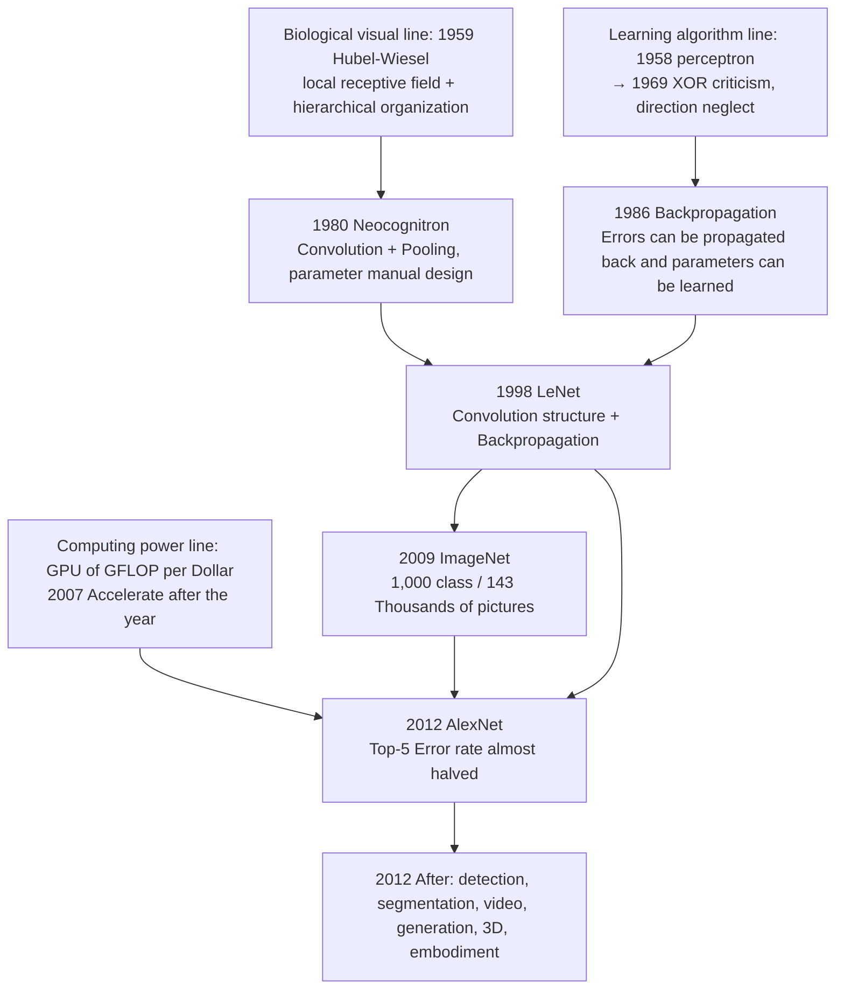
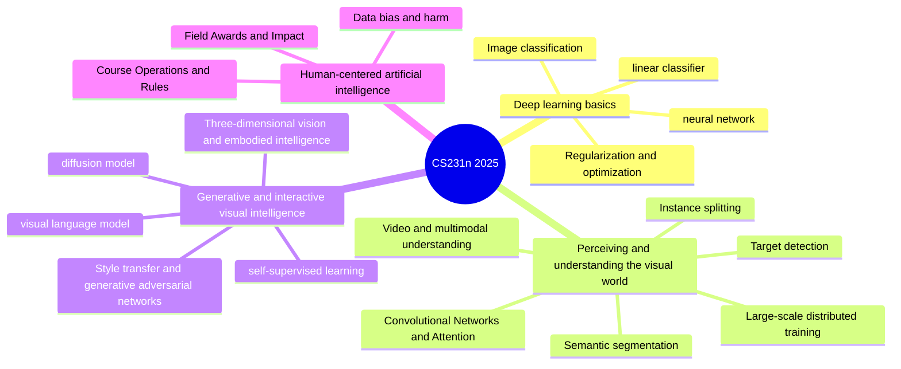

> **Course information**
>
> - **Course name**: Stanford CS231n: Deep Learning for Computer Vision(Spring 2025)
> - **Topic of this lecture**: Lecture 1. Introduction
> - **Lecturer**: Fei-Fei Li, Ehsan Adeli (co-taught by Zane Durante)
> - **Teaching date**: 2025-04-01
> - **Course homepage**: [cs231n.stanford.edu/2025](https://cs231n.stanford.edu/2025/schedule.html)
> - **Official courseware**: [lecture_1_part_1.pdf](https://cs231n.stanford.edu/slides/2025/lecture_1_part_1.pdf)  with  [lecture_1_part_2.pdf](https://cs231n.stanford.edu/slides/2025/lecture_1_part_2.pdf) (119 pages in total, illustrated page by page in the book)
> - **Subtitle source**: [cs231n_sp25_kor_sub · eng](https://github.com/lpaiu-cs/cs231n_sp25_kor_sub/tree/main/eng) (Publicly transcribed in English, Chinese rewritten by this book)
> - **Copyright statement**: The copyright of the slides and course materials belongs to Stanford University and the instructors; this book is an unofficial study note and is only used for study and research.

---

The question to be answered in this course sounds almost provocative: what is so difficult about making machines "see". Humans can tell at a glance that there is a cat in a photo, but the photon distribution on the retina is just a bunch of brightness values ​​- there is no analytical solution for the step from brightness to "cat". The answer given in the entire lecture is not a certain algorithm, but a historical chain: the visual system must be hierarchical, learning must be differentiable, and the data must be large enough to constrain high-capacity models. These three events correspond to the cat brain experiment in 1959, backpropagation in 1986, and ImageNet in 2009.

This lecture is delivered by two teachers. Fei-Fei Li spent 44 minutes telling a brief history of the two parallel threads of computer vision and neural networks. The starting point was the competition in 2012. After Ehsan Adeli took over, he gave a course map - four sections, what tasks to solve in each section, what models to use, and the rules and requirements of the course. The historical part seems to be a "story", but it explains where the technical choices in each subsequent lecture come from: why convolutions share weights, why pooling exists, and why "no data" has stagnated the entire field for twenty years.

## 1. Vision is the cornerstone of intelligence: the “sensor event” 540 million years ago

*(Reference time: 00:00:05 – 00:07:35｜Lecture 1)*

The course starts with self-positioning: it does not talk about "all of AI", but only the intersection of two things - computer vision and deep learning. This scope definition will be repeatedly drawn into a Venn diagram later, but when it first appears, it is just a sentence: vision is not only a part of intelligence, but also the cornerstone of intelligence. By saying this, I am striving for a premise for the entire course: vision is not a problem of "labeling pictures", but an entrance to understanding how intelligence grows from perception.

A group photo page arranged by year reveals the age of the class. It was still a new course when it started in 2015, and it has been running for ten years in 2025; the number of people in the photo is changing, and the topic has expanded from "image classification" to generation, three-dimensionality, and embodiment, but the skeleton of the course has not changed. For those who are taking the course for the first time, this page is useful for calibrating expectations: you are not facing a makeshift handout, but a set of paths that have been repeatedly trampled by tenth-grade students.

The 10th anniversary page draws this faculty thread clearly. Fei-Fei Li taught from 2015 to 2025; Andrej Karpathy 2015–2016; Justin Johnson 2016–2019, returning 2025; Serena Yeung 2017–2019; Ranjay Krishna and Danfei Xu each 2020–2021; Jiajun Wu 2022, Ruohan Gao 2022–2023, Yunzhu Li 2023; Ehsan Adeli and Zane Durante take over from 2024. These people later dispersed into inspection, video, 3D, robotics - the course content flowed with them, which explains why the coverage of CS231n is expanding every year.

From here it's a continuous build, one frame plus one circle. The first frame has only one circle: artificial intelligence. There is no definition, no subfield, just a boundary - things outside the circle are not discussed. The advantage of this painting method is that every time a circle is added later, the audience can immediately tell whether the new circle contains, intersects, or is juxtaposed with the old circle.

The second frame presses into two circles simultaneously: machine learning falls within AI, and computer vision significantly intersects with it but is not included. This detail is worth pausing for a moment - it means that there is "vision that can be done without machine learning" (such as geometric calibration, filtering), and there is also "machine learning that has nothing to do with vision". The class calls machine learning the most important mathematical tool for solving AI problems, and this frame is the graphical version of that sentence.

The third frame adds the circle of deep learning, which is drawn as a proper subset of machine learning and overlaps with computer vision. The definition of deep learning here is simple: a set of technologies built around a family of algorithms called neural networks. Note that it does not claim to be a "new paradigm", but is just placed in the position of set theory - this foreshadows the subsequent narrative that "neural networks appeared as early as the 1950s, but they were not called deep learning at the time."

The fourth frame is the most important operation in this lecture: paint the small area "Computer Vision ∩ Deep Learning" in red and mark This class with an arrow. The red block is just a small flap at the intersection of two large circles - this is exactly the proportion that the lecturer wants people to remember: this course does not cover the entire vision, nor the entire deep learning, only the small area where the two overlap. All subsequent "we don't talk about X" disclaimers can be traced back to this frame.

Neighbors are added starting from the fifth frame. The first one to come in was natural language processing: it also intersects with machine learning and overlaps with the circle of computer vision (later graphic and text tasks grew out of this overlap area). The red blocks are unchanged at this time - adding neighbors is not to expand the scope of the course, but to illustrate that vision is never an isolated subject.

The sixth frame adds speech recognition. After the three neighbors are placed side by side, a pattern emerges: each subfield of AI is "a certain signal + machine learning", and the difference is only in the nature of the signal - pixels are two-dimensional and physically constrained, speech is one-dimensional timing, and language is discrete symbols. This difference was mentioned separately by the lecturer later, because it determines that the same set of inductive biases cannot be used for the three types of tasks.

The seventh frame adds robotics, which largely overlaps with computer vision—the overlap is the embodied intelligence section in later courses. There are seven circles in the entire construction so far, and the red block has not changed in size from beginning to end. This is the most restrained design in the whole lecture: once the scope is defined, it will no longer expand with the topic.

The last frame is a different kind of addition: instead of adding "subfields of AI", we add "supporting disciplines" - mathematics, neuroscience, computer science, physics, psychology, and biology. This frame changes the picture from a "domain map" to a "knowledge source map", and also explains why CS231n first talks about a history of biological vision: the design of each layer of the convolutional network can almost be found in the outer circle of this picture.

There are only two items on the agenda: a brief history of computer vision and deep learning, and an overview of the course. In proportion, history accounts for nearly half, and this arrangement itself is an argument - if the history of a technology has repeatedly seen three ways of death: "insufficient data", "insufficient computing power" and "no differentiable learning rules", then understanding them has more transfer value than memorizing a certain network structure.

History begins 540 million years ago, not the 1950s. The fossil record shows that the number of animal species exploded during a window of about 10 million years in the Cambrian period—an extremely short period of time in evolutionary terms. Before that, life on earth basically floated in water, with no land animals. In the words of the lecturer, it was "quite leisurely."

What ignited this outburst? There are hypotheses about climate and the chemical composition of seawater, but the most convincing answer is "light comes in": trilobites evolved photoreceptor cells. It's not a complex organ with a lens and a retina, it's just a pinhole that collects light. The four types of eyes on this page illustrate that the same thing has been solved by nature more than four times - the eye is not a rare invention, but a solution that evolution has repeatedly selected.

From photoreception to imaging, humans make up the other half. The principle of the camera obscura has been recorded in ancient Chinese and Greek literature, and was painted by Leonardo da Vinci and Gemma Frisius: light passes through a small hole and casts an inverted image on the back wall of the darkroom. The purpose of the slides is not to provide evidence, but to point out a line——**Having an imaging device does not mean having vision**. The camera is just the eye, seeing happens later in the interpretation process.

Cameras are everywhere today, on mobile phones, cars, satellites, and microscopes. But the lecturer then gave a limitation: the camera does not "see", just like the eyes themselves do not "see", they are just front-end devices. The real question is how visual intelligence occurs - which is what this course is all about. This sentence ties together the history of biology in the first seventeen pages and the history of engineering in the back.

## 2. Hubel-Wiesel’s two legacies: receptive fields and hierarchies

*(Reference time: 00:07:38 – 00:17:09｜Lecture 1)*

The 1950s was the starting point of this line, and it started not in computer science departments but in neuroscience laboratories. This page only asks one question: where do we come from. The answer is divided into two groups - one studies "how living things see" and the other studies "how machines learn". The two will not merge into one until 2012.

### 1959: An electrode inserted into the primary visual cortex of an anesthetized cat

The experimental method is still crude and effective today: insert electrodes into the primary visual cortex of anesthetized cats, show the cats bright bars in different directions, and record the discharge of single neurons. They came to two conclusions. First, each neuron has its own **receptive field**——It is only responsible for a small area in the visual field, not the entire image; this area is small and mainly responsible for the primary visual cortex **directed edges** (and moving towards the edge) response. The two columns "Response/No response" in the lower left corner are the criteria: if the direction is right, it will discharge, if the direction is wrong, it will be silent.

The second conclusion is more important and more like engineering intuition: the visual pathway is **layered** of. Simple cells (simple cells) respond to specific orientations, and complex cells (complex cells) obtain a certain degree of translation invariance while maintaining orientation preferences; further up, neurons receive the output of lower-layer neurons, and the receptive fields become larger and the selectivity becomes more complex—from edges to corners to objects. The instructor specifically stated that this was an "oversimplification," but what she wanted was the concept: neurons feed each other to form a huge computational network. This sentence became Neocognitron in 1980 and LeNet in 1998.

### 1963–1970s: From a world of blocks to third-level representation of Marr

Computer vision as a discipline is often traced back to Larry Roberts' 1963 doctoral thesis "Machine Perception of Three-Dimensional Solids." What he did today seems very small: given a photo of stacked blocks, he calculated the orientation, edges and vertices of each face. The three grid images are the original image, the difference image, and the feature points selected from them - a pipeline from pixels to geometric structures. The entire paper only studies "shape", but this is the first time that someone has written "seeing" into an executable algorithm.

This page places Hubel-Wiesel and Roberts side by side on the same timeline, with a link to the MIT Dissertation Library at the bottom. The intention of the juxtaposition is that biological vision and machine vision started on the same axis, and the difference is only four years. Over the next sixty years they intersected repeatedly—neural networks borrowed inspiration from biology, which in turn used networks to explain the brain, and this mutual borrowing became more frequent after 2012.

In the 1970s, David Marr attempted to break down "seeing" into ordered levels of representation. \*\*Primal sketch\*\* extracts zero crossings, spots, edges, line endpoints, virtual lines, groupings and curve boundaries; **2½-D sketch **Complement the discontinuity of local surface orientation, depth and surface orientation; finally** 3D model representation**, using surface and volume primitives to organize complete objects hierarchically. The four-frame image of the basketball on the slide materializes this chain: the original image, the edge image, the cut-out foreground disk, and the sphere with light and dark.

Marr's framework has an implicit requirement: each level of representation must be consumed by the next level and be independent of specific objects. This requirement was unachievable at the time—2½-dimensional sketches required reliable depth cues, and depth information in a single image is inherently uncertain. So the problem was pushed to a more fundamental position: restoring the three-dimensional world from two-dimensional images is a **ill-posed problem**.

### Recovering 3D from 2D: Nature's solution, and its inaccuracies

This is the most "philosophical" section of this lecture. Photons project the three-dimensional world onto an approximately two-dimensional surface (a patch on a trilobite, or our retina), and the information is lost in the projection; to restore it, additional assumptions must be made. The natural solution is **multiple eyes**: Most animals have two, and a few have more, relying on parallax triangulation to restore depth - but two eyes are not enough, and corresponding point matching must be solved. Humans are also imprecise: the instructor said she knew the object's three-dimensional shape roughly, but not with geometric precision. Only after admitting this can we understand why the subsequent three-dimensional vision is so difficult.

The other difference is more subtle: language and vision are ontologically different. Language does not exist in nature. You cannot point to something and say "there is language there" - it is generated by the human brain, one-dimensional and serialized; vision faces a real physical world and obeys the laws of physics and materials. This difference explains a phenomenon in the era of large models: part of the reason why language can be so successfully modeled by autoregression is that it is itself a sequence; vision tasks are much looser in form.

## 3. 1970s–2000s: parts, edges, grouping, matching, a trial and error without data

*(Reference time: 00:17:19 – 00:25:40｜Lecture 1)*

The pioneers in the 1970s had no data, no computing power, and no today's mathematical tools, but they were already struggling with "object recognition." Stanford is represented by Rodney Brooks and Tom Binford **generalized cylinders**: Decompose the object into several columnar primitives with cross-section changes; another work in Palo Alto is **pictorial structures**, representing people or objects as a combination of components and geometric constraints between components. Both routes share the same assumption—that objects can be assembled from parts. This assumption was later overturned by data-driven end-to-end methods, but "composability" is back in today's scene graphs and 3D part generation.

In the 1980s, digital photos began to appear. For the first time, images could be "digitally" processed, and edge detection became the main battlefield. John Canny's 1986 edge operator (Gaussian smoothing + gradient + non-maximum suppression + dual threshold) and David Lowe's 1987 work formed the standard piece of visual front-ends for the next two decades. But the lecturer put in a very honest statement here: Looking at these results, you will be a little disappointed - all you get are sketches and outlines, "it seems like you can't go anywhere."

Disappointment accumulated into a cold winter. The slide lists four items: enthusiasm and funding for AI research have shrunk; "expert systems" have failed to fulfill their promises; but the subfields of AI are still growing - computer vision, natural language processing, robotics, and computational biology. This last point is important: what freezes in the cold winter is commitment, not research. The class also added that winter has entered "before many of you were born."

Parallel to the cold winter is another line that is completely unaffected by the funding cycle: cognitive science and neuroscience continue to produce. The value of this paragraph is that it gives **What to do** answer. The engineering community is struggling with the threshold of edge detection, and psychologists are asking "what information do humans use when identifying objects?"

Irv Biederman's experiment published in Science in 1972 is a beautiful comparison: the same bicycle, one picture has a normal background, and the other picture has a disrupted background. From a photon perspective, the image of a bicycle on the retina is almost the same, but the difficulty of recognition is completely different. The conclusion is: seeing an object is not a local operation, and it is not just the pixels of that object that are used to identify it - the rest of the entire image is also involved in the judgment.

The second experiment measures speed. The RSVP paradigm of Potter et al. in the 1970s: a series of natural images were flashed at a rate of 10 frames per second, and subjects were asked to detect whether a certain type of target appeared in them. 10 Hz means only 100 milliseconds per image. The subjects had never seen these pictures before, and they did not know which frame the target would appear in, what it looked like, and what posture it was in—but they could almost all report it.

Velocity was quantified electrophysiologically by Simon Thorpe. The subjects were put on EEG caps to watch natural scenes, and the task was just to judge whether there were animals in the picture; the results were approximately  **150 milliseconds**, distinguishable differences appear in the EEG signals. The lecturer reminded the audience not to underestimate this number: compared with today's GPUs, 150 milliseconds is ridiculously slow, but the operating frequency of biological neurons is much lower than that of transistors, and 150 milliseconds is only enough to jump a few times in the neural pathway - this is the ultimate speed that wetware can achieve.

Furthermore, the brain not only "recognizes", but also develops specialized areas for this purpose. Kanwisher et al. reported the fusiform face area (FFA) in 1997, and Epstein and Kanwisher reported in Nature in 1998 that the parahippocampal place area (PPA)—selective responses to faces and scenes respectively. The significance of this type of discovery is that visual recognition is not hard-calculated by a general cortex, but has been divided by evolution.

Putting the above together, we get a directional judgment: since the core ability of human vision is "recognizing objects in natural scenes", then computer vision should **Object recognition in natural scenes** Treat it as the main battlefield instead of continuing to draw squares and edges. This page is the midpoint of the entire historical narrative—from here on, the problem definition changes.

The first step in the 1990s was to separate the foreground from the background. Shi and Malik's \*\*Normalized Cuts\*\* in 1997 wrote image segmentation as a graph partitioning problem: pixels are nodes, similarity is edge weight, and the objective function simultaneously minimizes the similarity between clusters and maximizes the similarity within the cluster. Note the timeline: This is still the AI ​​winter, but research is advancing.

The second step is characterization. David Lowe's SIFT in 1999 packaged "key point detection + scale space + direction histogram descriptor" into a set of reusable processes: the same object can still be matched under different scales, rotations, and partial occlusions. Before deep learning, SIFT + nearest neighbor matching was the default solution for image retrieval and 3D reconstruction, and it was also the first lesson for many people to enter the industry.

The first case that truly "entered the industry" was face detection. Viola and Jones's 2001 method used integral graphs to accelerate Haar features, used AdaBoost to select features, and used a cascade structure to reject most windows in a few milliseconds - achieving real-time on the CPU at the time. The slide is described as "one of the earliest successful applications of machine learning in vision." The lecturer's personal memory is more vivid: this paper was published when she was a graduate student, and five years later the first consumer-grade digital camera used its autofocus.

In the early 2000s, the Internet began to become popular, and digital cameras began to become popular. The two things superimposed to create a new thing: data. The scale of research increased from thousands of images to tens of thousands of images, and then the Caltech 101 and PASCAL Visual Object Classes challenges appeared - the latter for the first time turned "detection + classification" into a unified evaluation protocol, with training sets, verification sets, and evaluation servers in place. The lecturer presses pause here: this line of vision has been discussed here, and now we have to go back and talk about another parallel line.

## 4. Parallel lines: perceptron, Neocognitron, backpropagation, LeNet, and then data

*(Reference time: 00:25:51 – 00:35:55｜Lecture 1)*

Another line starts from a single neuron. Rosenblatt's \*\*Perceptron\*\* was proposed in 1957 (the timeline of the slide marks it in 1958): input a weighted sum, pass a threshold, and output a category. It already has the prototype of "learning weights from data" - when an error occurs, the weight is adjusted in the direction of the error. On the timeline, there is only one year between it and Hubel-Wiesel’s cat experiment, and the two lines actually started at the same time.

Frustration comes quickly. Minsky and Papert pointed out in 1969 that a single-layer perceptron cannot express XOR: in the truth table on the left, (0,0) and (1,1) output 0, (0,1) and (1,0) output 1. There is no straight line between these four points on the two-dimensional plane that can separate the two categories. A single-layer perceptron can only draw a straight line, so it can't do it. This conclusion is mathematically impeccable, but in the dissemination it was read as "the neural network is a dead end", which directly led to this direction being left out in the cold for more than ten years.

The turn came from Japan. Kunihiko Fukushima 1980's  **Neocognitron**  It is a computing model based directly on the Hubel-Wiesel hierarchical structure: convolution is performed on the simple cell layer, and pooling is performed on the complex cell layer. The two layers are alternately stacked five or six layers. The farther back, the larger the receptive field and the more abstract the selectivity. It already has the skeleton of a modern convolutional network, but there is only one thing missing——**No practical training algorithm**. All parameters are designed by hand, and hundreds of parameters need to be adjusted little by little to recognize numbers and letters. It's an astonishing engineering achievement and an unscalable path.

1986 **Backpropagation **That piece of the puzzle was completed. The method is to introduce an error correction objective function: given the input and the correct answer, calculate the difference between the network output and the answer, and propagate the error back along the calculation graph in the reverse direction. Based on this, each layer gets the direction in which it should adjust its parameters. Mathematically it is just the repeated application of the chain rule; in engineering it means** No need to manually adjust parameters anymore**——As long as the network is differentiable, the gradient can be calculated automatically. The diagram in the middle of the slide (drawn by Lane McIntosh) depicts this error return path.

The first successful implementation was the convolutional network built by Yann LeCun at Bell Labs. He applied backpropagation to a Neocognitron-style architecture, with a network scale of about seven layers, used to recognize handwritten numbers and letters; the engineering was stable enough, and it was made into a commercial system by NEC to process bank handwritten checks. The slide gives a summary: it is very similar to today's convolutional network. The difference is only in scale, computing power and data.

In the 2000s, a small group of people continued to push the network deeper—Hinton and Salakhutdinov 2006, Bengio et al. 2007, Lee et al. 2009, Glorot and Bengio 2010. There is an embarrassing fact on this road: it was not a mainstream research topic at the time. What was discussed at the meeting was SVM, feature engineering, and kernel methods. Neural networks were considered to be unable to produce good results.

The slide added the third reason in the second frame, and the most fatal one: **No suitable data set**. Number and letter recognition is barely usable, but when you put the same system on photos of nature (cats, dogs, microwaves, chairs, flowers), the effect immediately falls apart. The lecturer emphasized that this is not an "inconvenience", but a mathematical problem: these are high-capacity models, and the larger the capacity, the more data are needed to constrain it, otherwise what is learned is just a coincidence on the training set. She gave a quote that has since been quoted again and again - data is the first class citizen of machine learning.

In the early 2000s, Fei-Fei Li and her students bet on data. They first collected about one billion candidate images, and after cleaning, they obtained about 50 million images. They then sorted out about 15 million annotated data covering 22,000 categories. The number of categories was chosen based on the "magnitude of categories mastered by young humans" in the cognitive science literature. Then cut out a subset from it to run the competition: **ImageNet Large Scale Visual Recognition Challenge (ILSVRC)**, 1,000 categories, 1,431,167 pictures, contestants are not limited to methods, only recognition accuracy.

This page draws two lines on the same timeline: the upper row is a visual milestone (1959 Hubel-Wiesel, 1963 Roberts, 1970s Marr, 1979 Generalized Cylinder, 1986 Canny, 1997 Normalized Cut, 1999 SIFT, 2001 Viola-Jones, 2004/2007 PASCAL, 2009 ImageNet), the lower row is the milestones of learning (1958 Perceptron, 1969 Minsky-Papert, 1980 Neocognitron, 1985 Backpropagation, 1998 LeNet, 2006 Deep Learning), with a blue AI Winter across the middle. Every previous approach between the two lines was missed. What was missing was data, computing power or learning rules.

These two lines have only really been connected at a few points: backpropagation in 1986 added learning rules to the convolutional structure, LeNet in 1998 combined the two but was limited by data, and AlexNet in 2012 brought the three together. By drawing this chain of cause and effect, the position of each subsequent lecture will become clear.

In the first year of the competition, the best algorithms had an error rate of nearly 30 percent, while humans had an error rate of less than 3 percent—a huge difference. There were no surprises in 2011 either. In 2012, Hinton and his students used convolutional networks to compete and nearly cut the error rate in half. This timeline has one more block this year: AlexNet.

The structure itself is not mysterious: input 224×224×3, first use an 11×11 convolution kernel with a step size of 4 to reduce the resolution, then stack several 5×5 and 3×3 convolutions plus maximum pooling, the number of channels increases from 48 to 192, 192, and 128, and finally connects two 2048-dimensional fully connected layers and a 1000-dimensional output layer. The real new thing is not in the graph, but behind the graph: these weights are learned, not designed.

You can estimate the amount of parameters according to the size of the superscript on the slide. There are a total of 48 11×11×3 convolution kernels in the first layer, with weights of approximately 11×11×3×48 ≈ 17,000; and a weight matrix between the two layers of 2048-dimensional fully connected layers is 2048×2048 ≈ 4.2 million. In other words, "five convolutional layers plus three fully connected layers" sounds like just a layer ratio, but almost all the parameters are on the last three layers. This distribution explains why early networks are so sensitive to video memory, and also explains why later architectures have to replace large matrix fully connected layers with other forms.

The lecturer put the two pictures side by side and asked a good question: If the structural similarity is so high, why didn't it work in 1980 but not in 2012? The answer is two things. One is **Backpropagation**: A learning rule that is correct in principle and mathematically strict, so that parameters no longer need to be adjusted manually. The second is **data**: High-capacity models need to be driven by massive data to generalize, and ImageNet provides this magnitude. She also added a forward-looking statement: The number of parameters of these models was in the millions at the time, and this road will eventually lead to the trillions.

## 5. After 2012: Tasks are expanding and bills are accumulating

*(Reference time: 00:36:04 – 00:44:40｜Lecture 1)*

### From the number of papers to architecture iteration

The first measurable change after 2012 was the number of papers. On the left is the submission and acceptance curve of CVPR, which was basically flat in the 1990s, started to rise in the mid-2000s, and then steepened after 2012; on the right is the number of monthly papers on machine learning and AI on arXiv, which rose from almost zero in 1994 to thousands per month in 2020. These two curves are the most direct evidence of "a field suddenly becoming hotter".

This page has the highest information density in the entire page. The NEC-UIUC system in 2010 was a purely manual pipeline: dense descriptor grid (HOG, LBP) → local coordinate encoding and supervector → spatial pyramid pooling → linear SVM; SuperVision in 2012 was replaced by a convolutional network (the receptive field and step size of each layer are marked in the figure); two branches appeared in 2014 - GoogLeNet uses parallel multi-scale branches (Inception) Module) to pile up a narrow and deep network, VGG uses continuous 3×3 convolution to pile up a regular deep structure, the number of channels 64→128→256→512→512 is doubled step by step, and finally connected to fc-4096, fc-4096, fc-1000 and softmax; ResNet (MSRA) in 2015 added cross-layer connections, allowing gradients to bypass multiple layers and be returned directly. The fourth generation systems do the same thing: replace "human-designed features" with "network-learned features".

### Task spectrum: expanding from classification to positioning, timing and generation

The same set of convolution features can be transferred to other tasks. The first one to be verified is retrieval: send the image into the network, take the activation of a certain layer as the descriptor, and use nearest neighbors to find similar images. The significance of this step is that it proves that what the network learns is not a "label" but a reusable representation - which is the starting point for transfer learning to become the default practice.

One step further is positioning. **Target detection** To output boxes and categories (the Faster R-CNN series of Ren, He, Girshick, and Sun 2015 are representative), **Semantic segmentation** Each pixel is given a class label (the multi-scale convolution approach of Farabet et al. 2012 is an early representative). From "What is this picture" to "Where is everything?", the output structure of the task has changed, and the network structure has also changed.

Beyond the static image is the dimension of time. Video classification needs to determine what a clip is doing (running, jumping, playing ball), and human activity recognition needs to give more detailed action categories. Simonyan et al.’s 2014 dual-stream network is a classic solution: look at the RGB (appearance) of a single frame all the way, look at the optical flow (motion) of consecutive frames all the way, and finally fuse the two scores.

The same batch of technologies has also been moved to very different places: Toshev and Szegedy used the network to directly return the coordinates of human body key points (gesture recognition) in 2014; Guo et al. in 2014 let the network learn to play Atari games from screen pixels. The latter has moved beyond "recognition" and into "decision-making" - for the first time, vision has become the input end of the control loop.

Three cross-domain cases illustrate generalization capabilities. Medical imaging is an inherently visual problem - the daily work of radiology and pathology departments is to look at pictures; whale identification comes from the Kaggle competition, using photos of whales for individual identification (Levy et al. 2016); galaxy classification (Dieleman et al. 2014) uses the same convolutional network on astronomical images. The lecturer made a point here: Scientific discoveries have also reaped dividends. Computational photography and vision technology were behind mankind’s first black hole photo.

\*\*Image captioning\*\* turns visual output from labels into sentences. The four sets of results on the slide are "a white teddy bear sitting on the grass", "a man in a baseball uniform throwing a ball", "a woman holding a cat" and "a man stepping on a surfboard". This is done by a convolutional network encoding the image and a recurrent network decoding it into a sequence of words (Vinyals et al. 2015; Karpathy and Fei-Fei 2015). After this step, the output of the vision system is no longer restricted to the predefined category table.

One step further is relationships. The triplet given in the slide includes "taller than" (person is higher than person), "left of", "wear on" (person wears a shirt), and "snow ski". This type of annotation comes from work like Visual Genome (Krishna, Lu, Bernstein, Fei-Fei, ECCV 2016), which represents images as scene graphs: nodes are objects and edges are relationships. Scene graphs are closer to the everyday usage of the word "understanding" than category labels.

The first amazing results for generating directions are **style transfer**: Take a content picture and a style picture, and optimize a new picture that has both the original composition and the oil painting strokes (Gatys et al. 2016). Also on the slide were DeepDream-style results (Inceptionism), the kind of graphs that reveal what mid-level features in a network are "looking" at. The instructor specifically mentioned that the pioneering work in this part came from Justin Johnson, the guest lecturer in this class.

\*\*Generative Adversarial Network (GAN)\*\* pushes face generation to the point where it is difficult to distinguish with the naked eye. The slide uses Progressive GAN (Karras et al., ICLR 2018): starting from a low resolution of 4×4 and doubling it step by step, first generating outlines and then details. The advantage of step-by-step growth is that the training is stable - high-resolution training directly is easy to collapse, but when going up from low-resolution, each level only needs to learn "details not drawn in the previous level".

The turning point from text to image is DALL·E (Ramesh et al. 2021). Enter a description and the model generates a picture that did not exist before. This step advances "generation" from style transformation to semantic combination: the model must understand nouns, attributes, quantities, and spatial relationships at the same time.

Another frame from the same set of results gives a more difficult example: combining the shapes and materials of two objects (such as an avocado-textured chair). The instructor said that this kind of graph is nothing today—systems like Midjourney have long since passed this level—but in 2021 it is a watershed moment.

### Three forces: computing power, algorithm, and data

At this point, the lecturer gave the central argument of the whole lecture: this outbreak is not a single breakthrough; **Three forces are in place at the same time**. On the left is the computing power - rows of GPU cabinets; in the middle is the algorithm - a schematic diagram of a four-layer small network; on the right is the data - a wall made of countless pictures. Without one of the three, it would not have happened in 2012; with all three in place at the same time, it explains why a similar network structure failed in 1980 but succeeded in 2012.

There are hard indicators for the computing power line: the vertical axis is the GFLOPs that can be purchased per dollar, and the horizontal axis is time. The CPU curve is almost flat; the GPU (FP32) curve began to rise after 2007, and became steeper after 2012. The marked points on the graph range from GeForce 8800 GTX (AlexNet era) all the way to GTX 580, GTX 1080 Ti, RTX 2080 Ti, and RTX 3080/3090. According to the lecturer: progress was relatively stable before 2020. Once deep learning begins to drive chip design in turn, the curve will completely take off.

The second frame adds a third curve: the GPU’s Tensor Core. This type of dedicated unit performs hardware-level optimization (low precision, high throughput) for matrix multiplication and addition, raising the "GFLOP per dollar" by another order of magnitude. The note on the slide is straightforward - "Specialized hardware for deep learning." This also explains why the same network can be trained an order of magnitude cheaper with a different generation of cards.

The third set of pictures focuses on the industry: the number of AI conference attendees, the number of startups developing AI systems, and enterprise-level AI application revenue. The three curves are rising at the same time. The lecturer used an exaggerated but easy-to-remember metaphor - we have emerged from the AI ​​winter and are now in a period of "AI global warming".

### Beyond Success: Prejudices, Gains, and What Can’t Be Done

After talking about growth, the lecturer immediately turned to the opposite side. There's only one twist on this page: Despite its fruitful results, computer vision is still far from a "solution." The next three pages explain why it's dangerous, why it's useful, and why it's not enough.

The first form of harm is prejudice. All large-scale AI systems are driven by data, and data is the product of human activities and naturally carries historical biases; biases are learned by models and then applied to people in the name of "objective algorithms." The example on the slide is an automatic video interview scoring system (HireVue type), the case is thanks to Timnit Gebru. The lecturer added something even more devastating: The bias shown by the facial recognition algorithm is the same as the bias of humans themselves.

The flip side is earnings. Medical imaging is the most direct application: film reading, screening, and follow-up. One of the research directions of the lecturers, Adeli and Zane is to use visual technology to provide care for the elderly population and patients. Her questioning method is juxtaposed: the same technology may be harmful when used in recruitment, but may be life-saving when used in diagnosis - "Is it completely bad? Is it completely good?" There is no engineering solution to this kind of question.

The last page is the simplest: two photos (one of which shows children playing), accompanied by the sentence "There are many things we don't know how to do" (slide show credit to Andrej Karpathy). The subtleties, ambiguities, humor, and emotions in human vision are basically incapable of being captured by today’s models. The instructor said she hoped students would leave class with a sense of "not enough"—not a sense of frustration, but a sense of problem.

## 6. Curriculum map: four sections, from classification to embodiment

*(Reference time: 00:44:48 – 00:59:53｜Lecture 1)*

On the first page after Adeli took over, the agenda was brought back exactly as it was, with both items present - the first item had already been covered and the second item was about to begin. This "same page again" approach works well in long lectures: it tells the audience where they are now and how much is left.

The title page of the second part clearly marks the lecture sequence: Lecture 1 – Part 2 – Overview. The entire course is divided into four sections. The following explains one by one "what tasks to solve and what models to use" according to the sections. Finally, it comes to the operation of the course.

Four core teachers took turns to take charge of the lectures: Fei-Fei Li gave the first and last lectures (human-centered AI), Ehsan Adeli and Zane Durante covered the basic and perceptual parts, and Justin Johnson was responsible for the "mechanical" lectures such as convolutional networks, Transformers, and generative models. You can understand how the course is organized when you see this list - it is not a textbook written by one person, but several researchers each talking about the passage they are most familiar with.

Guest lecturers correspond to four specialized directions: Jiajun Wu (3D Vision), Ranjay Krishna (Vision and Language), Ruohan Gao (Video and Multimodality), and Yunzhu Li (Robot Learning). This arrangement reveals the design logic of the course - the later sections rely more on specialized researchers rather than general lecture notes.

A list of four sections appears for the first time: Fundamentals of Deep Learning, Perceiving and Understanding the Visual World, Generative and Interactive Visual Intelligence, and Human-Centered Applications and Impact. Note that this division is not based on technology, but on "problem level": first learn to make tools, then use tools for perception, then generate and interact, and finally discuss its role in society.

### Deep learning basics: classification, linear model, regularization, neural network

The first section starts with the most basic tasks: **Image classification**. Give the model a picture of a cat and output the string "cat". The task definition is simple enough to be said in one sentence, but it is the foundation for everything that follows - detection, segmentation, and description generation, which are essentially based on the ability to "map images to semantics." The instructor calls it "deceptively simple."

The first frame added is **linear classifier**. Represent each picture as a point in the feature space (the slide is shown in two dimensions), and classification is to find a straight line (a hyperplane in high dimensions) to separate the two types of points. Its limitations are also very clear: when the data is not linearly separable, no matter how you draw the straight line, it will not be correct.

Second frame plus **Regularization and optimization**. If the model is too simple, it will be underfitted, and if it is too complex, it will be overfitted; regularization controls the complexity, and optimization is responsible for finding the most appropriate parameters under a given complexity. These two things are the entire engineering connotation of "being able to train something" - not just fitting the training set, but also holding up on new data.

The third frame plus **neural network**. There is only one difference from linear classifiers: nonlinearity is sandwiched between layers, and multi-layer stacking can represent complex boundaries of piecewise linearity. The lecturer pointed out its practical status - from Google Photos to ChatGPT's visual capabilities, this type of model is behind it. The remaining lectures in this section are to break down this conclusion: how to define, how to train, and how to adjust.

The four-section section page will appear repeatedly throughout the paragraph, with the text unchanged. Its function is to draw attention from the previous section back to the map. When this page appeared, the first section had just been finished.

The following third appearance corresponds to the start of the second section. The real new content is on the next page: In this section, we must first distinguish between the two concepts of "task" and "model".

### Perception and understanding: first divide tasks, then assign models

There are only two words on this page: tasks and models. The definition is very clean: **Task** is the specific problem to be solved (detection, segmentation, action recognition), **model** is the computational framework used to solve it. The two need to be aligned - if the classification model is used for pixel-level segmentation, the output structure will not match. This principle of "task determines the output structure" will run through all subsequent lectures.

The three tasks are lined up together, and the difference is visible at a glance. **Semantic segmentation** Give each pixel a category label (grass, cat, tree, sky), but do not distinguish the number of individuals of the same type - two dogs are labeled "dog"; **Target detection** Output the bounding box plus category to answer "what is there and where is it"; **Instance splitting** At its finest, each object instance is given an independent mask to combine detection and segmentation. The output dimensions of the three increase in sequence: a label, a set of boxes, and a pixel-by-pixel image.

Three tasks in the time dimension: **Video classification** Determine what is being done in the clip (running? jumping?); **Multimodal video understanding** Use images and sounds at the same time (the example in the slideshow is of someone playing the vibraphone. It is difficult to judge by just looking at hand movements, but adding audio makes it clearer); **Visualize and understand** In turn, ask the model where it is looking - using an attention heat map to explain the basis for a classification.

The model part starts with Convolutional Neural Network (CNN). A picture comes in, and after several convolutions, downsampling (pooling) and full connections, the classification result is finally obtained. This page uses LeNet's classic schematic diagram, which is the structure mentioned in the previous history section - here for the first time, the course turns "history" into "something to be realized by hand."

In addition to convolution, there are two types of structures: \*\*Recurrent Neural Network (RNN)\*\* processes sequences (video frames, word sequences), **Attention mechanism and Transformer** Replace local convolution with global weighting, which is good at long-range dependence. The three are not substitutions, but different inductive biases: convolution assumes that locality and translation are equivariant, and attention assumes that "any two positions may be related."

This page is new this quarter. There are three goals: training large models faster on larger data sets, breaking the upper limit of a single card and a single machine, and figuring out how to do it. There are two methods: **data parallelism** Copy the model to each worker and split the data; **Model parallelism** Cut the model itself to different devices and share data. Both paths have to answer the same additional question - whether gradient synchronization is synchronous or asynchronous, the former is consistent but slow, the latter is fast but introduces lag.

The section page appears again, pointing to the third section: Generative and Interactive Visual Intelligence.

After the fifth section page, the course begins to leave the comfort zone of "two-dimensional recognition".

### Generation and interaction: self-supervision, generative models, visual language, 3D and embodiment

This page is a pure transition page: all previous tasks are based on two-dimensional images, and the next five directions must go beyond this premise - self-supervision, generation, visual language, three-dimensional, and embodiment.

The motivation for \*\*self-supervised learning\*\* is that labels are too expensive. The method is to construct a training signal from the data itself: cover a part to let the model complete it, do two enhancements to the same picture to let the model recognize it, predict the relative position, etc. It makes it possible to "pre-train with massive unlabeled data" and is also one of the main fuels for visual breakthroughs in the past decade.

Generate part from **style transfer** Let’s talk about: Repaint a photo of Stanford campus into the brushstrokes of Van Gogh’s “Starry Night”. Technically it's an optimization problem - minimizing both content differences and style statistical differences simultaneously. The purpose of this page is to give an intuitive definition of "generate": instead of retrieving an existing image, it generates a picture that did not exist before.

Text-to-image goes one step further: given a prompt ("Teddy bear doing new AI research, underwater, using 1990s technology"), the model generates the entire image. The lecturer emphasized that the ability of this type of system is not just to draw likenesses, but to turn the combination relationship in language into pixels - the subject, scene, style, and sense of time are all satisfied at the same time.

\*\*Diffusion model\*\* is the current mainstream of image generation. The principle is to learn a reverse process: first gradually add noise to the image to pure noise, and then train the network to remove the noise at each step; when generating, start from pure noise, repeatedly denoise, and finally obtain the image. The slide also previews assignment three - implementing a generative model that generates emoji from text prompts (an example is "face wearing a cowboy hat").

**visual language model** Map images and text into the same representation space. The left picture of the slide shows the comparative pre-training of CLIP: there are N pairs of images and text in a batch, the N pairs on the diagonal are positive samples, and the remaining N²−N pairs are negative samples. The training goal is to push the similarity of positive samples higher and the negative samples lower. The picture on the right is a retrieval-enhanced multi-modal language model. The common point is that once images and texts share a space, retrieval, question and answer, and description generation all become different ways of asking the same question.

**3D vision** It is the geometry that is to be output, not the labels. The slide lists three works: 3D-R2N2 (Choy et al. 2016) uses recurrent networks to reconstruct voxels from multiple views; Point-Voxel Diffusion (Zhou et al. 2021) does shape generation and completion; Mesh R-CNN (Gkioxari et al., ICCV 2019) predicts meshes from a single image. The lecturer pointed out its value: three-dimensional representation allows "understanding" to fall into the physical space, which is a necessity for robots and AR/VR.

The last direction is **embodied intelligence**: The agent must sense, plan, and execute. The slide shows two representative works: BEHAVIOR-1K (Li et al. 2022) provides a simulation benchmark of 1,000 daily activities; and the work of Mandlekar and Xu et al. 2020 studies how to generalize from human demonstrations to long-range tasks. The difficulty here is not in recognition, but in the "consequences of actions" - the environment will change because of your actions.

The sixth section page appears, corresponding to the last section: human-centered applications and impacts.

The seventh appearance is the end, followed by the content of this section: what recognition this field has received and what it means to people's lives.

The four plates and their internal structures can be combined into a picture, and each subsequent lecture can be found on the picture:

## 7. From Turing Award to Curriculum: Why was this field established?

*(Reference time: 01:00:05 – 01:02:45｜Lecture 1)*

The first recognition was in 2018 **Turing Award**--The highest technical award in computing, awarded for "significant contributions of lasting importance to computing." The winners are Geoffrey Hinton, Yoshua Bengio, and Yann LeCun for their conceptual and engineering breakthroughs that have made deep neural networks a key component of computing. For a class, the effect of this message is to confirm that the methods on the podium are no longer laboratory toys.

The second recognition was more unexpected: the 2024 Nobel Prize in Physics was awarded to Hinton and John Hopfield "for discoveries and inventions that laid the foundation for machine learning using artificial neural networks." The physics prize was awarded to a neural network, which is quite controversial, but it shows that the source of this method is indeed statistical physics - the Hopfield network is essentially an energy function minimization system.

The third is an award in the field: IEEE PAMI’s  **Longuet-Higgins Award**, awarded annually to only one paper published ten years ago that has had a significant impact on vision research. At CVPR 2019, it was awarded to the 2009 ImageNet paper (Deng, Dong, Socher, Li, Li, Fei-Fei). The phrase "That's Fei-Fei" on the slide was a rare self-reference in the audience, and it also brought the historical narrative to an end - the line of data mentioned above was finally recognized posthumously in the form of an academic community.

This page quantifies "the field becomes larger". On the left is CVPR's submission/reception statistics: 1,131 submissions and 318 acceptances in 2006, 9,155 submissions and 2,359 acceptances in 2023 - the number of submissions has increased approximately eight times in seventeen years. On the right are photos of the venue and city for CVPR 2025 (Nashville, June 11–15). For someone who is just getting started, this set of numbers is both an opportunity and a reminder: with a conference of this magnitude, it is impossible to follow the hot spots.

### Course operation: classes, discussions, Q&A, grading

Next is the course operation part. **Editor's note**: This paragraph in the recorded subtitles does not correspond to the oral description (the lecturer jumped directly from the award to the learning objectives). The following is organized according to the content of the slide page as a record of the 2025 spring semester course rules.

Four pieces of hard information: Classes will be held every Tuesday and Thursday in the NVIDIA auditorium from 12:00–13:20; there will be no Zoom live broadcast, but real-time broadcast through Panopto; the slides will be hung on the course website shortly before each class; all lectures will be recorded and placed under the "Panopto Course Videos" tab of Canvas after class.

The course website is the only general entrance: syllabus, handouts, and assignment download links are all here. The prompt on the slide is "remember to refresh" - the course ongoing page will be continuously updated.

Six Friday discussion classes, 12:30–13:20, in the same NVIDIA auditorium: 04/04 Python/NumPy review, 04/11 backpropagation review, 04/18 final project description and specifications, 04/25 PyTorch/TensorFlow review, 05/02 RNN and Transformer, 05/09 midterm review. It is positioned as a "step-by-step tutorial that is more practical than the main course", and the first time is Python/NumPy/Colab.

Questions related to assignments, projects, midterms, and logistics will all be answered  **Ed** (Canvas → Deep Learning for Computer Vision → Ed Discussion). CGOE students need to register with @stanford.edu email address. If you have any questions, please contact  scpd-customerservice@stanford.edu.

Q&A starts from the second week, both online and offline. Offline, in the basement of Huang Building, follow the signs for CS231n; online, use Zoom and QueueStatus to line up, and the assistant will pull you into a one-on-one meeting room when it's your turn. The specific timetable is on the course website.

The five channels have a clear division of labor: course website (outline, handouts, homework links), Ed (most communication, homework and grading issues, only use private questions when honor code is involved), course email  cs231n-staff-spr25@stanford.edu, Gradescope (hand in assignments and receive grades), Canvas (watch lectures and seminar videos).

All assignments are completed on Google Colab. The content list of homework one is basically the knowledge points from the previous lectures: k nearest neighbor, linear classifier (Softmax), two-layer neural network, image features, deep network and optimizer. It combines both "implementation from scratch" and "training with the framework" into one job.

Grading is done using Gradescope’s automated grading system, which has the advantage of consistent standards. There are two sets of tests: the public test allows students to see the results immediately, and the private test is a promotion of the public test and is used to thoroughly check the boundary conditions of the implementation - this is why "local pass" does not equal "full score".

Weighting: Three assignments 12% + 18% + 15% = 45%, midterms 20%, course projects 35% (proposal 1%, milestones 2%, final report 29%, poster and poster sessions 3%), with up to 3% extra points for participation. Late Submission Policy: Four late submissions are free of charge, each assignment can take up to two days, and then 25% will be deducted for each day thereafter. Late submissions of project reports will not be accepted.

Four rules are worth remembering one by one: do not read other people's answers or codes, the submission must be your own work; do not share your own answer code, but discussion of ideas and overall strategies is not only allowed but encouraged; indicate people who have collaborated with you in the submission; do not submit AI-generated answers. The last sentence of the slide is the point – it’s better to submit late or incomplete than to violate the honor code.

There are only three prerequisites: proficiency in Python (all assignments use Python and NumPy, and later use PyTorch/TensorFlow, there are Python tutorials on the course website), college calculus, and linear algebra. Not listed are "Deep Learning Priors" - this course assumes you are starting from scratch.

Three optional textbooks: "Deep Learning" by Goodfellow, Bengio, and Courville (free online version available, Chapters 5, 6, and 7 cover vector calculus and continuous optimization); "Mathematics of Deep Learning" (free online version); "Dive into Deep Learning" (an interactive textbook with code and discussion based on the NumPy interface).

### Learning objectives, reasons for choosing courses and next class

Learning objectives are divided into three levels. The first layer is **Formalization**: Write a vision application as a task, define input and output, and estimate how much data and computing power is required. The second layer is **Take action**: Write code, debug, and train convolutional networks, and use PyTorch and TensorFlow. The third layer is **judgment**: Know what has happened in this field in the past 0-5 years, where are the open issues, and what ethical and social factors should be considered before deployment.

The four reasons correspond to four types of people: those who want to do vision research (CVPR 2025, ICCV 2025, and research opportunities at Stanford); those who want to do vision engineering in the industry (Google AI perception team, Google Cloud Vision, Meta AI, Amazon AWS, and Nvidia, Apple, Microsoft, OpenAI, Salesforce, etc.); those who want to use vision in other disciplines; and those who are purely interested.

This picture shows the correspondence between lectures and sections: Fundamentals of Deep Learning (Lecture 2–4), Perceiving and Understanding the Visual World (Lecture 5–12), Reconstructing and Interacting the Visual World (Lecture 13–17), and Human-Centered Artificial Intelligence (Lecture 18). Comparing page 073, you will find that there are subtle differences in the section names (the third section is called "Generative and Interactive Visual Intelligence"). These are two versions of the same outline on different pages, and the division of lectures is consistent.

Let’s get to the point in the next lecture: **k nearest neighbor (kNN) **with** linear classification**. The former is the simplest idea of ​​"memorize the training set and vote to decide", and the latter is the starting point of the parametric model - one is a representative of the parameter-free method, and the other is a representative of the parametric method. They are put together to make it clear "what is learning". The decision boundary diagram on the slide was drawn by Wolfram Cloud.

Only one email address is left on the last page: cs231n-staff-spr25@stanford.edu. The whole lecture ends here.

## Summary

*(Reference time: 01:02:30 – 01:02:45｜Lecture 1)*

- The difficulty of vision is not in "imaging" but in "interpretation": restoring the three-dimensional world from two-dimensional projection is an ill-posed problem. The solution in nature is multi-view + prior, and the solution in engineering is data + inductive bias.
- Hubel-Wiesel left behind two reusable legacies—local receptive fields and hierarchical organization; every design choice in convolutional networks can be traced back to these two.
- The neural network came close to success three times, but was blocked by the same shortcoming three times: in 1958, it lacked nonlinearity (XOR), in 1980, it lacked a learning algorithm (parameters depended on manual work), and in 1998, it lacked data (it collapsed directly on natural images).
- The watershed in 2012 was not a new structure, but the three things of "backpropagation + ImageNet + GPU" being in place at the same time; the same network in 1980 would have been an engineering feat of manual parameter tuning.
- Data is not an amenity but a mathematical necessity: the larger the model capacity, the more data is needed to constrain the hypothesis space, otherwise all that is learned is coincidence on the training set.
- The task determines the output structure: classify and output a label, detect the output frame, segment and output a pixel-by-pixel mask, generate and output a picture, and the model must be aligned with the output dimension of the task.
- What the lines of generation and interaction (self-supervision, diffusion, visual language, 3D, embodiment) have in common is that the supervision signal is getting weaker and weaker, and the reliance on data scale and world priors is getting stronger.
- The neutrality of technology is an illusion: the same visual system can be used for recruitment screening and medical screening, and the judgment criteria are not in the model.

## Appendix: Official Reference and Further Reading

- Course homepage and schedule: [cs231n.stanford.edu/2025/schedule.html](https://cs231n.stanford.edu/2025/schedule.html)
- Courseware for this lecture: [lecture_1_part_1.pdf](https://cs231n.stanford.edu/slides/2025/lecture_1_part_1.pdf), [lecture_1_part_2.pdf](https://cs231n.stanford.edu/slides/2025/lecture_1_part_2.pdf)
- Hubel & Wiesel's experiments on cat visual cortex (1959): page 019 of this lecture; Marr's third-level representation: page 022
- Rosenblatt's perceptron (1958), Minsky & Papert's Criticism of XOR (1969): pp. 036–037
- Neocognitron by Fukushima (1980): page 038; Backpropagation by Rumelhart, Hinton, Williams (1986): page 039
- LeNet by LeCun et al. (1998): page 040; ImageNet by Deng et al. (2009): page 043; AlexNet by Krizhevsky, Sutskever, Hinton (NeurIPS 2012): pages 045–047
- Assignments and course rules are subject to the current course website; the operational information on pages 109–114 of this lecture only corresponds to the 2025 spring semester.
- Copyright note: The copyright of the slides belongs to Stanford University and the instructors; this book is an unofficial study note and is only used for study and research.
