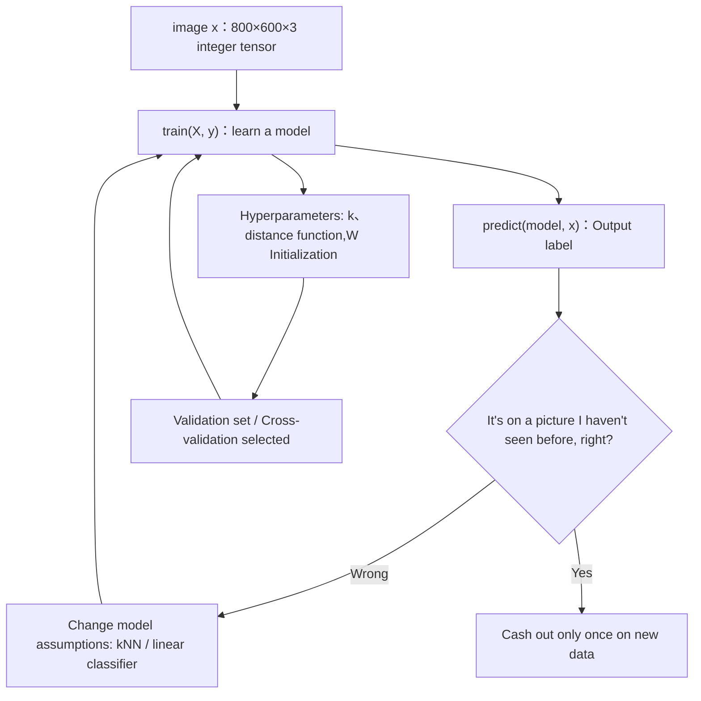
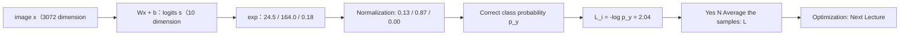

> **Course information**
>
> - **Course name**: Stanford CS231n: Deep Learning for Computer Vision(Spring 2025)
> - **Topic of this lecture**: Lecture 2. Image Classification with Linear Classifiers
> - **Lecturer**: Ehsan Adeli
> - **Teaching date**: 2025-04-03
> - **Course homepage**: [cs231n.stanford.edu/2025](https://cs231n.stanford.edu/2025/schedule.html)
> - **Official courseware**: [lecture_2.pdf](https://cs231n.stanford.edu/slides/2025/lecture_2.pdf) (102 pages, page-by-page illustrations in the book)
> - **Subtitle source**: [cs231n_sp25_kor_sub · eng](https://github.com/lpaiu-cs/cs231n_sp25_kor_sub/tree/main/eng) (Publicly transcribed in English, Chinese rewritten by this book)
> - **Copyright statement**: The copyright of the slides and course materials belongs to Stanford University and the instructors; this book is an unofficial study note and is only used for study and research.


The previous lecture spread out the task spectrum of computer vision. This lecture narrows the lens to an action that can be scored: given a picture, pick a word from {dog, cat, truck, airplane,...}. The task is so simple that a three-year-old can understand it, but it is the common exit for all subsequent models - detection, segmentation, retrieval, generation, and in the end all answer the same sentence: "What is in this picture?" The lecturer also explained the reason why it appears repeatedly: classification is a clean enough benchmark that can expose the differences in algorithms.

The skeleton of this lecture is two cost shifts. For the first time, "write rules" is replaced by "save samples": nearest neighbor reduces training to  $O(1)$, the cost is that each prediction must be compared with the distance of the entire training set. For the second time, replace "save samples" with "save parameters": only one linear classifier is left  $10 \times 3072$  matrix, prediction degenerates into a matrix multiplication. The accounts for both transfers are recorded in the same place - the cost at the time of prediction, and whether the model takes "unseen pictures" seriously. To let "which  $W$ "Better" becomes an answerable question, you must introduce a loss function; and to make the score have the meaning of probability, you must use Softmax and cross entropy. The end of this chain just leads to the next lecture: optimization.

## 1. A 144-dimensional integer tensor, and a word

*(Reference time: 00:00:05 – 00:04:43｜Lecture 2)*

The opening three pages of the recorded version are administrative information. The lecturer did not expand on the lecture, but the week's schedule is clearly written on the page: Assignment 1 will be released on April 9 (Wednesday) and will be due at 23:59 on April 23. The five topics are k-nearest neighbors, linear classifiers and Softmax, two-layer neural networks, image features, deep networks and optimizers; the course project proposal will be due on April 25. Each group will be assigned a TA to form a team and go through Google Form.


What is noteworthy about this list is not the deadline, but its order: the things to be handed in this week just cover the backbone of this lecture and the next three lectures, indicating that the course treats "from kNN to optimizer" as an indestructible minimum closed loop.


The syllabus page cuts the entire course into three parts: basics of deep learning, perception and understanding of the visual world, reconstruction and interaction of the visual world, and finally unified on human-centered AI and fairness ethics. The lecturer said that today he only wants to take the top three items of the first block: data-driven methods, linear classification, k nearest neighbors - they are the bricks of all subsequent models.


The definition of the classification task is short enough to be read in one breath: given an image, and given a predetermined set of labels {dog, cat, truck, airplane,...}, the system outputs one of the labels. There is zero cost for people, because the visual system is born with a holistic understanding, and "this is a cat" is almost a by-product of perception; for machines, it is another matter, there is no unit of "cat" in the things it gets.


The difference is written on the picture below. An 800×600 color picture is essentially a  $800 \times 600 \times 3$  Tensor: Each of the three channels is a grayscale table, and each grid contains an integer between 0 and 255. Calculated as an 8-bit integer, this "cat" occupies 1,440,000 numbers, about 1.44 MB of raw data - not a single number is called "cat".


The range from 0 to 255 has a specific origin. The lecturer added this point in the subsequent Q&A: mainstream images are stored in RGB, 24-bit format (32-bit with alpha channel), and the three channels of red, green, and blue are divided into 8 bits each to combine all colors. In other words, the semantic gap is not about "not enough data"; **Wrong selection of presentation layer**——Use three 8-bit integers to carry "cat", separated by the bridge that this lecture will build.

## 2. After the seven transformations, the path of "writing rules" will not work.

*(Reference time: 00:04:59 – 00:16:39｜Lecture 2)*

Let’s start with the most underestimated one: perspective. As long as the camera pans a little, every pixel in 800×600×3 will change a value, even if the cat is sitting motionless. To a human, it's still the same cat in the picture, but to a machine, it's a **Brand new data points**- Not a single number remains as a clue.


Lighting troubles are more insidious. The RGB value of each pixel is not an attribute of the object, but a function of "surface material × color × light source" - this is an old conclusion in graphics and image processing classes, and the lecturer specifically pointed out its origin. The numbers in the tensor can differ significantly between the same cat in a dark room and in the midday sun, but the labels should not change.


Then there’s background clutter: the subject may only occupy a corner of the frame, and the rest is distraction.


Occlusion is the one in which instructors spend the most time. The three pictures are of a complete cat, a half-blocked cat, and a cat with only a tail and a few claws left. It is almost impossible to tell from the third picture alone - it may be a tiger, or it may be a "raccoon with a small tail" - people relied on the context of "this is on the sofa in the living room" to make it back to "cat".


The deformation is particularly deadly for molluscs like cats: the same cat stretches and curls up, but there is almost no correspondence between the outlines.


Intra-category differences are another dimension: sizes, coat colors, patterns, and breeds are all different, but they are all labeled "cat."


The last one is context. The same partial picture will be read as a tiger if it is removed from the scene. Only when it is placed in a real scene and the shadow relationship is added, will it be read correctly as a cat. What this means for the algorithm is: **Some judgments must rely on the entire picture or even information outside the picture.**, and the "pixel-by-pixel comparison" method cannot obtain this kind of information by definition.


The lecturer asked the audience: "Besides lighting and viewing angle, what else can change the pixel value?" The student added background clutter, scaling, and resolution. His answer to the resolution is very practical: the model usually normalizes the image to a fixed size first, so the absolute resolution has limited impact. The real discomfort is **scale changes**——The same object suddenly becomes larger and smaller in the picture, and the pixel pattern changes completely.

These transformations explain why "modern vision algorithms" deserve a separate page: today's accuracy and robustness are not brought about by a clever rule, but by large-scale benchmarks such as ImageNet and subsequent larger-scale data and models.


### Why hard coding doesn’t work

So the question becomes: Can the steps for identifying cats be written as if-then-else like a sorting algorithm? The lecturer's answer is no, and the reason is very simple - there are clear comparison rules for sorting, but there are no rules for identifying cats.


Historically, people have actually tried it. Canny's 1986 edge detection set was used as the first step: first find edges, get a lot of contours, then find corner points on the contours, count the number of corner points of a specific type, and finally use these features to map to categories. This approach can work on images with minimal changes, but it has two dead ends: Every time you add an object, you have to rewrite a whole set of rules, and "coming up with a set of rules for each object" is another difficult task in itself.


### Replace a set of rules with two functions

The data-driven method is put in another way: instead of writing rules, write two functions. `train(X, y)`  Eats in images and tags and spits out a model; `predict(model, X_test)`  It eats in models and unseen images and spits out predicted labels. The first step is to collect data sets and labels - the lecturer recalled that he used image search engines to save them one by one more than ten or twenty years ago, and now the data sets are basically ready-made; the second step is to train the classifier; the third step is to evaluate on new pictures.


These three steps may seem mundane, but they determine all subsequent engineering constraints: **Training can be slow, prediction must be fast**; **Parameter adjustment can only view the validation set, and the test set can only be used once.**. These two items will become specific costs and specific disciplines in Sections 3 and 4 respectively.



## 3. Nearest neighbor: training is reduced to O(1), and the cost is all-in prediction.

*(Reference time: 00:16:50 – 00:29:17｜Lecture 2)*

The first classifier is so simple that it’s almost a joke: it does nothing during the training phase and just stores the training set in memory as it is; during the prediction phase, it finds the training image that is most similar to the query image and copies its label. The lecturer's statement is that "the training function has no other actions except retaining the data."


The algorithm to be discussed in this section has only two rules, but it clearly demonstrates the counter-intuitive trade-off of "cheap training, expensive prediction" - it is also a testing ground, where hyperparameters, distance functions, and training/validation/test splitting methods will all appear for the first time.


To make "most similar" an executable judgment, there is still a distance function missing. Give it two pictures and it will return a number. The smaller the number, the closer the two pictures are. The example on the slide is five labeled training images (deer, bird, plane, cat, car) and a query image, with the task of calculating distances pairwise.


The most commonly used options are  $L1$  Distance, that is, subtract pixel by pixel, take the absolute value, and then add them all up:


$$
d_1(I_1, I_2) = \sum_{p} \left| I_1^{(p)} - I_2^{(p)} \right|
$$


Among them  $p$  Run through all channels of all pixels. It has only one requirement for the two images: the shape must be the same - there are two on CIFAR-10  $32 \times 32 \times 3$  Tensors are subtracted element-wise.


There are only a few lines written in NumPy, and the complete runnable version is given on the page: `train`  put  `X`  and  `y`  Store into member variables; `predict`  Calculate the distance of all training samples for each test image, take the subscript of the minimum value, and check the label back.

```python
class NearestNeighbor:
    def train(self, X, y):
        # 训练阶段唯一的动作：把数据留住
        self.Xtr = X
        self.ytr = y

    def predict(self, X):
        num_test = X.shape[0]
        Ypred = np.zeros(num_test, dtype=self.ytr.dtype)
        for i in range(num_test):
            # L1 距离：广播成 (N, D)，沿 D 求和得到 N 个距离
            distances = np.sum(np.abs(self.Xtr - X[i, :]), axis=1)
            min_index = np.argmin(distances)
            Ypred[i] = self.ytr[min_index]
        return Ypred
```


Note in this line  `np.sum(..., axis=1)`: it puts  $N$  The comparison is compressed into a broadcast operation. It seems that there is no loop, but  $N \times D$  Subtraction, absolute value, and addition every time—**Vectorization changes the constant factor but does not change the complexity.**.


### Training O(1), prediction O(N)

This leads to the first "moment of reckoning" in the whole lecture. Assume that the training set has  $N$  pictures, each  $D$  Dimensions: training is  $O(1)$, because indeed nothing is counted; the prediction is  $O(N)$——Each test picture must be compared with all training pictures. on CIFAR-10 ($N = 50000$, $D = 3072$), a test picture is  $1.54 \times 10^8$  Element-by-element operation, 10,000 test images are  $1.5 \times 10^{12}$  magnitude. The lecturer used ChatGPT as an analogy: If every time you ask a question, you have to compare all the possible answers on the Internet and answer it again, it will be several years after the calculation is completed.


The opposite direction is the key. Training can be run offline all night, it doesn't matter if it is slower or more expensive; prediction happens in front of the user, which is what the product must afford. This preference will continue to the convolutional network: no matter how expensive the training is, it can be spread to the cluster, but the delay of forward propagation is directly written in the user experience.

To make up for the shortcoming of "slow prediction", the engineering community has taken another path: it does not require accurate nearest neighbors, as long as **Approximately** Nearest neighbor. The lecturer mentioned that there are many such methods and is beyond the scope of this course, but gave an implementation that can be directly used - Meta's faiss. The corresponding paper is "Billion-scale similarity search with GPUs" by Johnson et al. in 2017.


Back to the algorithm itself, what exactly is the nearest neighbor doing? Think of each training image as a point, and the entire space will be cut into several pieces: whichever piece it falls on will inherit the label of the owner of that piece. 1-The division of neighbors looks like this - each training point occupies a small territory, and the boundary is the "power boundary" between it and its neighbors.


This picture immediately exposed the problem: there is a small patch of yellow in the middle, surrounded by green. It comes from an isolated yellow dot - either noise or mislabeled, but the 1-neighbors believe it unconditionally. Change to  $k$  neighbor, let  $k$  If every neighbor votes, the enclave will be swallowed up by the surrounding green. The price is a white zone: no decision can be made when each of the three classes has one vote. The lecturer reversed this side effect——**The white area just tells you where to fill in the data**.


## 4. k nearest neighbors and two distances: the decision boundary is drawn by the distance function

*(Reference time: 00:29:22 – 00:41:29｜Lecture 2)*

$k$  It’s decided, but there’s still a second option that’s still undecided: how to calculate the distance. $L2$ (Euclidean) distance converts the absolute value into a square, and finally takes the root:


$$
d_2(I_1, I_2) = \sqrt{\sum_{p} \left( I_1^{(p)} - I_2^{(p)} \right)^2}
$$


### Rhombus and Circle: Isometric Surfaces Determine Boundaries

The difference between the two formulas is not just whether they can open the root sign; **The shape of an isometric surface**. The slide is counted again with the same set of points: origin  $O(0,0)$, point  $A(1,0)$, point  $B$. use  $L1$  Time to take  $B(0.5, 0.5)$, $d_1(O,B) = 0.5 + 0.5 = 1$, with  $d_1(O,A)=1$  equal; use  $L2$  Time to take  $B(1/\sqrt{2}, 1/\sqrt{2})$, $d_2(O,B) = \sqrt{1/2 + 1/2} = 1$, also with  $d_2(O,A)=1$  equal. That is to say: a point with a distance of 1 from the origin is at  $L1$  It forms a rhombus at the bottom, with  $L2$  Form a circle below.


This shape difference can be quantified. point  $(0.5, 0.5)$  falls exactly on the edge of the rhombus ($L1$  The distance is  $0.5 + 0.5 = 1$), but its  $L2$  only distance  $\sqrt{0.5} \approx 0.707$, falling firmly within the circle. In other words, $L1$  The unit sphere is an inscribed rhombus of a circle: they are equally far apart along the coordinate axis and diagonally  $L1$  But it is obviously "tightened" - the points on the diagonal are measured farther away. This is exactly  $L1$  Sources that are sensitive to feature axes and tend to spread differences to various coordinates.

put  $K=1$  The two divisions of are placed side by side, and the difference in shape is visible at a glance: $L1$  The boundaries are almost all parallel to the coordinate axis and run in a stepped shape; $L2$  The borders are slanted and smooth.


The lecturer asked a more essential question here: Why  $L1$  Sensitive to features? Because its isometric surface is a rhombus, once the characteristic axis is rotated, the rhombus rotates, and the distance from the same point to the origin immediately changes; while the circle remains itself after rotation, $L2$  The distance remains unchanged. The conclusion is that the usage scenario is different - if the feature itself has a clear meaning and you want the distance to respect each coordinate (such as sparse, interpretable features), $L1$  is more appropriate; if the feature is just some arbitrary embedded coordinate, and the rotation should not change the semantics, then use  $L2$.


At this point, $k$  Neighbors already have two knobs that must be customized: $k$  and distance function. The lecturer gave this kind of thing a name——**hyperparameter**, that is, "the choice about the algorithm itself", as opposed to the parameters learned during the training process. The trouble with it is that there is no universal answer: $k$  How much to take and which distance to use are strongly dependent on the data set and problem, so you can only try them one by one.


### Four ways to select hyperparameters

So the question becomes "how to try so that it counts?" The slide lists four paths: the first two are pitfalls, and the last two are the correct solutions.

Idea 1: Pick the best performing hyperparameters on the training set. Yes  $k$  For our immediate neighbors, this is a losing game—$k=1$  It is always 100% correct on the training set because it copies the training samples back unchanged.


Idea 2: Pick the best performer on the test set. This may seem smart, but it's actually cheating - you're effectively using the test set to participate in model selection, and then there's no clean data to estimate the true generalization ability.


Idea 3: Cut out a piece of the training set to make a verification set, train on the training set, select hyperparameters on the verification set, and finally evaluate it on the test set. This is the standard answer, but the cost is that the validation set is usually much smaller than the training set, and the selected hyperparameters have sampling noise.


Idea 4: Cross-validation. Cut the training data into  $K$  Fold (use 50% for the slide), each fold will be used as a validation set in turn, and the rest will be used as a training set. Run  $K$  Take the average round and use the average to select hyperparameters. The lecturer added a very realistic footnote: This is almost necessary for small data sets, but it is not commonly used in large-scale deep learning - if you repeat 50% training five times, the computing power bill will persuade you to quit first, so in practice it is more common to use "single validation set + experience".


## 5. 28% on CIFAR-10: Why pixel distance ends here

*(Reference time: 00:41:45 – 00:45:58｜Lecture 2)*

Put the above onto real data. CIFAR-10 has 10 classes, 50,000 training images, and 10,000 test images. Each  $32 \times 32 \times 3$, from a 2009 technical report by Alex Krizhevsky.


Run the nearest neighbor again, and take the first 10 nearest neighbors of each test image and arrange them in a row: the first column is the query graph, and the ten columns on the right are its neighbors. This diagram is more intuitive than any formula - some lines seem quite reasonable and some are completely outrageous.


Next is a very standard step: scan it with five-fold cross-validation  $k$. Each point is a separate result, the line passes through the mean, and the vertical line is the standard deviation. on the picture  $k \approx 7$  At best, the accuracy falls around 28%–29%.


The 28% number needs to be put in the right frame of reference: the random guess for a 10-type question is 10%, so it does learn something; but it's still far from usable. The lecturer did not rush to explain, but first went back to the search results and pointed out what was wrong - for example, in the fourth line, the query image is a frog, but the neighbor ranked first is more like a dog. The reason is not difficult to guess: the pixel color distribution of the two objects is inherently close. **Pixel-level distance cannot distinguish between "look alike" and "are of the same category"**.


The picture below nails the problem. The left is the original image, and the three on the right are the masked version, the overall right-shifted one-pixel version, and the overall stained version. From a human perspective, the difference between these three images and the original image is huge - the masked version has lost a large chunk of information, while the translated version is almost exactly the same. But in terms of pixel distance, they are exactly the same distance from the original image.


Therefore, the conclusion given by the lecturer is not "$k$  Neighbors are not good enough", but a more precise sentence: **Distances defined on pixels themselves carry no semantics**. This sentence is the motivation for the next section - instead of continuing to find smarter neighbors in the pixel space, it is better to change the assumption: let the model learn a set of parameters by itself and map the pixels into category scores.


## 6. Linear classifier: fold the entire image into a 10×3072 matrix

*(Reference time: 00:46:26 – 00:57:20｜Lecture 2)*

Change the hypothesis: Instead of saving samples, save a group **parameters**. The image comes in and goes through a function  $f$, directly spit out 10 numbers - each number is the score of the corresponding category, and the higher the score, the more similar it is. The lecturer calls this approach a parametric approach, and the parameters are denoted as  $W$, also called weights.


This section will explain "parameterization" thoroughly: first look at  $W$  How is the shape forced out by the dimensions? Let’s look at the same  $W$  How it can be read—algebraic dot product, visual template, geometric hyperplane—finally depends on which distributions it must fail.


The linear classifier defines this function in its simplest form: $f(x, W) = Wx$.


Dimensions must be aligned. A picture of CIFAR-10 is flattened into  $3072 \times 1$  column vector of , the output is  $10 \times 1$  fraction vector of , so  $W$  can only be  $10 \times 3072$——This shape is not a convention, it is forced out by matrix multiplication.


Add another offset  $b$($10 \times 1$), $f(x, W) = Wx + b$. The lecturer emphasized that it is **Regardless of input** is an item whose function is to raise or lower the overall score of each category. Geometrically, it pushes the decision-making surface away from the origin - this will be seen more clearly in the "Geometric Perspective" section later.


Calculate a parameter account. $W$  Yes  $10 \times 3072 = 30720$  number, $b$  There are 10, for a total of 30,730. Compare k nearest neighbors: it needs to save 50,000 training images, that is  $1.54 \times 10^8$  The number is approximately 614 MB based on float32. **Thirty thousand numbers versus 150 million numbers**, a difference of about 5000 times - this is what "parameterization" brings: the model size no longer grows with the training set, and the prediction is once  $10 \times 3072$  of multiplication.

More important is composability. Stacking linear functions layer by layer is a neural network; the lecturer put it directly: This is the most important brick in almost all architectures of deep learning.


In the structural diagrams of AlexNet (Krizhevsky et al., 2012) and ResNet (He et al., 2015), linear layers can be seen everywhere - the convolutional layer and the fully connected layer are essentially "multiplying a matrix and adding a bias", but part of the weights are shared.


To figure it out, the instructor reduced the problem to as small as possible: a picture with only 4 pixels and 3 categories (cat, dog, boat). The graph is flattened into a 4-dimensional vector  $[56, 231, 24, 2]$, so  $W$  is  $3 \times 4$, $b$  is  $3 \times 1$.


![Four-pixel toy example: Flatten a 2×2×1 tensor into \[56, 231, 24, 2\]](</attachments/cs231n-df08257118a0dfe349a93a57.png>)

From an algebraic perspective, everything is just a three-row dot product. Take this behavior of a cat as an example:


$$
s_{\text{cat}} = 0.2 \times 56 + (-0.5) \times 231 + 0.1 \times 24 + 2.0 \times 2 + 1.1 = 11.2 - 115.5 + 2.4 + 4.0 + 1.1 = -96.8
$$


The dog row gives 437.9 and the boat row gives 61.95. Dog is the highest among the three numbers, so the current one  $W$  I will judge this picture as a dog - note that this is just "a certain  $W$  The reading below" is not a conclusion.


### Three reading methods: algebra, template, hyperplane

We have already seen the dot product of algebra, and the lecturer will explain the remaining two reading methods separately.


**Visual perspective.** $W$  Each row of has 3072 numbers, which is exactly the same shape as a picture, and can be reshaped into  $32 \times 32 \times 3$  Look at the "picture". It is not a training sample, but a sample of this category **Template**: A high score means that the inner product of the input and this template is large. Drawing all 10 lines trained on CIFAR-10, you can see that there is a red mass at the bottom of the car grid (the front of the car), and the airplane grid is a bluish sky color block - a linear model has indeed learned "what this category looks like on average."


**Geometric perspective.**  each line  $W_k$  A hyperplane is defined: $W_k x + b_k = 0$, the fraction is the signed distance from this point to the plane. In the two-dimensional representation, three lines cut out airplanes, cars, and deer from other categories respectively; in the 3072nd dimension, these lines become hyperplanes and cannot be drawn, but the principle is the same. bias  $b$  It shows its effect here: without it, all planes must pass through the origin, which is equivalent to forcing "all zero inputs score 0 for all classes", which is obviously unreasonable.


The boundaries of the linear model are also clear: **It can only draw straight lines (hyperplanes)**. The slide gives three counterexamples - the first type occupies the first and third quadrants and the second type occupies the second and fourth quadrants (XOR type); the first type is a ring "with a distance from the origin between 1 and 2"; the first type has three scattered modes. These three distributions cannot be cut by any straight line.


### From scores to losses

So the question converges into one: how to find a good  $W$? The instructor gave a two-step recipe and made it clear that the second step is the content of the next lecture.

1. Define a loss function (loss function) and put "current  $W$ "How bad it is on the training set" is quantified into a number.
2. Find an efficient way to  $W$  Adjust to minimize this number - that is, optimization.


In order to talk about loss, a specific example is needed: 3 training samples, 3 categories (cat, car, frog), a certain  $W$  The score given is cat  `[3.2, 1.3, 2.2]`, car  `[5.1, 4.9, 2.5]`, frog  `[-1.7, 2.0, -3.1]` (Rows are samples, columns are categories).


The way to define the loss function is to write down the "degree of dissatisfaction": give it the  $i$  A vector of scores and true labels for samples, it returns a scalar, the smaller the better.


Formally, the data set is  $\{(x_i, y_i)\}_{i=1}^{N}$, $x_i$  is an image, $y_i$  is an integer label, $f(x_i, W)$  is a fractional vector. The loss of a single sample is recorded as  $L_i$, it is only determined by the score and true value of this sample.


The loss over the entire dataset is the average loss across samples:


$$
L = \frac{1}{N} \sum_{i=1}^{N} L_i
$$


divide by  $N$  This step seems inconsequential - it does not change the optimal  $W$, only changes the magnitude of the loss; but without it, the loss will drift with the data set size, and hyperparameters such as learning rate cannot be reused across data sets. The lecturer's original words were "We usually normalize by the number of samples, although it is not that important" - this sentence is actually very important in engineering.


## 7. Softmax: Score is not probability, cross entropy is the ruler

*(Reference time: 00:57:26 – 01:06:54｜Lecture 2)*

Now only one last thing remains: $L_i$  What exactly does it look like. The lecturer chose the Softmax route and first explained the motivation - the score output by the linear function is unbounded. $-96.8$  and  $437.9$  can appear, this kind of number is difficult to read and difficult to compare; if you can read it as "the probability of belonging to this category", things will go smoothly.


Softmax classifier is also called multinomial logistic regression: it compresses the original score of each class into  $[0, 1]$, and let the probabilities of all classes add up to 1. The "multinomial" here corresponds to multiple categories, and "logistic regression" corresponds to the familiar framework of two classifications.


### Index first, then normalize

The function itself has only two steps. Take the index first:


$$
p_k = \frac{e^{s_k}}{\sum_{j} e^{s_j}}
$$


Take for example the score table in Section 6 (Cat  $3.2$, car  $5.1$, frog  $-1.7$): $e^{3.2} = 24.5$, $e^{5.1} = 164.0$, $e^{-1.7} = 0.18$. The exponent guarantees that the result is always positive—the first requirement of probability is satisfied.


Then divided by the sum of the three  $188.7$, get  $0.13$, $0.87$, $0.00$. The three probabilities are non-negative and add up to 1, which is a legal distribution. Note that the model’s judgment can already be read here: it believes that 87% of this picture is a car.


The terms should be aligned here: the numbers after indexation and before normalization (3.2, 5.1, -1.7) are called **Unnormalized log probability**, the more common name is  **logits**. The reason why it is called "log probability" is because after taking the softmax and then taking the logarithm, it will return exactly to them (with a difference of a constant).


Next define the loss. Since we want to "maximize the probability of the correct class", and the optimizer is used to minimizing, we reverse the sign and take the logarithm - taking the logarithm not only makes the numerical values easier to handle, but also turns the continuous multiplication of probabilities into continuous addition from the perspective of maximum likelihood:


$$
L_i = -\log p_{y_i} = -\log\!\left(\frac{e^{s_{y_i}}}{\sum_j e^{s_j}}\right)
$$


In this example, the correct class is cat. $p_{\text{cat}} = 0.13$, so  $L_i = -\log 0.13 = 2.04$. The better the score, the smaller the number; when  $p_{y_i} \to 1$  when it approaches 0.


The lecturer incidentally pointed out the name of this writing method in other classes: it is equivalent to **Maximum Likelihood Estimation**——Choose weights to maximize the probability of the observed data appearing. CS 229 talks about the same thing.


### Negative logarithm, KL divergence and cross entropy: three ways of saying the same formula

Why is "negative logarithm" justified? Looking at it from another perspective: the correct label can be written as a one-hot distribution  $(1, 0, 0)$, the model gives  $(0.13, 0.87, 0.00)$. Putting the two distributions together, the question becomes "how to measure the difference between them".


The information-theoretic answer is KL divergence (Kullback–Leibler divergence): it measures  $q$  to approximate  $p$  How many more bits to pay. Minimizing the KL divergence means making the two distributions overlap as much as possible.


One step further is cross entropy: $H(p, q) = H(p) + D_{\mathrm{KL}}(p \| q)$. because  $p$  is one-hot, its entropy  $H(p) = 0$, so the cross entropy is exactly equal to the KL divergence, which is also exactly equal to  $-\log p_{y_i}$. This is the origin of "cross entropy" / "BCE" that appears everywhere in deep learning - three roads lead to the same formula.


Collapse the whole chain: linear functions turn graphs into logits, Softmax turns logits into probabilities, negative logarithms turn probabilities into losses, and you can get what you want by minimizing the loss.  $W$.




There are two oral questions at the end of the class, both of which are suitable for self-examination.

The first question: What is the value range of Softmax loss? The lower bound is 0 - as long as the score of the correct class is much higher than the other classes, $p_{y_i}$  can be infinitely close to 1, $-\log$  It is infinitely close to 0 (but cannot be obtained); the upper bound is  $+\infty$——The probability of the correct class can be pushed to 0, and the negative logarithm explodes.


Second question: What happens during initialization? $W$  When very small, all logits are almost equal, and Softmax degenerates into a uniform distribution.  $1/C$, so  $L_i = -\log(1/C) = \log C$.$C = 10$  time is approximately equal to  $2.3$. This is a very practical physical examination indicator: at the beginning of training, if the loss is not  $\log C$  Nearby, it indicates a bug in initialization, label alignment, or data pipeline.


Time runs out here. The last text page is the final pointer to the whole deck: next is regularization and optimization - the former answers "how to make the model stand outside the training set", and the latter answers "how to really  $L$  Come down".


## Summary

*(Reference time: 00:00:05 – 01:06:54｜Lecture 2)*

| judge | One sentence reason |
| :--- | :--- |
| The semantic gap is a representation problem | There is no number called "cat" in the 800×600×3 integer tensor. The only way out is to change the representation. |
| The cost of classification is either training or prediction | nearest neighbor training  $O(1)$, prediction  $O(N)$; What the product wants is the other way around. |
| Pixel distance carries no semantics | There are three types of changes: occlusion, translation by one pixel, and dyeing.  $L1$  The distance is exactly the same |
| The distance function determines the shape of the boundary | $L1$  The unit ball is a rhombus, and its boundaries are at right angles; $L2$  It is a circle, and the boundary is diagonal. |
| Hyperparameters can only rely on the validation set | training set selection  $k$  It is inevitable to choose 1, the test set selection is cheating, and cross-validation is a compromise. |
| Parameterization decouples the model from the data | 30,730 parameters replaced  $1.54 \times 10^8$  training pixels, prediction becomes a matrix multiplication |
| The boundary of a linear model is a hyperplane | The three types of distributions, XOR, ring, and multimodal, cannot be cut by any straight line. This is the reason why nonlinearity must be added later. |
| Softmax loss is  $\log C$  opening | during initialization  $p = 1/C$, so  $L = \log C \approx 2.3$, this is the most trouble-free correctness check |

If you only take away three sentences:

1. **The costs of training and prediction can be offset by each other, but they cannot disappear out of thin air.**  kNN moves the cost to the prediction, and the linear classifier moves the cost to the parameters; the account of the former is  $O(N)$, the latter account is the model capacity.
2. **It is enough for a loss function to satisfy "the smaller the better" and leave the rest to the optimizer.**  Cross entropy is popular because it is the optimal code length in both maximum likelihood, KL divergence, and information theoretic sense.
3. **The ceiling of a linear model is geometric, not data.**  Adding data cannot cut through the XOR, the only way out is to transform the features or stack the model deeper - this is the main line after Lecture 4.

## Appendix: Slides not shown in class

The recording ends at 01:06:54 with the last line "$\log 10 \approx 2.3$";deck transfer to after-school reading starting from page 83. The title of page 83 itself reads Reading Assignment – ​​SVM Loss. Pages 84–97 review multi-type SVM losses from the beginning with six follow-up questions. Page 98 provides a code skeleton. Pages 99–102 compare Softmax and SVM side by side. These pages are not discussed page by page in class. They are included here according to the agreement of this book. Each page still only appears once.

### Another loss: multi-class SVM (083–088)


SVM loss and Softmax eat the same set of scores, and the reading is completely different: it does not construct a probability, it only asks "how much higher is the correct class than the wrong class". There will be no penalty if it is higher than 1, otherwise there will be a linear penalty based on the difference.


The three frames tell three sides of the same thing: $L_i$  It is the sum of several polylines, each polyline is flattened at "the correct class is 1 point ahead". That 1 is the safety margin, which makes the model not satisfied with "just right", but requires "right enough".


### Three-column arithmetic: 2.9, 0, 12.9 (089–092)

Cat column: $s_{y_i} = 3.2$, the penalty given by the two error classes is  $\max(0, 5.1-3.2+1) = 2.9$  with  $\max(0, -1.7-3.2+1) = 0$, a total of 2.9.


Both items in this row of cars were  $\max$  Truncated into 0 - the correct class 4.9 is more than 1 point higher than the cat's 1.3 and the frog's 2.0. The margins have already been met, the model is "satisfied", and the loss is 0. This is the most critical difference between SVM loss and Softmax: it does not pursue pushing the probability to 1, and stops when it is enough.


The frog is the worst one: the correct category  $-3.1$  It lags behind the two error classes (2.2 and 2.5) by a large margin, with two margins of 6.3 and 6.6 respectively, for a total of 12.9.


Average of three columns: $(2.9 + 0 + 12.9)/3 = 5.27$, this is this  $W$  loss over the entire dataset.


### Six Questions (093–097)

Three questions crammed into one page. Q1 asked "What will happen if the overall score of the car is reduced by 0.5" - the answer is no change, the correct category is ahead enough, the margin has long been truncated at 0, and it will still be 0 if it is reduced by 0.5. Q2 asks about the minimum and maximum values: the lower bound is 0, and the upper bound is infinity. Q3 asks about initialization: all  $s \approx 0$  When each item is  $\max(0, 1) = 1$, a total of  $C-1$  item, so  $L_i = C-1$($C=10$  time is 9).


Q4 asked "What if  $j = y_i$  It is also considered as a summation" - there will be one more item  $\max(0, 1) = 1$, the overall loss is moved up by 1, optimal  $W$  No change, but the initial health check value changes from 9 to 10.


Q5 asked "summation converted into average" - each column has  $C-1$  term, averaging is divided by  $C-1$, the loss during initialization changes from 9 to 1; the optimal solution remains unchanged, only the scale of the quantity changes.


Q6 Change to a square hinge: put a square outside the margin item. The larger the error, the faster the penalty increases.


This frame compares the square hinge with the original definition on the same page. The difference between the two formulas is only one square sign.


### Comparison of code and two losses (098–102)

The code page does not give a complete implementation, leaving only a four-step skeleton: first calculate the fraction, then calculate the margin  $s_j - s_{y_i} + 1$, put  $j = y_i$  is set to zero (because the summation only runs  $j \neq y_i$), the last edge  $j$  Sum. This "zeroing" trick avoids having to write a loop in NumPy - just erase the diagonal and do the sum in one go.


The last set of pages puts both losses on the same pipeline: the same set  $W$, $x_i$, $b$  get points  $[-2.85, 0.86, 0.28]$, the correct class is 2. Hinge gives 1.58; Softmax side is indexed first ($0.058, 2.36, 1.32$), normalized into  $(0.016, 0.631, 0.353)$, and then take the negative logarithm of the correct class.


It should be reminded that these two numbers cannot be compared horizontally: there is no upper bound for SVM loss, and the lower bound for Softmax loss is 0. The numerical scales of the two are inherently different.


The page also leaves three sets of comparison scores, asking what the two losses are. first group  $[10, -2, 3]$, second group  $[10, 9, 9]$: The SVM loss is 0 on both groups (the correct class is ahead by more than 1 point), while the Softmax is approximately  $0.001$  with  $0.55$——The gap is all in the 9 in the second group that is "only 1 point ahead".


Doubling the correct class score from 10 to 20, the SVM loss is still all 0 (the difference has not changed, the margin has already been met), but the Softmax will drop significantly. For example, the second group will fall to  $10^{-5}$  magnitude. This page describes two kinds of loss tempers: one only cares about "enough", and the other always wants to be more confident.


