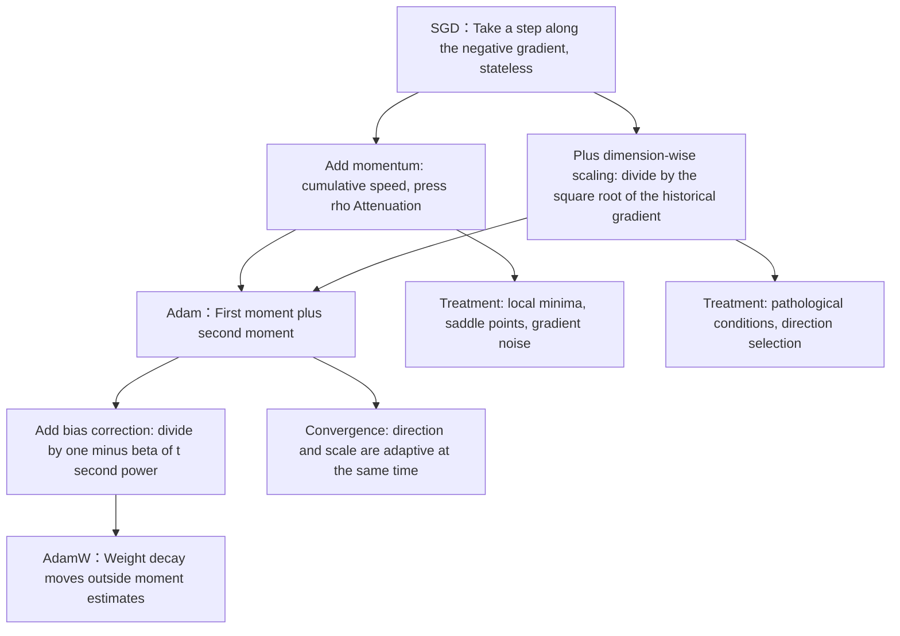

> **Course information**
>
> - **Course name**: Stanford CS231n: Deep Learning for Computer Vision(Spring 2025)
> - **Topic of this lecture**: Lecture 3. Regularization and Optimization
> - **Lecturer**: Zane Durante
> - **Teaching date**: 2025-04-08
> - **Course homepage**: [cs231n.stanford.edu/2025](https://cs231n.stanford.edu/2025/schedule.html)
> - **Official courseware**: [lecture_3.pdf](https://cs231n.stanford.edu/slides/2025/lecture_3.pdf) (119 pages, page-by-page illustrations in the book)
> - **Subtitle source**: [cs231n_sp25_kor_sub · eng](https://github.com/lpaiu-cs/cs231n_sp25_kor_sub/tree/main/eng) (Publicly transcribed in English, Chinese rewritten by this book)
> - **Copyright statement**: The copyright of the slides and course materials belongs to Stanford University and the instructors; this book is an unofficial study note and is only used for study and research.


The previous lecture compressed image classification into a linear scoring function  $f(x,W)=Wx$. At this point, there is no secret in "calculating the score of each category for a picture"; what remains unsolved are two more basic problems: **Are these scores considered good?**, and **How to find out the weights when they are not known yet**. This lecture is divided into two parts: the first half makes up for the missing item in the loss function, and the second half turns "finding W" from a search problem into a process that can be executed repeatedly.

The two questions are not of equal weight. Regularization seems to just add a penalty, but it actually determines "which solution we want" - the same training data often corresponds to infinite numbers of W with zero loss, and the penalty term determines which one you end up on. Optimization may seem like just "going lower," but all the engineering complexity comes from the terrain itself: long and narrow valleys, flat saddle points, noisy gradients, and a learning rate that must change over time.

The first three pages of the handout are course matters and will not be discussed in class, but they will directly affect how you use your homework in the following weeks, so record them first.


Assignment 1 will be released the day after this lecture (4/9) and will end at 23:59 on 4/23. During the Q&A time, only high-level questions will be answered and no code debugging will be done. The page says No Code Show Policy. The actual meaning of this policy is: if the gradient is written incorrectly or the dimensions do not match, you have to locate it yourself - and this is the purpose of the "gradient check" at the end of Section 4. In other words, this lecture not only gives you two concepts, but also a set of methods for checking errors by yourself.


Project proposals are due on April 25; the teaching assistant's expertise and Q&A schedule are posted on the course webpage (cs231n.stanford.edu/office\_hours.html), with a mix of offline and online. Before choosing a topic, it is much easier to see which teaching assistant understands the direction you want to go in than to ask after the fact.


You must read all the pinned posts on Ed. Corrigendums and additional explanations are posted there; students who want to take the midterm exam on campus (CGOE) need to send an email to  cs231n-staff-spr25@stanford.edu  Register.

## 1. The three decisions left in the previous lecture and the questions they failed to answer

*(Reference time: 00:00:17 – 00:11:05｜Lecture 3)*


Reviewing is not about repeating the previous lecture, but laying out the three decisions that have been made to see which one will collapse today. The three decisions are: use data instead of rules to classify, use a distance measure of "similarity", and use a linear function to map images into scores.


**The first difficulty is not in the algorithm, but in the representation.**  What people see is the concept of "cat", and what the machine gets is a 32×32 pixel grid, with three integers at each position, for a total of 3072 discrete values. From this pile of numbers back to the semantic label "cat", the gap in the middle - the lecturer calls it the semantic gap - is the real problem that classification needs to solve. It also explains why  $W$  The width is 3072 and not some other number: $32\times32\times3$.


The six pictures correspond to six types of difficulties, and in two of them the lecturer explained it in more detail than the pictures. cats are typical **deformable object**: It can twist, curl up, and stretch. The same category has almost no stable shape at the pixel level, and any rules that rely on "shape templates" will be invalid. The blocked one is more interesting - there is only a tail sticking out of the seat in the picture. People rely on "the shape of the tail + common sense of cat behavior" to complete it into a cat, but the algorithm has no common sense. Coupled with background clutter and intra-class differences, the "if-else rule" approach is not inaccurate, but the number of combinations of rules will explode.


So it became data-driven: instead of writing rules, it is better to save training samples, and when a new sample comes, vote for the nearest neighbors. 1-NN directly copies the label of the nearest neighbor, 5-NN takes the majority vote of the nearest 5, where 5 is the hyperparameter  $k$. The data should be cut into three parts instead of just two: **The validation set is used to pick hyperparameters** (in  $k$  Scan over the values and draw a line "Validation set accuracy vs  $k$"curve, take the highest point), the test set is only used to answer "How does it perform on completely unseen data?" These two things get mixed up, and the process of picking hyperparameters itself leaks information from the test set into model selection.

Two questions from the class are worth remembering because they distinguish two types of "distance" that are easily confused. The first is the distance metric itself: the k-nearest neighbor (kNN) ratio is **between samples** The most commonly used distances are L1 (Manhattan) and L2 (Euclidean). The example given by the lecturer is the distance from the origin to two points - the L1 distance from (1, 0) and (0.5, 0.5) to the origin is both 1, because you can only walk horizontally and then vertically, (0.5, 0.5) has to be split into two sections of 0.5; but under L2, the former is 1 and the latter is  $\sqrt{0.5}\approx0.707$, so the equidistant line of L2 is a circle, and the equidistant line of L1 is a rhombus (a square turned 45°). The second question is "Is the template of a linear classifier a nearest neighbor?": No. The template is a row of the weight matrix and the coefficient of the linear function. It does not correspond to any training sample. Geometrically, it is the normal direction of a decision boundary.


After flattening the graph into a 3072-dimensional vector, $W$  is  $10\times3072$  matrix (the lecturer said it as 3071 when dictating, press  $32\times32\times3$  should be 3072), $b$  It's 10 dimensions. There are three ways to pronounce the same thing, and all three will be used today: **algebraic reading**——$W$  Each row of is a category grader, with  $x$  Do inner product and add bias; **Template reading**——Reshape a certain line back  $32\times32\times3$  Draw it, and what you see is the weighted template of "what this category looks like"; **geometric reading**——Each row is a hyperplane in the input space, $w^\top x + b = 0$  is the decision boundary, and the sign determines which side the sample falls on. The geometric reading method is the most useful: plot the data and you can see at a glance whether the red and blue points can be separated by a straight line - if not, then the problem is not optimization, but the model family itself. This foreshadowing is buried here until page 094 at the end of Chapter 7.


Specifically, in this score table: in the cat column (3.2, 5.1, −1.7), the correct category is only ranked second, and car’s 5.1 is higher, so it is wrong; in the car column (1.3, 4.9, 2.0), the correct category is the highest, so it is right; in the frog column (2.2, 2.5, −3.1), the correct category is at the bottom, and it is the most wrong. The "goodness" of the three columns of scores cannot be sorted by the naked eye: cat only lost 1.9 points, and frog lost 5.6 points. Why do you say the latter is worse, how much worse? So we need a function that compresses the entire list of fractions into a number:


$$
L = \frac{1}{N}\sum_{i=1}^{N} L_i\left(f(x_i, W),\, y_i\right)
$$


this is **data loss**: The degree of agreement between the model prediction and the training label, the smaller the better. The softmax and cross entropy mentioned in the previous lecture are its specific implementation (high probability of the correct class means low loss, low probability means high loss), and the derivation will not be repeated here. The problem is that by only minimizing this term, the model will try to fit the training set at all costs - including learning the noise in the training set as a rule. The loss function is missing one item.

## 2. Regularization: Take the initiative to make the training loss slightly worse

*(Reference time: 00:11:07 – 00:19:30｜Lecture 3)*


The second thing to do may sound contradictory: **Deliberately make the model perform worse on the training data**. The instructor made it very straightforward - the purpose of this item is not to improve the score on the training set, but to prevent the model from "doing too well" on the training set so that it can do better on unseen data. The training set becomes worse and the test set becomes better. These two things must happen at the same time, otherwise it is not called regularization.


Why is "too good on the training set" a bad sign? A toy diagram with only five points can explain it.


Given these five points, an infinite number of curves can be drawn through them. The picture gives two candidates: $f_1$  with  $f_2$.


$f_1$  Passing through every point accurately, the data loss is almost 0; $f_2$  Every point is a little bit different. If we only look at the training loss, $f_1$  Complete victory. But if these five points are sampled from a smoother law and contain measurement noise, then  $f_1$  What I learned is "what noise looks like", $f_2$  What you learn is "what the rules look like."


The conclusion is that line: Regularization resists the force of "don't fit too well", and its effect is **Not fitting the noise in the data**. The same intuition has a name in philosophy - Occam's razor: among multiple competing hypotheses, choose the simplest one first; only when the simple hypothesis is proven wrong, try more complex ones.


Written as a formula, it is to put a penalty behind the data loss, and then use a coefficient to sew them together:


$$
L(W) = \underbrace{\frac{1}{N}\sum_{i=1}^{N} L_i\left(f(x_i,W), y_i\right)}_{\text{数据损失}} + \underbrace{\lambda R(W)}_{\text{正则项}}
$$


$\lambda$  is **Regularization strength**, another artificially set hyperparameter, with values ranging from 0 (completely unregularized) to arbitrarily large (punishment overwhelms). It's not learned through training, it's like  $k$  Scan on the validation set as well. The reason why this item is important is that it changes "whether the model is good or not" from a single objective to a weighted sum of two objectives: the data loss says "you have to be responsible for the training set", and the regularization term says "don't work too hard".


The three specific forms all operate on the weight matrix element by element and then sum: L2 is the sum of squares  $R(W)=\sum_k\sum_l W_{k,l}^2$;L1 is the absolute value sum  $R(W)=\sum_k\sum_l |W_{k,l}|$;The elastic network divides the two according to coefficients  $\beta$  Mix it up. The difference between them is not in the length of the formula, but in **Penalties for large numbers and small numbers are different**, this point will be clarified with a multiple-choice question in Section 3.


The picture also lists a series of regularizations that are "less like a penalty term": Dropout, batch normalization (BatchNorm), stochastic depth (stochastic depth), and fractional pooling (fractional pooling). What they have in common is that they all inject some randomness or constraints into the network during training so that the model cannot rely on a certain fixed path; the cost is that they will change the network structure itself, which is much more troublesome to adjust than L1/L2. According to the lecturer, there are new papers on this type of method every year and it is an active research direction. This course only covers a small part.


There are three reasons given on the page, and the third one is the most easily ignored. **express preference**: If you believe that the solution to this problem should be "spread" or "sparse", write this preference into the objective function with the corresponding penalty term. **Simplified model**: If regularization suppresses high-order polynomial terms, the model will indeed become simpler. **Improve optimization**: The L2 term is a square, which is a parabola when drawn. Adding it is equivalent to adding a curvature to the loss surface, which makes it more convex and easier to optimize. This will not be discussed in this lesson, but it means that regularization not only affects generalization, but also affects the speed of training itself.

Only the first two of the three reasons are "to make the model simpler". The lecturer specifically corrected a popular misunderstanding: regularization does not always make the model simpler. Dropout is a counterexample - it makes the model more "difficult to learn" during training and more complex in structure, but better on the test set. There is only one truly unified definition: **Worse on the training set, better on the test set**.

## 3. L2 flattening, L1 sparseness: write "preferences" as optimizable items

*(Reference time: 00:19:36 – 00:24:22｜Lecture 3)*


This section uses a live hand-raising question to turn "preference" into something calculable. The input is  $x=[1,1,1,1]$, two candidate weights  $w_1=[1,0,0,0]$  with  $w_2=[0.25,0.25,0.25,0.25]$. The inner product of both is equal to 1, that is **Data loss is exactly the same**——The model's ability to fit the training set is exactly the same, the only difference lies in how the weights are distributed.


The answer is to equalize the weight on both sides. Do the math and you’ll understand why: $R_{L2}(w_1)=1^2=1$, while  $R_{L2}(w_2)=4\times(1/4)^2=1/4$, the latter is four times lower. So L2 will choose among the two solutions that "can also score 1 point" $w_2$——It puts weight **disperse** to all input dimensions rather than betting on a single dimension. In the class vote, the majority chose No. 2. The lecturer said that "L2 likes to spread the burden of weights."


The very second question is a trap. L1 is the sum of absolute values: $R_{L1}(w_1)=1$, $R_{L1}(w_2)=4\times0.25=1$, **The two answers are tied**. Most people in the class raised their hands and chose No. 1 (the sparse one). Their intuition was right, but the reason was not the size of this item - looking at the loss function alone, the two solutions were completely equivalent. The lecturer's approach was straightforward: admit that this is a trap question, and then give why we do see No. 1 in practice - when a certain weight can be pressed to 0 with almost unchanged performance, the optimization process will tend to push it to 0.

This "why" deserves a further derivation (Editor's note: You can get it by deriving the two terms separately): The gradient of L2 to a certain weight is  $2W_{k,l}$, the closer the weight is to 0, the smaller the force being pulled back, so it can stop at a small non-zero value; the gradient of L1 is  $\mathrm{sign}(W_{k,l})$, as long as the weight is not 0, there will always be a fixed force pushing it toward 0. The result of the superposition of the two is: L2 gets a set of weights that are "all small, but not zero", and L1 gets a set of weights that are "a large number of exact zeros" - this is the source of sparsity, and why L1 is equivalent to "making a linear model with fewer coefficients." The lecturer used the intuition of squaring in his explanation (0.001 squared becomes  $10^{-6}$, the penalty almost disappears), and the conclusion is consistent with derivation.

By the way, I will remember a question that was not answered in class: When one of the numbers is replaced by a value like 0.9, will L1's preference be reversed? The lecturer turned back to the review without further explanation after being asked. This is the type of question "leave it to you to do the math in your homework".


The review page re-strung the entire chain, and the explanation about Softmax is worth copying: its function is to **any set of real numbers** becomes a set of probabilities that sum to 1. Classes with higher scores have probabilities closer to 1; other classes are pushed closer to 0. The reason why this is important is that the loss needs to take the negative logarithm of the "probability of the correct class": when the probability is close to 1, the loss is close to 0, and when the probability is close to 0, the loss tends to infinity - the behavior at both ends is exactly in line with "the more outrageous the mistake, the heavier the penalty."


There is only one more thing added to the second edition review page: after the average of the sample-wise loss, add  $\lambda R(W)$. At this point, "how to evaluate a W" has been completely determined: data loss governs fitting, regular terms govern preference, $\lambda$  Control the exchange rate between the two. There is only one question left, which is the entire content of the second half of this lecture——**Where does this W come from?**. Someone in the class asked, "Why does using weight range for regularization mean that the model is simpler?" The lecturer admitted that the L1 situation is relatively straightforward (fewer coefficients), but the general situation does not hold true. In the end, we have to return to the definition of "poor training, good testing".

## 4. Optimization: Find the lowest point on an invisible terrain while blindfolded

*(Reference time: 00:24:37 – 00:33:51｜Lecture 3)*


Once the loss function is determined, the problem becomes a pure optimization problem:  $W$  In the high-dimensional space formed by  $L(W)$  The smallest point. The metaphor used by the lecturer is terrain (loss landscape): think of the loss value as the altitude, the parameters as the coordinates on the ground, and the training is to reach the lowest valley on this terrain.


There is an obvious flaw in this metaphor: when a person stands on a mountain, he can look up and see which side is lower and where the valley is. The lecturer himself fixed this loophole——**Blindfold the person walking**. I can't see the distant view, I can only use my feet to feel the inclination and slope of this point under my feet, and then take a step downhill. This revised version is the real situation of the optimization algorithm: it always only knows the local slope of the current position and does not know where the global lowest point is.


In this setting, there are countless strategies for "how to go". Let’s first look at a strategy that we know is stupid, but is worthy of being used as a lower bound.


Random search is a for loop: randomly generate 1000  $W$, calculate the losses one by one, and keep the best one. There's no math, no directional information.


It gets it on CIFAR-10  **15.5%**  The accuracy of  **99.7%**. The significance of this number is to give a sense of magnitude: any "real" optimization algorithm should far exceed it, otherwise the gradient will not work at all. The lecturer's evaluation of it was very restrained: it is not rigorous, but it is better than the random baseline, and it is not the worst choice when you are desperate.


The second strategy is to formalize the movements of a blindfolded person: feel the slope beneath your feet, take a step downhill, repeat. All algorithms after this step - Momentum, RMSProp, Adam - are just tinkering with this action.


The slope in one dimension is the derivative, defined by the familiar limit:


$$
\frac{df}{dx} = \lim_{h\to 0}\frac{f(x+h)-f(x)}{h}
$$


When there are multiple dimensions, count each dimension once, and the result is **gradient** $\nabla_W L$, one and  $W$  Vectors of the same shape. Two properties will be used later: any direction  $u$  The slope on is equal to the dot product of the gradient and that direction  $\nabla_W L \cdot u$; And the downhill direction with the steepest slope is **negative gradient** $-\nabla_W L$. Gradient points uphill, negative gradient points downhill - this sentence explains the minus sign in all subsequent update formulas.


The most direct algorithm implementation is to hard calculate the limit definition. On the left side of the picture are the current 9 weight components (0.34, −1.11, 0.78, 0.12, 0.55, 2.81, −3.1, −1.5, 0.33, …), and below is the current loss of 1.25347; the right column is full of question marks, waiting to be filled in.


take  $h=0.0001$, change only the first component to  $0.34+0.0001$, calculate the loss forward again, and get 1.25322 - 0.00025 smaller than the original.


thus  $\partial L/\partial W_1 \approx (1.25322-1.25347)/0.0001 = -2.5$. A negative number means "increase this component and the loss will decrease", which is in line with expectations.


Replace the second component: $-1.11+0.0001$, the loss becomes 1.25353, which is larger than the original.


$\partial L/\partial W_2 \approx (1.25353-1.25347)/0.0001 = +0.6$. The positive sign means "turning it up will make it worse", and you should go in the opposite direction when updating.


third component  $0.78+0.0001$  After that, the loss is still 1.25347, exactly the same to five decimal places.


$\partial L/\partial W_3 \approx 0$. This 0 is not a miscalculation: the loss is only printed to five decimal places, and the change is less than  $10^{-5}$, converted into gradient is  $|g|<0.1$  This magnitude - it looks like 0 in the displayed precision.


At this point we can give a verdict on this method. To fill the entire gradient vector, get it right **every** A complete forward calculation is performed once for each component: 3072 times for 3072 dimensions, and millions of times for millions of parameters. And it's only an approximation -$h$  If it is set too high, the truncation error will be large, and if it is set small, significant digits will be lost in floating-point subtraction, which is undesirable for both ends.


So the lecturer said "This is silly". Because the loss is simply  $W$  An explicit function of: from  $W$  Getting to the fraction is a matrix multiplication, and going from the fraction to the loss is Softmax plus logarithm. The whole process is a composite of elementary functions - of course it is differentiable.


Since it is differentiable, we can directly use the chain rule to  $\nabla_W L$  Write it out. $x_i$  with  $y_i$  is data and treated as a constant, only  $W$  is a variable; although there are exponents and logarithms in between, the derivation process is mechanical. This derivation is left as homework, and only its resulting form is emphasized in class.


The question marks in the column on the right are filled in at once: $dW = [-2.5, 0.6, 0, 0.2, 0.7, -0.5, 1.1, 1.3, -2.1, \dots]$, which is completely consistent with the first three components calculated by the numerical gradient. The difference lies in the cost: one forward plus one reverse will get all 3072 components, and the total cost is only a constant multiple of a single forward; while numerical gradient requires 3072 forwards. The only difference here is one  $N$  times, not a constant factor.


The comparison table is worth memorizing: numerical gradient **Approximate, slow, easy to write**;analytical gradient **Accurate, fast, easy to make mistakes**. The engineering conclusion is not to choose one of the two, but to "always train with analytical gradients, but test once with numerical gradients" - this process is called **gradient check**: put  $h$  get  $10^{-4}$  Magnitude, compare whether the components calculated on both sides are of the same magnitude and have the same sign. This is what the gradient check in the job does.

There is another question worth remembering in class: If a certain loss function is better, but it is not differentiable, can it be hardened using numerical gradients? The lecturer's answer is two-fold - constructing a "better but non-differentiable" loss is difficult in itself; and if the loss is non-differentiable in most parts of the domain (such as a bunch of disconnected points), it makes no sense to go in the steepest direction, because you don't have a continuous terrain to walk on. On the other hand, this downhill approach works well if the function is convex. This also explains why the loss functions of deep learning are almost always differentiable: not because it is more elegant, but because gradients can only be used if they are differentiable.

## 5. Gradient Descent and SGD: All three lesions come from "only looking at local slopes"

*(Reference time: 00:33:56 – 00:44:44｜Lecture 3)*


With gradients, the algorithm has only one line: calculate the gradient of the current position, take a step in the negative direction, and the step length is determined by the learning rate.


$$
W \leftarrow W - \alpha \nabla_W L(W)
$$


$\alpha$  is the step size (learning rate). The only thing that needs explanation in this formula is "how far to go": $\alpha$  is fixed, but the gradient itself changes, so **The actual displacement is  $\alpha$  Multiply the module of the current gradient**——Where the terrain is flat, the gradient is small, and the walk is short; where the terrain is steep, the gradient is large, and the walk is long. This will become trouble later.


It is better to understand it by switching to a top view: the color is the loss value, purple and blue are the high points, red and yellow are the bottom, the arrow is the direction of the negative gradient, and the white dotted line is the trajectory. The trajectory does not point to the "global center". Each step of it only points in the local downhill direction of the current point - this is exactly how a blindfolded person walks. The lecturer added a detail that is often overlooked here: there is no "stop" item in the update formula. If it is written according to the formula, the cycle will continue forever. In practice, there are only two ways to stop. One is **Fixed number of iterations**, the second is **Look at the change in loss**——When the loss only decreases every step  $10^{-5}$  even  $10^{-9}$  Stop when you reach a certain level and think it's good enough.


Push the camera closer, and only a curved valley remains. This picture without text is a necessary transition: the real high-dimensional loss surface is not concentric circles, but this long, narrow, curved shape with extremely uneven scales. The next three "lesions" all come from this geometry.


The next issue is settling the score. The complete gradient must be correct  $N$  Sum the samples, $N$  When the level is one million, one step update requires traversing the entire data set, which is an unacceptable cost. **Stochastic Gradient Descent (SGD)**  The method is to only sample a small batch (minibatch) at each step, and use the average gradient of this batch as an estimate of the full amount. Batch sizes 32/64/128 are the most common, the example code on the slide takes 256. Because each time a random subset is collected, it is called "random"; in practice, it will not be purely random, but the entire data set will be scrambled, taken in sequence, and then scrambled again——**Traverse all samples one epoch at a time**.

At this point SGD is ready to run, but it has three structural problems. What's interesting is that these three problems are not errors in the algorithm, but the consequences of "only looking at the local slope" itself.


The first question is **Poor conditioning**. What is drawn in the picture is the equal loss line: horizontal ($w_1$) very flat, vertically ($w_2$) is very steep, and the contour lines are stretched into circles of extremely flat ellipses. Ask: How would gradient descent work on this kind of terrain?


The answer is the red sawtooth: **Very slow progress along gentle directions, jittery back and forth along steep directions**. The reason is not difficult to deduce: the direction of the negative gradient is almost perpendicular to the direction of the valley bottom, so each step is "crossing the valley" instead of "going down the valley"; the components in the steep direction are repeatedly crossed and then pulled back, and all the energy is consumed in the back and forth oscillation. If the learning rate is larger, the oscillation amplitude will gradually increase, and finally fly out of the valley. The lecturer singled out this failure: it will really happen when the learning rate is too large.


The marginalia at the bottom of the page gives this thing a name: loss function **condition number**  Very large, defined as the ratio of the largest singular value to the smallest singular value of the Hessian matrix. If the second-order derivative in the steep direction is large and the second-order derivative in the flat direction is small, the ratio will be large; the larger the ratio, the flatter the contours will be, and the harder it will be to walk SGD. This quantity will appear repeatedly later - it is also what momentum and RMSProp want to deal with.


The second question is **The point where the gradient is zero**. There are local minima on the loss surface, and there are also saddle points: in one direction it is a valley, in another direction it is a ridge.


At this point the gradient is 0 and the update amount  $\alpha\cdot 0=0$, the parameters remain motionless. Falling in the local minimum is considered "bad luck but not wrong", while falling in the saddle point is a pure waste of time - there is obviously a deeper valley next to it, but it can't even feel the direction.


The lecturer highlighted a counter-intuitive empirical fact: **The higher the dimension, the more saddle points and fewer local minima.**. The intuition is that for a point to become a local minimum, all directions must curve upward; and as long as one direction curves downward, it is a saddle point. As the parameters increase from tens of thousands to hundreds of millions, the number of directions increases accordingly, and the probability of "all bending upwards" sharply decreases. The slide refers to the 2014 paper by Dauphin et al. that specifically discusses the saddle point problem in high-dimensional non-convex optimization.


The two-dimensional saddle point is best recognized: like a saddle, the front and rear directions are downward, the left and right directions are upward, and the slope of the middle point is 0 in both directions. It cannot be drawn in more than three dimensions, but the structure of "half pointing up and half pointing down" is the same.


The third problem comes from SGD itself: the gradient is an estimate of the mini-batch, not the full true value, so every step is noisy. The direction is generally towards the bottom of the valley, but every step will deflect. This noise is both a trouble (slow convergence, end-point jitter) and a benefit (the noise itself can push the parameters away from the saddle point) - the subsequent trade-off between momentum and batch size is related to this point.


This quadruple diagram is the turning point of this lecture: local minima, saddle points, ill-conditioned conditions, and gradient noise. The trajectories of SGD (black) and SGD + momentum (blue) are drawn once for each of the four scenarios. It can be seen that the blue trajectory is more "straight" in the four scenes - it does not stop at the saddle point, does not jitter in steep directions, and is not biased by noise. Let’s look at what Momentum has changed from the code level.


```python
while True:
    dx = compute_gradient(x)
    x -= learning_rate * dx
```

Two lines, no status. All subsequent optimizers differ by inserting "memory" between these two lines.

## 6. Momentum, RMSProp, Adam, AdamW: split "where to go" into designable components

*(Reference time: 00:44:47 – 00:59:12｜Lecture 3)*


The physical analogy of momentum is that of a ball rolling down a hill: the ball does not re-determine its direction every moment, it carries with it the speed it has accumulated along the way. Written in code, there is only one more state variable:

```python
vx = 0
while True:
    dx = compute_gradient(x)
    vx = rho * vx + dx
    x -= learning_rate * vx
```

$v_x$  is the speed, $\rho$  is the attenuation coefficient (usually 0.9 or 0.99). $\rho$  The larger it is, the more the new speed depends on the old speed and the longer the memory. The first version of the slide  $\rho$  It's called "friction", but on the next page it's called "momentum" - different names, but the same effect: it determines how much weight "past" and "present" each have.


Why can this change treat four diseases at the same time? The lecturer has corresponded one by one: local minimum - rush over with speed, as long as  $\rho$  It is large enough to climb over a small slope; saddle point - although the gradient is 0, the speed is not 0, it will continue to walk for a while in the original direction; ill-conditioned conditions - the positive and negative components in the steep direction cancel each other out when accumulated, and the components of the same sign in the square direction accumulate larger and larger, which is equivalent to automatically filtering out the "jitter" and amplifying the "forward"; Gradient noise - the noise direction is random and cancels each other out after accumulation, while the true direction shared by the four scenes is retained. This also explains why momentum "averages" away noise: it does a moving average of gradients.

Someone in class asked: Will the momentum become more difficult to converge because it has been overshot? The lecturer's answer is "yes" - it may converge slower, but it is more likely to stop at a better point; and which one is better? **empirical question**, SGD without momentum is actually faster on some models, so the practical approach is to try all of them.


Slides also give you another way to write, merging speed and updates into one step. The lecturer clearly stated that this page "skips the proof in order to rush for time", but the conclusion should be remembered: two ways of writing produce **Exactly the same parameter sequence**, just put  $v_x$  The difference between being saved explicitly or derived implicitly. When looking at other people's code, don't assume that the algorithms are different just because the formulas look different.


Momentum records the direction of the gradient, and RMSProp records the gradient. **size**. It maintains a "moving average of squared gradients":

```python
grad_squared = 0
while True:
    dx = compute_gradient(x)
    grad_squared = decay_rate * grad_squared + (1 - decay_rate) * dx * dx
    x -= learning_rate * dx / (np.sqrt(grad_squared) + 1e-7)
```

The key is in the last line: the gradient is divided by  $\sqrt{\text{grad\_squared}}$. If the gradient of a certain dimension has been very large in history, the denominator will be large, and this step will be short; if the gradient of a certain dimension has been very small, the denominator will be small, and this step will be long. in the denominator  $10^{-7}$  Just prevent division by zero.


The official name of this mechanism is **per-parameter learning rate**  or **adaptive learning rate**. There is only one nominally  $\alpha$, but the actual step size obtained for each dimension is  $\alpha/\sqrt{s}$, $s$  Different dimension by dimension - it is equivalent to assigning its own learning rate to each parameter, and this learning rate is automatically estimated from the historical gradient.


The question was thrown back to the students in class: How would RMSProp go in this long and narrow valley?


The answer is the literal translation of the above derivation: **The steep direction is suppressed and the flat direction is accelerated.**. In the case of pathological conditions, RMSProp will quickly reduce the "crossing the valley" component and amplify the "down the valley" component, so the trajectory quickly turns to the direction of the valley bottom - this is the thing that SGD lacks the most.


The three trajectories are very clear when put together: SGD is slow and jittery; the momentum will overshoot and then turn back (the lecturer mentioned "overshooting" again here); RMSProp is the fastest to turn in the right direction, because it is changing every step. **direction**, instead of just changing the speed.


Adam just stacks the above two mechanisms, each taking care of half:

```python
first_moment = 0
second_moment = 0
while True:
    dx = compute_gradient(x)
    first_moment = beta1 * first_moment + (1 - beta1) * dx
    second_moment = beta2 * second_moment + (1 - beta2) * dx * dx
    x -= learning_rate * first_moment / (np.sqrt(second_moment) + 1e-7)
```

The first moment is the velocity term of momentum, and the second moment is the square term of RMSProp. The so-called "first-order/second-order" are just words borrowed from physics and statistics: one records the mean of the gradient, and the other records the mean of the square of the gradient. At this point Adam can run - except for the first step.


The problem is with the initialization: $m_0=0$, $v_0=0$, while  $\beta_1,\beta_2$  Both are close to 1 (0.9 and 0.999). first step  $m_1=(1-\beta_1)dx=0.1\,dx$, $v_1=(1-\beta_2)dx^2=0.001\,dx^2$, so the denominator in the update amount is  $\sqrt{0.001\,dx^2}\approx0.032\,|dx|$, and the molecule is  $0.1\,dx$——Dividing the two, the step size is amplified by about 3 times, and the amplification factor only depends on  $\beta$, independent of gradient size. The instructor's statement was that "the denominator is almost 0, so the first step is ridiculously large."


The modification is to assign a time step-dependent correction to each of the two moments:


$$
\hat m_t = \frac{m_t}{1-\beta_1^t}, \qquad \hat v_t = \frac{v_t}{1-\beta_2^t}
$$


No.  $t$  When walking, $m_t$  is the weighted sum of past gradients, and the sum of weights is only  $1-\beta_1^t$, so dividing it by it makes up for the problem of "not saving enough in the early stage". $t$  After getting bigger  $1-\beta^t\to1$, the correction disappears automatically - it only works for the first few dozen steps.


The default value given by the slide is  $\beta_1=0.9$, $\beta_2=0.999$, learning rate  $10^{-3}$  or  $5\times10^{-4}$. These three sets of numbers are the starting point of "use it to run first", not the optimal solution; the lecturer's original words are "it is a good starting point for many models, whether it works or not will be discussed later".


Four trajectories are stacked in one picture, and the shape of Adam is indeed somewhere between momentum and RMSProp: it turns quickly like RMSProp at the beginning, and maintains direction in the middle like momentum. This step is visual evidence that "the two mechanisms do not conflict".


Next is the most easily skipped section of this lecture, but it is very practical in engineering: **Where should L2 regularization be added?**.


The answer is "it depends on where you put it". Both methods are legally called "L2 regularization", but the optimizer perceives them completely differently.


The standard Adam approach is to put  $\lambda R(W)$  Added together with the data loss to find the gradient, then this gradient enters the first-order moment and the second-order moment, **Participated in all calculations of momentum and scaling**. The consequence is: the strength of the regularization will be rescaled by the adaptive learning rate - a certain weight decays quickly, its historical gradient is large, and the denominator is also large, so the actual decay becomes slower.


AdamW's approach is to separate the two: moment estimation only uses the gradient of the data loss, and weight decay is added as an independent step at the end. In this way, "where to go" is completely determined by the loss. The attenuation is only responsible for pulling the weight toward the origin, and is not affected by the loss.  $\beta$, $\epsilon$  interference. That's where the name weight decay comes from - it's a separate shrinkage step, not part of the gradient.


The curve on the right side of the slide is the accuracy of the same network on ImageNet: the one using weight decay (blue) is on top of the L2 one (orange) throughout the training process, about 0.94 vs. 0.93 at 30 epochs, and the difference is more obvious in the first 10 epochs (about 0.87 vs. 0.82). The lecturer added some evidence from the industry: Meta’s Llama series all use AdamW, presumably because of this difference.

Someone asked in class: Since the effect is almost the same, why do you need to write one more step? The lecturer's explanation is - you want the speed and momentum to be **loss** function instead of **weight itself** function; if you want the optimization process to follow the loss as much as possible, you have to remove the regularization term from the moment estimate, but you don’t want to give up the regularization, so you put it in the last step.



The reading of this picture is "each component is added to cure a disease": Momentum cures the short-sightedness of "only looking at the current step", RMSProp cures the roughness of "all dimensions share a step size", Adam stacks the two, and AdamW solves the side effect of "regularization being rewritten by the optimizer". There is no substitution relationship between the four components, only superposition relationship.

## 7. The learning rate is not a constant: Scheduling, second-order methods, and a step toward nonlinearity

*(Reference time: 00:59:15 – 01:08:33｜Lecture 3)*


All previous algorithms assume  $\alpha$  is a fixed number. This section will remove this assumption: the learning rate can not only be a variable, but also **variables in almost all modern models**.


The four learning rates are drawn on the same loss curve, and the reading is very straightforward: if it is too high, it will oscillate and diverge (the loss will rise), if it is too low, it will be so slow that no decline can be seen, the one that is high but does not diverge will jump back and forth near the optimal point and can no longer be suppressed, and only the moderate one can both decline quickly and continue to improve.


Then the lecturer broke down the problem: **All four may be correct.**——Depends on how far you have trained. In the early stage, a large learning rate is required to decrease rapidly, and in the later stage, a small learning rate is required for refinement; the "best" learning rate is always changing during the same training process. So he naturally introduced scheduling: let  $\alpha$  Changes with training progress.


The simplest one is **step decay**: When a fixed number of epochs are reached, multiply the learning rate by 0.1. The classic formula of ResNet is to drop once at the 30th, 60th, and 90th epoch. Three cliffs can be directly seen on the picture: the loss drops from about 4.0 all the way to around 1.0. Each time the learning rate is lowered, the curve will immediately "explore a little further" - this is direct evidence that "the learning rate is too high and cannot be suppressed."


The second is **cosine decay**, the curve is half a cosine: from  $\alpha_0$  Smoothly drops to 0. The formula given in the slide is


$$
\alpha_t = \frac{1}{2}\alpha_0\left(1+\cos\frac{t\pi}{T}\right)
$$


Among them  $\alpha_0$  is the initial learning rate, $\alpha_t$  It's the first  $t$  The learning rate of epochs, $T$  is the total number of epochs. The difference between it and the step decay lies in the shape: the step is a piecewise constant with sudden changes, while the cosine is continuous everywhere - gentle at the beginning, steepest in the middle, and gentle again at the end.


In this frame, only the left graph has been changed - from "learning rate changes with epoch" to "training loss changes with epoch", and the horizontal axis is stretched to 300 epochs. It can be seen that the loss has been steadily declining in the middle period (rather than flattening early), and it is close to 0 until about 250 epochs. This is what the lecturer wants to say: **The shape of the loss curve is largely determined by the scheduler**, when using it to compare different models, the scheduling must be aligned first.


In the third frame, a line was added to the formula area. **Linear attenuation** $\alpha_t=\alpha_0(1-t/T)$, change the left side to a straight line. The literature in the lower right corner has also been replaced by the BERT article - only representative works using this kind of scheduling are retained in each frame. This detail itself shows that "which kind of scheduling" is often tied to "which model family".


The fourth frame is added **inverse square root** $\alpha_t \propto 1/\sqrt{t}$, change the reference to Transformer. By this frame, all four scheduling formulas are available, and the shapes cover the four categories of "piecewise constant, cosine, linear, and power law". According to the lecturer, there is no upper limit to the number of such variants. Which one to choose depends on the model and data. You can only try it.


What is more easily overlooked than "how to get down" is "how to get started". **linear warmup**  The approach is to linearly increase the learning rate from 0 to  $\alpha_0$, then add the cosine or inverse square root. The reason is that when the initial learning rate is too large, the gradient direction of the first few steps is still very unreliable, and taking a big step directly will cause the loss to explode; warmup is equivalent to giving the optimizer a "trial period". There’s another rule of thumb on the same page: **Batch size scaling  $N$  times, the initial learning rate is also magnified  $N$  times** (Goyal et al.’s 2017 article on training ImageNet in one hour). The lecturer emphasized that this is an empirical rule rather than a theorem - the variance of the gradient within the batch decreases with the batch size, so a single step can go further, but the "linear" ratio is fitted experimentally.


After talking about scheduling, the lecturer spent the last few minutes explaining a branch that "just knows it exists": second-order optimization. Let’s first look at what the thing we’ve been using looks like – construct one using the gradient of the current point **linear approximation**.


The specific method is two steps: use the gradient to cut a straight line (or hyperplane) at the current position to approximate the loss, and then go to the minimum point of this approximation. For the linear approximation, the minimum is at infinity, so what is actually done is "take a fixed step in this direction" - which is exactly gradient descent. All first-order methods (SGD, momentum, RMSProp, Adam) belong to this category, the only difference is "which direction to go and how far to go".


The second-order method changes the approximation from a straight line to a parabola: using not only slope but also curvature.


Written as a formula, it is a second-order Taylor expansion


$$
J(\theta) \approx J(\theta_0) + (\theta-\theta_0)^\top \nabla_\theta J(\theta_0) + \frac{1}{2}(\theta-\theta_0)^\top H (\theta-\theta_0)
$$


Let the derivative be 0 and solve for the extreme point, we get **Newton update** $\theta^* = \theta_0 - H^{-1}\nabla_\theta J(\theta_0)$. Note the difference from gradient descent: the step size is no longer a scalar  $\alpha$, but the matrix  $H^{-1}$——It automatically takes small steps in the direction of large curvature, and automatically takes large steps in the direction of small curvature. The pathological conditions are corrected at once. This also answers the previous question: "Can Hessian be used to determine the direction?" - Yes, that's it.


The problem is settling accounts. Hessian is  $N\times N$  The matrix of $N$  is the number of parameters: the magnitude given in the slide is "tens to hundreds of millions", which means  $10^{14}$  The number of elements of the magnitude cannot be stored; the inversion is  $O(N^3)$, let alone motionless. The lecturer added a very practical judgment: Even if you are willing to spend this time, if you use the same computing power to feed more data, the benefits will usually be greater. Therefore, in today's network scale, second-order methods basically do not appear.


At the end, I gave three suggestions that can be applied directly. **Adam or AdamW is selected by default**: Run it first on new problems, and you can often get usable results even if the learning rate is fixed. **SGD's added momentum can sometimes exceed Adam's**, but the price is that there are more things to adjust - without RMSProp to help with scaling, you have to try many learning rates, and you also have to try scheduling. **If you can afford full batch updates** (The entire training set is crammed into one batch), which means that the data or model is not large. Only then is it worth looking at second-order and higher-order methods.


The last question is left for the next lecture: for all the optimization techniques discussed in this entire lecture, the optimization object is always the linear scoring function.  $f(x,W)=Wx$. If the model itself is not strong enough, no matter how good the optimizer is, it can only optimize it to its own upper limit.


The object to be optimized in the next lecture looks like this: $f = W_2\max(0, W_1 x)$. Two weight matrices, sandwiched by a ReLU (element-wise  $\max(0,\cdot)$), this is the smallest neural network. In shape, $x\in\mathbb{R}^{D}$($D=3072$), $W_1\in\mathbb{R}^{H\times D}$, $W_2\in\mathbb{R}^{C\times H}$($C=10$), the middle one  $H$  is the hidden layer width, which becomes a new hyperparameter - the parameter quantity changes from the linear model's  $10\times3072$  become  $H\times(D+C)$, the capacity of the model is determined by this  $H$  decision. The lecturer specifically explained that in practice, each layer will also add a learnable offset, and the slides were omitted for clarity.


Why do we have to include that nonlinearity? If you go back to the geometric reading in Section 1, you will understand: the red and blue dots on the picture are in a circle within a circle. **No straight line can separate them**. If you just stack two linear transformations ($W_2W_1x$), together it is still a linear transformation, which is equivalent to adding nothing.


The way out is to change the data to another space first. The example given in the slide is polar coordinates: $f(x,y)=(r(x,y),\theta(x,y))$, replace the points on the plane with "distance from the origin + angle", and the original structure of a circle within a circle becomes two groups that can be cut with a straight line in the new coordinates. Each layer of the neural network does exactly this - except that this transformation is not designed by hand, but learned together with the classifier.


By the way, give me a name. The word "neural network" is too broad. A more accurate name for the structure to be discussed in this lecture is **fully-connected network**, sometimes also called **Multilayer Perceptron (MLP)**. It is called "fully connected" because every neuron between two adjacent layers is connected to every neuron in the next layer, and there is no artificial zero position in the weight matrix.


Next, let’s talk about two things: the neural network itself, and backpropagation - it answers the question "How do you calculate after multiple layers are stacked up?" $\partial L/\partial x$". This lecture explains how to push gradients (for  $W$  Seek guidance, guide  $x$  When a constant) becomes a chain in a multi-layer structure, the chain rule must be used systematically, which is the content of computational graphs and backpropagation.

## Summary

*(Reference time: 01:06:04 – 01:08:33｜Lecture 3)*

| Main points | One sentence explanation |
| :--- | :--- |
| There are two losses | The data loss is about "fitting the training set", and the regular term is about "don't fit too hard". $\lambda$  is the exchange rate between the two |
| Zero loss is not unique | can make the training loss 0  $W$  There are usually an infinite number of them, and regularization determines which one you fall on |
| L2 flat, L1 sparse | For two solutions with the same score, L2 chooses the one with dispersed weights; L1’s penalty treats both large and small weights equally, so the smaller one is pushed to 0 |
| The gradient is "one forward exchange of all partial derivatives" | Numerical gradient is easy to write but an order of magnitude slower. Analytical gradient is fast but can be written incorrectly, so the two need to be compared. |
| Three lesions of SGD | Jitter under pathological conditions, stopping at saddle points, and noise caused by small batches-these three are not implementation bugs, but the necessity of "only looking at the local slope" |
| Momentum governs direction, RMSProp governs scale | The former is a sliding average of the gradient, the latter is divided by the square root of the historical gradient according to the dimension, and Adam superimposes the two and then adds bias correction. |
| The learning rate must change | The early stage is large and the late stage is small; cosine plus warmup is a general formula, and the batch size is enlarged.  $N$  When times are doubled, the learning rate also increases  $N$  times |
| Second-order methods are blocked by memory | Hessian is  $N^2$, the inverse is  $N^3$, $N$  It is not feasible when there are millions of times, so there are basically only first-order methods in deep learning. |

## Appendix: Slides not shown in class

The last 22 pages of the handout are backup pages from old years marked "Appendix (Slides from Previous Years)", which are not taught in class. They are not dispensable leftovers: they include Nesterov momentum, AdaGrad, and L-BFGS, three methods mentioned in the main text of this lecture but not expanded, as well as a complete derivation of "zero loss is not unique" using SVM loss. The following is recorded page by page in the original order.


This page speaks for itself: the following does not fall within the scope of the course in 2025 and is simply historical material retained by the lecture notes. It is more appropriate to read it as an extension of "I will talk about it if there is still time" rather than as required reading.

### Nesterov Momentum: Look one step before taking gradient


Momentum updates are split into three parts: velocity, gradient, and actual steps. One sentence summary is "combine the gradient of the current position with the speed to get the step size that is actually used to update the weight."


The right half is Nesterov's change: instead of taking the gradient of the current position, **Take a step forward according to the speed first**, take the gradient of the "point to be reached", and then mix it with the speed.


What is marked on the picture is the look-ahead point - it is not at the current position of the parameter, but one step forward in the direction of velocity.


A problem arises: the gradient of the look-ahead point cannot be directly written into the update formula with the current position as the independent variable, so a variable substitution is required.


After the substitution, the form becomes clean again, at the cost of adding a correction to the gradient in the definition of velocity. The lower right corner of the page points to the course handout neural-networks-3.


The only difference between this page and the previous page is the expansion of variable substitution, and the conclusion is the same: the only difference between Nesterov and ordinary momentum is "at which point the gradient is taken", and the implementation is still two lines.


The three trajectories are juxtaposed: SGD is the shakest, and the momentum will overshoot. Nesterov's overshoot is smaller - because it "sees" the slope is going to slow down before it arrives.

### The predecessor of AdaGrad and RMSProp


AdaGrad is the ancestor of this RMSProp section: it also scales the gradient by dimension, but the denominator is **Cumulative sum of squared historical gradients**, no attenuation.


The question is the same as the RMSProp page: In a valley with "one direction is steep and one direction is flat", what trajectory will be followed by the step length scaled by the cumulative sum of squares.


The answer is consistent with RMSProp - the steep direction is suppressed and the flat direction is accelerated.


The second question is to extend the time scale: the denominator only increases but not decreases, how will the step size change with time.


Because the denominator is a monotonically increasing cumulative sum, the step size will be **Decay all the way to 0**, almost stopped at the end of training. This is exactly the flaw that RMSProp aims to fix.


Replace "accumulation" with "moving average with attenuation", the denominator will no longer grow infinitely, and the step size will not return to zero. The name given by the slide is very vivid: leaky AdaGrad.

### Quasi-Newton method and L-BFGS


Since  $O(N^3)$  The inversion of is not feasible, so a series of rank-1 updates are used to gradually approach the inverse Hessian, each time only  $O(N^2)$——This is the BFGS class method. L-BFGS goes one step further: it does not even store the complete inverse Hessian, only the vector pairs of the most recent steps.


Its boundaries are clearly written: **Full batch, deterministic** of  $f(x)$  The performance is very good; the results will be significantly worse when switching to small batch random settings. Getting the second-order method right for small batches is still a research topic.


It is almost the same as the advice on page 91 of the text, except for the last difference: the recommendation here is "try L-BFGS in full batches if you can, and remember to turn off all noise sources" instead of "look at the second-order method".

### Use SVM loss to re-explain "zero loss is not unique"


same group  $W$, $x_i$, $b$  Calculate the same set of fractions  $(-2.85, 0.86, 0.28)$, the label is Category 2: 1.58 for hinge loss and 0.452 for cross entropy. Same set of predictions, two completely different values ​​- this also reminds one thing: loss values ​​are only comparable within the same loss, and comparing losses across models is meaningless.


The next three pages are replaced by SVM loss and re-examine "Zero loss is not unique": Assume that a set of weights has been found that makes the total loss 0, and ask whether this solution is unique.


The answer is not the only one: put  $W$  If the whole thing is doubled, the loss is still 0.


This page completes the calculation: it turns out that the loss in the car column is  $\max(0,1.3-4.9+1)+\max(0,2.0-4.9+1)=0$; After doubling the whole score, it becomes  $\max(0,2.6-9.8+1)+\max(0,4.0-9.8+1)$, both items are still 0. That is to say  $W$  with  $2W$  are completely equivalent on the training set, but their generalization behavior is not the same.


The last question goes right back to Section 2: Since  $W$  and  $2W$  To tie, the selection criteria can only come from other than data loss——**regular term**. This also explains why the L2 penalty is directly related to the "global scaling of weights": among all equivalent scalings, it picks the one with the smallest module length.
