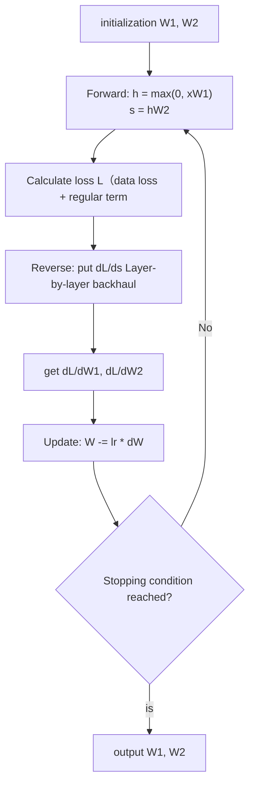
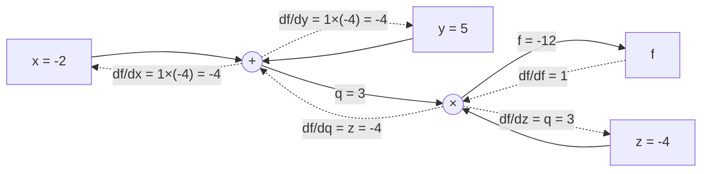

> **Course information**
>
> - **Course name**: Stanford CS231n: Deep Learning for Computer Vision(Spring 2025)
> - **Topic of this lecture**: Lecture 4. Neural Networks and Backpropagation
> - **Lecturer**: Ehsan Adeli
> - **Teaching date**: 2025-04-10
> - **Course homepage**: [cs231n.stanford.edu/2025](https://cs231n.stanford.edu/2025/schedule.html)
> - **Official courseware**: [lecture_4.pdf](https://cs231n.stanford.edu/slides/2025/lecture_4.pdf) (147 pages, page-by-page illustrations in the book)
> - **Subtitle source**: [cs231n_sp25_kor_sub · eng](https://github.com/lpaiu-cs/cs231n_sp25_kor_sub/tree/main/eng) (Publicly transcribed in English, Chinese rewritten by this book)
> - **Copyright statement**: The copyright of the slides and course materials belongs to Stanford University and the instructors; this book is an unofficial study note and is only used for study and research.


At the end of Lecture 3, a complete training pipeline is actually closed: data  $(x,y)$ → Linear scoring  $s=Wx$ → loss  $L$ → gradient  $\partial L/\partial W$ → Take one step along the negative gradient. The only link in the chain that is not taken seriously is the model itself - there is always only one  $W$. This lecture does two things: first change the scoring function from "one layer of linear" to "alternating linear and nonlinear stacking", and then add a machine that can calculate the gradient of any depth of stack.

The second thing is the important thing. The lecturer said that when he was studying in his early years, he often referred to this machine as "a magical process that allows the network to learn from its own mistakes, but it is more organized and a little more mathematical than humans." He also gave a harder judgment: Every algorithm that will be discussed throughout the semester uses some form of backpropagation. Therefore, this lecture does not introduce new losses or new optimizers, but only answers one question——$\partial L/\partial W$  How to calculate it systematically, instead of recalculating matrix calculus on paper every time.

## 1. Where does the review stop: Loss, gradient, and optimizer are all in place, but the model is missing

*(Reference time: 00:00:05 – 00:09:53｜Lecture 4)*

### One page review

The two pages of administrative notices are crossed out first, but they have practical uses: project proposals are due on April 25 (Friday), and the expertise of each teaching assistant is listed on the office hours page. Before selecting a topic, you should find people to ask according to the direction; tomorrow's discussion class will be led by Matthew Jin and assisted by Emily Jin, and the topic happens to be backpropagation.


These two are not small talk, they determine the rhythm of this week: the proposal must be implemented into "data set + baseline + indicator", and whether the baseline can run depends on whether you can write a correct backpropagation yourself. The discussion class is scheduled the day after the main class, which essentially leaves a slow replay of today’s content.


The discussion class was arranged the day after the main class, which was equivalent to leaving a slow replay for today's derivation. Next comes the review: the entire assembly line from the previous lecture needs to be rearranged, because every symbol introduced today is built on it.


The separator page only has a title and no content. Its function is to remind: everything in the next five minutes is "known conditions".


The above page is worth reading block by block because all subsequent symbols follow its writing pattern. The data is  $(x_i, y_i)$  The set of ; the scoring function takes a linear form  $s = f(x;W) = Wx$;There are two common ways to write losses:


$$
L_i = -\log\frac{e^{s_{y_i}}}{\sum_j e^{s_j}}, \qquad L = \frac{1}{N}\sum_{i=1}^{N} L_i + R(W)
$$


$$
L_i = \sum_{j \neq y_i}\max\left(0,\; s_j - s_{y_i} + 1\right)
$$


The flow chart on the right is a map of the entire course: $W$  All the way to the score function, and then to the data loss; at the same time  $W$  There is also an independent branch heading towards regularization loss; two branches are  $L$  Add up everywhere. The lecturer specifically responded to a question that was asked repeatedly - why only Softmax was used throughout the class. The answer is that it is not the only option, but the most commonly used one in classification tasks; Hinge (called SVM loss at the time) is also common in early neural networks. The difference is that Hinge does not turn the score into a probability. It only requires that the score of the correct category is at least one margin higher than other categories. This margin is the one in the picture  $+1$. The loss is 0 when the condition is met, and increases linearly from the boundary when it is violated.

This comparison is very practical: Softmax cares about "how big the probability mass of the correct category is", and Hinge cares about "whether the correct category is ahead, and whether it is ahead enough". The former performs global normalization on scores, while the latter only looks at pairwise comparisons. Neither changes what we are going to talk about today - no matter which loss is taken, the gradient must be passed back from the loss all the way to each  $W$.

### Gradient descent and two gradients


The instructor drew the loss function as a valley. The bottom of the valley is the minimum value. Each point on the valley corresponds to a set of weights.  $W$. Training is about going down this terrain: figuring out  $\nabla_W L$, and then takes a step in its opposite direction, the step size is determined by the learning rate. The value of this metaphor is that it explains why "gradient" is the only necessity - you don't need to know the global shape of the terrain, as long as you know the steepest descent direction at the point under your feet, you can approach the bottom step by step.


The division of labor between the two gradients is worth remembering. For numerical gradients  $\frac{L(W+h)-L(W-h)}{2h}$  This kind of differential approximation is slow and only an approximation, but it is almost impossible to write it wrong; the closed-form expression of the analytical gradient using the chain rule is fast and accurate, but its derivation and implementation are prone to errors. In practice, the approach is not to choose one of the two, but to "write the analytical version and use the numerical version for unit testing" - this is also the origin of gradient check in all subsequent frameworks.


The total loss must be corrected  $N$  Sum the samples, $N$  It's unacceptably expensive for one. The method of minibatch is to sample dozens to hundreds of samples from them, and use the average gradient of the subset as an estimate of the full gradient. Common batch sizes are 32, 64, 128, and 256. There is an assumption hidden here that will be used repeatedly later: the subset gradient is an unbiased estimate of the full gradient, and the noise decreases as the batch size increases.

### Optimizers and learning rates


The four optimizers are arranged in a line according to "whether to use historical gradients": SGD only looks at the current gradient; Momentum does an exponential moving average of historical gradients to pass through the oscillations in the narrow valley; RMSProp scales the step size according to the square of the historical gradient of each parameter; Adam does both. The lecturer did not go into details, but only gave a practical experience: the further back the optimizer is, the less need to manually adjust the attenuation.


Four common shapes for learning rate scheduling are given side by side on this page. The step method multiplies the learning rate by 0.1 at several fixed epochs. The example in the slide is that ResNet decreases once at 30, 60, and 90 rounds; the cosine method decreases smoothly to 0; the linear method decreases at a constant speed; the inverse square root presses  $1/\sqrt{t}$  Attenuation. There are three symbols marked on the picture: $\alpha_0$  is the initial learning rate, $\alpha_t$  It's the first  $t$  The learning rate of the round, $T$  is the total number of rounds. The lecturer added a word about the current changes: Adam and its variants encode this step into the optimizer, and in many cases explicit attenuation is no longer needed.

### Today’s layout: These ten pages of models share the same base

The review ends here. The lecturer pushed the topic to today with one sentence: "with that, I want us to get to the topic of neural networks and see how we can actually build neural networks and solve more exciting and harder problems." (00:09:53) This was followed by a continuous screening without narration, starting from the separator page of "Today: Deep Learning" and showing the masterpieces of recent years in one breath.


The screening begins with this separator page, starting with the 2022 DALL-E 2, followed by the newer generation DALL-E 3, and then expanding to language, segmentation and video.


These three pictures require explanation in 2022: the objects, scenes, and styles that appear in the text descriptions are all generated out of thin air by the model. Beyond picture quality, the real new thing is that "the same model can respond to any combination of semantics" rather than classifying a certain category.


The two words in the title of the paper later became a common recipe: hierarchical (hierarchical generation first coarse and then fine) and CLIP latents (shared semantic space learned by comparing images and texts). Both clues will reappear after Lecture 12.


In the first example, the scene, material, and style are all spelled out in the prompts, and the picture is almost realized sentence by sentence. The second example switches to a completely different theme and painting style to show that this is not an effect adjusted for a certain type of prompt words.


The highlights of these two pages are the length of the prompt words and the density of details: the texture of the fur, the material of the clothing, the shot scene, and the relationship between the characters are all written into the conditions, and the pictures are basically fulfilled one by one. The corresponding paper title is Improving image generation with better captions - treating "understanding long descriptions" as an independent ability.


Jumping directly from the language model to the segmentation model has a large task span, but the underlying training paradigm has not changed.


From generation to segmentation, the task form is very different, but the structure is the same thing: the input (image, text, point or box prompt) passes through a huge differentiable function, the output (pixel, token, mask), in the middle is a huge number of parameters, all relying on gradient training.


The next two pages break this statement into two specific abilities: one is to turn static images into videos with action, and the other is to rewrite the content of existing videos according to instructions.


The two usages listed on the second page are very illustrative: a static picture of a Shiba Inu wearing a beret can be "animated"; a live video can be rewritten into a "rainbow highway in space" or replaced with a Joshua tree scene. It requires the model to maintain both temporal consistency and semantic controllability.


The last page condenses the conclusion into three words: more compute. The same architecture and the same data distribution only increase the training computing power by 4 times and 32 times, and the physical rationality and detailed stability of the samples will be improved to a higher level. The lecturer did not comment on this page, but it is very directly related to this lecture - the prerequisite for computing power to exchange for quality is that the gradient can be calculated correctly, quickly, and not explode on thousands of layers.

What these pages have in common is not the task, but the base: all are very long stacks of "linear transformation + nonlinear + linear transformation", all relying on backpropagation to send the loss signal back to each parameter. The remaining hour today is spent taking this base apart and looking at it.

## 2. One layer is not enough: What you buy for the hidden layer is not "depth", but "combinable templates"

*(Reference time: 00:10:13 – 00:25:55｜Lecture 4)*

### from f = Wx to f = W2 max(0, W1x)


The lecturer picks up from the most familiar place: $f = Wx$  It is the "most basic neural network" because it has only one layer. This statement is not a word play. It defines "layer" as a combined unit of "one linear mapping + one element-by-element nonlinearity", so adding a layer means adding a  $W$  and a non-linearity.


Just add a layer  $Wx$  Put another one outside  $W_2$  and element-by-element nonlinearity: it originally outputs fractions directly, but now it first outputs a set of intermediate quantities, and then combines the intermediate quantities into fractions.


Starting from this page, the symbols must be memorized: Enter  $x \in \mathbb{R}^D$, the first layer weight  $W_1 \in \mathbb{R}^{H \times D}$, the second layer weight  $W_2 \in \mathbb{R}^{C \times H}$, among which  $D$  is the feature dimension, $C$  is the number of categories, $H$  is the number of hidden layer neurons—a hyperparameter of your choice. There is another sentence at the bottom of the slide that is easy to skip: In practice, each layer also adds a learnable bias (bias), but it is omitted for simplicity when writing the formula.

Dimension alignment is the only thing that cannot go wrong in this type of network: $W_1$  put  $D$  maintain pressure into  $H$  dimension, $\max(0,\cdot)$  does not change shape, $W_2$  again  $H$  Dimensionally mapped into  $C$  dimension. If any layer is written in reverse, the subsequent matrix multiplication will immediately report an error - this also explains why when we talk about backpropagation later, "is the shape correct" will become the most effective way to check the gradient.

### Nonlinearity is not decoration: two moons and polar coordinates


This picture appeared when talking about linear classifiers: two types of points intersect into two crescents, and no straight line can cut them apart. What it says is not "linear classifiers are bad", but "in this coordinate system, the class boundaries are not linear".


Take each point from  $(x,y)$  map to polar coordinates  $(r,\theta)$, the two groups of points are immediately separated by a straight line in the new two-dimensional space. The lecturer used this example to illustrate: What is really needed is not "a more complex classifier", but "a transformation that moves the data to a separable space." What the neural network does is make the transformation itself learnable -$\max(0, W_1x)$  inside  $W_1$  What we learned is exactly such a mapping, except that it does not require people to specify whether to use polar coordinates or other coordinate systems.

This example also implies a boundary: hand-designed feature transformations are completely sufficient for low-dimensional, visualization problems, but images have 3072 dimensions ($32\times32\times3$), no one can write the correct transformation by observation. Learnability is not elegant here, it is the only feasible path.

### 100 templates instead of 10


The term "neural network" is too broad, and the instructor suggested using a more accurate term in class: fully-connected network, or multi-layer perceptrons (MLP). The reason is that structurally it only has matrix multiplication and element-wise nonlinearity, nothing "neuron" specific.


The number of layers can be stacked continuously, but what really determines the behavior of the network is how the dimensions of each layer change, not the number of layers themselves.


This page is the most practical accounting page in the whole lecture: the input 3072 dimensions ($32\times32\times3$) by  $W_1$  Become 100 dimensional  $h$, again  $W_2$  Becomes a class 10 score.

| quantity | shape | number of elements |
| --- | --- | --- |
| $x$ | $3072$ | 3,072 |
| $W_1$ | $100 \times 3072$ | 307,200 |
| $h$ | $100$ | 100 |
| $W_2$ | $10 \times 100$ | 1,000 |
| $s$ | $10$ | 10 |

The number of parameters without bias is 308,200, 99.7% of which are concentrated in the first layer. This distribution is not a coincidence, nor is it a problem: the first layer needs to cover all directions of the input space, and the second layer only needs to do linear combinations in 100 already "meaningful" directions.


As mentioned earlier when talking about linear classifiers, 10 outputs correspond to 10 templates, and each template is a pixel-level prototype of the entire image. Now there are 100 more neurons in the middle, which allows the network to learn 100 templates, and these 100 templates can be shared by 10 classes. The lecturer's example is very specific: birds, cats, deer, dogs, frogs, and horses all have eyes, so the "eyes" template does not have to be learned once in each class. It is learned once in the hidden layer and then reused by multiple output classes with different weights. This is the meaning of "composition" - the hidden layer learns not the whole object, but the parts that can be reused.

There is also a summary on the slide: learn 100 templates instead of 10, and share templates between classes. These two sentences together explain why adding a layer does not bring about "a deeper model of the same kind", but a change in the form of expression.

### What happens if you remove max


The slide first lays out the problem: What happens if you try to build a network without an activation function?


This question and answer is the first key argument of the entire lecture and deserves a full retelling. remove  $\max$  After that, the model becomes  $f = W_2 W_1 x$; and  $W_2 W_1$  Itself is a matrix, denoted as  $W_3$, so  $f = W_3 x$——The number of layers is still there, but the expression ability has returned to a single-layer linear classifier. In other words, **Depth must be "locked" by nonlinearity**, otherwise all linear layers will be collapsed into one layer by matrix multiplication. This is why when talking about any new structure (convolution, residual, attention) later, the first question to ask is always "Where is the nonlinearity?"

### Activation function shelf: ReLU is the default option


This page draws seven candidates side by side, and ReLU circled in red is the default answer:

- **ReLU**: $\max(0,x)$, the positive semi-axis derivative is always 1, and the negative semi-axis derivative is always 0. Cheapest to compute, the gradient does not decay in the positive range.
- **Leaky ReLU**: $\max(0.1x, x)$, leaving a small slope on the negative semi-axis to avoid "dead neurons" - when the input is negative for a long time, the gradient of ReLU is always 0, and this neuron will never be updated.
- **ELU**: For negative half shaft  $\alpha(e^x-1)$, the instructor believes it is better than Leaky ReLU because the output is closer to the zero center.
- **GELU**: $x\cdot\Phi(x)$, using Gaussian cumulative distribution for gating, which is the most common in Transformer.
- **SiLU**: $x\cdot\sigma(x)$, Google has used it in models such as EfficientNet.
- **Sigmoid / Tanh**: Push the value into  $(0,1)$  and  $(-1,1)$, the problem is also here - the derivatives at both ends approach 0, and the gradient disappears as soon as the layer is deep. The lecturer's statement is: These two are usually not placed in the middle of the network, but are placed in the final output layer to binarize the results or press them into a probability interval.

The only defining characteristic shared by the seven functions is "nonlinearity"; the rest of the differences are engineering trade-offs: whether they are differentiable, whether they are zero-centered, whether they are saturated, whether they are cheap to compute. The weights of these four items are different in different architectures, which is why there are so many types at the same time.

### Dimensions, naming and one-shot forward


Naming confusion is the most common pitfall for beginners: when talking about "3-layer network", it usually refers to the weighted layer (two hidden layers + one output layer), so it is the same thing as "2 hidden layer network"; and "1 hidden layer network" is actually a two-layer network. The slide shows these two terms side by side, which means: when you hear the number of layers, first ask "Can you count the input layers?"


This page puts the abstract formula into code: the input is  $3\times1$, the two hidden layers each have 4 neurons and output 1 scalar; $W_1$  is  $4\times3$, $W_2$  is  $4\times4$, $W_3$  is  $1\times4$. The forward direction is three rows of matrix multiplication sandwiched with two activations:

```python
# 3-4-4-1 前向，激活函数用 sigmoid
f  = lambda x: 1.0 / (1.0 + np.exp(-x))
x  = np.random.randn(3, 1)          # 3x1
h1 = f(np.dot(W1, x) + b1)          # 4x1
h2 = f(np.dot(W2, h1) + b2)         # 4x1
out = np.dot(W3, h2) + b3           # 1x1
```

Note that the last layer is not connected to the activation function: whether the output layer should be non-linear depends on whether the task is regression or classification. This page demonstrates the scalar output of the regression type.

### Questions asked on the spot: How to choose the activation function? Can we all use the same one?

The Q&A in this section is more informative than the main text because it is a sample of "how engineers make decisions when there are no theorems."

The first question: Which activation function should be chosen for the new problem? The lecturer's answer was straightforward—empirical in most cases. The starting point is to follow architectural conventions: whatever is commonly used in CNN and what is commonly used in Transformer, use that one first; if you are designing a brand new network, then it, like other hyperparameters, is a choice you must make, rather than a conclusion that can be deduced from theory.

Second question: What exactly do these functions share? The answer is "create nonlinearity", and the rest are secondary attributes - differentiability (otherwise it cannot be backpropagated), zero center, smoothness, these will affect the convergence speed, but they are not defining.

The third question: Can all neurons in the entire network use the same activation function? Usually yes, this is almost always done in fully connected networks; the exception is in the output layer, where it is changed to sigmoid or tanh according to the task needs. Behind this answer is actually an engineering convention: the activation function is a property of the "layer type", not a property of the "neuron".

## 3. Beyond twenty lines of code: capacity, regularization, and "don't use network size as a regularizer"

*(Reference time: 00:26:09 – 00:39:01｜Lecture 4)*

### four blocks in twenty rows

The lecturer gave a very specific explanation: Use Python to write the training of a two-layer network in less than 20 lines. The premise for this to be true is to cut the code into four pieces, and each piece is not too long.


This page first gives the titles of the four blocks, and the code body has not yet been expanded. The division of labor among the four blocks is: defining the network (dimension and initialization), forward propagation (calculating activation and loss layer by layer), analytical gradient (the main topic of this lecture), and gradient descent (updating parameters with gradient). The lecturer points out here: the first three blocks can be written according to the formulas, the real difficulty is only in analyzing the gradient, and the rest of the lecture is almost entirely spent on it.


The first frame lays out the data shape: $N$  is the number of samples, $D_{in}$  is the input dimension, $D_{out}$  is the output dimension, $h$  is the number of hidden layer neurons; $x$, $y$  Randomly generated, $W_1$, $W_2$  Random initialization. The reason why this step is framed separately is because the shape of all subsequent gradient formulas is determined by these four quantities.


What is extra in the second frame is the forward direction: multiply the input by weights layer by layer, over-activate, obtain predictions, and then calculate the loss. Note that there is no "training" happening here - forward just calculates the loss for the given parameters, it also keeps the intermediate values ​​used in backpropagation in memory.


The third frame is the core of the entire page, and it is also the part where the lecturer repeatedly emphasizes that "we haven't really gone in yet". What it wants to answer is: given the intermediate amount left forward, $\partial L/\partial W_1$  with  $\partial L/\partial W_2$  How to write matrix multiplication in a few lines.


The fourth frame completes the loop: after calculating the gradient, it updates in the negative direction.  $W_1$, $W_2$, one iteration ends here. The four pieces put together form a complete training cycle:



The shape of this loop will not change later: changing the data set, changing the loss, changing the optimizer, what changes is only what is filled in the three boxes B, C, and D. It is the D grid that backpropagation solves - a general process that can automatically derive the derivative of any complex forward graph.

### Number of neurons, overfitting, and λ


This page trains the same two-classification problem using networks of different capacities. The law is very intuitive: when there are only a few neurons in the hidden layer, the boundary is close to a straight line or a simple curve, which is under-fitting; when the number of neurons increases to dozens, the boundary begins to fit the data distribution; if there are more neurons, the boundary will bypass individual points and islands will appear - that is over-fitting. The lecturer directly compared this phenomenon to kNN in Lecture 2: $k=1$  At this time, each point is self-contained, and the boundaries are too fragmented to be generalized; if the network is given too much capacity, the effect is the same.


This page is a clear rule given by the instructor: **Don't expect to "make the network smaller" to cure overfitting**. The reason is not theoretical, but engineering - the size of the network is a variable that takes several days of training to see the effect, and it is ridiculously expensive to try it as a regularization knob. The correct approach is to first choose a network that is "slightly larger than needed" and then use the regularization strength ($\lambda$) to suppress overfitting. The slide shows two demonstrations where you can drag parameters in the browser to see the boundaries: ConvNetJS's classify2d and TensorFlow Playground.

Some students at the scene asked: Why?  $\lambda$  Is it under-fitting if it becomes larger? The lecturer's answer breaks down the two losses: $\lambda$  Controls the weight of the regular term in the total loss, and the regular term is only defined in  $W$  On the other hand, it does not care whether the prediction is correct or not; $\lambda$  The bigger, $W$  The smaller the degree of freedom, the more "universal" and smoother the boundary, and finally even the details of the training set are given up. Both ends are bad: $\lambda=0$  record data, $\lambda$  Too old to remember anything. So  $\lambda$  It's a balance knob, not a bigger-is-better safety valve.

There are two related follow-up questions worth noting. Why can't you just ask "how many neurons are needed for this problem"? Because there is no general prescription: you can only look at similar data and the scale used by others for similar tasks, start from that range, and then add experiments to increase or decrease. Is there any theoretical method to directly determine these hyperparameters? There are studies, and there are ways to automatically search for hyperparameters, but each is based on specific assumptions that may not necessarily hold true for your data set - so the final answer is still experimentation.

### Biological Neurons: An Analogy That Works Only as an Analogy


The next five minutes are the historical baggage of "Why is this thing called a neural network?" The lecturer had a shot in the arm: If someone with a neuroscience background is sitting here, don’t take these examples as fact—these analogies are very loose.


Four parts are marked on the diagram: dendrite, cell body, axon, and presynaptic terminal. The corresponding function is "input summary → threshold judgment → output transfer".


The second frame clearly marks the direction of the signal: the impulse travels along the dendrite **flow direction** cell body, along axon **leave** cell body. This directionality is the origin of "forward" in artificial neurons - information only flows in one direction, and during back propagation, only gradients flow, not signals.


This page replaces the "cell body" step with a sigmoid: biological neurons make a nonlinear decision on the accumulated input in the cell body, while artificial neurons make an activation of the weighted sum. The lecturer used this comparison to explain the reason for the existence of the activation function - it corresponds to the non-linear action of "whether to fire". Without it, the neuron degenerates into a wire.


Stratification is not a biological fact, it is a computational fact. The connections of biological neurons are complex three-dimensional networks. Artificial networks arrange the connections into layers so that neurons on the same layer can be parallelized and the weights can be transformed into regular matrices. This is a structure optimized for GPU and matrix multiplication, not a replica of the brain.


This counterexample picture is very convincing: randomize the connection method of the network, and as long as it is given enough searches, the performance can be equivalent to that of the artificially designed regular network. Since "rule layering" is not a necessary condition for performance, it can only be interpreted as a choice for engineering efficiency.


This page lists three cracks in the analogy: there are many types of biological neurons, but all units in the artificial network use the same function; dendrites themselves can perform complex nonlinear operations, and the artificial network summarizes the entire input into a dot product; and the synapse is not a single scalar weight, but a complex nonlinear dynamic system. The conclusion of these three points is very clear: calling artificial neurons "neurons" is a historical naming, not a mechanism equivalence. The lecturer paused here and said that if he wanted to talk about neuroscience, he could continue after class.

## 4. Computational graphs and chain rule: moving derivation from paper to graphs

*(Reference time: 00:39:01 – 00:53:51｜Lecture 4)*

### Why "pushing it on paper" doesn't work


At this point, all the parts of the model are here: input the  $W_1$,activate, $W_2$  to get the score, run the score into Hinge or Softmax to get the data loss, plus  $R(W)$  Get the total loss.


The lecturer wrote the question on this page into a simple sentence: as long as it can be calculated  $\partial L/\partial W_1$  and  $\partial L/\partial W_2$, you can learn these two matrices. The rest of the lecture is spent answering "how to calculate".


The slide lists three shortcomings of the "paper derivation" approach. First, it is cumbersome: to do calculus on matrices, many sheets of scratch paper are needed. Second, fragility: If you want to replace Hinge with Softmax, you have to start all the derivation from scratch. Third, it is not feasible: Model 1 is complex and closed-form derivatives cannot be written at all. These three items are not efficiency issues, but maintainability issues - it means that the cost of "changing a loss function" is equal to "rewriting the entire derivation process".

### Computational graphs: an (x+y)z example


The construction method of the calculation graph is very simple: each operation (multiplication, addition, hinge, regularization) in the network is drawn as a node, the input and parameters are the leaves, and the loss is the root. In this little picture, $x$  and  $W$  Collect the fractions first  $s$, $s$  Enter hinge to get data loss, $W$  Enter separately  $R$, adding the two paths gives  $L$.


Zooming this picture into a real network looks like this: an input image on the left, a dozen layers stacked in the middle (each layer has its own weight), and a loss in the lower right corner. Note that the topology of the graph does not become more complex—only the number of nodes increases.


Even more extreme than AlexNet is the structure with external memory: the graph must not only be expanded, but also the operations of reading and writing memory must be drawn.


Neural Turing Machine is the example chosen by the lecturer because it has two difficulties at the same time: it has external memory in structure, and it needs to be sequentially unfolded (unrolling) in time. After expansion, the same set of weights will appear dozens or hundreds of times on the graph according to time steps. It is an impossible task to manually write the derivatives for each copy. This explains why "automatic" derivation is needed, rather than "faster manual" derivation.


### Reverse: start from df/df = 1


The function has only one line: $f(x,y,z) = (x+y)z$. There are two nodes on the graph: an addition handle  $x$, $y$  becomes an intermediate quantity, and a multiplication sums the intermediate quantities  $z$  become  $f$.


Name the intermediate quantity  $q = x+y$  After that, the entire function becomes a concatenation of two simple operations: $q = x+y$, $f = qz$. The meaning of the name is that the chain rule requires "segment-by-segment derivation", and each segment must have an identifiable output.


After plugging in the specific numbers, the first step forward is  $q = -2 + 5 = 3$. Calculating the forward direction first is not just the process sequence: the local gradient to be used in the reverse direction (such as  $\partial f/\partial q = z$, $\partial f/\partial z = q$) all rely on forward-computed values, which must be cached.


The forward direction ends here, $f=-12$. Next, the entire backpropagation will produce three numbers: $\partial f/\partial x$, $\partial f/\partial y$, $\partial f/\partial z$.


It is impossible to calculate these three partial derivatives at once. You can only walk backwards along the graph from right to left, and write down the derivatives at each node.


Backpropagation always starts from  $\partial f/\partial f = 1$  Start. This one is not a trick, but a boundary condition of the chain rule: the derivative of the loss with respect to itself is 1, and all upstream gradients are multiplied from this 1.



The solid line on the graph is forward and the dotted line is reverse. Every step in the reverse direction is doing the same thing: multiplying the number passed back from the right by the local derivative of this short section.


$z$  with  $f$  There is only one multiplication node between them. $\partial f/\partial z = q = 3$. This step does not require the chain rule because  $z$  directly connected  $f$.


Same reason  $\partial f/\partial q = z = -4$. The local derivative of multiplication is "another factor", which is also the source of the "mul gate is a switch" later.


$y$  and  $f$  separated by one  $q$, this is the first time the chain rule is actually used: $\partial f/\partial y = \partial f/\partial q \cdot \partial q/\partial y$.


$\partial q/\partial y = 1$ (The partial derivative of addition is 1 for either input), so  $\partial f/\partial y = -4 \times 1 = -4$.


$x$  with  $f$  Also separated between  $q$, the path length is the same, just another input to the addition gate.


$\partial f/\partial x = -4$. It's no coincidence that the gradients of the two inputs are the same: the local derivative of the addition gate is 1 for both inputs, so it distributes the upstream gradient unchanged to both sides.


This frame gives names to two factors. \*\*Upstream gradient\*\* is the gradient returned from the loss and reaches the current node; \*\*local gradient\*\* is the partial derivative of the current node's output to one of its inputs. The product of the two is the gradient of that input.


The lecturer pointed out an important structural fact here: the local gradient only depends on the function of the node itself and has nothing to do with the rest of the network; the upstream gradient only depends on the graph after the node and has nothing to do with the node itself. Multiply the two, and a node can complete its part without knowing the whole situation.


This is the origin of "the addition gate is a gradient distributor", and it is also the foreshadowing of memorizing the gate pattern later.


eventually  $\partial f/\partial z = 3$, $\partial f/\partial q = -4$, $\partial f/\partial x = \partial f/\partial y = -4$. The entire reverse process only does four multiplications, each of which is "upstream multiplication local".

### Three words: local, upstream, downstream


The next six frames are step-by-step annotations of the same node. The purpose is to abstract the approach of the previous example into a universal template.


The local gradient is written inside the node because it is only represented by  $f$  Decision: $f$  If it is addition, it means two 1s. If it is multiplication, it means the value of the other party. If it is sigmoid, it means  $\sigma(1-\sigma)$.


The upstream gradient is written on the right arrow, it is "the sensitivity of the loss to the output of this node".


The downstream gradient is written on the left arrow and the formula is  $\partial L/\partial x = (\partial z/\partial x)(\partial L/\partial z)$——Take the local ride upstream.


This picture is the template for all subsequent implementations. The so-called backpropagation is to perform this set of operations from the root to the leaves in topological order: each node receives the upstream, multiplies the local, and sends out the downstream.


The key to the establishment of the template is that the downstream gradient will become the upstream gradient of the previous node. Therefore, the entire graph does not require any global formula, only each node needs to calculate its own local derivative.

Some students at the scene asked "What exactly are gradients doing?" The lecturer's answer returned to the starting point of optimization: What we want is  $\partial L/\partial W$, fortunately, take a step in the direction of the negative gradient; backpropagation just spreads this calculation to each node, rather than "sit down and write out the function of the entire network and then derive the derivative." He gave an example using the number of layers: If the network has 100 layers, no one will write an analytical formula for a 100-layer composite function, but it is feasible to transmit back node by node along the graph, and the cost only increases linearly with the number of nodes.

## 5. The same gradient, three ways of writing: door-by-door derivation, door mode, modular API

*(Reference time: 00:54:02 – 01:04:14｜Lecture 4)*

### A complete ledger of sigmoid composite functions


This time the function is much longer: $f(w,x) = \dfrac{1}{1+e^{-(w_0x_0+w_1x_1+w_2)}}$. In the picture, it is broken down into eight gates: two multiplications, two additions, and one multiplication gate.  $-1$, an exp, an addition of 1, and a reciprocal. What the lecturer means is that although it looks complicated, it is actually just replacing the two nodes in the above example with eight nodes, and the method is exactly the same.


The five input values are first marked on the leaf nodes. Next, do the forward direction, and the output of each gate is written on its own exit edge.


$w_0x_0 = 2\times(-1) = -2$, $w_1x_1 = (-3)\times(-2) = 6$. These two numbers are the source of the local gradient in the subsequent reverse direction, so they must be calculated and cached first.


$-2 + 6 = 4$, plus bias  $w_2=-3$  Got  $1$. This ends the linear part.


This page gives two things at the same time: the forward chain of final values ($1 \to -1 \to 0.37 \to 1.37 \to 0.73$), and the four local derivative rules to be used in the reverse direction——$e^x$  The derivative of is  $e^x$, $ax$  The derivative of is  $a$, $1/x$  The derivative of is  $-1/x^2$, $c+x$  The derivative of is 1. These four items are all the math that needs to be used.


Reverse from  $\partial f/\partial f = 1$  Start. The local gradient of the reciprocal gate is  $-1/x^2$, put  $x=1.37$  Substitute it in and get it  $-0.53$, multiplied by the upstream 1 or  $-0.53$.


$+1$  The local derivative of this gate is 1, so  $-0.53$  Continue walking back without making any changes. This type of "translation" type operation is always a transparent transmission of gradients.


The local gradient of an exponential gate is equal to its own output, $0.37$; $-0.53 \times 0.37 \approx -0.2$.


Taking the local derivative of the negative gate is  $-1$, so the gradient becomes  $+0.2$. Note that what changes here is not only the value, but also the direction: if the negative sign is missed in the previous step, the update direction of all subsequent parameters will be reversed.


The addition gate is the next gate to be processed: it has two inputs (the 4.00 one and  $w_2$), there is only one upstream gradient.


Addition does not enlarge or reduce, it just copies. So  $w_2$  get  $+0.2$, $4.00$  Got that one too  $+0.2$, this is the "gradient allocator" that will be summarized later.


The local gradient rule for multiplicative gates is "exchange": the partial derivative with respect to the first input is equal to the value of the second input, and vice versa.


There are two addition gates in series in the picture: $q_3 + w_2$  After that, there is another  $q_1 = w_0x_0$  with  $q_2 = w_1x_1$  Added doors. The gradient does not change when passing through these two gates, so the upstream values obtained by the two multiplication gates are  $0.2$.

![A pair of results for an addition gate: \[0.2\] × \[1\] = 0.2, both inputs are 0.2](</attachments/cs231n-fb8efeb6a20d3fe8ba026128.png>)

This frame writes the full result of the second addition gate: $[0.2]\times[1] = 0.2$, both inputs are this value - how much is upstream, and how much is taken by each side.


According to the exchange rules, $w_1$  The local gradient of is  $x_1=-2$, $x_1$  The local gradient of is  $w_1=-3$, respectively take the upstream  $0.2$  Got  $-0.4$  and  $-0.6$.


The other one is the same: $w_0$  Got  $-0.2$, $x_0$  Got  $0.4$. At this point, the loss has all the partial derivatives of the five inputs, and a backpropagation is completed.

### Fold eight doors into a sigmoid


The lecturer emphasized a methodology: the computational graph representation may not be unique, and you should choose a drawing method in which "the local gradient of each node is easy to write out." The function in front of me goes from multiplication to reciprocal, which is exactly  $\sigma$  definition, so the entire line can be folded into a node.


The folded return is here: $\sigma$  The derivative of can only be used  $\sigma$  expressed himself, $\sigma'(x) = (1-\sigma(x))\,\sigma(x)$. There is no need to recalculate exp or save intermediate values.

![Substitute in: \[1.00\] × \[(1 - 1/(1+e^-1))(1/(1+e^-1))\] = 0.2](</attachments/cs231n-0af70a423682af0bbdb77c8d.png>)

The upstream gradient is still  $1.00$, the local gradient is  $\sigma$  expand into  $\frac{1}{1+e^{-1}}$.

![Numericalization: \[1.00\] × \[(1-0.73)(0.73)\] = 0.2](</attachments/cs231n-5aa8a9e1131538d161861580.png>)

$\sigma = 0.73$, $(1-0.73)\times 0.73 \approx 0.2$. This result is exactly the same as that obtained by going door by door - folding does not change the mathematics, only the number of accountings. This is also the motivation for the "fused kernel" in deep learning frameworks: same gradient, fewer nodes, less memory, and less startup overhead.

### four door mode


The mode of the addition gate is best to remember: how much upstream is, how much each of the two inputs takes. It plays a "distribution" role in the graph. The more branches connected to it, the more the gradient is copied.


The mode of the multiplication gate is "exchange": $5\times 3 = 15$, if the upstream is 2, then  $5$  Get it this way  $2\times 3 = 6$, $3$  Get it this way  $2\times 5 = 10$. The local gradient is always "another factor", there is no need to calculate anything new.


When a value is copied to multiple consumers, the gradient of each channel must be reversed **add up**. The one on the picture  $4+2=6$  It is the result of the confluence of two downstream streams. This is the easiest thing to miss in implementation: as long as a variable appears twice in the graph, its gradient must be accumulated.


The max gate only sends the gradient to the winning input, and the loser gets 0. This explains why the gradient of ReLU is a 0/1 mask, and also explains why the "dead neuron" never updates once it loses - it can't even receive the gradient.

The four modes combined are a table that can be memorized:

| door | forward | local gradient | a word |
| --- | --- | --- | --- |
| add | $x+y$ | two 1 | Gradient distributor |
| mul | $xy$ | exchange($y$, $x$) | exchange multiplier |
| copy | $x$  For multiple uses | Adding up all the ways | gradient accumulator |
| max | $\max(x,y)$ | Winner 1, Loser 0 | gradient router |

### Flat code and modular APIs


The so-called "flat" implementation is to flatten the graph into a piece of linear code: calculate it in order in the forward direction and save the intermediate quantities, and handwrite each step in the reverse order in the reverse direction.

![The first line of the reverse: base case grads\[z\] = 1](</attachments/cs231n-f7d7512ab439d3ae8fac1d0a.png>)

The first sentence in reverse is always to set the output itself to 1. Without this line, all subsequent multiplications would lack a starting point.


The sigmoid step is just one line in the code: multiply the upstream gradient by  $(1-s)s$, among which  `s`  It is the output saved in the forward direction.


The addition gate corresponds to two rows  `+=`, note that it is accumulation rather than assignment - because a variable may be used multiple times in the graph.


In this frame, both sides of the addition gate are completed, and the opposite direction continues towards the leaf.


The multiplication gate requires two input values ​​that are saved forward. This is also the most direct example of "why the forward must cache the intermediate results."


By this frame, the backpropagation of the entire example has been written. The advantage of flat implementation is that it is intuitive, but the disadvantage is also obvious: every time a new function is added, a new reverse code must be written by hand, and the functions cannot be reused.


The modular approach is to upgrade "functions" to "objects": `forward`  Responsible for calculating the output and storing the value to be used in the reverse direction. `backward`  Collect the upstream gradient, retrieve the cache, and multiply out the downstream. The right side of the slide is directly given to PyTorch  `Multiply`  Implementation, three lines of comments clarify three things - cache value, receive upstream, and upstream multiply part.


This page arranges the operators in the framework side by side. They all inherit the same base class and follow the same set of  `forward`/`backward`  Agreement. In other words, the dozen or so doors you pushed in Chapter 5 are, in the framework, a dozen instances of the same type of object.


Looking at the source code will feel strange: `forward`  It does almost nothing, just a single line of calls.


The answer is in the next frame: the real calculation is written in C++/ATen, and the Python layer is just the glue. What you see on the front end is "one line of Python", running the compiled kernel, plus the automatically generated reverse function.


The reverse half is equally simple: get the upstream  `grad_output`, use the output stored in the forward direction to calculate the local gradient, multiply and return. All the things that were pushed by hand in the whole talk are finally converged into these dozen lines of patterns in the framework.

## 6. Vectors, matrices, tensors: Jacobi is an accounting method, not something that needs to be actually constructed.

*(Reference time: 01:04:27 – 01:16:05｜Lecture 4)*

### three derivatives


In all previous examples  $x$, $y$, $z$  All are scalars. In real networks, they are large matrices, and this step requires generalizing the conclusion.


The derivative of a scalar to a standard is still a scalar, which means "if the input moves a little, the output will move a lot."


when  $x$  is  $n$  dimensional vector, $y$  is a scalar, the derivative becomes a  $n$  dimensional vector, each component answers "This component moves a little, $y$  How much does it move?"


When both sides are vectors, the derivative is a matrix (Jacobian), th  $(i,j)$  item answer"$x$  of the  $j$  Move the weight a little, $y$  of the  $i$  How much does each component move?" This page lays out the three situations side by side because all subsequent dimension discussions start from this table.

### Vector version of backpropagation


The structure is exactly the same, except that each edge is no longer a number, but a vector.


loss  $L$  It is always a scalar quantity - it is the number to be minimized. So the upstream gradient  $\partial L/\partial z$  the shape of  $z$  Same.


This frame just puts the name on it: the vector coming in from the right is called the upstream gradient.


Read element by element: $\partial L/\partial z_i$  measure  $z$  of the  $i$  The contribution of each component to the loss. This is obvious in the scalar case, but needs to be written explicitly in the vector case, since it will be relied upon later to align the shapes.


internal to node  $\partial z/\partial x$  and  $\partial z/\partial y$  Now the matrices, the downstream gradients are obtained by multiplying them with the upstream.

![The shape of the Jacobian: ∂z/∂x is \[Dx × Dz\], ∂z/∂y is \[Dy × Dz\]](</attachments/cs231n-df21d7258cce4ed8af81f357.png>)

The shape rules are finalized on this page: $\partial z/\partial x$  The number of rows is  $x$  The number of dimensions and columns is  $z$  of dimensions. In this way, "matrix multiplied by the upstream vector" can be obtained with  $x$  Isomorphic results.

![Matrix multiplication vector: \[(Dx × Dz)\] × \[Dz\] = \[Dx\]](</attachments/cs231n-e8aafca6eb6f70da12015080.png>)

This is called "implicit multiplication": we never actually construct that matrix, only implement the function "multiply a vector by the Jacobian".


This conclusion is worth remembering alone: $\partial L/\partial x$  must be related to  $x$  Isomorphic. It is the first level to check the implementation - if the shape is wrong, there must be something written wrong.

### Sparse Jacobian of element-wise operators

![Vector version example: x = \[1, -2, 3, -1\], z = max(0, x) = \[1, 0, 3, 0\]](</attachments/cs231n-ea5a3641abf0de28036e918d.png>)

ReLU is the most typical element-wise operator: each of the four inputs is passed through  $\max(0,\cdot)$, negative numbers are pressed to 0.

![Given the upstream gradient dL/dz = \[4, -1, 5, 9\]](</attachments/cs231n-a43104f405915823f002572c.png>)

Upstream is a four-dimensional vector with four components independent of each other.


Because each output depends only on the corresponding input, the Jacobian only has a non-zero diagonal: $\mathrm{diag}(1,0,1,0)$- The first and third inputs are positive so the derivative is 1, the second and fourth are truncated so they are 0.


Multiplying a matrix by a vector means multiplying each component by 0 or 1.

![Result dL/dx = \[4, 0, 5, 0\]](</attachments/cs231n-e2998387871f51dad4b81fc4.png>)

The gradient corresponding to the negative input is cleared, and the positive input passes through unchanged. This is exactly what "ReLU reverse is a mask" is all about.


If you really press  $4\times4$  To save, 12 of the 16 numbers are 0; if the input is one million dimensions, the matrix is one million times one million. Therefore, the implementation never constructs it and uses mask multiplication directly.


The lecturer's conclusion is very straightforward: if you know how the function acts element by element, you will know how the gradient acts element by element. There is no need for the huge matrix in the middle.

### Matrix Multiplication: A 256 GiB Lesson


In the case of matrices (or even tensors), the rule "the gradient is isomorphic to the variable" still holds. $dL/dx$  The shape of is always equal to  $x$.


The upstream gradient is a matrix with the same shape as the output, and the downstream gradient is a matrix with the same shape as the input.


The problem is that local gradient in the middle: it takes  $y$  Each element pair of  $z$  The partial derivative of each element of is loaded in.

![Shape: \[(Dx×Mx) × (Dz×Mz)\]](</attachments/cs231n-c4e002a67326286768c88ffc.png>)

The Jacobian between two matrices, the dimension is the product of the number of elements on both sides. This number is growing very fast, and the next page is a concrete example.

![Numerical example of matrix multiplication: x\[N×D\] and w\[D×M\] are multiplied to obtain y\[N×M\], dL/dy is the same shape as y](</attachments/cs231n-de317bdfa0ff56c27f965624.png>)

Example  $x$  is  $2\times3$, $w$  is  $3\times4$, $y$  is  $2\times4$, $dL/dy$  Also  $2\times4$. The bottom of the slide gives a derivation link to the course notes (linear-backprop.pdf), and the handout explains this in more detail.

![The real size of Jacobian: dy/dx is \[(N×D)×(N×M)\], dy/dw is \[(D×M)×(N×M)\]](</attachments/cs231n-19adfa7f3ac05c0ecaa63013.png>)

Settlement: take  $N=64$, $D=M=4096$, then  $dy/dx$  Yes  $(64\times4096)^2 \approx 6.9\times10^{10}$  elements, which is about 275 GB (about 256 GiB) according to float32. This is just one matrix multiplication, one batch of Jacobians.


Since you can't construct, you can only use structure. The first step is to ask: $x_{n,d}$  changes will affect  $y$  Which elements of?


The answer is the whole line - because  $y_{n,m} = \sum_d x_{n,d}w_{d,m}$, No.  $n$  Elements outside the row are the same as  $x_{n,d}$  Nothing to do.


The second step asks for specific values.


$\partial y_{n,m}/\partial x_{n,d} = w_{d,m}$. This is actually the matrix version of the "exchange" rule of the multiplication gate: $x$  The gradient of  $w$  Come and calculate.

![dL/dx = (dL/dy) Wᵀ: Shape \[N×D\] = \[N×M\] × \[M×D\]](</attachments/cs231n-d93ac809325f02044b81f5c5.png>)

Adding up the effects of all elements, we get the first formula: $\partial L/\partial x = (\partial L/\partial y)\,W^\top$.

![dL/dw = Xᵀ (dL/dy): Shape \[D×M\] = \[D×N\] × \[N×M\]](</attachments/cs231n-66f3a451b17aff2677ba5a1b.png>)

The same applies to Article 2: $\partial L/\partial w = X^\top(\partial L/\partial y)$. The slide gave a very practical notation - these two formulas are "the only way to make the shapes line up": $[N\times D] = [N\times M]\times[M\times D]$  Can only rely on transposition  $W$  get, $[D\times M] = [D\times N]\times[N\times M]$  Can only rely on transposition  $X$  get. If you forget the formula, just look up the shape. The shape will tell you how to transpose.

## 7. Summary

*(Reference time: 01:16:17 – 01:16:39｜Lecture 4)*


This page breaks down the entire lecture into five items: Fully connected network is a stack of "linear function + nonlinear activation", and its expressive power far exceeds that of linear classifiers; backpropagation is the recursive application of the chain rule along the calculation graph, used to find the gradient of all inputs, parameters, and intermediate quantities; maintaining a graph is achieved, and the nodes are exposed  `forward()` / `backward()`  Two interfaces; `forward`  Calculate the results and store the intermediate values required for gradient calculation into memory; `backward`  Use the chain rule to calculate the gradient of the loss with respect to the input.


The topic of the next lecture is convolutional neural networks. Editor's note: Fully connected layer  $32\times32\times3$  The image is flattened into 3072 dimensions and then fully connected to 100 neurons. The two-dimensional adjacency relationship of the pixels is lost in the first step. Convolution is the way to write this prior back into the structure. Important to the narrative of this book are training loops, backpropagation, `forward`/`backward`  There is no need to change a single line of this set of things.

The judgments that take away this lesson can be condensed into the following items:

- **Depth is locked by nonlinearity**: Remove the activation function, $W_2W_1$  It will be folded into a matrix, no matter how many layers there are, it will equal one layer.
- **The value of the hidden layer is "template reuse"**: 100 intermediate units allow the network to learn parts instead of the whole graph, and let these parts be shared by multiple classes.
- **Scale is not a regularization knob**: First use a "slightly larger than required" network, and then use  $\lambda$  Overfitting; $\lambda$  If it is too large, it will result in underfitting, not a more stable model.
- **There is only one formula for backpropagation**: Downstream gradient = upstream gradient × local gradient, the rest are all variations of this formula in different shapes.
- **Locality is the source of composability**: Each node only needs to know its own function and the received upstream, and the network can be lengthened arbitrarily.
- **Never construct a Jacobian explicitly**: $N=64$, $D=M=4096$  At that time, a single Jacobian is 256 GiB, and only the action of "Jacobian multiplication vector" is retained in the implementation.
- **Shape is the correctness check**: $\partial L/\partial x$  Must go with  $x$  Isomorphic; the two inverse formulas for matrix multiplication can be deduced from the shape alone.
- **There is more than one way to draw an equivalent calculation graph**: Collapse a long list of scalar gates into a sigmoid, the gradient remains unchanged, the number of nodes and memory are reduced.
