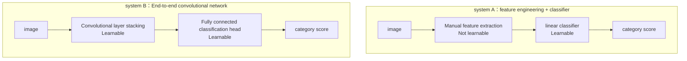
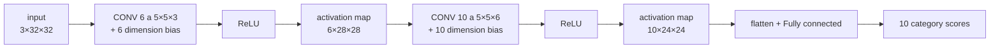
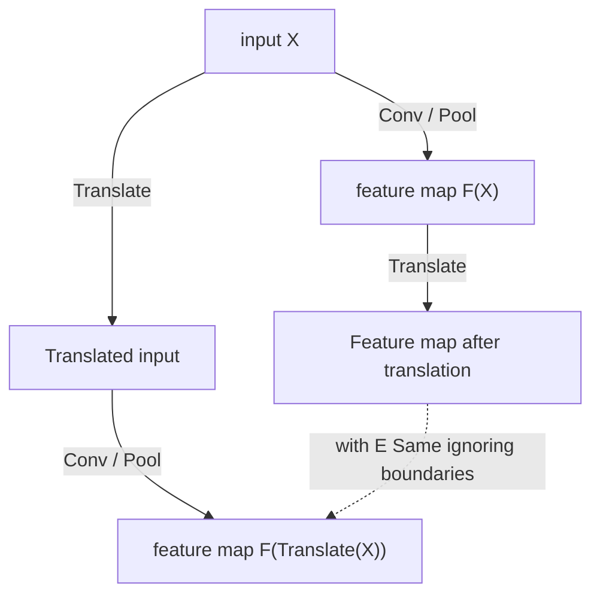

> **Course information**
>
> - **Course name**: Stanford CS231n: Deep Learning for Computer Vision(Spring 2025)
> - **Topic of this lecture**: Lecture 5. Image Classification with CNNs
> - **Lecturer**: Justin Johnson
> - **Teaching date**: 2025-04-15
> - **Course homepage**: [cs231n.stanford.edu/2025](https://cs231n.stanford.edu/2025/schedule.html)
> - **Official courseware**: [lecture_5.pdf](https://cs231n.stanford.edu/slides/2025/lecture_5.pdf) (141 pages, page-by-page illustrations in the book)
> - **Subtitle source**: [cs231n_sp25_kor_sub · eng](https://github.com/lpaiu-cs/cs231n_sp25_kor_sub/tree/main/eng) (Publicly transcribed in English, Chinese rewritten by this book)
> - **Copyright statement**: The copyright of the slides and course materials belongs to Stanford University and the instructors; this book is an unofficial study note and is only used for study and research.


After a 32×32×3 image is flattened into a 3072-dimensional vector, the "adjacent" relationship disappears: pixels (0,0) and (0,1) are separated by three subscripts in the vector, and there is no mathematical difference between its distance from (31,31) and its distance from (0,1). The previous lecture turned calculation graphs and backpropagation into universal tools. The answer in this lecture is: since nodes can be designed by themselves, then **What should a node designed for an image look like?**.

The answer is surprisingly small - only two new operators are needed: the convolution layer and the pooling layer. The convolutional layer changes the fully connected layer's "each output looks at the entire image" to "each output only looks at a small piece of 5×5, but the same set of weights slides through the entire image"; the pooling layer provides a downsampling method that costs almost no computing power. The real weight of this lesson is not in the definitions, but in the three accounts: **Where do the parameters come from, how big is the output, and how wide is the receptive field?**.

## 1. Review is not a retelling: a "Tensor → Loss → Gradient" pipeline left over from the first four lectures

*(Reference time: 00:00:05 – 00:11:55｜Lecture 5)*


The two pages of administrative information posted on the front page before class begins are worth jotting down because they mark the relationship between this lecture and the previous four lectures. Assignment 1 is due at 23:59 on April 23. The test points are k nearest neighbor (kNN), linear classifier (SVM and Softmax), two-layer neural network, and **Image features**——This last item is what we will dismantle in Chapter 2 of this lecture.


The second page is the project proposal, which is due on April 25. The research direction of the teaching assistant is listed on the office hours page of the course webpage. These two pages are not expanded in the video, but they remind one thing: after this lecture, the course will shift from "Basics of Deep Learning" to "Perceiving and Understanding the Visual World", and the assignment will also shift from "Implementing Operators" to "Designing Systems."


The self-introduction takes less than a minute and contains a lot of information: the lecturer participated in the launch of CS231n while studying for a PhD at Stanford, taught here from 2015 to 2018, then went to Facebook AI Research, worked as a faculty member in Michigan, and recently worked in World Labs. The timeline of 2010 / 2015 / 2020 / 2025 at the bottom of the slide, plus the "Stanford CS231n 10th Anniversary" at the footer of the entire article, indicates that this is the tenth year of this course - the timeline of "2012 to 2020 Convolutional Networks Dominate Vision" will be used repeatedly later in this lecture to explain why we still need to learn it today.


The course is divided into four sections: Deep Learning Fundamentals (Lectures 2–4), Perceiving and Understanding the Visual World (Lectures 5–12), Generative and Interactive Visual Intelligence (Lectures 13–16), and Human-Centered Applications and Impact (Lectures 17–18). This position is very special: the first four lectures have already covered "what is a tensor, what is the loss, and how to calculate the gradient". The next seven lectures will be used to plug this general machine into specific visual tasks. So the first half of this lecture is about review, and the second half is about replacing parts.

### 1.1 Three-piece set: model, target, search

The review is compressed into three pages, corresponding to three replaceable parts: model (scoring function), objective (loss function), and search (optimizer). The three are very loosely coupled - the scoring function determines the shape of the output tensor, the loss compresses it into a scalar, and the optimizer only cares about "how the scalar becomes smaller." As long as the output shape remains unchanged when changing models, the loss and optimizer can remain unchanged. This is why the same set of training code can train linear classifiers, multi-layer perceptrons and convolutional networks.


The scoring function is still  $f(x,W)=Wx+b$: Pull the image into a 3072-dimensional column vector, multiply by  $10\times3072$  The weight matrix is used to obtain scores for 10 categories. The value of review is not in the formula itself, but in its "image classification"**Encoded into a mapping from input tensor to output tensor**——This is the first step in all deep learning problems and the baseline for judging "what has been changed by the convolutional layer." The number 3072 is worth remembering: $32\times32\times3=3072$, it will appear repeatedly, because the fully connected layer only recognizes this number, while the convolutional layer recognizes  $(3,32,32)$.


The second step is loss. Given data set  $(x,y)$  With the scoring function, a scalar is required to measure "how bad the current set of weights is on this data set." Softmax loss is commonly used for classification problems (SVM loss is also listed on the slide). The complete loss is usually data loss plus regularization term: the former requires fitting the training data, and the latter constrains the weights from growing into strange shapes. The interface convention is——**Loss is always a scalar**, this is used repeatedly when deriving the gradient shape later.

| loss | form | When pairs have been divided and the remaining balance is sufficient |
| --- | --- | --- |
| SVM / hinge | $\sum_{j\ne y}\max(0,s_j-s_y+1)$ | Gradient is 0, no more force is applied |
| Softmax / cross entropy | $-\log\dfrac{e^{s_y}}{\sum_j e^{s_j}}$ | The gradient is still non-zero and continues to push the probability to 1 |

The only difference between the two is "how to view the score difference": Hinge stops applying force once the margin is sufficient, while Softmax always wants to be more confident. The choice of loss will change the shape of the gradient, but not the premise that it must be a scalar.


The third step is to search. The slides deliberately lined up SGD, SGD+Momentum, RMSProp, and Adam. The lecturer inserted an on-site anecdote here: Just the day before, ICLR 2025 awarded the "Test of Time Award" to the paper that proposed Adam in 2015 - the optimizer taught in the third lecture of this course. This detail shows that these "standard parts" in the course are not teaching toys, but work that is still being cited ten years later. Classic methods can survive for ten years, often not because they are optimal, but because they capture the unchanged part of the problem.


Then the problem arises: the linear classifier is not strong enough. The slides give two complementary perspectives. **visual perspective**: Each row of the weight matrix can be restored to a picture of the same size as the input, that is, "a template for each category", so judging a cat depends on "whether the inner product of this picture and the cat template is large." The example given by the lecturer is very touching - the "car" template learned is a ball of red, but the car does not have to be red. **geometric perspective**: Each sample is a point in high-dimensional space, and linear classifiers can only use hyperplanes to cut the space; they are only effective when each type happens to fall in the area separated by the hyperplane, and there is no reason to believe that image data will match this.


The remedy is to no longer use just one weight matrix. The two-layer network inserts a 100-dimensional hidden layer in the middle: $x\in\mathbb{R}^{3072}$  Take first  $W_1$  Become 100 dimensions, pass through ReLU, and then multiply  $W_2$  Get 10 points. There is only one more step in algebra, but the expressive ability is completely different - it no longer requires only one template for each category, but can first combine a batch of intermediate "parts" and then use the parts to vote. The function form has been changed, but the input and output interfaces are exactly the same, so the loss and optimization process do not need to change a word.


The trouble is optimization. As the number of parameters increases and the number of layers becomes deeper, it is no longer realistic to push the partial derivative of each parameter by hand, so a calculation graph is introduced: each node is a small function primitive, and the data flows forward from left to right to calculate the loss, and then flows in the reverse direction to calculate the gradient. In the picture on the slide, $x$  with  $W$  Import the rating node, and import the rating and label into the hinge node to get the data loss, and at the same time  $W$  Also divided into a regular term  $R$, the sum of the two is the final loss. This also shows that the regular term is part of the graph - it is not an additional line of judgment in the training loop, but a node hanging on the weight, so its gradient is also calculated by backpropagation, but this path does not pass through the data.

### 1.2 Computational graph: split the global problem into local problems

"Computation graph" sounds abstract, but it is actually just a bookkeeping convention: split a forward calculation into a series of elementary nodes, each node is only responsible for a simple function. After taking it apart, the global matter of derivation becomes a matter of calculating the local derivatives of each node and then multiplying them along the edges - this is the engineering of the chain rule, not new mathematics.


The key to backpropagation is that it is **local**. Each node only does two things: in the forward direction, it calculates the output from the input, and in the reverse direction, it receives the "upstream gradient" (the loss of the partial derivative of the node's output), multiplies its own "local gradient", and spits out the "downstream gradient" (the loss of the partial derivative of the node's input). Nodes do not need to know where they are in the entire graph, nor do they need to know where the upstream gradient comes from. It is this "ignorance" that makes the framework possible: as long as all nodes adhere to the same interface, any complex network can be spelled out, and the gradients will automatically be in place.


Replace the scalar with a vector and the local gradient becomes the Jacobian matrix. If node  $f:\mathbb{R}^{D_z}\to\mathbb{R}^{D_y}$, its local Jacobian is  $D_y\times D_z$  The matrix of  $(i,j)$  item answer"$z$  of the  $j$  Move each element, $y$  of the  $i$ "How many elements move". The slide repeatedly emphasized: the loss is still a scalar, so **The shape of the upstream gradient is always equal to the shape of the output, and the shape of the downstream gradient is always equal to the shape of the input.**——If the shape is right, the implementation will basically be correct.


One level further up is the tensor. like  $x$  is  $D_x\times M_x$, $y$  is  $D_y\times M_y$, the theoretical local Jacobian size is  $(D_xM_x)\times(D_yM_y)$——A monster that grows with the square of the tensor size. The slide shows it so that people can see clearly "why it can't really be constructed."

> **Editor's note**: In actual implementation, this matrix is never explicitly constructed, but the "vector-Jacobian product" is calculated: given the upstream gradient, output a tensor with the same shape as the input. to  $1000\times1000$  For the matrix multiplication example, the complete local Jacobian requires  $10^{12}$  elements, and the actual calculation only requires "the transpose of the upstream gradient times the weight", and the cost is  $10^6$  times multiplication and addition. This is why the backpropagation of matrix multiplication, convolution, and pooling are only of the same order as the forward activation.

This whole set of things together is a pipeline: encode the problem into input and output tensors → write a calculation graph → collect  $(x,y)$  Dataset → Define scalar loss → Use backpropagation to find gradients and gradient descent to update parameters. The lecturer said that this recipe "basically supports all deep learning applications", the only difference is which nodes are placed in the calculation graph. This also just explains the positioning of this lecture: **The convolutional network is not a new framework, it just inserts two more nodes into this picture.**

## 2. Convolutional network is not a new framework, it just inserts two nodes into the calculation graph

*(Reference time: 00:12:11 – 00:22:59｜Lecture 5)*


The course officially changes here. The current location is marked with an orange arrow on the slide: Lectures 2–4 "Basics of Deep Learning" have been taught, and the next three paragraphs have turned gray in turn. This seemingly redundant animation prompts the audience to make a mental switch - the previous content is about general machines, and from here on we will discuss "what are the special characteristics of data such as images".


In the second frame, the arrow moves one line to the right and falls on Lecture 5-12 "Perception and Understanding the Visual World", and the last two paragraphs continue to turn gray. These seven lectures will deal with classification, architecture, sequence model, detection and segmentation, video, and large-scale training in sequence, and this lecture is the entrance: first explain the "image-specific operators" thoroughly, and then there will be something to pile up later.


The drawing method of the slide is very straightforward: the upper part is the fully connected layer that has been seen before ($x\to h\to s$) and the activation function, with "We have already seen these" written next to it; the lower half is temporarily blank, with "Today: Image-specific operators" written. In other words, no new training algorithms or new losses are introduced today, only two new ones are introduced. **operator**.


In the second frame, fill in the lower part: the convolution layer is drawn as "local window connected to a neuron", and the pooling layer is drawn as  $224\times224\times64$  The volume is reduced to  $112\times112\times64$. Four building blocks are complete - fully connected layer, activation function, convolution layer, and pooling layer. The lecturer emphasized that the convolutional network "actually just adds a little bit to the existing framework", and the real workload lies in understanding the shape and cost of these two operators.


The camera pulls back to the mission itself. The problem to be solved in image classification is: given a picture, assuming a set of categories  $\{dog, cat, truck, plane,\dots\}$  OK, output one of the categories. The slide shows a cat, with dog, bird, deer, and truck options listed below. This type of problem seems simple, but it is the prototype of almost all visual tasks: detection is to add a frame on the picture, and segmentation is to assign the category to pixels. They are essentially based on "judging categories from pixels".


The approach taught in the previous chapters is to let  $f(x)=Wx$  Eat pixels directly: $x$  is a literal value of pixel value, $W$  Each row of is an entire image template. This road can work, but the assumption is very strong - it assumes that the concept of "cat" can be summarized by a pixel template with a fixed position, but in reality, cats can appear in any position, in any posture, and under any lighting.

### 2.1 The era of manual features: humans guess first, and the network judges later

Before end-to-end, the visual system was two-stage: the human was responsible for turning images into vectors, and the model was responsible for turning vectors into categories. The key is **Feature extractor is not learnable**——It is a fixed piece of code and will not adjust itself because of wrong classification, so the upper limit of the entire system is determined when that piece of code is written. The three examples on the slide represent three ideas: only counting "how many colors appear", only counting "which direction the edges are facing", and only counting "what types of local patches appear". The difference lies only in which part of the information is lost.


This approach is to not let the network see the pixels, but to let people design the feature extractor first.  $f$, transform the image into a "more meaningful" representation, and then feed it to the classifier. This was the mainstream of computer vision from the 2000s to around 2010. The core assumption was that "people know what features are useful, and the network only needs to learn to draw boundaries on the features."


The first example is a color histogram. Discretize the color space into a bunch of buckets, count the number of pixels falling into each bucket, and get a feature vector. It works because some problems really only look at color - to judge whether an apple is ripe or not, the proportion of red pixels is a strong signal. But it also exposes the cost of such features: **The space structure was completely destroyed**, whether the red is in the upper left corner or the lower right corner, the histograms are exactly the same. Its dimension only depends on "dividing it into several buckets" and has nothing to do with resolution: RGB is cut into 8 steps.  $8^3=512$  Dimension, cut into 16 steps is 4096 dimensions; a 4000×3000 photo and a 32×32 thumbnail have exactly the same feature length.


The second example is the Histogram of Oriented Gradients (HoG), which can be regarded as the dual of the color histogram: basically not looking at the color, only looking at the direction of the local edge. The method is to cut the image into 8×8 areas and quantize the edge direction to 9 bins in each area. The slide gives a specific account: the 320×240 image is cut into 40×30 bins, with 9 numbers in each bin, and a total of features.  $30\times40\times9=10{,}800$  dimension. If followed by 10 types of linear classifiers, the light weights will be 108,010, and the image itself is only 320×240 - a common problem in the manual feature era is here: in order not to miss the resolution, the features are made long and dense, and the number of parameters of the classifier quickly exceeds the scale that the data can support.


The third example is Bag of Words. The first step is to randomly select a large number of small patches from the training images for clustering to obtain a "visual dictionary"; the second step is to encode each image into a histogram of "how many times each word appears". It turns the image into an unordered word frequency vector - again losing position, but retaining local pattern statistics. Dictionary size is a pure design choice: too small and the discriminability is insufficient, too large and the dimensions are out of control.


A common routine in that era was to "put it all together": calculate the color histogram, HoG, and bag of words each, connect them end to end to form a very long vector, and then train a linear classifier on it. The lecturer was restrained in his evaluation - these features are basically no longer used today, but they are worth a smell, because what will be compared later is the two worldviews of "features designed by humans" and "features designed by gradient descent".

These three types of features also expose two common problems: dimensionality explosion (HoG is 10,800 dimensions), and information selection relies on guesswork - which ones should be kept and which ones should be discarded are all up to the designer's judgment, and training cannot be corrected if the judgment is wrong.

### 2.2 End-to-end: Humans design function families, data determines functions

An alternative is to make the feature extractor also a learnable parameter. At this time, what people did changed: instead of writing "how to calculate HoG", they wrote a sequence of operators such as "first convolution, then ReLU, then pooling", as well as the tensor size of each layer. What you define is a **function family**, which function to take depends on the training data.


This comparison chart is the turning point of the whole lecture. The upper part is the old system: image → feature extraction (a bunch of manual C or MATLAB code) → linear classifier → 10 scores, the blue arrow indicates that only the classifier is learned through training. The bottom half is the convolutional network: again from image to 10 scores, but the blue arrow covers from pixels to scores **entire link**. The interfaces are exactly the same, the difference is only in the range covered by the blue arrow - in the above system, the gradient stops at the classifier, the feature extractor does not receive any signal, and will never be adjusted to "separate cats and dogs"; in the below system, the gradient is transmitted all the way back to the first layer, and the features will automatically deform according to the task.



This is the structural reason why end-to-end almost always wins when there is enough data: not "smarter features", but "features that can be corrected by the task". Wherever the gradient can reach, the representation there can be rewritten by the task; where the gradient cannot reach, it can only rely on human judgment. This rule does not only apply to convolution - today's large models emphasize end-to-end pre-training, which essentially maximizes the learnable range.

### 2.3 What exactly is lost by flattening?


So what's the problem? Back to the only kind of network we can build: stretch 32×32×3 into 3072 dimensions, multiply  $W_1$  To 100 dimensions, ReLU, then multiply  $W_2$  to the 10th dimension. There is nothing mathematically wrong with it, the problem lies in the first step - flattening.


Let’s calculate it specifically: $32\times32\times3$  After the image is flattened, the pixels  $(0,0)$  with  $(0,1)$  separated by 3 subscripts, and  $(1,0)$  96 subscripts apart, and  $(31,31)$  3071 apart. The fully connected layer only sees these subscripts, and it must learn from the data that "subscripts 0 and 3 are neighbors", and this knowledge has no structure available in the weight matrix - each pair of adjacent pixels requires separate parameters. The slide has red text here: "Problem: The spatial structure of images is destroyed!".

The convolutional layer changes its approach: it does not learn "who is adjacent to whom", but **regulations** Only adjacent 5×5 windows are connected. This stipulation is a priori, which moves "the image is two-dimensional" from the data into the structure. If the prior is correct, there will be fewer parameters to learn; if the prior is wrong, the model will have to pay extra capacity to offset it - this is a general framework for understanding all architectural designs. The lecturer thus gave the central argument of this lecture: In "artificial features + classifier", what humans design is **Concrete function**;In an end-to-end network, humans design **function family**. He said something very important in passing: Gradient descent is probably a better programmer than you, and a lot of data probably understands this problem better than you.

## 3. From LeNet to Transformer: Why should we learn convolution in 2025?

*(Reference time: 00:23:17 – 00:30:25｜Lecture 5)*


Before talking about the operators, let’s use a picture from 1998 to determine the overall shape. This picture comes from the work of LeCun et al. The drawing method is very simple: the left side is the input image, and a string of "thin slices" in the middle represent the feature maps generated by convolution and pooling. To the right, the space size becomes smaller and there are more channels, and finally it is connected to several fully connected layers. Remember this outline first——**The space becomes smaller layer by layer, and the channels become more numerous layer by layer.**——All the arithmetic that follows explains why it must be so.


Add a key comment to the second frame: when the convolution and pooling operators extract features **Preserves the two-dimensional structure of the image**. This is the watershed between them and fully connected layers. The fully connected layer requires the image to be flattened first, while the convolutional layer requires maintaining  $H\times W$  Arrangement - the input is a three-dimensional volume, and the output is also a three-dimensional volume, but the height, width and depth have changed.


The third frame adds the end: the convolution part is followed by a fully connected layer to form a multi-layer perceptron to predict the category score. This splits the network into two parts with different responsibilities - the first half is the "feature extractor", which turns pixels into a compact set of responses; the second half is the "classifier", which turns the responses into 10 scores. This division is only for understanding, and there is no stage-by-stage training.


The last frame adds "End-to-end training with backpropagation and gradient descent". This sentence strings the first three frames into a whole: convolution, pooling, full connection, and loss, all in the same calculation graph, and the gradient is passed back from the loss all the way to the bottom filter. **end-to-end** That’s the point – no layer is set in stone.

### 3.1 1998 and 2012: the same skeleton, two different fates

Looking back at the connection of these four frames, it breaks "what is a convolutional network" into four propositions that can be independently established: the operator maintains a two-dimensional structure, the end is connected to a fully connected classification head, and the entire link is trained end-to-end. The four elements are not new when taken apart, but together they form a complete structure - and these four elements were already in place in 1998.


This picture corresponds to the 1998 paper "Gradient-based learning applied to document recognition", written by LeCun, Bottou, Bengio, and Haffner. The task is to recognize handwritten digits in documents. The instructor emphasized two things: it worked fine back in the day, and it was very expensive - no GPU, no TPU. What's more noteworthy is that its structure is "basically the same" as the mainstream network in the 2010s: convolution, pooling, full connection, and backpropagation are all missing. If you estimate the cost, you will understand why it has waited for fourteen years: LeNet's input is only 32×32, and the number of channels is single digits; when enlarged to 224×224, 64 channels, the number of pixels alone is 49 times more. Multiplied by the increase in the number of channels and layers, the total computing power requirement is two or three orders of magnitude higher - this is not an algorithm problem, but a hardware problem.


Jumping from 1998 to 2012, it’s AlexNet (Krizhevsky, Sutskever, Hinton). There is no revolution in structure: it is still a convolutional layer plus a fully connected layer, but it is deeper, wider, and has more parameters. What has really changed are external conditions—GPUs can count, and the Internet and ImageNet provide enough data. The lecturer made this very clear: the algorithm has been in place for a long time, and it was computing power and data that pushed the door open. This also explains why "Convolution Dominance" can last for eight years: its inductive bias exactly matches the computing power and data scale at that stage, the number of parameters is controllable, and it can be trained with small graphs.

### 3.2 Tasks eaten by convolutional networks

The next three pages show three faces of the same thing: convolutional networks are not just classifiers, but a general base for "extracting discriminative features from images". The more complex the task, the more complex the structure of the output, but the base remains unchanged.


From 2012 to 2020, convolutional networks swept almost all visual tasks. The left side of the slide is detection: not only to determine the category, but also to draw a box on the picture and label the box (Faster R-CNN, Ren, He, Girshick, Sun, 2015); the title of the right half also says Detection, but what is done in the picture is segmentation - putting the label on each pixel (Farabet et al., 2012). The output spaces of the three tasks are worthy of comparison: the classification output is a length of  $K$  vector; detection output  $N$  boxes, each with 4 coordinates and  $K$  Category scores; segmentation outputs a category map of the same size as the input. The more complex the output, the higher the spatial resolution the network needs - this is why the segmentation network must connect shallow high-resolution features back to the deeper layers. The base is still the same set of convolution operators, which shows that the value of convolution is not in a specific task, but in that it is a sufficiently general image operator.


The language direction has not been spared either. Image captioning requires inputting a picture and outputting a sentence. One of the most successful early solutions was "convolutional network to extract features + recurrent network to generate sentences" (Vinyals et al. 2015; Karpathy and Fei-Fei 2015). The six generated captions on the slide—"A white teddy bear sits on the grass," "A man in a baseball uniform pitches," "A woman holds a cat in her hands"—are examples generated by the instructor using Neuraltalk2.


The reverse is also true. Vincent Diagram requires inputting a sentence and generating a picture. The early and really useful version is also built on a convolutional network; the slide picture is from the paper Stable Diffusion (Rombach et al., CVPR 2022). Examples include a watercolor-style "half-rat and half-squirrel eating a burger", a Picasso-style zombie, and a T-shirt with "I love generative models!" printed on it. The lecturer mentioned by the way: This technology has made rapid progress in the past two years, and will be discussed specifically in subsequent lectures.


So when this course was founded in 2015, it was called "Convolutional Neural Networks for Visual Recognition" - convolutional networks and computer vision were almost synonymous at the time, and vision was the area that benefited the most from deep learning. The sentence "This class used to be focused on ConvNets!" on the slide is self-deprecating: the name of the class was later changed because the field has changed - in 2025, convolutional networks are just one piece of the toolbox, not the whole thing.

### 3.3 After 2021: Attention takes over, but convolution does not disappear


The change happened in 2017. Vaswani et al.'s "Attention is all you need" proposed Transformer, which initially only processed text sequences. The fundamental difference between it and convolution is "where to look": the field of view of convolution is determined by the kernel size and number of layers, while attention can see the entire sequence at once and dynamically assign weights according to the content. To put it another way: the weight of the convolution is **fixed**, the same filter performs the same matching on any image; the weight of attention is **calculated**, the weight between each pair of positions depends on the content of the two positions.


In 2021, "An Image is Worth 16x16 Words" by Dosovitskiy et al. used an almost identical Transformer on images: the image was cut into 16×16 patches, and each patch was treated as a "word". The result is that for many problems originally solved by convolutional networks, replacing CNN with Transformer and keeping the rest unchanged, the performance is actually better, and it consumes more data and computing power - which happen to be the two most indispensable things in these years.


The slide adds a line "Wait until Lecture 8!" here, pushing the details to the back. The lecturer was very honest: he didn't want to talk about convolution as the only truth in a year when convolutional networks are obviously no longer the only answer. But he gave four reasons to continue learning-historical significance, it is still widely used in engineering, it can build intuition for image operators, and today's systems are often a mixture of convolution and attention. The more common approach in engineering is indeed a mixed use: convolution is used to extract local features in the shallow layer, and attention is used in the deep layer for global interaction. So what really needs to be grasped is not "which one is better", but "what are the respective inductive biases and when are they useful?"


After the history is finished, the screen cuts back to a pure title page: "Convolutional Neural Networks". In the next half hour or so, I only did one thing: split the convolutional layer down to the dimension level.

## 4. Convolutional layer: split "one picture, one template" into "one small template slides over the whole picture"

*(Reference time: 00:30:28 – 00:49:43｜Lecture 5)*


The screen returns to the four-square grid, but this time only the upper half is lit: the fully connected layer and activation function, with "We have already seen these" written next to it, and the lower half is still empty. This arrangement of "putting out the known first, then filling in the unknown" corresponds to the following order of description: first reinterpret the fully connected layer, and then grow the convolutional layer from its limitations.


In the second frame, the convolutional layer and the pooling layer are added and marked "Today: Image-specific operators". The so-called "image-specific" means that the connection mode of these two operators is designed for two-dimensional grids - the parameter sharing method, output shape, and even the writing method of backpropagation all rely on the premise that "the input is a graph with spatial structure".


In the third frame, the pooling layer turns gray and the convolution layer remains highlighted. Here's a visual reminder: Let's talk convolution first, leave pooling for later. The rhythm of the whole lecture is indeed "convolution accounts for 70%, pooling accounts for 20%, and the rest is equivariance and summary."


The method of fully connected layer has been seen before: $32\times32\times3$  The image is drawn into  $3072\times1$  column vector of , multiplied by  $10\times3072$  The weight matrix is obtained and 10 scores are obtained. The slide specially labels "input activation" and "weights" separately, because it is the shape relationship between the two that will be moved next.


Focusing on a single output: each of the 10 scores is  $W$  The dot product of a row of and the entire 3072-dimensional input. And the dot product can be read as **template matching**——The more consistent the directions of the two vectors, the greater the value. When they are orthogonal, they are 0, and when they are in opposite directions, they are negative. Therefore, the fully connected layer is equivalent to "preparing 10 templates of the same size as the input, and comparing each one with the entire image." This interpretation is the key to convolutional layers.

### 4.1 From "whole image template" to "sliding template"

The two perspectives can be connected: the fully connected layer learns the "whole image template", and the convolutional layer learns the "local template", and then uses sliding to cover the entire image with the local response. This conversion step brings three direct consequences - the parameter amount is decoupled from the image size, the same template can be reused at any position, and the output retains the two-dimensional index. The third consequence is most easily overlooked: the output of the fully connected layer is a 10-dimensional vector, and the position information only exists in "which row weight it corresponds to"; the output of the convolutional layer is  $6\times28\times28$  The volume of  $(c,i,j)$  element explicitly represents "th  $c$  template in the  $(i,j)$  location response". When doing detection later, the offset of the regression frame can be directly returned on this plane, relying on the fact that this index is still there.


The first thing a convolutional layer does is refuse to flatten. The input is still  $32\times32\times3$  The three dimensions of the volume have names: height 32, width 32, and depth 3 (depth is also called channel). Retaining these three dimensions is equivalent to retaining the information of "who is next to whom", and this is exactly what the fully connected layer loses.


Then introduce the filter: a  $5\times5\times3$  The small volume is only 5×5 in space, but the depth is the same as the input. The wording of the slide is "slide the filter over the image and do a dot product point by point". Notice the role reversal - the template is no longer the same size as the entire image, but a small "partial pattern".


The slide adds an easily overlooked constraint: **The depth of the filter is always equal to the depth of the input**. This is not a convention, but a requirement of the dot product - to calculate the inner product, the two tensors must have the same number of elements. Therefore, a 3-channel image can only be equipped with a 3-channel filter. $5\times5\times3$  filter and  $5\times5\times3$  There is a one-to-one correspondence between exactly 75 elements of the image block.


Calculate a scalar at a single drop: $\sum_{c=1}^{3}\sum_{i=1}^{5}\sum_{j=1}^{5} W[c,i,j]\,X[c,i,j] + b$, that is, 75-dimensional dot product plus bias. The question answered by this number is: "How much does the image look like this filter at this position?" The larger the value, the more aligned the image is with the template. One number is obviously not enough to describe an image - pressing 75 numbers into a dot product only retains the degree of freedom of "the degree of alignment with this template"; to describe more aspects, multiple filters must be used.


Put the window in the first position, get a number, and draw it as a small dot on the right. This frame only has "one input block and one output" in order to make "one output only depends on one local window" intuitive - compared with "one output depends on all 3072 pixels" in the fully connected layer, the difference is clear at a glance.


In the second frame, move the window one space to the right, keep the weights completely unchanged, and calculate the dot product again. Here are the two core properties of convolution: **Parameter sharing** (The same filter reuses the same set of weights at all locations) vs. **local connection** (Each output is only connected to a small piece of input). The former compresses the parameter size from "image size × number of categories" to "filter size", and the latter allows the output to naturally contain position information.


The third frame continues to pan. It is worth noting that each calculation is independent: no intermediate results are shared between locations, and they do not affect each other. This "position-wise independence" makes convolution extremely easy to parallelize on the GPU - essentially it is a batch of small matrix multiplications that can be amortized into one large matrix multiplication.


By the fourth frame, the window has swept across most of the picture, and the responses on the right side gradually become connected. The instructor did not count the squares here, but jumped directly to the next step: instead of caring about a single square, it is better to care about "what you get after sliding all the positions."


The answer is activation map. $32\times32$  input configuration  $5\times5$  filter, both horizontally and vertically can place  $32-5+1=28$  times, so the output is a  $28\times28$  The plane - each grid records "how much the corresponding position of the original image resembles this template". The space size was reduced from 32 to 28 for a simple reason: the filter cannot be suspended, and the full 5×5 window cannot be placed on the side. This also predicts why there is padding later: if you want the output to be the same size as the input, you have to pad zeros at the edges to give the filter "somewhere to stand."


Next add a second filter (drawn green on the slide), still with the size  $5\times5\times3$, but the weights are a different set. It also slides across the whole picture and gets the second one  $28\times28$  activation map. The two pictures answer two different questions: the first picture may be looking at "is there some kind of edge", and the second picture may be looking at "is there some kind of color contrast". Why do you need multiple filters? Because a filter can only answer one question - project the 75-dimensional space into one direction; to cover "edges, colors, textures, corners", you have to project the 75-dimensional space into multiple directions. The number of channels is essentially **Number of projection directions**.


Stacking the results of the 6 filters, the output is  $6\times28\times28$: Two spatial dimensions come from sliding, and the third dimension comes from the number of filters. At the same time, the six filters themselves also form a four-dimensional tensor  $6\times3\times5\times5$——The first dimension is the "number of filters", and the last three dimensions are the shape of a single filter. This is the complete input and output contract of the convolutional layer: input three-dimensional volume, output three-dimensional volume, and weight four-dimensional tensor.

### 4.2 Accounting method for four-dimensional tensors

All shapes of the convolutional layer can be written clearly using four symbols. This table is the most important page to memorize in the whole lecture:

| object | shape | This example |
| --- | --- | --- |
| Input (leaflet) | $C_{in}\times H\times W$ | 3×32×32 |
| filter bank | $C_{out}\times C_{in}\times K\times K$ | 6×3×5×5 |
| bias | $C_{out}$ | 6 |
| Output (single) | $C_{out}\times H'\times W'$ | 6×28×28 |

Four hyperparameters——$C_{out}$, $K$, $S$, $P$——Determines all shapes except input. Note that the second dimension of the filter bank must be  $C_{in}$: This is not a design choice, but a direct result of "each filter looks at all input channels"; if this dimension does not match, the dot product cannot be performed.


Like linear layers, convolutional layers also have biases. The difference is in the granularity: the linear layer has one bias per output neuron, and the convolutional layer has **One bias per filter**, here is a 6-dimensional vector. When adding, the first  $k$  bias is broadcast to the  $k$  All 784 positions of the Zhang activation map - it only occupies 6 numbers in the parameter table, but participates in 4704 additions in the calculation. This also explains why the calculation of parameter quantities is often written incorrectly: formula  $C_{out}(C_{in}K^2+1)$  inside  $+1$  Add only once instead of adding  $H'W'$  times; broadcasting is a matter of calculation level, not a matter of parameter level.


Reading the output volume in another direction gives you another useful intuition: $28\times28$  There are 6 spatial positions, and a 6-dimensional vector is hung at each position, and the responses of 6 filters at that position are stored. In other words, the convolutional layer transforms each position from a "pixel patch" into a "feature vector" - this is where all the "feature map" statements come from. The two reading methods correspond to two implementations: reading according to "position", the convolution is a bunch of small dot products that are independent of each other, suitable for understanding; reading according to "channel", each position is a feature vector, suitable for subsequent fully connected layers.


The actual training will not be counted one by one. Stack 2 pictures into  $2\times3\times32\times32$, the convolutional layer is calculated once and outputs  $2\times6\times28\times28$. The batch dimension just reuses the same set of filters on more samples without introducing any new parameters - this is why the memory overhead of convolutional networks mainly comes from activations rather than weights: a picture  $3\times32\times32$  The graph has only 3072 numbers, and after two layers of convolution it becomes  $10\times24\times24=5760$  activations; when the batch size is 64, only the last layer of activations will store 368,640 numbers, and all these values must be retained during backpropagation.


So there is a common way of writing: input  $N\times C_{in}\times H\times W$, weight  $C_{out}\times C_{in}\times K_w\times K_h$, bias  $C_{out}$, output  $N\times C_{out}\times H'\times W'$. Four hyperparameters determine the shape of all weights, and  $H'$  with  $W'$  By input size and  $K,S,P$  Decide together. This picture is worth remembering, because later calculations of parameter quantities, FLOPs, and video memory are all algebra based on these five symbols:


$$
H'=\left\lfloor\frac{H-K+2P}{S}\right\rfloor+1,\qquad W'=\left\lfloor\frac{W-K+2P}{S}\right\rfloor+1
$$


The parameter quantity is  $C_{out}\times(C_{in}\times K\times K+1)$——in brackets  $+1$  is an offset per filter. Check the calculation using the example problem in Chapter 5: $10\times(3\times5\times5+1)=760$, consistent with the numbers on the slide.


With convolutional layers, the network can be stacked. The simplest version has only one layer: $3\times32\times32$  Enter, 6  $5\times5\times3$  filter, out  $6\times28\times28$. It has much less parameters than the fully connected layer - this layer only has  $6\times(3\times5\times5+1)=456$  parameters; if it is replaced by a fully connected layer that directly connects the 3072-dimensional input to the 6 outputs, it needs  $6\times3072+6=18{,}438$  The difference is forty times, and the convolutional layer also preserves the spatial structure.


The second layer of convolution follows, using 10  $5\times5\times6$  filter. Note the 6 here: it must be equal to the number of output channels of the previous layer, because the input of this layer is the 6 activation maps of the previous layer. Space size continues to shrink, $28\to24$;The number of channels increases from 6 to 10. This rule of "the space becomes smaller and the channels become more" will be repeated in every subsequent lecture.

### 4.3 Why must a nonlinearity be inserted?


There are bugs in this heap, and they are serious. The lecturer posed the question to the students in class: "What's wrong with this architecture?" Some answered the size, some answered the receptive field, and some answered the video memory, and finally settled on the correct answer——**It's all linear**. Convolution is a dot product, and dot product is a linear operator; the composite of two linear operators is still a linear operator. In other words, two layers of convolution are directly connected, and the expressive power is equivalent to one layer of convolution, and the middle layer is added in vain.

The remedy is exactly the same as for multilayer perceptrons: insert an element-wise nonlinear activation function (here ReLU) between two convolutions. After adding, $10\times24\times24$  Each element of is the result of "local window → linear → nonlinear", and stacking really increases expressive power. The order is not arbitrary: convolution first and then ReLU, which means that nonlinearity acts on the "matching score" - first calculate how similar the image is to the template, and then press the negative similarity to 0; conversely, first ReLU and then convolution, which is equivalent to truncating the input first, and then matching. Both can be trained, but the former has clear semantics and is also the convention adopted by the slides and all subsequent architecture diagrams.



This picture puts the core links of this lecture into one line: convolution is responsible for "local template matching + parameter sharing", ReLU is responsible for "nonlinearity", and stacking is responsible for "combining into components from edges and then into objects". Without any link, the network will either degenerate into a linear model or not be deep at all.


Back to the original question: What exactly are convolutional filters learning? Let’s first make an analogy with a linear classifier. Each row of weights of the linear classifier can be restored to a picture of the same size as the input, which is the "whole picture template" of this category - what is learned is "what the average cat looks like." Its limitation has been mentioned before: one template cannot summarize all postures and colors.


The multi-layer perceptron is better because it has a whole row of templates (hidden layer units) and can split the entire image into several "whole-image-level patterns" and then combine them. But each template is still full image size and still requires the pattern to appear at a fixed location. These two pages are put together to illustrate: **There is nothing wrong with template matching itself, but what is wrong is that the template is too big and too rigid.**.

### 4.4 Where do filters come from?


The answer to convolution is "small template + sliding". This picture shows the 64 filters in the first layer of AlexNet. Each  $3\times11\times11$, you can understand it by rendering it directly as a small picture: some are looking for directional edges (vertical, horizontal, diagonal), some are looking for opposite colors (green and red, blue and yellow), and some are colored patches. The lecturer emphasized that this is not a special case of AlexNet or ImageNet - the first layer of almost any convolutional network will learn something similar, as long as the task is reasonable.

Someone asked in class: "Where do these filters come from?" The lecturer's original words were "The miracle of gradient descent and backpropagation." The process is very simple: each filter is given a set of random numbers during initialization, and then they are the same as the weights of the fully connected layer, and are rewritten bit by bit through the backpropagation of the loss. Two concepts need to be distinguished here: **parameters** is the amount that will be rewritten by the gradient during training (each number of filters, each bias), **hyperparameters** It is a quantity that is determined before training starts and remains unchanged during training (number of filters, kernel size, step size, padding). The former determines "what this operator will become in the end", and the latter determines "how big this operator is." Mixing the two together will waste a lot of time when adjusting parameters - the value of the filter cannot be adjusted manually, it can only rely on data; and the number of filters can only rely on experimentation, and the gradient will not tell you how many to add. There is another detail that is easily overlooked: random initialization must allow **Each filter is different**. If the initial values ​​of 6 filters are exactly the same, they will calculate the same activation in the forward direction, receive the same gradient in the backward direction, and therefore remain the same forever - 6 filters effectively degenerate into 1. The solution is to give each filter an independent random initial value. This is symmetry breaking.


The deeper you go, the harder it is to visualize directly, because the input to a deep filter is no longer pixels, but the activation map of the previous layer. The slide does the opposite: it takes a bunch of input images to stimulate the network, and picks out and lines up the patches that give a certain filter the strongest response (visualization from Springenberg et al., ICLR 2015, taken from layer 6 of an ImageNet model). So you can see that some filters are specific to eyes, some are specific to text, and some are specific to wheels or arcs. The lecturer did not explain the technical details of this picture, leaving only one judgment: **Deep layers learn larger, more abstract structures**, and this matter is directly related to the "receptive field" in the next section.

There was another question at the end of the class: "If the responses of all filters are known, can the original image be deduced?" The lecturer's answer is yes, and gradient descent is used - treating the image itself as the variable to be optimized, so that its response can approximate the observed response. Just remember the conclusion here: **The information loss of convolution is reversible to the extent that it can be "reconstructed", but reconstruction requires an optimization rather than analytical inversion.**.

## 5. Dimension, receptive field and computing power: three accounts of convolution

*(Reference time: 00:49:47 – 00:59:29｜Lecture 5)*


After talking about what a filter looks like, the screen cuts to arithmetic. It’s still the same one on the left side of the slide  $3\times32\times32\to6\times28\times28$  The link, the two parameter tensors of this layer are marked on the right: $W_1$  is  $6\times3\times5\times5$, $b_1$  It is 6 dimensions. The next dozen pages only do one thing - write the relationship between these numbers into a formula, and then add, subtract, multiply and divide on the formula. The order is deliberately arranged: first solve "how big the output is", then solve "how far you can see", and finally solve "how much calculation it takes", which corresponds to the three engineering constraints - video memory, accuracy, and speed.

### 5.1 Output dimensions: counting from 7×7 to formula


In order not to be interfered by the channel dimension, the slide "rotates the convolution 90 degrees and loses the depth", leaving only a  $7\times7$  plane and a  $3\times3$  of the core. This simplification is safe: the convolution is summed in the channel direction and does not affect the spatial dimensions.


$3\times3$  The window is pressed into the upper left corner, covering rows 1–3, columns 1–3. This position is legal because the window completely falls within the image.


Moving the window one space to the right, covering rows 1–3 and columns 2–4, is still legal. Continue moving right along this line until the right edge of the window touches the right edge of the image.


When the left edge of the window falls on column 5, it covers columns 5–7, and the right edge touches the border; further to the right there is a column hanging in the air. So there are 5 positions in total in the horizontal direction - this is exactly  $7-3+1=5$.


Similarly, there are 5 positions in the vertical direction, and the combination is  $5\times5=25$  output. The slide deliberately asks the audience to count it by themselves, because the intuition of "how many times can be played" is more important than the formula itself: **Output size = number of legal drop points**.


Written as a formula, it is  $W-K+1$. It can be read like this: The left edge of the filter can take positions from 1 to  $W-K+1$, a total of  $W-K+1$ . The larger the kernel, the fewer places it can be placed; the larger the input, the more places it can be placed.


The formula brings a side effect: every time a convolution is performed, the feature map shrinks  $K-1$. A 3×3 kernel eats 2 pixels per layer, and a 5×5 kernel eats 4 pixels per layer. After stacking ten layers of 3×3, $32\times32$  The only pictures left  $12\times12$;Pile it twenty layers and it will be gone. This is not a theoretical problem, but a real-world constraint that must be dealt with when designing a network.


The solution is called padding: padding around the input  $P$  Circle zero, "expand" the image and then convolve it. After zero padding, the output becomes  $W-K+1+2P$. The example on the slide is  $7\times7$  Make up one circle to become  $9\times9$, $3\times3$  The core slides just right to get  $7\times7$——Dimensions remain unchanged. The lecturer left a warning here: from a signal processing perspective, zero padding will introduce artificial discontinuities at the boundaries and "will cause some problems at the boundaries." Zero-padding is equivalent to claiming that "the outside of the image is all black", and some content usually continues beyond the boundary of the real image, so the input distribution seen by the output close to the boundary is not the same as the center position. But most practices choose to ignore it, because the engineering convenience brought by zero padding (predictable size, simple implementation) far outweighs the boundary effect.


So there is a set of the most commonly used combinations: $K$  Take an odd number, $P=(K-1)/2$.$K=3$  Match  $P=1$, $K=5$  Match  $P=2$, can make "same padding" true - the output height and width are the same as the input, only the number of channels changes. This convention will appear in every subsequent lecture, because it makes "how big is the feature map of which layer" a simple question that only needs to look at the number of downsampling.

### 5.2 Receptive field: how much an output “sees”


In a single-layer convolution, each element of the output depends only on a piece of the input.  $K\times K$  area, this area is called **receptive field**(receptive field).$3\times3$  The kernel means that each output "sees" 9 input pixels, and the remaining pixels have no effect on it.


But the network is stacked. Each element of the second layer depends on an element of the first layer  $K\times K$, and each element of the first layer depends on a piece of input  $K\times K$, after expansion, the receptive field of the second layer to the original input is  $K+(K-1)$. With each additional layer, the receptive field increases  $K-1$; $L$  After the layer is  $1+L(K-1)$. The slide mentions a confusing point here: "The receptive field in the input" and the "receptive field in the previous layer" are two different quantities, and you must keep an eye on the reference system when calculating.


$$
R_L = 1 + L\,(K-1)
$$


It shows that the receptive field is **Depth** function, rather than a function of parameter quantities. one  $3\times3$  The kernel has only 9 weights, but stacking 112 layers can cover 224 pixels; conversely, a  $11\times11$  The large core has only one layer and the receptive field is only 11. This explains why modern networks prefer small kernels and deep stacks - for the same receptive field, small kernels have much fewer parameters and more nonlinearities.


This linear growth spells trouble. Assume the input is  $224\times224$, use all  $3\times3$  Convolution, to cover the entire image requires  $1+2L\ge224$, that is  $L\ge112$  layer. The linear stacking of 112 layers is an order of magnitude difficult to train before the residual connection matures - it is not that it cannot be calculated, but that the gradient cannot be transmitted back. The receptive field is the premise of "global decision-making", and linear growth makes this premise too expensive.


The solution is **Downsampling within the network**: First reduce the spatial size, and then perform convolution on the small image, so that the same number of layers can cover a larger original area. There are two ways to do downsampling - convolution with stride, or pooling; the former is the subject of this section, and the latter is the subject of the next chapter.

### 5.3 Step size: Use downsampling to replace the receptive field


There is only one change to the stride: the window no longer moves one space at a time, but  $S$  Grid. $S=2$  When , the window position changes from 1, 2, 3, 4, 5 to 1, 3, 5, and the positions in the middle are directly skipped.


In the second frame, the window falls in column 3, covering columns 3–5; in the next frame, it falls in column 5, covering columns 5–7. It can already be seen here: the number of legal landing points has changed from 5 to 3.


Get it after sliding  $3\times3$  The output-space size is reduced from 7 to 3, more than halved. This is not an "incidental" effect, but a step-length effect. **purpose**: Use one convolution to complete both "feature extraction" and "downsampling" at the same time.


Combining padding and step length, you get the formula that the lecturer calls "a bit ugly": each of the three items performs its own function——$K$  Deduct the part eaten by the core, $2P$  Fill in the filling, $S$  Do division, last  $+1$  It is a "fence post" type of position counting. It's more important to remember the structure than the symbols: **Calculate the available range first, then count the grids according to the step size**.


$$
H'=\left\lfloor\frac{H-K+2P}{S}\right\rfloor+1,\qquad W'=\left\lfloor\frac{W-K+2P}{S}\right\rfloor+1
$$


Let’s check a set of numbers: $H=7,K=3,P=0,S=2$  Shi De  $(7-3)/2+1=3$, and on the slide  $3\times3$  agree; agree  $S$  Change it back to 1 to get 5; add more  $P=1$  Got 7. The respective functions of the three hyperparameters are clear at a glance. Stacking convolutions with stride will bring about a qualitative change: the receptive field grows from linear growth to exponential growth. to  $3\times3$, $S=2$  For example, layer 1 receptive field 3, layer 2  $3+2\times2=7$, layer 3  $7+2\times4=15$, the general term is approximately  $2^{L+1}-1$. In other words, seven layers can cover  $224$  Pixels - sixteen times worse than the previous 112-layer linear solution.

| Number of layers  $L$ (3×3 convolution) | Receptive field with step size 1 | Receptive field of step size 2 |
| --- | --- | --- |
| 1 | 3 | 3 |
| 2 | 5 | 7 |
| 3 | 7 | 15 |
| 4 | 9 | 31 |
| 5 | 11 | 63 |
| 6 | 13 | 127 |

This table is one of the arithmetic core of the whole lecture: with the same number of layers, changing only one step size hyperparameter, the receptive field changes from "only partial view" to "almost full view of the whole picture". The price is a decrease in spatial resolution - every time downsampling occurs, the accuracy of position information is lost by half. This is why subsequent detection and segmentation tasks must "connect back" shallow features.

### 5.4 A complete account: output, parameters, multiplication and addition


The slide shows a complete example question: input  $3\times32\times32$, 10  $5\times5$  filter, step size 1, padding 2. Three questions are required to be answered - how big is the output, how many learnable parameters are there, and how many multiplications and additions are required. These three problems correspond to three engineering constraints: video memory, model size, and computing power.


The number of output channels is equal to the number of filters, so it is 10; the spatial size formula is: $(32+2\times2-5)/1+1=32$. Note that the 32 here is the same as the input 32 but has different meanings - the former is "output height and width" and the latter is "input height and width". The slide is distinguished by two blue colors to prevent people from confusing this account.


Second question: How many learnable parameters are there in this layer? The key is to separate "how many parameters each filter has" from "how many filters are there in total", and don't include spatial position - parameter sharing means that no matter where you slide, the same set of weights is used.


A single filter is  $3\times5\times5=75$  weight, plus 1 bias, for a total of 76; 10 filters equals 760. Compare the fully connected layer connecting the same image to 10 outputs: $10\times3072+10=30{,}730$  parameters. **When the number of outputs is aligned to 10, the convolutional layer is only 2.5% of the fully connected layer.**, this is the direct benefit of parameter sharing.


The third issue is most easily underestimated: computing power. A small amount of parameters does not mean a small amount of calculation - the parameters of the convolution are shared, but the dot product must be recalculated at each position.


The account is calculated like this: output volume  $10\times32\times32=10{,}240$  elements, each element is a 75-dimensional dot product ($3\times5\times5$), total  $75\times10{,}240=768{,}000$  times multiplication and addition. This number is three orders of magnitude different from the parameter amount of 760——**Parameter sharing saves storage, not calculations**. This is why convolutional network training is slow and inference is expensive: FLOPs are mainly determined by "output volume × single point calculation amount".

| Configuration | output | Parameter quantity | Number of multiplications and additions |
| --- | --- | --- | --- |
| 3×32×32 → 6 5×5 | 6×28×28 | 456 | 352,800 |
| 3×32×32 → 10 5×5, P=2 | 10×32×32 | 760 | 768,000 |
| 64×56×56 → 64 3×3, P=1 | 64×56×56 | 36,928 | 115,605,504 |
| 128×28×28 → 256 3×3, P=1 | 256×28×28 | 295,168 | 231,211,008 |

The last two lines are the norm in modern networks: there are hundreds of millions of multiplications and additions at one layer, but the number of parameters is only a few hundred thousand. So the bottleneck of reasoning is computing power, and the bottleneck of training is video memory (forward activation must be reserved for backpropagation) - neither bottleneck is determined by the amount of parameters. This also explains why "how big the model is" and "how slow it runs" often don't match up.

### 5.5 One-page cheat sheet, and two parameters not mentioned in the framework


This page collects all the previous symbols into a table: input  $C_{in}\times H\times W$;The hyperparameter is the kernel size  $K$, number of filters  $C_{out}$, filling  $P$, step size  $S$;The weight is  $C_{out}\times C_{in}\times K\times K$, the bias is  $C_{out}$;The output is  $C_{out}\times H'\times W'$. Four common combinations are also listed on the right: $K=3,P=1,S=1$; $K=5,P=2,S=1$; $K=1,P=0,S=1$; $K=3,P=1,S=2$ (Downsampled by a factor of two). These four groups basically cover 90% of the convolutional layers in the classic architecture, among which  $K=3,P=1,S=1$  It is the absolute main force: the small core has fewer parameters, more nonlinearity, and the receptive field is sufficient after stacking; $5\times5$, $7\times7$  The large kernels usually only appear in the first layer or after downsampling; $K=1$  It is the other extreme, which does not do any spatial mixing, only channel transformation.


Corresponds to PyTorch, `nn.Conv2d`  In addition to the above four parameters, there are two more that the lecturer did not expand: `groups`  with  `dilation`. His judgment is very straightforward - dilation is not used much now, group convolution (groups) is occasionally encountered, and the details will be left to a later time. They do not change the essence of "local dot product + sliding", they just change "which input channels are connected to which output channels" and "the spacing between elements in the core".

```python
import torch.nn as nn

conv = nn.Conv2d(
    in_channels=3,      # C_in
    out_channels=6,     # C_out，等于滤波器个数
    kernel_size=5,      # K
    stride=1,           # S
    padding=2,          # P
)
print(conv.weight.shape)  # torch.Size([6, 3, 5, 5])
print(conv.bias.shape)    # torch.Size([6])
```

These five rows of parameters correspond exactly to the shape table in Section 4.2: the weight is  $6\times3\times5\times5$, the bias is 6. Every number drawn on the slide can be used in the frame  `shape`  Just print it out - check if the implementation is written correctly, the fastest way is to print the shape.

### 5.6 Convolution is not just for two-dimensional images


So far, all we have talked about is two-dimensional convolution: sliding in two spatial dimensions, and summing the channel dimension. its weight shape  $C_{out}\times C_{in}\times K\times K$  Here, the first two dimensions are "channel mapping" and the last two dimensions are "spatial range".


Removing one spatial dimension results in a one-dimensional convolution: input  $C_{in}\times W$, weight  $C_{out}\times C_{in}\times K$, sliding in only one direction. It is common in speech, text, and time series signals - "local patterns repeat in sequences" and "local patterns repeat in images" are the same assumption. Today's status has actually risen: causal convolution in large language models and waveform modeling in speech synthesis all use the same set of arithmetic of "sliding in one direction".


Adding another dimension is a three-dimensional convolution: input  $C_{in}\times H\times W\times D$, weight  $C_{out}\times C_{in}\times K\times K\times K$, each output position corresponds to one in the volume  $C_{out}$  dimensional vector. It will be used in video, medical imaging, and point cloud voxelization. The higher the dimension, the faster the parameters and computing power increase: take the same  $K=3$, $C_{in}=C_{out}=64$, the 2D convolution layer has about 36,928 parameters, the 3D convolution layer has about 110,656 parameters, and the number of multiplications and additions is multiplied by the number of voxels - this is why 3D convolution is always "small core, few channels, low frequency use" in practice. The three meanings combined: convolution is not an "image-specific" operator, but the carrier of the set of assumptions of "local connection + parameter sharing + translation and sliding"; as long as the data has a grid structure, this set of assumptions can be used.

### 5.7 Stringing the formulas together: size and receptive field calculation of three-layer network

Finally, apply all the previous formulas to a specific link: enter  $3\times224\times224$, three floors  $3\times3$  For convolution, the first layer maintains the size, the second layer downsamples with stride 2, and the third layer maintains it again.

| layer | hyperparameters | Output size | This layer faces the window of the previous layer | Cumulative receptive field for the original input |
| --- | --- | --- | --- | --- |
| 1 | $K=3,P=1,S=1$ | 64×224×224 | 3×3 | 3 |
| 2 | $K=3,P=1,S=2$ | 128×112×112 | 3×3 | 5 |
| 3 | $K=3,P=1,S=1$ | 128×112×112 | 3×3 | 9 |

The algorithm for cumulative receptive fields is  $R_i=R_{i-1}+(K_i-1)\prod_{j<i}S_j$: first floor 3, second floor  $3+2\times1=5$, third floor  $5+2\times2=9$. Note that the last term uses the "product of all previous steps", which is the mathematical reason why downsampling can push the receptive field faster. The result is: after three layers of convolution, each output only sees a 9-pixel-wide window in the original image, less than 5% of 224. For the final decision to see the entire picture, there are only two ways - continue to deepen it, or insert more layers with steps into the network.

Four lessons can be extracted from this calculation, which can be used in any architecture diagram later:

- The output size is only given by  $H,W,K,P,S$  The decision has nothing to do with the number of channels - count the space first, then the channels.
- The parameter quantity is only given by  $C_{in},C_{out},K$  The decision has nothing to do with the size of the space - a big picture does not equal a big model.
- The computing power is calculated by "output volume × $C_{in}K^2$"The decision has nothing to do with the number of parameters - small models can also be slow.
- The receptive field is determined by "layer number × step accumulation" and has nothing to do with the number of channels - if you want to see the whole picture, you must either deepen or downsample.

## 6. Pooling and translation equivariance: why downsampling does not change the conclusion

*(Reference time: 00:59:33 – 01:07:37｜Lecture 5)*


The title changes from "Today: Convolutional Networks" to "Convolutional Networks", the convolutional layer is still bright, and the pooling layer is still gray. This picture appears in the position of "Convolution is over and pooling is about to be explained". Its function is to shift the attention from "how to extract features" to "how to downsample".


In the next frame, the highlights are reversed: the convolution layer turns gray and the pooling layer lights up. The lecturer's attitude towards Chihua was very relaxed - "Thank God, Chihua is easy". It's really simple: there are no learnable parameters, just two hyperparameters and an aggregation function.

### 6.1 Pooling: trading almost zero computing power for downsampling


The input to pooling is a  $C\times H\times W$  The volume of **Independent processing on a plane-by-plane basis**: put 64  $224\times224$  The planes are pulled out one by one, downsampled each, and then stacked back in the original order. Therefore, pooling never changes the number of channels, only the spatial size - which is exactly the opposite of convolution (convolution can also change the spatial size by changing the number of channels). The three hyperparameters are kernel size, step size, and aggregation function. Compared with convolution, pooling has one less constraint: it does not change the number of channels, so it does not exist"$C_{in}$  Must be equal to the alignment problem of the output channel of the previous layer; the price is that it cannot perform cross-channel information fusion.


The most commonly used is max pooling. Cut individual depth planes into non-overlapping ones  $2\times2$  Small blocks, take the maximum value in each block: upper left block  $\{1,1,5,6\}$  Take 6, upper right block  $\{2,4,7,8\}$  Take 8, lower left block  $\{3,2,1,0\}$  Take 3, lower right block  $\{1,2,3,4\}$  Take 4 and output  $2\times2$. There is not a single multiplication in the entire process, and there is not a single parameter.

The action of "taking the maximum" brings a side effect: **Insensitive to small translations**. If the entire image is translated by one pixel, the output of the max pooling is likely to remain unchanged - because the maximum value in the window is often still that value. The slide says this "gives invariance to small spatial shifts", which is why pooling is useful in classification tasks: the category should not change just because the cat moved two pixels to the right. Its backpropagation is also very simple: the gradient is only passed back to the position with the maximum value in the window, and the other positions receive 0, so the pooling layer does not need to store weights, it only needs to remember "where the maximum value of each window is".


The formula is simpler than convolution: $H'=(H-K)/S+1$, no padding (padding is rarely used in practice), and the number of parameters is 0. Common settings are  $K=2,S=2$, exactly reducing each spatial dimension by half. The lecturer mentioned that he occasionally uses  $4\times4$, step size 2, this kind of "overlapping pooling", but in most cases it is "dropped by twice".

There is more than just "maximum" aggregate function. The slide lists three categories: max pooling, average pooling, and downsampling with anti-aliasing. The trade-off is straightforward - maximum pooling retains the strongest response and is more sensitive to edges and textures; average pooling retains the overall energy and produces a smoother output, but will dilute isolated strong responses; the anti-aliasing version performs a low pass before downsampling to reduce aliasing.

Three common questions about pooling are clearly answered in class. **Do you want filling?**  Usually not; for max pooling, zero padding is equivalent to doing a ReLU at the boundary. If there is already a ReLU in the network, this operation is redundant. **Should we add non-linearity?**  Look at the aggregation function: Maximum pooling itself is non-linear, and a ReLU can be omitted; average pooling is linear, and is usually followed by ReLU. **Where to put it?**  Alternately placed with convolution, the typical mode is  `[CONV CONV POOL] × N → FC`, allowing the space size to decrease step by step. There is another engineering detail worth remembering: pooling (and convolution) requires that the images in the same batch are of the same size. If the aspect ratios in the data are different, common methods are to uniformly scale, zero-pad to the same size, or do **aspect ratio bucket** (aspect ratio bucketing) - Group samples according to aspect ratio, and only take images from the same bucket to form a batch in each iteration.

### 6.2 Translational equivariance: What exactly do convolution and pooling “promise”


This last concept sounds scary, but it's actually just a swap diagram. The above path: enter  $H\times W\times C$  Obtained by convolution or pooling first  $H'\times W'\times C'$, and then translate the result as a whole. The following path: first translate the input, and then pass the same operator. The question is: do these two paths have the same outcome?


The answer is the same as "on the premise of ignoring boundary conditions", written as a formula:  $\mathrm{Conv}(\mathrm{Translate}(X))=\mathrm{Translate}(\mathrm{Conv}(X))$. This property is called **translational equivariance** (translation equivariance): The output is translated as much as the input is translated, and everything else remains unchanged. Note that it is different from "translation invariance" - invariance requires that the output does not change at all, while equivariance only requires that the output moves along with it. These two words are often used interchangeably, but the difference is very real in engineering: the classification task ultimately requires invariance, so pooling or global averaging is required to erase the position information; detection and segmentation require equivariance, and the frame and mask must move with the object.



This picture is the literal meaning of "exchange diagram": two paths from upper left to lower right, as long as the end points are the same, it means that the order of operators and translation can be exchanged. It looks like a mathematician's toy, but it actually makes a strong engineering statement - the same filter does not need to "know" where it is in the image.


Why is this happening? Because the convolutional weights are shared: the same filter does the same thing anywhere in the image, so "cat in the upper left corner" produces exactly the same response as "cat in the lower right corner", except for location. The lecturer used a very simple example - the same group of people are sitting on a bench. When viewed from the left and from the right, they are "people and benches". The position has changed, but the content has not changed. Equivariability is to write this intuition into the operator.

This also explains the meaning of the sentence at the beginning of this lecture: **Respect the two-dimensional structure** Not just "don't flatten", but "encode the 'position independent' prior into the operator" - the fully connected layer spends a lot of parameters to learn this from the data, and the convolutional layer has it written in from the beginning. The lecturer poured cold water on him at the end: This commutative graph is an interesting mathematical fact. **Don’t actually translate the feature map in code**. Its value lies in explaining "why convolution is suitable for images", rather than providing an operation that can be called. Mathematicians call this kind of diagram a commutative diagram, and the comment given in class was, "Mathematicians like this kind of thing very much." This property also has boundaries: zero padding will destroy strict equivariance, and sampling with step size only holds true at integer multiples of the step size, so the slide adds the limitation "under the premise of ignoring boundary conditions" - it is **Structural priors that hold approximately**, is not an identity.

## Summary

*(Reference time: 01:07:40 – 01:07:56｜Lecture 5)*


The last picture summarizes the whole lecture into a puzzle: fully connected layer, activation function, convolution layer, and pooling layer. The four building blocks are spliced in order to get the convolutional network. The lecturer did not repeat it piece by piece, leaving only one judgment - there are only two new pieces today, and the remaining work is to put them together in the correct order and size.


The slide ends with "Next time: CNN Architectures". This is not a courtesy: this lecture solves "how to calculate a single operator", and the next lecture solves "how to arrange operators". The two lectures combined are a complete convolutional network. Put the three operators together and compare them, and the whole account will be clear:

| operator | Learnable parameters | Change the number of channels | Change space size | Change the way you express your abilities |
| --- | --- | --- | --- | --- |
| Fully connected layer | $N_{in}N_{out}+N_{out}$ | is | flattened to nothing | Change template |
| convolution layer | $C_{out}(C_{in}K^2+1)$ | is | Yes (by  $S,P$  decision) | Change partial template + stack |
| Pooling layer | 0 | No | is | Only change the representation accuracy |

- What the convolutional layer replaces is not "linear", but "connection mode": the weight changes from "each output is connected to all inputs" to "each output is connected to one  $K\times K$  window, and all locations share the same set of weights".
- The deciding factor in the number of parameters is the filter, not the image: $3\times32\times32$  input with 10  $5\times5$  The filter has only 760 parameters, while the corresponding fully connected layer has 30,730 parameters.
- The determining factor of computing power is the output volume, not the amount of parameters: the same layer needs to do 768,000 multiplications and additions, which is three orders of magnitude more than the amount of parameters - saving video memory does not mean saving time.
- Receptive field is the true measure of "depth": $L$  layer  $K\times K$  Convolution can only be seen  $1+L(K-1)$  pixels, without step size or pooling, and it takes hundreds of layers to cover the entire image.
- Step size and pooling are two implementations of the same thing: one does feature extraction incidentally, and the other costs almost no computing power; both push the receptive field from linear growth to exponential growth at the expense of spatial accuracy.
- Without nonlinearity, stacking is useless: the composition of two linear operators is still a linear operator, and ReLU is not an option but a necessary condition.
- Translation equivariance is a priori of convolution, not a trained property: it writes "position independence" into the operator structure, which is why it is more efficient than fully connected layer samples.
- Parameter amount, computing power, and receptive field are three independent sets of accounts. When adjusting hyperparameters, you need to know which one you are moving - downsampling moves the last two at the same time, while changing the number of channels only moves the first one.

## Appendix: Slides not shown in class

The following 33 pages are from the "Appendix (Slides from Previous Years)" at the end of the courseware. They are backup pages and historical materials from previous years. There will be no page-by-page explanation in the 2025 class. They are still listed in the original order, because many of them - especially the parameter quick review of convolutional layers, 1×1 convolution, pooling summary and the history of deep learning - just fill in the details omitted in the main text.


### Another notation for convolutional layers


This frame is the old version of the "Today: Convolutional Networks" four-square grid, which has the same origin as the one at the beginning of Chapter 4 of the text, and is used to bring the audience back to the operator level.


The writing method is slightly different from the main text: assuming the input is  $W_1\times H_1\times C$, the convolutional layer requires four hyperparameters - the number of filters  $K$, filter size  $F$, step size  $S$, zero padding  $P$;output  $W_2\times H_2\times K$, among which  $W_2=(W_1-F+2P)/S+1$;Parameter quantity  $F^2CK$  add  $K$  an offset. This set of symbols is consistent with the text  $C_{out},C_{in},K$  One-to-one correspondence, just write "core size" as  $F$.


The second frame adds common settings: $K$  Raise to a power of 2 (32, 64, 128, 512); $(F,S,P)=(3,1,1)$, $(5,1,2)$, $(5,2,\text{可整除值})$, $(1,1,0)$. The third is the classic writing method of "downsampling twice", and the fourth is the 1×1 convolution mentioned below.


1×1 convolution looks like a joke: the kernel only has one pixel, how to extract spatial features? The answer is that it doesn't extract spatial features at all - it does a 64-dimensional dot product at each location, linearly combining the 64 channels into 32 channels. The size of the space remains unchanged, but the number of channels changes.


To put it another way: 1×1 convolution is equivalent to "running a fully connected layer independently at each spatial position", and the weights are shared among all positions. Its main purpose is dimensionality reduction and cross-channel information fusion, and it is a key component in the bottleneck structures of GoogLeNet and ResNet.

### Neuron Perspective and Parameter Quick Check


This page gives  `nn.Conv2d`  The typical calling form is to put the four hyperparameters into specific parameter names. The note below the slide states that PyTorch is released under a BSD 3-clause license—this type of license information appears in the courseware to indicate the source of the code screenshots.


Split the convolutional layer into neurons: each output is a neuron, and its input is  $5\times5\times3=75$  Number, weight is 75 dimensions, do a dot product plus bias. The only difference from a fully connected neuron is that "it only looks at a small piece of the graph".


So a precise analogy can be given: the convolutional layer is a "fully connected layer with local connections and weight sharing". Local connections determine how large each neuron is, and weight sharing determines how many neurons reuse the same set of weights.


If there are 5 filters, the convolutional layer is  $28\times28\times5$  A three-dimensional grid of neurons arranged; five neurons at the same spatial position look at the same area in the input, but with different weights. This sentence clearly explains the abstract dimension of "channel": channel = multiple different templates calculated in parallel at the same location.


The control page lays out the fully connected layer again: 3072-dimensional input, 10 neurons, each connected to all 3072 pixels. Comparing the two groups, the differences between the two groups of "local vs. global" and "shared vs. independent" are clear at a glance.


There is no text on this page, only a flow chart: a car picture passes through CONV, RELU, and POOL in sequence. The feature map gradually changes from clear edges to abstract patches, and finally connects to FC to output the score bar of "car / truck / airplane / ship / horse". It compresses the visual results of all previous formulas into a horizontal line——**Look at the edges at the shallow level, look at the components at the middle level, and look at the semantics at the deep level.**.

### Pooled legacy pages


The old version is shorter: pooling makes the representation smaller, more manageable, and operates independently on each activation map. These two sentences are completely consistent with text 6.1, but the formula is missing.


Perform max pooling again on the same 4×4 numerical example and output  $2\times2$.


The second frame adds two properties: there are no learnable parameters and spatial invariance is introduced. These two together explain why pooling is "cheap and useful" - it does not increase model capacity, only changes the spatial accuracy of the representation.


The old version summary uses  $F$  with  $S$  Two symbols, output  $W_2=(W_1-F)/S+1$, the parameter amount is 0, which is equivalent to the pooled quick reference page of the text.

### Architecture paradigm and deep learning process


This page gives the standard paradigm around 2015: `[(CONV-RELU)*N - POOL?]*M - (FC-RELU)*K - SOFTMAX`, among which  $N$  Usually no more than 5, $M$  Very big $K$  Between 0 and 2; and points out that ResNet/GoogLeNet are already challenging this paradigm (deeper convolutional stacking, less pooling and fully connected).


Definition page of a fully connected layer: Each neuron is connected to the entire input volume, no different from an ordinary neural network.


This page is a link to a browser demo (ConvNetJS's CIFAR-10 training visualization) where you can see loss reduction and kernel evolution in real time. There is no demonstration in the class, but it is the most intuitive material to understand "training is a cycle".


The old version split the entire methodology into five steps. The first step is to write the problem as  $y=f(x)$, among which  $x$, $y$  It's all digital grid - in image classification  $x$  is  $32\times32\times3$, $y$  are scores in 10 categories.


The second step is to define the loss. What is written on the slide is Softmax loss: $L(s,y)=-\log\frac{e^{s_y}}{\sum_i e^{s_i}}$, among which  $s$  is  $n$  a vector composed of fractions, $y$  is  $[0,n)$  The integer label inside. Ideally the score for the correct category tends to  $+\infty$, the rest tend to  $-\infty$.


The third step is to use learnable weights to construct the  $x$  Arrive  $y$  The calculation diagram, the example given in the slide is a linear classifier  $f(x,W,b)=Wx+b$.


The content of this frame is the same as the previous frame. It is a stay frame of the animation and is used to illustrate the position of the concept of "computation graph" in the entire slide.


The fourth step is to use backpropagation to calculate  $\mathrm{d}L/\mathrm{d}w$, the fifth step is to use the optimization algorithm to find the one that minimizes the loss.  $w$. These five steps are another layout of the assembly line in Chapter 1 of the main text.

### A brief history of deep learning

This set of nine pages is arranged chronologically, from the Perceptron in 1957 all the way to the Neocognitron in 1980, with evidence from neuroscience interspersed in between. They are not within the scope of teaching in 2025, but they complete the causal chain of "Why does the convolutional network look like this?"


Rosenblatt's perceptron (ca. 1957) was the first trainable classifier; the Mark I machine was connected to a  $20\times20$  The camera is composed of a cadmium sulfide photosensitive element. The input is a 400-pixel image, and the task is to recognize letters. Its update rule is the prototype of today's gradient descent.


Widrow and Hoff's Adaline/Madaline (about 1960) stacked linear units into multiple layers and was a representative of early neural network hardware.


The work of Rumelhart et al. (1986) made backpropagation really popular, and the training of multi-layer networks has since had a general algorithm.


The deep belief network of Hinton and Salakhutdinov (2006) proved that deep networks can be pre-trained layer by layer, which rekindled the academic community's interest in "depth".


Between 2010 and 2012, deep networks simultaneously achieved breakthroughs in speech recognition (Mohamed, Dahl, Hinton 2010; Dahl et al. 2012) and ImageNet classification (Krizhevsky, Sutskever, Hinton 2012)—this was the moment when the "deep learning renaissance" truly took hold.


This page traces the source to neuroscience: Hubel and Wiesel recorded the receptive fields of single neurons in the cat visual cortex in a series of papers in 1959, 1962, and 1968, and found that some cells only responded to edges in specific directions. This is where the "directional selectivity" of convolution filters comes from.


Another piece of evidence is retinal topological mapping: adjacent cells in the visual cortex correspond to adjacent areas in the visual field. This "preserving spatial adjacency" organization is exactly what the convolutional layer uses weight sharing to simulate.


The slide shows a schematic diagram illustrating that the early visual pathway is layered: Retina → LGN → V1 → V2… Each layer extracts increasingly complex features. The structural intuition of deep convolutional networks largely comes from this picture.


Fukushima's Neocognitron (1980) engineered the above findings: the S layer (simple cells) has modifiable parameters and is responsible for responding to local patterns; the C layer (complex cells) is pooled and is responsible for tolerating position changes; the two are alternately stacked into a sandwich structure of "S C S C S C...". This is almost the direct ancestor of modern convolutional networks - convolution + pooling + stacking, the skeleton has not changed in forty years.
