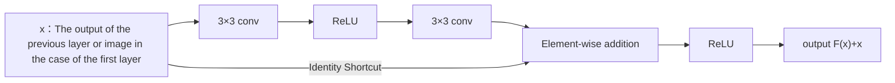
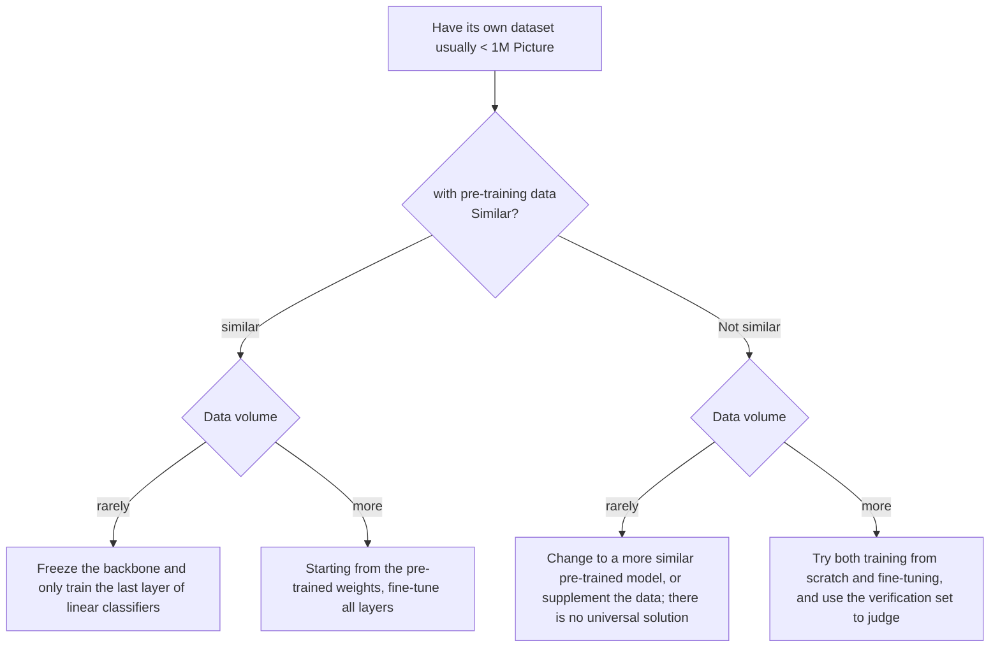

> **Course information**
>
> - **Course name**: Stanford CS231n: Deep Learning for Computer Vision(Spring 2025)
> - **Topic of this lecture**: Lecture 6. CNN Architectures (CNN architecture, also talking about CNN training process)
> - **Lecturer**: Zane Durante
> - **Teaching date**: 2025-04-17
> - **Course homepage**: [cs231n.stanford.edu/2025](https://cs231n.stanford.edu/2025/schedule.html)
> - **Official courseware**: [lecture_6.pdf](https://cs231n.stanford.edu/slides/2025/lecture_6.pdf) (97 pages, page-by-page illustrations in the book)
> - **Subtitle source**: [cs231n_sp25_kor_sub · eng](https://github.com/lpaiu-cs/cs231n_sp25_kor_sub/tree/main/eng) (Publicly transcribed in English, Chinese rewritten by this book)
> - **Copyright statement**: The copyright of the slides and course materials belongs to Stanford University and the instructors; this book is an unofficial study note and is only used for study and research.

At the end of Lecture 5, you have a handful of components: convolution, pooling, padding, stride, receptive fields. But putting the parts together does not equal a network, let alone a network that can be trained. The first half of this lecture answers "How to assemble these parts into a structure", and the second half answers "How to train the assembled things" - the lecturer Zane Durante wrote this dividing line directly into the overview page: How to build CNNs? and How to train CNNs?, each with four lines.

A main line runs through the whole scene: **Capacity and optimizability are not the same thing**. VGG proves that stacking 3×3 convolutions layer by layer can produce more nonlinearity with fewer parameters under the same receptive field; ResNet found that "deeper" itself will make optimization difficult, so it used an identity shortcut to change "learning mapping" to "learning residuals". The four things in the second half - weight initialization, input normalization, data enhancement, transfer learning - do not increase the expressive power of the model. They only do one thing: making the existing capacity really available for gradient descent.

## 1. Six-grid component board: convolution and pooling give the spatial structure, normalization and dropout are responsible for numerical values and generalization

*(Reference time: 00:00:05 – 00:16:11｜Lecture 6)*

The second page of the slide is course affairs: Assignment 1 is due at 23:59 next Wednesday (4/23), and project proposals are due next Friday (4/25). The lecturer did not stay on this page, but the position where it appeared illustrates the positioning of this lecture - as soon as the homework is finished and the project starts, it is exactly the point where "can build a CNN" becomes "can train a CNN". All subsequent suggestions on initialization, enhancement, and transfer learning are for this purpose.

This overview page cuts the lecture in half. The first half of "How to build CNN" has four lines: layers in the network, activation function, CNN architecture, and weight initialization; the second half of "How to train CNN" has four lines: data preprocessing, data enhancement, transfer learning, and hyperparameter selection. In the first frame, the first half is marked red and the entire second half is gray.

The next frame flips the emphasis: red falls on "How to train CNNs?" The lecturer's own evaluation is that the second half is "much less dense" and mainly contains operational suggestions that can be followed directly in the project; the derivation that really requires brain use is concentrated in the first half.

The third frame cuts back to the first half, and the first of the four lines, Layers in CNNs, is lit alone. This page appears ten times in this lecture (introduction on pages 3-5, plus coming back once after each section). Every time you come back, the red color will move down one space - it is actually a progress bar for the entire lecture, not a table of contents.

### 1.1 From 3×32×32 to 6×28×28: three numbers for convolutional layers

The review is completed in one page: a 3×32×32 RGB image, equipped with 6 5×5 filters, slide each filter on it once, do "element-wise multiplication and summation, add bias" at each position, sweep out a 28×28 activation map, stack six of them to form a 6×28×28 output volume, and finally connect a ReLU. Each of the three numbers has its own division of labor: **The depth of the filter must be equal to the depth of the input** (Here it is 3 because the image has three channels), **The number of filters determines the depth of the output** (here 6), and the space size is determined by 32, 5, step size 1, zero padding 0, $32-5+1=28$.

The lecturer specifically asked: If there is another layer of convolution, what should its depth be? The answer is 6 - each filter in the next layer must span all six activation maps. This "depth alignment" rule is the premise for all subsequent architecture diagrams to be understandable: VGG's block has increased from 64 filters to 512. The increase is the number of filters, and the input depth of each layer is exactly equal to the output depth of the previous layer, so the entire network is a tightly coupled chain in the depth direction.

### 1.2 Pooling only does one thing: fold H and W

The pooling layer is much simpler than the convolution: it is still a sliding window, but the window is 2×2, the stride is 2, and there is no overlap between the windows, so the height and width are each halved, and the depth remains unchanged. Taking the maximum value in the window is called max pooling, and taking the average is called average pooling. The lecturer's attitude is very pragmatic: both are commonly used. When creating a new architecture, try both to see which indicator is better. It is a choice of "no priori, only experimentation". The function of pooling is to consolidate spatial information so that subsequent layers can see a larger range on a smaller plane.

### 1.3 Two-step formula for normalization, and four types of "calculating statistics with whom"

This board is worth remembering because it is the structure of the entire lecture. The three in the upper row (convolutional layer, pooling layer, fully connected layer) have been dismantled in Lecture 5; the three in the lower row (normalization layer, dropout, activation function) are to be supplemented in this lecture. The legend of the fully connected layer is very straightforward: $x \to h \to s$, one matrix multiplication plus an activation function, that’s all. The lecturer's original words were: There are actually only three layers in these classic models, but they have defeated all methods that people have tried before.

The red box is moved to the "normalization layer" and the formula is given:

$$
\hat{x}_{i,j}=\frac{x_{i,j}-\mu_j}{\sqrt{\sigma_j^2+\varepsilon}}
$$

This is the first step common to all normalization layers: subtracting the mean, dividing the standard deviation, and moving the data into a Gaussian distribution with zero mean and unit variance. $\varepsilon$  Just a small constant to prevent division by zero. The differences that appear repeatedly throughout the whole lecture are all in  $\mu_j$  and  $\sigma_j$ "What numbers are used to calculate these two statistics?"

The second step is the key: do not stop after normalization, but multiply by a learnable scaling and add a learnable translation, and let the model decide by itself "what is the most comfortable distribution of this layer." The lecturer emphasized that this step is a parameter learned through gradient descent, not a human-determined super parameter.

Dimension accounts are written on the same page. input  $x$  is  $N\times D$ (N samples, each is a D-dimensional vector), statistics  $\mu,\sigma$  is  $N\times 1$——Each sample is counted as a set, so it is called "sample-by-sample"; learned  $\gamma,\beta$  is  $1\times D$——One set for each feature dimension, shared by all samples. The output is  $y=\gamma(x-\mu)/\sigma+\beta$. The parameter quantity is  $2D$, has nothing to do with the number of samples, which is why it can be stuffed into any layer.

The lecturer said that "understanding this picture means understanding all the normalized layers." Think of the input as a  $N\times C\times H\times W$  cube, each normalization just selects a different subset to calculate the mean and variance:

- **LayerNorm**: Each sample is processed separately, and the statistics cover the sample  $C\times H\times W$  For all values, a sample has only one mean and one standard deviation.
- **BatchNorm**: A set of statistics for each channel, covering the entire mini-batch  $N\times H\times W$, which is what the lecturer calls "averaging across samples within the batch".
- **Instance normalization (InstanceNorm)**: To be more detailed, each channel of each sample is counted as one set, and the range is only  $H\times W$.
- **Group Normalization (GroupNorm)**: Divide the channels into several groups. Each sample and each group of channels is counted as one set. The granularity is between LayerNorm and InstanceNorm.

The formula skeletons of the four are exactly the same, and the only difference is "which dimensions are the blue ones on the cube?" A classmate asked three questions in class. The lecturer's answer can be summarized in two sentences: LayerNorm is a set of statistics for each sample, and BatchNorm uses channel statistics across samples in mini-batch; the "channel" here is depth, that is, how many values ​​there are in each spatial position.

> Editor's note: BatchNorm uses the statistics of the current batch during training, and instead uses the accumulated sliding average during training during inference. This is another engineering difference between it and LayerNorm/InstanceNorm; this layer is not expanded in the class.

After the discussion is over, the screen switches back to the component board, and the red frame remains in the normalized grid. This board is like a page of loose-leaf notes in this lecture: wherever the red box goes, the box moves from "To Be Learned" to "Learned". It is also a review tool - if you can't tell the difference between the four normalizations, don't look at the formulas yet, go back to the cube diagram and ask "which dimensions are shaded?" and the answer will come out immediately.

### 1.4 Dropout: randomly dig holes during training and fill them up during testing

From normalization to dropout, the lecturer only said one sentence: This is the last layer that needs to be learned. After learning it, you can start to look at the architecture built by others. The red box falls on Dropout, and there's a "(sometimes)" hanging next to it - not every architecture has it.

One sentence of the mechanism itself: each forward propagation, with probability  $p$  Randomly set some activation values of this layer to zero. $p$  It is a fixed hyperparameter, 0.5 is the most common, and 0.25 is also commonly used. After setting to zero, the contribution of these units to the next layer is 0, so in engineering, you can use a mask to skip the calculation directly - 0 multiplied by any number is 0. The objective function given by the lecturer is very straightforward: **Make the model more difficult to fit to the training data and thus generalize better**.

Why is this a good idea? The lecturer's answer was "more experience than theory". The most intuitive explanation lies in the list of cat characteristics: ears, tail, fur, claws, and cunning eyes. Each item is voted for "cat". If two features always appear together in your data set, "having ears and being furry" is almost equivalent to a cat, and the model will stick to this pairing. Dropout randomly mines half of them so that the pairs no longer always appear together, and the model is forced to learn a broader set of correspondences—a term called blocking feature co-adaptation.

Some students in class asked: If it is the category "tree", how do you decide which features to discard? The answer is that this question is not valid - the discarding is completely random, and people do not make any choices. Precisely because they do not make choices, the model cannot predict which features will be absent. The cost is that the model only sees a part of the features during training, and the performance on the training set will become worse; but when testing, it no longer discards all the features, and the performance is better.

The second interpretation is more like accounting: each binary mask corresponds to a sub-network, and Dropout is equivalent to training an exponentially large ensemble at the same time, and these sub-networks share the same set of parameters. The numbers given on the page are impressive - a fully connected layer with 4096 units has  $2^{4096}\approx 10^{1233}$  kind of mask, and the atoms in the universe "only" have about  $10^{82}$ . This also explains why it can only be considered an "approximate" integration: it is impossible to really  $10^{1233}$  The models are averaged.

The rule for testing is a corollary to this idea: no more units are discarded, but the output of each neuron is equal to its expected output during training. Because only half of the units are working during training and are suddenly turned on during testing, the value entering the next layer will be overall larger, so the retention probability must be multiplied to bring the magnitude back.

The summary page compresses the entire section into two lines: drop during training and scale during testing. The lecturer said here "I won't talk about the specific code" because the code just translates these two things into a few lines. The real pitfall is not the writing, but the **Don't forget the second one**: If only drop is implemented without scale, the indicator will drop inexplicably during inference, and it is difficult to check.

Some students also asked about the problem of backpropagation: What to do with the units that are set to zero? The answer is the same as the negative semi-axis of ReLU - the gradient of that path is 0, this path on the calculation graph does not need to be walked again, and the weights connected to it will not be updated at this step. It's not "less updated", it's that this step is not updated at all.

## 2. Activation function: Sigmoid dies from saturation, ReLU uses half the domain for efficiency, and GELU rounds the corners.

*(Reference time: 00:16:13 – 00:21:45｜Lecture 6)*

Go back to the overview page and highlight the Activation Functions line in red. So far, the layers of CNN have been talked about. The remaining question is: these linear operators are still linear when stacked together, and where does the nonlinearity come from.

The red box moves to the activation function in the lower right corner. Convolution is multiplication and addition, full connection is matrix multiplication, and pooling is maximizing or averaging - the first two are linear, and pooling is piecewise linear and has no parameters. This means that if the activation function is not inserted, the entire link is still mathematically just a large linear mapping, and the depth is completely lost.

This frame only has one more line than the previous frame: Goal: Introduce non-linearities to our model. The motivation for the entire activation function section is this sentence.

![The first frame of Sigmoid: push the value to \[0,1\] and saturate at both ends](</attachments/cs231n-6e81267ec9912ddce199b478.png>)

Sigmoid's historical status comes from a beautiful explanation: it is like the "firing rate" of neurons, pressing any real number into  $[0,1]$. But the lecturer used it as a negative teaching material: when multiple layers of sigmoid are stacked, the gradient will be smaller each layer during backpropagation.

The instructor posed this question to the class: In which regions does the sigmoid have a small gradient? The answer is both very negative and very positive. It can be seen more clearly from the picture: only the derivative near 0 is obviously non-zero, and it becomes flatter towards both ends, and it quickly approaches 0. This means that as long as the value entering the sigmoid is too large or too small, the returned gradient will be close to zero, and the deep network will become "dumb" before it even starts to learn.

The first advantage of ReLU is that the positive interval is not saturated at all - the derivative is constant 1, whichever is passed back. The second advantage is that it's cheap: a max is much cheaper than an exp. The measured conclusion given on the slide is that the convergence speed is about 6 times faster than sigmoid. These two things combined are why it took over so quickly after 2012.

The problems with ReLU are also on the same page: the output is not zero-centered, and the gradient in the negative interval is always 0. Once these neurons fall in, they will no longer receive gradients. The term is dead ReLU. The lecturer made a very accurate comparison: sigmoid is "except for a small section in the middle, almost the entire domain gradient is close to 0"; ReLU is "half of the domain gradient is 1 and half is 0". The latter is obviously better, but is still a dead end for half the domain.

GELU is here to fill this blind spot. it counts  $f(x)=x\cdot\Phi(x)$, among which  $\Phi$  It is the cumulative distribution function of the standard normal - the instructor explained it using "the area under the Gaussian curve": $x$  When it is very negative, the area is 0 and the output approaches 0; $x$  When the area approaches 1, the output approaches  $x$. So it converges to ReLU at both ends, but is smooth near 0 and has non-zero gradients everywhere. There will be no "sudden gradient break at the inflection point" during training. The price is more expensive than ReLU. The conclusion of the slide is: it is now the workhorse activation function in Transformer.

This page draws five candidates side by side: ReLU is  $\max(0,x)$, Leaky ReLU is  $\max(0.1x,x)$, ELU is used on the negative half axis  $\alpha(e^x-1)$  Change to a gentle slope, GELU is  $x\cdot\Phi(x)$, SiLU is  $x\cdot\sigma(x)$. The lecturer said, "If you squint your eyes, they all look the same": the left section is flat, and the right section gradually becomes  $y=x$  The only difference is how to deal with the corners and how to save the negative half axis. He also mentioned a slip-of-the-speech level detail - this was mentioned in class  $x\cdot\sigma(x)$  It is pronounced SELU, but what is written on the page is actually SiLU; the shapes of the two functions are very similar ($\sigma$  with  $\Phi$  It is similar), but the name should be based on the page.

The question is written on the page: Where is the activation function inserted in CNN?

The answer is "follow all linear operators": after fully connected layers and after convolutional layers. The lecturer conveniently clarified the terminology - feedforward layer, linear layer, and fully connected layer are the same thing, and they are all matrix multiplication and addition activations. This position convention will be used repeatedly later: say "a 3×3 convolution block", the default is conv → ReLU.

## 3. Two victories for depth: VGG splits large convolutions into small convolutions, and ResNet installs a shortcut for every two layers.

*(Reference time: 00:21:45 – 00:41:37｜Lecture 6)*

The overview page is back again, this time marked in red with CNN Architectures. The first half is already halfway through: we’ve finished talking about the layers, we’ve finished talking about the activation functions, and now we’re looking at what the network that others have built looks like.

### 3.1 Six years of reading ILSVRC with one picture: Errors are falling and the number of layers is jumping

This page draws two things on the same graph: the blue column is the top-5 error rate of each year's champion on ImageNet, and the orange triangle is the number of layers of the model. In 2010, Lin et al. 28.2%, and in 2011 Sanchez & Perronnin 25.8%, both were still "shallow" methods; in 2012, AlexNet reduced the error rate to 16.4%, using only 8 layers; in 2013, ZFNet 11.7%, still 8 layers; in 2014, VGG achieved 7.3% with 19 layers, and GoogLeNet achieved 7.3%. The 22-layer achieved 6.7%; in 2015, the ResNet 152-layer achieved 3.6%, surpassing the human 5.1% for the first time; after that, SENet pushed all the way to 2.3%.

The red frame first encircles the 2012 pillar. The historical significance of AlexNet is not "deeper", but "the first CNN to actually run on ImageNet, and it was trained on GPU" - the lecturer made it clear that this history has been discussed in Lecture 3, and is only used as a comparison here.

The red box moves to the two pillars in 2014: VGG (19 layers, 7.3%) and GoogLeNet (22 layers, 6.7%). Two models in the same year are listed side by side, which is information in itself - stack depth is not the only way, but the way chosen to explain in detail in this lecture is VGG, because it separates the variable "depth" and everything else (filter size, number of layers) is as regular as possible.

### 3.2 VGG: Split 7×7 into three 3×3

Reading an architecture using a block diagram is a fundamental skill in this course: a block represents a layer or group of layers. The orange block is a 3×3 convolution, stride 1, padding 1 – stride 1 means it visits every position without skipping, padding 1 means the spatial dimensions are unchanged after convolution. The pooling uniformity is 2×2 and the stride is 2. Finally, three segments of full connections are connected: 4096, 4096, and 1000, where 1000 is the number of ImageNet categories. **The last layer of the classification network is always equal to the number of your categories**.

The difference between VGG16 and AlexNet is, in the words of the lecturer, "an enlarged version of AlexNet": all convolutions are replaced by 3×3, and two to three layers of re-pooling are performed at a time instead of one layer and one pool. There are only three layers of repetition in the entire network, but the top-5 error rate has been reduced from 11.7% to 7.3%.

The question is written next to the architecture diagram: Why 3×3? The lecturer admitted that he did not know whether the author had intuition first or found reasons afterwards, but he was sure of another thing - the ResNet article was "first have a thought experiment, and then do the experiment." This distinction is important: explanations in architecture papers are sometimes design motivations, and sometimes are post hoc rationalizations.

### 3.3 Receptive field arithmetic: for each layer of 3×3, add 2 to the receptive field

To answer "Why use 3×3", you must first calculate the receptive field: a value on the activation map, how much of the input image is seen. The page strings three 3×3 convolutions into Input → A1 → A2 → A3. The question is how big a square on the input corresponds to a value on A3.

The best number in the first layer: Each value of A1 comes from the previous 3×3 window of the input, so the receptive field of A1 is 3×3.

Each value of A2 is calculated from 3×3 values ​​on A1, and each of these 9 values ​​covers the input 3×3, which together is 5×5—the extra circle than 3×3 is the overlap of adjacent windows.

Going back one level: a value of A3 → 3×3 of A2 → 5×5 of A1 → 7×7 of the input.

The last frame fills the entire footprint, and the answer is 7×7. The rules are also very clean: **3×3 convolution with stride 1, adding 2 receptive fields for each layer** (Expand one space each time to the left, right, up and down), the three floors are  $3+2+2=7$.

The conclusion is stacked below the same figure: a stack of three 3×3 convolutions (stride 1) has the same effective receptive field as a 7×7 convolution.

The real reason lies in the parameter account. Assume that the number of channels in each layer is  $C$, a 3×3 convolution filter has  $3\times3\times C$  weights, total  $C$  a filter, that is  $9C^2$;The third floor is  $27C^2$. And a 7×7 convolution is  $49C^2$. That is to say, **The same receptive field, small convolution only needs 55% of the parameters**, and there are two more ReLUs in the middle - more nonlinearity and more complex relationships that can be represented. This "fewer parameters + more nonlinearity" is the entire legacy of VGG to future generations.

Some students in class asked: How much of this explanation is intuition at the time of design, and how much is retrospective recognition? The lecturer said that he could not answer VGG for the author, but he was sure about the ResNet article - it was a typical example of making a hypothesis first and then designing an experiment. The question itself is worth remembering: when reading an architecture paper, "why it is designed this way" and "why it is designed this way" are two different things.

### 3.4 The starting point of ResNet: 56 layers lost to 20 layers, and it was not overfitting

The red frame moved for the last time, encircling the three pillars after 2015, with the sentence "Revolution of Depth" marked next to it. From here on, the protagonist of this lecture has changed positions with VGG: it is no longer "how to make the pile deeper and more economical", but "why the deeper the pile is, the worse it is".

The question is written as it is on the page: What happens if you continue to stack layers on top of a "plain" (no tricks) convolutional network?

The answer is a counter-intuitive curve: for the two models of 20 and 56 layers, whether looking at training error or test error, the 56-layer model is worse than the 20-layer model.

If you only look at the test error, the first reaction is overfitting. But the training error is also high, which eliminates over-fitting - the definition of over-fitting is that it is good on the training set and gets worse on the test set, and here it is bad on both sides. The lecturer emphasized that this sentence was the turning point of the entire lecture: **It’s not that you can’t remember the model, it’s that you can’t learn it.**.

Hence the reasoning that was cited repeatedly later: the set of representable functions of the deep model is a superset of the shallow model (setting the extra layers to identity mapping will degenerate into a shallow model), so the expressive ability will only increase rather than decrease; since there is no problem with the expressive ability, the problem must be optimization - deep models are more difficult to train.

The following thought experiment is very beautiful: How to make a deep model "at least as good as" a shallow model? According to the construction method, the layers learned by the shallow model are copied as they are, and the extra layers are set to identity mapping, so that the output is equal to the input. The problem is——**Letting a bunch of convolutional layers learn to "do nothing" is not easy for gradient descent.**.

The solution to ResNet is to change the fitting object: do not let these layers directly fit the desired  $H(x)$, but let them fit the residuals.

The specific method is to input  $x$  Copy these two layers of convolution as they are and add them at the exit: $H(x)=F(x)+x$. So "learn to be equal" became "to put  $F(x)$ "Learned to 0" - As long as the convolution kernel all learns to 0 (in practice, it learns to a very small value), the output is  $x$. This branch road passing by is called **Residual connection**, this pair of convolutions plus a shortcut is called **Residual block**.

The lecturer summed up the physical implications of this in one sentence: **What is learned in the block is no longer the feature itself, but the increment of the feature relative to the input** (delta). It turned out that we had to go all the way  $x$  become  $H(x)$, now just learn this difference; the difference is usually much smaller and much easier to optimize. The intuition of the abstraction level has not been lost - each block is still moving towards a higher-level representation, but its output is "add a little more to the previous layer".

There are two technical questions in class that are worth writing down. First, addition requires that the shapes of the two tensors are exactly the same. This is why all convolutions use 3×3, stride 1, and padding 1: the shape is unchanged so that the addition is easy; once the size changes after pooling, the simple addition does not hold, so the residual block is placed before pooling. Second, since it is just "adding a line", can the same effect be achieved by training for a while? The lecturer's answer is no - plain the network is not converging slowly, but is stuck on a very poor solution, and cannot catch up with the shallow model no matter how long it is trained; what the residual connection changes is whether it can reach a good solution, not how fast it goes.

### 3.5 The shape of the entire ResNet: periodic doubling of channels and halving of space

Stacking the residual blocks together is ResNet. The line on the picture that goes around each pair of convolutions is  $x$  The position that is added back; each residual block is fixed with two 3×3 convolutions, the first convolution is followed by ReLU, and the addition is followed by a ReLU.

This design rule deserves its own note: **After each set of residual blocks, the number of filters is doubled and the spatial size is halved.**, the volume of the activation body remains roughly unchanged. The visual impression given by the lecturer is: the input is a thin and large picture. As the number of layers increases, it becomes smaller and thicker, and finally it is compressed into a vector for classification.

Another detail is the 7×7, stride 2 convolution (stem) at the beginning. The lecturer said that this layer is a purely empirical product: with it, the indicators are better, and there is no deeper theory. It is responsible for cutting 224×224 to 112×112 before entering the residual block, saving all subsequent calculations.

The same set of building blocks can create different depths. The commonly used levels on ImageNet are 18, 34, 50, 101, and 152 layers.

The results page gives three numbers: 152 layers, ILSVRC'15 classification champion, 3.57% top-5 error rate, and all the classification and detection tasks of ILSVRC'15 and COCO'15 were scanned in the same year. The lecturer added something about the atmosphere at that time: In those two years, almost all visual tasks used ResNet as the backbone network by default.

Some students in class asked how the number 152 was determined. The lecturer's answer was very honest: he didn't know the author's original considerations, but the general approach is to start from small to large - first train 18 layers, then add 34 layers to see the indicators, and increase until the benefits are no longer obvious (the difference between 101 and 152 is only about 1%). At the same time, it is also subject to the limitation of video memory: the more parameters, the smaller the model that can be crammed into one card. He also added an engineering detail: These models of different depths are trained independently and are not "cut" from one model.

## 4. Initialization and input normalization: Let the activation distribution of 152 layers neither collapse nor explode

*(Reference time: 00:42:02 – 00:50:23｜Lecture 6)*

The overview page comes back, and red falls on the last line of the first half, Weight Initialization. The lecturer added a truth here: The architecture is already established, but if the same architecture is chosen incorrectly with the initial value of the weight, it will be completely impossible to train.

The question is thrown as it is: What should the weights of a network layer be initialized to? The answer is not "just random", because randomness also has magnitudes.

### 4.1 The initial value is too small: after each level, the activation will collapse to 0.

The experimental setup is very clean: 6-layer fully connected network, each layer has 4096 dimensions, the weights are standard normal and multiplied by 0.01, each layer is followed by ReLU, and then the mean and standard deviation of each layer activation during forward propagation are plotted.

The result is a monotonically declining curve: the first level still has a decent mean and variance, and then it gets smaller and smaller, and in the end it almost all collapses to near 0. The lecturer added an ideal state: **We hope that the activation distribution of each layer is similar**, because the distribution is stable, the optimization problem is easy to solve. The reason why 0.01 "looks small and safe" is precisely because it scales down each layer a little, and it disappears when multiplied by six times.

### 4.2 The initial value is too large: the same multiplication relationship bites people in turn

Adjusting the standard deviation from 0.01 to 0.05 changes only one number.

The curve immediately turned over: each layer was enlarging, and later the mean and standard deviation became huge numbers. The lecturer's original words were "Imagine you are training a 152-layer ResNet." This amplification process is repeated 152 times, and the value has long overflowed. 0.01 will collapse, 0.05 will explode, and the "just right" value in the middle is about 0.022 - but this is just a lucky number under a specific setting, and it will become invalid if you change the dimension.

In class, some students asked about the mechanism of the explosion. The lecturer explained with a recursion relationship: each layer is "random matrix multiplied by vector and then ReLU". If the average gain of this multiplication is greater than 1, it will be amplified layer by layer; ReLU cuts off the negative half, and the remaining ones are all positive, and the mean will continue to drift in the positive direction. Conversely, gains less than 1 are attenuated layer by layer. The ideal initial value is to make this gain exactly equal to 1.

### 4.3 Kaiming initialization: write "just right" as a formula related to dimensions

So the initialization cannot be a constant, it must be a function of the dimension of this layer: a 4096-dimensional fully connected layer and a 2048-dimensional one require different standard deviations.

The answer is Kaiming initialization (also called MSRA initialization): the standard deviation is  $\sqrt{2/D_{\text{in}}}$, among which  $D_{\text{in}}$  is the input dimension of this layer, and coefficient 2 is a correction made specifically for ReLU - if ReLU is cut in half, the variance will be reduced by half, so the variance must be doubled first. There is only one line of code: `W = np.random.randn(Din, Dout) * np.sqrt(2/Din)`. There are six levels of statistics written on the effect page: mean 0.57, 0.57, 0.56, 0.55, 0.55, 0.55, standard deviation 0.83, 0.83, 0.83, 0.81, 0.81, 0.81 - almost a horizontal line.

The lecturer's attitude towards derivation is very frank: the process does not unfold, "you can treat it as a magic formula, plug it in and get the properties you want." If you want to get to the bottom of it, read the article by He et al. 2015. He also gave two boundaries: the convolution layer uses the same set of formulas, but  $D_{\text{in}}$  To press  $3\times3\times C_{\text{in}}$  To calculate (convolution kernel size multiplied by the number of input channels); if one day you invent a new layer that no one has done before, the formula is not guaranteed to be effective, and you can only try a few sets of initializations.

At the end of the class, someone asked: Since the normalization layer can bring the activation back to the standard distribution, does it mean that we don’t have to worry about initialization? The lecturer admitted that normalization can indeed block the specific symptom of "explosion", but optimization may still be more difficult - initialization solves the starting point, normalization solves along the way, and the two cannot replace each other.

### 4.4 Input normalization: the whole thing is only three numbers

The overview page cuts to the second half, and red falls on Data Preprocessing. The first half (how to build) ends here, and the remaining four sections are all about "how to train".

The preprocessing of the image is so simple that it can be said in one sentence: Calculate a mean and a standard deviation for each channel (RGB three channels, a total of six numbers, the "3 numbers" mentioned on the page refers to the mean of the three channels), and then subtract the mean of the channel and divide by the standard deviation of the channel for each pixel. It requires you to calculate the statistics of the entire data set before training, and **Statistics are data set dependent**. The common practice in engineering is to directly use the mean and standard deviation of ImageNet, even if you are not training ImageNet - the lecturer admits that this is not rigorous, but it is a de facto standard, and it is only worth recalculating when your data distribution is far away from natural images.

## 5. Data enhancement and transfer learning: first change the distribution of data, and then borrow other people’s weights

*(Reference time: 00:50:25 – 01:07:14｜Lecture 6)*

The overview page is back, this time all four rows in the second half are lit, and the red stops at Data augmentation. From here to the end of the lecture, the content is all operations that can be directly copied into the project.

### 5.1 Unified sentence pattern of regularization: add randomness during training, and average out the randomness during testing

The instructor first gave a sentence pattern that can be applied to all subsequent techniques: inject some randomness during training, and average out this randomness during testing (sometimes it can only be approximated).

Dropout is a standard example of this sentence: randomly drop half of the activations during training, enable them all during testing, and then scale according to the retention probability. The same set of logic is moved to the input, which is data enhancement.

### 5.2 Data enhancement: Make the same picture look different every time

The flow chart is very short: take an image and its label (cat) from the data set, transform it before sending it to the network, and then calculate the loss. The lecturer said that this is almost unconditionally enabled in modern deep learning - "basically always". There are two levels of income: one is **Equivalently enlarged data set**, the same picture is seen in a different version every time; secondly, the model cannot pass the test by memorizing questions, and the training loss will be higher, but the generalization is better.

The simplest enhancement is horizontal flipping. It is almost free for everyday objects, because most objects are symmetrical; but for the task of "reading text", it is a disaster - after flipping it, it is like looking into a mirror, and the words are all reversed. Vertical flipping is another story: everyday objects almost never appear upside down, so they are generally not used; however, it is completely reasonable in microscope images and overhead images. This criterion applies to all enhancements: **After this transformation, can humans still recognize the categories?**

The most commonly used one is called random resized crop, and the complete parameters of ResNet are given on the page. During training: first  $[256,480]$  Pick one randomly from  $L$, scale the short side of the image to  $L$ (Maintaining the aspect ratio), then randomly cut a piece of 224×224 from the inside. When testing, perform test time augmentation (TTA): scale the graph to  $\{224,256,384,480,640\}$  Five scales, each scale takes 10 224×224 crops (four corners + center, and then flips each), and averages all predictions.

The lecturer’s evaluation of TTA was very honest: **Steady improvement of 1% to 2%**, the cost is that the inference runs 50 times forward (5 scales × 10 cuts), and it is only worth using in situations where "really care about the last few tenths of points". He also explains why random scaling is useful: it changes scale, position, and effective resolution simultaneously, and humans still recognize these variations as cats.

Color jitter takes another route: randomly adjusting contrast and brightness to make the picture grayer or brighter. This type of transformation is traditional image processing. How to determine the parameters? The lecturer gave the same criterion - adjusting the intensity until it "still looks like the same distribution and people can still recognize it" is the appropriate intensity.

The last one is Cutout: set random rectangular areas of the image to zero (black blocks or gray blocks) during training, and use the complete image during testing. The lecturer said that it is not mainstream, but it illustrates that "enhancement can be customized according to the scene" - if your camera is often blocked and only part of the object is exposed, this kind of enhancement is a preview for the deployment environment. The slide also points out the relationship between the three: Dropout, data enhancement, and Cutout/random cropping. Essentially, they are all doing the same thing in different positions.

### 5.3 Transfer learning: Use the features trained by ImageNet as a free feature extractor

The overview page comes back, and the red color falls on Transfer Learning. This is the most "usable" part of this lecture: most people's data sets don't have a million pictures.

The question is very straightforward: If there is not much data, can we still train a convolutional network? The lecturer said the answer is yes, but you have to be smart.

Based on the hierarchical features mentioned in Lecture 5: the first layer of filters (AlexNet is 64 3×11×11) learns edges, color blocks, and small patterns, and the higher they go up, the more abstract they are. this means **The underlying features are almost universal**, has little to do with your specific tasks.

Stronger evidence is on the next page: Send the image into the network, take the vector before the classification layer (4096 dimensions or 2048 dimensions), calculate the L2 distance in the feature space to find the nearest neighbor, and images of the same category will be tightly clustered together. In other words, this vector itself is a good feature representation - if you put a linear classifier or kNN on it, the effect is already good. This is equivalent to treating CNN as a **Predefined feature extractors**, occupying the same position as those hand-designed features (color histograms and the like) in the old paradigm, except that it is much stronger.

The standard process has three steps. The first step: train a large model on a very large data set (ImageNet or Internet-level data), or directly download the model trained by others.

Step 2 (small data set): Freeze all layers except the last layer - the parameters are kept as they are, and the gradients are not returned - then replace FC-1000 with FC-C (C is the number of your categories) and initialize it with Kaiming to train only this layer. The lecturer said that this step is mathematically equivalent to: first using the entire network to turn each image into a 4096-dimensional vector, and then training a linear classifier on this vector. This is the literal meaning of "use the pre-trained model as a feature extractor".

Step 3 (larger data set): Unfreeze all layers and fine-tune the entire network starting from the pre-trained weights. The lecturer said that he takes this step in almost all his projects: he has one million to ten million pictures in hand, starting from a model trained on billions of pictures, and then fine-tuning it on a small data set. The effect is stable and better than training from scratch - because the model has seen a lot of data, the feature extractor is better, and fine-tuning allows it to adapt to your specific problem.

The instructor spread out the choices into a 2×2 matrix: the horizontal axis is "how similar your data set is to the pre-training data", the vertical axis is "how much data you have", and the four grids are empty first.

Similar + less data: Use a linear classifier on the last layer (step 2). Similar + lots of data: fine-tune all layers (step 3).

Dissimilar + less data: The most uncomfortable grid, you can only change to a closer pre-trained model, or collect data. Not similar + lots of data: Both training from scratch and "pre-training + fine-tuning" are worth trying. There is no conclusion on which one is better, we can only experiment.

The lecturer made it very clear about the boundaries of this matrix: only the "dissimilar + less data" cell has no reliable answer, and the other three cells are all stable in practice. He also mentioned the third way between "only training the last layer" and "full training" - only training part of the layer, or using methods such as LoRA to only learn low-rank increments (this is the same idea as "learning differences instead of learning values" when he talked about residuals earlier), but the specific details are left to Transformer.

The page ends with two suggestions: find a similar big data training large model, and then migrate it to your data; and don’t train it yourself from scratch - PyTorch  `torchvision`  and Hugging Face's  `pytorch-image-models` There is a ready-made model zoo in (timm).

## 6. Hyperparameter search: first overfit a sample, and then sample at random points

*(Reference time: 01:07:14 – 01:10:34｜Lecture 6)*

The overview page comes back for the last time, with red falling to Hyperparameter Selection.

The first three steps of the process are walkthroughs, not searches. The first step is to look at the initial loss: when it has just been initialized and has not been trained yet, the loss should fall near the theoretical value (the loss of random guessing). A far difference indicates that the initialization or loss function is written incorrectly. The second step, **Overfitting to a small sample**: Take one or two samples or even a picture, and the training loss should drop to close to 0; if it cannot drop, there is a bug in the code, or the model cannot express your problem at all. The lecturer said that this step can also tell you the magnitude of the learning rate. The third step is to use all the data, turn on a little weight attenuation, and find a learning rate that can significantly reduce the loss within about 100 iterations. The commonly used gear is  `1e-1`, `1e-2`, `1e-3`, `1e-4`, `1e-5`.

The fourth step is to lay out a coarse grid near the learning rate, and each configuration only runs 1–5 epochs; the fifth step is to make the grid thinner and train for longer; the sixth step is to start looking at the curves - the next set of slides are four typical shapes.

The first shape: both training and verification accuracy are still going up. There is no need to adjust parameters at this time, just continue training.

The second shape is the question page of this lecture: the training accuracy goes all the way up, and the verification accuracy reaches a peak and then starts to decline - the gap in the middle is overfitting.

The prescription given by the lecturer is to choose one of two: increase regularization (Dropout, weight decay, data enhancement), or get more data. If you can't do both, you can only stop early at the peak. He also reminded of an easily contradictory statement: looking at **Accuracy** The shape of the curve; if you look at the loss, the training loss decreases and the verification loss increases.

The third shape: the two curves are almost touching each other, and neither is high. This is not overfitting, but underfitting - the model has insufficient capacity or insufficient training. You can train for longer, or you can change to a larger model.

The seventh step has only one line: GOTO step five. Parameter adjustment is not a one-time process, but a cycle of "coarse adjustment - refinement - look at the curve - refine again" until the verification indicators no longer improve.

The last question: When multiple hyperparameters are adjusted together, should all combinations be exhausted? The lecturer’s answer is no, **Random search is better than grid search**. The reason is that schematic diagram: there are two vertical and horizontal axes, one is important super parameters and the other is unimportant super parameters. Grid search only takes a few discrete values ​​for important parameters each time, and the rest of the points are wasted on repeated values ​​of unimportant parameters; randomly scattering points allows important parameters to be taken more densely and finely. Therefore, the correct approach is to set an interval for each hyperparameter, and then randomly sample from the interval until the indicator no longer improves.

## 7. Summary

*(Reference time: 01:10:38 – 01:10:59｜Lecture 6)*

The first half of the page lists four things about "how to build": layers (Conv, FC, Norm, Dropout), activation functions (ReLU, GELU, etc.), architecture (VGG, ResNet), and weight initialization - the last one is summarized in one sentence, "Maintain activation distribution." These four words are all the test points in the first half.

The last two pages organize the entire lecture into eight themes, the first four of which belong to "how to build" and the last four to "how to train". Break these two pages into takeable judgments:

- There are only six grids in the CNN layer list, and only three grids are actually used repeatedly in the classic architecture: convolution, pooling, and full connection; normalization and dropout are numerical and generalization patches added later.
- The normalization layer shares the same two-step formula. The difference between the four subtypes is only "which dimension the statistic covers", not the formula itself.
- The benefit of dropout comes from destroying feature co-adaptation, at the cost of being worse on the training set; the test must be scaled according to the retention probability, otherwise the numerical magnitude will drift.
- There is only one main line in the evolution of the activation function: do not let the gradient equal zero for most of the domain - ReLU cuts off half of the domain, and GELU rounds the corners.
- Three 3×3 convolutions ≡ The receptive field of one 7×7 convolution, but the parameters are only 55% of the latter, and there are two more nonlinearities; this is the whole reason for "small convolution stack depth".
- The problem of deep network training is not overfitting but an optimization problem. Residual connection replaces "learning mapping" with "learning difference", making "at least no worse than shallow" an easy task.
- The goal of initialization is to keep the activation distribution of each layer unchanged, $\sqrt{2/D_{\text{in}}}$  is the analytical solution to this matter; input normalization is the data-side approach to the same thing.
- When the data is insufficient, the correct sequence is: first enhance (change the data distribution), then migrate (borrow other people's weights), and finally adjust the super parameters - super parameters can only work if the model can already learn.
