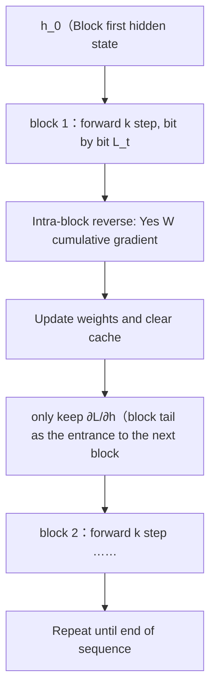
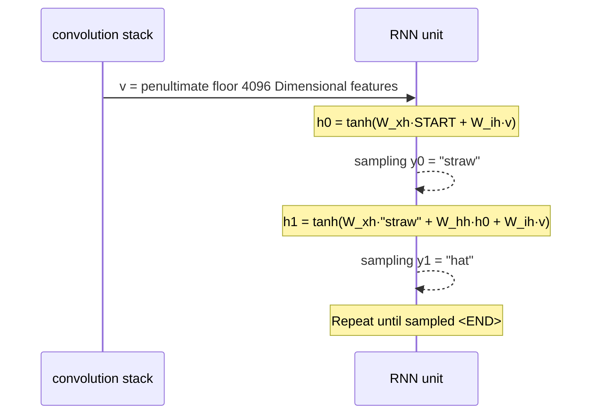

> **Course information**
>
> - **Course name**: Stanford CS231n: Deep Learning for Computer Vision(Spring 2025)
> - **Topic of this lecture**: Lecture 7. Recurrent Neural Networks
> - **Lecturer**: Zane Durante
> - **Teaching date**: 2025-04-22
> - **Course homepage**: [cs231n.stanford.edu/2025](https://cs231n.stanford.edu/2025/schedule.html)
> - **Official courseware**: [lecture_7.pdf](https://cs231n.stanford.edu/slides/2025/lecture_7.pdf) (124 pages, page-by-page illustrations in the book)
> - **Subtitle source**: [cs231n_sp25_kor_sub · eng](https://github.com/lpaiu-cs/cs231n_sp25_kor_sub/tree/main/eng) (Publicly transcribed in English, Chinese rewritten by this book)
> - **Copyright statement**: The copyright of the slides and course materials belongs to Stanford University and the instructors; this book is an unofficial study note and is only used for study and research.


All the networks in the first six lectures are based on an assumption: the input is a fixed-size tensor, and the output is a fixed-size vector. $224\times224\times3$  The image goes in and the 1000-dimensional score comes out. No matter how many layers of convolutions and residuals are piled in the middle, the shape is fixed from beginning to end. This lecture will dismantle this assumption. Image description requires a picture to spit out a sentence of variable length, video classification requires a stack of frames to spit out a label, and language model needs to do the same thing repeatedly on each character - the lengths of input and output are not fixed, and may even be unequal to each other.

Zane Durante's solution is to turn "time" into a dimension of the network: the same function and the same set of weights are called repeatedly at each time step, and the entire history is pressed into a fixed-length vector. All the benefits of this design (the number of parameters does not change with the sequence, no upper bound on the context window) and all the troubles (must be serialized, gradients must be multiplied along time  $T$  times) all come from the same fact. Therefore, the focus of the second half of this lecture is not to introduce more structures, but to calculate an account: $\tanh$  The maximum derivative of is 1, $W_{hh}$  The singular values of are multiplied one by one, $T$  After steps, the gradient either disappears or explodes; in the final analysis, the entire contribution of LSTM is to open a bypass in this continuous multiplication chain that only does element-by-element multiplication.

## 1. First fill in the two pitfalls from last time: Dropout scaling and normalized ceiling

*(Reference time: 00:00:05 – 00:05:39｜Lecture 7)*

There are only two pieces of transactional information in the class, and they are both stuck this week: Assignment 1 is due at 23:59 on April 23 (tomorrow), and the project proposal is due on April 25 (Friday).


The previous lecture left two questions on the Ed discussion forum. The lecturer explained them clearly at the beginning, because both of them involve the inconsistency between "writing on the slide" and "implementation in the library", which is the most likely to be copied incorrectly.


The first is how Dropout scales during testing. During training, a part of neurons are randomly zeroed in each forward propagation. The zeroing ratio is a hyperparameter, and 0.5 is the most common (Srivastava et al., "Dropout: A simple way to prevent neural networks from overfitting", JMLR 2014). The trouble lies in the semantics of this hyperparameter: **Most libraries  $p$  It is defined as a drop probability, and the implementation of the previous slide treats it as a retention probability.**, so the same symbol points to opposite operations under two sets of conventions.


There is only one criterion for judgment: all neurons are alive during testing, so the activation must be scaled to "test period output = expectation of training period output". If 25% is lost during training, multiply it by 0.75 during testing. During the training period, the output of this neuron has a 25% probability of being set to zero and a 75% probability of being itself. The expectation is  $0.75a$;Everyone is present during the test period, and the output is  $a$, times  $0.75$  The expectations of both parties are in line.


This rule can be condensed into six words: lose it in training and shorten it in testing. This is the implementation of the "test period scaling" version; most frameworks today default to the opposite, dividing the retained activations by the keep probability during the training period, and nothing needs to be done during the testing period - the two writing methods are equivalent, the only difference is which side the constant factor is placed on.


The second question is "Can normalization save bad initialization?" The lecturer answered with a toy setting that can be drawn on paper: the input is a 2-dimensional point, the network is a two-layer ReLU, and the goal is to output 1, 2, 3, 4 by quadrant (upper right 1, upper left 2, lower left 3, lower right 4). Run each of the four combinations - good Kaiming initialization and bad initialization with too large standard deviation, each with or without LayerNorm.


The conclusion of the first frame is a significant improvement: after bad initialization and LayerNorm, both error curves dropped significantly, from "close to the ceiling" to "able to go down".


But the second frame says it all: the gap remains. The blue color on the picture (bad initialization, no normalization) hangs all the way  $10^{-1}$  magnitude, green (bad initialization + LayerNorm) falls to  $2\times10^{-2}$  Nearby, red (Good Initialization + LayerNorm) pressed to  $10^{-2}$, orange (good initialization, no normalization) almost coincides with red. That is to say, **Normalization can save more than half, but it cannot save the last part.**; For best performance, you still have to get the initialization right.


What’s more worth remembering is the counterexample of the third frame: normalization doesn’t necessarily make sense. The quadrant task only requires knowing "which direction the point is approximately". Subtracting the mean and dividing the standard deviation will not change the quadrant affiliation, so it is useful; but if the task requires precise coordinates, normalization will delete the position information, and LayerNorm will be worse. **Normalization is throwing away information. If it is thrown correctly, it is regular, and if it is thrown wrong, it is destruction.**


After the clarification, the lecturer went back and collected the entire process of "acyclic network" into a list: one-time setup (activation function, preprocessing, weight initialization, normalization, transfer learning), training dynamics (following the training process, parameter update, hyperparameter optimization), evaluation (validation set performance, test-time enhancement). This list is the entire content of the first six lectures, and it is also what this lecture will avoid.


He recommended a tool for the second and third items on the list: Weights & Biases. On the slide is its parallel coordinate plot, with one hyperparameter per column and color-coded validation set accuracy. Shown here is the dropout column - runs with low dropout have higher overall accuracy. The lecturer's original words were that he uses it in almost every project, and TensorBoard is a like-for-like alternative.


Finally, today’s route: discuss sequence modeling; talk about the simple models used by people before Transformer, that is, RNN and its variants; and use one page to explain RNN and today’s **state space model** (state space model, such as Mamba) What is the relationship? His judgment is clear: the key concepts of RNN are not outdated, but have been covered by Transformer for a long time.


The control objects are laid out first. The vanilla neural network maps a fixed-length input to a fixed-length output. This is the only shape that has been dealt with in the first six lectures. All new things that follow are based on this shape.


## 2. Four shapes of sequences: one hidden state should contain the entire history

*(Reference time: 00:05:51 – 00:13:53｜Lecture 7)*

If you loosen the "fixed length" constraint, you will get four basic shapes. The slide uses four visual tasks to draw them one by one.

| shape | input | output | Classroom example |
| :--- | :--- | :--- | :--- |
| one to many | a fixed-length tensor | variable length sequence | Image description: a picture → a word |
| many to one | variable length sequence | a label | Action recognition: a stack of video frames → a category |
| Many-to-many (not aligned) | variable length sequence | variable length sequence | Video description: a stack of frames → one sentence description |
| Many-to-many (aligned) | variable length sequence | equal length sequence | Frame-by-frame video classification: one label per frame |

The first is image description: input a picture and output a string of words or characters, the length of which is determined by the model itself.


The second is action prediction: the input is a sequence of video frames, and the output is an action category - the same output form as image classification, except that the input changes from a picture to a stack of pictures.


The third is video description: input a stack of frames and output a description. Input and output are both sequences, the lengths can be different, and they do not have to correspond one to one.


The fourth is frame-by-frame video classification: each frame has a label, and the input and output are of equal length. This is the main battlefield in the first half of this lecture, because **Each time step has input, output, and loss.**, is most suitable for taking apart the mechanism of RNN.


After the shape is laid out, let’s enter the RNN itself. The easiest way to draw it is a box labeled RNN. $x$  Enter from below, $y$  Coming out from above, an arrow on the side circles back to itself——**When you see the arrow pointing back, you know that this layer is a circulation layer.**.


This arrow represents only one thing: RNN has a function that is constantly updated as the sequence is processed. **internal state**, usually called hidden state. Every time a new input comes, use it and the previous hidden state to calculate a new hidden state.


It is easy to get dizzy when calculating the gradient using the square drawing method, so the standard approach is to divide it by time. **Expand** (unroll): No.  $t$  The output of the block is fed to the  $t+1$  blocks, each block receives an input  $x_t$, spit out an output  $y_t$. After expansion, "the current hidden state depends on the current input and the previous hidden state" becomes an ordinary chain calculation graph.


The formula is written in only two lines. Hidden status update is


$$
h_t = f_W(h_{t-1}, x_t)
$$


Among them  $h_{t-1}$  It’s the old state, $x_t$  is the input vector of the current time step, $f_W$  with parameters  $W$  function - there is no essential difference from the previous layers. It is still "multiply the weight matrix and then pass an activation function", but now it is a recursive formula.


The output is given by another function:


$$
y_t = f_{W_{hy}}(h_t)
$$


$W_{hy}$  Do two things: change the dimension of the hidden state into the dimension of the output (the two can be different), and perform a learnable linear transformation on the hidden state. So **calculate hidden state** and **Calculate output** There are two sets of parameters and two functions, but they are shared in time.


Expanding the diagram also requires a starting point. The hidden state should be initialized to a certain  $h_0$, in principle it can be a learned vector, in this example it is given directly.


At this point we can point out one of the most important properties of RNN: **The same function and the same set of parameters are used at every time step**. The number of parameters is therefore independent of sequence length, at the cost of  $t$  The step information must be squeezed into the same fixed-length vector.


The simplest form is the so-called vanilla RNN, also called Elman RNN (named after Jeffrey Elman): the hidden state is  $\tanh$,


$$
h_t = \tanh\left(W_{hh}h_{t-1} + W_{xh}x_t\right), \qquad y_t = W_{hy}h_t
$$


choose  $\tanh$  The reason for is very practical: it compresses the value in  $-1$  Arrive  $1$  Between, repeated iterations will not fly out of the order of magnitude; it can express zero center, positive and negative. The simplest case on the output side is a matrix multiplication without an activation function.


There are two questions worth remembering in class. One, the old one  $y$  Can it affect new ones?  $h$? In some writing methods, it is possible. The most common method is to use the output of the previous step as the input of this step, which is autoregressive modeling - this is also the approach of the character-level language model later. Secondly, $h_0$  and  $x_1$  What's the difference? The answer is that they are multiplied by different weights: $h_0$  What is taken is the set of parameters from hidden state to hidden state. $x_1$  What goes is the set of parameters input to the hidden state.

## 3. From a hand-made RNN to BPTT: the gradients of the same W need to be added

*(Reference time: 00:13:57 – 00:36:30｜Lecture 7)*

Let's first give an example of a master who can count to the end: the input is a 0/1 sequence, and it is required to "output 1 when the current bit and the previous bit are both 1, otherwise output 0". The corresponding output of the sequence 0,1,0,1,1,1,0,1,1 is 0,0,0,0,1,1,0,0,1. This is a bit-aligned many-to-many task, and it is also the only time in this lecture that all matrix multiplications are written out.


The question was reduced to one sentence: What should be installed in the hidden state? The answer is derived from the information bottleneck - the output only looks at the hidden state, and the judgment requires two things, so the hidden state must at least hold the "previous input" and "current input".


The specific method is to take the hidden state into 3 dimensions, and the third component is always 1, which is equivalent to assigning a constant bias to ReLU; the two functions  $f_W$  with  $f_y$  Both take ReLU to make the arithmetic possible orally. $h_0$  initialized to  $(0,0,1)$, meaning "two 0s have been seen before, so it shouldn't trigger".


The weights are handwritten, and the entire logic is a cycle:

```python
w_xh = np.array([[1], [0], [0]])
w_hh = np.array([[0, 0, 0],
                 [1, 0, 0],
                 [0, 0, 1]])
w_yh = np.array([1, 1, -1])

h_t_prev = np.array([[0], [0], [1]])
for t, x in enumerate([0, 1, 0, 1, 1, 1, 0, 1, 1]):
    h_t = relu(w_hh @ h_t_prev + (w_xh @ x))
    y_t = relu(w_yh @ h_t)
    h_t_prev = h_t
```

The three matrices have a total of 9 + 3 + 3 = 15 numbers. These are all the parameters of the entire model——**The number of parameters has nothing to do with the length of the sequence** This thing, on this page, is literal.


first matrix  $W_{xh}$  is  $3\times1$  column vector of  $(1,0,0)^\top$, its only responsibility is to write the current input into the first cell of the hidden state: $x=0$  time contribution zero vector, $x=1$  time contribution  $(1,0,0)$.


$W_{hh}$  The first row of is all zeros, so cell 1 is never contaminated by history - it is always equal to the current input.


The second line is  $(1,0,0)$, it moves the 1st cell of the previous moment (that is, the "current position at that time") to the 2nd cell, so the "current" becomes the "previous position" of this moment.


The third line is  $(0,0,1)$, pass the constant 1 as it is, and the output layer relies on it for subtraction.


Output weight  $W_{hy}=(1,1,-1)$, a dot product is  `ReLU(当前 + 上一位 − 1)`: When both are 1, you get 1. As long as one of them is 0, it falls to 0 or a negative number and is truncated by ReLU.


This set of weights really works. But it was cobbled together by human hands, and it would be impossible to start with a real mission——**The question then becomes: How are these W's found in practice?**  The answer is gradient descent, and the gradient of RNN must go along time, so first write the expansion graph as a calculation graph. By the way: using this set of weights to train other tasks is transfer learning, but the 3-dimensional hidden state is too small and will not be useful in practice.


The computational graph starts with one step: $h_0$  and  $x_1$  into the same function  $f_W$, come out  $h_1$.


The second step is just to connect the same block again: $h_1$  with  $x_2$  given  $h_2$.


Until the first  $T$  step. The entire chain is the same function being called.  $T$  times.


Therefore, only one can be marked on the diagram  $W$: **Each time step reuses the same weight matrix**. This sentence is the root of all subsequent gradient derivation - it means  $W$  Appeared in the calculation graph  $T$  times, the gradient must be  $T$  All contributions are added up.


Connecting the output is many-to-many: each  $h_t$  Pass by each other  $W_{hy}$  get  $y_t$.


each  $y_t$  There are corresponding losses  $L_t$.


The total loss is added up item by item: $L=\sum_{t=1}^{T}L_t$. When backpropagating, you can calculate each separately first.  $\partial L_t/\partial W$  If you want to find the sum again, you can also calculate it all at once - because  $W$  It's the same thing, and the two ways of writing are equivalent.


Changing the shape is many-to-one: only take one in the last step  $y$, there is only one loss.


But for tasks like video classification, taking the output only at the last frame is wasteful: the entire video contains information. A more common approach is to do average pooling or maximum pooling on the hidden state at each time step, and then calculate  $y$- What should be reserved for pooling, rather than going all-in on the last vector.


The opposite direction is one-to-many: only the first step has input, and one is spit out at each subsequent step.  $y$.


The problem is with the subsequent steps  $x$  From where. The question mark on the picture is this gap: $f_W$  There are two entrances, one expects the input vector, and the other expects the previous hidden state. The second entrance cannot be empty.


The easiest way to fill in is to fill in zeros.


A more useful way to fill in is to take the output of the previous step and connect it back, which is autoregressive - this is exactly what image description does: the "input" the model sees is the word it just wrote.


With the graph, we can talk about backpropagation. The name is **Back propagation through time** (backpropagation through time, BPTT): Calculate the loss by walking the entire sequence in the previous direction, and then calculate the gradient by walking the entire sequence in the reverse direction.


Its cost is written directly in the video memory: the activations and gradients of each time step are retained for use in the reverse direction. As the sequence gets longer, this part explodes - according to the lecturer, almost all troubles when training neural networks ultimately come down to insufficient video memory and NaN loss.


The practical solution is **Truncate BPTT** (truncated BPTT): Cut the sequence into fixed-length blocks, and only forward and reverse within the block each time. The hidden state is passed down time as usual, but the gradient is only passed back  $k$  step.


The implementation is to slide this window: only one quantity is transferred between blocks - the gradient of the loss of the first hidden state of the block. The rest are discarded, the weights are updated, the cache is cleared, and the next block is replaced.


If the task only has one output at the end, the truncation still holds: each time step still counts the gradient, but there is no longer "the step's own loss", and it is all driven by the gradient passed down from the upstream.


Three follow-up questions are worth remembering. **Why not use a separate set for each time step?  $W$?**  That is not recursive. It is equivalent to training an independent model for each position: the number of parameters increases linearly with the length, the length must be known in advance, the variable-length sequence directly fails, and the performance is usually worse. **What is lost by truncation?**  What is lost is the long-range gradient across blocks, so it is an approximation - one training becomes several independent updates, and the calculated direction is not the same as the precise gradient of the large batch. **Where have you seen this?**  In distributed training, each card calculates its own gradient and then applies it uniformly to the same weight. The structure is exactly the same; the only difference is that what is measured here is equipment, and what is measured here is time.



Truncate the video memory from  $O(T)$  down to  $O(k)$, the price is that the gradient is no longer accurate. The lecturer's attitude was very direct: Of course it would be better to put everything into the video memory, and truncation is the only solution when there is no other way.

## 4. 112 lines of Python’s character-level language model: from gibberish to Shakespeare

*(Reference time: 00:36:34 – 00:47:58｜Lecture 7)*

The next example is the one that really gets results: character-level language models. Vocabulary only has four characters  `[h,e,l,o]`, the training sequence is  `"hello"`, the task of the model is **Look at the current character and guess the next character**. The input is encoded with one-hot, and the output is softmaxed to obtain the score of each candidate character. The label is the character shifted one position to the right in the sequence - no manual annotation is required, the text itself is the label.

![Character-level language model: vocabulary \[h,e,l,o\], training sequence "hello", one-hot input](</attachments/cs231n-60603482af4e26da3ac618a2.png>)

Stack the hidden state formula and you can see the entire chain: each one-hot vector is  $W_{xh}$  Enter the current hidden state, the previous hidden state has been  $W_{hh}$  Come in, add the two together  $\tanh$.


The last frame is connected to the output layer: each hidden state is  $W_{hy}$  The 4-dimensional score is obtained, and the target characters (e, l, l, o) are marked at the beginning of the line. The first column of scores is  $(1.0, 2.2, -3.0, 4.1)$, and the goal is  `e`——**The model gives the highest score to the wrong character at this step**, so the loss in this step will be huge.


The process during testing is reversed: starting from a certain character, sampling step by step and feeding back the sampling results. The first step is to enter  `h` (one-hot is  `1,0,0,0`), hidden state  $(0.3,-0.1,0.9)$, output score  $(1.0,2.2,-3.0,4.1)$, after softmax we get  $(.03,.84,.00,.13)$, sampled to get  `e`.


There is a detail worth remembering here: the instructor pointed out on the spot that the softmax column on this page does not match the logits - the largest score is the 4.1 item, while .84 falls on the second item. He confirmed with the students that "no one has found this page for several years," and then continued to use it to talk about sampling, because the mechanism to be talked about was not affected. collected  `e`  After that, connect it back to the input terminal, and the second column will grow.


The second step  `e`  Feed it back and the hidden state becomes  $(1.0,0.3,0.1)$, score  $(0.5,0.3,-1.0,1.2)$, softmax gives  $(.25,.20,.50,.05)$, sampled to get  `l`.**The generation process is done one by one in this way.**.


The third step is the same, `l`  Keep feeding it back. The so-called "generating text with RNN" means that this picture is repeated many times.


There is another engineering detail on the input side: the actual implementation does not actually feed the one-hot vector into the model, but uses **embedding layer** (embedding layer). Using one-hot for matrix multiplication has the effect of "extracting a certain column from the weight matrix"; in this case, it is better to directly maintain a  $D\times D$  The embedding matrix ($D$  is the vocabulary size), fetch a row by index. What is omitted is multiplication, and what is obtained is a dense vector that can be learned - initialize with small values ​​​​such as Kaiming, and only update the fetched row during training, which is better optimized than one-hot sparse gradient.


How long is such a set? **112 lines of Python**. Karpathy's gist is the complete implementation and can train a variety of tasks.


The accompanying blog was written in 2015, and the author is Andrej Karpathy, the former lecturer of this course; the left side of the slide is the original text of Shakespeare's sonnets, and the right side is still the RNN block - the entire input to the model is such a stack of plain text, without any annotation. His conclusion was that RNN was "unreasonably effective" at generating text.


The comparison of the training process is the most convincing. It was pure gibberish at first, because  $W$  It's still random; after training for a period of time, English-like words will begin to appear; and later on, I can write grammatical sentences, and even make up my own character names and imitate Shakespeare's line breaks and dialogue format.


The sample after convergence looks like this: the character names (PANDARUS, VIOLA, KING LEAR), line branches, and dialogue turns are all correct, and the sentences are sometimes smooth and sometimes deviated——**The formats are very similar, but the semantics are only half correct.**.


If you continue to train, the paragraphs will become longer and longer: the parts will become more and more similar, and the whole will become more and more off-topic. The lecturer called this curve of "more and more similar with more training" a preview of the later AI era - his evaluation of this picture was that at the time it was already very similar to the behavior of today's large models, but the scale was several orders of magnitude smaller.


Switch to code corpus (Linux source code) to train the same model, and it starts to generate C code: indentation, brackets, and comments are all decent. The lecturer's judgment was "I don't know if it can be compiled, but it seems reasonable."


This road later became what it is today: Codex, GitHub Copilot, and Cursor all use the same task, except that "predicting the next character" is replaced by "predicting the next token" - a token is a set of characters, and how to cut it depends on the model. The mission has not changed, but the scale has.


Character-level RNN also has one advantage that other models rarely have: **Hidden status can be viewed directly**. Draw the activation values of tanh aligned character by character, $-1$  painted red, $+1$  Painted blue, each grid is the value of a certain neuron at a certain character.


Most of the grids appear to be noise, but a few have obvious structure. The paper (Karpathy, Johnson, Fei-Fei, "Visualizing and Understanding Recurrent Networks", ICLR Workshop 2016) picks out several interpretable ones from these grids.


The first is quotation mark detection: it lights up as soon as the quotation mark is opened, and turns off when the quotation mark is closed. The model must know "there is a quote left open" because it is trying to predict when to close the quote.


The second one tracks the line width: it starts out high at the beginning of the line and gets lower as it approaches the newline - it's counting how long the line is.


The third one corresponds to the if statement: it continues to light up after entering the if block, and then goes back down after the block ends.


The fourth distinguishes quotes from comments - both must wait for a terminator, but the terminator is different.


The fifth is the code indentation depth: for each level of nesting, the activation is increased by one level.


The meaning of these five grids is not the big talk of "RNN has learned grammar", but that **In Chapter 3 we wrote by hand  $W$  Let the hidden state remember the "previous input", where the model itself grows something equivalent**——The same are several interpretable status bits, but one is designed by humans and the other is found by gradient descent.

## 5. CNN sees, RNN says: The pipeline of image description and its illusion

*(Reference time: 00:48:19 – 00:58:22｜Lecture 7)*

Let’s figure out RNN’s account first, and then talk about its use in vision. Four advantages and two disadvantages all come from the design of "weight sharing in time".

| Advantages of RNN | Why is it established |
| :--- | :--- |
| Can handle input of arbitrary length, no context window | The state is deduced and the length is not limited by the structure. |
| No.  $t$  In theory, a step can use information from many previous steps. | History is pushed into a hidden state |
| As the input becomes longer, the model size remains unchanged. | Parameter quantity and  $T$  irrelevant |
| Each time step uses the same set of weights and the processing method is symmetrical | Calling the same function repeatedly |

The disadvantage is equally direct: recursive calculation is slow - Chapter  $t$  steps must wait  $t-1$  After the steps are calculated, the time dimension cannot be parallelized during training, which will become a bottleneck when the amount of data increases; in practice, it is difficult to really obtain the information many steps ago - the hidden state is of fixed length, and the longer the sequence, the more early information is squeezed out.


The most classic application on the visual side is image description. There's a bunch of work in this thread: Mao et al.'s "Explain Images with Multimodal Recurrent Neural Networks", Karpathy & Fei-Fei's "Deep Visual-Semantic Alignments for Generating Image Descriptions" (CVPR 2015), Vinyals et al.'s "Show and Tell", Donahue et al.'s LRCN, Chen & Zitnick's Recurrent Visual Representations - the schematic on the slide is from Karpathy That article.


The architecture is two-part splicing: a convolutional network encodes the image into a vector, and an RNN turns this vector into the next word together with the generated word.


Go through it with a specific example. The test image is a straw hat (CC0 Public Domain).


The image enters the convolution stack from the top, working its way down: two groups of conv-64, pooling, two groups of conv-128, pooling, two groups of conv-256, pooling, six groups of conv-512, pooling, and finally two 4096-dimensional fully connected layers.


The key step is **No classification layer**: Throw away the last 1000-dimensional score and take the 4096-dimensional activation of the penultimate layer as the image vector  $v$. This is the same routine as the transfer learning mentioned in the previous lectures - the classification labels are from ImageNet, and this layer retains common visual features.


The first input of RNN is the start symbol  `<START>`, the model produces the first word accordingly.


Therefore, the hidden state formula has one more item: originally there were only "input × weight" and "hidden state × weight", but now the image vector must be  $v$  by  $W_{ih}$  Add it in, that is  $h=\tanh(W_{xh}x+W_{hh}h+W_{ih}v)$.**The image only appears in this item, and each subsequent time step relies on this hidden state to carry visual information.**


The first word sampled is  `straw`.


Second time step: $y_0$  write down  `straw`, and at the same time put  `straw`  as new input  $x_1$  Send it back, the hidden state changes from  $h_0$  become  $h_1$.


The second word is  `hat`, put it together  `straw hat`.


The third time step continues, and the hidden state is pushed to  $h_2$.


Until the model samples  `<END>`, the generation process ends. **The length is not limited, and the termination condition is given by the model itself.**——This is the most different thing from fixed-length classifiers.


Draw the entire circuit as a timing diagram. The visual information is only injected once at the beginning, and then it is carried entirely by the hidden state:



In the standard test pictures of that year, the descriptions given by this model were quite reasonable: a cat sitting on a suitcase, a dog running on the grass, a tennis player on the court, a giraffe standing on the grass, and a surfer walking on the beach carrying a board - all eight pictures were basically correct.


Failure cases are more informative and fail in a highly consistent manner: **Treat co-occurrence relationships in the training set as cause and effect**. The cupped hand → guessed as a mouse; the fur collared coat → guessed as holding a cat; the beach → guessed as holding a surfboard; the baseball glove catching the ball → guessed as a pitching ball. The lecturer's statement is that this type of illusion is still very common in today's visual language models: just because an object is common in the scene, it does not mean that it is present in this picture.


The second application was visual question answering (VQA), which had two typical writing methods at the time. One is to change the description model to "give questions and generate answers", multiply the probability of each token of the answer to get the probability of the entire answer; the other is more common: send the image, question, and several candidate answers together into the model, and output the probability of each candidate. **Make a classifier that can choose one of four** (Answers 1/2/3/4).


The third is a visual dialog: multiple rounds of back and forth around a picture. At that time, this was called an independent task, but today a model can do it; the lecturer mentioned by the way that this type of ability has improved greatly in the past two years.


The fourth is visual language navigation: given the instruction "go to the living room", the agent encodes the instruction and uses RNN to generate movement actions step by step, and the visual input changes with each step -**The output becomes the next input**, which is exactly the three-dimensional version of the autoregressive structure discussed in Chapter 3.


There is another fact that is easily overlooked: the RNNs shown above are basically multi-layered. Multi-layer RNN is organized in the same way as multi-layer CNN, but the time dimension brings an additional rule -**Each layer only recurses on its own timeline**, layer 1  $h_t$  Relies only on layer 1  $h_{t-1}$, the layers are connected only by "the output of the lower layer is used as the input of the upper layer", so the entire calculation graph becomes a depth × time grid. To calculate the value in the upper right corner, you must first calculate the entire grid.


This also explains why RNN training is slow: each column of the grid depends on the previous column, and the time dimension cannot be parallelized; the number of parameters is very economical - each layer shares the same set of weights in time, and only parameters are exchanged between layers.

## 6. Why the gradient disappears: the derivative of tanh, the singular value of W, and the conveyor belt of LSTM

*(Reference time: 00:58:22 – 01:09:04｜Lecture 7)*

Before LSTM appears, it is necessary to determine the "cause" of vanilla RNN. The slide shows two models side by side: a vanilla RNN on the left and an LSTM on the right (Hochreiter & Schmidhuber, "Long Short Term Memory", Neural Computation 1997). The right side is obviously much more complex - the problem it wants to solve is hidden in this complexity.


The cause of the disease starts from a picture: what each time step does is " $h_{t-1}$  and  $x_t$  put together, multiply  $W$, passed  $\tanh$". During backpropagation, from  $h_t$  Post back to  $h_{t-1}$  It is this block that needs to be crossed.


The cost of crossing it is one  $W_{hh}$ (strictly speaking yes  $W_{hh}^\top$). One step is fine, $T$  The first step is  $T$  times.


put  $T$  Looking at the steps together, the problem becomes the shape of the product: **The gradient is  $T$  multiplication of factors**, each factor is  $\tanh$  The derivative of  $W_{hh}$.


Take the four steps and expand them into a specific example: $x_1..x_4$  Enter in sequence, $h_0..h_4$  Produced in turn, each  $h_t$  Each produces  $y_t$.


In reverse, the loss in step 4 is passed all the way back to step 1. The total gradient is the sum of the contributions of each step  $\partial L/\partial W=\sum_t \partial L_t/\partial W$, and each term is a continuous multiplication of the Jacobian matrix: $\partial L_T/\partial W=(\partial L_T/\partial h_T)(\partial h_T/\partial h_{T-1})\cdots(\partial h_1/\partial W)$.


The structure of each factor in the multiplication chain is the same: $\tanh$  multiplied by the derivative of  $W_{hh}$. So the fate of the entire chain is determined by these two things.


Look first  $\tanh$  the derivative of. Its maximum value is at 0, which is equal to 1; the remaining positions are all less than 1, $|x|$  If it is slightly larger, it will quickly approach 0. **Multiply a bunch of numbers less than 1, $T$  Return to zero as soon as one rises**——This is the vanishing gradient.


So the slide concludes: these factors are almost always less than 1, and the gradient disappears.


What if the nonlinearity is removed? hypothesis  $\tanh$  Changing to an identity mapping, the factors remain  $W_{hh}$, the gradient becomes  $W_{hh}$  of  $T$  Power.


The behavior of the matrix power is determined by the singular values: if the maximum singular value is greater than 1, the vector is repeatedly stretched and the gradient explodes; if it is less than 1, the vector is repeatedly compressed and the gradient disappears. **In other words, if you want the gradient to be stable, $W_{hh}$  The spectrum would have to stop exactly around 1 - which is almost impossible to maintain through learning.**


The prescriptions for the two directions are different. Explosion is easy to handle: **gradient crop** (Gradient clipping) - When the gradient norm exceeds the threshold, it is scaled back as a whole, with the direction unchanged and the length limited.


Disappearance is difficult to deal with, so the structure can only be changed.


This is where LSTM comes from. It was introduced in 1997 and was used until the rise of Transformer. The instructor clearly stated the requirements for the class: **No need to know the details of LSTM**, but understand what it's trying to alleviate, because today's state space models are alleviating the same set of problems.


The idea is to turn "a hidden state" into "a hidden state + a cell state" (cell state), and use four gates to control the entry and exit of information: input gate, forget gate, output gate, plus a candidate gate.


When calculating specifically, consider  $h_{t-1}$  and  $x_t$  Put them together and multiply them by a large matrix  $W$($4h\times 2h$, $h$  is the hidden state dimension), obtained at once  $4h$  dimensional vector, then cut into four parts: the first three parts are obtained by sigmoid  $i,f,o\in(0,1)$, the fourth copy passed  $\tanh$  Get candidate values  $g$. Under the same hidden state width, this  $W$  4x larger than vanilla RNN – the benefits of gating are not free.


Each of the four gates is responsible for one thing: $i$  Decide how much to write into the cell, $f$  Decide how much old content to erase, $o$  Determines how much of the cell is exposed to hidden states, $g$  It is the "content to be written" itself.


input gate  $i$  Appears in two places: it multiplies the candidate value  $g$, determines how much is written into the cell at this moment.


oblivion door  $f$  Multiply directly on the old cell state  $c_{t-1}$  on, decide how much history to retain.


output gate  $o$  ride on  $\tanh(c_t)$  to determine how much of the hidden state is exposed at this moment.


Together they are the three-line formula of LSTM:


$$
\begin{pmatrix}i\\f\\o\\g\end{pmatrix}=\begin{pmatrix}\sigma\\\sigma\\\sigma\\\tanh\end{pmatrix}W\begin{pmatrix}h_{t-1}\\x_t\end{pmatrix},\qquad c_t=f\odot c_{t-1}+i\odot g,\qquad h_t=o\odot\tanh(c_t)
$$


The key step is to update the cell state: $c_t=f\odot c_{t-1}+i\odot g$. Backpropagation from  $c_t$  return to  $c_{t-1}$, just need to multiply element-wise by one  $f$, **No matrix, no tanh**.


So when passing back along time, the gradient goes along the "conveyor belt" above: only element-by-element multiplication is done along the way, as long as  $f$  If it is not close to 0, the information can be passed on forever.


Does this solve the disappearing problem? The answer is qualified: **It makes "retaining information" easy to learn**——If  $f=1$, $i=0$, the content of this cell can be retained as it is for any number of steps; while vanilla RNN needs to learn a method that can retain information for a long time.  $W_{hh}$, the difficulty is not at the same level at all. But it does not guarantee that the gradient will not disappear or explode, it just provides an easier path.


This conveyor belt has the same idea as the ResNet mentioned in the previous chapters: ResNet uses skip connections to let gradients bypass the convolution block, and LSTM uses cell states to let gradients bypass the activation function. The difference is only in the dimensions - one jumps to the number of layers (depth), and the other jumps to the time step (length).


There is another stop in the middle: Highway Networks (Srivastava et al., ICML DL Workshop 2015), which uses gated jump connections to do this idea first, a little earlier than ResNet.


## 7. Summary: Regarding linear time, why did we invite RNN back?

*(Reference time: 01:09:12 – 01:11:39｜Lecture 7)*

The last content slide brings the topic back to today. RNN In the past two years, **state space model** The name (state space model) is back: the structure is still "summarizing history with a hidden state", but the calculation amount is reduced to be proportional to the sequence length, and there is no upper limit on the context length. RWKV and Mamba are representatives of this line.


Why is this line suddenly valuable? The answer is Transformer's account: the amount of attention calculation increases with the square of the sequence length, and the context window becomes a hard constraint. The industry uses techniques such as RoPE to extend it, but the square term is always there. Linear time plus infinite context just fills this gap - of course the cost is real: recursion cannot be parallelized, and the throughput cannot be increased during long sequence training.


The lecturer concluded with five points: RNN has a large architectural space; vanilla RNN is simple but not easy to use; the value of complex variants (LSTM, Mamba) lies in "selectively transmitting information"; gradients will explode or disappear, and explosion depends on cutting and disappearing by changing the architecture, while gradient calculation is inseparable from BPTT; better architecture is still the hottest research direction at the moment.


The next lecture is about the opponents of this line: Attention and Transformer.

Six judgments you can take away:

- **The core constraint of sequence modeling is bandwidth**: No matter how complex the structure is, history must be squeezed into a fixed-length state. As the length increases, information will inevitably be lost.
- **The weights are shared over time, in exchange for the decoupling of parameter quantity and length.**, the price is that the time dimension cannot be parallelized - this trade-off has not been bypassed so far, but has been diluted by parallel hardware.
- **The video memory of BPTT is  $O(T)$, truncation reduces it to  $O(k)$**, the price is that the gradient becomes approximate: don’t truncate it if you can put it all into the video memory.
- **The main cause of vanishing gradient is continuous multiplication**: $\tanh'$  less than 1 and  $W$  The singular value of deviates from 1, and the two are multiplied by  $T$  Times, the exponential term is destined to be unbalanced; clipping can only cure explosion.
- **The contribution of LSTM is to build a bypass path for the gradient** (Element-wise multiplication  $f$, no matrices, no activations), which is the same thing as ResNet's skip connections, but happens in the time dimension instead of the depth dimension.
- **The success or failure of the architecture depends on how the accounts are calculated**: Transformer trades square-level computing power for parallelism, and RNN trades serial computing power for linear computing power and infinite context. Who wins depends on sequence length, batch size, and hardware.
