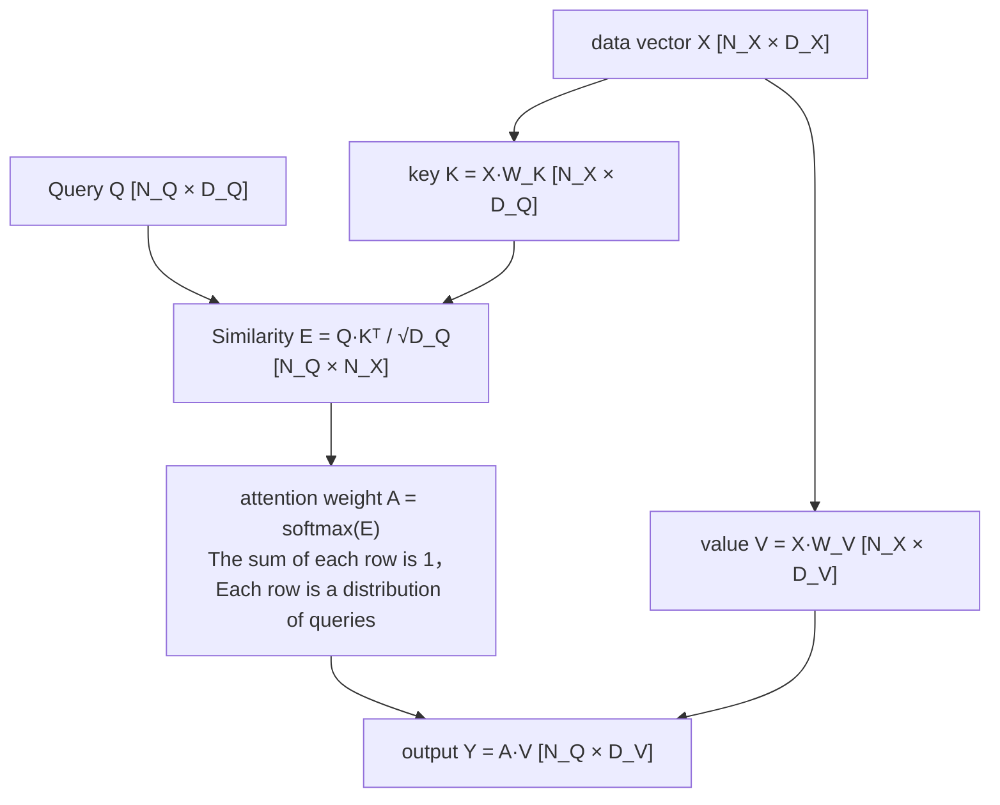
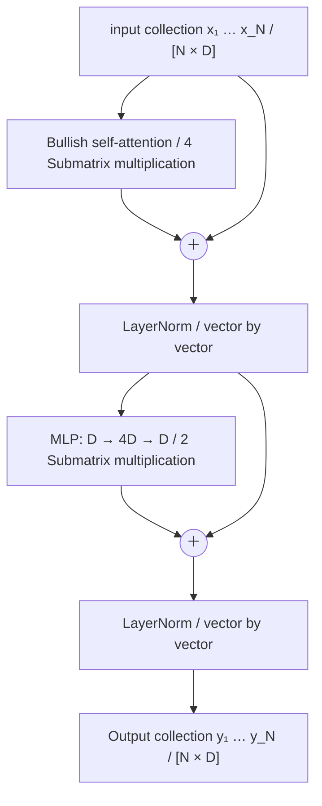

> **Course information**
>
> - **Course name**: Stanford CS231n: Deep Learning for Computer Vision(Spring 2025)
> - **Topic of this lecture**: Lecture 8. Attention and Transformers
> - **Lecturer**: Justin Johnson
> - **Teaching date**: 2025-04-24
> - **Course homepage**: [cs231n.stanford.edu/2025](https://cs231n.stanford.edu/2025/schedule.html)
> - **Official courseware**: [lecture_8.pdf](https://cs231n.stanford.edu/slides/2025/lecture_8.pdf) (122 pages, page-by-page illustrations in the book)
> - **Subtitle source**: [cs231n_sp25_kor_sub · eng](https://github.com/lpaiu-cs/cs231n_sp25_kor_sub/tree/main/eng) (Publicly transcribed in English, Chinese rewritten by this book)
> - **Copyright statement**: The copyright of the slides and course materials belongs to Stanford University and the instructors; this book is an unofficial study note and is only used for study and research.

Lecture 7 finished talking about the fact that "neural networks can process sequences", the price is that the hidden state depends on each step: a sequence of length N must go through N serial time steps. This is the price to be dismantled in this lecture. Justin Johnson is following a historical line - first go back to the 2014 encoder-decoder translation model and find the narrow gap of "the entire sentence must be pressed into a fixed-length vector"; then put attention into RNN to fill the narrow gap; then remove the RNN entirely, leaving only the attention operator; and finally use residuals, LayerNorm, and MLP to wrap it into a block and pile it into a Transformer.

There is only one proposition throughout: **The bottleneck of sequence modeling is never expression ability, but parallelism**. The expressive power of RNN is sufficient, but the sequence dimension cannot be parallelized; convolution can be parallelized, but the receptive field must be changed by stacking layers; self-attention allows each vector to see all vectors in one matrix multiplication, at the cost of  $O(N^2)$  computing power and video memory - and this account is not a bad thing in the GPU era.

## 1. The first answer to sequence conversion, stuck on a fixed-length vector

*(Reference time: 00:00:04 – 00:09:03｜Lecture 8)*

The second page is the business announcement: Assignment 2 was released the day before (4/23), and the project proposal was due the next day (4/25). It has nothing to do with the content of this lecture, but it marks the time coordinate-assignment two corresponds to the recurrent network, and the project proposal requires students to pick a visual task. All subsequent judgments about "use a ready-made architecture or design it yourself" fall within this context.

This page only has the title, and all the content is supplemented by oral review. The lecturer summarized the previous lecture into a problem family: one-to-one (one picture in, one category out), one-to-many (one picture in, one sentence out, that is, image description), many-to-one (a string of frames in, one category out, that is, video classification), and many-to-many. The significance of RNN is not that it is deeper than CNN, but that it relaxes "the input must be a tensor" into "the input can be a variable-length sequence", so for the first time these tasks above can share a set of parameters.

Today's two keywords are defined side by side on this page. **attention**  is a new neural network primitive that operates on a collection of vectors; **Transformer**  It is a network architecture that puts attention everywhere. This hierarchical distinction is important: primitives are the parts that can be plugged into any network, and architecture is the assembly scheme of the parts. The first three quarters of this lecture are spent on making parts, and the last quarter is spent on assembling it into a machine.

In the second frame, three lines of text are added below the definition. The most critical ones are the last two lines: Transformer is used everywhere today, but it is actually a branch of RNN, so we must start with RNN. The lecturer inserted a piece of field history here: The moment Transformer was born was not like a "tsunami", because before 2017, the ideas of alignment, soft alignment, and attention had been fermenting in the machine translation circle for several years. **New architectures are often the result of stripping old mechanisms out of old hosts**, rather than an invention appearing out of thin air.

### 1.1 Encoder-Decoder: compress the entire sentence into a vector

The motivational problem is machine translation: input  $x_1,\dots,x_T$ (English), output  $y_1,\dots,y_{T'}$ (Italian), neither the length nor the word order of the two sequences need correspond. The encoder is an RNN, $h_t=f_W(x_t,h_{t-1})$, feed "we see the sky" word by word, and spit out four hidden states. Four words correspond to four function calls, parameters  $W$  Full sharing - this is the only structural advantage of RNN over fully connected layers.

In the second frame, only one line and two squares are added: the last hidden state  $h_4$  Take it out and record it as a context vector  $c$ (usually just take  $c=h_T$), add another starting point for the decoder  $s_0$. take  $h_T$  The reason comes from the recursion itself: it has "seen" all the previous words, so it is naturally a summary of the entire input. $s_0$  How to set it is another topic. Section 2.6 will deal with this issue specifically.

The decoder is another RNN, $s_t=g_U(y_{t-1},s_{t-1},c)$, parameters  $U$  Not shared with encoders. It eats three things at each time step: the output word of the previous step, the hidden state of the previous step, and the fixed  $c$. The first decoding gives  $y_1=$"vediamo", the input is  $y_0=$\[START\].

The second frame  $s_1$  received  $s_2$, spit out "il". Compared to the previous frame, the only new additions are  $s_2$  with  $y_2$  two squares; the one from  $c$  Leading line **no changes**——same  $c$  Being used over and over again, that's exactly the problem.

![Frame 5: cielo and \[STOP\], translated in one sentence](</attachments/cs231n-b168ea6d99dc3c6ef78a6615.png>)

The last frame is completed with "cielo" and the terminator \[STOP\], and the decoder completes four steps. The context fed to the decoder in the four steps is always the same  $c$, the shape is  $[D]$, it has nothing to do with whether the input has 4 words or 400 words.

### 1.2 Narrow mouth: $c$  The length of is an architectural constant, not a function of the data

This frame has a line of red text on the entire picture: The input sequence must pass a fixed-length  $c$  to reach the output if  $T=1000$  What? The magnitude given by the lecturer is  $c$  May be a 128-dimensional or 1024-dimensional floating point vector -**This number is fixed during modeling and will not grow longer as the input becomes longer.**. It is reasonable to squeeze four words into 1024 dimensions; pushing an entire paragraph, an entire book, and an entire corpus into 1024 dimensions is equivalent to requiring the encoder to perform the same lossy compression on all inputs.

Make a deducible estimate to get a feel for the magnitude: If  $D=512$, the encoder hidden state for 1000 words is  $1000\times512$  number (about 2 MB under fp32), while  $c$  Only 512 numbers (about 2 KB). The compression ratio is 1000:1, and the network does not have any selection mechanism for "this part can be lost and this part must be kept". The key to a narrow mouth is not insufficient capacity; **Information cannot be selectively passed through**.

The solution is in one sentence: Don't use fixed-length vectors to make narrow openings, and let the decoder look back at the entire input sequence at each output step. It's still intuitive at this point, and putting in place an achievable mechanism is the next four steps in the chapter.

## 2. Put attention into RNN: alignment score, Softmax, context vector

*(Reference time: 00:09:23 – 00:28:45｜Lecture 8)*

### 2.1 Scoring, normalization, weighted sum, and feeding back to the decoder

Transformation starts from scratch: the encoder does not move in one line and still needs to give an initial decoding state  $s_0$. This is what is circled in red  $s_0$——It will be compared with the four encoder hidden states one by one. Pay attention to the direction of the arrows on the diagram: the information comes from  $s_0$  flows to the input sequence rather than from the input sequence  $c$  Then flows to the output, where the entire bottleneck structure is reversed.

Newly added are four small squares  $e_{t,i}=f_{att}(s_{t-1},h_i)$, each is a scalar. Implementation  $f_{att}$  Just a linear layer: put the decoder state  $s$  with a certain encoder status  $h$  Splice it into a vector, and then linearly transform it into a number. **It does not have any special structure, it is just a set of ordinary learnable parameters**, so it can be directly inserted into the calculation graph and learned using gradient descent together with other parameters.

$e$  The value is  $(-\infty,+\infty)$  Any real number on, directly weighted will make the value out of control. So add a layer of softmax on top: $a_{t,i}=\exp(e_{t,i})/\sum_j\exp(e_{t,j})$, get  $0<a_{t,i}<1$  and  $\sum_i a_{t,i}=1$. These four numbers can then be read as "the relative importance of each position in the input sequence given the current decoder state", which is a discrete distribution.

The fourth step is the weighted sum: $c_t=\sum_i a_{t,i}h_i$. it is still  $[D]$  vector, but **This vector is calculated for the current step**, not copied from the end of the encoder. on the picture  $c_1$  Coming out of the summation block on the right, and  $s_0$  Convergence.

finally  $c_t$  Access the decoder: $s_t=g_U(y_{t-1},s_{t-1},c_t)$, among which  $g_U$  Can be LSTM or GRU. The structure of the decoder has actually not changed up to this point - it has become just "$c$  Where does it come from? It turns out that it was the last hidden state of the encoder, now it is a weighted average calculated at each time step.

### 2.2 Who taught these weights? No one teaches

The picture gives a set of specific numbers: when you want to generate "vediamo" (equal to "we see" in English), $a_{1,1}=a_{1,2}=0.45$, $a_{1,3}=a_{1,4}=0.05$. The sum of the four numbers is exactly 1. What this distribution means is: the decoder pays 90% of its attention to "we" and "see" and almost never looks at "the" and "sky". **These are not rules written down by humans, but developed by the model itself.** preferences.

What this frame adds is the key fact on the training side: from  $s_{t-1}$  Arrive  $e$, to  $a$, to  $c_t$, and then  $s_t$, all differentiable operations. Therefore, there is no need for any annotation of "the third English word corresponds to the second Italian word". The loss function is still the softmax plus cross entropy at the output end, and the gradient follows  $c_t$  all the way back to  $f_{att}$. The lecturer emphasized that if we really want to do alignment annotation, this kind of data cannot be obtained on a large scale——**Differentiability is the premise for this mechanism to be established, not the implementation details.**.

In the second frame, the entire process is repeated: take  $s_1$  with four  $h_i$  Recalculate the alignment score, re-softmax, and re-weight to get  $c_2$. Note that it reuses the same  $f_{att}$- A set of parameters shared by all decoding time steps.

$c_2$  with  $y_1$  Enter the decoder unit together and get  $s_2$  with "il". The picture also marks the root that was missed in the previous chapter.  $s_0$  Arrive  $s_1$  arrow - the lecturer laughed at himself, "I probably dropped this line." This slip of the tongue itself shows that the picture expresses "the decoder is recursive inside."

Same reading: when generating "il" ("the"), $a_{2,1}=a_{2,2}=0.05$, $a_{2,3}=0.8$, $a_{2,4}=0.1$——The mass changes from "two 0.45 splits" to "one 0.8 spike" because "il" corresponds to the single word "the" in English ($h_3$), while "sky" ($h_4$) leaving only a margin of 0.1. The sum of the four numbers is still 1. Comparing the two frames, you can understand the full expressive power of attention: **It is a differentiable soft pointer that changes with the decoding status.**.

### 2.3 From "one vector" to "one vector per step"

This page plots four time steps side by side: $c_1,c_2,c_3,c_4$  Each corresponds to a decoding step, and each is a different weighting of the four hidden states. Compared with the one in Chapter 1, there is only one  $c$  In the figure, the bottleneck disappears: the input sequence no longer needs to be compressed first, but is retained in four hidden states, which are accessed on demand at each decoding step.

The price was also written on the same page, but no one said it clearly at the time: **Each decoding step requires scoring the entire input sequence.**. Enter length  $T$  The larger the value, the calculation amount of this part increases linearly; if it is extended to self-attention, it will become the sum in Chapter 5  $O(N^2)$  account.

### 2.4 Drawing attention weights as a matrix: what does the diagonal say?

Attention has a by-product: the weights themselves are data. Since each step of decoding will produce a "distribution of the input sequence", stacking the distributions of all steps by rows will result in a  $T'\times T$  The matrix can be viewed directly as a heat map. According to the lecturer, these are the few people who can **Directly observe what is happening inside the network** One of the mechanisms because no one ever told it how to align it.

The example is changed to English-French translation (the lecturer specifically stated that he cannot read French). The input is "The agreement on the European Economic Area was signed in August 1992." and the output is "L'accord sur la zone économique européenne a été signé en août 1992.". This sentence was chosen deliberately: it contains a three-word noun phrase (European Economic Area), rearranged in French as zone économique européenne, and also contains word order differences such as prepositions and dates.

A diagonal line appears on the graph from the upper left to the lower right: when predicting "le", the mass is all on "the", and when predicting "accord", the mass is all on "agreement". diagonal means **There is a one-to-one correspondence between words at the same position in the two sequences**, which is the most trouble-free literal translation situation. The lecturer's statement was very restrained: the network itself decided this matter, and humans only provided a mechanism to "look back".

The really interesting thing is in the middle: European Economic Area has a different word order in French, and a reverse diagonal line appears on the heat map; and where two words in French correspond to one word in English (or vice versa), a small 2×2 square appears, indicating that attention cannot separate them cleanly. **The shape of the matrix directly exposes the grammatical differences**, which is more intuitive than any accuracy number.

### 2.5 General operator outcrop

At this point, the lecturer took a breath: This set of things was invented to repair RNN, but it is actually a universal, independent, and very powerful operator. The next step is to turn our attention away from the RNN **cut out**, making it a separate layer.

Renaming is the first step to detachment. Hidden state change of decoder **Query vector (query)**: "I want to produce this piece of output, so I'm going to find something"; the encoder's hidden state is renamed **data vector (data)**: "These are materials that may be useful"; and the output  $c_t$  Change name **Output vector**. The rules also become cleaner: each query scores all data vectors and gets **one** Output vector. As for where the next query comes from, the attention layer doesn't care - this sentence is its license to break away from RNN.

### 2.6 Boundary: How to set the initial state, and "has it learned grammar?"

Someone in class asked how to "initialize" the decoder. The lecturer pointed out that this word is overloaded twice and deserves to be noted separately:

- **Weight initialization**: The decoder itself is a neural network with parameters. These weights are randomly initialized at the beginning of training and then optimized by gradient descent, which is no different from any network.
- **Hidden state initialization**: When the weight has been given, each time a new output sequence is processed, it must be given  $s_0$  a value. There are three common approaches - directly taking the last hidden state of the encoder, and using a learned linear projection to  $h_T$  mapped to  $s_0$, or simply set to zero. The lecturer said that all three can be used. **Just let the network see the same convention all the time during training**.

The second question is "How did the network understand the grammar on its own?" The lecturer first answered "This is the mystery of deep learning", and then gave a mechanism-level explanation: no one gave it a grammatical annotation, only a large number of input-output pairs and a mechanism that can be aligned; if this mechanism happens to make "reducing translation loss" easier, the gradient will push it towards the solution of "learning alignment". So the attention weight is designed by humans. **a priori shape** The result of working with the data - the prior only provides possibilities, the specific alignment is learned.

Finally, there is a question about negation (whether there will be problems with negative words and structures that are difficult to align with XOR). The lecturer's answer was very real: There may be problems, which is the difficulty, but the network can only solve it by itself with more data and more computing power, without additional structural guarantees.

## 3. Remove RNN: attention becomes an independent layer

*(Reference time: 00:28:53 – 00:45:44｜Lecture 8)*

### 3.1 A query, a bunch of data: four lines of definition

A new page defines this layer from scratch. The first frame only writes  `Inputs: Query vector q [D_Q]`, the right side is still the RNN picture, $s_0$  Marked by a red box - it reminds the reader where this abstraction comes from. In the next few frames, the list on the left will be filled line by line, while the picture on the right will never move. This comparison itself illustrates the meaning of detachment: **The topology of the graph belongs to RNN and the formula belongs to attention**.

The second line is  `Data vectors: X [N_X x D_X]`——$N_X$  data vectors, each  $D_X$  dimension. At this point the query and data dimensions can be different ($D_Q$  Yes  $D_X$), because the first version of the similarity function  $f_{att}$  It is arbitrary and does not require both sides to be of the same dimension.

The third line is  `Similarities: e [N_X]`, $e_i=f_{att}(q,X_i)$. Note the shape of the output: a query pair  $N_X$  Score the data and get the length of  $N_X$  vector——**The score is "one to many", which determines all subsequent shapes.**.

fourth line  `Attention weights: a = softmax(e) [N_X]`. At this point, a query has become a set of weights. The sum of this set of weights is 1, which can be read as "the distribution ratio of this query on each data vector."

last line  `Output vector: y = Σ_i a_i X_i [D_X]`. The output dimension is equal to the data dimension  $D_X$  rather than query dimensions  $D_Q$——Because the output is a linear combination of data vectors, it can only fall in the space spanned by the data. This rule remains unchanged in every subsequent edition of Attention.

After completing the five definitions, there is an additional line "Let's generalize this!" on the page. Do three promotions in the following three sections:  $f_{att}$  Change to dot product, add scaling, and then expand the single query into multiple queries.

### 3.2 The similarity degenerates into a dot product and is then divided by  $\sqrt{D}$

The first change is to let  $f_{att}$  Make it simple: Since any function with "two vectors in and scalar out" will work, then use the simplest one - dot product  $e_i=q\cdot X_i$. The price is the dimensionality constraint: the dot product requires both sides to be of the same dimension, so  $q$  shape from  $D_Q$  Change to  $D_X$. The lecturer's statement is "simplify and promote at the same time", because the dot product also brings a form that can be batched.

The second change is scaling: $e_i=q\cdot X_i/\sqrt{D_X}$. This step may seem like a trick, but the reason lies in the next frame.

What is given on the page is the constant vector argument: given by  $a\cdot b=|a||b|\cos\theta$, if  $a,b$  are all constant vectors, then  $|a|=(\sum_i a_i^2)^{1/2}=a\sqrt{D}$, so the dot product of two constant vectors follows  $D$  Linear growth. The larger the score, the closer the softmax is to one-hot, and the smaller the derivative of the output with respect to the score. **gradient disappears**. divide by  $\sqrt{D_X}$  Later, growth was suppressed  $\sqrt{D}$  magnitude, softmax falls back into the interval with gradient.

> Editor's note: A more common equivalent is to start from randomness - if the components of the two vectors are independently and identically distributed and have a variance of 1, then the variance of the dot product is  $D$, divided by  $\sqrt{D}$  The variance then returns to 1, regardless of dimensionality. The slide uses the constant vector version, and the conclusion is the same.

Why is this change important? The reason given by the lecturer is "scale": the network will get bigger and bigger, and the vector dimension will go up. If the scale of similarity drifts with the dimension, the same set of hyperparameters can be trained in 128 dimensions but cannot be trained in 1024 dimensions. So **Everywhere in the architecture the question "What happens when the dimensions are ten times larger?"**, which is a recurring inspection posture in this lecture.

### 3.3 Multi-query: Compute all pairs in one matrix multiplication

In RNN we never have more than one query - the decoder has one at each step. So put  $Q$  written as  $[N_Q\times D_Q]$  matrix, processing an entire batch at a time:

$$
E=QK^\top/\sqrt{D_X}\in\mathbb{R}^{N_Q\times N_X},\qquad A=\mathrm{softmax}(E),\qquad Y=AX\in\mathbb{R}^{N_Q\times D_X}
$$

Each of the three operations has a clear matrix interpretation. The score is "the inner product of all pairs between the two vector sets", which is exactly a matrix multiplication; the normalization is done along the "data" dimension, so that each query becomes a distribution; the weighted summation is "using  $A$  Each row of  $X$  row", which is also a matrix multiplication.

Regarding which dimension along which softmax should be performed, there is a place on the page that is easy to misread: the formula reads:  `softmax(E, dim=1)`  And mark the shape  $[N_Q\times N_X]$, but the picture is **Keys are arranged in rows, queries are arranged in columns**, so the lecturer verbally said "normalize each column". Both statements refer to the same thing - normalize along the data/key dimension so that each query gets a distribution. It is enough to remember this convention: **The rows are the query, the columns are the keys, and the sum of each row is 1**.

### 3.4 Keys and values: Separate "what to compare" and "what to retrieve"

So far  $X$  It is used twice in a forward pass: once to calculate the similarity with the query, and once to do the addend of the weighted sum. The lecturer thought this was a bit awkward -**"What to use to match" and "what to retrieve after matching" should be two different things.**. So two learnable projections are introduced:

$$
K=XW_K\in\mathbb{R}^{N_X\times D_Q},\qquad V=XW_V\in\mathbb{R}^{N_X\times D_V}
$$

$W_K$  Project the data to the dimension of the query (because you need to calculate the dot product), $W_V$  Project to output dimensions  $D_V$ (Can be used with  $D_Q$  different). The subsequent process remains unchanged: $E=QK^\top/\sqrt{D_Q}$, $A=\mathrm{softmax}(E)$, $Y=AV\in\mathbb{R}^{N_Q\times D_V}$.

The analogy used by the lecturer is a search engine. You type "what is the best school in the world" in the box, this is **Query**;This query needs to be compared with the backend record **key** to match; and what you want to get back **value** It's "Stanford" - it's nothing like the sentence you typed in. The content of the three should not be the same, so it is natural to separate them.

As for "how to split the data vector into keys and values", the answer is the same as before: don't tell it how to split it, just give it two projection matrices and let the gradient descent decide by itself. The lecturer interprets this as **Do two different filters on the same vector**: The query only matches part of the features and retrieves another part of the features.

### 3.5 Assembly: five-frame animation

From this page on, the RNN graph completely disappears, leaving only the operator itself. The first frame lays out four queries  $Q_1..Q_4$  and three data vectors  $X_1..X_3$, three serial numbers 1, 2, and 3 are marked on the right side, corresponding to the next three steps.

In the second frame, three purple squares are added to the data side.  $V_1,V_2,V_3$——The value is the data  $W_V$  The result of projection. At this point the query isn't related to anything yet, it's just standing there.

Third frame fill key  $K_1..K_3$, and expand one on the right  $3\times4$  of  $E$  Grid: rows are keys ($K_1..K_3$), the column is the query ($Q_1..Q_4$), in the grid  $E_{i,j}$  It's the first  $j$  query with the  $i$  Scaled dot product of keys. This grid is  $QK^\top$  all content.

In the fourth frame, softmax is passed through each grid, and it is clearly written that "softmax normalizes each column: each query predicts a distribution on the key." The grid of three rows and four columns becomes  $A$, the sum of each column is 1. At this point, the name "attention" is worthy of its name: **Each column is an allocation decision**.

The fifth frame is added on the right  `Product(→), Sum(↑)`: put  $A$  Each column of is multiplied by the corresponding value and added together to get  $Y_1..Y_4$. Each output is a linear combination of all value vectors, with the weight determined by that column. The lecturer gave a summary here: **An output is a mixture of information from all values, with the proportion determined by the query.**.

The title of the same picture is changed to Cross-Attention Layer. This layer has two inputs (query and data), two learnable parameters ($W_K,W_V$), input two strings of vectors, output one string of vectors, and can be inserted into any network like a convolutional layer. It's called "crossover" because the query and data come from two different sources; the next chapter will look at a more common version that has only one input and compares each vector to every other vector in the same group.

See the entire data flow in one picture: queries only participate in scoring, and the data is divided into two ways - one way to change the key to score, and the other way to change the value to be weighted. **The output is always in the value space, not in the query space.**, this is the most commonly ignored item when calculating dimensions later.

## 4. Self-attention: One input, three projections, and two remedies for "sequence"

*(Reference time: 00:45:44 – 00:56:42｜Lecture 8)*

### 4.1 One input, three projections

Self-attention combines the two sets of cross-attention inputs into one set: only one  $X\in\mathbb{R}^{N\times D_{in}}$, but it is projected into three parts: query, key, and value at the same time——$Q=XW_Q$, $K=XW_K$, $V=XW_V$, the three weights are all  $[D_{in}\times D_{out}]$. One sentence on the page illustrates the simplification of shape: **almost always  $D_Q=D_V=D_{out}$**. The lecturer also admitted that he "wrote the marks more generally than they actually were" and that he had hardly seen any in such a long time.  $D_{in}\neq D_{out}$  self-attention layer.

The second frame adds a practical tip: put the three weight matrices together along the output dimension and calculate it in one go

$$
[Q\ K\ V]=X\,[W_Q\ W_K\ W_V],\qquad [N\times 3D_{out}]=[N\times D_{in}]\,[D_{in}\times 3D_{out}]
$$

The reason is purely hardware efficiency -**A few large matrix multiplications are more cost-effective than many small matrix multiplications**, the GPU can only be fully occupied on a large matrix. This habit of "putting together the matrices that can be assembled" will be used later when counting the number of matrix multiplications.

### 4.2 Four-step animation: scoring, normalization, weighting

The third frame is drawn on the picture  $E$  grid, $E_{i,j}=Q_i\cdot K_j/\sqrt{D_Q}$. The shape is  $[N\times N]$——The number of queries and the number of keys in self-attention are both  $N$, this is the most substantial difference between it and cross-attention, and it is also  $O(N^2)$  source.

The fourth frame  $E$  normalized into  $A$, also one distribution per column. Note that both "column" and "row" are long at this time  $N$, the matrix is square, so it's easier to look at the wrong axis - the criterion is always "which direction sums to 1": **Each query is on a line that sums to 1**.

For the fifth frame  `Product(→), Sum(↑)`  get  $Y_1..Y_3$. At this point, all four steps have been completed, and the remaining two sections discuss the "side effects" of this mechanism.

### 4.3 Substitution equivariance: it actually acts on sets

The lecturer asked a seemingly harmless question here: What would happen if the order of the input vectors was disrupted? Slide handle  $X_1,X_2,X_3$  Replace with  $X_3,X_1,X_2$.

The second frame gives the first conclusion: because  $Q,K,V$  are vector-by-vector linear projections, so scrambling the inputs will just cause them to be scrambled in the same way, **The content is perfect**.

Third frame: Similarity is dot product, and dot product does not look at the position, so  $E$  Every number in it is still there, but the rows and columns have been changed. on page  $E$  The grid's row labels start from  $K_1,K_2,K_3$  become  $K_3,K_1,K_2$, column labels from  $Q_1,Q_2,Q_3$  become  $Q_3,Q_1,Q_2$, the numbers in the grid move accordingly.

The fourth frame: softmax is done column by column. After shuffling the rows and columns, each column is still the same column, but the column number is changed. **Normalization does not introduce any coupling across vectors**, so it doesn't destroy this property.

Closing of the fifth frame: The result of the linear combination is naturally the same output, but the order has changed.

The four frames combined are an exact algebraic property: $F(\sigma(X))=\sigma(F(X))$, called **permutation equivariance**. The lecturer deliberately juxtaposed it with the translation equivariance in Lecture 5 - convolution is equivariant to translation, and self-attention is equivariant to displacement. The meaning is: self-attention does not really work on "sequences", **it works on collection**, but this set happens to be packed into an ordered matrix. This also explains why it can simultaneously process data with completely different structures such as language, image patches, and point clouds.

### 4.4 Two remedies: positional encoding and masking

Equivariance is a double-edged sword. "cat eats fish" and "fish eats cat" are the same set in the eyes of self-attention, and the output only differs by one permutation. This is fatal to the language, so something has to inject the order into it.

The solution is **positional encoding**: Right  $i$  input plus a vector  $E(i)$, which is a fixed function of the subscript and does not contain learnable parameters (it can also be learned, but the essence is the same). Marked on the picture  $E(1),E(2),E(3)$  Three additional items. After addition, the same word becomes different input vectors at different positions, and the substitution equivariance is broken——**The cost of the injection sequence is just to store more for each vector  $D$  values**.

The second remedy is **Masked self-attention**. The approach is straightforward: calculate  $E$  After that, directly overwrite the positions that are not allowed to be viewed as  $-\infty$;after softmax  $e^{-\infty}=0$, the weights of those positions are exactly zero, and the output  $Y$  It no longer relies on the value vector of the corresponding position. on the right side of the page  $A$  In the matrix, the blocked grids are all 0 - in the picture, they are arranged according to "keys are in rows and queries are in columns", and the zeros are in the lower left corner; if it is written like "rows are queries", the upper right triangle is erased. **No matter how you draw it, the meaning is the same: information can only flow from the past to the future.**

Why is this needed? Because once the RNN is removed, self-attention can directly do language modeling: input "attention is very" and predict the next word "cool". But during training, the entire sentence is fed in at the same time. If the second position can see the third position, "predicting the next word" becomes copying the answer. The mask guarantees the first  $t$  The output depends only on the previous  $t$  input. The lecturer's comment on this page is written in the title - "This is pretty cool" because it uses a  $- \infty$  Overwriting satisfies both parallelism during training and causality during inference.

### 4.5 Long position: parallelize H shares and then put them back together

The next question is "why not more copies". Since the experience of deep learning is "bigger and stronger", then copy the same set of self-attention  $H$  The copies run in parallel, and each copy is called one **head**.

The key details are: three heads **The architecture and calculation are exactly the same, the only difference is the weight**, and are randomized into different values during initialization, so they will be differentiated into three different similarity measures after training. The lecturer's input  $X_1,X_2,X_3$ "Is it the same copy?" the answer is simple: it is the same copy, fed to three copies with different parameters.

In the third frame, the output is pressed  $Y_{i,h}$ (No.  $i$  Input, No.  $h$  heads) are stacked into a matrix. So far, there has been no cross-head exchange of information—the three heads each speak their own words.

The fourth frame was added  $W_O$: Stacked  $H$  The outputs pass through a linear layer and are merged into one. **This is the only place in the bull market where different heads can see each other.**, which is also the reason why it is stronger than "run three times and then average" - the fusion weight can be learned.

This frame clearly describes the entire set of shapes, and it is also the page most worth copying:

| Tensor | shape | Description |
| :--- | :--- | :--- |
| $X$ | $[N\times D]$ | input collection |
| $W_Q,W_K,W_V$ | $[D\times HD_H]$ | Three projections, the output dimension is "number of heads × head dimension" |
| $W_O$ | $[HD_H\times D]$ | Output projection, put  $H$  Push your head back  $D$ |
| $Q,K,V$ | $[H\times N\times D_H]$ | split into  $H$  portions, each portion is independent |
| $E,A$ | $[H\times N\times N]$ | softmax edge  `dim=2`, that is, the dimension of the key |
| $Y$ | $[H\times N\times D_H]\to[N\times HD_H]$ | Each head output splicing |
| $O$ | $[N\times D]$ | Output, same shape as input |

There is also a key agreement on the page: **Usually  $D_H=D/H$**, so that the input and output dimensions are the same, and the blocks can be stacked layer by layer. By the way, let’s calculate the parameters: the three projections total  $3D\cdot HD_H=3D^2$, output projection  $D^2$, total  $4D^2$, regardless of the number of heads. So the long doesn't increase the parameter budget, what it does is **Cut the same budget into  $H$  parts, allowing the model to learn at the same time  $H$  different similarity measures**.

The last frame is the project conclusion: no need to write  `for h in range(H)`, merge all heads into the batch dimension of a batch matrix multiplication, and calculate it in one go. The lecturer said that this is a way of writing that is "used everywhere in practice"——**Bullishness is not a cycle, it is a batch dimension**.

## 5. Two accounts of computing power: the cost of four matrix multiplications and the trade-offs of three sequence primitives

*(Reference time: 00:56:42 – 01:02:36｜Lecture 8)*

### 5.1 Divide the entire layer into four matrix multiplications

The title of this page was changed to "Self-Attention is Four Matrix Multiplies!", and the input list on the left and the formula on the right remained unchanged——**It's just the perspective that changes**: Instead of asking "what is it", ask "how many matrix multiplications does it take". The answer is given in four frames.

First time: $[N\times D]\,[D\times 3HD_H]\Rightarrow[N\times 3HD_H]$, then split + reshape into three  $[H\times N\times D_H]$. The cost this time is  $2N\cdot D\cdot 3HD_H=6ND^2$ (take  $HD_H=D$).

Second time: $[H\times N\times D_H]\,[H\times D_H\times N]\Rightarrow[H\times N\times N]$. The cost this time is  $2N^2D$——It is the first square term in the four steps, and it is also the only one that must really be  $H\times N\times N$  The steps to calculate the similarity matrix, the graphics and memory account to be calculated in the next section are all on it.

The third time: $[H\times N\times N]\,[H\times N\times D_H]\Rightarrow[H\times N\times D_H]$, then reshape back  $[N\times HD_H]$. The cost is also  $2N^2D$.

The fourth time: $[N\times HD_H]\,[HD_H\times D]\Rightarrow[N\times D]$, spend  $2ND^2$. Four steps add up: $8ND^2+4N^2D$.**The previous term is linear in  $N$, the latter term squared to  $N$**, the dividing point where the two are equal is  $N\approx 2D$; $D=1024$  time is approximately  $N\approx 2048$. This dividing line explains why the bottleneck of Transformer is in the parameters for short sequences and the attention matrix for long sequences.

### 5.2 Accounting of computing power and video memory

The lecturer wrote the question into a line and hung it in the lower right corner of the page: "With the number of vectors  $N$  Increase, how much computing power does this cost? "Notice that he didn't ask "Is it expensive?", but first asked "How to increase the price"——**Complexity is a property of the architecture, absolute time consuming is a property of the hardware**.

answer  $O(N^2)$, from the 2nd and 3rd matrix multiplication  $N\times N$  Pair. $N=1000$  At one million points, it was relatively cheap; $N=10^6$  It is one trillion points at a time, and no hardware can take it.

The second question is changed to memory. This step is more fatal than the computing power, because the computing power can wait slowly, but if the video memory is not enough, it will not be able to run.

The answer is still  $O(N^2)$: $E$  and  $A$  two  $[H\times N\times N]$  The matrix must be implemented.

Substitute specific numbers: $H\times N\times N=64\times10^5\times10^5=6.4\times10^{11}$  elements. According to fp16, 2 bytes per element, yes  $1.28\times10^{12}$  Bytes, about 1.2 TB - consistent with the 1.192 TB printed on the page (the difference comes from the conversion caliber between TB and TiB). For comparison, the video memory of a mainstream data center GPU is on the order of 80 GB. **The difference is more than an order of magnitude**. This is what the saying "attention is expensive" really means.

The solution is given in the last frame: FlashAttention combines steps 2 and 3 (scoring and weighting), **Use it immediately after calculation, do not use the whole sheet  $A$  Write back to video memory**, so the video memory changes from  $O(N^2)$  down to  $O(N)$, big  $N$  It became feasible. The lecturer did not expand on the block details of this algorithm, leaving only the conclusion; for readers of this book, it is enough to remember that "the expensive thing is the intermediate matrix, not the calculation itself."

### 5.3 Three ways to process sequences

This page only has a title, which is used to collect all the previous content into a horizontal comparison. From convolutions in Lecture 5, RNNs in Lecture 7, to self-attention in this lecture, we have seen three primitives for processing sequences, and the next three frames put them side by side.

The account in the RNN column is very clear: it works on a 1-dimensional ordered sequence, and its theoretical advantages are **For long sequences it is still  $O(N)$  computing and memory**——There are as many steps as the sequence is long, and the cost of each step is fixed. The shortcoming is the fatal one: the hidden state depends on the next step. **Cannot parallelize**, there is no work that can be started simultaneously in the sequence dimension.

Add a convolution column. Convolution works on  $N$  On a dimensional grid (images are 2 dimensions, speech is 1 dimension, and videos are 3 dimensions), its advantage is **Can be parallelized**: The calculation of each position when the convolution kernel slides is independent of each other. The disadvantage is the receptive field - if you want an output to see the entire image, you must either use a very large kernel or stack many layers, and the "stack" itself introduces serial depth.

The third column adds self-attention: working on a collection of vectors, the advantage is **Each output on a long sequence depends directly on all inputs** (One layer is enough, no need to stack), and it is highly parallel (four matrix multiplications). The shortcomings are exactly what we calculated in the previous section: $O(N^2)$  computing power, $O(N)$  Video memory (here refers to the memory after FlashAttention is configured).

The last frame just replaces the footer with "Vaswani et al, NeurIPS 2017" - the title of that paper is "Attention is All You Need", which is also the answer on this page. The lecturer’s original words were: Among the three, **You can go far with just your concentration**.

There are two follow-up questions in class that are worth remembering. The first one is "What is the use of parallelism?" The reason given by the lecturer is hardware history: the single-core main frequency has basically stagnated since the mid-2000s, and the increase in computing power comes from the number of cores. Therefore, the algorithm that can really expand is the algorithm that "gives 10,000 processors and can be 10,000 times faster", rather than the algorithm that "must be run sequentially on a very smart processor". The second question is "$N^2$  Is it a fatal flaw?" The lecturer had the opposite attitude: $N^2$  means more computation, and more computation means the network has more room to "think" on the input, so it's expensive, but not necessarily a bad thing -**The real thing to worry about is video memory, which can be replaced with FlashAttention and more GPUs**.

## 6. Transformer: The only part that allows vectors to talk to each other only occupies one grid.

*(Reference time: 01:02:40 – 01:04:36｜Lecture 8)*

### 6.1 Five parts of a block

With the primitives in place, next comes assembly. The input is still a set of vectors  $x_1..x_4$, the output needs to be of the same shape - so that it can be layered layer by layer. This frame only draws the input, the entire block is still empty.

The second frame fills in the first component: multi-head self-attention, which the page says is "through which all vectors interact." This is the whole block **only** Where information exchange occurs across vectors, each subsequent component only looks at a single vector.

Add residuals to the third frame: $x+\mathrm{SA}(x)$. The reason is exactly the same as ResNet - giving the gradient an identity path will not degrade when stacking deeply. The lecturer specifically emphasized that this is not "the invention of Transformer", but a mature approach borrowed from CNN.

The fourth frame is connected to LayerNorm, and the formula is written out completely (do it independently for each vector):

$$
\mu_i=\frac{1}{D}\sum_j h_{i,j},\qquad \sigma_i=\Big(\frac{1}{D}\sum_j (h_{i,j}-\mu_i)^2\Big)^{1/2},\qquad y_i=\gamma\cdot\frac{h_i-\mu_i}{\sigma_i}+\beta
$$

Note the range of statistics: $\mu_i,\sigma_i$  is **One scalar per vector** (in  $D$  (find within the dimension), $\gamma,\beta$  is  $[D]$  Learnable zooming and translation, shared by all vectors. This is exactly the opposite of BatchNorm in Lecture 6 - it does not span samples or batches, so the behavior of training and inference is consistent.

Add MLP to the fifth frame: for each vector **independent** Running a two-layer network, the classic configuration is  $D\to4D\to D$, also called FFN (feed-forward network). It has a clear division of labor with self-attention - self-attention is responsible for "between vectors", and MLP is responsible for "within vectors".

The sixth frame also adds residuals to MLP. At this point, there are two residuals and two normalized positions in the block, and the structure becomes symmetrical.

In the seventh frame, add a second LayerNorm to the exit of the block and output  $y_1..y_4$  Same shape as the input. **Isomorphism is the prerequisite for blocks to be stacked**, which has not been broken in all subsequent variants.

This frame is the ledger of the entire lecture: self-attention is the only cross-vector interaction, LayerNorm and MLP are both vector-by-vector; the main calculation of the entire block is  **6 matrix multiplications - 4 from self-attention (QKV projection, QK, AV, output projection), 2 from MLP ($D\to4D$  with  $4D\to D$)**. This sentence explains why Transformer is hardware-friendly: its calculation graph is almost six GEMMs, with no branches, no loops, and no data dependencies.

Combine seven frames into one picture, and the structure of the block is a straight line:

The two vertical edges are two residuals: they bypass the only cross-vector interaction (self-attention) and the only feature expansion (MLP) in the block. **As long as the input and output remain the same shape, the box can be copied in place  $L$  times**——The next section is exactly what we want to see  $L$  and  $D$  The process of growing bigger together.

### 6.2 Stacking: from 12 to 96 blocks

Draw three stacks on the right side of the page. According to the lecturer: Structure from 2017 to present **Basically nothing has changed, what has changed is the scale.**.

Original Transformer (Vaswani et al, 2017): 12 blocks, $D=1024$, $H=16$, training sequence length  $N=512$, 213 million parameters.

GPT-2 (Radford et al, 2019): 48 blocks, $D=1600$, $H=25$, $N=1024$, 1.5 billion parameters. The number of parameters has increased by 7 times, and the number of blocks has increased by 4 times.

GPT-3 (Brown et al, 2020): 96 blocks, $D=12288$, $H=96$, $N=2048$, 175 billion parameters. The same architecture has spanned three orders of magnitude in eight years.

Here you can check the parameters yourself by doing each block  $4D^2$ (attention) + $8D^2$(MLP, $D\to4D\to D$  Two projections) = $12D^2$:

| model | Number of blocks  $L$ | $D$ | $12LD^2$ | After adding vocabulary embedding | Page number |
| :--- | ---: | ---: | ---: | ---: | ---: |
| Original | 12 | 1024 | $1.5\times10^8$ | $\approx2.1\times10^8$ | 213M |
| GPT-2 | 48 | 1600 | $1.5\times10^9$ | $\approx1.6\times10^9$ | 1.5B |
| GPT-3 | 96 | 12288 | $1.7\times10^{11}$ | $\approx1.8\times10^{11}$ | 175B |

All three lines match, indicating that **The main term of parameter quantity is  $12LD^2$, with  $N$  irrelevant**. This leads to a counter-intuitive conclusion: put  $N$  Adjusting from 512 to 2048, this formula will not increase by a penny - what the variable length context buys is "how many tokens can be seen in each forward direction", not "how big is the model". GPT-3 is 800 times larger than the original version, thanks to  $L$  From 12 to 96, $D$  From 1024 to 12288, not the sequence length. By the way, the head dimension can also be calculated: $1024/16=64$, $1600/25=64$, $12288/96=128$——The number of heads is changing, and the head dimensions are basically between 64 and 128.

## 7. One block, two wirings: Language modeling and ViT

*(Reference time: 01:04:36 – 01:05:20｜Lecture 8)*

### 7.1 Language modeling: add a matrix at both ends

Transformer itself only accepts vector sets, so there must be an entrance to turn discrete symbols into vectors: learn one  $[V\times D]$  embedding matrix, $V$  is the vocabulary size. Its function is to look up the table - Chapter  $i$  The vector of a word is the third of the matrix  $i$  OK. **This step has no non-linearity and no position information**, pure table lookup.

The second frame is supplemented with causality: mask self-attention is used within the block to ensure that the  $t$  tokens can only be seen before  $t$ . This one is the same thing as the mask in Section 4.4, just changed from a "trick" to an "architectural necessity" - without it, the language model is just copying the answer when training.

![Third frame: Add a \[D×V\] projection to the exit to get the score of each word](</attachments/cs231n-0c560627622507fdc3dc3039.png>)

Add one at the exit in the third frame  $[D\times V]$  projection matrix, put each  $D$  Dimensional vector type  $V$  Dimension score, each component corresponds to a word in the vocabulary. It is the exact transpose of the entry's embedding matrix shape, but is usually two independent parameters.

The last frame is the loss: do softmax for each position, and calculate cross-entropy with the real next token. The sentence "Attention is all you need" on the page runs across the entire image, which just demonstrates the meaning of masking - only "Attention" can be seen when predicting "is", and only the first three words can be seen when predicting "all". **The entire language model is "look-up table → $L$  Block → Projection → Cross Entropy" these four steps**, there is no other agency.

### 7.2 ViT: Cut images into 196 words

Switching to images, the question becomes "How to turn a picture into a set of vectors". ViT’s answer is extremely simple: cut the picture into small pieces and use each piece as a token.

In the second frame, the cat face is cut into  $16\times16\times3$  of small pieces. press  $224/16=14$  Calculate, a picture is exactly cut into  $14\times14=196$  patch——**This 196 is the sequence length of ViT  $N$**.

The third frame puts each block  $16\times16\times3$  Flattened to 768 dimensions ($16\times16\times3=768$, exactly), then multiply by  $[768\times D]$  linear layer. This step turns the pixels into something isomorphic to the word embedding——**From this moment on, images and text make no difference to the Transformer**.

The lecturer paused here and posed the question to the class: dicing + flattening + linearity, how else to describe it?

The answer is: **this is one  $16\times16$, step size 16, 3 input channels, $D$  Convolution of output channels**. When the convolution kernel size is equal to the step size, the windows do not overlap each other, each output position corresponds to exactly one patch, and the number of output channels is  $D$. So ViT's "patch embedding" is not a new operator, it just uses the convolution in Lecture 5 as a non-overlapping slicer.

The fourth frame clarifies this correspondence: $N=196$  a  $D$  The dimensional vector is the input set of the self-attention layer.

The fifth frame complement position encoding. Note that the encoding here is **2D position** (rows, columns), rather than one-dimensional subscripts - after pulling the 196 patches into a line, the one-dimensional subscripts no longer directly tell you "who is on top of whom, and who is on the left of whom", and the spatial structure of the image is precisely determined by these two things.

The sixth frame illustrates the presence or absence of masks: image classification has no causal requirements, so with complete self-attention, each patch can see the remaining 195. **"Whether to use a mask" depends on whether the task has a time direction, and has nothing to do with the architecture.**.

Frame 7: After the blocks are stacked, each patch position has one  $D$  Dimensional output.

The last frame is the classification header: put 196  $D$  Dimension vectors are average pooled into 1, and then one  $D\to C$  The linear layer of  $C$  category scores. Here you can easily compare the scale: ViT’s attention matrix is  $196\times196\approx3.8\times10^{4}$  scores, and the language model  $N=2048$  time is  $2048^2\approx4.2\times10^{6}$——**The sequence of image patches is two orders of magnitude shorter, so  $O(N^2)$  In vision, it is not a bottleneck for a long time.**, which is why ViT can start with a smaller sequence length.

## 8. After-school reading: Eleven pages skipped in class with modern changes

*(Reference time: 01:05:20 – 01:05:28｜Lecture 8)*

At this point, the lecturer's original words were "There have been some small changes to Transformer in recent years, but there is not enough time, so I left them for after-class reading", and then went directly to the summary. Therefore, pages 110–120 were only turned over and not explained in class; this book keeps them here in the original order of the deck, with each page description taken from the slides themselves and no longer pretending to be class content.

This page gives the baseline: Residual Connection + LayerNorm + MLP, which is the block in Chapter 6. The following four groups of pages correspond to four changes that are already common in modern implementations.

### 8.1 Pre-Norm: Move normalization into residuals

The arrangement of the original version is "Sublayer → Addition → Normalization", and the normalization is located in the residual **outside**. The criticism given in the slide is very direct: in this way, the residual path also has to go through normalization, the model cannot actually learn the identity mapping (identity), and the optimization will become brittle when stacking deeply.

There is only one change: move LayerNorm to self-attention and MLP  **before**, put inside the residual, so the residual path is a clean addition chain. The cost is that there is one more normalization on the output side, and the benefit is that the training is much more stable (Baevski & Auli, 2018). This is also the most common arrangement in open source implementations today.

### 8.2 RMSNorm: Remove the step of subtracting the mean

RMSNorm deletes the entire "minus mean" section of LayerNorm, leaving only division by root mean square:

$$
y_i=\frac{x_i}{\mathrm{RMS}(x)}\cdot\gamma_i,\qquad \mathrm{RMS}(x)=\sqrt{\varepsilon+\frac{1}{N}\sum_{i=1}^{N}x_i^2}
$$

The only parameters left are scaling  $\gamma$, translation  $\beta$  No more. The absence of the two reduction steps of "finding the mean" and "subtracting the mean" is a real bandwidth saving on large models; the evaluation on the page is that "the training is slightly more stable" (Zhang & Sennrich, 2019).

### 8.3 SwiGLU: Adding a door to MLP

Let’s start with the classic MLP: $W_1\in[D\times4D]$, $W_2\in[4D\times D]$, $Y=\sigma(XW_1)W_2$, parameter quantity  $8D^2$.

SwiGLU splits the middle layer into two parallel branches, one for overactivation and one for underactivation, and then multiplies them element by element and then performs output projection:

$$
Y=\big(\sigma(XW_1)\odot XW_2\big)W_3,\qquad W_1,W_2\in[D\times H],\ W_3\in[H\times D]
$$

The parameter quantity is  $3DH$. order  $H=8D/3$, exactly equal to  $8D^2$——**"Parameters remain unchanged, expression is stronger" is the only arithmetic on this page**.

The third frame quotes the famous self-deprecating line from Shazeer's paper: "We offer no explanation as to why these architectures seem to work; we attribute their success, as all else, to divine benevolence." This sentence is worth remembering because it marks the nature of this type of change: **Experimental benefits first, explanation later**.

### 8.4 MoE: only activate some experts

Mixture of Experts copies the MLP of each block  $E$  portions, call one for each portion **expert**, the weight shape is from  $[D\times4D]$  expand into  $[E\times D\times4D]$.

Each token is only sent  $A<E$  expert, and the rest do not participate in the calculation. So **Parameters increase  $E$  times, calculation only increases  $A$  times**——This article decouples "model capacity" and "inference cost", which is also the reason why MoE can support trillions of parameters.

The page named GPT-4o, GPT-4.5, Claude 3.7, and Gemini 2.5 Pro models of this generation, judging that they "almost certainly" use MoE and have parameters exceeding 1T, and pointed out that the manufacturers have no longer released details. The methodological significance of this sentence is greater than the conclusion: **When architectures converge, the information that can be disclosed will degrade from "structure" to "scale"**.

The last page lists four changes: Pre-Norm (move normalization to residuals), RMSNorm (change to a normalization layer), SwiGLU (change to an MLP shape), MoE (learn  $E$  MLP, each token uses  $A$ ). All four items are only partially changed, leaving the main line "self-attention is the only cross-vector interaction" unchanged - this is the evidence of the sentence in Section 6.2: Nine years have passed, and the skeleton has not changed.

## 9. Summary

*(Reference time: 01:05:28 – 01:06:16｜Lecture 8)*

The lecturer ended by returning to the two definitions at the beginning: attention is a primitive that acts on a collection of vectors, and Transformer is an architecture with attention as the core; almost all large-scale AI models today—language, vision, and speech—are its descendants.

The next lecture will change tasks but not the skeleton: target detection, semantic segmentation, visualization and interpretability to see what other problems this architecture can be applied to.

Condens this lecture into a few judgments that you can take away:

1. **The bottleneck is caused by the structure, not the data.**  The problem with the encoder-decoder is not that the RNN cannot remember, but that it must go through a fixed-length vector. The topology changes; attention changes the topology, not the capacity.
2. **Attention is a differentiable soft lookup table.**  The query determines where to look, the key determines what to compare, and the value determines what to retrieve; the three are learned separately by three projection matrices, and humans only provide the shape "can be aligned".
3. **scaling factor  $\sqrt{D}$  It is a margin left for scale.**  Without scaling, as the scale of the dot product grows with the dimension, the softmax is pushed into the saturation region and the gradient disappears - this is the first example of the "what happens when the dimension is ten times larger" type of check.
4. **Self-attention works on sets, not on sequences.**  Permutation equivariance is its defining property; if you want order, you must additionally inject (positional encoding), if you want causality, you must additionally shield (mask).
5. **There are only four matrix multiplications in the entire layer, and the cost of one layer is  $8ND^2+4N^2D$.** $N\approx2D$  is the dividing point between linear terms and square terms; video memory  $O(N^2)$  is the real hard constraint, and it is the intermediate matrix that FlashAttention bypasses.
6. **Transformer's stackability comes from isomorphism and division of labor.**  Self-attention manages "between vectors", MLP and LayerNorm manage "within vectors", and the residual ensures that the gradient has a way to go; six matrix multiplications, no branches, and no loops are the fundamental reasons why it is hardware-friendly.
7. **What has changed in nine years is the scale, not the skeleton.**  From 12 blocks 213M to 96 blocks 175B, the main parameter quantity is always  $12LD^2$; The four changes of Pre-Norm, RMSNorm, SwiGLU, and MoE only change parts and do not touch the main body.
