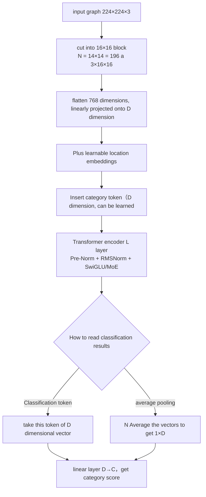
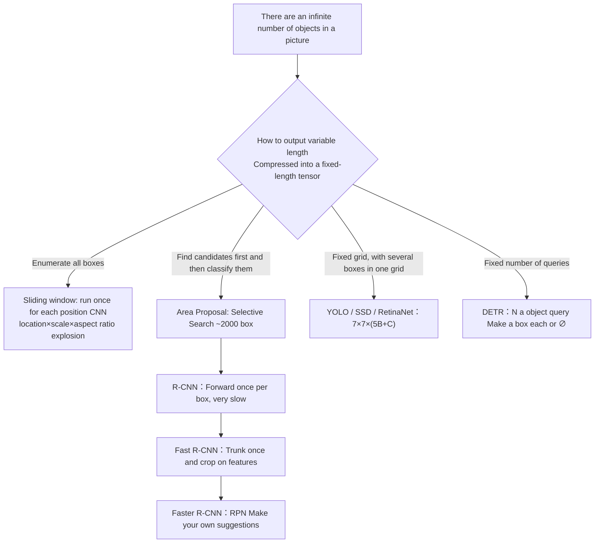

> **Course information**
>
> - **Course name**: Stanford CS231n: Deep Learning for Computer Vision(Spring 2025)
> - **Topic of this lecture**: Lecture 9. Object Detection, Image Segmentation, Visualizing and Understanding
> - **Lecturer**: Ehsan Adeli
> - **Teaching date**: 2025-04-29
> - **Course homepage**: [cs231n.stanford.edu/2025](https://cs231n.stanford.edu/2025/schedule.html)
> - **Official courseware**: [lecture_9.pdf](https://cs231n.stanford.edu/slides/2025/lecture_9.pdf) (178 pages, page-by-page illustrations in the book)
> - **Subtitle source**: [cs231n_sp25_kor_sub · eng](https://github.com/lpaiu-cs/cs231n_sp25_kor_sub/tree/main/eng) (Publicly transcribed in English, Chinese rewritten by this book)
> - **Copyright statement**: The copyright of the slides and course materials belongs to Stanford University and the instructors; this book is an unofficial study note and is only used for study and research.

The first six lectures have been doing variations of the same thing: giving a label to a picture, and the middle two lectures have turned to dealing with sequences. Let's go back to the image and take a look at the output shape - the label can be a word, it can be H×W words (one for each pixel), it can be several "categories + boxes", or it can be several pixel-level masks. As soon as the task is changed, the length of the output changes from fixed length to variable length, and the output layer of the neural network can only spit fixed-length tensors. In the first half of this lecture, on the evolutionary line from sliding windows to R-CNN, YOLO, and DETR, the only thing changed at each stop was "how to compress variable-length output into a fixed-length tensor."

In the second half, we change the direction: don’t ask what the network outputs, but why the network outputs it like this. Calculate the gradient of the classification score on the pixels to get a saliency map; multiply the final fully connected weight back to the feature map to get CAM; use the gradient as a weight and multiply it back to get Grad-CAM. The motivation given by the lecturer Ehsan Adeli is very practical - in medical imaging, no one cares about the sentence "Is there a tumor?", what they care about is where the tumor is.

## 1. Finish the Transformer first: ViT cuts the image into words, and makes four changes to stabilize it.

*(Reference time: 00:00:05 – 00:15:53｜Lecture 9)*

There is no technical content in the opening two pages. The reminder on the second page is that Assignment 2 is the longest of the three assignments, and the midterm and project milestone deadlines follow it; the other is the Colab practice post. The lecturer did not stop at this page. He only explained at 00:03:21: Stop to answer questions after reviewing ViT, and ask homework-related questions at that time.

The skeleton of the previous lecture is compressed into one page: the encoder is several layers of "multi-head self-attention + LayerNorm + MLP", and its product is a string of encoded tokens; the decoder has the same structure, but has an extra layer of cross-attention to the encoder output, which is used to generate the target sequence word by word. The reason why this picture needs to be replayed is because all detection models in the second half of this lecture are reusing these two components - DETR's encoder-decoder is directly moved from this picture.

The significance of the three methods side by side is to calculate "expensive" and "good" separately. The recurrent network requires O(N) video memory to store the hidden state for a sequence of length N, and must be calculated moment by moment, and cannot be parallelized; convolution can be parallelized, but the receptive field of a single output is limited, and many layers must be stacked to see the distance; self-attention allows each output to be directly connected to all inputs, at the cost of O(N²) calculations and O(N) video memory. The advantage is that it only takes four matrix multiplications to complete the calculation in parallel. The lecturer’s judgment was straightforward: self-attention is more expensive, but its modeling capabilities are significantly better, so current applications choose it by default—this trade-off will appear again in DETR later.

The starting point of ViT is an ordinary RGB image, 224×224×3. There is only this picture and one line "Input image: e.g. 224x224x3" on the whole page, because the next seven pages all do the same thing on it: turn it into a string of vectors.

Dicing is the whole secret to this trick: an image is cut into non-overlapping 16×16 chunks, each retaining three color channels, so a two-dimensional grid of pixels becomes a string of three-dimensional tensors. The lecturer made a point of emphasizing what was lost here - what was lost was location. The sequence model only sees "which token" and cannot see "whether this token was originally in the upper left or lower right of the picture."

This frame counts the number of blocks as N. For 224×224 input, 16×16 blocks, 14 blocks are cut out on each side, N = 14×14 = 196 - this number is not written in the slide, but it is directly obtained from 224/16, and all subsequent estimates of the calculation amount are based on it.

Each 3×16×16 block is flattened to 3×16×16 = 768 numbers, which are then multiplied by a 768×D linear layer to form a D-dimensional vector. The number 768 is not a hyperparameter, it is a direct result of "3 channels × 16 × 16"; the real hyperparameter is only D, which is the width of the entire Transformer.

Because the position is lost due to slicing, it needs to be compensated: each position is assigned a D-dimensional learnable vector, which is directly added to the corresponding token. The lecturer added that there is freedom in implementation - the position coding does not have to be learned, it can also be manually specified, such as numbering in sequence 1, 2, 3, or using (x, y) to compile a set of two coordinates and then add them together. The effect is not much different. This is the same thing as positional encoding in text Transformers.

By this frame, the input shape is completely isomorphic to the word vector sequence of a natural language sentence, so what follows is the standard Transformer without changing a single line. It should be noted that there is no mask here: the language model must cover the future, the image has no "future", and each patch can see all patches.

How to read the classification? The most common method is to stuff an additional token with dimension D and a value that is a learnable parameter - it does not correspond to any piece of the graph and is only responsible for "collecting" global information in layers of self-attention. The lecturer answered a very natural question: it is not a bias, but an independent trainable vector, which will eventually be mapped into a class C probability by a feedforward layer or linear layer.

The output end only takes the vector of this token, connects it to a linear layer of D→C, and obtains the scores of C categories. Those patch's own output vectors are discarded at this step - they are not wasted, the information has been funneled into the classification token through self-attention, which is exactly what this architecture diagram wants to express "one token represents the entire picture".

Starting from this page, Slide redraws the entire assembly line just to replace the final classification head. The first frame is still the input image and tiles, and the annotation is returned to 16×16×3.

This frame is supplemented by flattening and linear transformation, which is exactly the same as the previous step (3×16×16 flattened to 768, and then pressed to D), except this time it will be reaccounted as the first step of the "pooling head" version.

The stringed D-dimensional vector is clearly marked as the input of Transformer in this frame. Up to this point, the two routes are identical, with the divergence occurring only on the output side.

The position encoding is added in this frame, and the wording is clearer than before: the purpose is to tell Transformer the position of each patch on the two-dimensional plane, rather than just telling it the sequence number.

The fifth frame is specifically marked "No mask". This item is taboo in language models and is the default in images. The reason is very simple: there is no causal order between the pixels of the image. Covering a part will not make the task more meaningful, but will only lose information in vain.

The shape of the output is determined at this frame: N D-dimensional vectors, one for each patch. Note that there are no classification tokens here, N vectors are the entire product.

The alternative falls in the last frame: do average pooling on N output vectors to get 1×D, and then connect a D→C linear layer for scoring. The lecturer said very little about the difference between the two routes, but the engineering implications are very clear - classification token allows the network to learn to summarize information into one position, while average pooling forces the assumption that the contribution of each patch is equal. The former is more expressive, while the latter has fewer parameters and is less likely to overfit.

The review ends here, and next is "the same structure, what changes have been made in eight years." The overview page is very emphatic: the architecture of Transformer has not changed much since 2017, and there are only four changes that have been truly fixed by the industry - moving normalization to the residual, changing to a normalization, changing to an MLP, and copying the MLP into multiple experts.

The first change came from a very careful observation. The original version puts LayerNorm after the residual addition, that is, outside the residual branch; this means that no matter what the sub-layer learns, the output will be re-normalized once, so the network cannot learn strict identity mapping - and identity mapping is precisely the premise for deep networks to be trained: a certain layer is really useless, at least it can do nothing.

The solution is to move the two LayerNorm to the entrance of self-attention and MLP respectively, that is, inside the residual branch. In this way, there is a clean path on the residual backbone, and the gradient can pass through it as it is; the price is that the values ​​on the backbone are no longer subject to normalization constraints, so the training must be stabilized by other means - this is the reason for the existence of RMSNorm and warmup later. The slide gives only one conclusion: training is more stable.

The second change is more economical: since the purpose of normalization is to control the scale, can the step of subtracting the mean be omitted? RMSNorm only keeps division by root mean square, $y_i = x_i/\mathrm{RMS}(x)\cdot\gamma_i$, among which  $\mathrm{RMS}(x)=\sqrt{\varepsilon+\frac{1}{N}\sum_{i=1}^{N}x_i^2}$. One less averaging and one less subtraction is a real savings in computing power on large models. The lecturer's attitude is very honest: most of these changes are empirically more stable, and the theoretical explanation is just an afterthought.

The third change is internal to the MLP. The classic structure is  $Y=\sigma(XW_1)W_2$, $W_1$  is D×4D, $W_2$  It is 4D×D, and the width of the middle layer is four times that of the input - this 4 times is the place that takes up the most parameters in Transformer.

SwiGLU turns two matrices into three: $Y=\sigma(XW_1)\odot(XW_2)W_3$, among which  $W_1,W_2$  is D×H, $W_3$  is H×D, $\odot$  is element-wise multiplication. The extra path is a gate: one branch is activated, the other is a switch, and the element-by-element multiplication determines how much is released. The instructor pointed out the key number - taking H to 8D/3, the total number of parameters is the same as the 4D version of the classic MLP, but the nonlinearity is stronger.

The fourth change is to change "one MLP" into "a group of MLPs". E sets of independent MLP weights are learned in each block, each set is called an expert, and the weight tensor is directly expanded from D×4D to E×D×4D.

Routing is the core of this trick: each token is only sent to A of E experts (A \< E), and this A is called an active expert. Therefore, the number of parameters increases by E, and the amount of calculation only increases by A - this is currently the main method to achieve both "large model" and "inference is not too expensive".

The third frame makes it clear: GPT-4o, GPT-4.5, Claude 3.7, Gemini 2.5 Pro. This model almost certainly uses MoE, with parameter amounts above 1T, but the details are no longer announced. The lecturer added two pieces of experience in the Q&A: experts are trained in parallel and each is randomly initialized, so they will naturally differentiate to learn different aspects, and are sometimes used to separate multi-modal data distribution; the number of experts E and the number of actives A are both hyper-parameters, which are usually predetermined and not fine-tuned.

The summary page juxtaposes four items, and the wording is worth copying: Pre-Norm is to move the normalization into the residual; RMSNorm is to change the normalization layer; SwiGLU is to change the MLP; MoE is to learn E MLPs and only use A for each token. The parameters have skyrocketed and the computing power has increased slightly. These four together represent all the structural differences between the “2017 architecture” and the “2025 model.”

## 2. Semantic segmentation: Apply the classifier to each pixel, and then find a way to return the resolution

*(Reference time: 00:15:57 – 00:33:07｜Lecture 9)*

The agenda page divides the entire lecture into two parts: Computer Vision Tasks (semantic segmentation, object detection, instance segmentation) and Visualization & Understanding (layer visualization, saliency map, CAM and Grad-CAM). The first part takes up three-quarters of the time, and the second part is only ten minutes. The lecturer himself said that this is "going through the most important parts."

This page is a map of the entire site. The output of classification is "one word" and has no spatial range; the output of semantic segmentation is "one word per pixel", but it does not distinguish between individuals, and both dogs are labeled dog; target detection gives a number of "categories + boxes", and the individuals are separated but the shape is not given; instance segmentation requires both, dividing individuals and giving pixel-level masks. The most critical of the four lines is the sentence "No objects, just pixels" below semantic segmentation - it explains why instance segmentation is needed later.

The lecturer rewinds the scene to the first lecture: given a tag set such as {dog, cat, truck, plane, ...}, output a word for a cat picture. The role of this picture here is not to review classification, but as a target - all subsequent tasks are obtained by adding and subtracting conditions to this sentence.

For the same four-frame picture, the highlight is moved to the second frame. The output of semantic segmentation is not "there are grass, cats, trees, and sky in the picture", but which category each pixel belongs to. The lecturer's statement is to "turn each pixel into a label", which is equivalent to duplicating the classification problem H×W copies.

The formalization has only two lines: during testing, classify each pixel of the new image; during training, each training image must have pixel-by-pixel semantic annotation. The lecturer mentioned the historical cost by the way - in the early years, such data sets were marked by people sitting down one by one, which was very expensive; now there are tools to assist, but labeling is still the main cost of this route.

The simplest idea is to only look at this one pixel. The first frame only has a picture and a question mark, and the problem has not been exposed yet.

The answer is no: you can’t tell what a pixel value is by looking at it out of context. A patch of green might be grass or a patch of tree canopy. So we need to introduce context, that is, look at the area around it.

The question mark at this frame becomes "How to model this context" - take a patch centered on the target pixel and send it to the classifier as a small image.

The specific method is in the fourth frame: patch through CNN and output the category of the center pixel. The slides cite Farabet et al.'s 2013 scene annotation work and Pinheiro and Collobert's 2014 circular convolution version. The lecturer emphasized that the network here can be any one - CNN, ResNet, or ViT, because it does something that has long been familiar: classifying a small picture.

The cost is stated in the fifth frame: an H×W picture requires H×W forward runs, and adjacent patches overlap significantly, and the overlapping areas are repeatedly calculated countless times. This is not an accuracy issue, it is pure waste - the motivation for all subsequent segmentation architectures starts from here.

The first step to improve is to replace "run the network once for each pixel" with "run the network once for the entire image". But the page also points out obstacles: in order to make the classification architecture deeper, the spatial size of the feature map is usually reduced midway, while semantic segmentation requires the output to be as large as the input.

So there is a fully convolutional network (FCN): there is only convolution in the entire network, no pooling and no strided convolution. The input is 3×H×W, D×H×W is maintained in the middle, the score of C×H×W is output, and the last argmax gets the prediction of H×W.

The cost is added to the second frame of the same page: D channels are maintained for convolution at the original resolution, and the video memory and computing power are linearly expanded according to H×W. The lecturer recalled that in the early years, GPU memory was small, which almost directly sentenced FCN to death - which also explains why the split architecture eventually moved towards "first lowering the resolution and then raising it back up."

This picture is the main skeleton of the segmentation in this lecture. The left half is already done: pooling, strided convolution, gradually reducing D×H×W to D2×H/4×W/4, the number of channels becomes thicker, the space becomes thinner, and the receptive field becomes larger; the right half needs to increase the size back, and there are three question marks written in that column on the page - there are ready-made operators for downsampling, but not for upsampling.

The left side is filled in, but the right side is still empty. The lecturer stopped at this page and asked: This network starts from a picture and ends at a picture. How to write the loss function? The answer in class is pixel-by-pixel classification loss. The instructor confirmed: Calculate a softmax loss for each pixel on the image, and then sum up all pixels. $L=\sum_{i}\ell_{\text{softmax}}(s_i, y_i)$, and then backpropagates as usual. This is why such tasks must have pixel-by-pixel ground truth label maps.

The first answer to upsampling is "don't learn parameters, just do geometric rearrangement." The nearest neighbor copies each element of the 2×2 input into a 2×2 block in the output; the “bed of nails” only puts the original value in the upper left corner of each block and fills the rest with zeros. The latter seems more wasteful, but with the subsequent convolutional layers, these zeros will be gradually "filled" with the effective values ​​​​of the neighborhood, which is equivalent to letting the network learn how to interpolate by itself.

If the encoder uses max pooling, the decoder can be more accurate: when pooling, record the position of the maximum value in each window (switch), when unpooling, put the value back to that position, and set the rest to zero. The slide shows this pair of operations on the same page, labeled "Remember which element was max!" - this is the only additional information that needs to be passed between the encoder and decoder.

The second route is to make upsampling also parameterized. The review starts with the most common convolution: 3×3 filter, stride 1, padding 1, input 4×4, output still 4×4. This frame just puts "what is convolution" back on the table.

In the second frame, the words "dot product" are marked at the position where the filter overlaps the input. The output of each grid of convolution is the sum of the element-wise products of the filter and the input of a 3×3 window.

When the window slides once, the output will grow by one grid. A stride of 1 means that every time the input moves one frame, the output also moves one frame, so the input and output sizes are the same - this is the literal meaning of "convolution without subsampling".

Change the step size to 2, and the same filter becomes a downsampler: the input is 4×4, and the output is only 2×2.

The position of the tab is marked in this frame. The effect of step size 2 is: two adjacent cells in the output correspond to positions two cells apart in the input.

The third frame gives this key interpretation: the step size is the ratio of the input movement amount to the output movement amount, so the strided convolution can be read as "learnable downsampling" - it compresses 4×4 into 2×2, and the compression method is determined by the 9 weights, rather than fixed pooling rules.

Reverse this relationship, and you get transposed convolution: input 2×2, output 4×4. The lecturer fast-forwarded this set of pages in class, citing lack of time, leaving only one sentence: "It is the inverse operation of conventional convolution. The convolution is applied to the transposed version of the input, so the output is larger." The frame-by-frame construction process is left to be seen in the slides.

The roles are reversed: in ordinary convolution, the filter sweeps over the input and each output takes a weighted sum; in transposed convolution, each value of the input is multiplied by the entire filter, and a whole block is "printed" on the output. The annotation of this frame is "Input gives weight for filter", which is what it says.

The direction of the step size is reversed at this frame: the filter moves 2 spaces on the output at a time, corresponding to the input advancing 1 space. So the step size changes from "compression ratio" to "amplification ratio", and 2×2 is enlarged to 4×4.

There will inevitably be overlap after enlarging: the areas of two adjacent "prints" will collide with each other, and the solution is to add them together. This frame marks the overlap area, and the next page completes it.

The completion of superposition is the final 4×4 output. Looking at these five frames together, transposed convolution is not mysterious - it "multiplies each input value by the filter, spreads it to the output according to the step size, and sums the overlap." It shares the same set of weights as ordinary convolution, but the order of traversal is reversed.

The one-dimensional example clears things up: the inputs are just a and b, and the filter is (x, y, z). The three copies of a occupy the output cells 1–3, and we get (ax, ay, az); the three copies of b are moved to the 3–5 cells in steps of 2, and we get (bx, by, bz). The third cell collides with the third cell of a, so the final output is (ax, ay, az+bx, by, bz). Input 2 numbers and output 5 numbers, which is exactly the amplification ratio of "kernel size 3, step size 2": $(2-1)\times 2+3=5$. The lecturer ended with this example because it turns the four words "overlap and addition" into something that can be calculated by hand.

Returning to the skeleton diagram, both columns are filled: downsampling is pooling or strided convolution, and upsampling is unpooling or transposed convolution. At this point, FCN's calculations are completed - it uses one network and one forward pass to output the entire segmentation map, which is several orders of magnitude faster than the sliding window.

U-Net is the best-known example of this route. The whole picture is U-shaped: the left half is the downsampling path, the number of channels increases from 64 to 1024, and the resolution drops all the way from 572×572 to 32×32; the right half rises back symmetrically, and finally outputs a segmentation map of the same size as the input.

The left half is characterized in this frame: downsampling makes the receptive field larger, and the model can see larger structures; the cost is that spatial information is discarded and the boundary position becomes blurred.

The task on the right side is therefore clear: reconstruct high-resolution maps from low-resolution, semantically strong features. But the information has been lost, and upsampling alone cannot make it up, and the boundaries will be blurred.

The solution of U-Net is the horizontal gray arrow: copy the high-resolution feature map of the same resolution on the left, concatenate (concatenate) with the upsampling result on the right, and then convolve them together. This is the form of skip connection in segmentation - it does not change the depth of the network, it just passes the "lost spatial details" to the opposite side unchanged. The lecturer emphasized that this is particularly critical in medical imaging, because the boundaries of organs are the basis for diagnosis.

The summary page condenses the entire chapter into one sentence: a segmentation network is a set of convolutional layers with downsampling and upsampling sandwiched in between. The lecturer answered another question here - are the transposed convolution filters trained? Yes, it is no different from other convolutional layers, and the gradients are returned as usual.

The last page points out what this route cannot do: the output only has pixel categories. If there are two dogs on the picture, the model will say that both of them are dogs, but it does not know that they are two. To answer "Is this the same one or two?", you must first have the concept of "object" - so the topic turns to target detection.

## 3. The first issue in detection is the output length: single-objective regression, sliding window and R-CNN’s twice forward

*(Reference time: 00:33:29 – 00:40:34｜Lecture 9)*

The same four-frame picture appears for the third time. The first two columns have been finished and have been pressed into gray; the images in the third and fourth columns are still dark, and only the brackets of the "Multiple Object" below light up first - it reminds them of what these two columns have in common: the output quantity is no longer fixed.

The picture in the third column lights up at this frame: In the same living room photo, two dogs and a cat are surrounded by three different colored frames, and the labels below are DOG, DOG, and CAT. Classification only outputs one word, while detection outputs three (category, box) pairs, and the number three is unique to this picture.

Assume that there is only one object in the picture, and the problem immediately degenerates into "classification + positioning". After the trunk, there are two parallel heads: full connection 4096→1000 for the category score, full connection 4096→4 for the box (x, y, w, h). The lecturer said that the key understanding of this step is that positioning can be regarded as a regression problem, and the four numbers in the box are four continuous variables.

The loss is also logically divided into two paths: Softmax cross entropy is used for categories, and L2 distance is used for frames. Because the frame coordinates themselves are real numbers, you can directly calculate the Euclidean distance between the prediction frame and the true value frame. The sentence "Treat localization as a regression problem!" on the page is the only thing you need to remember in this section.

The two-way losses are added to obtain the multi-task loss, $L=L_{\text{cls}}+\lambda L_{\text{box}}$, a scalar, a backpass. The lecturer did not expand  $\lambda$  How to determine it? I just say that this structure is almost unchanged in today's detectors - the classification head and the regression head share the backbone and each suffers losses.

Once there is more than one object in the picture, the output becomes a list like CAT: (x,y,w,h), DOG: (x,y,w,h), DUCK: (x,y,w,h). The length of the list is not fixed, but the output layer of the network is fixed-length matrix multiplication - this is the core contradiction to be solved in the entire chapter.

The slide draws this contradiction in three lines: 4 numbers for a single object, 12 numbers for three objects, and "many numbers" for more. Each picture requires a different number of outputs, so "setting the output dimension to 4N" will not work - no amount of N is correct.

The first remedy is to turn detection into multiple classifications: take various crops on the image and let the CNN determine whether this is an object or background. The first frame is an empty box with three questions answered NO, NO, and YES in sequence.

The box slides over to the dog, and the answer flips over: Dog? YES, Background? NO. The detection is thus split into "enumerating all frames + classifying frame by frame".

In the third frame, the frame is only moved a little, and the answer is still Dog? YES. This detail illustrates an implicit cost of sliding windows: adjacent positions are highly redundant, and the same object is repeatedly confirmed as YES.

Cat? YES when the box falls on the cat. A question is thrown in the lower right corner of the page: What is the problem with this method? The answer is on the next page.

The problem is written in one sentence: CNN needs to be run on a huge number of positions, scales and aspect ratios, which is completely computationally unacceptable. This is the same disease as the sliding window of semantic segmentation - splitting "one forward" into "tens of thousands of forwards".

So there is a region proposal: first use a method that does not require a neural network to find the "blocked, object-like" areas on the map. The slide shows a selective search - giving about 2000 proposal boxes in a few seconds on the CPU. This step does not determine the category, but only determines "there may be something here", so it can be done quickly and roughly. The lecturer said that this was the mainstream idea around 2014: split "where" and "what" into two questions.

The first frame of R-CNN only has the input image. This picture is from Girshick et al.'s 2014 paper, and the next seven frames are added to it with components.

Regions of interest (RoI) are added at this frame, numbering about 2k. Note that these boxes are of different sizes, and CNN requires a fixed input size, so it must be deformed in the next step.

The third frame forcibly stretches the pixels in each frame to 224×224. This warp would destroy the aspect ratio, which was one of the details that R-CNN was later criticized for, but at that time it allowed "arbitrary frames" to be fed into the standard classification network.

The most expensive step occurs in the fourth frame: each area after the warp must pass through the convolutional network completely. The lecturer dropped the hint here - 2000 boxes is 2000 forwards, and a large number of pixels in them are repeated.

The fifth frame connects an SVM classifier to each region and outputs the category. R-CNN does not use Softmax but one SVM for each class. This was the practice of that era.

The sixth frame is supplemented with frame correction: it does not directly predict the absolute coordinates, but predicts four correction amounts (dx, dy, dw, dh) relative to the proposed frame, and "moves a little, shrinks a little" the frame. The reason why relative quantities are used instead of absolute quantities is because the same object must be correctly returned at different positions, and absolute coordinates will force the network to remember the position.

In the seventh frame, the cost is written out: each picture requires about 2k independent forward passes. This is the reason why R-CNN is an engineering death sentence and the starting point for all improvements in the next section.

There is only one idea to break the situation: convolution retains spatial information, and there is a clear correspondence between the position on the feature map and the pixel position, so why not wait until the entire image has been convolved before cropping? This page is marked with red letters "Idea: Pass the image through convnet before cropping! Crop the conv feature instead!" - 2000 forwards become 1.

The six frames of Fast R-CNN are built layer by layer from the same architecture diagram. In the first frame, the old architecture is placed on the left for comparison.

Add the backbone to the second frame: the entire image is passed through ConvNet once to obtain the conv5 feature map. The backbone can be any one of AlexNet, VGG, and ResNet. The slide lists them side by side under "Backbone network" - the accuracy and speed of the detector are largely determined by this choice.

The RoI is projected onto the feature map at this frame. Because convolution is translationally equivariant, the pixel coordinates are divided by the total step size to obtain the feature map coordinates, and the relative position of a frame on the two images is consistent.

In the fourth frame, do "cropping + scaling features". This step is the prototype of RoI Pool. The details of how to compress a feature area of ​​any size into a fixed size are left in the appendix (pages 153–164).

The fifth frame is "Per-Region Network": each RoI feature is connected to a small header, one linear + Softmax output category, and one linear output frame offset. So far, each picture has only passed through the trunk once, and the cost has been reduced from 2000 times forward to 1 time.

The sixth frame puts the entire pipeline together. The lecturer's evaluation of this line is that it advances detection from "impossible in real time" to "can talk about speed", but there is still one bottleneck that has not been solved - the 2,000 proposals still come from an algorithm that has nothing to do with the network.

## 4. Give the proposal to the network itself: RPN’s anchor box, YOLO’s grid, DETR’s query

*(Reference time: 00:40:46 – 00:57:38｜Lecture 9)*

The third bottleneck is the proposal itself. Since the backbone has turned the picture into a 512×20×15 feature map, why not directly predict “where there may be objects” on this picture? This is how RPN comes about: input 3×640×480, output 512×20×15, each spatial position corresponds to a 32-pixel square grid on the original image.

The anchor box (anchor) was introduced in this frame: a fixed-size box is placed at each point on the feature map. Its function is to turn the "prediction box" into "predicted offset relative to the anchor box." This step is the same idea as R-CNN's (dx, dy, dw, dh), except that this time the anchor box is pre-paved.

Add the first head to the third frame: perform two classifications for each position, determine whether there is an object in the corresponding anchor box, and output a 1×20×15 objectness map. Note that there are no specific categories here, only "object/background".

Add the second header to the fourth frame: For the positive box, return it to the four corrections of the true value box, and output 4×20×15. The lecturer said that he would skip the details of this step (how to parameterize, how to sample positive and negative samples) and leave it to the pages of Faster R-CNN in the appendix.

The number of anchor boxes changes from one to K, covering different scales and aspect ratios. So the channel numbers of the two output images are multiplied by K respectively: the objectness is K×20×15, and the frame transformation is 4K×20×15.

The sixth frame is the ending: sort the K × 20 × 15 boxes by objectness, and take the top 300 as proposals. Calculated with K=9, 20×15=300 positions, there are a total of 2,700 candidate frames, of which only about 300 enter the second stage - where RPN suppresses "dense prediction" into "sparse proposal".

Taking the idea of RPN one step further is a single-stage detector: it is no longer divided into two stages: "proposal" and "classification", but the frame and category are directly displayed on each grid at the same time. The account given in the slide is very clear: the image is cut into a 7×7 grid, each grid has B reference boxes, each box has 5 numbers (dx, dy, dh, dw, confidence), plus C category scores, the output tensor is 7×7×(5B+C). Taking B=3 and C=20, there are a total of 7×7×35 = 1715 numbers - a fixed-size tensor, and the problem of variable length is completely eliminated. The last comment on the page is spot on: it's a lot like RPN, but category-related.

YOLO (You Only Look Once) is the most famous name of this route, and the title says real-time object detection. The lecturer said that even today, it is still widely used as a baseline in industrial applications because it is fast and accurate.

The secret is all in this frame: divide the picture into an S×S grid (this version is 7×7). Each grid is only responsible for the small area it covers. The allocation problem of "which box belongs to which object" is directly decided by the grid position - no proposal or matching is required.

The third frame lists three outputs for each grid: the probability that there is an object in the box P(object), the B bounding boxes (x, y, h, w), and the probability of belonging to each category P(class). These two items are separated: the former answers "Is there something here?" and the latter answers "What is that thing?"

B is set to 2 in this frame. This number is small, meaning that each grid is responsible for at most two objects - enough for a 7×7 grid, since the centers of objects usually fall in different grids.

The fifth frame shows the respective probabilities of two boxes in the same grid. Note that they are output in parallel, the network does not need to choose between the two boxes, the choice is left to post-processing.

All grid frames are stacked back to the original image, and the thickness of the line is the probability. At this point, an image will produce 7×7×2 = 98 boxes, the vast majority of which are background or repeats.

The seventh frame is the result of post-processing: first filter by probability threshold, then use non-maximum suppression (NMS) to remove overlapping duplicate frames, and the rest is the final detection. The instructor did not go into the details of NMS, other than to say that it is the standard finish for this type of detector.

The third route deletes the entire "anchor frame". The pipeline of DETR is: CNN extracts features → Transformer encoder-decoder → directly outputs a set of boxes; during training, bipartite matching is used to pair the prediction box with the true value box, and then return the coordinates. The sentence "No anchors, no regression of box transforms" on the page is the key point of this page - it does not even require the concept of "relative anchor box offset".

Starting from this frame, the slide zooms in on each of the three components of the pipeline. First zoom in on the backbone: the feature map output by the CNN must be added to the position encoding, otherwise the Transformer cannot distinguish the spatial position - this is the same problem as the position embedding in ViT.

The interior of the backbone is completed in the third frame: the feature map and the position encoding are merged at the plus sign. At this point, a picture has been turned into a string of tokens with positions, which is consistent with the input form of ViT.

The camera moves one layer closer and falls on the encoder: multi-layer self-attention plus MLP, the input and output are the same string of tokens. The number of tokens in the image is much smaller than the number of pixels (the feature map on the previous RPN page is 20×15), so the O(N²) self-attention is bearable here.

The fifth frame adds the decoder: it uses the output of the encoder as a key and the input is a small set of learnable query vectors (object queries). The lecturer emphasized this point repeatedly - these queries are not image blocks, nor are they pre-laid frames, but a bunch of trainable parameters, and the network learns "what to focus on for each query" by itself.

The last frame is supplemented with the prediction head: the output of each query is passed through an FFN, and a category plus a box is obtained, or it is judged to be no object (∅). The picture on the right is the final result - two seagulls claimed by two queries. The lecturer explained the capacity meaning of this design: The query number is the maximum number of objects you allow the model to detect in a picture. Objects exceeding this number can only be discarded, so it must be adjusted according to the data set.

## 5. Instance segmentation: Add a 28×28 mask branch to the detection head

*(Reference time: 00:58:01 – 01:01:31｜Lecture 9)*

The detection solves "how many are there and what are they", but does not solve the "precise shape of each object". The fourth column of the four-frame diagram requires both: individual classification and pixel-level masking.

This page has only one line of title, which is used to treat the end of the previous chapter as the starting point of this chapter. The lecturer's caliber is: instance segmentation does not require a new architecture, it only requires one more output on the detector.

So there is Mask R-CNN: in addition to the original classification head and box regression head, a small branch is added to each RoI, and a small fully convolutional network is used to predict a 28×28 binary mask. The lecturer emphasized that this mask is "one per RoI" and has nothing to do with the size of the object in the input image - 28×28 is a fixed resolution.

In the second frame, the account at the input end is clearly written: the backbone plus RPN gives the RoI, and RoI Align aligns and samples the features of each RoI into 256×14×14. Use Align instead of Pool because pooling requires the frame to be "adsorbed" to the integer grid, which will cause misalignment of several pixels, and for the mask, the misalignment is a blurred boundary.

The third frame is supplemented with a mask branch: the 256×14×14 features are passed through two layers of convolution, and the output is C×28×28—one mask for each category, rather than one shared by all categories. In this way, the mask branch is decoupled from the classification branch. If the classification is wrong, the mask will not be drawn wrong.

The true value of the mask is not a semantic label map, but a binary map of "which pixels belong to this object inside this RoI." The first set of examples makes the source clear: the red frame on the left encircles a chair between the bed and the cabinet, and the image on the right is the binary shape of the chair on a 28×28 grid, with jagged edges - this is the quantization brought about by fixed low resolution.

The second frame has another set stacked below: the same room, the frame has been moved slightly, and the edges of the mask have also changed. The lecturer used this to explain the learning goal of the mask branch - it learns "who does this pixel in the frame belong to", rather than memorizing the shape of the entire class of objects.

The third frame fills in the third group, and the page changes from vertical layout to grid layout. Putting the three groups together, it becomes clear that different frames in the same scene correspond to different masks: the mask is one-to-one with the frame, not one-to-one with the image.

The four groups are complete: the upper right group of frames is relaxed, and the mask becomes wider; the lower two groups are replaced by the people on the bed and the bed itself. These four pairs of samples explain the design of "one 28×28 for each category" - in the same frame, different categories should have different masks, so the mask header must output C images by category, not just one.

The results page is the persuasiveness of this chapter: people and objects in the same picture are framed and masked separately, and the occlusion relationship can be handled. The lecturer's original words were "results have been very, very good", but he immediately added a realistic comment - this type of two-stage model is rarely used today because it is too computationally intensive.

The same framework can also be used for pose estimation: replace the mask branch with a key point heat map, one for each person, and you will get the human skeleton. This shows that "one small full convolution branch for each RoI" is a universal interface, and what is output depends on how you connect the branch.

There are ready-made projects for implementation: TensorFlow Detection API includes Faster R-CNN, SSD, RFCN, and Mask R-CNN; Detectron2 (PyTorch) includes Mask R-CNN, RetinaNet, Faster R-CNN, RPN, Fast R-CNN, and R-FCN. In both places, you can take pre-trained models and fine-tune them on your own data.

The review page puts the four types of tasks side by side on the same picture. The lecturer gave a very practical starting point here: the combination of these tasks still appears on industrial assembly lines, such as sorting rotten tomatoes - first detect each tomato, and then classify whether it is good or bad. The two tasks are strung together to form a usable production line.

## 6. Visualization: Point the gradient to the pixel and point the weight to the feature map

*(Reference time: 01:01:37 – 01:13:11｜Lecture 9)*

The agenda page appears for the second time, and the remaining ten minutes belong to the second block. The reason given by the lecturer is not academic interest, but application demand: judging "whether there is a tumor" in medical images has limited value in itself. What is valuable is "where is the tumor", and the latter question can only be answered through visualization.

Returning to the linear classifier in the first lecture: each row of the weight matrix can be reshaped into a graph, which is a template of this type. The template of the car category looks like a front-facing car, because most of these samples in the training set have this posture. The purpose of this page is to give an analogy - if the weights of the linear model can be seen, the weights of the convolution kernel should also be visible.

The convolution kernel of this layer is 64 3×11×11 filters: 64 is the number of filters, which determines the number of output channels; 3 is exactly equal to the number of input channels, so each filter can be directly displayed as an 11×11 color picture. What you see are edges, stripes, patches of color—the most basic detectors of direction and frequency.

Switching to ResNet and DenseNet, the core of the first layer becomes 64 3×7×7, and the drawing is still a bunch of stripes and color blocks. Three networks with an order of magnitude difference in depth, but the first layer looks very similar - this is consistent with intuition: the first layer eats pixels directly, and what can be learned is limited by the input statistics and has nothing to do with the subsequent depth.

Start with this page and ask a different question: Which pixels on the image contribute to this score? In the first frame, only the forward direction is performed, turning the picture into the probability of the category "Dog".

The key step is to change the object of derivation. What is sought during training is the gradient of the loss versus the weight. What is sought here is the gradient of the category score versus the pixel - "If this pixel moves a little, how much will the dog's score change?" The obtained tensor is of the same shape as the input (3×H×W). The absolute value is taken and the maximum of the three channels is taken, and compressed into an H×W grayscale image, which is the saliency map. In the picture in the lower right corner, the outline of the dog is faintly visible.

Looking at several pictures, the saliency map can generally outline the subject, but the edges are very fragmented and the background is also responsive. The lecturer commented on it as "very effective in many situations", but did not say that it was reliable - this is exactly the problem that the CAM series will solve later: the gradient tells you which pixels are sensitive, but does not tell you which area the network has established a category concept on.

CAM has changed its perspective: it does not change the network, only the reading method. It requires the network to use global average pooling (GAP) at the end to compress the H×W×K feature map into K dimensions, and then pass through a fully connected layer to obtain C scores. This structural constraint is both the reason why CAM works and why it can only be used at the last level.

The first step is the definition of GAP: $F_k=\frac{1}{HW}\sum_{h,w} f_{h,w,k}$. K feature maps become K numbers, and the spatial information is averaged here - but precisely because it is averaged, each spatial position is  $F_k$  The contributions are equally weighted, which leaves the door open for subsequent pushback.

The second step is to write the score as the weighted sum of the pooled features: $S_c=\sum_k w_{k,c}F_k$. At this point, the C category scores are already the weighted sum of K pooling numbers, and the spatial information is not yet visible.

The second frame  $F_k$  Substitute the definition of: $S_c=\frac{1}{HW}\sum_k w_{k,c}\sum_{h,w}f_{h,w,k}$. At this time, the outer layer is still the channel summation, and the space summation is still included in it.

The third frame only does one thing - exchange the summing order, written as  $\frac{1}{HW}\sum_{h,w}\sum_k w_{k,c}f_{h,w,k}$. This step is the key to the entire CAM: once the spatial index is in the outer layer, the item in the brackets is  $(h,w)$  It can be calculated individually, and after calculation, one pixel is a score. The lecturer explained here the confidence of "why we can recover the image space all the way": convolution is spatially consistent, and the position on the feature map has a fixed correspondence with the center of the receptive field on the input map.

The fourth frame  $w_{k,c}f_{h,w,k}$  Boxed separately: the activation of the k-th feature map at position (h, w), multiplied by its importance weight for the c-th class. After this step, there is only a summation distance between the "category score" and the "spatial position".

The last frame gives the definition: $M_{c,h,w}=\sum_k w_{k,c}f_{h,w,k}$, $M\in\mathbb{R}^{C\times H\times W}$. The entire CAM is based on this line of formula - treat the K weights belonging to the c-th category in the fully connected layer as the weighting coefficients of K feature maps, add them and then upsample them back to the original image size.

The results page is the most convincing: For the same building photo, the heat map falls on the roof and facade when asked about "palace", the dome when asked about "dome", and the interior when asked about "altar". For the same feature map, changing a set of weights results in a different interpretation. This just shows that the weights encode "which types of features are important to which types."

The problem is also written on the same page: this derivation requires the classifier to follow the GAP, so it can only be applied to the last layer of convolution. After the last layer of modern CNN, there are often several layers of fully connected or other operators, and CAM has no way to start there. In addition, the resolution of the feature map of the last layer is inherently low, and the heat map is naturally very thick.

The first trick of Grad-CAM is to remove the restriction of "last layer": pick any layer and record its activation as  $A\in\mathbb{R}^{H\times W\times K}$. The further back the layer is selected, the stronger the semantics and the lower the resolution; the further forward the layer is selected, the higher the resolution and the weaker the semantics. This is an adjustable knob.

Step 2: Calculate  $\partial S_c/\partial A$. The shape of the gradient is the same as the activation, and the meaning is "how sensitive is this feature map at this location to the score of class c".

Step 3: Average the gradients over space to obtain K scalars  $\alpha_k=\frac{1}{HW}\sum_{h,w}\frac{\partial S_c}{\partial A_{h,w,k}}$. The shape of this step exactly corresponds to the GAP of CAM - except that CAM uses fully connected weights  $w_{k,c}$, Grad-CAM calculates one using gradient.

Step 4: $M^c_{h,w}=\mathrm{ReLU}\left(\sum_k \alpha_k A_{h,w,k}\right)$. ReLU is not a decoration - it suppresses all the evidence "against this category" and leaves only positive contributions, so the heatmap looks cleaner.

The results have the same origin as CAM but have a much wider applicability: any layer can produce a graph, and any network structure can be used, because only one backpropagation is required. The lecturer's original words are that this method is one of the most commonly used tools for understanding CNN and the most worth learning first.

For models such as Transformer, this matter is simple: the self-attention matrix already contains the weight of "which inputs each output depends on", and it can be spread back to the image according to the patch position. There is no need for gradients and no need to change the structure. The column on the left is the attention map of different objects, and the four on the right are examples with confidence (basketball 95.13%, beacon 99.81%, American\_black\_bear 92.99%, basketball 87.74%). The lecturer's summary of this comparison is: Transformer has its own interpretation interface, and CNN only needs plug-ins such as Grad-CAM.

## 7. Summary

*(Reference time: 01:13:19 – 01:13:36｜Lecture 9)*

The agenda page appears for the last time, with both large blocks crossed out. The lecturer said that he originally thought that the content would be endless.

The last page leads to Lecture 10: Video Comprehension. It is actually an extension of all tasks in this lecture on the timeline - classification, detection, and segmentation must be consistent from frame to frame, and "consistency" is the theme of the next lecture.

Divide the entire lecture into a few takeaway judgments:

- The loss of semantic segmentation is the sum of pixel-by-pixel softmax. The only new problem in the network structure is how to raise the resolution back; anti-pooling, transposed convolution, and skip connection are three different levels of answers.
- Transpose convolution is not a new operator. It is "input to weight, filter to output, and addition at overlap". It shares the same set of parameters with ordinary convolution.
- The fundamental contradiction of detection is that the output length is not fixed; sliding window, region proposal, fixed grid, and fixed query are essentially four encoding methods that compress variable-length output into fixed-length tensors, at the cost of computing power, delay, accuracy, and upper capacity limit.
- The speed bottleneck of the two-stage detector is never in the classification, but in the proposal; the value of RPN is to turn the proposal into a forward convolution operation.
- The single-stage detector uses "B frames per grid" in exchange for speed, and the output tensor is fixed to  $S\times S\times(5B+C)$, NMS is its indispensable finishing touch.
- The formula of CAM states that "the category score is the weighted sum of the feature maps", so the weight can be regarded as spatial importance; Grad-CAM replaces the weight with gradient and extends this conclusion to any layer.
- The value of visualization depends on the task: in classification tasks it is a debugging tool, in medical and autonomous driving it is part of the product - "where" is often more expensive than "what".

## Appendix: Slides not shown in class

The lecturer explained twice at 00:31:42 and 00:42:42: He deleted the details of coordinates, dimensions and RoI from the text, and put them all at the end of the deck for everyone to read after class. The following 29 pages are these backup pages, described page by page in the original order of the deck.

This page is the entrance to extended reading. The text is not expanded and only the title is left on the page.

After writing convolution as matrix multiplication, "downsampling" corresponds to multiplying the input vector by a sparse matrix: the number of rows is less than the number of columns, and each row only has those non-zero items that overlap with the kernel.

This is the algebraic explanation of the three words "transposed": when the transpose of the same matrix is multiplied back, the dimensions naturally become larger, and the overlaps are naturally added.

The cropping details of Fast R-CNN start here, first laying out the size relationship between the input and the feature map.

The projection relies on the total step size: the pixel coordinates divided by the step size are the feature map coordinates.

"Adsorption" is to align the frame with the grid of the feature map, at the cost of an alignment error of up to half a grid.

Fixed size is necessary because the fully connected layer later requires the input dimension to be fixed.

Segmentation does not require integer division, and the sub-region boundaries can fall between grids, which is also one of the sources of errors.

Max pooling ensures that the output size is the same no matter how big the input area is - this is what RoI Pool is all about.

The superimposition of two levels of quantization (first adsorbing the frame, then segmenting) will cause the feature to be offset from the real object by a few pixels, which will have little impact on detection, but will be a disaster for masking.

The modification of Mask R-CNN is simple: remove the adsorption step.

The coordinates of the sampling point can be decimals, and the value is interpolated from the surrounding four grid points, so there is no quantization error.

This frame gives the definition of bilinearity, and the weight is determined by the distance from the sampling point to the four grid points.

Each of the four corner points is a 512-dimensional vector, and interpolation is performed independently for each channel.

The process is exactly the same as RoI Pool, the only difference is that the sampling points are no longer quantized - this is also the direct reason why Mask R-CNN's mask boundary is cleaner.

The picture on the left is the training time: 84 hours for R-CNN, 25.5 hours for SPP-Net, and 8.75 hours for Fast R-CNN. The picture on the right shows the test time: R-CNN 49 seconds, SPP-Net 4.3 seconds, Fast R-CNN 2.3 seconds; after excluding the time of region proposal, Fast R-CNN only takes 0.32 seconds.

Putting these two sets of pillars together reveals the next bottleneck: Fast R-CNN only takes 0.32 seconds after removing the proposals, and the remaining 2 seconds are almost entirely spent on proposals.

After the proposed network is built into the backbone, the remaining process is exactly the same as Fast R-CNN: feature cutting and region-by-region classification.

The four losses are RPN's object/non-object classification, RPN's box regression, final classification, and final box regression.

The same test time histogram adds the last one: Faster R-CNN 0.2 seconds, another order of magnitude faster than Fast R-CNN.

How to remove duplicates in NMS, how to determine anchor frames, how to collect positive and negative samples, and how to parameterize frame regression - these four things determine the success or failure of the implementation, but they are all engineering quantities rather than new ideas.

The first stage is run once for each image (backbone plus RPN), and the second stage is run once for each region (feature cutting, classification, regression offset).

This question is the starting point for single-stage detectors - the answer to YOLO and SSD in Chapter 4 is "no".

The three conclusions are straightforward: Faster R-CNN is slower but more accurate, SSD is faster but less accurate, and the larger and deeper the backbone is, the better.

This supplementary review strings together the testing routes before 2019 and is suitable for further reading.

The method is the same as that of the saliency map, except that the object of derivation is changed from the category score to the value of an interneuron.

This is the meaning of guided: negative gradients are always truncated, and the resulting graph is cleaner, at the cost of no longer being a true gradient.

The left side is the real image patch that makes the neuron respond the strongest, and the right side is the synthetic pattern deduced. Comparing the two can tell what the neuron is looking for.

Each row corresponds to a neuron, and the differences between rows are evidence of the division of labor between different channels.
