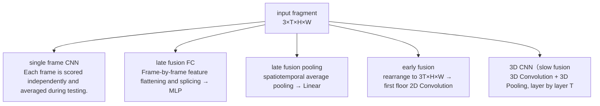
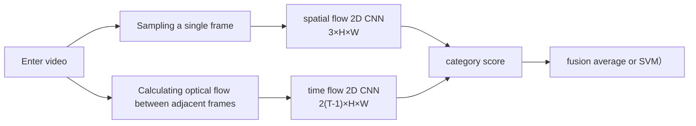

> **Course information**
>
> - **Course name**: Stanford CS231n: Deep Learning for Computer Vision(Spring 2025)
> - **Topic of this lecture**: Lecture 10. Video Understanding
> - **Lecturer**: Ruohan Gao
> - **Teaching date**: 2025-05-01
> - **Course homepage**: [cs231n.stanford.edu/2025](https://cs231n.stanford.edu/2025/schedule.html)
> - **Official courseware**: [lecture_10.pdf](https://cs231n.stanford.edu/slides/2025/lecture_10.pdf) (103 pages, page-by-page illustrations in the book)
> - **Subtitle source**: [cs231n_sp25_kor_sub · eng](https://github.com/lpaiu-cs/cs231n_sp25_kor_sub/tree/main/eng) (Publicly transcribed in English, Chinese rewritten by this book)
> - **Copyright statement**: The copyright of the slides and course materials belongs to Stanford University and the instructors; this book is an unofficial study note and is only used for study and research.

The previous lecture pushed the output of 2D vision from "a label" to "a set of boxes plus a mask": classification, semantic segmentation, target detection, and instance segmentation. The four tasks share the same backbone, and the difference is only in the output shape of the head. This lecture changes the input terminal - the input is no longer a 3×H×W picture, but a roll of T frames, and the shape becomes T×3×H×W. This extra dimension goes far beyond "storing a few more pictures": it allows a one-minute high-definition original film to occupy 10 GB, increases the computing power of 3D convolution to 2.9 times that of VGG-16, and makes "action", a concept that only exists in time, become a classification target for the first time.

The class is taught by guest lecturer Ruohan Gao (University of Maryland, College Park), whose research focuses on multimodality—using sound in addition to vision. This clue will be taken back in the last twenty minutes: when two people are talking at the same time in the picture, you can't tell who is saying what just by looking at the pixels, but you can tell them apart by matching their mouth shape and voice. So the whole lecture can be summarized into a chain: **First ask at which layer the time information should be fused, then ask how much computing power is required for this fusion, and finally ask if there are any other modalities available besides pixels.**.

## 1. The video is not “a lot of pictures”: what shapes have been changed by the extra T dimension?

*(Reference time: 00:00:05 – 00:03:10｜Lecture 10)*

### 1.1 A guest lecturer and the first decade of the course

The title page puts three things side by side: Lecture 10, Video Understanding, and the footer line Stanford CS231n 10th Anniversary. This lecture is the first guest lecturer in the spring semester of 2025. The course was announced at the beginning of the semester. Several people who have taught this course before will be invited to come back and each will give a lecture on the direction they are most familiar with.

The resume on the slide can be read by time: Dr. UT Austin, working as a postdoctoral fellow at Stanford from 2021 to 2023 (the collaborators are Fei-Fei Li, Jiajun Wu and Silvio Savarese), during which he served as a lecturer in CS231n during the 2022–2023 academic year. He also spent time at Meta and is now an assistant professor at the University of Maryland, College Park, where he chairs the Multisensory Machine Intelligence Lab. His key word is "multimodality": in addition to vision, sound and touch channels are also used. This background explains why the last twenty minutes of this lecture suddenly cut from screen to audio - in his eyes, video is never a "moving image", but an event with sound.

### 1.2 What 2D vision can and cannot answer

The setting of image classification is condensed into a single line: given a set of candidate labels {dog, cat, truck, plane, ...}, output which one of them. This page is placed at the beginning of the video lesson because it defines the comparison benchmark for all subsequent tasks - the input is a three-dimensional tensor, and the output is a C-dimensional fractional vector, with neither "position" nor "order" in between.

The previous lecture advanced this set of interfaces three steps. The four-frame diagrams respectively marked what they gave up: classification "no spatial extent" (no spatial extent), semantic segmentation "no objects, only pixels", detection begins to process "multiple objects", and instance segmentation requires two dogs of the same type to each have a mask. What the four have in common is **The input is always one frame**——They can all answer "what is in this picture and where", but there is no place to store "when".

When the toolbox is moved to a real scene, the gap is even more obvious: there are dogs and babies in the living room, and the detection frames and masks can be drawn, but the real message of this video is that the dog pounces and the baby laughs. **event**. A single frame cannot distinguish between "pounce" and "lying" because the postures of the two can be almost the same; the difference is only in the displacement between adjacent frames.

### 1.3 Separator pages and 4D tensors

There is no content on the middle page, just a title bar for the tenth anniversary. It appears twice in this lecture (and once again on page 088 later), and its function is to cut the "2D visual review" and the "video itself" into two sections - such separator pages are recorded in this book because they mark the speaker's breathing points.

The real definition is on this page: A video is a sequence of images whose shape is a four-dimensional tensor T×3×H×W, which can also be written as 3×T×H×W. These two ways of writing are not typographical preferences. The former puts the three channels of a frame together (frame priority), and the latter stacks all frames of the same channel together (channel priority). PyTorch  `Conv3d`  request  `(N, C, D, H, W)`, that is, 3×T×H×W; when we talk about early fusion later, the slides need to be flattened directly from T×3 into 3T channels, using the frame-first arrangement. **For the same video, if the axis order is changed, the first layer of convolution kernel will see completely different things.**, this will become a specific parameter account in Chapter 3.

The cost goes beyond storage. In the two-dimensional network, batch is the only "extra" axis. In the three-dimensional network, there is an additional axis T. The activation value increases linearly with T, and the receptive field, pooling, and normalization all need to redefine the "neighborhood." Therefore, every architecture after this lecture is essentially answering the same question: At which layer is the T axis suppressed and in what manner.

## 2. 10 GB per minute: first make the video smaller and then train on the clips

*(Reference time: 00:03:37 – 00:08:16｜Lecture 10)*

### 2.1 Change tags from nouns to verbs

The interface of video classification is exactly the same as that of image classification, only the label set has been changed: swimming, running, jumping, eating, and standing. The input is still a tensor in and a fractional vector out, so the cross-entropy loss, backpropagation, and SGD mentioned in the previous lectures can be carried over unchanged. The lecturer put the difficulty more straightforwardly: the first level of difficulty in video understanding is not the loss function, but "how to turn the pixels into a feature that can be fed to the loss function."

This page spreads out the differences: here are dog, cat, fish, truck, all **noun**;The video here is swimming, running, jumping, eating, standing, all **verb**. Nouns can be determined by the texture and shape of a single frame, but verbs cannot - the definition of "run" naturally contains a time span. This also explains why the input of the video model must be "a segment" rather than "a picture", and why all subsequent architectural debates revolve around "how to compress this segment into a vector."

### 2.2 First calculate how many bytes there are in one minute

The calculation is as follows: 30 frames per second, 3 bytes per pixel, SD (640×480) is about 1.5 GB per minute, HD (1920×1080) is about 10 GB per minute. These two numbers are worth remembering, because they are not "a little big" - one minute of HD original film has 10 GB, which is close to the video memory of a 24 GB graphics card, and training a batch takes much more than one minute. The lecturer also added a cost that is often ignored: not only the input must be stored, but also the weights and activation values ​​of the convolutional network.

The solution is on this page: only watch short clips during training, and reduce two things at the same time - frame rate and spatial resolution. The example given in the slide is T=16, H=W=112, which is 3.2 seconds and 588 KB at 5 fps. You can check this number yourself: $16\times112\times112\times3=602{,}112$  bytes, exactly 588 KiB.

| express | Frames and shapes | Uncompressed size | HD original film of the same length |
| --- | --- | --- | --- |
| HD one minute | 1800 frames × 1920×1080×3 | ~11.2 GB (page name ~10 GB) | 1× |
| SD one minute | 1800 frames × 640×480×3 | ~1.66 GB (page name ~1.5 GB) | about 1/7 |
| training clips | 16 frames × 112×112×3 | 602 KB(588 KiB) | About 1/990 |

Downsampling is not free: 5 fps will blur fast movements such as swings and jumps into a blur, and 112×112 will make small objects in the distance disappear. The caliber of the slide is "If you have the computing power, of course you can use a higher resolution" - this sentence will appear repeatedly later in this lecture. The account of 39.5 GFLOPs in Chapter 4 started with "Can you afford a higher resolution?"

### 2.3 Train on segments, test on segments averaged

There is only one timeline on the page, labeled "Long and High FPS." What it wants to illustrate is: the complete video is not a sample that can be sent to the Internet at all, and the length ranges from tens of seconds to several hours.

Sliding window sampling is used during training: the long video is cut into segments of many T frames. Each segment inherits the label of the entire video and is trained as an independent classification sample. This step converts the trouble of "variable-length input" into "fixed-length input + more samples".

When testing, do the opposite: sample a number of clips from a long video (about 10 were mentioned in class), score each clip separately, and then average the probabilities as predictions for the entire video.

This "train on segments, test on average" protocol is the common premise of all subsequent models, and it has two implicit assumptions. One is **clip tag equals video tag**——This is true for videos like Sports-1M where the entire video contains only one kind of sport, but not for unedited videos (temporal action positioning in Chapter 7). The second is **Segments can be averaged**- If the action only occurs within ten seconds, the ten randomly sampled clips will be mostly empty and the average will be diluted. The second hypothesis will become a clear research problem in Chapter 7 "Efficient Video Understanding": Instead of uniform sampling, it is better to learn a strategy of "which clips are worth counting".

## 3. Which layer does the fusion occur: single frame, late fusion, early fusion, 3D convolution

*(Reference time: 00:08:29 – 00:26:06｜Lecture 10)*

With the unified input of "segment", there is only one question left: At which layer is the information of T frames merged? The four answers are arranged by fusion position - no merging at all (single frame), last merging (late fusion), frontmost merging (early fusion), layer-by-layer merging (3D convolution). The lecturer talks in this order, and each page adds a "problem" mark on the picture on the previous page, so when reading this chapter, you must keep an eye on the line of red text: it marks the place where the solution fails.

### 3.1 Single-frame CNN: run this baseline first

The most trouble-free way is to treat the video as an image: each frame is passed through a 2D CNN, and the probability of each frame is averaged during testing. The seven little people on the slide each pass a CNN, and all output "Running". The lecturer gave it a very high evaluation——**This tends to be a very strong baseline**, because clips like running don’t change much between frames, and the static appearance is enough to judge; before designing any video model, you should run it first, and don’t write 3D convolution as soon as you start.

The real problem is pushed to sampling. The lecturer paused here and said, "How to collect frames is a key issue in itself and an active research direction." The stupidest way is to uniformly sample (one frame per minute for a one-hour video). A better way is to use the result of the first judgment to decide where to look next. This foreshadowing is recycled in Chapter 7 - SCSampler This kind of work is to learn a "where to look first" strategy.

### 3.2 Late fusion one: combine T feature maps into a giant vector

The first step of late fusion is still to pass the 2D CNN frame by frame, but instead of directly outputting the category, the feature map of the middle layer is taken, with the shape T×D×H'×W'. Then it is flattened and spliced ​​to obtain a TDH'W'-dimensional "segment feature", which is then sent to MLP to map to C category scores. It is called "late" because each frame is processed independently to a very late stage, and the time information is not put together until the end.

The parameter account is not difficult to calculate. Taking D=512, H'=W'=7, T=16, each frame feature has 25,088 dimensions, which together is 401,408 dimensions; if the first layer's full connection width is 4096, this layer is  $401{,}408\times4096\approx1.64\times10^{9}$  Parameters - ResNet-50 has about 25.6 million parameters, and this classification head is more than sixty times that. And this number grows linearly with T: the fragment is pulled from 16 frames to 32 frames, and the classification header parameters are doubled directly.

| practice | Features per frame | The vector fed into the classifier | The first layer parameters of the classification header |
| --- | --- | --- | --- |
| Late Fusion + FC | 512×7×7 = 25,088 | 401,408(T=16) | About 1.64×10⁹ |
| late fusion + pooling | 512×7×7 = 25,088 | 512 | 512×C |

### 3.3 Late Fusion Part 2: Pooling saves parameters and foot movements

The modification method is very straightforward: instead of splicing, do average pooling in space and time, compress T×D×H'×W' into a D-dimensional fragment vector, and then pass through a linear layer to obtain C scores. The number of parameters dropped from billions to  $512\times C$, and no longer increases with T.

The price is written in red on the next page: **Low-level motion between frames becomes difficult to compare**. The lecturer used the runner's feet in the picture as an example - the foot position marked by the red circle is different in each frame, which is the most direct clue to judge "running"; but the frame-by-frame 2D CNN is convolutional and pooling all the way to the deep layer, and the feature map no longer has position-level information such as "in which frame the foot was raised", and only the semantic-level appearance is left. Average pooling then suppresses the timeline, leaving no order left.

This is the true meaning of "late": the later the fusion occurs, the more abstract the thing being fused is. Deep features are good at answering "Does it look like running in the picture?" but not good at answering "How much did the feet move between two frames?" The lecturer added an intuition: the earlier the feature is extracted, the closer it is to the original frame, and the more likely it is to retain low-level motion; the further back, the more semantic it is. Late Fusion has fixed this choice at "backward".

### 3.4 Early fusion: suppress 3T channels at one time

Early fusion goes to the other extreme: directly stacking the three channels of the T frame into 3T channels and rearranging them into 3T×H×W, so that **first floor**  2D convolution maps the channel dimension from 3T to D. From then on, the entire network is a standard 2D CNN, except that the temporal information has been compressed into a D×H×W feature map in the first layer. This sentence is written very unpleasantly on the slide: collapses all temporal information.

Its advantage is that the temporal receptive field is in place in one step: the first layer of convolution kernel covers all T frames in time. The parameter cost is not small: the first layer is  $D\times3T\times3\times3$, when T=16, the input channel is 48, and if D=12, it is 5,184 parameters; for the same D and convolution kernel, the late fusion layer only has  $12\times3\times9=324$ , a difference of 16 times.

The red letter points out its faults: **Just relying on one layer for time processing may not be enough.**. The first layer of convolution is linear weighting plus nonlinearity. It can express "which positions of which frames are lit at the same time", but it is difficult to express the sequential relationship of "first A, then B" - and actions are precisely defined by order. The lecturer's statement was "We are too greedy and want to grab everything on one floor."

### 3.5 3D convolution: Let the receptive field grow together in time and space

The third way is 3D convolution: both the convolution kernel and the pooling kernel have one more time dimension. The input is 3×T×H×W. The features of each layer in the network are four-dimensional tensors D×T×H×W. The time dimension is slowly reduced layer by layer. Karpathy and others call it "slow fusion" - not at the front or at the end, but dispersed to every layer.

Let’s start with a page to review 2D convolutions so that the “one more dimension” thing can be compared.

The 2D convolution kernel only slides in the H and W directions, and the third dimension (channel) is full at once: $5\times5\times3$  The core slides through  $32\times32\times3$  As input, each position outputs a scalar, and we get  $28\times28\times1$  activation map. The channel here is not "space", but "the length of the feature vector at each position".

3D convolution turns the kernel into  $k_t\times k_h\times k_w$  The cube: not only slides across the x and y of the screen, but also slides across the timeline. The three sets of numbers (6×6×6, 5×5×5, 4×4×4) marked on the slide are the kernel sizes of the three-layer convolution, and the square itself depicts the feature volume shrinking layer by layer. It should be noted that only three axes are drawn on the figure, and the channel dimension C is omitted - the real tensor is C×T×H×W, and each grid point is a complete C-dimensional vector. The lecturer specifically reminded this because "four-dimensional objects cannot be drawn on paper" and all schematic diagrams of 3D convolution are missing one dimension.

### 3.6 Three toy ledgers: same input, three sensory fields

The next eight pages are a frame-by-frame build of the same table. The input is unified to 3×20×64×64 (20 frames, 64×64). The layer width is deliberately made small. The lower right corner of the slide also states that "the actual model is much larger." The correct way to read these eight pages is to focus on "what is more in this frame than the previous frame": the table has one more row each time, and the node graph below has one more layer each time. The red dot marks exactly "how many inputs an output value has seen."

The first frame has only two rows of data: Input is 3×20×64×64, Conv2D(3×3, 3→12) outputs 12×20×64×64, and the receptive field is 1×3×3. Note that T is still 20 - this layer only slides on H,W.

In the second frame, a node graph is added below the table: the Input row is a blue dot, the Conv(3×3) row is also a dot, and the three red dots in the middle converge into one red dot. This is where 1×3×3 comes in – an output is only connected to three adjacent inputs; there are no connections across frames in the time dimension, so the first number is 1.

Add a row to the third frame Pool2D (4×4): the size becomes 12×20×16×16, and the receptive field is 1×6×6. The node graph correspondingly has an additional Pool (4×4) layer, and the red dots expand from 3 to 6 - pooling enlarges "one output to see several inputs".

The fourth frame is supplemented with Conv2D (3×3, 12→24): 24×20×16×16, receptive field 1×14×14, and the node graph grows to four layers. The first conclusion "Build slowly in space" appears on the right side at the same time.

The fifth frame is completed and fused late: GlobalAvgPool compresses 24×20×16×16 into 24×1×1×1, the receptive field column jumps to 20×64×64, and the entire node chain turns red. The sentence on the right is completed as "Build slowly in space, All-at-once in time at end" - the time receptive field is not grown, but covers all 20 frames at once at the moment of global averaging.

Early fusion is added in the sixth frame: the first layer after the input is Conv2D (3×3, 3\*20→12), T disappears directly in the output size (12×64×64), and the first row of the receptive field is 20×3×3; the subsequent Pool2D and Conv2D only continue to grow, and the time is always 20. Change the label on the right to "All-at-once in time at start".

The seventh frame adds a 3D CNN: Conv3D(3×3×3, 3→12) with a receptive field of 3×3×3, Pool3D(4×4×4) with a receptive field of 6×6×6 and T drops from 20 to 5, and another Conv3D to 14×14×14. The two lines on the right "Build slowly in space, Build slowly in time" have quotation marks next to "Slow Fusion" - this time the time is reduced layer by layer.

Nothing is added to the last frame, only a line of words appears in the center of the table: What is the difference? The three accounts are put together, and the difference is only one sentence: **Is the time perception field on the last layer, the first layer, or does it grow on each layer?**.

The bifurcation point of the four branches is the position of the "fusion layer": B is not fused at all, C and D are fused at the end, E is fused at the first layer, and F is fused at every layer. The number of parameters, the receptive field, and whether the order can be expressed are all determined by this position.

**Late fusion leaves time to the end, early fusion puts time at the front, and 3D convolution spreads time to each layer - three routes, three costs.**

## 4. Time translation invariance, and the 39.5 GFLOPs paid for it

*(Reference time: 00:26:12 – 00:39:10｜Lecture 10)*

The toy table in the previous chapter puts early fusion and 3D convolution together. The time receptive field of both can eventually cover the entire segment, and the difference is compressed into one sentence: "The first layer grows or each layer grows." This chapter expands that sentence into two questions: What exactly does 2D convolution do in time? On which layer does the overpay for 3D convolution go?

### 4.1 2D convolution is "fully connected" in the time direction

This picture uses 2D convolution on a tensor where "time has been spelled into the channel": the input is C\_in×T×H×W, and the weight is C\_out×C\_in×3×3 - there is no t dimension in the kernel. It slides on x and y, and the channel is full at one time (that is, all 3T channels are connected). The output is still C\_out×T×H×W, and T=16 is no less. Therefore, the "2D convolution" of early fusion appears to be convolution, but in the time direction it is actually **Fully connected**: Each output grid point is connected to all 16 frames.

The conclusion follows: **No time translation invariance**. If the same "blue to orange" transition occurs in the 4th and 15th frames, the convolution kernel uses different slices (the 4th slice and the 15th slice) in the weight at these two moments, and must be learned separately. This is not the case spatially at all - whether the same edge appears in the upper left corner or the lower right corner, the same set of 3×3 weights is used, which is why convolution works on images.

The slide puts the question into a questioning question: How to move between space and time? **Anywhere** Identify the transition from blue to orange? The answer is not in 2D convolution, because its temporal weights are bound moment by moment.

### 4.2 What 3D convolution buys is "the same kernel slides through all times"

Switching to 3D convolution, the weight is C\_out×C\_in×3×3×3. The extra one dimension allows the kernel to only cover 3 frames in time (T=3 marked on the figure is the time width of the kernel, and the input is still 16 frames). So each position in the output only depends on a local window of 3 frames, rather than all 16 frames.

This is what I bought **Time translation invariance**: The same core is shared from t=1 to t=14. No matter which moment the change from blue to orange occurs, it is responded to by the same set of weights. The lecturer classified this as "representation efficiency" - there is no need to learn a kernel for each moment.

The rewards are directly visible on this page. The first layer of filters is therefore a small 3×4×5×5 video that can be played one by one like a GIF: some kernels respond only to color patches (almost degenerating into 2D filters), some respond to motion in a certain direction, and some respond to temporal changes at edges. The lecturer reminded that this is not just a visualization technique, it shows that 3D convolution is indeed learning patterns such as "motion", rather than just stacking frames.

### 4.3 Sports-1M: Single frame 77.7, 3D convolution 80.2

This page of the data set shows the scale and difficulty: 1 million YouTube videos, tagged with 487 sports categories, down to the difference between marathon and ultra marathon that a layman can’t tell (the lecturer’s original words are “I don’t know the difference between the two”). The blue box on the picture is the annotation box, the green words are correct predictions, and the red words are wrong predictions - it is also a visualization of the model output.

The lecturer added some troubles unique to the data set: the video was too large to be packaged and distributed like ImageNet. Sports-1M initially released only a list of YouTube URLs; ten years later, users deleted and changed videos, and about half of the one million links that year have expired. **This means that the numbers from 2014 are difficult to replicate today.**, take this into account when reading old papers.

The results page is the first "counter-intuitive" in this lecture: the single-frame model is 77.7, the early fusion is 76.8 (but lower), the late fusion is 78.7, and the 3D CNN is 80.2. Fusion of time information does not automatically bring improvement - the linear projection of the layer fused early cannot take the order, and the pooling of late fusion smooths out the low-level motion. Only the 3D convolution of layer-by-layer fusion gets 2.5 points. The two comments on the right side of the slide are the lecturer's conclusion: the single-frame model is very strong, always try it first; 3D convolution has made great progress since 2014.

### 4.4 C3D: Move VGG as a whole to three dimensions at a cost of 39.5 GFLOPs

The idea of C3D is "3D version of VGG": input 3×16×112×112 (which happens to be the 588 KB fragment in Chapter 2), all convolutions are 3×3×3, and all pooling are 2×2×2, with the exception of Pool1, which uses 1×2×2 - no downsampling in time, and halving the space first. The eight convolutions are followed by FC6 and FC7, each with 4096 dimensions, and FC8 outputs class C. It publishes the weights after pre-training on Sports-1M. Many people use it as a video feature extractor: after extracting the features and then connecting it to a linear classifier, you save money on training a 3D network.

This page adds the most important column: layer-by-layer FLOPs. Adding these numbers up is exactly 39.5, which is consistent with the 39.5 GFLOPs of C3D marked on the left side of the page; for comparison, AlexNet 0.7 GFLOPs, VGG-16 13.6 GFLOPs, and C3D is 2.9 times that of VGG. You can choose a layer to check: Conv3b is a 3×3×3 convolution of 256→256, and the output is 8×28×28. $256\times256\times27\times8\times28\times28\approx1.11\times10^{10}$, exactly corresponding to 11.10 in the table above. This layer alone accounts for 28% of the entire network.

It is clear where the money is spent: the same 3×3 kernel is multiplied by 3 in time, and the feature map has one more dimension T=8. The multiplication of the two terms is an expansion of more than twenty times. The computing power of 3D convolution is not "slightly more expensive", but an order of magnitude more expensive.

After adding C3D, the histogram becomes 77.7 / 76.8 / 78.7 / 80.2 / 84.4. C3D is 6.7 points higher than single frame and 4.2 points higher than the 2014 3D CNN. This page also marks the baseline for the first half of this lecture: **At a budget of 39.5 GFLOPs, Sports-1M has a top-five accuracy of approximately 84%**. All architectures in the second half - dual-stream, RNN, non-local blocks, I3D - can be understood as "wanting to exceed this line with less computing power, or to exceed more with the same computing power."

## 5. Should appearance and motion be calculated separately: optical flow, dual flow, and giving time to RNN and self-attention

*(Reference time: 00:39:59 – 00:54:18｜Lecture 10)*

3D convolution stuffs space and time into the same core, at the cost of multiple times in time for each core  $k_t$, the output has one more dimension T, and the stacking of the two items is an expansion of an order of magnitude. Let’s ask another question in this chapter: space and time are two signals with different properties. Can they be processed separately by two independent channels and then combined at the fractional level? The lecturer first gave a human experiment as a motivation, and then gave three "separate processing time" solutions: optical flow + dual-flow network, CNN features + RNN, 3D features + self-attention.

### 5.1 Only movement is enough to recognize actions

The slide refers to Johansson's 1973 classic experiment (point-light display): only a few joint points on the human body are retained as bright spots, and the rest are blacked out. The observer can still recognize "walking", "running" and "sitting". The freeze frame on this page is almost completely black, with only two bright spots - the lecturer played a short clip live to let the audience guess the action: there is no appearance, no background, no color, only the movement trajectory of the dots. The purpose of this page is to establish a premise: **Movement itself is a strong discriminant signal**, no need to rely on textures and objects. In this case, there is no reason to force a convolution kernel to learn appearance and motion at the same time.

### 5.2 Optical flow: Write "where the pixels go" into two channels

An explicit tool for measuring motion is optical flow: take two adjacent frames and estimate how much each pixel has moved from one frame to the next. There are only two frames of original images on the page, and there are no arrows - let people see what the input is first.

The second frame adds the definition: optical flow is a displacement field  $F$, map each pixel of the t-th frame to the position of the t+1-th frame, $F(x,y)=(dx,dy)$, satisfy  $I_{t+1}(x+dx,\,y+dy)=I_t(x,y)$. The lecturer mentioned that there are many assumptions for the specific algorithm (the most commonly used one is "brightness constant": the brightness of the same point does not change after moving), but no matter which one is used, the output is a two-channel image.

Take it apart in the third frame and look at it: the horizontal component dx and the vertical component dy are each a grayscale image. The bright part of the former moves horizontally, and the bright part of the latter moves vertically. This step is very important, because the next input of the dual-stream network is "to stack (dx, dy) as two channels."

### 5.3 Dual-stream network: one looks at appearance, the other only looks at movement

The structure is on this page: the previous entry **spatial flow** (spatial stream) eats a single frame 3×H×W, which is an ordinary image classification network; the following one **time flow** (temporal stream) Eat stacked optical flow, the number of input channels is  $2(T-1)$——T frames generate T−1 optical flow fields, each field has two channels. The structures of the two streams are completely symmetrical (conv1 7×7×96 with step size 2, conv2 5×5×256, conv3–5 are both 3×3×512, fc6 4096, fc7 2048), and are finally fused at the class score layer. Special note on the slide: The first layer of 2D convolution of the time stream processes all optical flow maps at once, that is, early fusion is used inside the time stream.

Results on UCF-101 (101 classes of actions): 3D CNN 65.4, spatial stream only 73.0, temporal stream only 83.7, two-stream average 86.9, two-stream + SVM fusion 88.0. The most worth stopping at are the second and third pillars——**The time flow that only looks at movement is 10.7 points higher than the spatial flow that only looks at appearance.**. The lecturer's explanation is a hypothesis: the appearance flow is easy to overfit the background (the background and category of many videos in UCF-101 are strongly related), while the motion flow is almost only the action itself, which makes it harder to cheat.

The division of labor between the two streams is clear in the diagram: **The appearance goes one way, the motion goes one way, and the fusion only occurs at the fractional layer.**. This also means that there is no gradient sharing between the two streams, and the training cost is doubled, but each stream can change the backbone independently - later I3D expands the two streams into 3D.

### 5.4 Video longer than five seconds: CNN extracts features, RNN extracts time

At this point, all models only deal with clips of 2 to 5 seconds. The limitation is written in the title of the slide: Previous temporal convolutional networks only modeled "local motion within a very short segment and between frames." So what about long-term structures? A timeline of CNN covering about 5 seconds is drawn at the bottom of the page.

The second frame points the answer to tools already learned: sequence modeling with recurrent neural networks (RNN). This is not new knowledge, but rather a transfer of the tools from Lectures 7 and 8.

The specific approach is divided into two steps. The first step is feature extraction: segments are taken at fixed intervals along the time axis, and each segment is passed through a CNN (2D or 3D) to obtain a series of feature vectors. The role of CNN here has degenerated from "classifier" to "fixed-length local encoder".

The second step is to feed this string of features to the LSTM. At this time, the time span is no longer limited by the receptive field of the CNN - as long as the hidden state of the LSTM is passed on, the information of the first second can affect the output of the tenth second.

There are two output forms. **many to one** (many-to-one) Only take the output at the last time step to get a video-level label, corresponding to the setting of "One category for the entire video" in Chapter 2.

**many to many** (many-to-many), each time step is output, which is suitable for frame-by-frame annotation tasks (such as timing positioning in Chapter 7). The same network can serve two tasks by changing the readout method.

The slide gives a very practical engineering suggestion: In order to save video memory, you can **Do not back-propagate gradients back to CNN**, but pre-train the CNN, freeze it, and only train the subsequent loop part. Otherwise, end-to-end training of a "convolution + loop" giant network will be very difficult. This suggestion appeared in the work of Baccouche et al. in 2011 and was popularized by Donahue et al.'s LRCN in 2015.

This page puts the properties of the two side by side: each value inside the CNN is **Fixed time window** function (local time structure), each vector inside RNN is **All previous vectors** function (global time structure). The question naturally becomes: Can the two be combined into one network?

### 5.5 Circular convolutional network: replace RNN matrix multiplication with convolution

First review the shape of multi-layer RNN: the horizontal axis is time, the vertical axis is depth, and each grid point  $h_t^l$  Receive at the same time the previous moment of the same layer  $h_{t-1}^l$  at the same time as the layer below  $h_t^{l-1}$. The instructor said that the same grid can be used to process videos, except that each grid point is changed from a vector to a feature map.

The recurrent convolutional network is the convolutional version of this grid: all states are C×H×W feature maps, and each grid point relies on two inputs—the feature map of the same layer at the same time, and the feature map of the previous layer at the same time; each layer has its own set of weights, and the weights are shared in time.

The comparison page first shows ordinary 2D convolution: an input feature map C×H×W, and an output feature map C×H×W.

Then draw the loop unit: the new state is the "old state" and "current input" passing through a certain parameter  $W$  The result of the function. This step is no different from standard RNN.

The key line is on this page: take the vanilla RNN  $h_t=\tanh(W_h h_{t-1}+W_x x_t)$  All matrix multiplications in are replaced by 2D convolutions, $W_h$, $W_x$  From the matrix to the convolution kernel, the results of the two convolutions are added and then passed through tanh to obtain the latent feature map at the current moment. The parameter quantity therefore changes from "state dimension squared" to "core size × number of channels", regardless of the time length.

This page puts the three time spans side by side: the receptive field of a regular CNN is **limited**, only the fixed window can be seen; the memory of the fully connected RNN is **unlimited** Yes, you can look back at the entire history; the same is true for circular convolutional networks **unlimited**, but its state update is implemented using convolution - local connections and weights are shared over time, and the memory is still passed down all the way through the hidden state. The lecturer did not push further here because the comparison is enough to illustrate the position of this type of model.

The price also came. The recurrent convolutional network combines the locality of convolution and the infinite memory of loops, but it inherits the fatal shortcomings of RNN: **Time steps must be calculated serially**, a video of one thousand frames requires one thousand forward passes, and the parallelism of the GPU is almost useless. The lecturer said that this is the reason why this type of model "has not been used" - it is not that the effect is not good, but that it is too slow.

### 5.6 Self-attention: Turn “where to look” into a parallelizable matrix multiplication

The way out is to replace the loop. Each position in the self-attention emits three vectors of query, key, and value at the same time ($q=xW_q$, $k=xW_k$, $v=xW_v$), the alignment score of any two positions is  $e_{ij}=q_j\cdot k_i/\sqrt{D}$, get the weight after softmax  $a_{ij}$, the output is  $y_i=\sum_j a_{ij}v_j$. The key is: **Alignment of all positions can be calculated simultaneously**, no time step dependence.

Moving self-attention to the video is a nonlocal block (Wang et al., CVPR 2018). The first frame first lays out the inheritance structure: the input fragment first passes through the 3D CNN to obtain C×T×H×W features, and then enters this block.

Three 1×1×1 convolutions are added to the second frame: they map the C-dimensional features to the C' dimension, and obtain three C'×T×H×W feature maps of queries, keys, and values. The reason for using 1×1×1 instead of 3×3×3 is to allow this block to only take care of the “global relationship” and leave the local structure to the external 3D convolution.

The third frame is the core: flatten and transpose the spatial and temporal dimensions of queries, multiply them by keys, and obtain a (THW)×(THW) attention matrix, and then perform softmax by row. The "non-local" here means literally - every position is in and **all** Compare spatio-temporal locations instead of just looking at neighborhoods.

In the fourth frame, this matrix is used to weight the values, and a new feature map of C'×T×H×W is obtained. At this point, the new feature of each position is the weighted sum of the features of all positions.

In the fifth frame, a 1×1×1 convolution is added to map C' back to C so that it can be aligned with the original input.

The sixth frame adds residual connection (+), and the output of the block = original feature + attention result. This is the premise that it can be plugged into any network: in the worst case, the identity mapping will be learned and the existing features will not be destroyed.

The last frame strings the blocks together: 3D CNN → Non-local block → 3D CNN → Non-local block → Running. The slide also raises the question: non-local blocks can be inserted into any 3D CNN, but **What is the best 3D CNN architecture?**? This brings the topic to the next chapter of I3D.

There is an account that must be settled here. The attention matrix is (THW)×(THW). If it is done on the features of T=16, H=W=56, THW = 50,176, the matrix is  $2.5\times10^{9}$  elements, half-precision requires 5 GB—a single layer would overwhelm the video memory. So non-local blocks can actually only be placed on layers whose resolution has been reduced several rounds (e.g. T=8, 28×28, THW=6,272, matrix approx.  $3.9\times10^{7}$  elements). **"Global" has a price, and the price increases with the square of the feature map area.**, this is also the direct reason why Transformer needs to factorize attention in the following video.

## 6. Reuse 2D architecture and weights: I3D, video Transformer, and what the model is looking at

*(Reference time: 00:54:23 – 01:01:16｜Lecture 10)*

Non-local blocks bring a new problem to the forefront: the block itself is universal, but what should the outer 3D CNN look like? Designing a 3D architecture from scratch requires a lot of data and computing power; and the image side already has mature architecture and pre-trained weights accumulated over ten years. This chapter talks about "whether it can be used directly" - first expand the structure, then expand the weights, and finally look at the results and visualization.

### 6.1 Expansion: Replace each K\_h×K\_w with K\_t×K\_h×K\_w

I3D (Carreira and Zisserman, CVPR 2017) has only one idea: take a mature 2D CNN and convert each  $K_h\times K_w$  The convolution or pooling layer is replaced by  $K_t\times K_h\times K_w$  3D version of. In this way, the topology, number of channels, and depth of the network remain unchanged, but the core has one more dimension.

The specific object to be expanded is the Inception block: four parallel branches (5×5 convolution, 3×3 convolution, 1×1 convolution, 3×3 maximum pooling), each branch is preceded by a 1×1 convolution for dimensionality reduction, and finally spliced along the channel.

After expansion, 5×5 becomes 5×5×5, 3×3 becomes 3×3×3, 1×1 becomes 1×1×1, and even the maximum pooling becomes 3×3×3. The topology is exactly the same, and the expansion factor of the parameter quantity is given by  $K_t$  decision.

### 6.2 Weights can also be inflated: copy K\_t copies and divide by K\_t

The structure can expand, and so can the weights. The method is: copy the 2D convolution kernel along the time axis  $K_t$  parts, and then divide the whole by  $K_t$, use it to initialize the corresponding 3D convolution. The reason is a line of algebra - if you enter the video  $K_t$  The frames are exactly the same (constant video), the output of the 3D convolution is

$$
\frac{1}{K_t}\sum_{t=1}^{K_t}\sum_{c,k_h,k_w} w_{c,k_h,k_w}\,x_{c,k_h,k_w}=\sum_{c,k_h,k_w} w_{c,k_h,k_w}\,x_{c,k_h,k_w},
$$

Exactly equal to the result of 2D convolution on a single frame. **This ensures that the expanded network will not degrade on "still video"**, the edge and texture detectors learned on ImageNet are retained as they are, and the remaining time dimensions are fine-tuned from the video data.

### 6.3 How much is ImageNet pre-training worth: comparison on Kinetics-400

The results page separates the two factors of "architecture" and "pre-training": Per-frame CNN 57.9→62.2, CNN+LSTM 53.9→63.3, Two-stream 62.8→65.6, Inflated CNN (I3D) 68.4→71.1, Two-stream inflated 71.6→74.2. Three things are worth remembering: the CNN+LSTM trained from scratch is only 53.9, which is worse than a single frame, indicating that the loop part is difficult to train; pre-training compensates this level the most (+9.4); the expansion itself (68.4 vs. 62.8) already brings 5.6 points, without any new data.

Transformer is divided into three routes after entering the video. The slides only list the papers and do not expand on them (the lecturer said, "You can read the papers if you are interested"): **Break down attention** (Attention is done in space and time respectively, represented by ViViT and TimeSformer, the latter is "Is Space-Time Attention All You Need for Video Understanding?"); **Pooling module** (Reduce the number of tokens layer by layer, represented by MViT and MViTv2); **Video mask autoencoding** (Moving MAE to video, represented by VideoMAE, VideoMAE V2 and "Masked autoencoders as spatiotemporal learners"). The three routes are respectively solving the three cost items of attention: $\text{token}^2$, token quantity, annotation data.

Putting the numbers together: Per-frame CNN 62.2, CNN+LSTM 63.3, Two-stream 65.6, I3D 71.1, Inflated I3D 74.2, SlowFast 16x8+NL 79.8, MViTv2-L 86.1, VideoMAE V2-g 90. From 62.2 to 90 it is 27.8 points, of which dilation and dual-stream contribute about 9 points, SlowFast and non-local blocks contribute about 5.6 points, and Transformer and large-scale pre-training contribute about 10 points.

### 6.4 What is the video model looking at: "Three types of evidence" created by gradient ascent

After the classification is done, it is natural to ask what the model is looking at. The method follows the same method as in Lecture 9: randomly initialize an appearance map and an optical flow map, calculate the score of a certain category in forward direction, and calculate the score in reverse direction. **input** Find the gradient and modify the input along the gradient to make the score larger. There is an extra step in the video: adding a spatial smoothing term to the optical flow and adjusting the penalty coefficient can force out two types of evidence: "slow motion" and "fast motion" respectively.

The answer is not shown on the slide, but only three panels are shown: appearance, slow motion, and fast motion, allowing the audience to guess what movements they are. The lower right corner of this page is signed Slide credit: Christoph Feichtenhofer, and the material comes from his two works analyzing action representation.

The answer is revealed: weightlifting. What’s even more interesting is the content of the two exercise panels—the slow exercise column is optimized for barbell shaking (Bar Shaking), and the fast exercise column is optimized for push overhead (Push overhead). **The same action is broken down into evidence on two time scales**, indicating that the network does utilize slow and fast motion information respectively, rather than just remembering a static posture.

Another one: the same three panels, the same first guess.

The answer is Apply Eye Makeup. This kind of visualization cannot prove that the model "understands" the action, but it can illustrate what kind of cues the model relies on - useful for debugging data set bias (for example, if there is a barbell in the background, the model may just be recognizing the equipment).

## 7. Beyond the Fragment: Positioning, Detection, Sound and Efficiency

*(Reference time: 01:01:16 – 01:08:27｜Lecture 10)*

Up until Chapter 6, the task has been "give an edited clip and say what action it is." Real video is not like this: it's unedited, long, with sound, and most of the frames are uninformative. This chapter treats all the previous models as parts to see what new tasks they can create and what the lecturer's own research direction is.

### 7.1 From "What is this paragraph" to "Which seconds does the action take place"

The page returns to the label picture in Chapter 2: swimming, running, jumping... The difference is that this time it is placed here as a "completed part".

The task definition of temporal action localization is very clear: given a long, unedited video, find the frame interval corresponding to each action. The example on the slide is a corridor surveillance section, with blue boxes marking Running and red boxes marking Jumping, with frames without action sandwiched in between. The method is borrowed from detection: **First generate timing proposals, and then classify the proposals**, corresponding to the two-stage structure of Faster R-CNN, except that the two-dimensional anchor box is replaced by a one-dimensional time window.

The next step is spatio-temporal detection: not only asking "which seconds", but also "who is the person and where in the screen". The slide shows an example of the AVA dataset - each actor has a box and an action label at each second. At this point, the detection frame in Lecture 9 and the time window in this chapter are combined into a three-dimensional positioning problem.

This page puts the three types of tools discussed side by side: 3D CNN, dual-stream network, and spatiotemporal self-attention. It is the table of contents for the first half of this lecture and the starting point for the second half - what is to be added next is not a new architecture, but a new modality.

### 7.2 Voice is not a supporting role

The second appearance of the separator page marks the shift from "pixels" to "sound".

The class showed a demonstration here: the same face video was first marked as "Ba Ba Ba...".

Then mark it as "Fa Fa Fa...". The images on the two pages are the same, but the labels are different, pointing to the fact that "what is heard will be rewritten by what is seen."

The third page contains only one line of credit: McGurk & McDonald (1976), video source BBC.

> **Editor's note**: The McGurk effect means that when auditory and visual speech information conflict, the syllables heard by people will be changed by the mouth shape seen - for example, the dubbing is /ba/, the mouth shape is /ga/, and subjects often report hearing /da/. The slide uses a two-page comparison of "Ba" and "Fa" to demonstrate this point. This lecture uses this to explain that video understanding cannot only look at pixels.

The lecturer started from this: There is also the dimension of sound in the video. Without it, the two types of information "emotion" and "interaction" are lost - the baby's laughter, the barking of the dog, who is talking, and whether the tone is fierce or soft, all are in the audio track. This is also his own research direction: **Use vision to aid hearing**.

### 7.3 Separating sounds with your eyes

This page lists more than a dozen documents (Gao et al. ECCV 2018, Afouras et al. Interspeech 2018, Owens and Efros ECCV 2018, Ephrat et al. SIGGRAPH 2018, Gao and Grauman ICCV 2019, Gao et al. CVPR 2021...), which is a timeline in itself: visually-guided audio source separation in 2018 Before and after becomes an independent direction.

The task setting is explained clearly with a page of waveforms: the input is a speech mixture, two people speak at the same time, and the waveforms are stacked together.

The output is the separated single-channel speech - the left speaker's voice. Note that the visual information used here is **Who speaks when?**: The path that aligns the mouth opening and closing with the sound envelope is the path that should be left.

The other path is the voice of the speaker on the right. The two pages combined explain: The same mixed audio can be split into two independent audio tracks when paired with images. However, blind separation of pure audio is difficult to achieve when two people are talking at the same time.

The same idea can be extended to music: the slide shows the separation of instruments (Gao and Grauman, ICCV 2019), and the training set is 100,000 segments **No label** Based on the multi-sound source video clips, the model learns to associate "which object is moving" with "which audio track is sounding", and then migrates to the new video for separation. The supervision signal here is not manual annotation, but the fact that "visual events and sound events occur at the same time."

Once audio is admitted as the input, video classification itself also changes: cut the audio spectrogram into patches and feed them into the Transformer together with the video patches (Attention Bottlenecks, Nagrani et al., NeurIPS 2021), or use a masked autoencoder to predict image patches and spectral patches simultaneously (Audio-Visual MAE). These tasks are the same as the VideoMAE in Chapter 6, except that the modes are changed from one to two.

### 7.4 Efficiency: Not every fragment is worth counting

The final engineering issue is efficiency. Only a small part of the long video contains real action clips, and the protocol in Chapter 2 is to run the model on all sampled clips - most of the computing power is spent on empty shots.

The slide outlines four complementary routes: **MoViNets** (Make 3D networks more economical, Kondratyuk et al., CVPR 2021), **X3D** (Extending a small network along multiple axes, Feichtenhofer, CVPR 2020), **SCSampler** (Learn a "which fragments are significant" sampler, Korbar et al., ICCV 2019), **AdaMML** (Adaptively selecting modalities, Pandal et al., ICCV 2021). The first two reduce the cost of a single segment, and the latter two reduce the number of segments and modalities.

The instructor’s own proposal is on the last page: **Use audio as preview** (Listen to Look, Gao et al., CVPR 2020). An LSTM travels along time. At each step, it issues two queries based on the current hidden state. It selects the most relevant segment (Index I and Index A in the figure) from the image feature sequence and the audio feature sequence respectively, and then proceeds to the next step after fusion. Audio is much cheaper than video. Use it to locate "what's worth seeing" first, and then do expensive visual calculations on only those frames - this is "listen first and watch later".

### 7.5 First Person and Video LLM

The final direction is first-person (egocentric) video. The slide shows smart glasses: there is a microphone array on the frame, and a camera next to it, which records the picture and multi-channel audio from the wearer's perspective. The task is **Conversation graph prediction** (Ego-Exo Conversational Graph, Jia et al., CVPR 2024) - Determine who is speaking to whom and who is listening to whom in the picture. The output is a directed graph. This type of task is difficult to do with vision alone: ​​a person's mouth is not moving when his back is to the camera, but the direction of the sound tells you that he is speaking.

The last page is the hottest line at the moment: video understanding + large language model. Representative works include Video-LLaVA (Lin et al., EMNLP 2024), Video-ChatGPT (Maaz et al., ACL 2024), and VideoLLaMA 3 (Zhang et al., 2025). The method is to cut the video into tokens, map it to the embedding space of LLM, and then use natural language to ask - "What is this person doing?" - the model outputs a text description. The lecturer summarized it as "connecting video understanding to LLM" and explained that this is work in progress and not a solved problem.

The course ends here: the next lecture returns to the training system itself - large-scale distributed training.

## Summary

*(Reference time: 01:08:27 – 01:08:41｜Lecture 10)*

- The extra dimension of the video is not "a few more pictures", but the tensor becomes T×3×H×W; the activation value, sampling strategy, receptive field and pooling must be recalculated.
- Single-frame CNN is the baseline that must be run first: it has 77.7 on Sports-1M, but it drops to 76.8 with early fusion - the fusion time information does not automatically equal the increase point.
- The fusion position determines the cost: the classification head parameters of late fusion grow linearly with T, the first layer parameters of early fusion multiply T and are fully connected in time, and 3D convolution is fused layer by layer but the computing power is an order of magnitude more expensive.
- What 3D convolution really buys is temporal translation invariance: the same kernel slides through all moments, without having to learn a "blue to orange" detector for each moment.
- C3D's 39.5 GFLOP is 2.9 times that of VGG-16, of which Conv3b layer accounts for 28% - the overhead of 3D convolution is concentrated in the layers with many channels and the time dimension has not been reduced.
- Separating appearance from motion pays off: 83.7 for the time-only stream on UCF-101, up from 73.0 for the space-only stream, and 88.0 for both streams merged.
- The loop scheme loses to parallelism rather than expressiveness; non-local blocks use the attention matrix of (THW)² in exchange for a global receptive field, and the cost increases with the square of the feature map area.
- Both 2D architecture and weights can be "expanded" for reuse: I3D pushed the dual-stream on Kinetics-400 from 65.6 to 74.2, and the entire curve went from 62.2 to 90 in ten years.
