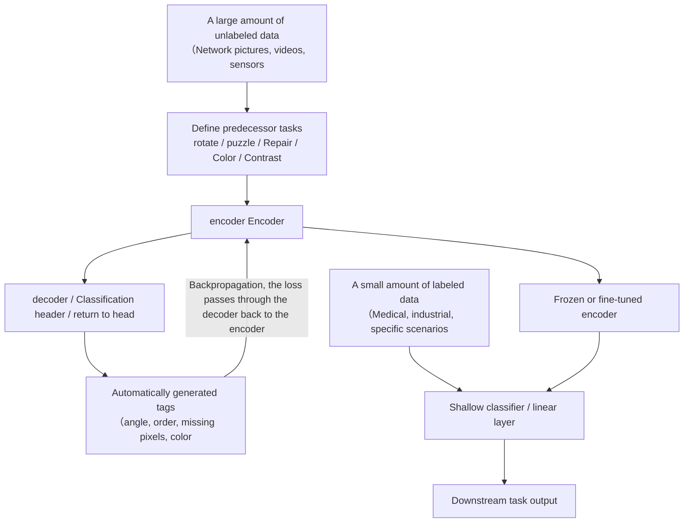
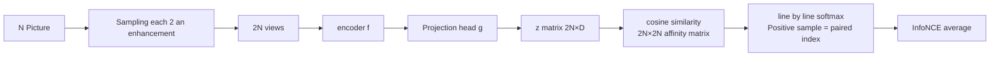

> **Course information**
>
> - **Course name**: Stanford CS231n: Deep Learning for Computer Vision(Spring 2025)
> - **Topic of this lecture**: Lecture 12. Self-Supervised Learning
> - **Lecturer**: Ehsan Adeli
> - **Teaching date**: 2025-05-08
> - **Course homepage**: [cs231n.stanford.edu/2025](https://cs231n.stanford.edu/2025/schedule.html)
> - **Official courseware**: [lecture_12.pdf](https://cs231n.stanford.edu/slides/2025/lecture_12.pdf) (115 pages, page-by-page illustrations in the book)
> - **Subtitle source**: [cs231n_sp25_kor_sub · eng](https://github.com/lpaiu-cs/cs231n_sp25_kor_sub/tree/main/eng) (Publicly transcribed in English, Chinese rewritten by this book)
> - **Copyright statement**: The copyright of the slides and course materials belongs to Stanford University and the instructors; this book is an unofficial study note and is only used for study and research.


Lecture 11 solves the problems on the machine side: how to use GPU, how to parallelize multiple cards, and how to expand training to a larger scale. This lecture deals with the other half of the same thing - data. Computing power can be bought and stacked, but labeling cannot. When the model increases from one million parameters to one billion parameters, the only production material that cannot increase at the same rate is manual labeling.

Ehsan Adeli organized this lecture into two technical tracks. The first half is "creating labels from image transformation": converting a picture, covering an area, shuffling the order of patches, removing colors, and then using reconstruction or classification to predict the part that has been moved by yourself. This represents the work of MAE. The second half is "creating labels from the relationship between samples": bringing the two views of the same picture closer, pushing the views of different pictures farther away, and writing the unsupervised problem as an N-way classification problem. Representative work is InfoNCE, SimCLR, MoCo, CPC and DINO. There is only one common assumption between the two routes: **As long as the prediction task is hard enough, the encoder is forced to learn a general structure about the visual world**.

## 1. Labels are the bottleneck: computing power can be piled up, but manual labeling cannot be piled up.

*(Reference time: 00:00:05 – 00:08:20｜Lecture 12)*


There are only three lines on the business page before class starts: the midterm exam will be held during class time next Tuesday (5/13), don’t be late, see Ed’s post for logistical details; the midterm review class will be tomorrow (Friday, 5/9) at 12:30 noon; feedback on the project proposal has been sent to Gradescope. This page has nothing to do with the technical content that follows, but it gives this lecture a time coordinate - this is the last lecture before the midterm, and the next class is the exam.


The previous lecture was a new addition to the course. The lecturer's own evaluation was "timely and very important" - the expansion of model scale and application has made "how to spread training onto many cards" from an engineering detail to a required course. But this page only stayed for a few seconds, because it solved "can count", and what we want to solve today is "can afford to feed".


This picture is the motivation picture of the whole lecture, but it hides the motivation in the layout. The four grids are classification, semantic segmentation, target detection, and instance segmentation. The following three lines of small words mark their supervision granularity: classification "No spatial extent" - one label for each picture; semantic segmentation "No objects, just pixels" - one category for each pixel (grass, cat, tree, dog, sky); instance segmentation "Multiple objects" - also separate similar objects one by one. It is along this granularity gradient that the labeling cost explodes. A 224×224 image has 50,176 pixels. Classification requires only 1 label, while semantic segmentation theoretically requires 50,000. Even if polygons or graffiti are used to approximate it, the manual time difference is still three or four orders of magnitude. The lecturer did not give a specific price, but this order of magnitude difference is enough to explain all the subsequent designs: **Any method that can bypass manual labeling, as long as it maintains accuracy, is worth a try**.


Back to last week’s visualization and understanding. That lecture talked about how to "see in": the saliency of gradients, class activation maps, and projecting the response of the intermediate layer back to the pixels. What we want to borrow today is not these tools, but the fact they expose - those numbers in the middle of the network are not gibberish, they have structure.


The classic comparison picture of AlexNet: the left column is the query graph, the middle left is the L2 nearest neighbor in the pixel space, the middle right is the L2 nearest neighbor in the feature space, and the network profile icon on the far right is red at the fc7 layer. The neighbors in the pixel space are all mushy images of the same color and texture - the elephant's neighbor is a bunch of gray-brown stuff; the neighbors in the feature space, each query image is followed by objects of the same type: purple flowers, elephants, warships, jack-o-lanterns, dogs. The difference comes from the framed red bar: the 4096-dimensional vector output by fc7. Two images can be very different in pixels, but very close in this 4096-dimensional space. This is what the term "learned representation" means in engineering: it is not an explanation, but a coordinate that can be used as a distance measure.


The same slide appears again, with the title changed from "Last Week: Visualization and Understanding" to "Learned Representations." This name change is a turning point in this lecture: in the previous lecture, it was used to explain that "the model has learned something." The question in this lecture is "Can this thing be used directly?" - If the 4096 dimensions of fc7 are used as features and a linear classifier is connected to produce categories, then we actually have a reusable intermediate product that is independent of labels.


The arrow continues to extend to the right: 4096-dimensional vector → Class Labels. At this point, the question is put on the table: **What are the difficulties with large-scale training?**  The instructor himself gave the answer and repeated it - we need a lot of labeled data. This network starts from the image and ends with the category. The reason why the 4096 dimensions in the middle are "useful" is precisely because the entire network is trained by the label; when the label is gone, the link is broken. So the core question of this lecture becomes a sentence that can be written on the whiteboard: Is there a way to train a neural network without massive manual annotations and still get good features?


The answer to self-supervised learning is to split this link into two parts. On the left is the pretext task: the task is defined by the data itself, without manual annotation. It is unsupervised in form, but the objective function of supervised learning is used for training - classification or regression. On the right is the downstream task: the application you really care about does not have a large data set, but the batch of data is labeled. There is only one thing shared between the two tasks: the encoder. The Trained Encoder in the picture is all the deliverables.



This picture is the skeleton of this lecture: the upper loop is self-supervised training, and the lower short chain is transfer. Note that it does not say "the performance of the pre-task is better" - on the contrary, the same sentence will appear repeatedly later: we don't care how accurate the model is in rotation prediction or puzzle, only how easy it is to learn the encoder in the downstream.


Take a look at the first paragraph. The input is an image, the encoder compresses it into a learned representation, and subsequent modules map the representation to the output space - the labels there are not human-labeled, but are automatically generated by the data. This post-module can be called a decoder, classifier or regressor, depending on how the pre-task is defined: to reconstruct pixels is the decoder, to predict four types of angles is the classifier, to regress a continuous angle is the regressor. The lecturer added something that is easily overlooked: when the post-module is a decoder, the whole thing is closer to the framework of an autoencoder. This sentence will become the main line in the MAE section later, because MAE makes the autoencoder into an asymmetric shape.


What is done in the downstream stage is replacement: the encoder is retained, the subsequent decoder is replaced by a classifier (FC is written on the picture), and the source of the label is replaced by a real label. At this time, only the last segment needs to be trained. The encoder can be frozen or fine-tuned - this option will be officially named linear probing and fine-tuning in the MAE section. For such a set of processes to be established, only two conditions are required, and they pull each other: the prerequisite tasks must **Difficult enough to learn**, otherwise the encoder cannot learn anything; the pre-task must **No manual annotation required**, otherwise it means nothing is saved. The rest of the entire lecture is essentially a matter of repeatedly checking how well these two conditions are met on different tasks.

## 2. How to accept pre-tasks: task performance, representation quality, robustness, efficiency, downstream

*(Reference time: 00:08:37 – 00:14:57｜Lecture 12)*


Defining prerequisite tasks is not simple. The lecturer's original words are "not that straightforward". This page gives four examples that have been run: image completion (cover a part, predict the covered part), rotation prediction (input the image, output the angle it has been rotated θ), puzzle (shuffle the patch, output the correct order), coloring (give a grayscale image, predict the color of each pixel). The four tasks share the same set of legal arguments, written at the bottom of the page: The process of solving these tasks will force the model to learn good features; the labels for these tasks can be completely automatically generated. The first article determines the method **upper limit**——If the task can be done correctly without understanding the object, then the learned features will not understand the object; the second item determines the method **cost**——As long as labels can be automatically generated, the amount of data can be infinitely expanded.


Next is assessment. This page lists five items, rearranged by the instructor in order of importance:

- **Pre-task performance**: How well the model does on the unlabeled task itself. It is the easiest to measure and the most deceptive - when the task is simple, the accuracy can be very high but the features are useless.
- **Indicates quality**: Don’t look at any fine-tuning, just look at the representation itself. Three common methods are linear evaluation protocol (linear evaluation protocol, training a linear classifier on frozen representation), clustering (seeing whether the representation can be naturally grouped), and t-SNE (reducing high-dimensional representation to 2D/3D visual separability). The lecturer specifically explained that t-SNE has not been discussed much before, and its function is only dimensionality reduction and visualization.
- **Robustness and generalization**: How much is left after changing the data set and perturbation.
- **Computational efficiency**: Training time and resource overhead.
- **Migration and downstream performance**: Move the representation to a supervised downstream task and see what it's worth.

The lecturer clearly called out the names: the most important of the five items is the last one. There are engineering reasons for this judgment - the accuracy of the pre-task is a proxy indicator, and only the downstream indicators are what we pay for; the correlation between the proxy indicator and the real target is precisely the most uncontrollable link in self-supervised research.


This is the first frame of the "evaluation flow chart" in all self-supervised papers. On the left is a bunch of unlabeled data, in the middle is self-supervised learning plus a feature extractor (a convolutional network), and in the upper right corner is the output of the rotation task: the image is rotated 0/90/180/270, and the network outputs one of four categories. The product of this step is not the four-classifier, but the encoder.


The second frame connects the downstream: a linear classifier (conv + linear classifier is written on the picture) is hung behind the feature extractor, trained with a small amount of annotated data of the target task, and finally evaluated on the target task (classification, detection, etc.). Note that the fc and four-class headers in the first frame have been removed entirely - they are only useful in the pre-stage and are not needed at all downstream. The lecturer emphasized that what is important here is **Shallow layer** network. The reason is very straightforward: if the features are really good, no complicated mapping is needed to read the categories; if a deep network is required to read the categories, it means that the information is not in the features, but has been re-learned in the new layers you added. At this time, the question "are the features good or not?" loses its meaning. This is also the entire logic of the linear evaluation protocol.


This page takes the field beyond computer vision. The four grids on the figure correspond to four fields: vision (Doersch et al., 2015), language modeling (GPT-4, OpenAI 2023), speech synthesis (Wavenet, van den Oord et al., 2016), and robotics/reinforcement learning (Dense Object Net, Florence and Manuelli et al., 2018). The grid in the middle marked "Today's lecture" is the scope of this lecture. The lecturer made the most important judgment here: the paradigm that makes these large language models possible today is self-supervision. Most of the training corpus of frameworks such as GPT-4 is original text, and no one annotates it sentence by sentence; the same logic is being replicated in speech, robots, and reinforcement learning. He also gave a very specific example: There are so many self-driving cars running data on the roads in the Bay Area. Part of the business logic is that "the data can be collected by oneself, and there is no need to label it by oneself."


The agenda is divided into two parts. The first half is the preliminary tasks of image transformation: rotation, repair, rearrangement, coloring, plus the latest form of route reconstruction, MAE. The second half is about contrastive representation learning: first we talk about intuition and formalization, then we talk about instance-level methods SimCLR and MoCo, sequence-level method CPC, and finally DINO.


The second frame on the same page only changes one thing: the entire second half is grayed out. This is how the lecturer uses the progress bar - light up the first half first, then come back and light up the second half after finishing the lecture. This agenda will appear again in the same form on page 67, with the first half grayed out.

## 3. Rotation, relative position, puzzle: turn geometric transformation into classification labels

*(Reference time: 00:15:26 – 00:26:25｜Lecture 12)*

### 3.1 All bets on rotation prediction are on “visual common sense”


This is the first prerequisite task in this lecture, and it is also the cleanest assumption in the whole lecture: **A model can only recognize the angle it has been rotated if it has visual knowledge of "what this object should look like when it is upright."**. This sentence ties together the difficulty of the task and the quality of the features - for the model to be correct, it must know that the bird's beak is facing forward, the human head is facing up, and the car's wheels are facing down.


The implementation is straightforward. an original picture  $X$, using four deterministic functions  $g(X, y)$  Rotate 0, 90, 180 and 270 degrees respectively to get  $X^0, X^1, X^2, X^3$  Four versions, the labels are  $y \in \{0,1,2,3\}$. The lecturer specifically pointed out that this is not a regression: there is no need to predict the exact angle, just choose one of the four categories. The advantage of four classifications is that the task is stable and the categories are balanced - each picture must and only generate four samples, each category accounts for 25%, and there will be no problem of particularly large numbers of certain types of angles.


The second frame fills in the training half: four rotated versions enter **same one** ConvNet $F(\cdot)$, the next four target boxes say "Maximize prob.  $F^y(X^y)$”, that is, for each  $y$  Maximize it and judge it as the first  $y$  class probability. Shared weights are the only subtlety here - if you train a network from each of the four angles, you will learn four unrelated features, and there will be no "universal representation" at all. The amount of data is also easy to calculate: originally  $N$  A picture, after one rotation, it becomes  $4N$  training samples, labeling at zero cost. This is a common bonus for all image transformation pre-tasks——**Data enhancement has been upgraded from regularization to label factory**.


CIFAR-10 was used for evaluation. The method is: do rotational self-supervised pre-training on the entire CIFAR-10 training set, then freeze conv1 and conv2, and only use a small part of the labeled CIFAR-10 data to learn conv3 and linear layers. The horizontal axis is the number of labeled samples (20, 100, 400, 1000, 5000), and the vertical axis is the test accuracy.

There are two things worth remembering about the curve. First, **The gap between low label intervals is huge**: With only 20 labeled samples, the semi-supervised version (yellow line) is already around 65%, while the supervised version starting with random initialization (blue line) is still around 39% - a 26 percentage point gap, all from pre-training. The instructor's statement is that "the model was in a good state from the beginning, and the object was already understood even in the first few iterations." Second, **The two lines in the high-labeled interval will merge.**: By 5000 labeled samples, both climb to around 92% (the blue line is slightly higher). The reason is not mysterious - CIFAR-10 itself is a simple task. Once there is more data, the monitoring signal itself will be enough. This just delineates the applicable boundaries of self-supervision: **What it buys is the slope of the low marked interval, not the upper limit.**. The simpler the task, the less valuable this slope is; the more difficult the task and the more expensive the annotation, the more valuable it is.


This table is the first hard number in this lecture and is worth reading line by line. The task columns are classification (%mAP), detection (%mAP) and segmentation (%mIoU) of Pascal VOC 2007, and the rows are different pre-training sources:

| Pre-training method | Classification fc6-8 | Category all | Detection | split |
| --- | --- | --- | --- | --- |
| ImageNet fully supervised (upper limit reference) | 78.9 | 79.9 | 56.8 | 48.0 |
| Random initialization (no pre-training) | — | 53.3 | 43.4 | 19.8 |
| Random initialization + scaling | 39.2 | 56.6 | 45.6 | 32.6 |
| Rotating Self-Supervision (RotNet) | 70.87 | 72.97 | 54.4 | 39.1 |

There are three levels of reading. The line with random initialization is the floor: classification 53.3, segmentation 19.8. The rotational self-supervision line raised the floor to 72.97 and 39.1 - a nearly 20-point increase in classification and a direct doubling of splits. But compared with the ImageNet fully supervised line, it is still 2-9 points behind (only a difference of 2.4 in detection and a difference of 6.9 in classification), and these points are obtained by spending 1000 categories of manual labels. The lecturer's original words are: rotation pre-training "is not equivalent to pre-training on all ImageNet, but it is very close."

Note that there is a row of other self-supervised methods in the table, and RotNet ranks at the top in all three columns: Split 39.1, higher than ColorProxy’s 38.4, Jigsaw’s 37.6, and Split-Brain’s 36.0. However, the sorting within the table is not stable: Jigsaw's 67.6 on the classification column exceeds Split-Brain's 67.1, ColorProxy's 65.9 on the detection column surpasses Jigsaw's 53.2, and the order of each company on the split column is changed again. **The selection of predecessor tasks will systematically favor certain types of downstream tasks**, this observation is a foreshadowing of the summary on page 61.


The third evaluation angle is to project features back to pixels and see where the model is looking. The lecturer gave a useful comparison: the attention map of the fully supervised model tends to be more focused - it only needs to solve the task of classification, and it is enough to capture the eyes and the shapes around the eyes. Other areas have nothing to do with loss; the coverage of the self-supervised model is significantly wider, because it does not know what the downstream tasks are and can only establish a more overall understanding of the entire image. This is not evidence that "self-supervision is better", but a structural difference: **The narrower the supervision signal, the easier it is for features to be squeezed into a shape that only serves that task.**. This sentence will appear in another form when we talk about contrastive learning later - the reason why the projection head exists is to prevent contrast loss from compressing the features too narrowly.

### 3.2 From "which patch" to "which arrangement"


The second task is relative position (Doersch et al., 2015). Cut the picture into a 3×3 grid, take the center patch as a reference, and ask the model: Where is this patch relative to the center? The eight non-central locations correspond to eight categories, so it is again an 8-way classification. The illustration on this page is a microcosm of the entire lecture: breaking down "understanding images" into "understanding the spatial relationships between parts."


Noroozi and Favaro pushed this idea to the extreme in 2016: using the same 3×3 grid, all 9 patches were scrambled, allowing the network to predict the correct arrangement. The lecturer asked the class a question on the spot: How many arrangements are there in this setting? The answer was shouted out by the students——$9! = 362{,}880$.

Directly doing 360,000-way classification is neither necessary nor stable, because many permutations differ only by one adjacent exchange and are almost visually the same. The author's approach is to build a lookup table and retain only 64 permutations. The selection criterion is the largest difference between them (the lecturer's term is "largest difference distance"). In this way, the task becomes a 64-way classification, and the output is a 64-dimensional vector. The lecturer added a very practical comment: The number 64 is almost arbitrary. It was not chosen as a result of theoretical derivation, but to make the task fall on a controllable classification scale——$\log_2 64 = 6$  The amount of information in bits is not too small for a picture.


The migration results are evaluated according to the same set of VOC protocols. "Ours" in the picture is the puzzle feature, and the comparison is the relative position method of Doersch et al. The lecturer did not read the numbers one by one, but only gave the conclusion: the jigsaw method surpassed the previous framework in these three types of tasks. This is worth noting - the two tasks use the same 3×3 grid and the same batch of images. The difference is only in "predicting the position of a single patch" or "predicting the arrangement of the entire group of patches". The latter advances the task from "identifying local content" to "identifying global layout", and the feature quality has reached a higher level. The lecturer then reminded the year: this was work in 2016, early in this series of methods. The boundaries of its capabilities are also very clear - a network that can only judge 90-degree rotations does not understand what an object is, but only its orientation.

## 4. Repair and coloring: treat pixels and colors themselves as supervision signals

*(Reference time: 00:26:30 – 00:37:04｜Lecture 12)*

### 4.1 Cover a piece and let the model write back the missing pixels


The third task is inpainting, Context Encoders of Pathak et al. (2016). The masking strategy couldn't be simpler: cover up a rectangular area on the input image and let the model fill it back. Its legitimacy comes from the fact that the covered content exists in the original data, so **We always have standard answers on hand**, but this answer never needs to be marked.


The structure is an encoder-decoder: the encoder presses the obscured image into the feature space, with several fully connected layers in between. The decoder restores the features to pixels in the missing area, and the loss function compares the output with the real pixels. The lecturer classified it into the category of autoencoders, but emphasized a qualifier - this is an "autoencoder trained with a mask target". It reconstructs not the entire picture, but the obscured part. This qualification is important because it determines what the encoder must learn: if the goal is to reconstruct the entire image, the network can learn an identity mapping (copying the input to the output) and understand nothing; when the goal only falls in the missing region, the identity mapping fails and the network must infer the content from the context.


However, there is a natural problem with the evaluation of restoration. The lecturer stopped to talk: **There are countless reasonable ways to fill the same gap**. The sky can be made into blue or gray, the grass can be made into green or yellow, there is no wrong calculation. When measured by L2, the model will tend to output the "average" of these reasonable answers - so the early reconstruction results are generally weak, blurry, and the edges are smoothed. This is not because the model is not big enough, but because the loss function encourages averaging. This diagnosis leads directly to the next page.


The solution is to add a counter term so that "it doesn't look real" also enters the loss. The entire page of formulas is worth copying:


$$
L(x) = L_{recon}(x) + L_{adv}(x)
$$


$$
L_{recon}(x) = \left\| M * \left( x - F_\theta((1-M) * x) \right) \right\|_2^2
$$


$$
L_{adv} = \max_D \; \mathbb{E}\left[\log D(x)\right] + \log\left(1 - D\left(F((1-M)*x)\right)\right)
$$


Each of the three symbols performs its own function. $M$  is a mask, the covered area is taken as 1, and the uncovered area is taken as 0; $*$  It is element-wise multiplication; $F_\theta$  It is an encoder plus a decoder. So  $(1-M)*x$  It means "feed only the visible part", $F_\theta((1-M)*x)$  is the completion result, $x - F_\theta(\cdot)$  is the pixel-by-pixel error, multiplied again by  $M$  Just count the errors in the covered area——**The loss is only calculated on the gap, not a single pixel in the visible area.**. This is completely consistent with the approach of MAE later and can be seen as a repeat of the same recipe on a larger scale. The adversarial term is written in the standard GAN way. $D$  is the discriminator. The lecturer clearly said that this section will be left to the next lecture (generative model) to expand. Here you only need to know that it solves "ambiguity".


Four columns side by side are all the evidence for this argument: input (gap context), pure reconstruction, pure confrontation, reconstruction plus confrontation. The result of pure reconstruction is smooth but has no details; pure confrontation can generate texture, but it may go off track; the combination of the two gives both structure and texture. The lecturer only added one judgment on this page: after adding the confrontation item, the reconstructed part "looks better."


Under the same set of VOC migration protocols, the repair features also gained gains, and the gains were distributed in the three columns of classification, detection, and semantic segmentation. The lecturer buried a kickback here: "I will return to the reconstruction-based framework and mask later, because this is one of the most commonly used models or pre-training tasks at present" - he is referring to the MAE starting on page 52.

### 4.2 Coloring: Separate brightness and color, and you will have a pair of free supervision signals


The fourth task is coloring, and the idea is a little more "physical" than the first three. Color images are usually stored in RGB, but the three RGB channels are mixed together, causing brightness and color to become entangled. It can be disassembled by changing to LAB color space: $L$  is the brightness, $a$, $b$  are two chroma channels. So the task becomes - input  $X \in \mathbb{R}^{H \times W \times 1}$ (L only), output  $\hat{Y} \in \mathbb{R}^{H \times W \times 2}$ (ab two channels). The lecturer inserted a narration here: There are many kinds of color spaces. RGB is the most commonly used in computer vision, but if you want to separate brightness and color, you have to change to a space such as LAB; stack the three channels L, a, and b to restore the color image. This passage explains why coloring is a legitimate pre-task: **The color is in the data, just split into two other channels.**.


In the second frame, the result is taken back: gray input warp  $F$  Output ab, and then concatenate it with L to form  $(\mathbf{X}, \hat{\mathbf{Y}})$, the picture on the right has changed from a pseudo-color channel visualization to a real color photo - the fish in the coral reef has been restored to a dark blue body with a yellow tail fin. The significance of this frame is to translate "predict two channels" into "generate a color picture", and also conveniently illustrates the evaluation method of this task: whether the color is correct or not, the human eye can tell at a glance.


Following the "given one part of the channel, predict the other part", you will naturally ask: Why can we only L → ab? The same holds true in the opposite direction. This is the split-brain autoencoder (Zhang et al.): the input image is divided into two channels: L channel and ab channel. The network  $\mathcal{F}_1$  Learn L → ab, network  $\mathcal{F}_2$  Learn ab → L, the outputs of the two pieces are put back into the original image, and the L2 loss is calculated with the input. The lecturer's description is: During training, these two functions are trained together, and finally the two functions are combined to generate the entire image and then the loss is calculated. Any distance function can be used. The subtlety here is **The two groups supervise each other**: The input of one branch is the target of the other branch, so no external labels are needed, and there is no need to design two sets of tasks.


The second frame abstracts it into a universal form. input graph  $X$  cut into two sets of channels  $X_1$ (blue) with  $X_2$ (yellow), the two paths use  $\mathcal{F}_1$, $\mathcal{F}_2$  Do cross-channel predictions: $X_1 \to \hat{X}_2$, $X_2 \to \hat{X}_1$, put together to get  $\hat{X}$. Once this form is established, "color" is no longer a necessary condition - any data that can be naturally grouped can be included.


The example given by the lecturer is an RGB-D sensor: a frame of data has both an RGB channel and a depth channel (HHA depth encoding is marked on the picture), so RGB can be used to predict depth and depth can be used to predict RGB, and the two are combined to form a predicted RGB-HHA image. He said this type of cross-modal prediction is a successful downstream task in robotics applications. This also explains the origin of the name split-brain: an autoencoder is split in half, each responsible for half of the channels.

### 4.3 Two by-products of coloring: a usable tool and a picture that can tell a story


Back to assessment. The approach is to do self-supervised pre-training on the entire ImageNet training set, and use it downstream  **$F_1$  with  $F_2$  The splicing characteristics of**, the evaluation data is labeled with Places (Zhou, 2016). The lecturer concluded that these features have a pretty good accuracy in predicting categories, but **Still not as good as full supervision**——Because there are no labels involved here, only two-way features spliced together. The action of splicing is worth noting: since the two channels have each viewed different channels, their features carry complementary information; joining the two channels together is equivalent to combining the "shape learned from brightness" and the "semantics learned from color" together. This is the only structural advantage of split-brain over unidirectional coloring.


The instructor talked about the value of coloring from a different angle here: it is not only a pre-training method, but also a useful tool in itself - it can colorize photos and videos that do not have color versions. The example on this page is an old photo (a zoo animal, black and white negative), and the color given by the model is tan fur and a gray-green background.


What is even more illustrative is this picture: Yosemite’s Half Dome, bridge, trees, and complete reflections on the water. The lecturer pointed out that not only the object itself is colored in the model, but also the mountains, trees, and bridges in the reflection are given the same color as the real thing. The model is not explicitly told that "water reflects", it learns this from massive amounts of data. The lecturer followed up with a qualification, which is worth remembering: These models appear before large language models and large vision models. They are trained for specific tasks, not to "solve everything". So when you see signs of "understanding the physical world," think of it as an interesting by-product rather than evidence of general ability.

## 5. Video coloring: Temporal consistency brings out tracking capabilities

*(Reference time: 00:37:09 – 00:44:46｜Lecture 12)*

### 5.1 From single frame to sequence: an extra constraint


By pushing coloring to video, there is an additional degree of freedom and an additional constraint in the task description. The settings are: $t=0$  The reference frame is in color, $t=1,2,3,\dots$  The target frames are in grayscale and the task is to color these frames. The question in the middle of the page is where all the difficulty lies - "How should I color these frames?" When coloring a single frame, each frame can independently guess a reasonable color; this is not possible in videos, because the clothes of the same person in the same video will not suddenly change color.


The second frame writes the answer: Should be the same color. From this we get the hypothesis of this section——**Learning to color video frames should allow the model to learn to track regions or objects without labels**. The reason is very straightforward: to give  $t=3$  To match the correct color to the person in the frame, the model must first be  $t=0$  Find the "same person" in the frame, and then move the color of that position over. Tracking is not explicitly supervised; it is a necessary intermediate step to complete the task.

### 5.2 Pointers, attention, weighted sum: move colors in three steps


Vondrick et al.'s approach is to establish a mapping between the reference frame and the target frame in the learned feature space, treat these mappings as "pointers", and use them to copy the color (LAB space) on the reference frame to the target frame. The instructor emphasized that this mechanism is the same thing as attention - for each target pixel, calculate its attention weight relative to all pixels in the reference frame.


The first step is the attention map: for a pixel in the target frame, use CNN features to calculate the similarity between it and each pixel of the reference frame. The input of this step is the feature map of the two frames, and the output is a weight map of the same size as the reference frame.


The second step is weighted summation: write the predicted color of this pixel as the weighted average of the colors of all pixels in the reference frame, and the weight is the attention of the previous step. The lecturer put it very simply - attention is similarity. High similarity means "it is probably the same position on the same object", so copy more of its color. Dimensionally this is a very light operation: on a  $H\times W$  target frame, each pixel needs to be compared to the reference frame  $H\times W$  The position is calculated as the weight, and the cost is  $O(H^2W^2)$;The actual implementation will be done on low-resolution feature maps, which is why it can run.


The third step is the training signal: calculating the loss between the predicted color and the real color. Note that what is being supervised here is **Color**, not "correspondence" - in order to make the colors match, the network forced the correspondence out. This is the standard recipe for self-supervision: supervise a cheap, automatically available target, and let the really desired representation become a by-product.

### 5.3 Qualitative results: Consistency is evident


Three-column arrangement is the standard display method for this type of paper: reference frame (color) in the left column, target frame (grayscale) in the middle column, and prediction in the right column. This example is an indoor gym with wooden shelves, black barbell plates, blue mats, and characters sitting on the ground. What the lecturer wants the audience to see is not "whether the color is accurate", but "whether the front and back frames are consistent." He gave a counterexample as a comparison: if each frame were colored independently, the color of the character's shirt would jump because there is no constraint requiring it to remain consistent. The value of video colorization does not lie in the beauty of a single frame, but in the **Stable across frames**——And this stability can only come from "finding the corresponding position".


Changing the scene, the conclusion is the same: the character in the yellow training uniform maintains the same color between multiple frames. The noteworthy detail here is that the character's posture is changing and the position is moving, but the color follows the person - this shows that the attention is indeed locked on "that person" rather than on a fixed image coordinate.

### 5.4 By-product: Segmentation masks and key points can also be "propagated"


Since attention gives "which pixel in the reference frame corresponds to this pixel in the target frame", it can not only transmit color. By mapping the segmentation mask on the reference frame with the same attention weight, the segmentation of the target frame is obtained - it is this propagation chain shown in the figure.


The same is true for key points: the posture key points marked on the reference frame are moved to subsequent frames by focusing on them, which becomes key point tracking. The instructor's exact words were that because you're counting attention to a reference frame, you can actually track objects, track clips, and even identify key points in the video. This chain of results is the most convincing section of the entire lecture: a task designed for "coloring", and the final delivery is the three capabilities of tracking, segmentation propagation and key point propagation, and their training labels are only the video itself.

### 5.5 Three Questions Asked, and the Lecturer’s Boundary Statement

The class paused here to ask three things, and the instructor's responses formed the boundary statement for this section.

**Why do coders know what to learn?**  The answer is that the tags come from the decoder, not from the person. The outputs of the pre-task (angle, color, missing pixels) are automatically generated from the data, the loss is calculated on these outputs, and the gradient is passed back through the decoder to the encoder. The instructor used a rhetorical question to align his intuition: When training a classifier, how does the encoder know what features to extract? Rely on reverse transmission loss. It's exactly the same here, except that "label" is replaced by "another channel" or "occluded pixel".

**Are the encoder and decoder one network or two?**  The lecturer said that this is completely different in different papers. When predicting the rotation angle, the decoder is just a few layers of fully connected, and the whole thing is a network, and those layers can be replaced in the downstream; when reconstructing the image, two networks are usually trained end-to-end, because you want to use the middle representation space; when it comes to MAE, there is no symmetry on both sides. **This is a task-related design choice and there is no single answer**.

**Why does the puzzle only take 64 permutations?**  because  $9!$  It is too large and most of the permutations are only one adjacent exchange away. The author selected the batch with the greatest difference from each other and classified the tasks into 64 ways (see 3.2 for details).

Finally, there is a disclaimer added by the lecturer: These are the earliest methods of self-supervised learning and should not be expected to "solve everything"; the assumption of the rotation task is just that if the model can judge "this is rotated 90 degrees", then it at least implicitly understands the correct orientation and can recognize what is inside when it gets the upright picture. He admitted that this was a limited task, but limited did not mean useless.

## 6. MAE: Mask out 75% of the image to make reconstruction a scalable pre-training

*(Reference time: 00:45:41 – 00:54:16｜Lecture 12)*

### 6.1 One gap turns into more than a hundred gaps


The lecturer puts MAE (He et al., 2021) here because it is of the same family as the previous repair task, but the scale is pushed up. The repair on page 28 only covers a rectangle, while MAE covers a large number of irregular patches, and the masking is more severe: two mask ratios of 50% and 75% are given side by side on the page. Why cover up so much? The lecturer gave two reasons, which will be confirmed by data on the ablation page later. The first one is **difficulty**: The more masked, the less context is left, and the less likely the task is to be fooled by texture. The model must truly understand the object structure. The second one is more engineering-the more masking, the more different masked versions of the same picture can be produced, and the amount of data increases several times out of the blue.


The entire pipeline is drawn on one page: the input image is cut into grids and most of the grids are covered; only the visible patches are sent to the encoder (gray large blocks); the encoder outputs a string of tokens; at the decoder entrance, the obscured positions are filled with gray tokens to form a sequence equal to the number of patches; the decoder outputs the reconstruction of each patch; on the right is the comparison of the reconstruction results with the target image. Note that there is an asymmetry in this chain: **The encoder only sees part of the token, the decoder sees all**. This is the watershed between MAE and classic autoencoders, and it is also something that will be discussed repeatedly in this section.

### 6.2 The occlusion method is a super parameter: uniform sampling 75%, no mask token


Four bullet points on the page make up the design description for the MAE. First, the segmentation method follows ViT: the image is divided into non-overlapping patches. Second, uniformly and randomly sample 75% of the patches and mask them out. Third, a high occlusion ratio is a necessary condition for the task to be meaningful - too little occlusion and the model can rely on neighboring pixel interpolation for intersection. The fourth and most technical one: **The encoder does not put the mask token**, feeding only the visible 25%, which is exactly why the encoder can do so much. The third article deserves an expansion. There is a natural shortcut for reconstruction tasks: if the gap is small, the receptive field of the convolution can interpolate the answer from the neighbor, and the model does not need semantics at all. Occlusion scale essentially cuts off this shortcut - the larger the gap, the less feasible interpolation is and the more semantics becomes the only way out.


The work of the encoder can be broken down into three steps: linear projection mapping of the visible patch to the embedding space; adding position coding (exactly the same as ViT, except that the position index corresponds to the original grid position); and sending a series of Transformer blocks. Because only 25% of the tokens are input, the calculation amount of each token of the encoder can be much greater than that of the decoder - the number given on the page is **The amount of calculation per token of the encoder exceeds 9 times that of the decoder.**. This 9x didn’t come out of thin air. Cut a 224×224 picture according to ViT’s common 16×16 patch, resulting in a total of 14×14=196 patches (Editor’s note: This is ViT’s standard cutting, the slide does not give specific sizes). After 75% occlusion, the encoder only processes 49 tokens, but the decoder has to process 196. By making the encoder deeper and the decoder shallower, the total computing overhead is kept within a controllable range - this is the core account that enables MAE to "scale".


The decoder does the opposite: it first puts the output of the encoder back into the grid in its original order, and inserts a **Shared learnable mask token**, and then add position coding to all tokens; then through several Transformer blocks, the last layer of linear projection maps each token into pixels to complete the reconstruction. The lecturer's explanation of the mask token is very honest: it is a learnable parameter, and there is no way to strictly explain what it encodes. It can only be said that it is roughly equivalent to the placeholder of "an average patch". The key is that it is **Share**——The same vector is used for all occluded positions instead of 147 different vectors, which decouples the parameter quantity from the occlusion ratio. The last sentence of the page is the most important structural judgment in this section: the decoder is only responsible for reconstruction, **After training, discard the entire section**, so it is completely decoupled from the encoder design - unlike traditional autoencoders or UNet, which require symmetry on both sides. This is the so-called asymmetrical autoencoder.

The implications of this design choice are worth explaining: in classic autoencoders, the capacity of the encoder and decoder must be weighed together, because the decoder must be used along with the model; while the MAE decoder is just a "scaffolding" that can be made shallow and narrow - its only task is to translate features back to pixels, and then it is useless.

### 6.3 The loss is only calculated on the gap, and the probe is only done on the feature.


The loss function is the mean square error (MSE) in pixel space, and **Only calculated for obscured patches**——The reconstruction of the visible area is an identity map, and counting it will only dilute the gradient. This article has the same idea as repairing damage on page 31, except that a mask is used there.  $M$  To do element-wise multiplication, here we directly use the patch collection to filter. Using MSE instead of perceptual loss or adversarial loss is a clear trade-off: pixel-level MSE will bring smoother reconstruction, but it is simple, stable, and scalable; while the goal of MAE is not to generate good-looking images, but to train a good encoder. When the lecturer evaluated the repair task earlier, he said that the reconstruction result was "false". MAE did not fix this problem because it did not care.


After the encoder is trained, there are two downstream routes, and the page draws them into upper and lower boxes. **linear probing**: The pre-trained model is frozen, and only a linear layer is added at the end to predict the label to evaluate the quality of the representation. **fine-tuning**: The pre-trained model is not frozen and is trained together with the newly added layer or layers (can be non-linear). The lecturer made the positioning of the two very clear: linear probing measures "how well the representation itself is under restricted conditions", while fine-tuning explores "what level the model can achieve when it is close to its true potential." This also explains why two numbers are reported in the paper - the former is the lower bound of quality, and the latter is the upper bound of practical performance.

### 6.4 Ablation: Among the eight hyperparameters, the most important ones are occlusion ratio and sampling method


This page lists the choices that need to be made: occlusion ratio, decoder depth, decoder width, whether the encoder uses mask token, reconstruction target, data enhancement, mask sampling method, training plan. The lecturer's original words were "so many modeling and hyperparameter selections", with a hint of helplessness in his tone - the adjustable space of this type of method is too large, and the persuasiveness of the paper must be achieved through ablation. He picked two to talk about. **Occlusion ratio**:75% gives a high accuracy, that's why it was chosen, not a priori. **Sampling method**: Mainly comparing random occlusion and grid/block occlusion, the conclusion is that random occlusion is the best. This conclusion is supported by intuition - block occlusion will erase the entire area, and the spatial correlation between the remaining patches is too strong; random occlusion will scatter the neighbors of each visible patch, and the model must be pieced together based on global semantics.


The last page is a comparison. The lecturer said that MAE was significantly better in this set of comparisons, including the more powerful contrastive learning methods DINO and MoCo v3 at the time. His evaluation of this reconstruction route is also very straightforward: Nowadays, MAE is one of the most commonly used frameworks for pre-training on the original data set. This also echoes the words left by the lecturer when talking about repair feature migration - "I will return to reconstruction and masking later": From Context Encoder in 2016 to MAE in 2021, the same clue has been going for five years. What has changed in the middle is the occlusion strategy, encoder skeleton and scale. What remains unchanged is the loss: only the gap is counted.

## 7. Comparative learning: Write "whether it is the same object" as an N-way classification

*(Reference time: 00:54:22 – 01:14:27｜Lecture 12)*

### 7.1 Two diseases of pre-tasks: manual design and not universal


There are only three summaries in the first half, and the lecturer compresses the entire paragraph into a sentence chain of judgment: the pre-task focuses on "visual common sense" (predicting rotation, repair, rearrangement, coloring); in order to understand these tasks, the model is forced to learn good features about natural images, such as semantic representation of object categories; and we usually **Don’t care about the performance of these pre-tasks themselves**, only care about how useful the learned features are for downstream (classification, detection, segmentation).


The second frame adds two questions, which is the turning point of this lecture. First, it is cumbersome to design pre-tasks for each task individually, and they have to be redesigned every time you change areas. Second, the learned representation may not be universal - the features you learned on the rotation task are for "judging orientation". Both of these problems are not efficiency issues, but methodological issues: if each downstream task requires a specially designed pre-task, then self-supervision does not get rid of manual design, but just moves manual design from the labeling stage to the task design stage.


This page puts the four tasks side by side. The two lines at the bottom are the second turning point of the whole lecture: the learned representation may be tied to a specific pre-task; can a more general pre-task be designed? The lecturer did not give an answer immediately, but first turned it into an operational question: If "universal" means that it can be used for any task, then this task at least cannot rely on a specific transformation (rotation, occlusion, color), it must come directly from the relationship between objects in the data.

### 7.2 More general task: two views of the same object should be close to each other


The answer starts to take shape from here. We always have two relationships on hand: the same image is still the same object after different transformations; other images in the data set are **different** object. The former is free, unlimited, and does not require any semantic annotation.


In the second frame, the comparison is completed: in addition to "same object", there is also "different object". So the task changed from "predicting the parameters of a certain transformation" to "determining whether the two perspectives are the same object" - this task does not depend on the specific rotation or cropping, nor does it depend on the color space or patch order. It only relies on the concept of "object identity".


The third frame gives the action: representing the same object in the feature space **bring closer** (attract), the representation of different objects **Push away** (repel). The lecturer's original words are - if I can define such a task: those belonging to the same object and the same pixel are approached in the representation space; those that do not belong to the same object are maximized in the potential space, then this is contrastive learning. At this point, the design of the pre-task has changed from "inventing a transformation" to "defining a relationship". The abstraction level of this step is increased, which is why it can be applied to images, videos, audios, and texts later.

### 7.3 Three-piece set: reference, positive, negative


Back to the agenda, this time it is the first half that is grayed out. The four lines in the second half: intuition and formalization, instance-level comparison (SimCLR and MoCo), sequence-level comparison (CPC), and label-free self-distillation (DINO).


This page is the same diagram as page 66, which the instructor showed again before going into formalization. Its function is to fix the slogan "Pull In/Push Away" into a visual anchor - all the following formulas are essentially writing cost functions for these two arrows.


Formally only three characters are needed. **reference**  It is a reference sample  $x$; **positive**  is a transformed version of it  $x^+$; **negative**  Is a sample of other objects in the data set (or current batch)  $x^-$. The lecturer emphasized that intra-batch learning is used here: the transformed versions of other samples in the same batch are naturally negative samples, and no additional construction is required.

### 7.4 From scoring function to InfoNCE: a Softmax with a different name


The starting point for formalization is a scoring function  $s$. Given encoder  $f$, we hope  $s(f(x), f(x^+))$  high, $s(f(x), f(x^-))$  low. Note that there are no rules here  $s$  There is no rule about what it looks like.  $f$  What is the network - this is a constraint only **relative size** The goal, all specific comparison methods are to fill in these two blanks.


Writing "relative size" as an optimizable loss requires only one step: put the scores of the positive samples and the scores of all negative samples into the same softmax, and then take the negative logarithm. The title on the page already makes the setting clear - 1 positive sample, $N-1$  negative sample.


The second frame expands the sum in the formula into a long string with ellipses. This step is visually inconspicuous, but it is the key to understanding InfoNCE: each term in the denominator is a negative sample. The more negative samples, the larger the denominator, and the harder it is for a positive sample to win - the difficulty will automatically increase with the number of negative samples.


In the third frame, the formula is color-coded: the green horizontal line is the score of the positive sample pair, and the red horizontal line is  $N-1$  The scores of negative sample pairs. The full form is


$$
L = -\mathbb{E}_x\left[\log \frac{\exp\left(s(f(x), f(x^+))\right)}{\exp\left(s(f(x), f(x^+))\right) + \sum_{j=1}^{N-1}\exp\left(s(f(x), f(x_j^-))\right)}\right]
$$


The sentence "This seems familiar..." at the bottom of the page is a reminder left by the instructor in class.


The answer is revealed: This is the cross-entropy loss of the N-way softmax classifier. put  $N$  candidates (1 positive sample + $N-1$  negative sample) as  $N$  categories, the positive sample is the correct category, and the rest are wrong categories, so "contrastive learning" = "in  $N$  Find the positive samples among the samples." The lecturer talked about this equivalence relationship twice in class, because it determines all subsequent engineering choices: since it is classification, the numerical stability of softmax is needed; since the category is "other samples", the number of categories is equal to the number of samples in the batch; since you want to train well, you have to let  $N$  Big - This is the fundamental reason why SimCLR stacks batches like crazy.


This page gives the name and its theoretical identity. The loss is called InfoNCE (information noise contrastive estimation), from van den Oord et al. 2018. Two properties plus one source: it is  $f(x)$  with  $f(x^+)$  a mutual information between **Nether**;Number of negative samples  $N$  The larger the value, the tighter the bound; see Poole et al. 2019 for detailed derivation. The lecturer was very careful about the "lower bound": negative InfoNCE is the lower bound of mutual information, so minimizing InfoNCE is equivalent to maximizing mutual information. He also emphasized the meaning of mutual information - the mutual information between two graphs measures the amount of information they share. So what this loss is doing is **maximize  $x$  with  $x^+$  shared information, minimized  $x$  with  $x^-$  shared information**.

In theory, "the tighter the boundary," this sentence is directly translated into a hard constraint in engineering: larger  $N$. The lecturer put it very bluntly - training the network with this loss requires a huge batch size. The more negative samples, the better and faster the convergence. This sentence is the source of all the differences between SimCLR and MoCo in the next section.

### 7.5 SimCLR: A batch is a 2N classification problem


SimCLR (Chen et al., 2020) combines all the previous parts into a framework as simple as possible. The picture on the page is a horizontal pipeline: the same picture is divided into two channels, each sampling an enhancement, and passing through the same encoder respectively.  $f$, and then another projection head  $g$, finally in  $z$  Calculate pairwise similarity in space. Three components correspond to exactly three design decisions:

- **How to get the positive sample**: Two types of random data enhancement are performed on the same picture - random cropping, random color distortion, and random blur. This is the cheapest implementation of "same object".
- **How to calculate similarity**: Cosine similarity as a scoring function  $s$.
- **In which space are the features compared?**: Not directly compared to the output of the encoder  $h$, but first passes through a projection network  $g(\cdot)$, in  $z = g(h)$  Make comparisons in this space.

The third decision is the projection head that will be discussed separately later in this section. The first two decisions explain why SimCLR's enhancement strategy is taken so seriously - enhancement is the label generator. If the enhancement is not strong enough and the positive sample pair is too easy, the task will not be difficult.


A one-page diagram illustrates the data flow: an original image enters the enhancement pipeline, and two different enhancement combinations are sampled, resulting in two views. These two views are a pair of positive samples. The lecturer specifically emphasized that "all kinds of transformations make sense" - in the settings of SimCLR, the choice of enhancement is not derived theoretically, but is adjusted experimentally.


The formal first frame only writes "How to generate positive sample pairs": sampling two transformations from the enhancement function family  $t_1, t_2$, acting on the same picture, we get  $\tilde{x}_i = t_1(x)$, $\tilde{x}_j = t_2(x)$, this pair is a positive sample. There is a red text reminder in the lower right corner of the page, and the instructor also read it again in class: Assignment 3 uses a slightly different writing method, please follow the assignment instructions. This kind of reminder that "the classroom version is inconsistent with the homework version" appears repeatedly in the slides of CS231n. If readers are completing the homework, they must refer to the homework.


In the second frame, the loss is connected: InfoNCE is calculated for each positive sample, and the negative sample is  **All non-positive samples in batch**. This is the first watershed between SimCLR and MoCo - the negative samples come entirely from the current batch, with no queue and no history.


The third frame is supplemented with traversal: there are in the batch  $N$  The original picture was transformed into  $2N$  Views; each view takes turns as a reference, calculates the loss once, and finally averages it. So each batch contributes  $2N$  A loss term - this is why it is written in matrix form later. It is too wasteful to calculate each one one by one.


The matrix form makes the whole thing very clean. $2N$  Each view is passed through the encoder and the projection head to obtain  $\mathbf{z} \in \mathbb{R}^{2N \times D}$; Calculate the cosine similarity between the two and get a  $2N \times 2N$  The "affinity matrix" of:


$$
s_{i,j} = \frac{z_i^\top z_j}{\|z_i\|\,\|z_j\|}
$$


The pairing rules are fixed: Section  $2k$  person and number  $2k+1$  elements are a pair of positive samples. The diagonal of the matrix is ​​itself and itself (the similarity is always 1 and must be masked). Each positive sample pair corresponds to two symmetric positions in the matrix.


In the second frame, a sentence is added to completely connect this matrix and classification: each row is a **Classification tags**. No.  $i$  The task of the line is "in  $2N$  Pick my paired view among candidates", the correct answer is  $p(i)$, the rest  $2N-2$  All are negative categories. So


$$
\ell_i = -\log \frac{\exp\left(s_{i,p(i)}\right)}{\sum_{k \neq i}\exp\left(s_{i,k}\right)}
$$


The loss of the entire batch is  $i$  Take the average. This also explains why the bigger the batch, the better: $2N$  The larger the value, the more candidates for each question, the more difficult the question, and the richer the signals in the gradient.



This picture is worth remembering because MoCo only made two changes later: replacing "2N views" with "a batch + a queue", and replacing "calculating gradients in the same batch" with "only the query path calculates gradients".


Evaluation follows the standard protocol: train the encoder with SimCLR on the ImageNet corpora, freeze it, and train a linear classifier on the features using labeled data. The lecturer’s conclusion is: SimCLR does not use any labels and relies only on linear classifiers to surpass all previous self-supervised methods and even approach fully supervised results. He added a qualification, which is very important: because it is learning more general features, the network itself needs to be larger; and in terms of accuracy, it is still only "comparable", not "exceeding". The MoCo v3 page below will show the other side of this limitation: the parameter increases from 86M to 632M, and the linear probe only goes from 76.7 to 79.1.


Another way to evaluate: Instead of freezing, fine-tune the entire encoder with 1% or 10% of the labels on ImageNet. This is a semi-supervised setting, which is closer to actual usage than a linear probe - in reality you always have a little label on your hand, the question is how much you can leverage with this little bit. The lecturer did not read out specific numbers, but the setting itself illustrates the business logic of self-supervision: **What I bought for pre-training is "it can be used even with a small number of labels"**, rather than "no tags at all".


The first design choice is the projection head. The lecturer specifically answered a question in class: Why not directly use the output of the encoder?  $h$, but to go around one layer  $g$  get  $z$? The explanation given in the slide can be broken down into three steps: the goal of comparative learning will be **discard** Information useful downstream but not required for comparison tasks; representation space  $z$  is trained to be invariant to data transformation, so the transformation-related information is in  $z$  was pressed out; and through the projection head  $g$, this information can be retained in  $h$  inside. In other words, $z$  It is "a sign of sacrificing for the mission", $h$  It is a "representation left to the downstream", and the function of the projection head is to draw an isolation zone between the two. This explanation is a bit counterintuitive - usually we think that adding an extra layer will only introduce more nonlinearity, but here it plays the role of a "discarded container". Because of this, the downstream uses  $h$  instead of  $z$, this is often mistaken by implementers.


The second design choice is large batch, and the instructor used an exclamation point: large training batch size is crucial for SimCLR. The reason has been discussed before - the number of negative samples is equal to  $2N-2$, if the batch is not large enough, the boundaries of InfoNCE will be loose, and the learned features will be blurred. The cost is written in the lower part of the page: large batches need to save a large number of intermediate activations during backpropagation, occupying a huge amount of video memory. In the ImageNet experiment, distributed training must be done on TPU. This puts SimCLR in an awkward position: the method is extremely simple, but the threshold for reproduction is extremely high - not everyone has a TPU pod.

### 7.6 MoCo: Use a queue to decouple negative samples from the batch


The starting point of MoCo (He et al., 2020) is the above embarrassment. The left side of the picture is the query branch: $x^{query}$  Get through the encoder  $q$, all the way up with gradient arrows; on the right is the key branch: a string  $x_0^{key}, x_1^{key}, x_2^{key},\dots$  Over-momentum encoder, stacked into queue  $k_0,k_1,k_2,\dots$, but that path is crossed out by a red slash, labeled no\_grad; the two branches join at the top to similarity and contrastive loss. Its three changes are written on the right side of the page:

- maintain a **key queue** (queue of keys), which stores negative samples of historical batches;
- The gradient is only returned through the query path, and the key path is marked no\_grad;
- Convert the min-batch size to the number of keys **decoupling**, so a small batch size can be used to support a large number of negative samples.

Article 3 is where all the value lies. In SimCLR, the number of negative samples = 2N-2, and the two are tied together; in MoCo, the number of negative samples = queue length. How big you want to set it is linearly related to the video memory only through the queue itself, and the queue only stores  $D$  dimensional vector, not activations. no\_grad is also worth clarifying. The keys in the queue are used by several batches in the past **old parameters** Calculated, if you calculate the gradient for them, it is equivalent to optimizing an outdated goal, and the gradient direction will conflict; simply do not return it and let them only participate in the denominator as "constant negative samples".


But the key encoder cannot stay still forever, otherwise the keys in the queue will be out of touch with the current encoder's representation space. MoCo's solution is momentum update:


$$
\theta_k \leftarrow m\,\theta_k + (1-m)\,\theta_q
$$


Among them  $\theta_q$  is the query encoder (normal SGD update), $\theta_k$  is the key encoder (only does exponential moving average), $m$  Take a value close to 1. The lecturer's original words are: training only affects the query encoder, using momentum over time  $m$  Update key encoder. The meaning of this formula is **Represents a slow drift in space**:key encoder follows the query, but moves very slowly, so those "old keys" in the queue are still roughly valid in the current space. This is the whole neat thing about MoCo - it replaces "recompute all keys" with a first-order lag.


The entire pipeline can be drawn in one page: sampling enhancement generates positive sample pairs; query passes  $f_q$, key passed  $f_k$ (No gradient); use keys in the queue as negative samples to calculate InfoNCE; $f_k$  Updates with momentum; the queue replaces the oldest keys on a first-in, first-out (FIFO) basis. The instructor's evaluation is that this framework is very successful in implementation, and there are many subsequent versions. The so-called "implementation success" specifically falls on FIFO: it is simple to implement and hardly increases code complexity, but it turns the "negative sample budget" into an independent super parameter.


MoCo v2 is a pure engineering merger, and the page is very straightforward: take the nonlinear projection head and stronger data augmentation from SimCLR; retain the queue of momentum updates from MoCo to train on a large number of negative samples **No TPU required**. The lecturer described this logic in class as a "hybridization of two routes": SimCLR proved that projection heads and strong enhancement are useful, and MoCo proved that queues can replace large batches. The two did not conflict, so they were put together.


The table on this page is Ablation of MoCo baselines (ResNet-50 backbone, ImageNet linear classification + VOC detection). Let’s look at the header and the first few rows:

| Configuration | MLP header | strong enhancement | cosine plan | ImageNet acc. | VOC AP50 | VOC AP | VOC AP75 |
| --- | --- | --- | --- | --- | --- | --- | --- |
| Full supervision (reference) | — | — | — | 76.5 | 81.3 | 53.5 | 58.8 |
| MoCo v1 | — | — | — | 60.6 | 81.5 | 55.9 | 62.6 |
| (a) + MLP header | ✓ | — | — | 66.2 | 82.0 | 56.4 | 62.6 |
| (b) + strong enhancement | — | ✓ | — | 63.4 | 82.2 | 56.8 | 63.2 |
| (c) Add both | ✓ | ✓ | — | 67.3 | 82.5 | 57.2 | 63.9 |

There is only one conclusion in the first frame: nonlinear projection heads and strong data enhancement are crucial to contrastive learning. On the reading, (a) the single plus MLP head pulled the linear probe from 60.6 to 66.2, an increase of 5.6 points; (b) the single plus enhancement only rose 2.8 points; both together (c) to 67.3.


The second frame adds a second conclusion: after decoupling the batch size from the number of negative samples, MoCo v2 surpasses SimCLR with a smaller batch (256 vs. 8192). In the table (d), add the cosine learning rate plan to 67.5, and (e) train for 800 epochs to 71.1. The two numbers 256 and 8192 are put together, which is the entire argument of this section: SimCLR needs a batch size 32 times larger to collect negative samples of the same magnitude, and MoCo uses queues to move this budget out of the video memory.


The third frame adds the last sentence: All this is done with a much smaller video memory footprint. The page also specifically explains that "end-to-end" here refers to SimCLR. The three frames are superimposed to form a complete comparison table: the same set of backbones and the same set of evaluations, MoCo v2 beats SimCLR on both axes of accuracy and resources. The lecturer commented on it as "significantly improving performance" and listed it as a route that was very successful in implementation and had many subsequent versions.

### 7.7 From instance to sequence: CPC turns “next” into a negative sample


At this point, all variants of contrastive learning are answering the same question: where do negative samples come from. This page gives a taxonomy. **instance level** (instance-level) contrastive learning is based on positive/negative instances, represented by SimCLR and MoCo; **sequence level** (Sequence-level) contrastive learning is based on sequence/time order, represented by CPC (Contrastive Predictive Coding). The difference lies in the definition of "positive sample": the instance level says "two views of the same picture are positive", and the sequence level says "adjacent/future segments in the same sequence are positive". The latter has a much wider range of applications - audio, text, video, and even image patch lines can be used as long as they are in order. The instructor made it clear at the end of the class that the details of the CPC were left in the slides, and the class did not unfold page by page. The following pages reproduce the original structure of the slides, without adding content outside the classroom.


The name of CPC itself explains the method. The three lines of explanation on the page are worth reading one by one:

- **Contrastive**: Use contrastive learning to compare the "right" sequence and the "wrong" sequence.
- **Predictive**: Given the current context, the model is to predict future patterns.
- **Coding**: The model learns useful feature vectors, also known as "codes", for use in downstream tasks, which is consistent with other self-supervised methods.

The structure in the picture is: a row of input  $x_{t-3},\dots,x_t,x_{t+1},\dots,x_{t+4}$, each passes first  $g_{enc}$  get  $z_t$, and then by  $g_{ar}$  Summarize a context vector along time  $c_t$; $c_t$  Emit multiple dotted arrows pointing to the future  $z_{t+1}$  Arrive  $z_{t+4}$. The two rows of figures below illustrate the construction of positive and negative samples: positive future segments (successive numbers in the same sequence) and negative future segments (numbers in another sequence).


The first step is just one sentence: encode all samples in the sequence into vectors  $z_t = g_{enc}(x_t)$. This step is completely the same as SimCLR's encoder. The difference is that the input is no longer a single image, but fragments in the sequence.


The second step is unique to CPC: using an autoregressive model  $g_{ar}$  Summarize a piece of context (such as the first half of a sequence) into a context code  $c_t$. The footnote of the slide explains that the original paper uses GRU-RNN here. The physical meaning of this step is "memory": $c_t$  Enough historical information must be compressed to support subsequent predictions for multiple time steps. This is also the most essential difference between CPC and instance-level methods - its positive sample is not another view at the same moment, but **future**.


The third step is to connect the loss: in context  $c_t$  code with the future  $z_{t+k}$  Calculated between InfoNCE, the scoring function is time-dependent:


$$
f_k(x_{t+k}, c_t) = \exp\left(z_{t+k}^\top W_k\, c_t\right)
$$


Among them  $W_k$  is a trainable matrix. Note the subscript  $k$: What is used after one step of prediction and after four steps of prediction? **different** $W_k$, because the corresponding relationships at different time distances are different. This detail is easy to miss during implementation. If it is missed, the model will degenerate into "only learning to predict in one step". Where do negative samples come from? other sequences in the same batch  $z_{t+k}$  It is a negative sample - so the negative sample of CPC is "the future of other time series", not "other pictures".


The first experiment of the paper is audio. The original waveform is cut into short frames, and each frame is encoded into  $z_t$, context code to predict the coding of several frames in the future. There are no labels for the task itself - the speech signal itself is the supervision. This setting makes intuitive sense: to predict future sound clips, the model must understand phonemes, intonation, and speaker characteristics, which are all things that speech recognition really needs.


Evaluation or linear classification: Freeze the trained representation and train a linear classifier on the LibriSpeech data set. This is standard practice in the self-supervision literature, and has the advantage that the representation itself is evaluated rather than a fine-tuning technique.


CPC can also be used on images. The method is very interesting: cut the image into a patch grid, and **Each line of patch is treated as a time step in the sequence**, using the above lines as context, predict the following lines. In this way, a static image is read as a sequence, and the CPC mechanism is moved over intact. This idea has a common intuition with the MAE in 6.2 above - the two-dimensional structure of the image can be flattened into a one-dimensional sequence, and then the task of "predicting the future" is used to force the model to understand the spatial layout. The difference is that CPC predicts representations (compared in feature space), while MAE reconstructs pixels.

### 7.8 MoCo v3 and DINO: the same set of skeletons, replacing the contrast loss


MoCo v3 appears here a bit unusually: the first sentence of its abstract is "This paper does not describe a novel method." What it did was an empirical study - it took apart the training formula of self-supervised ViT one by one and found that instability is the main problem, and this instability will be masked by "looking good" results.

The table on the slide gives several key numbers (ImageNet linear probe): ViT-B (86M parameters) 76.7, ViT-L (304M) 77.6, ViT-H (632M) 78.1, ViT-BN-H (632M) 79.1, ViT-BN-L/7 (304M) 81.0; ViT-B under end-to-end fine-tuning 79.9, ViT-L 84.1. Note the last line: the model with 304M parameters exceeds the model with 632M parameters on the linear probe, indicating **Training stability determines results more than parameter size**.

![DINO: Label-free self-distillation, visualization of paper home page and \[CLS\] attention](</attachments/cs231n-5775d7829d18d3dc3097838c.png>)

DINO (Caron et al., 2021) has a completely different target. Figure 1 on the home page of the paper is worth taking a closer look: it is a self-attention map of the last layer \[CLS\] token of ViT in unsupervised training, 8×8 patches. The model has never seen any labels, but its attention accurately falls on objects - birds, boats, giraffes, airplanes - and can provide unsupervised object segmentation. The lecturer has only one sentence to position DINO: The architecture is similar to MoCo, but it is not comparative learning because it has a student network and a teacher network.


This page illustrates the entire mechanism of DINO. same picture  $x$  Generate two views  $x_1, x_2$;Student Network  $g_{\theta_s}$  Process  $x_1$, teacher network  $g_{\theta_t}$  Process  $x_2$; Pass softmax on both sides to get the distribution  $p_1, p_2$;The loss is cross entropy  $-p_2 \log p_1$. There are three special treatments along the way for teachers: **centering** (minus a center vector), **sharpening** (use lower temperatures to make the distribution more pointed), and stop-gradient (labeled sg on the graph). The teacher parameters are not updated by gradients, but by exponential moving average:


$$
\theta_{\text{teacher}} \leftarrow \tau\,\theta_{\text{teacher}} + (1-\tau)\,\theta_{\text{student}}
$$


The right half of the picture clearly illustrates the purpose of these two actions: centering prevents a certain dimension from dominating (otherwise all samples will collapse to the same output), and sharpening prevents the collapse into a uniform distribution. The two check and balance each other to prevent "students chasing teachers" from collapsing. This is also the fundamental difference between self-distillation and comparative learning——**It does not require negative samples**, collapse is prevented by centering and sharpening.


The slide directly posted Algorithm 1 of the paper. The core is that  $H(t, s)$  Function:

```python
def H(t, s):
    t = t.detach()                      # 教师一侧：停梯度
    s = softmax(s / tps, dim=1)         # 学生：自己的温度
    t = softmax((t - C) / tpt, dim=1)   # 教师：先减中心 C，再用更低的温度
    return -(t * log(s)).sum(dim=1).mean()
```

The accompanying update has only three lines: `update(gs)`  Update students using SGD; `gt.params = l*gt.params + (1-l)*gs.params`  by momentum rate  `l`  Update Teacher; `C = m*C + (1-m)*cat([t1, t2]).mean(dim=0)`  The center is updated with a sliding mean of the two teachers' outputs. Two momentum rates (network  `l`, center  `m`) plus two temperatures (`tps`, `tpt`), which are all the adjustable knobs of DINO.


DINO v2 shows another visualization on this page: PCA is performed on all patches of the same column image, and the first three principal components are dyed into RGB. The result is that "the same parts still match when the posture, style and even object category change" - the wings of an eagle, the trunk of an elephant, the limbs of a horse, and the wheels of a truck can all match, and the background is filtered out by the threshold of the first principal component. The persuasiveness of this picture is that it does not show the classification accuracy, but the **Semantic alignment capabilities of dense features**——The same part can be matched between different postures, styles and even different objects, which is exactly what is needed for dense prediction-type downstream tasks.

### 7.9 Four summary pages and next lecture


The first of the four summary pages converges contrastive learning into a line of formula: InfoNCE is to perform N-way classification between positive and negative samples, and it is  $f(x)$  with  $f(x^+)$  the lower bound of mutual information between them. All the methods in the first half are essentially different negative sample construction methods of this loss.


The second picture gives three comments to SimCLR: the nonlinear projection head makes representation learning more flexible; it is simple to implement and effective in learning visual representation; but it requires a large batch to be effective, and the graphics memory overhead is high. The first two of the three sentences are its advantages, and the third sentence is the direct reason why it was replaced by MoCo.


The third picture is for MoCo: using the momentum encoder for comparative learning; decoupling the number of negative samples from the minibatch, and enabling large batches without using a TPU; MoCo v2 has moved the nonlinear projection head and strong enhancement of SimCLR. These three items exactly correspond to the three changes mentioned in 7.6.


The fourth picture is for CPC: using "right sequence" to compare "wrong sequence"; InfoNCE is equipped with a time-related scoring function; it can be applied to many learning problems, but it is not as effective as instance-level methods in image feature learning. The last sentence is the honesty of this section: the sequence-level method is very natural for audio and text, but when it comes to images, you have to create a sequence first (such as cutting patches by rows). This "creation" process itself loses information. So CPC has not become mainstream visually.


The last page is a transition: the next lecture is about Generative Models. The two lines buried in this lecture converge here - the adversarial loss on page 31 that is explicitly left to the next lecture, and the pixel reconstruction "only calculated on the gap" on page 57, are the two most basic types of parts in the generative model.

## 8. Summary

*(Reference time: 01:14:17 – 01:14:27｜Lecture 12)*

- What self-supervision saves is not computing power but labeling: it replaces "one manual label for each picture" with "one automatic label for each task", and the cost is transferred to task design.
- There are only two legalities for the pre-task: to solve it, you must understand the image (difficulty), and the labels must be automatically generated (cost). If one of the two is missing, the method will degenerate into a toy or become another way of writing manual annotation.
- When evaluating, don’t look at the accuracy of the pre-tasks: what you really want to report are linear probes, few-sample fine-tuning and downstream migration, and these three are extremely sensitive to the choice of pre-tasks.
- The ceiling of image transformation tasks is determined by "visual common sense": rotation, relative position, puzzle, repair, and coloring each only force a certain type of structure, so the representations they learn are not universal.
- The key to MAE is not reconstruction, but asymmetry: the encoder only looks at 25% of the patch so it can be made extremely large, and the decoder is just a scaffolding during the training period and is discarded after training.
- All the projects of comparative learning are spent on negative samples: SimCLR uses large batches to replace negative samples, MoCo uses queues and momentum to move negative samples out of the video memory, and DINO simply does not need negative samples and uses self-distillation to prevent collapse.
- InfoNCE's "the more negative samples, the tighter the bounds" is a hard constraint, which also explains SimCLR's memory pain points and the reason for MoCo's existence.
- Most of the methods in this lecture were born before large vision models. They proved that "label-free pre-training is feasible", but they did not prove that "one task can do it all."

## Appendix: Slides not shown in class

The class jumps directly to the positioning description of MoCo v3 and DINO after CPC, and the last four pages are not expanded. The slides are listed here in their original order, with one sentence per page.


Evaluation conclusion page of the CPC image version: On the ResNet-V2 backbone, CPC's ImageNet top-1 reached 48.7, which is the highest self-supervised result in the table (the highest value of the AlexNet conv5 group in the same table is Jigsaw's 38.1, Colorization is 35.2); but the "accuracy-parameter amount" scatter plot on the right shows that SimCLR, MoCo, CPCv2 These instance-level methods are already listed above it.


The Dense Object Net of Florence et al. (2018) moves contrastive learning from "whole image" down to "pixel-level feature descriptors": four settings: background randomization, cross-object loss, direct multi-object, and synthetic multi-object. Green arrows are used to mark corresponding pixels on the same object (positive samples), and red arrows are used to mark corresponding pixels on different objects (negative samples).


Qualitative results of the same method: every two rows, the upper row is the original frame, and the lower row is the visualization of the pixel-by-pixel features after PCA coloring - the feature colors of the same object in different frames and different positions remain consistent, indicating that the descriptor has indeed learned "this is the same thing."


The last page is a counter-example test: there is only a blank hole board in the picture without any identifiable objects, and the pixel-by-pixel feature map still gives a smooth and consistent color field. What it wants to illustrate is that this dense descriptor does not rely on "detected objects", but gives a stable embedding to each pixel.
