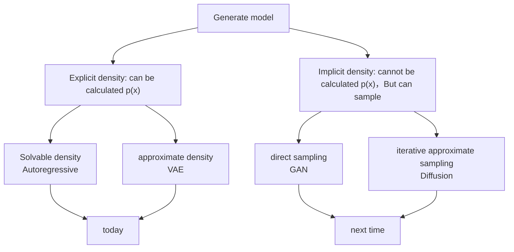
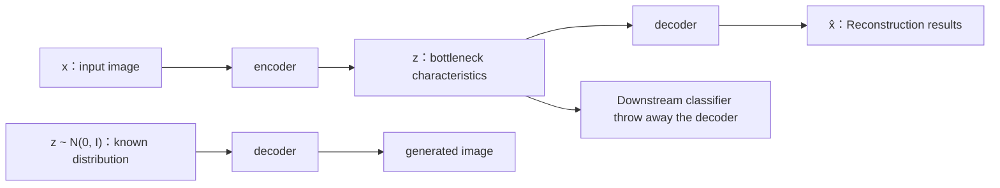

> **Course information**
>
> - **Course name**: Stanford CS231n: Deep Learning for Computer Vision(Spring 2025)
> - **Topic of this lecture**: Lecture 13. Generative Models 1
> - **Lecturer**: Justin Johnson
> - **Teaching date**: 2025-05-15
> - **Course homepage**: [cs231n.stanford.edu/2025](https://cs231n.stanford.edu/2025/schedule.html)
> - **Official courseware**: [lecture_13.pdf](https://cs231n.stanford.edu/slides/2025/lecture_13.pdf) (116 pages, page-by-page illustrations in the book)
> - **Subtitle source**: [cs231n_sp25_kor_sub · eng](https://github.com/lpaiu-cs/cs231n_sp25_kor_sub/tree/main/eng) (Publicly transcribed in English, Chinese rewritten by this book)
> - **Copyright statement**: The copyright of the slides and course materials belongs to Stanford University and the instructors; this book is an unofficial study note and is only used for study and research.

The previous lecture described "learning representation without labels" into three sets of recipes: geometric perturbation pre-task, contrastive learning, and label-free self-distillation. What they have in common is that there is only one final product - a feature vector that can be transferred to downstream tasks. This lecture replaces this product: what we need to learn is no longer  $z=f(x)$, but a probability distribution  $p(x)$, allowing the model to answer "How likely is this picture to appear?" and create new pictures out of thin air.

This is a road of increasing difficulty. Discriminative models only require labels to compete for a given image; once the image itself is placed in the modeled position, all possible images in the universe have to share in the same probability budget. This lecture only covers the left half of the family tree - explicit density: autoregressive models and variational autoencoders (VAE). The right half (generative adversarial network and diffusion model) is left to the next lecture.

## 1. Two debts owed in the previous lecture: SimCLR’s batch dependency, and the vague “learning structure” of unsupervised learning

*(Reference time: 00:00:05 – 00:15:01｜Lecture 13)*

The second page is the transaction page, with only two lines: Assignment 3 will be released tomorrow (5/16), and the project milestone will be due at the same time. There was no mention of these two lines in the entire oral broadcast - the lecturer said "Welcome back to CS231N lecture 13", and then went directly to self-supervised review. I record it here because it marks the time coordinate of the course: Assignment 3 and the project milestone both fall on May 16, and the generative model line will not end until the next lecture.

The first page of the review only draws the skeleton: on the left is an unlabeled data set, with the intermediate encoder extracting feature representations, and on the right is divided into two paths - one is the decoder, which predicts some kind of target automatically generated from the data itself; the other is the classifier or regressor, which is connected until the downstream tasks appear. No manual annotation appears on the entire page because the tags do not exist at this stage.

The second frame only adds a FC (fully connected layer) next to the decoder, but what is added is the entire two-stage process: first train the encoder-decoder on all unlabeled data, and then **Throw away the decoder**, connect the encoder to a possibly small fully connected network, and perform fine-tuning or end-to-end training on small labeled tasks. The scale account assigned by the lecturer to this process is very specific: one billion unlabeled images captured from the Internet are switched to downstream tasks that only label tens, hundreds, or thousands of samples, so that the performance of the latter can be improved by the general knowledge learned by the former.

The common point of the pre-processing tasks is explained in one sentence: first perform a geometric perturbation on the input pixels, and then let the model restore the information before the perturbation from this destroyed version. Rotation is to predict how many degrees it has been rotated; rearrangement (puzzle) is to cut the picture into patches and let the model restore the relative position; reconstruction is to dig out a piece and then replace it. This is the path MAE takes. The slide also lists two variants: inpainting and coloring, which are essentially reskinned versions of the same thing.

This page is the table of contents for the comparative learning part of the previous lecture: intuition and formalization, instance-level comparison (SimCLR and MoCo), sequence-level comparison (CPC), and label-free self-distillation (DINO). The lecturer said that this part was not covered last time, so the first ten minutes of Lecture 13 were used to complete it - the beginning of this lecture therefore looks like the end of Lecture 12.

The mechanism of contrastive learning can be summarized in one sentence: similar ones bring people closer, and dissimilar ones push them away. When it comes to implementation, a cat picture is cut out from two perspectives (face, butt), a monkey picture is cut out from one perspective and then converted into black and white; all enhanced versions are passed through the same feature extractor, and then a huge similarity matrix is ​​calculated. The lecturer reported a number here that is easy to remember incorrectly: $n$  Each picture is enhanced twice to obtain  $2n$  samples, the matrix is  $2n\times 2n$, that is  $4n^2$  elements, all compared pairwise.

Only one line of text was added to this frame: Problem: Need large batch size with lots of negatives. The reason is not that the video memory is insufficient, but that the task is too easy - when there are only a few negative samples in a batch, the model can easily rely on cheap clues such as color and texture to identify two cat perspectives as a pair, and cannot learn what is really needed. To make the problem difficult enough to provide effective learning signals, you have to increase the batch size; if the batch size is larger, you will return to the large-scale distributed training in Lecture 11. The lecturer's attitude is: it is feasible and feasible, but the cost is high.

What MoCo wants to cut off is the "number of negative samples = batch size" tie. It maintains a key queue, containing samples seen in the past several iterations; the current batch uses the normal query encoder and back-transmits it as usual, and the keys in the queue use another "momentum encoder". Because the amount of data in the key is too large and cannot fit into the video memory, so **Don't pass it back**- The weights of the momentum encoder do not rely on gradient descent, but are an exponential moving average of the current encoder weights: the old weights are multiplied by 0.99, and 1% of the new weights are added. The lecturer originally said that he did not have a good intuition to explain why this update must be true, but the empirical evidence was very strong. The by-product is the key: the number of negative samples is decoupled from the batch size, and a small batch can compare thousands of keys.

The skeleton of DINO has the same origin as MoCo: a normal backpropagation encoder plus a momentum encoder. The difference lies in the loss - instead of using the dot product after softmax, KL divergence is used to match the output distribution of the two branches; the backbone is also changed from ResNet to visual Transformer (ViT). The lecturer made its positioning very straightforward: you don’t need to remember the details, just know that it exists, because the next model is more commonly used in practice.

The key change of DINOv2 is not the loss, but the data scale: it has been expanded from 1 million images of ImageNet to about 142 million images, and a set of self-supervised recipes that can stably converge at this scale have been found. The result is that the feature quality is good enough that many people today directly use it as a ready-made visual backbone and then fine-tune it to their own tasks. The lecturer incidentally introduced the formula for progress in this field: larger networks, more data, more GPUs, more FLOPs - these are the real changes in the past ten years, not those few lines of probability formulas.

Turning to this page, the lecturer gave a very broad judgment: the generative model "didn't work at all" ten years ago - the samples were a low-resolution mess, and you had to squint to see any hope; but now language models, image generation, and video generation are all downstream of it. What is even more memorable is his subsequent addition: The basic idea has not changed much in the past ten years. What has changed is computing power, more stable training formulas, larger data sets and distributed training; the real changes in the algorithm mainly occur in the diffusion model in the next lecture.

### 1.1 One axis is the label and the other axis is the probability

The instructor takes a step back and nails the terminology first. Supervised learning data sets are paired  $(x,y)$, $x$  is data, $y$  is a label, and the goal is to learn a  $x$  Arrive  $y$  Functions; classification, regression, target detection, semantic segmentation, and image description all fall into this box.

Start filling in the examples box by box on the right side of the same page. The first cell is classification: input a photo of a cat and output a category label.

In the second box, replace the label with a sentence: the input is still the picture, and the output is a description text (the page indicates that this sentence was generated by neuraltalk2). The supervision signal changed from "a category" to "a string of words", but the shape of the task did not change - it was still a given  $x$  predict a  $y$.

The third grid is target detection: the output is no longer a label, but a set of boxes plus categories (DOG, DOG, CAT). The objects to be predicted range from "the entire picture" to "every object on the picture".

The fourth grid is semantic segmentation: assigning each pixel a category (GRASS, CAT, TREE, SKY). The four grids connected together explain one thing - supervised learning"$y$"It can be a scalar, a sentence, a collection of boxes, or a pixel-by-pixel map. The shapes vary widely, but they all require a human to label it.

After the two columns are side by side, the difference is only two lines: the data starts from  $(x,y)$  become  $x$ ("just data, no labels"), the goal changes from "learning a mapping" to "digging hidden structures from data". The lecturer's description of unsupervised comes with obvious reservations: it's vaguer, harder to define, and doesn't even have a clear task—you just hope to hit something good along the way, usually a representation that can be transferred.

The first type of example is K-means clustering: there is no label, only the data is divided into several clusters, and the structure of the clusters grows out of the original pixels.

The second type is dimensionality reduction, and the page is demonstrated using PCA.  $3\to 2$: Find an artificially specified low-dimensional subspace or manifold so that the data can maintain its original structure in it. The lecturer specifically reminded that clustering and dimensionality reduction often have probabilistic explanations, but **Not necessary** Considered as probabilistic models - they belong to the "unsupervised" axis, not the "generated" axis.

The third category is the main topic of this lecture: density estimation. The upper part is the one-dimensional density (scatter points plus fitting curve), the lower part is the two-dimensional density (the left is the surface, the right is the heat map, the two are CC0 materials), the copyright of the upper left one-dimensional image belongs to Ian Goodfellow, 2016, and is reproduced with permission. The question here for the first time becomes "what probability function generates these samples that I see". This axis is orthogonal to "generation/discrimination": you can do unsupervised but non-probabilistic learning (clustering), or you can do supervised probabilistic modeling (softmax classifiers).

## 2. There is only one probability mass: p(y\|x) allows labels to compete, and p(x) allows images in the entire universe to compete.

*(Reference time: 00:15:10 – 00:34:26｜Lecture 13)*

The lecturer separated "generation vs. discrimination" into a separate axis because this axis is inherently probabilistic: we assume that there is a probabilistic structure behind the data, and the three models just choose different variables to do the conditions.

### 2.1 Three expressions that look very similar have completely different competitive relationships.

There are three lines written side by side on the page: Discriminant Modeling  $p(y|x)$ (data  $x$, label  $y$); Generative modeling  $p(x)$;Conditional generative modeling  $p(x|y)$. The symbols of the three equations are almost the same, the only difference is who is placed to the right of the vertical line - and this position determines who is fighting for the probability mass.

The second frame adds the most critical constraint of the entire lecture: the density function  $p(x)$  to every possible  $x$  Assign a positive number, the larger the value, the more likely it is to occur; and it is normalized,

$$
\int_{X} p(x)\,dx = 1
$$

The lecturer calls this constraint the "source of power" of the probability model: the total quantity is fixed to one unit, and writing a distribution is equivalent to cutting this mass into all possible  $x$  on. So any one  $x$  The density of is raised, other  $x$ 's density must be suppressed - they are on the same budget sheet.

In the third frame, this budget falls on the discriminative model: given a cat picture, the model outputs  $P(\text{cat}\mid\cdot)$  with  $P(\text{dog}\mid\cdot)$, the two add up to 1. Note that "given" here means **Each picture has a set of distributions**, there is no shared budget between graphs.

In the fourth frame, another photo of a dog is superimposed, and at the same time, the two definition boxes of "Generative Model" and "Conditional Generation" on the left are turned gray - only the discriminant is left in sight. Each of the two pictures is equipped with a set of pillars: the group of cat pictures  $P(\text{cat})$  high, $P(\text{dog})$  Low, the order of the pillars in the dog picture is completely reversed and becomes  $P(\text{dog})$  ahead and higher. The conclusion in the lower right corner of the page is: possible labels compete for probability, and there is no competition between images. This sentence is the whole secret of the discriminative model - it creates a separate small-scale competition for each input, and the competition does not interfere with each other.

In the fifth frame, an abstract painting is inserted into the input position, and the problem is immediately exposed: the label space is fixed to the two words cat/dog during training. The model has no outlet for "this is neither a cat nor a dog", and can only bite the bullet and give an alternative distribution. The lecturer said that this can be seen as a shortcoming, but it is more important to understand the mechanism - the discriminant model **Must** It gives a set of label distributions for every possible input and has no waiver grammar.

### 2.2 The generative model must answer "Is a three-legged dog more likely than a three-armed monkey?"

Replace with  $p(x)$, the contestants have changed: all possible images are vying for the same quality. The page places three pictures (dog, monkey, abstract painting) side by side  $P(\cdot)$  Below, the label is All possible images compete for probability mass.

The paragraph added in the second frame is the most philosophical part of the whole lecture: Since all the images are on the same budget sheet, the model is forced to answer "is a dog more likely to stand or sit" and "is a three-legged dog more likely than a three-armed monkey?" The lecturer's judgment is that the three-legged dog should get more mass - a dog losing a leg is something that happens in reality; a three-armed monkey can almost only appear in science fiction pictures. To make this kind of judgment, the model must actually understand the structure of the visual world, rather than remember pixel co-occurrences.

The third frame translates this matter into engineering language: since the quality is limited, the model can suppress unreasonable inputs to extremely low or even zero probability. Suppose you only want a generative model of "zoo animals", then an abstract painting should have zero mass - this is the "reject" switch that the discriminative model lacks.

The fourth frame is replaced by conditional generation  $p(x|y)$: one line each for the given cat and the given dog  $P(\cdot\mid\cdot)$, inside each row is the entire image competing. So the organization method of the competition became "grouping by tag". The lecturer took advantage of the situation  $y$  Pushing towards more complex forms: if  $y$  If it is a paragraph of text, a whole paragraph, or even another picture plus a paragraph of text, then what the model has to solve is a rather morbid problem - it has to make deep inferences about the objects in the picture.

### 2.3 Bayesian stitches three models together

Three models are not three islands. Bayes' formula gives the conversion relationship: with the discriminant  $p(y|x)$, data edge  $p(x)$  with label prior  $p(y)$, you can spell out the conditional generation

$$
p(x|y)=\frac{p(y|x)\,p(x)}{p(y)}
$$

The lecturer's statement is broader: just move the terms of Bayes' formula any way you want, and you can get the third if you take any two of them.

The second frame labels the three blocks in the formula: conditional generative model, unconditional generative model, and label prior. The page also gives a qualification: In theory, conditional generation models can be built from other components, "but not common in practice". In practice, everyone generates models directly from zero training conditions; the exception is the diffusion model in the next lecture, where the conditional and unconditional versions are sometimes jointly trained.

### 2.4 The respective uses of the three models, and "unconditional generation is basically useless"

Purpose This page starts with the discriminant, because creativity is least needed: after training, labels can be assigned to the data; a by-product is that in the process of predicting labels, the middle layer often grows a transferable feature representation - this is how the backbone network trained on ImageNet comes from.

The second frame adds three lines to the generative model: detection of outliers (see if the density of a certain image is too low), label-free feature learning, and sampling to generate new data. The lecturer's evaluation of the last two items was quite unkind: Unconditional density estimation in self-supervised learning **Has never been very successful**, in practice it is far inferior to the comparative learning in the previous lecture; and unconditional sampling is "basically useless" because it has no control over what is generated.

The third frame is two lines of conditional generation: giving labels while rejecting outliers (traversing all  $y$  look  $p(x|y)$  are both too low), and sampling by label. The former lecturer said that it is rarely used in practice; the latter is the real main battlefield——$y$  When it's a paragraph of text, you can write "a cat wearing a hot dog-flavored T-shirt standing on the moon" and get a brand new picture.

Closing of the fourth frame: When the literature talks about "generative models", both unconditional and conditional ones count, but conditional generation accounts for the absolute majority in practice. The lecturer reminds readers to pay attention to a writing habit - many papers use conditions to make formulas look good.  $y$  Omit it and just write  $p(x)$; He himself has been doing this in the slides of this lecture, so every time he sees one  $p(x)$, you should automatically add "given" in your mind  $y$".

### 2.5 Why is it necessary to generate a model: because the output is not unique in nature.

The lecturer has only one answer: the output is ambiguous. Many mappings in discriminative tasks are deterministic (there are several cats in the picture, the answer is a number), but as long as the same input corresponds to an entire output space, it is necessary to model the distribution rather than the modeling function. The first example is language modeling: input "Write a short rhyming poem about the generative model". There are countless possible poems, and the model can only sample one of them. The short poem on the slide itself talks about this - "They sample from a learned P, / A distribution—structured, free. / Each token comes conditionally, / On all the ones that used to be."

The second example is Vincentian pictures: for the same prompt word, the lecturer sees one picture, and ChatGPT gives another picture, both of which are correct. The value of a generative model does not lie in picking the "only correct" one, but in that it models the entire space in principle, from which it can be sampled as needed.

The third example is Tusheng’s video: the picture shows him holding AirPods above a cardboard box, and then he may let go, may remove his hand, or the AirPods may deform. All three futures are reasonable. What the model needs to model and sample is the set of "possible futures".

### 2.6 Family tree: two branches, four leaves

The family tree picture is the skeleton of this lecture (the picture is adapted from Ian Goodfellow's 2017 GAN tutorial). The first frame only has the root node, because the first step in classification is to ask: Can this model calculate  $p(x)$  value.

The second frame falls on the left branch: explicit density, labeled Model can compute P(x). The whole job of this team is to write  $p(x)$  or  $p(x|y)$  The analytical form can be used to extract values from any sample.

The third frame adds the right branch: implicit density, labeled Cannot compute p(x) but can sample from P(x). There is no density function inside the model that can take values, but you can still sample from it - the density is learned "implicitly".

In the fourth frame, the second cut is made under the explicit density: it can be calculated accurately  $p(x)$  is called tractable density, which represents an autoregressive model.

Add another leaf in the fifth frame: only an approximation can be given  $p(x)$  It's called approximate density, which represents a variational autoencoder (VAE). It gives a lower bound, not a true value—that’s the whole account of Chapter 6.

The sixth frame goes to the right branch: a method that can spit out samples directly in one network evaluation is called a direct method, which represents a generative adversarial network (GAN).

The seventh frame adds the fourth leaf: an iterative process is required to approximate the sample, which is called the indirect method (indirect), which represents the diffusion model. The lecturer specifically explained here that the word "indirect" was improvised by him the day before, and there is no generally accepted name - the important thing is not the name, but the property of "there is no analytic function that can generate samples in one forward pass".

Only two labels are added to the last frame: Today falls under autoregression and VAE, and Next Time falls under GAN and diffusion. The lecturer is quite proud of this four-part division - two branches, four leaves, which is exactly half of the lecture in a day.

There are three follow-up questions worth remembering in class. First, why is it written on the whole page?  $p(x)$  instead of writing  $p(x|y)$? The lecturer admitted that he did this on purpose, just to let people ask; all the following  $p(x)$  Both should be read as conditional versions. Second, can we treat the iterative process as a black box and pretend it is direct sampling? In principle, it is possible, but the sample can only be approximate - the diffusion model has to go through infinite steps to get the real sample. In fact, it can only go through a limited number of steps. MCMC methods also had the same properties in the past. Third, what is the difference between approximate density and implicit direct sampling? The difference lies in the former **At least one value can be taken out** (Even if it is a boundary), the latter cannot find density values anywhere and can only sample.

## 3. Autoregression: The chain rule does not assume anything, the cost is to split a generation into T predictions

*(Reference time: 00:34:59 – 00:45:16｜Lecture 13)*

The first leaf on the family tree is the autoregressive model, which belongs to "solvable density": $p(x)$  Not only can you write analytical formulas, but you can also calculate exact numerical values for any sample. Its entire technical content lies in how to write this matter in a teachable way.

### 3.1 Maximum likelihood: First write "like or not" as a number that can be derived

The first step is only one line: the goal is to write an explicit function for density  $p(x)=f(x,W)$, among which  $W$  is the weight of the neural network. In other words, the network takes in a picture and spits out the number "How likely is this picture to appear?"

The data set is only available in the second step: given  $x^{(1)},\dots,x^{(N)}$, find the most likely weight of the entire data

$$
W^{*}=\arg\max_{W}\prod_{i=1}^{N}p(x^{(i)})
$$

This line is noted on the page as "maximizing the probability of training data", which is maximum likelihood estimation (MLE). Note the superscript  $i$  Refers to the  $i$  sample—this notation will be emphasized repeatedly in the second half of Chapter 3.

Add the log trick to the third frame: after taking the logarithm, the maximizing object remains unchanged (log monotonic), but continuous multiplication becomes continuous addition.

$$
W^{*}=\arg\max_{W}\sum_{i=1}^{N}\log p(x^{(i)})
$$

The lecturer gave two reasons: continuous multiplication quickly underflows numerically, and summation is easy to handle and derivation, and can be split into multiple samples in parallel.

The fourth frame  $p$  Replace it with network output to get a truly runnable form.

$$
W^{*}=\arg\max_{W}\sum_{i=1}^{N}\log f(x^{(i)},W)
$$

The lower right corner of the page says This is our loss function, and adds the sentence "maximize it with gradient descent". At this point, generative modeling degenerates into a normal training loop: forward calculation  $\log f$, backtransmission, update.

There are two details that are easily skipped here, and the lecturer specifically stopped to talk about them. The first is **The difference between likelihood and probability**: When talking about probability, the distribution is fixed, you are moving  $x$; When talking about likelihood, the sample is fixed and you are moving the distribution. MLE fixes the training set and changes the network parameters. It asks "which set of parameters makes this batch of samples least surprising." The second is the underlying assumption: there is a true distribution of the universe used to generate the data  $p_{\text{data}}$, we can never see it, we can only get the limited samples it spits out. MLE is a way to approximate it on limited samples; and then superimpose the independent and identical distribution (IID) assumption, the joint probability can be factorized into the product of sample-by-sample probabilities.

### 3.2 From joint distribution to conditional distribution: RNN and mask Transformer is born with this shape

The price of MLE itself not assuming any data structure is that it also cannot give any calculation path——$p(x)$  It is still a function defined on the entire graph. The first assumption added to the autoregressive model is very simple: there is some standard way to convert the sample  $x$  cut into a sequence  $x_1,\dots,x_T$. The lecturer here reminds you of the notation trap: superscripts are different samples, and subscripts are different fragments of the same sample. The two cannot be mixed.

Apply the chain rule of probability to the second frame:

$$
p(x)=p(x_1)\,p(x_2\mid x_1)\,p(x_3\mid x_1,x_2)\cdots=\prod_{t=1}^{T}p(x_t\mid x_1,\dots,x_{t-1})
$$

This equation holds for any joint distribution and requires no assumptions - it just replaces "predict the entire image at once" with "predict  $T$  a smaller conditional distribution". There is only one real assumption: the cutting method of the sequence (such as in scan line order).

Only one annotation was added to the third frame: Language modeling with RNN, plus the sentence "We have seen this before". The structure of RNN naturally matches the chain rule - the hidden state is propagated forward in time, Chapter  $t$  The hidden state of the step only contains the previous  $t-1$  The information of a segment, from which the distribution of the next segment is predicted, is exactly  $p(x_t\mid x_{<t})$.

In the fourth frame, the annotation is changed to Language modeling with masked Transformer, and the title is also changed to conclusion: LLMs are Autoregressive Models. Transformer achieves the same causality by masking attention - by covering the upper right triangle of the attention matrix, only the prefix can be seen at each position, so the conditional probability of the entire sequence can be calculated forward at once.

Why must it be demolished? The lecturer gave a hard account in the subsequent questioning: the size of the word list is  $V$, the sequence length is  $T$  When , to directly model the joint distribution requires  $V^T$  entries, exponential explosion; after splitting into conditional distributions, each step only requires one  $V$  Dimensional distribution, the parameters are reduced from exponential level to linear level. The price is that it must be generated in order, $T$  A fragment is required  $T$  Subforward (can be parallelized during training because the ground truth prefix of each position is known). Another question is numerical stability: in practice, no one actually multiplies a series of probabilities. The model outputs logarithmic probabilities, and the loss is also calculated in logarithmic space. The continuous multiplication only occurs when it is necessary to "take out an exact density value."

### 3.3 The image is not one-dimensional or discrete, but it can be broken into three million 256 types of problems

The text is naturally suited to autoregression: it is inherently one-dimensional and inherently discrete, which lends itself to the softmax cross-entropy used throughout the semester. Images occupy neither of those two dimensions - they are not one-dimensional, and they are often treated as continuous values. The lecturer's "hammer in hand" solution is to rasterize the image: the common format is 8 bits per channel, and one pixel is three integers from 0 to 255, so the entire image becomes a one-dimensional sequence, each element is a sub-pixel value, and predicting it is a 256-category classification problem. In the lower right corner of the page, a whiteboard photo is used as a nested description (it is the one where "a person is talking about generative models in front of the whiteboard"). A total of six RGB cubes in the lower two rows mark the scan line sequence: first walk along the channel to complete one pixel, and then go to the right one pixel.

The second frame adds the question: Too expensive. $1024\times1024$  The picture has  $3\times1024\times1024\approx 3.1\times10^6$  Sub-pixels, the sequence length is three million. Today's models can indeed consume millions of sequences, but the cost increases rapidly with length, and high resolution simply cannot scale like this. The two articles cited on the slide are representative works of this road: PixelRNN and PixelCNN (van den Oord et al., 2016).

The third frame gives a preview of the solution: instead of modeling by sub-pixels, model by "tiles" - first use some process to compress the image into a series of one-dimensional tokens, and then perform autoregression on the token sequence. The lecturer said that this road has returned in the past two years and will be discussed in the next lecture. The value of this frame does not lie in the answer, but in that it points out the real bottleneck of the autoregressive model on images: **How a sequence is defined**, rather than the likelihood target itself.

## 4. Autoencoder: First force the model to learn a 128-dimensional bottleneck, and then find a way to sample from the bottleneck

*(Reference time: 00:45:21 – 00:52:51｜Lecture 13)*

The second leaf of the family tree is VAE, which is "approximate density". It sacrifices the accurate value of density in exchange for something that the autoregressive model cannot give.

### 4.1 Why give up exact density: in order to get hidden variables

This page puts the trade-offs together. The first half is PixelRNN/PixelCNN: explicitly parameterizing the density with a neural network, $p_W(x)=\prod_t p_W(x_t\mid x_1,\dots,x_{t-1})$, the training goal is the likelihood of the training data. The next two lines are VAE: it defines a **incomprehensible** (intractable) density can neither be explicitly calculated nor directly optimized, "but we will be able to directly optimize a lower bound on the density".

The lecturer made the motivation unambiguous: since autoregression can already calculate accurate density, giving up it must be replaced by something else - hidden variables. In the process of learning, VAE will naturally grow "vectors that can represent this picture". These vectors themselves are useful (retrieval, editing, downstream tasks) and are worth replacing with precise density. This is the only clear exchange of equal value in the entire lecture.

The second frame of the same separator page has a text animation: Variational and (VAEs) turn light gray, and Autoencoders are underlined. The lecturer's explanation was "let's remove a few pages of V" because autoencoders have not been formally taught in this course.

### 4.2 Autoencoder: The loss function is "reconstructing yourself"

The goal of the autoencoder is the same as that of unsupervised learning: without labels, from the input  $x$  extract features from  $z$, hope  $z$  It encodes object identity, appearance, scene type and other information useful to downstream. The encoder can be MLP, CNN, Transformer, whatever you choose.

The second frame only adds one sentence: Problem: How can we learn without labels? This is the recurring question in the previous lecture, but this time it has a dumber answer.

The third frame is supplemented with the decoder: $z$  is mapped back to a  $\hat{x}$, the training goal is to make  $\hat{x}$  as close as possible  $x$. The page has a pun for this approach - "Autoencoding = Encoding yourself". The lecturer himself complained: This is probably the stupidest loss function ever. We spend a lot of computing power to learn a known identity mapping.

The fourth frame writes the loss to death:

$$
\mathcal{L}=\lVert \hat{x}-x\rVert^{2}
$$

The page is specially marked with two sentences: This item **without any tags**, only eat raw data. This is why it is self-supervised - the supervision signal comes from the input itself.

The fifth frame is the old routine of self-supervision: throw away the decoder after training, connect the encoder features to a softmax classifier, and output the predicted label.

In the sixth frame, the arrow is reversed: only the decoder is left. If a new one can be built  $z$, a new image can be generated. This is exactly how generative models are intended to be used.

The seventh frame throws cold water: Problem: Generating new z is not any easier than generating new x. You just replaced "sampling in pixel space" with "sampling in latent space", if  $z$  The distribution of is also unknown and has no analytic form. The problem has just been moved.

The eighth frame gives the core action of VAE: forcing all  $z$  All come from a known distribution. As long as this constraint holds, one can be drawn directly from the distribution during inference.  $z$, through the decoder, a new sample is obtained - the sampling problem is completely eliminated.

This picture draws two ways out together: the previous one is self-supervision (using  $z$  Do downstream tasks), the next step is generation (collecting from a known distribution  $z$  decode again). Traditional autoencoders can only take the upper path - the entrance to the lower path  $p(z)$  is empty. This is why the lecturer said "generate new  $z$  no better than generating new ones  $x$ "Easy": It is this item that is missing in the brackets.

## 5. Turn z into a random variable: If the marginal integral cannot be calculated, train another network to guess the posterior

*(Reference time: 00:53:00 – 01:02:59｜Lecture 13)*

The title page of this section only gives one source of information: the footer reads Kingma and Welling, Auto-Encoding Variational Bayes, ICLR 2014 - the derivation that follows is a popular restatement of this paper. The lecturer only said "It's a long story" about "Why is the word variation called this"? This lecture does not go into the etymology, but only how the three lines of formulas came about.

### 5.1 Assumption: There is an invisible z behind each picture

The page first gives two goals: learn latent features from raw data  $z$, and can sample and generate new data from the model. Note that only the first of these two items is fulfilled in the autoencoder, and the second item is what VAE needs to make up for.

The second frame is supplemented with probability hypotheses: each  $x^{(i)}$  are composed of an invisible latent variable  $z$  To generate, the data is "first draw a data in the hidden space  $z$, and then by  $z$  generate  $x$"The product of this two-step process. The intuition given by the lecturer is: $x$  is an image, $z$  It is the factor that determines the properties and orientation of this picture - it contains all the information needed to generate this picture, but you can never observe it.

The third frame draws the sampling process after training: pick one from the prior  $z$, and then from the conditional distribution  $p(x\mid z)$  Rich one  $x$. The only prerequisite for this process to be established is that  $z$  is known a priori.

The fourth frame nails the prior: hypothesis  $p(z)$  is a simple distribution, in practice it is almost always the standard Gaussian  $\mathcal{N}(0,I)$. This step is the fulcrum for the entire method to be implemented - it replaces the "unknown latent space distribution" with an analytical object that can be sampled at any time.

### 5.2 Training: Maximum likelihood hits an integration wall

In the fifth frame, we return to the familiar path: the basic idea is still maximum likelihood. If the data set except  $x$  Also comes with  $z$, then you can directly train a conditional generation model  $p_\theta(x\mid z)$, the problem ended on the spot. but we didn't  $z$  label.

The sixth frame  $z$  Points lost:

$$
p_\theta(x)=\int p_\theta(x,z)\,dz=\int p_\theta(x\mid z)\,p_\theta(z)\,dz
$$

There is no approximation in this step. It just splits the joint distribution according to the chain rule and then marginalizes it.

The seventh frame begins with item-by-item acceptance. $p_\theta(x\mid z)$  It is the decoder - a neural network that we are going to train with maximum likelihood. This is no problem.

The second item of the eighth frame acceptance: $p_\theta(z)$  Even the Gaussian prior we just assumed, and the analytical formula is known, is no problem.

The ninth frame is a death sentence: Problem, we can't integrate over all z. $p_\theta(x\mid z)$  It is a complex function parameterized by a neural network. There is no closed-form solution to the analytical integral of the entire latent space. Using finite sampling to approximate a high-dimensional integral and stuffing it into the inner loop of training is unacceptable in cost and variance. The lecturer explains the general routine of generative models thoroughly on this page: write down a number of probability terms, hoping that some of them are simple distributions that can be calculated by hand, and the other part is the network to be trained - and now one of them happens to be neither the former nor the latter.

### 5.3 Change the path: Bayesian formula moves the problem to the posterior

Bayes' formula gives another way of writing:

$$
p_\theta(x)=\frac{p_\theta(x\mid z)\,p_\theta(z)}{p_\theta(z\mid x)}
$$

The page arranges these three pieces vertically, preparing to check and accept them one by one.

first term of numerator  $p_\theta(x\mid z)$  It's still a decoder, it counts.

second term of numerator  $p_\theta(z)$  It is still a Gaussian prior, which can be calculated. There are no integrals in the entire equation - it looks like the problem is solved.

Problem with the denominator: $p_\theta(z\mid x)$  is the posterior of the latent variable given the image. To calculate it, you have to calculate it again.  $p_\theta(x)=\int p_\theta(x\mid z)p_\theta(z)dz$——Go back to the starting point. The lecturer said that this was the whole motivation for introducing Bayesian in the first place, and this is where it failed.

The solution is the real trick of VAE: since it cannot be calculated later, train a neural network to approximate it. Remember this approximate network as  $q_\phi(z\mid x)$, parameters  $\phi$  with decoder  $\theta$  independent of each other. It inputs a picture and outputs a distribution in the latent space.

put  $q_\phi$  Substituting back into the Bayesian formula, we get a computable approximation:

$$
p_\theta(x)\approx\frac{p_\theta(x\mid z)\,p(z)}{q_\phi(z\mid x)}
$$

This step is just "replacement" without any guarantee——$q_\phi$  It may not really equal a posteriori. All the derivation in the whole lecture is essentially dealing with this "not necessarily".

### 5.4 Two networks, one output distribution trick

The page clearly states the responsibilities of the two networks: the decoder inputs the hidden code  $z$, output data  $x$  distribution on; encoder input data  $x$, output hidden code  $z$  distribution on. Both have independent weights and are trained jointly. The instructor reminded that this step is not trivial: $q_\phi(z\mid x)\approx p_\theta(z\mid x)$  This condition cannot be directly enforced and can only be approached through training.

A side note was added in the second frame, asking about the most common place where beginners get stuck: the output of a neural network is a vector, how can it be a "distribution"? The answer is to let the network output distribute **parameters**, fixing the shape of the distribution into the selected family.

The third frame gives the specific form:

$$
p_\theta(x\mid z)=\mathcal{N}\big(\mu_{x\mid z},\ \sigma^{2}\big),\qquad q_\phi(z\mid x)=\mathcal{N}\big(\mu_{z\mid x},\ \Sigma_{z\mid x}\big)
$$

The decoder only outputs the mean  $\mu_{x\mid z}$, variance  $\sigma^2$  Fixed; the encoder outputs two vectors, one is the mean  $\mu_{z\mid x}$, the other is the diagonal covariance  $\Sigma_{z\mid x}$. The lecturer specifically explained why it must be **Diagonal**: $h\times w$  To model the covariance between pixels in an image, you need  $(hw)^2$  elements, which cannot be accommodated and have no data support; after diagonalization, the covariance degenerates into one and  $z$  For vectors of the same shape, the network can output two vectors of the same shape.

The fourth frame expands the likelihood:

$$
\log p_\theta(x\mid z)=-\frac{\lVert x-\mu_{x\mid z}\rVert^{2}}{2\sigma^{2}}+C
$$

When the variance is fixed, maximize it for  $z$  The likelihood of is completely equivalent to minimizing  $x$  The L2 distance from the mean output of the network - the "silliest loss" of the autoencoder reappears here, but this time it is deduced from the probability hypothesis rather than determined by taking a shot.

The lecturer added a very practical boundary here. The decoder could have also output the per-pixel variance, but that would make no sense: since no inter-pixel correlation is modeled, the per-pixel variance is just "each pixel is allowed to jitter a little bit", and sampling from such a distribution is equivalent to adding a layer of per-pixel independent noise to the mean map, which looks like noise rather than like a new image. So the practice is to put the decoder **pretend** into a distribution, but always only uses its mean and never actually samples from it. This is a clear engineering compromise worth remembering when reproducing code.

The last frame returns to the origin, and the question is thrown to the next page: With the encoder, decoder, and approximate posterior, what is the training goal?

## 6. ELBO: Discard the uncalculated posterior KL, and the remaining two items are reconstruction and prior

*(Reference time: 01:03:03 – 01:11:58｜Lecture 13)*

The lecturer said that this was the only page in the entire lecture that required some serious math. There are only five steps in the derivation, but each step does the same thing: move something that cannot be calculated into a term that can be thrown away.

### 6.1 Five-step derivation

The starting point is maximum likelihood itself, expanded using Bayes' formula:

$$
\log p_\theta(x)=\log\frac{p_\theta(x\mid z)\,p(z)}{p_\theta(z\mid x)}=\log\frac{p_\theta(x\mid z)\,p(z)\,q_\phi(z\mid x)}{p_\theta(z\mid x)\,q_\phi(z\mid x)}
$$

The second step is identity deformation: multiplying the numerator and denominator  $q_\phi(z\mid x)$, the value remains unchanged.

This frame just marks the action of the previous step - multiplying the upper and lower parts by the same amount in order to create a shape that can be recognized later. The lecturer's original words were "Now let's do something stupid", but this step is the crux of the entire derivation.

The third frame takes apart the logarithms and rearranges them:

$$
=\log p_\theta(x\mid z)-\log\frac{q_\phi(z\mid x)}{p(z)}+\log\frac{q_\phi(z\mid x)}{p_\theta(z\mid x)}
$$

The colors of the three items correspond on the page, making it easier to keep track of who is who. The order of arrangement seems random, but it is actually to prepare for the next step of "recognizing KL".

The fourth frame is the key observation: $\log p_\theta(x)$  itself and  $z$  irrelevant (all  $z$  will be eliminated), so you can give it a layer of expectations for any distribution without changing the value:

$$
\log p_\theta(x)=\mathbb{E}_{z\sim q_\phi(z\mid x)}\big[\log p_\theta(x)\big]
$$

Choose here  $q_\phi(z\mid x)$  As an expected distribution, it is precisely to match the three terms on the right.

The fifth frame allocates expectations to three items:

$$
=\mathbb{E}_{z}\big[\log p_\theta(x\mid z)\big]-\mathbb{E}_{z}\Big[\log\frac{q_\phi(z\mid x)}{p(z)}\Big]+\mathbb{E}_{z}\Big[\log\frac{q_\phi(z\mid x)}{p_\theta(z\mid x)}\Big]
$$

Up to this point it is still an exact equation and no approximations have been introduced.

The sixth frame identifies the last two terms - they are the definition of KL divergence:

$$
=\mathbb{E}_{z\sim q_\phi(z\mid x)}\big[\log p_\theta(x\mid z)\big]-D_{\mathrm{KL}}\big(q_\phi(z\mid x)\,\|\,p(z)\big)+D_{\mathrm{KL}}\big(q_\phi(z\mid x)\,\|\,p_\theta(z\mid x)\big)
$$

KL divergence measures the difference between two distributions, is non-negative, and only takes 0 when the two distributions are identical.

### 6.2 What are each of the three items?

first item  $\mathbb{E}_{z\sim q_\phi(z\mid x)}[\log p_\theta(x\mid z)]$  is a reconstruction item, and the process can be read out:  $x$  Send to the encoder to get  $q_\phi(z\mid x)$, pick one from this distribution  $z$, and then send it to the decoder, asking it to restore the  $x$. due to  $p_\theta(x\mid z)$  is a diagonal Gaussian, given a sampled  $z$, this term is the L2 in Chapter 5 (only the difference is a constant factor); the expectation itself can be estimated with one sampling, and the slide marks this term as a whole that can be calculated in a closed form.

Second item  $D_{\mathrm{KL}}(q_\phi(z\mid x)\|p(z))$  is the prior term: the distribution predicted by the encoder for each picture should be close to the prior we set in advance (standard Gaussian). KL between two Gaussians also has a closed-form solution and does not require sampling estimation.

The third item  $D_{\mathrm{KL}}(q_\phi(z\mid x)\|p_\theta(z\mid x))$  Is the posterior approximation term: it requires that the approximate posterior really sticks to the true posterior. The true posterior is the quantity that could not be calculated at the beginning, so this term has no closed-form solution to Gauss.

The fourth frame makes the most cost-effective step in the whole lecture: KL forever  $\ge 0$, so throw away the third item, and the remaining two items must be  $\log p_\theta(x)$  the lower bound. This is not an approximate equation; **Inequality**——The error will be as big as the lost part, but the direction is always on our side.

In the fifth frame, write the final training goal:

$$
\log p_\theta(x)\ \ge\ \mathbb{E}_{z\sim q_\phi(z\mid x)}\big[\log p_\theta(x\mid z)\big]-D_{\mathrm{KL}}\big(q_\phi(z\mid x)\,\|\,p(z)\big)
$$

Maximizing the right side is maximizing a lower bound of the true likelihood. Lecturer reminds the mentality here: we never really optimize  $\log p(x)$, what is optimized is its lower bound; raising the lower bound does not guarantee that the true value will be raised simultaneously, but this is the only thing that can be calculated.

This page wraps up the notation: Jointly training encoders  $q_\phi(z\mid x)=\mathcal{N}(\mu_{z\mid x},\Sigma_{z\mid x})$  with decoder  $p_\theta(x\mid z)=\mathcal{N}(\mu_{x\mid z},\sigma^2)$, a variational lower bound that maximizes the likelihood of data; it is also more commonly known as the evidence lower bound (Evidence Lower BOound, ELBo). "Evidence" means  $\log p(x)$  itself, the Nether is its replacement.

### 6.3 Five steps of the training cycle, and two mutually pulling losses

The training process starts from a page with only formulas: there are only two lines of formulas "Maximizing the variational lower bound" on the screen, and the right side is blank. The next six frames will fill in the encoder-decoder block diagram and the five steps one by one.

Step 1: Enter  $x$  Send it to the encoder and get  $q_\phi(z\mid x)=\mathcal{N}(\mu_{z\mid x},\Sigma_{z\mid x})$, that is, a pair of vectors.

The second step is to implement the KL term: the prior loss requires the encoder output to be close to the standard Gaussian, that is, the mean approaches 0 and the covariance approaches the unit matrix. This item directly "drags" the latent space into a regular spherical distribution, which is the fundamental reason why sampling can be done later.

The third step is sampling, which is also the most critical part of the entire method in engineering. directly from  $\mathcal{N}(\mu_{z\mid x},\Sigma_{z\mid x})$  The action of sampling itself is not differentiable, and the gradient cannot be transmitted back to the encoder; the reparameterization technique rewrites it as

$$
z=\epsilon\odot\Sigma_{z\mid x}+\mu_{z\mid x},\qquad \epsilon\sim\mathcal{N}(0,I)
$$

Randomness is moved to the parameter-independent  $\epsilon$  Up, $z$  Yes  $\mu$, $\Sigma$  It's just a normal differentiable operation, and the gradient can be passed all the way back to the encoder. Note that this is element-wise multiplication ($\odot$), since the covariances are assumed to be diagonal.

Step 4: Take the collected  $z$  Send it to the decoder and get  $p_\theta(x\mid z)=\mathcal{N}(\mu_{x\mid z},\sigma^2)$, in fact only the mean value is taken  $\mu_{x\mid z}$.

Step Five: Reconstruct Loss Requirements  $\mu_{x\mid z}$  with  $x$  The L2 distance should be as small as possible. At this point, the five-step closed loop turns the entire page into a pseudocode that can be directly followed to write code.

In the last frame, a description is added below the formula: The loss terms fight against each other. Rebuilding lost hope  $\Sigma_{z\mid x}=0$, and each  $x$  Have its own unique  $\mu_{z\mid x}$——That way the decoder can restore any picture deterministically and the reconstruction error will be zero. a priori loss hope  $\Sigma_{z\mid x}=I$, $\mu_{z\mid x}=0$——In this way, all inputs are mapped to the same standard Gaussian, and the latent space is regular but without any discrimination. The two goals are in opposite directions. The training process is to find a balance point: it must be able to reconstruct while keeping the latent space in a "sampling" shape. This is also the reason why VAE cannot achieve perfect reconstruction - to make the latent space continuous and sampleable, the model must tolerate  $\Sigma_{z\mid x}>0$, that is, actively giving up part of the pixel-level certainty.

### 6.4 Sampling and decoupling

After training, generating samples only requires two steps: from  $\mathcal{N}(0,I)$  pick one  $z$, averaged through the decoder. No encoder is required, nor is there any iterative process required - that's what "sample forward" means.

The diagonal prior also has a side effect: it lets  $z$  Each dimension is statistically independent, so one dimension can be changed individually to see the effect. On the page is a scanning grid, with the horizontal axis changing  $z_2$, vertical axis changes  $z_1$, handwritten digits transition smoothly from one category to another in the grid, rather than abruptly. The lecturer calls this phenomenon "disentangling factors of variation", saying that these dimensions "often" encode something useful, interpretable, and orthogonal to each other. To be clear, this is a diagonal Gaussian **by-product**, is not an explicitly optimized target - so it often holds, but is not guaranteed to be that clean in every dimension.

## 7. Summary

*(Reference time: 01:12:01 – 01:12:15｜Lecture 13)*

The last three pages wrap up the whole story. The first page repeats the comparison chart from Chapter 1: Supervision is  $(x,y)$  School mapping, unsupervised is  $x$  Find the structure.

The second page repeats the three models and density normalization constraints from Chapter 2, reminding readers that the only difference between the three is "who is competing for probability mass."

The third page is the complete family tree, with both Today/Next Time labels still in place. Only two of the four leaves left today: autoregression of solvable density and VAE of approximate density.

The last page is a preview: The next lecture will supplement the right half - generative adversarial networks and diffusion models.

Judgment of taking it with you:

- **The watershed between generation and discrimination is "who is competing for probability mass"**: The discriminant lets the labels inside each picture compete with each other, the generative makes the images in the universe compete with each other, and the conditional generation opens a competition based on the labels; normalization constraints  $\int p(x)dx=1$  is the source of it all.
- **Unconditional generation is basically useless in practice**, because it is impossible to control what is generated; omitted from the literature  $y$  Just a marking habit, read  $p(x)$  The default should be when  $p(x\mid y)$.
- **The essence of autoregression is to split the joint distribution into  $T$  conditional distribution**, this equation does not require any assumptions; the price is that the sequence must be generated piece by piece, and the image must be additionally solved "how to turn the picture into a sequence".
- **It is feasible to perform autoregression on the image directly by sub-pixel, but  $1024\times1024$  That’s three million tokens**, the real bottleneck is the sequence length rather than the likelihood target, so the modern approach is to compress it into tiles first and then model.
- **VAE replaces hidden variables with exact density**: $p(x)=\int p(x\mid z)p(z)dz$  It couldn't be accumulated, so I rewritten it using Bayesian and got stuck in the posterior, so I inserted an encoder.  $q_\phi(z\mid x)$  to approximate the posterior.
- **The derivation of ELBO does only one thing**: Leave the uncalculable posterior KL on the right side of the inequality and discard it. The remaining reconstruction terms and prior terms are both calculable, differentiable, and have closed-form solutions.
- **Two losses are inherently opposite**:Rebuild to  $\Sigma=0$  And each sample has an independent  $\mu$, a priori  $\Sigma=I$  and  $\mu=0$; The blurring and decoupling of VAE grow from this balance point.
- **Heavy parameterization technology is the prerequisite for VAE to be trainable**: Move randomness to  $\epsilon$  On, the sampling step does not cut off the gradient.
