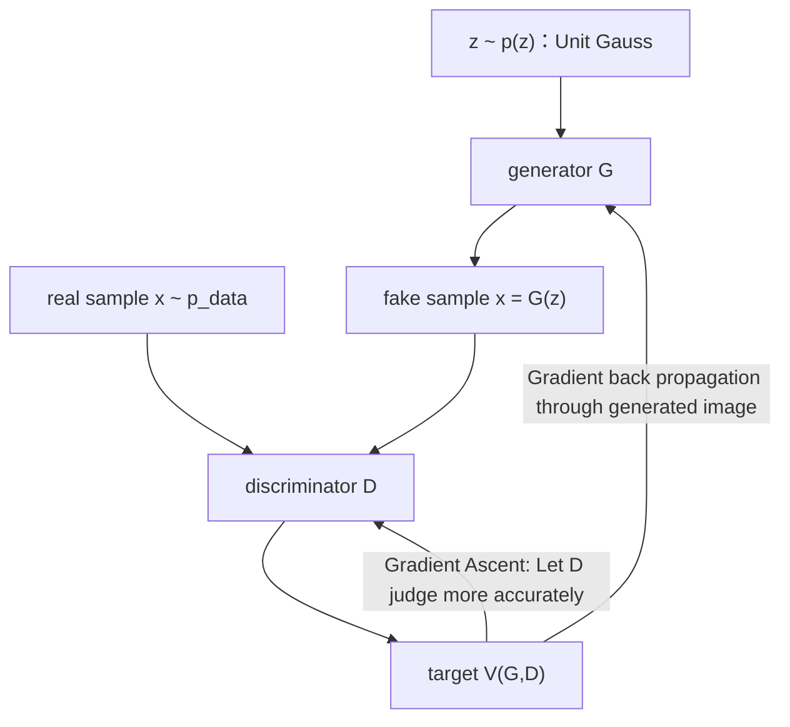
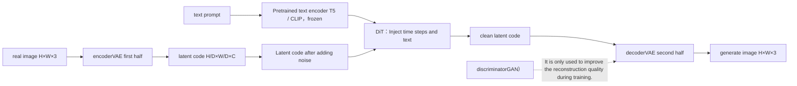

> **Course information**
>
> - **Course name**: Stanford CS231n: Deep Learning for Computer Vision(Spring 2025)
> - **Topic of this lecture**: Lecture 14. Generative Models 2
> - **Lecturer**: Justin Johnson
> - **Teaching date**: 2025-05-20
> - **Course homepage**: [cs231n.stanford.edu/2025](https://cs231n.stanford.edu/2025/schedule.html)
> - **Official courseware**: [lecture_14.pdf](https://cs231n.stanford.edu/slides/2025/lecture_14.pdf) (123 pages, page-by-page illustrations in the book)
> - **Subtitle source**: [cs231n_sp25_kor_sub · eng](https://github.com/lpaiu-cs/cs231n_sp25_kor_sub/tree/main/eng) (Publicly transcribed in English, Chinese rewritten by this book)
> - **Copyright statement**: The copyright of the slides and course materials belongs to Stanford University and the instructors; this book is an unofficial study note and is only used for study and research.


Lecture 13 only goes halfway down the family tree of generative models: autoregressive models whose density can be calculated, and variational autoencoders that can only calculate lower bounds. Both share the same premise - you can write  $p_\theta(x)$  some explicit form of , and then do maximum likelihood on it. This lecture dismantles this premise and looks at the other half: implicit density. This type of model does not hand over any density values ​​and only promises one thing - being able to sample from the learned distribution.

So the question becomes two. First, if even  $p(x)$  Even if you can't figure it out, what exactly is "training" optimizing? GAN's answer is extreme and beautiful: outsource this to a second neural network and let it act as the loss function. Secondly, if GAN is so easy to use, why did the entire field turn to the diffusion model after 2021, and finally everyone stuffed GAN, VAE, and diffusion into the same assembly line? Answer the first question in the first half and the second question in the second half.

## 1. Give up p(x) first: GAN uses a discriminator instead of likelihood

*(Reference time: 00:00:05 – 00:13:54｜Lecture 14)*


The second page only states two things: Assignment 3 is due on May 30th, and the project report is due on June 4th. The position where it appears illustrates the situation of this lecture - the semester is coming to an end, and there is only one lecture left on the generative model line, so the pace is forced to be compressed: GAN takes up the first half hour, and the diffusion model needs to be taught all the way from intuition to industrial pipelines in less than an hour.


The review only took two sentences, but the point is very accurate: these three models are all probabilistic models, and the difference is not in the network structure, but in **What do you want to predict, what are the conditions, and most importantly - who to normalize to?**. discriminant modeling  $p(y\mid x)$, the label space is very small, and normalization only distributes the probability among several categories; generative model learning  $p(x)$, must satisfy  $\int_X p(x)\,dx=1$, so every possibility appearing in a picture is competing for the same probability mass. The lecturer regarded this sentence as the introduction of the whole lecture: Generating a model is difficult because it must spread the quality throughout the data space, not just draw a decision boundary correctly.


This tree diagram is worth remembering the skeleton first. The first level of bifurcation is explicit density (explicit density) and implicit density (implicit density): the former must actually output a  $p(x)$  Or its approximation, which only requires the ability to sample. Explicit density is divided into two branches - the tractable density corresponds to the autoregressive model, and the density can only be approximated (approximate density) corresponds to the strain autoencoder. The implicit density is also divided into two branches - the direct sampling corresponding GAN, which approximates the corresponding diffusion model of the sample through an iterative process. In the previous lecture, we walked the left half, and in this lecture, we walked the right half.


The approach of the autoregressive model is to flatten the data into a sequence, and then perform chain decomposition on the sequence:


$$
p(x)=\prod_{t=1}^{T} p\left(x_t \mid x_1,\dots,x_{t-1}\right)
$$


For images, this "sequence" is the pixel value - the lecturer specifically emphasized that it is usually **Discrete** In the form, each pixel is treated as an 8-bit integer from 0 to 255, so the entire model is a discrete sequence model, and the backbone uses RNN or Transformer. This explains why its likelihood can be calculated and training is stable, and why its reasoning is slow: to generate a graph, the sequence must be completed in order, without any room for parallelism.


VAE took a different approach: not counting directly  $p(x)$, but introduce latent variables  $z$, a lower bound for optimization likelihood—that is, the evidence lower bound (ELBO):


$$
\log p_\theta(x)\ \ge\ \mathbb{E}_{z\sim q_\phi(z\mid x)}\left[\log p_\theta(x\mid z)\right]-D_{KL}\left(q_\phi(z\mid x)\,\|\,p(z)\right)
$$


encoder  $q_\phi(z\mid x)=\mathcal{N}(\mu_{z\mid x},\Sigma_{z\mid x})$  Compress a picture into a Gaussian, decoder  $p_\theta(x\mid z)=\mathcal{N}(\mu_{x\mid z},\sigma^2)$  Then restore the latent code into a picture. The two networks are trained jointly, with the goal of making this lower bound as high as possible. The lecturer added a sentence here that ran through the whole scene: **Maximum likelihood is the common obsession behind it all**, no matter how the form changes, the goal of training the generative model is always to make the probability of the observed data under the model as high as possible.


There is an additional set of annotations on the same tree: Last Time is written on the left half, Today is written on the right half, and the GAN and diffusion model are hung on the "direct" and "indirect" leaves respectively. This page is actually the table of contents of this lecture, but it uses a taxonomy instead of a title list - it also predicts one thing: the commonality of the two on the right is that the density cannot be calculated, the difference is "at what cost to obtain the sample".

### 1.1 Implicit density: The density value cannot be handed over, but the sample can be handed over


A pure title page is inserted here in the slide, officially switching the topic to GAN. The lecturer's exact words are: This is the first implicit density model we will see.


The review page writes the objective functions of the first two models side by side: autoregression directly maximizes the likelihood of the training data, and VAE maximizes the lower bound of the likelihood. What the two have in common is——**There is a written down goal that you can do gradient descent against.**. This sentence is the counterpoint to all the troubles that follow.


This frame adds a third line at the bottom: Generative adversarial networks give up modeling  $p(x)$, but allows us to start from  $p(x)$  draw samples from. Note the wording - not "approximately" $p(x)$", but "does not model  $p(x)$". There are no readable density values ​​inside the model, there is only a path from noise to data.

### 1.2 Settings: Push z through the generator and hand over "like or not" to the discriminator


The setup is simple: I have a batch of samples on hand  $x_i$, assuming they are drawn from some real distribution  $p_{data}$, and we hope to sample from this distribution. Lecturer  $p_{data}$  The description is the most philosophical in the whole room: it is "the distribution that the universe uses to generate data," mixed with physical, historical, and perhaps sociopolitical constraints. The purpose of this sentence is not rhetoric, but to remind you——**you can never get it  $p_{data}$  The analytical formula of**, there is only a limited data set available. By the way, I answered a class question: It is impossible to generate concepts that have never been seen before (such as unicorns), because  $p_{data}$  Defined by the data set you choose; the model can only generalize between similar things you give it.


The second frame introduces latent variables  $z$, it obeys a simple prior that we specify and fully understand  $p(z)$- Usually unit Gaussian, since we both sample and know its analytic properties. Then imagine a data generation process: take a  $z$, through a generator network  $x=G(z)$, get  $x$  It obeys the so-called generator distribution  $p_G$. Changing network parameters, changing architecture, and changing training methods will induce different  $p_G$.**The goal of the entire GAN training is only one sentence: let  $p_G$  approaching  $p_{data}$.**


The assembly line is added on the screen: from  $p_z$  Sampling gets specific  $z$, feed into the generator  $G$, output a generated image. The instructor defined it as a network that "converts samples of known distribution into samples of data distribution".


A key frame: there is an extra discriminator network on the right  $D$, input a picture and output whether it is true or false. The generator is responsible for fooling it, and the discriminator is responsible for seeing through it. Why do you need this network? Because in the first two models, we write an objective function ourselves to force  $p_G$  close  $p_{data}$;The approach of GAN is **Hand over this task**, let another neural network learn a criterion of "resemblance or not" by itself.


The last frame connects the two networks into one system, labeled "joint training" $G$  and  $D$, hope  $p_G$  converge to  $p_{data}$". Here is a class question: Can the generator get feedback from the discriminator? The answer is yes, and that's exactly why the whole mechanism works - the feedback is in the form of gradients. $G$  and  $D$  They are all just neural networks. When combined, they are still a differentiable system. The gradient can be propagated all the way back from the output of the discriminator, through the generated image, and back to the parameters of the generator. **The only supervision signal of the generator is the gradient chain passing through the discriminator**;Except for the regularization term, there is no auxiliary loss that directly tells it what to generate.



There are two loops in this picture worth keeping an eye on: one that makes the discriminator become stronger on its own, and the other that forces the generator to become stronger. Both loops share the same scalar  $V$, which is the source of all subsequent training difficulties.

### 1.3 minimax: a scalar, two directions


The objective function is written as a minimax game:


$$
\min_G \max_D\ \mathbb{E}_{x\sim p_{data}}\left[\log D(x)\right]+\mathbb{E}_{z\sim p(z)}\left[\log\left(1-D(G(z))\right)\right]
$$


The lecturer breaks it down by color: blue belongs to the generator and red belongs to the discriminator.


Define first  $D$  The output meaning of: $D(x)=P(x\ \text{is real})$, the value 0 means it is judged as false, and 1 means it is judged as true; in actual training, it outputs a soft probability between 0 and 1. With this semantics, the two terms in the logarithm are meaningful.


Fixed  $G$, just watch  $D$: The item on the left requires true data  $D(x)=1$, the item on the right requires false data  $D(G(z))=0$. because  $\log$  monotonic, maximizing  $\log D(x)$  Equivalent to maximizing  $D(x)$; but want to  $D(G(z))$  is close to 0, it is necessary to maximize  $\log(1-D(G(z)))$. So the whole  $\max_D$  It is a standard true and false two-category target——**The problem that the discriminator solves is not essentially different from any image classifier.**, except that half of the data set comes from real data and half from the generator.


Switch to generator perspective, fixed  $D$: The item on the left only involves real data, and  $G$  It's completely irrelevant and can be crossed out directly. The generator only cares about the right side, and its appeal is opposite to the discriminator - it hopes that the false data will be judged to be true, that is, it hopes that  $D(G(z))=1$. So the same  $\log(1-D(G(z)))$, the discriminator should be maximized and the generator should be minimized. This is the full meaning of the word "confrontation".


Pack four items into a scalar  $V(G,D)$, the game can be written as  $\min_G \max_D V(G,D)$. The optimization method is to alternately update: the discriminator does gradient ascent, and the generator does gradient descent.


The skeleton code is given on the page:

```python
while True:
    D = D + alpha * dV_dD      # 判别器梯度上升，想把 V 做大
    G = G - alpha * dV_dG      # 生成器梯度下降，想把 V 做小
```

Note that the two rows have opposite signs: the discriminator is  `+`, the generator is  `-`. The instructor calls this structure "all of GAN training" - there are no other loss items, no other auxiliary goals, just these two lines are executed alternately in an infinite loop. Precisely because there are only these two lines, all subsequent complaints about "GAN being difficult to train" are not implementation details, but the nature of the game itself.

## 2. V is not a loss: The theoretical optimality of GAN is beautiful, but it neither guarantees convergence nor tells you the progress.

*(Reference time: 00:14:05 – 00:30:44｜Lecture 14)*

### 2.1 There is no loss curve to see. This is the nature of the objective function rather than an implementation problem.


There is only one sentence in red on this page, but it is the most important sentence in the entire lecture: **We are not minimizing any total loss, so there is no training curve to see**. The reason is  $V$  The absolute value of is uninformative - it depends on both the generator and the discriminator level. If the discriminator is weak, the generator can get good-looking numbers by just cheating; if the discriminator is strong, the generator must be stronger to get the same number. different  $(G,D)$  The combination can give exactly the same  $V$, so stare at  $V$  Unable to judge  $p_G$  Is it approaching?  $p_{data}$.

The lecturer responded casually, "Then draw two curves and look at them separately.  $G$  and  $D$  OK or not?": You can draw, but it's usually useless. He mentioned that there are hundreds of papers behind this that have tried to change the target, remove  $\log$, replaced by a distance like Wasserstein, five years, and thousands of people’s investment, in the end everyone still used this simplest writing method during training.


Spread out training dynamics. At the beginning, the generator is randomly initialized, and the output is basically noise. The discriminator only needs a few rounds of iterations to separate the true from the false, so  $D(G(z))\approx 0$- The discriminator says "this is false" with almost certainty.


Herein lies the trouble. What the generator wants to minimize is  $\log(1-D(G(z)))$, and when  $D(G(z))\to 0$  When , this curve is near the origin **almost flat**. The gradient is close to zero, which means that the generator learns almost nothing in the early stages of training: it is indeed doing gradient descent, but each step is small enough to be ignored.


The patch is just one line: change the generator's goal from minimizing  $\log(1-D(G(z)))$  Change to minimize  $-\log D(G(z))$. Both in "hope" $D(G(z))$  get bigger", but the latter is  $D(G(z))\to 0$  The gradient is steep - the more confident the discriminator is in telling falsehoods, the more push the generator gets. The cost is that the generator and discriminator **The optimized ones are no longer the same  $V$** : The discriminator is still maximizing  $\log(1-D(G(z)))$, the generator minimizes another quantity. The lecturer said that this change is extremely important in practice when training GAN from scratch; he also admitted incidentally that this is the specific manifestation of "no uniform loss".

### 2.2 Theoretical optimal: $D^*$  It can be written, but it can never be calculated.


The next question is: Is this goal mathematically good? The lecturer said that he used to have slides to walk through this proof step by step, but he didn’t have time today, so he only gave the conclusion.


Put the inner layer  $\max_D$  Solved, for any fixed  $p_G$, the optimal discriminator is


$$
D^*(x)=\frac{p_{data}(x)}{p_{data}(x)+p_G(x)}
$$


The meaning of this formula can be read in one sentence: **At a certain point, the probability of the "true" output by the discriminator is proportional to the relative size of the real density and the generated density at that point.**. If  $p_G=p_{data}$, then  $D^*(x)=1/2$——The discriminator cannot tell the difference at all and can only guess blindly.

The lecturer pointed out an embarrassing point: this formula is beautiful when written on paper, but you can never calculate it because it requires  $p_{data}$  density; whereas if you have  $p_{data}$  density, this has been done long ago.


put  $D^*$  Substituting back to the outer layer, it can be proved that the outer layer target is and only in  $p_G=p_{data}$  When the minimum value is obtained. That is to say, theoretically there is a unique equilibrium point: the generator perfectly reproduces the data distribution, and the discriminator degrades to 1/2. This is the entire theoretical basis for GAN to make people think "this thing should be possible".


The next two caveats discount the beauty above. First, derive the hypothesis  $G$  and  $D$  All have unlimited capacity and can represent any function, while real networks have fixed size and fixed capacity. Second, this conclusion only explains "where the best point is" and does not explain at all "where gradient descent plus gradient ascent can go", especially on limited data. The lecturer's original words are: This gives us a little theoretical comfort, but it is neither strong nor tenable in practice.

There are two follow-up questions in class that are worth remembering. Ask "Does it matter if the discriminator learns too well in the early stages of training?" - It doesn't matter, because this is not an ordinary classification problem: the data set of an ordinary classifier is fixed, and the "data set" here is created by the generator and will continue to change with training, so the entire optimization is **non-stationary** of. Asking "Will it be stuck in a local minimum and can it be kicked out?" - the same hundreds of papers and a bunch of heuristics, none of which really stayed.

### 2.3 Latent space smoothing is an unexpected gift of GAN, but it is not inevitable


Back to engineering. $G$  and  $D$  They are all neural networks, and historically they have all been CNNs - the lecturer added: GAN had fallen out of favor before ViT became popular, otherwise ViT would most likely have been used. What really made GAN run smoothly on non-toy data was DC-GAN (Radford et al., ICLR 2016), a five-layer convolutional network that gave quite amazing samples at that time.


This frame has two paper homepages posted on the right side. It is a joke by the lecturer and a character footnote: Alec Radford, a work of DC-GAN, followed up by making GPT-1 and GPT-2. The lecturer connected a clue from this - the people who did image generation later jumped to discrete text generation, and did the most important work there; **"Modeling a distribution" is the same thing for pixels and tokens**.


The only other article to be singled out by name is StyleGAN. The lecturer did not go into details and only gave one suggestion: if you want to learn the best practices of GAN, read it. Its core is to  $z$  First, the mapping network becomes  $w$, and then use AdaIN at each layer to  $w$  Becomes a set of zooms and translations:


$$
\mathrm{AdaIN}(x,w,b)_i=w_i\,\frac{x_i-\mu(x)}{\sigma(x)}+b_i
$$


Pay attention here  $w_i$  and  $b_i$  with  $x$  Same shape - that is, each layer and each channel has its own scaling and translation, all decoupled from that  $w$  Forecast. Noise is injected from another branch on a pixel-by-pixel basis to control the randomness of details.


A very pleasing property of GANs is that the latent space is usually **Smooth** of. Take two latent vectors  $z_0,z_1$, interpolate between them


$$
z_t=t\,z_0+(1-t)\,z_1,\qquad x_t=G(z_t)
$$


By passing every point along the entire path through the generator, the resulting images will evolve smoothly into each other instead of jumping around.


This page uses an example of StyleGAN3 (Alias-Free GAN): all the way  $z$  Smooth changes, and the animals in the picture will also deform smoothly. The lecturer's interpretation of it is that the model spontaneously organizes some useful structure in the latent space. But he immediately added a counterexample to prevent you from taking this as inevitable: the generator can completely ignore  $z$, only remember the ten pictures in the training set, no matter what  $z$  Everyone vomited one of them. This can also fool the discriminator (the output is the same as the real sample bit by bit), and is a legal solution under this objective function - it is equivalent to stacking several Dirac peaks near a dozen samples, and the probability in the rest of the places is zero. **This solution will not have any smooth latent space.**


The summary page counts the accounts clearly. Advantages: The form is simple; after adjustment, it can produce excellent images (the resolution and texture of the StyleGAN series are evidence of this). Disadvantages: There is no loss curve to see; training is unstable and crashes at any time - mode collapse, NaN/Inf suddenly appears, the discriminator goes crazy, the generator starts outputting pure noise, and you have no curve to diagnose; it is difficult to scale to the scale of truly large models and big data. The sentence in the footer is historical positioning: **From about 2016 to 2021, GAN is the first choice for generative models**.

There are two more class questions and answers worth staying for. Ask "What did we replace?" - VAE replaced latent vectors but the samples were blurry, GAN replaced them with clear samples but lost controllable latent vectors. Ask "What to do with the discriminator during inference" - just throw it away and pick one  $z$  After passing through the generator once, the picture will be produced. **The inference cost is a forward**, this is the only hard advantage of GAN that is still remembered today.

## 3. Diffusion rewrites generation into a path from noise back to data, with only six lines of core code

*(Reference time: 00:30:50 – 00:45:11｜Lecture 14)*


What pushed GAN down from the altar was another type of model. This page lists five papers, which is a timeline in itself: Sohl-Dickstein et al. (2015) proposed using non-equilibrium thermodynamics for deep unsupervised learning; Song & Ermon (NeurIPS 2019) used estimated data distribution gradients for generation; Ho et al.'s DDPM (NeurIPS 2020) made it really useful; Song et al.'s SDE framework (ICLR 2021) and DDIM (ICLR) 2021) give a continuous-time perspective and faster deterministic sampling respectively.


The lecturer takes the vaccination first: **The terminology and notation for this direction is very confusing**, different papers use different symbols to refer to the same thing, and some papers require five pages of mathematics to tell you what it is doing. Therefore, this lecture does not seek to cover all variants, but only talks about a modern and clean implementation-Rectified Flow. He also stated a position in advance: Some people think that Rectified Flow is not a diffusion model, but he doesn't care. "To me, it is a kind of diffusion."

### 3.1 Intuition: First add noise until it is completely messy, and then learn to erase it bit by bit.


The first hard constraint on the diffusion model is hidden in the details: the noise distribution  $z\sim p_{noise}$  Usually taken as unit Gaussian, and **Must have the same shape as the data**. If your picture is  $H\times W\times 3$, then the noise must also be  $H\times W\times 3$——This is much lower-dimensional than the one in GAN  $z$  Completely different, the source of all "slowness" later lies here.


Introducing noise levels  $t\in[0,1]$: $t=0$  represents clean data, $t=1$  Represents pure noise, and the middle is obtained by mixing the noise into the data in proportion.  $x_t$. So the same piece of data becomes a family of samples from this perspective, with a continuous transition from clear to completely blurry.


Training goal: Give the network a noisy image  $x_t$  and noise level  $t$, let it **Just remove a little bit of noise**. Note that it is "a little bit", not "restore to the original image" - this is the difference between diffusion and autoencoders.


Reasoning is an iterative process: start with  $p_{noise}$  Take a picture of pure noise  $x_1$, feed it to the network, and it is forced to "see" a little bit of the data structure in this pure noise; get back a slightly cleaner picture, feed it in again, and go a little bit more... Repeat it enough times, and you'll get there  $x_0$. The lecturer's evaluation of this setting was very frank: "This is a very strange setting, but this is the intuition of diffusion."

As for whether the number of steps is a fixed hyperparameter, how to specifically add noise, and how much to remove in one step - this page is deliberately vague, because different formalizations give different answers, and it will be nailed down in the next section.

### 3.2 Rectified Flow: the straight line from data to noise


In order to make the vague statement above concrete, the lecturer switched to geometric language: draw two distributions, the blue one is  $p_{noise}$, the red one is  $p_{data}$. He also reminded of the dangers of this drawing method - the intuition that is established in two-dimensional space often completely fails in one thousand dimensions, but there is no way, there is only two dimensions on the slide.


Each training iteration takes three things: $z\sim p_{noise}$, $x\sim p_{data}$ (That is, extract a picture from the training set), $t\sim\mathrm{Uniform}(0,1)$. The blue dot on the picture is  $z$, the red dot is  $x$.


Then do two things. First, in  $x$  Arrive  $z$  Take an interpolation point on the connection line of


$$
x_t=(1-t)\,x+t\,z
$$


Second, define the direction of this connection as the speed  $v=z-x$.$t=0$  time  $x_t=x$, $t=1$  time  $x_t=z$, so  $t$  It is indeed the ratio from data to noise.


The training goal is to let the network watch  $x_t$  and  $t$, predict that velocity vector:


$$
L=\left\|f_\theta(x_t,t)-v\right\|_2^2
$$


The lecturer emphasized: **That's all**. There is no confrontation, no lower bound, and no importance sampling. It is a regression problem.


The complete implementation is given on the page:

```python
for x in dataset:
    z = torch.randn_like(x)          # 与 x 同形状的单位高斯
    t = random.uniform(0, 1)         # 噪声等级
    xt = (1 - t) * x + t * z         # 直线插值
    v = model(xt, t)                 # 网络预测速度
    loss = (z - x - v).square().sum()  # 目标速度就是 z - x
```

The lecturer made a very valuable comment here: The distance between the obscurity read in the paper and the code needed to actually run it is astonishingly large——**The core training cycle is these six lines**. He also compared the situation of GAN: when training the diffusion model, you have a visible loss curve. As the loss decreases, the model generally gets better; and for those who have experienced the "GAN crazy era", seeing this smooth declining curve for the first time is a touching experience.

### 3.3 Sampling: Take 50 small steps along the predicted speed


The inference side is more complex than training, which is the only obvious disadvantage of diffusion relative to GAN. The first thing is to determine the number of steps  $T$, Rectified Flow is usually set to 50; the instructor said that 30 is barely usable.


from  $p_{noise}$  pick one  $x_1$, which is total noise.


Loop from  $t=1$  Decrease to  $0$, step size  $1/T$. At each step, the network is first used to evaluate the speed of the current point.  $v_t=f_\theta(x_t,t)$. The key understanding here is: **network predicted  $v_t$  You will not be sent directly to a clean sample**, it only indicates direction.


So do a step update


$$
x \leftarrow x-\frac{v_t}{T}
$$


because  $v$  The direction is "from data to noise", so we have to go in the opposite direction. The position after the first step is marked on the map.  $x_{2/3}$ (used here  $T=3$  demonstration).


Ask the network again at the new location and get  $v_{2/3}$. Pay attention to this step  $v$  Different from the previous step——**The velocity field is a function of position and time, and must be asked again every step**.


Continue taking a small step in the new direction and drop to  $x_{1/3}$. At this point the path has clearly shifted towards the red cloud.


The last step comes  $x_0$, it has fallen on  $p_{data}$  in the clouds. $x_0$  It is the output sample of the model.


This frame combines the entire trajectory into one picture: $x_1\to x_{2/3}\to x_{1/3}\to x_0$, as well as two evaluations along the way  $v_{2/3}$, $v_{1/3}$. You can see that the trajectory is not a straight line but a polyline - each step is redirected using the local velocity of the current point, which is exactly what "numerical integration" looks like.


The algorithm adds the last line  `Return x`. The number "50 moves" now has a concrete meaning: **50 network forwards**, instead of 1 time for GAN.


This frame adds two things:  $x_0$  Mark it with a yellow circle (emphasis that it is the deliverable), and the complete sample code:

```python
sample = torch.randn(x_shape)
for t in torch.linspace(1, 0, num_steps):
    v = model(sample, t)
    sample = sample - v / num_steps
```

If you compare it with the training code, you will find a beautiful fact: **Sampling is to use the speed predicted by the model to do gradient descent.**, but the step length is  $1/T$, the goal is to reach  $t=0$. Putting training and sampling on one page makes "diffusion models less intimidating," the instructor said.


This page juxtaposes training and sampling: training is done from real pairings  $(x,z)$  A velocity field is learned here, and sampling is started from pure noise and integrated along this velocity field. The two pictures are on the same set of distributions so that you can see clearly that they share the same geometric object.

### 3.4 Common difficulty in generating models: z and x are never paired

After finishing the sampling process, the lecturer stopped and said the most abstract and valuable words in the lecture.

He said the really difficult question is: **You have a bunch of things you can sample  $z$, there are also a bunch of things you want to generate  $x$, but you never know which  $z$  Which one should correspond to  $x$**. All generative models work around this dead end - VAE allows the model to predict a  $z$  Re-forecast  $x$, and then force  $z$  Pull it into a distribution that can be sampled (the effect is average); GAN simply does not supervise this relationship, allowing the generator to grow a mapping by itself in the feedforward process, and the discriminator only checks at the distribution level; diffusion turns it into an integral of the curve, using "local direction at each point" to bypass the global pairing. If the pairings had been known from the beginning, this would have been over a long time ago.

This passage explains why each subsequent section is changing the details rather than changing the framework: **The degree of freedom at the framework level is actually only "how to approximate the distribution without pairing"**.

## 4. When the condition signal is too weak, CFG uses the difference between the two velocity vectors to amplify it

*(Reference time: 00:45:19 – 00:52:16｜Lecture 14)*

### 4.1 Conditional Rectified Flow: treat y as an additional input


As mentioned in the previous lecture, unconditional generation is basically meaningless. What we really care about is conditional generation. This page first lays out the picture: $p_{data}$  It is not a whole. It is made up of several sub-distributions. For example, "square" and "triangle" are each a group, and they are marked on the picture.  $p_{data}(x\mid y=\blacktriangle)$  with  $p_{data}(x\mid y=\blacksquare)$. At this time, both pieces of code are pressed into gray, which means to first see clearly what the problem looks like.


There are only two changes, both of which are enclosed by red boxes: the iteration object of the data set changes from  `x`  become  `(x, y)`, the model is called from  `model(xt, t)`  become  `model(xt, y, t)`. That is to say, **A condition is nothing more than an additional auxiliary input**, the training objectives (prediction speed, L2 loss) have not changed a word.


The sampling end also only adds one thing: `y = user_input()`. This line may seem like nonsense, but it is actually the key point of the entire paragraph——**$y$  From data labels during training to signals that users can control during inference**. It can be a text prompt, an input image, or anything you get during inference. Conditional generation is useful because it hands over control.


But a new question pops up here, written in green in the middle of the page: Can the model be controlled? **Listen more** Conditions  $y$? The lecturer said that if trained simply like this, the model is often not obedient enough - the generated pictures do not match the prompt words. This leads to the protagonist of the next eleven pages.

### 4.2 CFG: Randomly discard y during training, and subtract two vectors during sampling


Classifier-less bootstrapping (CFG) only changes the training loop in one line:

```python
if random.random() < 0.5:
    y = y_null      # 以 50% 概率抹掉条件信息
```

The lecturer said that 50% is a super parameter, but in practice everyone basically uses 50. The effect of this line is: **The same model learned both conditional and unconditional modes at the same time**. give it real  $y$, which does conditional generation; give it  `y_null`, it degenerates into an unconditional diffusion model.


Why does this control the emphasis? Look at the picture first: take a noisy one  $x_t$, it may come from any sub-distribution, or it may be mixed by noise.


put  `y_null`  Feed it in and the model gives  $v_\varnothing=f_\theta(x_t,y_\varnothing,t)$. This vector points to **The entire data distribution  $p(x)$ "center of gravity"**——Because it has never seen the conditions, it can only go in the average direction of all data.


Replace it with real conditions  $y$, the model gives  $v_y=f_\theta(x_t,y,t)$. This vector points to **The subdistribution corresponding to that condition**, that is, the group of squares.


Now that we have two directions, we can do a little linear algebra:


$$
v_{cfg}=(1+w)\,v_y-w\,v_\varnothing
$$


put  $v_\varnothing$  from  $v_y$  subtract from , equal to **Deduct the common component of "the average trend of all data"**, the remaining part all returns to the condition; then multiply by  $(1+w)$  Amplify it. The result is a ratio  $v_y$  A vector that points to the conditional distribution more biasedly and "forcefully".


Use this when sampling  $v_{cfg}$  Use it as speed. Note  $w=0$  When the formula degenerates into  $v_y$, that is, returning to pure conditional generation; $w$  The larger it is, the more strongly the condition is emphasized.


This frame switches the emphasis to the sampling side, preparing to show the modified sampling code.


The code becomes:

```python
for t in torch.linspace(1, 0, num_steps):
    vy = model(sample, y, t)
    v0 = model(sample, y_null, t)
    v  = (1 + w) * vy - w * v0
    sample = sample - v / num_steps
```

Here is an account that must be remembered: **Each iteration requires one more forward run.**. Sampling costs double directly.


The lecturer explained the origin of the name and made it clear that the naming was stupid. "No classifier" is relative to the earlier classifier guidance (Dhariwal & Nichol): that type of method additionally trains a discriminant  $p(y\mid x)$, correct it when sampling  $x$  the gradient of  $\partial\log p(y\mid x)/\partial x$  Add to speed. CFG does essentially the same thing, but removes the classifier - using the same generative model in  `y_null`  The output below replaces the role of the classifier. The two papers were only nine months apart, but their names remain to this day.


The lecturer's evaluation of it was unambiguous: This is the most important trick in practice and is used by almost all high-quality diffusion models.


The cost is also written on the same page: sampling costs double. This explains why distillation is important later - CFG makes each step twice as expensive, distillation makes the number of steps an order of magnitude smaller, and the two just cancel each other out.

### 4.3 The skipped section: What exactly is the optimal prediction predicting?


Next are seven pages of "Optimal Prediction". The lecturer only spent more than ten seconds on this page: "I skipped the optimal prediction section, not because it was not interesting, but because I was afraid of not having enough time." But when he talked about noise scheduling, he went through the conclusion of this section again - because without explaining "why the middle is the hardest", he couldn't explain why it was necessary to change  $t$  distribution. So the content of these seven pages was not lost, it was just squeezed into the opening of the next section.


The question itself is: given  $x_t$  and  $t$, network **optimal** What is the output? Half of the answer is given on the page - due to  $x_t=(1-t)x+tz$  is a many-to-one mapping, the same  $x_t$  May correspond to many groups  $(x,z)$, while the network can only see  $x_t$. Under square loss, the optimal prediction is the conditional expectation of these possibilities, that is **average them**.


Extreme situations are easy to analyze. $t=1$  time  $x_t=z$  is pure noise, which does not contain anything about  $x$  information, the optimal prediction at this time is  $p_{data}$  direction of the mean - the average of all answers.


symmetrically, $t=0$  time  $x_t=x$  is clean data, the noise is completely unknown, and the optimal prediction is  $p_{noise}$  direction of the mean. Only two constant vectors need to be learned at both ends.


The real difficulty is in the middle. $t$  When near 0.5, $x_t$  There is both structure and noise in it. What can explain it?  $(x,z)$  There are so many combinations, and the conditional expectation is to average them all out, and the resulting direction is often a "fuzzy compromise."


Herein lies the paradox: uniform sampling  $t$  means **The easy samples at both ends have the same weight as the difficult samples in the middle.**. A lot of training computing power is spent on "learning two constant vectors".


The solution direction is logical: put  $p(t)$  Change it to non-uniform and weight it towards the middle. This just segues into the next section.

### 4.4 Noise Scheduling: The middle is the most difficult, so you should practice more in the middle


This page turns the conclusion of the previous section into a curve: the horizontal axis  $t$, vertical axis  $p(t)$, the shape is a bulge with a high middle and low ends.


The specific form is called logit-normal sampling - first sample a normal distribution, and then apply logit transformation to  $(0,1)$, the resulting density is exactly this shape with low ends and high middle.


There is also a type called shifted scheduling, which has an asymmetric shape and is generally biased towards the noisier side. The reason is resolution: the correlation between adjacent pixels in high-resolution images is very strong, and to truly destroy the information, greater noise is needed; the correlation between low-resolution images is weak, and the same noise is excessive. The lecturer came to a very important judgment from this——**This set of things will not automatically adapt to the resolution**.


This page displays the complete settings of Rectified Flow in one picture: sampling and regression on the training side, iterative integration on the sampling side, plus the information on the right  $p(t)$  Three lessons learned. The instructor's comment is: This is a simple and scalable setting that can be applied to many generative modeling problems.


The red text added immediately is its weakness: running directly in pixel space and high resolution will not produce good results. This "badness" cannot be smoothed out by fine-tuning noise scheduling. It directly gave rise to the next section - which is also the actual form of almost all image generation systems today.

## 5. Modern pipelines do not run diffusion on pixels: VAE pressure, DiT calculation, GAN finishing

*(Reference time: 00:52:26 – 01:02:25｜Lecture 14)*

### 5.1 Latent space diffusion: compress 256×256×3 into 32×32×16


The lecturer first corrects his previous sentence: He said that the diffusion model is the most popular generative model, which is "a bit of a lie" - what is really used everywhere is **Latent space diffusion model (LDM)**. It is a multi-stage process. In the first stage, a pair of encoder/decoder is trained.  $H\times W\times 3$  The image is pressed into  $H/D\times W/D\times C$  The latent code is then restored by the decoder.


Specific Numbers: Spatial Downsampling  $D=8$, number of channels  $C=16$. So  $256\times256\times3$  The picture becomes  $32\times32\times16$  The latent code——**The number of elements dropped from 196608 to 16384, a full 12 times**. This pair of codecs is usually an attention-based CNN, and some work has also switched to ViT in recent years.


The second stage: the diffusion model no longer looks at pixels, but at latent codes. During training, pass the image through the encoder to obtain the latent code, add noise to the latent code, and let the model learn to denoise. The lecturer emphasized a detail that is easily overlooked——**Encoder is frozen**, the gradient will not be passed back to it, it is only responsible for turning the graph into latent code.


After training, enter inference.


First pick a random latent code, the shape is  $H/D\times W/D\times C$.


Then follow the previous 50-step process to repeatedly denoise. Note that the cost of each step here is calculated based on the latent code size, not pixels——**This is what LDM saves**.


After denoising, we get the clean latent code and pass it through the decoder one last time to get  $H\times W\times 3$  image.


The footer adds a positioning sentence: This is the most common form today.

### 5.2 How to train the encoder/decoder pair: VAE foundation, GAN recovery


The instructor posed the question to the class: What codec structures have we seen? The answer is in the next frame.


It is a VAE - the architecture in which the encoder outputs Gaussian and the decoder outputs Gaussian as discussed earlier. The only difference is that the weighting of the KL term is very small: we don't really need the latent code to obey a standard Gaussian, just that it is reversible with little information loss.


But VAE has an old problem: **Decoder output is blurry**. In LDM, this is fatal - the reconstruction quality of the decoder is the upper limit of the entire pipeline. If the image it restores is blurry, it will be useless no matter how well the subsequent diffusion model is generated.


The solution is to bring GAN back: connect a discriminator behind the decoder to determine "reconstructed image vs. real image". The reconstructed image must be pushed to look like the real image, and the problem of ambiguity will be eliminated by the adversarial loss.


So the foreshadowing of the whole story ends here. The lecturer's original words were: "The most advanced generative modeling, is it VAE? Is it GAN? Is it diffusion? **All of them.**"Modern pipelines train a VAE, a GAN discriminator and a diffusion model simultaneously - the VAE is responsible for compression, the GAN is responsible for making the decoder unambiguous, and the diffusion is responsible for generating in the latent space. "I'm sorry, this is just a stew," he said.



In this picture, the solid line is the path that is actually run during inference, and the dotted line only exists during the training phase——**The discriminator is discarded during inference**, which is completely consistent with GAN.

### 5.3 DiT: Where do conditions enter Transformer?


On the contrary, network ontology has become cleaner in recent years: it directly uses the standard Transformer block, which is the so-called DiT. There is only one question that really needs to be designed——**How to inject conditions into it?**. There are three inputs to the network: noisy images and time steps.  $t$, conditional signals (such as text).


The first mechanism is to have the network predict a set of scales and translations to modulate intermediate activations inside the Transformer block. This is basically the time step  $t$  The standard injection method - the same idea as StyleGAN's AdaIN: turning the scalar condition into a channel-by-channel affine transformation.


The second mechanism takes advantage of the nature of Transformer: it is a sequence model, then **Put everything into the sequence**. Text tokens can be combined with image tokens for joint attention, or they can be used as separate key values ​​for cross-attention. The modern conventions summarized by the lecturer are: scale/shift for time, and sequence splicing for text (usually cross-attention, sometimes joint attention).

### 5.4 Vincentian pictures and Vincentian videos: the same pipeline, but the sequence length differs by two orders of magnitude


Putting all the above parts together is a Vincentian diagram. The prompt words first pass through a pre-trained text encoder (T5, CLIP, etc., usually frozen), and we get  $D\times L$  text embedding; it and  $h\times w\times c$  The noisy latent code of  $H\times W\times 3$  image. The example prompt words on the page were written by the lecturer the day before: a monkey shook hands with a tiger in front of the Eiffel Tower, the monkey wore a hat made of bananas, and the tiger stood on two legs and wore a suit.

![Vincent figure specific figures: configuration and sequence length of FLUX.1 \[dev\]](</attachments/cs231n-4d248ac67990381287688f0b.png>)

Use a real model to put the numbers down: FLUX.1 \[dev\] uses T5 + CLIP dual text encoder, the codec does 8 times downsampling, and the diffusion model itself is a 12 billion parameter Transformer. The latent code is  $128\times128\times16$, DiT did an extra time before  $2\times2$  For patchify, the sequence length given by the instructor is  **1024 image tokens**.**Remember the number 1024**, will be used for comparison immediately.


The pipelines of Vincent Video are exactly the same. The only difference is that the latent code has an extra time dimension: from  $h\times w\times c$  become  $t\times h\times w\times c$, the decoder also changes from a spatial autoencoder to a spatiotemporal autoencoder, downsampling in time and space simultaneously. The prompt on the page was replaced with a description of a red-faced, white-haired monkey taking a hot spring bath.


This frame has the generated results of Meta Movie Gen posted in the lower right corner as evidence.


The comparison of numbers is brutal. MovieGen's text encoder is UL2 + ByT5 + MetaCLIP, and the codec is  $8\times8\times8$  Downsampling, the diffusion model is  **30 billion parameters** of DiT. noisy latent code  $32\times128\times72\times16$, clean latent code  $33\times128\times72\times16$, output  $257\times1024\times576\times3$  video. $1\times2\times2$  After patchify, the sequence length reaches  **76000 tokens**——More than seventy times the 1024 tokens in Vincent’s diagram.

The lecturer thus gave the core conclusion of this line: the cost of the video diffusion model is almost entirely due to the sequence length, not the parameters or architecture. If you want high frame rate, high resolution, and multiple frames, the number of tokens will be expanded simultaneously in these three dimensions.


This page arranges the models in the past year and a half into a timeline. The colors distinguish three categories: green is an open source model, orange is a technical report, and red is no technical information at all. From Google's WALT (460M) in early 2024 to Wan (14B), Hunyuan (13B), Cosmos (14B), and MovieGen (30B) in May 2025, the number of parameters has increased from 460 million to 30 billion, spanning nearly two orders of magnitude. The lecturer said that there had been new models almost every week for 18 months, and that Google had just released Veo 3 at 11 a.m. that day - he read the blog on the car on the way to school. He specifically mentioned that Veo 3 will jointly model sounds and can output audio and images at the same time.

As for Sora's historical status, he said: It was not the first video diffusion model, but it was the first to be shockingly effective, adopting the modern route of DiT + Rectified Flow (he was not sure whether Sora actually used Rectified Flow), "that was the mile-and-four-minute moment of video diffusion," and all major manufacturers were chasing after it.

## 6. Replacing the same process with four functions is another paper: Generalized Diffusion, Distillation and Three Mathematical Perspectives

*(Reference time: 01:02:30 – 01:11:26｜Lecture 14)*

### 6.1 Distillation: Convert 50 steps into 1 step and exchange mass for speed


The biggest engineering problem with diffusion is its slowness: sampling requires 30 to 50 iterations, and the model itself may have tens of billions of parameters and tens of thousands of sequence lengths. The lecturer called it a "disaster in reasoning."


The solution is a type of algorithm called distillation: take a model that takes 30-50 steps, and transform it in some way into a model that requires only a few steps and can still produce good samples. Sometimes it can even be done in one step, and CFG can be "baked" together. The trade-off is a loss in sample quality - the trick with all distillation methods is **Drop as little as possible**. The lecturer listed six documents for 2022–2025 (Progressive Distillation, Consistency Models, Adversarial Diffusion Distillation, LADD, sCM, Moment Matching) and said that this is a very active direction.

### 6.2 Generalized Diffusion: Split Rectified Flow into four function slots


After talking about engineering, let’s go back to mathematics. This page rewrites the goals of Rectified Flow as a baseline for comparison: Sampling  $x\sim p_{data}$, $z\sim p_{noise}$, $t\sim p_t$, order  $x_t=(1-t)x+tz$, $v_{gt}=z-x$, prediction  $v_{pred}=f_\theta(x_t,t)$, minimize  $\|v_{gt}-v_{pred}\|_2^2$.


The column on the right is "generalized diffusion": replace the coefficients of the two linear combinations with  $t$  function——


$$
x_t=a(t)\,x+b(t)\,z,\qquad y_{gt}=c(t)\,x+d(t)\,z
$$


network input  $x_t$  with  $t$, output  $y_{pred}$, the loss is still L2. **The difference between all diffusion variants is what functions are plugged into these four slots.**


Fill in the corresponding form: Rectified Flow Yes  $a(t)=1-t$, $b(t)=t$, $c(t)=-1$, $d(t)=1$, at this time  $y_{gt}=z-x$, it is that velocity vector.


The second type is called variance preserving (VP): $a(t)=\sigma_t$, $b(t)=\sqrt{1-\sigma_t^2}$. There is a definite benefit to choosing this format - if  $x$  with  $z$  are independent and have variances of 1, then  $x_t$  The variance of is also always 1, and the noise will not blow up the numerical scale. The cost is to collapse the two functions into one  $\sigma_t$, and this  $\sigma_t$  It's still up to you to decide.


The third type is called variance explosion (VE): $a(t)=1$, $b(t)=\sigma_t$. At this time, the signal remains unchanged and the noise becomes larger and larger, so  $\sigma_1$  must be large enough to submerge  $x$  All signals in , otherwise  $t=1$  Sometimes there is still information left.


In addition to the interpolation method, the regression target can also be changed. The page lists three groups  $(c,d)$: Predict clean data ($c=1,d=0$), which is x-prediction; predicting the noise added ($c=0,d=1$), which is ε-prediction, which is used by DDPM; predicting a mixture of the two ($c=b,d=-a$), which is v-prediction. The three objectives are mathematically equivalent (knowing two of them will solve the third), but the numerical condition numbers on different noise intervals are very different.


The lecturer admitted that this set of parameterization is frustrating: It was difficult enough to choose super parameters, but now we have to choose **to  $t$  is a function of independent variables**, which cannot be set up by intuition at all, and must be guided by mathematics. This brings him to the final section.

### 6.3 Three mathematical perspectives: one algorithm, three sets of explanations


First formalization: Diffusion is a latent variable model. Each clean sample  $x_0$  They all correspond to a whole noise-added trajectory.  $x_1,\dots,x_T$, these intermediate states cannot be observed by us and are latent variables. Therefore, we can copy the VAE derivation and optimize the variational lower bound of the likelihood. This line extends from Sohl-Dickstein et al. (2015) to DDPM.


The second formalization completely changes the language. for any distribution  $p(x)$  Define the scoring function


$$
s(x)=\nabla_x \log p(x)
$$


It is a vector field pointing in the direction of high probability density. Diffusion models can be thought of as "learning a score function for the data distribution", one for each of multiple noise levels - so you get a family of score functions, not just one.


A third formalization writes the noise addition as a stochastic differential equation (SDE):


$$
d\boldsymbol{x}=f(\boldsymbol{x},t)\,dt+g(t)\,d\boldsymbol{w}
$$


What the network learns is the numerical integrator of this SDE. The lecturer said frankly that he didn't fully understand this. But this perspective has a practical benefit: once you think of sampling as solving an SDE, you can borrow all the more advanced integrators in numerical analysis, and the "edge" in Rectified Flow  $v$ "Take a step" is essentially the simplest forward Euler method.


If you want to continue reading, the lecturer recommended Sander Dieleman's blog article, which gives eight different perspectives on the diffusion model, and said that all articles written by this author on diffusion are worth reading.

### 6.4 Counterattack of the autoregressive model


The last half page is a backlash. The autoregressive model in Lecture 13 is too slow on raw pixels - the sequence is spread out pixel by pixel and is too long to be sampled sequentially. But if you replace token with **discrete latent code**, the sequence length immediately decreases by one or two orders of magnitude, and autoregression works again.


Specific method: first train a pair of codecs and compress the image into **integer** Latent code (this step corresponds to the VQ-VAE series); then train an autoregressive model on this discrete sequence; extract the latent code sequence from the autoregressive model during sampling, and pass the decoder to obtain the image. This line has been pushed to a very high quality in work such as Taming Transformers, Parti, etc. The lecturer put it at the end to illustrate **Modern generative modeling takes more than one path: diffusion**, and these two paths share the same skeleton: encoder, decoder, modeling on latent space.

## 7. Summary

*(Reference time: 01:11:38 – 01:12:03｜Lecture 14)*


The summary page has only three lines: generative adversarial network, diffusion model, and latent space diffusion model. The lecturer characterized the course as a "whirlwind tour" - two broad categories, ending up in a modern pipeline that incorporates both.


The next lecture turns to vision and language.

What you should really take away from this class is the following judgments:

- **Normalized object determines difficulty**: The discriminative model divides probabilities between several categories, and the generative model must spread the probability quality throughout the data space. This is the fundamental reason why it must rely on approximation or confrontation.
- **GAN outsources the objective function to the discriminator**, at the expense of readability: $V$  The absolute value of depends on the level of both networks at the same time, and the training curve cannot be used to judge progress.
- **Unsaturated loss is not an aesthetic choice**: $\log(1-D(G(z)))$  in  $D(G(z))\to 0$  When the gradient approaches zero, it is replaced by  $-\log D(G(z))$  Just to make the opening gradient, the price is  $G$  with  $D$  Optimized is no longer the same  $V$.
- **Theoretical optimality only guarantees "where is the best point"**: $D^*=p_{data}/(p_{data}+p_G)$  with "$p_G=p_{data}$ "Time-optimal" all assume infinite capacity, and we have no idea whether we can use gradients to get there.
- **Diffusion uses "iteration" to replace the loss curve**: Training is an L2 regression, the loss is readable and scalable; the cost is that sampling takes dozens of forward times, and CFG will double this number.
- **The difference between the two vectors of CFG is to deduct the common component**: $v_{cfg}=(1+w)v_y-wv_\varnothing$  What is subtracted is the "average trend of all data", and what remains is the purely conditional direction. $w$  It just emphasizes intensity.
- **Resolution will not automatically adapt**: Noise scheduling must translate with the data resolution. This is the direct reason why pixel space diffusion fails at high resolution and must be transferred to latent space.
- **Modern pipelines are made of**: VAE is responsible for compression, GAN is responsible for making the decoder unambiguous, DiT is responsible for denoising in the latent space, and the text encoder is responsible for conditions. Today's picture cannot be produced without any missing link.
