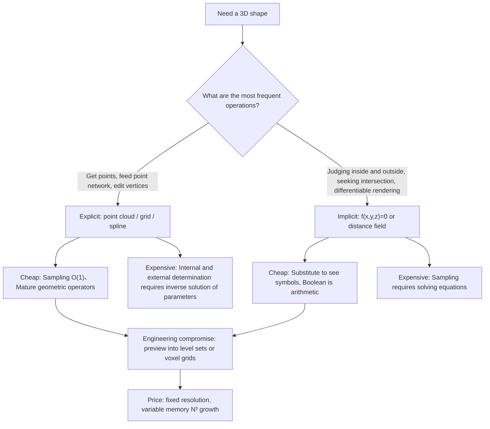

> **Course information**
>
> - **Course name**: Stanford CS231n: Deep Learning for Computer Vision(Spring 2025)
> - **Topic of this lecture**: Lecture 15. 3D Vision
> - **Lecturer**: Jiajun Wu
> - **Teaching date**: 2025-05-22
> - **Course homepage**: [cs231n.stanford.edu/2025](https://cs231n.stanford.edu/2025/schedule.html)
> - **Official courseware**: [lecture_15.pdf](https://cs231n.stanford.edu/slides/2025/lecture_15.pdf) (105 pages, page-by-page illustrations in the book)
> - **Subtitle source**: [cs231n_sp25_kor_sub · eng](https://github.com/lpaiu-cs/cs231n_sp25_kor_sub/tree/main/eng) (Publicly transcribed in English, Chinese rewritten by this book)
> - **Copyright statement**: The copyright of the slides and course materials belongs to Stanford University and the instructors; this book is an unofficial study note and is only used for study and research.

In the first fourteen lectures, most objects end up falling on a two-dimensional grid: pixels have rows and columns, and the rows and columns are addresses, so "adjacent" does not need to be defined. 3D does not have such an address system. The same cup can be described by millions of coordinate points, hundreds of thousands of triangles, or a line of equations.  $x^2+y^2+z^2=r^2$  Description - Three ways of writing describe the same object, but make completely different operations cheaper. The first question to be answered in this lecture is therefore not "Which representation is best?" but "**Each represents which thing is made cheaper and which thing is made more expensive.**".

The second question is the deep learning part. Jiajun Wu described this clue as a chain of dependencies: after 2012, people first performed 3D convolution on voxels, because the difference between voxels and pixels was only one dimension; then they were criticized by the graphics community as "slow and ugly", so they turned to point cloud-native PointNet; then they discovered that the deep network itself is an implicit function, so Occupancy Networks and DeepSDF were born; finally, the implicit function was connected to differentiable body rendering, and then NeRF and 3D Gaussian were born Splatting (3DGS). **Every track change is not because the network is stronger, but because of a different representation.**

## 1. "3D has no pixels": Explicitly means writing the objects into a list first

*(Reference time: 00:00:05 – 00:11:12｜Lecture 15)*

The interface for 2D vision is so cheap that no discussion is needed: a  $H\times W\times 3$  The tensor, which row, column, and channel are the same all over the world. 3D does not have this default value. The lecturer did not give a definition at the beginning, but first gave three photos to expand the boundaries of the word "three-dimensional object".

The first picture is a row of goblets and glasses. Cup rims as thin as a few millimeters, nearly transparent materials, and contours that block each other—the difficulty with this type of geometry lies not in the shape and contours, but in the details and materials. Any "sampling by grid" means that the resolution is even worse and the mouth of the cup collapses into a ball.

Second shot in reverse: an aerial shot of Manhattan's Central Park. In the city-level geometry, tree crowns, buildings, and roads are simultaneously included in the painting, and the scale spans from meters to kilometers. The same set of representations must be able to accommodate trees and buildings at the same time. This is a question posed by "scale" to the representation method.

The third is an overhead shot of a river delta (National Geographic reader contribution, Adriana Franco). The main river channel bifurcates into tributaries, and the tributaries bifurcate again. The shape is isomorphic to trees and blood vessels. Three-dimensional shapes often have multi-scale self-similarity, and any fixed-resolution representation will be distorted at one end. These three pictures taken together are the first argument of this chapter: **The choice of three-dimensional representation is essentially the choice of "at which scale without losing information"**.

### 1.1 Two major families and six considerations

The slide spreads the options into two groups. **explicit** (explicit): point cloud, polygon mesh, subdivision surface (subdivision), NURBS - the common point is that "points are written directly". **Implicit** (Implicit): level set, algebraic surface, distance function - the common point is that "points are filtered out by a relational expression". You can't get a point table, you can only ask "Is this point in it?" The last line of the slide reads: Each choice corresponds to a different task and geometry type, and there is no global optimal.

When actually doing engineering, you need to answer six things when choosing a model: how to save it into the computer (pixels are a matrix, point clouds are irregular tables, and implicit functions have to think about "what to save"); how to create new shapes, whether the input is pictures or language descriptions; what operations are supported - editing, simplification, smoothing, filtering, repair; how to render, rasterization, ray tracing or neural rendering; how to animate, especially human bodies and animals; and whether these six items can be connected with deep learning. This list will be used again and again later to rate each expression.

### 1.2 Point cloud: $3\times N$  The list is missing a connection table

Point cloud is the most economical way to write: a  $3\times N$  The matrix of , the three rows are  $x,y,z$, $N$  Columns are points. The image is "each position stores a value", and the point cloud is "each point stores a position" - the stored objects change from values ​​to coordinates, and the connection relationship is completely discarded. To render, you need to add another column: normal. Light comes from a certain direction, and which way each point on the surface faces determines how bright it is. Without the normal direction, the point cloud can only be drawn as a fog without light and darkness. Points with directions have special names in graphics——**surfel** (denominated).

Point clouds are important because they are often the sensor's **raw output**: The first-hand data spit out by depth cameras, structured light scanners, and even ARKit on the iPhone are points. However, the original output cannot be used directly: a single scan only covers one viewing angle, is noisy, and large areas are missing. Multiple frames must be **Registration** (registration) to the same coordinate system and then merge. Calculate an account: a frame of 640×480 depth map has about 300,000 points. Shooting 100 frames around the object is 30 million points. Three float32s for each point save about 360 MB - this is only the intermediate product of one scan.

The advantage of point cloud is that "any geometry can be stuffed into it". Any shape can be represented by moving the points, and it is not subject to topological constraints, so it is naturally suitable for large-scale data sets. The shortcomings are equally clear: the undersampled area cannot be drawn (the rabbit's head is densely packed, the tail is sparse, and the rendering is just a hole), there are no mature operators such as simplification and subdivision, and there is no directional smooth rendering. The most terrible thing is that **No topology information**. The question mark in the lower right corner of the slide comes from the last item: the same bunch of points may be a torus or two rings nested together - the point set does not tell you how they are connected.

### 1.3 Triangular grid: make up the connections at the expense of irregularities

A polygonal mesh fills in the connections: not just points, but faces as well. It is the most common representation in graphics engines, games, and film and television pipelines. Real-time rendering consumes almost all triangles. The price is irregularity: a face can have 3, 4, or 5 vertices. This variable-length structure directly conflicts with the "fixed resolution input" assumption of early convolutional networks. The lecturer described this as a hidden thread in the cost-**Deep learning started late in three dimensions, largely because of inconsistent representation.**.

Complex meshes can reach exaggerated scales. This statue of David has 28,184,526 vertices and 56,230,343 triangular faces. The vertex coordinates stored in float32 are  $2.82\times10^{7}\times3\times4$  bytes, about 338 MB; triangles are stored according to three 4-byte indices  $5.62\times10^{7}\times3\times4$, about 675 MB. The total size is about 1 GB, not including algorithm directions, UVs and textures. This is why the first step in mesh processing is often simplification rather than rendering.

Above that is Google Earth: a global grid reconstructed from satellite and aerial imagery, with trillions of triangles. Based on the 12-byte index of each triangle, it is 12 TB. It cannot be installed on a single machine at all, and the details can only be obtained by streaming according to the viewpoint. **Whether it can be "simplified without collapsing" has therefore become the core competitiveness of grid representation.**, and point cloud does not even have this operation.

Three basic operations make up the grid's toolbox. **Segmentation** (subdivision) Insert new points on the edge, determine the position of the new points based on neighborhood weighting, and divide a surface into four. The resolution increases but the shape remains unchanged; **Simplify** (simplification) In turn, the vertices are removed while maintaining the shape and appearance to change the frame rate; **regularization** (Regularization) Do not change the shape, only change the sampling distribution - make each face a triangle, three vertices, and similar in size, so that subsequent collision, parameterization, and smoothing algorithms can be easily written.

Regularization deserves a separate note because it answers the question "Why can't you just use the scanned grid?" The scanned grid is often dense on one side and sparse on the other, with long triangles all over the ground. Numerical algorithms are unstable on such grids. By making the sampling distribution uniform, the shape error is almost unchanged, but each subsequent step becomes cheaper - this is a typical example of "the quality of the representation is equal to the quality of the subsequent algorithm" in graphics.

At this point, the two representatives of explicit representation have been laid out: what point clouds and grids have in common is that "points are written directly". The next chapter takes a completely different approach: instead of listing points, write functions.

## 2. Write the shape as a function: parameterization saves degrees of freedom and makes implicit decisions easier

*(Reference time: 00:11:14 – 00:27:37｜Lecture 15)*

If the shape is "designed" - a table has straight sides, a chair has a plane of symmetry, a car body has a streamlined surface - it is wasteful to approximate it with millions of points: a round table only requires radius and height. Parametric representation is to write this prior into the representation: **The degrees of freedom of the shape are much less than 3**, a surface is essentially two-dimensional, and a curve is one-dimensional. To "paste" them into a three-dimensional space only requires a mapping.

### 2.1 Parameterization: Write the surface as a function of two variables

Use one slide first  $2\times2$  The classification diagram sets up the coordinate system: the horizontal axis is explicit and implicit, and the vertical axis is non-parametric and parametric. This frame only fills in the two squares (dots and grids) in the upper left corner. Each time I teach a category, I fill in one square - I will fill it in once during the entire lecture, and then use it as a signpost to refer to it repeatedly.

Parametric representation defines the surface as a function **like**(range): $S=\{f(u,v)\mid (u,v)\in D\}$, among which  $f:D\subset\mathbb{R}^2\to\mathbb{R}^3$. Note that the degrees of freedom are 2 and not 3 - the surface itself is two-dimensional, the third dimension is just the space in which it is embedded. It doesn't matter where the parameters come from, what matters is "you can locate a point on the surface with two numbers."

The simplest examples are circles and balls. Circle is written as  $f(t)=(\cos t,\ \sin t)$, $t\in[0,2\pi)$, one degree of freedom sweeps a circle; the ball is written as  $f(u,v)=(\sin u\cos v,\ \sin u\sin v,\ \cos u)$, $u\in[0,\pi]$, $v\in[0,2\pi)$, two degrees of freedom cover the entire spherical surface. There is no need to save points, just saving this function is enough.

More commonly used in engineering is  **Bézier curve**: Give several control points  $P_i$  and the corresponding basis functions  $b_i(t)$, the curve is  $B(t)=\sum_i b_i(t)P_i$. The control points only give the "pull direction", and the curve itself always falls within the convex hull of the control points, so adjusting the shape is very intuitive - this is the curve that can be dragged in the industrial design software. One Bézier has limited expressive power, and the actual approach is **Segmentation Bézier**: Multiple segments are put together, and endpoints are shared between segments to ensure continuity.

A surface is a tensor product of curves: $S(u,v)=\sum_i\sum_j b_i(u)b_j(v)P_{ij}$, get one  **patch** (Patch); multiple patches are sewn together to form a complete surface. This structure explains why digital models of cars and airplanes are "curved patch puzzles" - each patch has only a few dozen control points, but can create any smooth shell.

Another road alongside Bézier is **Segmentation** (subdivision, slide note borrows material from Keenan Crane and Don Fussell): Instead of writing formulas, we start from a rough control grid and repeatedly execute the rule of "insert points at the edge midpoints and move old points according to neighborhood weighting", and converge to a smooth limit surface after several iterations. It is easier to handle arbitrary topologies than tensor product surfaces like NURBS, which is why it has become the mainstay of animation pipelines.

By this frame, the two boxes in the lower half of the classification diagram have been filled in: splines and subdivision surfaces are both "parametric" - what they have in common is that they do not save a point table, but a set of control quantities and a set of generation rules. So far, the four representations (point, grid, spline, subdivision) all stand on **explicit** This side: No matter how it is generated, it will eventually give the specific points on the surface.

### 2.2 Explicit: Sampling is easy, internal and external are difficult

The unified description of explicit representation is: **All points are given directly**. The general form is written as  $f:\mathbb{R}^2\to\mathbb{R}^3$——Give it two parameters and it will give you a three-dimensional point. This interface determines its strengths and weaknesses.

The strong point is sampling. The torus given by the slide is  $f(u,v)=((2+\cos u)\cos v,\ (2+\cos u)\sin v,\ \sin u)$. To pick points on this surface, randomly select a few  $(u,v)$  Just put it in and you'll get the points **Guaranteed on the surface**. This step is  $O(1)$ , and there is no need to solve any equations - this property is relied on when methods such as PointNet later require converting shapes into point clouds.

The weakness is internal and external judgment. Given a query point  $(3/4,1/2,1/4)$, and ask whether it is inside the object - for explicit representation, you have to first find a pair  $(u,v)$  such that  $f(u,v)$  is equal to this point, which means solving a **inverse problem**. This type of equation on the torus may have multiple solutions or no solution. Once the shape is complex, there will be no analytical solution. The lecturer paused here and said "I'm not sure myself" - this hesitation just illustrates the problem: it is not intuitive for people, and it is even less friendly to the rendering pipeline.

### 2.3 Implicit: One symbol solves the internal and external problems

The implicit representation has changed direction: instead of listing points, give a **Classification rules**. The sphere is all that satisfies  $x^2+y^2+z^2=1$  points; more generally, the surface is  $f(x,y,z)=0$  The zero level set of . $f$  The signs of give the inside and outside: negative ones are inside, positive ones are outside. Slides with one line from  $-1$  Arrive  $+1$  The ribbon depicts this - the surface is the zero line flanked by the two domains.

The price appears immediately: **Sampling becomes difficult**. The torus implicit function given in the slide is  $f(x,y,z)=(2-\sqrt{x^2+y^2})^2+z^2-1$. To pick a point on this surface, we have to solve  $f=0$——This example can be made up using high school mathematics, but if it is changed to any shape, there is no closed-form solution, and the root can only be found numerically. Implicit representation throws away exactly what explicit representation does best.

But internal and external judgment has become substitution. same query point  $(3/4,1/2,1/4)$  Score unit goals: $9/16+1/4+1/16=7/8$, subtract 1 to get  $-1/8<0$, **inside**, one multiplication plus one subtraction is all. The slide intentionally places this number on  $-1/8$  Above: Accurate and verifiable, no need to believe in any approximations.

The same point will give different answers on two different implicit functions. This is worth remembering: substitute it into the torus function on the previous page, $\rho=\sqrt{x^2+y^2}=\sqrt{13}/4\approx0.901$, $(2-\rho)^2+z^2-1\approx+0.27>0$, judged as **external**. The symbol itself has no meaning, the symbol is relative to "the current  $f$  The described shape" only makes sense.

Explicit and implicit thus form a clean set of symmetries:

| Task | Explicit (point, grid, spline) | implicit($f=0$, distance field) |
| --- | --- | --- |
| Pick a point on the surface | Easy, just substitute parameters | Difficult, need to solve the equation |
| Whether the judgment point is inside or not | Difficult, need to solve the parameters inversely | Easy, substitute and see the symbols |
| Boolean operations (union/intersection/difference) | Need to re-intersect and reconstruct the topology | Just do point by point arithmetic |
| Represents complex topology | Requires explicit maintenance of connections | Natural support for merging and splitting |

This table explains the motivations for all subsequent technical routes: **What rendering requires is "querying the density of each point along a ray", which means a large number of internal and external judgments**, so neural rendering ends up on the implicit side.

### 2.4 Implicit Combination: Booleans, Distance Fields and Mixing

The implicit first level capabilities are **algebraic surface**: A surface is the zero set of multivariate polynomials. Quadratic surfaces (spheres, ellipsoids, and hyperboloids) can be written in closed form and have good controllability. The problem is also very straightforward: if you want the shape of a cow, you can't write the polynomial. There is a wall between closed-form expression and shape complexity.

The first way to get around this wall is to **Construct solid geometry** (constructive solid geometry, CSG): Instead of writing a complex function, use union, intersection, and difference to put together simple shapes. Implicit representation is particularly convenient here - each shape is given a function value, and the Boolean operation is to perform point-by-point arithmetic on the value, without re-intersection or reconstruction of the topology. This has also been standard practice in CAD (computer-aided design) for decades: a model of an industrial part is essentially a tree of Boolean expressions.

The second trick is to upgrade "symbol" to "numeric value": **distance function** (distance function) stores the shortest distance to the object surface at each point, and the signed distance field encodes both the inside and outside and the distance. The amount of information is much larger than that of binary inside and outside, at the cost that the function value is no longer just 0/1.

With numbers you can do arithmetic. The slide uses a one-dimensional example: a vertical line is  $f_1(x)=0$, the left side is negative and the right side is positive; the other vertical line is  $f_2(x)=0$; Adding the two functions, the zero set falls between the two lines, forming a **Smoothly moving borders**. This is "blending": not a hard cut like a Boolean, but a transition between two shapes like two pieces of plasticine. The same addition in three dimensions can glue two balls into a peanut shape, with the width of the shape transition controlled by the scale of the distance field.

How far can this road go? The slide shows a scene map that is completely composed of distance functions - buildings, steps, and decorations are all there, all of which are a combination of several distance functions. The lecturer said that it is "not easy", but "if you are good at it, your expressiveness is very strong". It illustrates that the upper limit of implicit representation is high, but also implies a lower limit: **Manually adjusting these functions is a craft**, which is why I later wanted to replace it with a neural network.

The classification diagram of this frame only has the name added, and the two implicit cells are still empty - algebraic surfaces and CSG belong to parametric implicit, and their diagrams (that  $x^2+y^2+z^2=1$  balls and Boolean trees) will not be added until page 40, after level sets and voxels. The slides use this "fill in the blanks frame by frame" rhythm to emphasize that this picture is not a catalog, but a knowledge map for this lecture.

### 2.5 From functions to fields: level sets and voxels

The advantage of implicit representation is that it is easy to merge and split. The disadvantage is that there is no closed form for complex shapes, and the function must be calculated for each query. The engineering compromise is **level set method** (level set): analytic functions are no longer retained, but on a three-dimensional grid **pre-check** The function value of each grid point is stored in a matrix. Where are the surfaces? Where two adjacent grid points are one positive and one negative, just interpolate to find the zero crossing point.

What this step brings is "explicit control": a three-dimensional scalar field is like a three-dimensional texture, which can be directly visualized, edited directly, or isosurface extraction algorithms such as marching cubes can be directly run. What you pay for is resolution - the coarser the grid, the harder it is to find fine structures.

Calculate an account: The example given by the lecturer is  $100\times100\times100$  grid, that is  **1 million function evaluations**. Change to a common resolution: $256^3$  is 16.8 million times, $512^3$  That’s 134 million times. When saved, 1 byte per grid is calculated as 1 MB, 16.8 MB, or 134 MB; if each grid is compressed into 1 bit inside and outside, it is 0.125 MB, 2.1 MB, or 16.8 MB. These differences of several orders of magnitude determine later "why voxels cannot go far and why octrees appear."

The most mature battlefield for level sets is medical imaging. The data given by CT and MRI are originally volume data, and each voxel is a density value; by taking a certain isosurface (such as a constant tissue density), the organ boundary is obtained. There is no need for analytical functions or topological priors here, and isosurface extraction on the grid is directly available.

Just take a step back **voxel** (voxels): The level set only leaves symbols, positive ones are always marked as 1, and negative ones are always marked as 0. The three-dimensional scalar field becomes a three-dimensional binary matrix. This representation corresponds almost one-to-one to pixels - pixels are two-dimensional matrices and voxels are three-dimensional matrices, with just one more depth axis. The lecturer said that he deliberately took such a long way to talk about voxels: only by pushing down the implicit function can we see that the voxel is actually the product of the three steps of "implicit function + pre-check + binarization", rather than a representation that appears out of thin air.

to this frame, $2\times2$  The graph is finally filled with: non-parametric explicit (points, grids), parametric explicit (splines, subdivision surfaces), non-parametric implicit (voxels, level sets), parametric implicit (algebraic surfaces, CSG). This picture will appear repeatedly later. Every time the deep learning route is changed, the instructor will point the arrow from one grid to another.

Use a flow chart to collect the choices in this chapter:

## 3. Data is scarcer than methods: the ImageNet gap in 3D

*(Reference time: 00:29:28 – 00:35:45｜Lecture 15)*

Half of the credit for the success of AlexNet in 2012 lies with ImageNet. The same principle applies to 3D: the representation determines "what can be done", and the data determines "whether it can be learned". The lecturer did not talk about any network structure in this paragraph, but only calculated accounts - turning over the history of 3D data sets from before 2014 to the Objaverse, and using the number of models of each type to explain why 3D deep learning can only be used for chairs in the long term.

### 3.1 Ledger before 2014: ten models per category

The most commonly used benchmark before deep learning is  **Princeton Shape Benchmark** (PSB): 1814 models, 182 categories, an average of 10 per category. It seems pitifully small today, but at that time it was already a scale that could "make up a paper" - because at that time there were almost no machine learning methods that could really use this data, so the data demand was naturally not high.

This one-page table quantifies "less". It counts the main shape benchmarks before 2014:

| benchmark | Type | Number of models | Number of categories | average per category |
| --- | --- | --- | --- | --- |
| SHREC14LSGTB | Universal | 8,987 | 171 | 53 |
| PSB | Universal | 907+907 (training+testing) | 90+92 | 10+10 |
| SHREC12GTB | Universal | 1,200 | 60 | 20 |
| TSB | Universal | 10,000 | 352 | 28 |
| CCCC | Universal | 473 | 55 | 9 |
| WMB | Watertight (movable) | 400 | 20 | 20 |
| BAB | architecture | 2,257 | 183+180 | 12+13 |
| ESB | CAD | 867 | 45 | 19 |

Pay attention to the largest row: TSB has 10,000 models, but only 28 are left in 352 categories; CCCC is even more extreme, with only 473 models in 55 categories, 9 in each category. The instructor's statement was "With ten models per category, you can't do anything." This is the starting point of three-dimensional deep learning - it’s not that the network is not good, it’s **There are not enough examples for the network to learn invariance**.

### 3.2 ShapeNet and Objaverse: Millions of synthetic data

The turning point is  **ShapeNet** (Chang et al., arXiv 2015), a work led by Stanford (with participation by Leo Guibas and Silvio Savarese). There are 3 million models in total, but a subset is used daily.  **ShapeNetCore**: 51,300 models, 55 categories. On average, there are 933 per category - an increase of nearly a hundred times from 10 in PSB. This is the level of "trainability". The cost is imbalance: chairs and cars are particularly large categories, so for several years the results of papers were only reported on chairs and cars.

Further up are large-scale synthetic assets: collected by AI2 (Allen Institute for AI, Seattle)  **Objaverse**  About 800,000, **Objaverse-XL**  About 10 million. This type of data is characterized by more complex categories, higher average quality, generally textured, and is all synthetic - there is no scanning noise, but there is no real-world statistical properties.

### 3.3 Real scan: from 441 models to 19,000 videos

Synthetic data is easy to create, but real data is difficult to create. The object scan data set around 2016 (the lecturer mentioned the collection of the Redwood series) has 10,933 RGBD scans, but only covers  **441 models**——On average, each object is scanned more than 20 times, which is enough for reconstruction, but far from enough for training classification.

**CO3D**  I changed my mind: don’t hire people to scan, use crowdsourcing. Meta has teamed up with Oxford to allow ordinary people to take a 360-degree video of an object with their iPhone and upload it for a small fee. The first version had 19,000 videos in 50 categories; subsequent versions expanded to about 90,000 videos. Its dual value lies in: appearance statistics of real objects, and pairing supervision of "video ↔ 3D geometry" - with pairing, the reconstruction algorithm has a supervision signal.

Even so, the gap is still huge. The two orders of magnitude given by the lecturer are: **Real three-dimensional objects are approximately  $10^5$  magnitude, two-dimensional image data is billions of times (the "5B" he mentioned)**. A difference of four orders of magnitude. This cannot be made up by collecting another batch of data. It explains the technical route for the next ten years: **Find ways to learn 3D from 2D images instead of waiting for more 3D data to become available**.

### 3.4 Parts and scenes: thinner and smaller

Object-level annotation is not enough, many tasks require part-level annotation. The famous picture in the ShapeNet paper breaks the annotation into four layers: link to  **WordNet**  Classification (hypernyms of swivel chair are chair, seat, furniture), symmetry plane and alignment, part hierarchy (backrest / seat / base / leg / wheel), and the correspondence between different objects with the same functional parts. Even the size, material, quality and function of the parts are marked: $50\times45\times5$  cm, foam and fabric, 5 kg, function: support.

**PartNet**  Make this thing into a system: fine-grained, instance-level, hierarchical, with additional annotations **Mobility** (mobility) - For example, a notebook can be opened and closed. The dimension of mobility is very critical. It turns "static geometry" into a "structure with joints", which will be used in subsequent robot operations and simulations.

Scenes are harder than objects. **ScanNet**  The approach is to carry a scanner into other people's homes and offices: 1,500 RGBD scans, 2.5 million views, with camera poses, surface reconstruction and instance-level semantic segmentation. In recent years, ARKitScenes and ScanNet++ (the latter adds SLR images) are of similar order of magnitude, with the number of rooms ranging from thousands to thousands. The lecturer pointed out this ceiling: **As long as people have to scan, the amount of data will be locked up by man-hours.**——This is also the real motivation of the route of "learning 3D from 2D supervision".

## 4. First compress 3D into 2D: multi-view CNN, voxel convolution and octree

*(Reference time: 00:35:52 – 00:45:34｜Lecture 15)*

With the data in hand, next comes the method. The first reaction around 2015 was very pragmatic: since the 2D network is already strong on ImageNet, and the 3D data is orders of magnitude smaller, then **Convert 3D problems into 2D problems** It's the easiest path. This chapter talks about three attempts: rendering objects into multiple views, treating voxels as three-dimensional pixels, and the invention of the octree to save video memory.

### 4.1 Task List: Generation, Discrimination and Joint Modeling

The slide divides the 3D tasks into two columns. **Generative**:Learn shape prior  $p(x)$, and conditional generation  $p(x\mid z)$ (condition is language, image or category) for shape generation, completion, geometric data processing. **discriminant**:Learning shape descriptors  $p(z\mid x)$, used for classification, segmentation, and perspective estimation. The third piece is **Joint modeling 2D and 3D**: 2D has massive data and strong pre-trained models, 3D has geometry, and the middle is connected by microprojection, differentiable backprojection and neural rendering. The lecturer also mentioned two categories of non-visual modalities—robot haptics, autonomous driving LiDAR, and depth—that also need to converge here.

Before starting, the lecturer laid out the classification diagram again and added implicit brackets: **Eulerian** (Eulerian type). These two words are borrowed from fluid mechanics - the Euler description is concerned with "the field value of each fixed point in space", and the Lagrangian description is concerned with "where each particle goes". The voxels and level sets are Eulerian (store values ​​on a fixed grid), and the point cloud is Lagrangian (follow the particles). This diagram will appear again on page 69 with the "Eulerian → Lagrangian" arrow, which is when the route switches.

### 4.2 Multi-view CNN: Outsourcing 3D recognition to 2D

The earliest solution was so simple that it was almost lazy: don’t touch the three-dimensional representation, put the object **Rendered into a set of 2D images**, and then do it as image classification. This page of slides from Su et al. ICCV 2015 has only one chair - it is the input to be recognized.

The first step is to arrange the camera: take a circle around the object  $N$  perspective, get  $N$  A rendering. This step replaces the "three-dimensional shape" with a "set of two-dimensional observations". The price is that there must be a projection - and the projection will lose information, and the occlusion, back side, and internal structure will not be visible.

The second step is to pass a convolutional network (denoted CNN $_1$) to mention features. This layer completely reuses the weights pre-trained by ImageNet, which is the biggest bonus of the entire route: **Three-dimensional data is not enough, but two-dimensional features are enough**.

The third step is integration. The method is called  **view pooling**: put  $N$  The feature maps of each viewing angle are maximized element by element to obtain a fusion feature with the "most significant response". Maximizing rather than averaging is taken because discriminative components seen from one perspective (such as the curvature of a chair back) should not be diluted by mediocre responses from other perspectives.

The fourth step is to pass a convolutional network (CNN $_2$) Turn the fused features into shape descriptors, and finally connect to softmax to output the category. The entire link is end-to-end trainable, but only the CNN $_2$  It is truly "learned for three dimensions", CNN $_1$  Basically borrowed.

The results show that this path can work. On ModelNet40:

| method | Number of viewing angles | Classification accuracy | Retrieve mAP |
| --- | --- | --- | --- |
| SPH | — | 68.2% | 33.3% |
| LFD | — | 75.5% | 40.9% |
| 3D ShapeNets | — | 77.3% | 49.2% |
| FV | 12 | 84.8% | 43.9% |
| CNN | 12 | 88.6% | 62.8% |
| MVCNN | 12 | 89.9% | 70.1% |
| MVCNN+metric | 12 | 89.5% | 80.2% |
| MVCNN | 80 | 90.1% | 70.4% |
| MVCNN+metric | 80 | 90.1% | 79.5% |

Two numbers are worth keeping an eye on. First, **Classification** The jump from 77.3% for 3D ShapeNets to 88.6% is achieved simply by replacing voxels with renderings and adding ImageNet pre-training - the twelve-point gap almost entirely comes from 2D pre-training. second, **Search** It is much more sensitive to the fusion method: for the same 12 perspectives, the ordinary CNN is 62.8%, adding view pooling to 70.1%, and adding metric learning (metric) to 80.2%. Classification only depends on "whether it is correct", while retrieval depends on "whether the feature space is arranged well". The latter is more difficult to fool. The number of viewing angles increased by only 0.2 points from 12 to 80, indicating that the 12 viewing angles have basically covered the discriminant information.

The lecturer's summary of this page is very flat: it is indeed easy to use and can leverage the entire image classification literature and pre-trained features; but it must have projection, and **If the input itself is a noisy, incomplete point cloud, the "rendering out" step is already ruined.**. This sentence buried the motivation behind PointNet.

### 4.3 Voxel routing: 3D convolution, 3D-GAN and differentiable projection

The other path is "native 3D", but the starting point is still copying 2D:  $H\times W$  The convolution kernel is replaced by  $D\times H\times W$, two-dimensional convolution becomes three-dimensional convolution, and the network structure does not need to be changed. Princeton 2015  **3D Convolutional Deep Belief Network** (3D Conv DBN) does this, generating low-resolution voxel shapes - which is crude today, but quite amazing at the time.

This page shows two things at once. On the left are the generated results of sampling by category: sofa, bathtub, toilet, chair, bed, table, bedside table, seven samples per category, with reasonable shapes but all edges are steps. The table on the right shows that the generative model can also discriminate (same set of voxel features):

| Number of categories | indicator | SPH | LFD | the job |
| --- | --- | --- | --- | --- |
| Class 10 | Classification | 79.79% | 79.87% | 83.54% |
| Class 10 | Retrieve MAP | 44.05% | 49.82% | 68.26% |
| Class 40 | Classification | 68.23% | 75.47% | 77.32% |
| Class 40 | Retrieve MAP | 33.26% | 40.91% | 49.23% |

The classification improvement was 3.7 points on ten categories of tasks and 1.9 points on forty categories of tasks - not a much increase, but it proved that the "voxel + deep network" path itself was established, which was brand new at the time.

Following this idea, just move GAN over  **3D-GAN**: The generator generates a three-dimensional voxel shape from a shape code, and the discriminator determines "is this a real model or generated". The instructor's statement is "It's very simple, we just did it" - it is indeed simple, but it directly connects the mature tools of adversarial training to the three-dimensional.

The really interesting step is  **Visual Object Networks** (VON): Split shape and appearance into two networks. **shape network** Generate 3D shapes from shape encodings, one by one **microprojection** Get depth map and silhouette; **texture network** Generate 2D images from texture encoding and perspective encoding. Therefore, the adversarial loss can be added to two places at the same time: the three-dimensional shape should be like the real shape, and the two-dimensional rendering should be like the real photo. The significance of this step is that **Treat 2D images as 3D supervision signals**, rather than just treating it as input.

After disassembling the coding, controllability is naturally available: change the angle coding to change the camera, change the shape coding to change the style, change the texture coding to change the color; interpolate between the two codes to achieve a smooth transition; connect the texture coding of car A to the shape coding of car B, and you will get "B's shape + A's painting". This was the most immediate bonus of decoupled representation and became the standard demonstration for all subsequent 3D generation work.

### 4.4 Octree: Eliminate empty space sampling

The most criticized aspect of the voxel route is that it is slow: the entire space must be presampled, and **Most of the grid points are either empty or inside the object**, they are considered to have no information content. The idea of ​​​​an octree is to only spend computing power near the surface.

The specific method is to recursively divide the space into eight: cut a cube into eight, determine which sub-block intersects with the surface, and continue cutting only the intersecting sub-blocks. So in the same scene, there are fine grids near the surface and coarse grids in the cavity, and the storage capacity is reduced from "volume" to "area". The slides are marked with two concurrent works of OctNet (CVPR 2017) and O-CNN (SIGGRAPH 2017).

The curve on this page is the strongest evidence of this route: the horizontal axis is resolution ($16^3$  Arrive  $256^3$), the vertical axis is GPU memory. voxel CNN in  $64^3$  It fills up the video memory nearby, but O-CNN can do it all the way  $256^3$——The resolution is increased by four times, the volume is increased by 64 times, and the cavity is saved.

Double check with numbers: $256^3$  is 16.8 million grid points, while the surface only occupies  $O(N^2)$  Magnitude - just one piece  $256\times256$  The surface has 65,000 grid points, and the surface grid points of a closed surface are on the order of 100,000, less than 1% of the total. **More than 99% of the grids are empty or solid**, which is why the octree can save two orders of magnitude.

There are also corresponding modifications to the generation task: **Octree Generating Networks**  No more one-time output  $N^3$  voxels, but **Generate octree layer by layer**——First generate a rough layer to determine where refinement is needed, and then generate the next layer in the required sub-blocks. The amount of calculation is from  $O(N^3)$  Reduced to the same level as the surface, this is also the common skeleton of all subsequent sparse 3D generation methods.

## 5. From point set to function: The appearance of PointNet’s symmetric functions and implicit functions

*(Reference time: 00:45:38 – 00:58:43｜Lecture 15)*

The octree optimizes the voxel route to the limit, but the graphics community is still dissatisfied: why use a representation that "just looks ugly"? Point clouds and meshes are obviously closer to the geometry itself. There is only one obstacle: **Points are unordered**,Convolution requires a fixed order of neighborhoods, which ,point clouds do not have. This chapter talks about three breakthroughs: using a symmetric function to solve disorder, using MLP to learn parameterization, and finally simply letting the network act as a function.

### 5.1 PointNet: A symmetric function solves permutation

On page 69, the classification diagram is laid out again, this time with a thick arrow pointing from Voxels to Points, and the title is  **Eulerian → Lagrangian**: Switch from "storing field values on a fixed grid" to "following points". That’s the route switch after 2017.

**PointNet** (Qi, Su, Mo, Guibas, CVPR 2017) is the beginning of this road. Its selling points are two "unifications": end-to-end learning of irregular point data, and using the same framework to do multiple tasks - object classification (is this blob of a cup, a table, or a car), component segmentation (which points belong to the chair back), and scene semantic segmentation (which points belong to the wall, floor, or chair). The lecturer emphasized that it came from Leo Guibas’ group, the same people who worked on ShapeNet——**The data and methods were recommended by the same people**.

Point cloud places two hard requirements on the network. **Replacement unchanged** (permutation invariance): Point cloud is a set. There is no concept of "first point". If you renumber the points, the output must be exactly the same. **Sampling unchanged** (sampling invariance): The output should only depend on the underlying geometry and not on which points you happened to pick - ten points on the rabbit's head and five on its tail, and vice versa, should give the same answer.

The mathematical grip is **Symmetric function** (symmetric function): The input order is randomly disrupted, and the output remains unchanged. max, sum, average are all. The question in the middle of the slide is the key——**How to use neural network to construct "global symmetric function"**, rather than just picking a few ready-made aggregation operators?

The most direct method is: each point undergoes the same point-by-point transformation, and then max or sum is taken from the results of all points. This does not change the displacement, but the expressive power is limited - the statement on the slide is that it "can only discover the extreme and total properties of geometry" (the frontmost point, the highest point, the sum of all points), and cannot learn the relationship between points.

The key step of PointNet is to change the point-wise transformation into a learnable MLP  $h$, the aggregation remains symmetrical  $g$: $f(\{x_1,\dots,x_N\})=g\big(h(x_1),\dots,h(x_N)\big)$. As long as  $g$  Symmetry, $f$  symmetrical; and  $h$  is an MLP with shared weights that can be calculated independently for each point. It not only keeps the substitution unchanged, but also gives the expressive power to  $h$. This is vanilla PointNet.

Calculate a parameter quantity: Let  $N=1024$  points, point by point MLP walking  $3\to64\to128\to1024$, the parameters are about  $(3\cdot64+64)+(64\cdot128+128)+(128\cdot1024+1024)\approx1.4\times10^{5}$, **with points  $N$  irrelevant**. If you are lazy  $3N=3072$  The dimension is directly connected to a 1024-dimensional fully connected layer, and the parameter amount is  $3.1\times10^6$, increased twenty times, and it does not change at all - if the input order is changed, the weights will not correspond to the same point.

A natural extension after PointNet is to view point clouds as graphs: points are nodes, neighbor relationships are edges, and graph neural networks (GNN) are used to convey messages on the edges. In this way, local structures can be modeled explicitly, and subsequent work such as PointNet++ followed this path.

### 5.2 How to calculate loss in point cloud: Chamfer and EMD

Loss for classification tasks is not an issue - cross-entropy is enough. However, the generation task requires comparing the "output point cloud" and the "true value point cloud", and the point cloud is an unordered collection, and element-by-element subtraction is meaningless. The slide shows two commonly used metrics.

**Chamfer distance**: Find the nearest blue point for each red point, find the nearest red point for each blue point, and sum the distances on both sides. It does not require one-to-one correspondence, the calculation is  $O(NM)$  Pairwise comparison——$1024\times1024$  About a million distance calculations.

**Earth Mover distance** (EMD): Find one between two point sets **One-to-one optimal matching**, minimizing the sum of distances of all pairs. It is more in line with the intuition of "moving a pile of soil into another pile of soil", but requires the same number of points on both sides. The solution is bipartite graph matching, and the naive implementation is  $O(N^3)$  Magnitude - A thousand points is a billion operations, usually with approximations.

Both metrics can be made differentiable, so they can be directly back-propagated to train the generation network. This is critical: **Without differentiable set distances, there is no point cloud generation**.

### 5.3 AtlasNet: Let the network learn from the "paper"

The arrow on page 77 changes direction: from Points to the Splines of the Parametric row. This means that although the point cloud is flexible, the generated surface will always be rough because it has no concept of "surface"; to obtain a smooth surface, you have to go back to parameterization.

The problem is that the parameterized analytical expression cannot be written. A sphere can be written as sine and cosine, but a chair cannot. **AtlasNet**  The idea is simple: since there is no closed formula, use an MLP to represent this mapping - the input is a two-dimensional parameter  $(u,v)$, the output is a three-dimensional point, and the network learns by itself "how to bend a plane into this shape."

One network cannot bend the entire chair, so use multiple ones: the lecturer compared it to **Origami**——There are several pieces of paper in my hand, each folded into different shapes, and put together to form a complete object. Each patch is a small network, each responsible for a surface, and together they cover the entire geometry.

The three-column comparison makes this evolution clear. **voxel** The reconstruction is locked by the resolution, and the edges are all steps; **point cloud** No longer limited by resolution, there are more details, but without faces, the rendering is just a layer of scatter points; **AtlasNet**  What is given is a real curved surface with smooth edges and continuous normals, which can be directly entered into the rendering pipeline. The same input image, three representations, three "what can it be used for".

### 5.4 Deep Implicit Function: Four Same Things in 2019

The arrow on page 80 points from the explicit column to the implicit column. The motivation for this step was explained most clearly by the lecturer: **The deep network itself is a function**. When doing ImageNet classification, the network learns a mapping from 250,000-dimensional pixels to 1000-dimensional categories - the input space is huge and the output space is extremely small. This mapping is too complex to write a closed form, so a network is needed. Looking at three dimensions in reverse: If what I want is "whether each three-dimensional point is in the object", that is a mapping from 3 dimensions to 1 dimension, and the output space is smaller than classification. **Then why not use the network as the implicit function directly?**

So there is the batch of jobs in 2019: network input  $(x,y,z)$, outputs a scalar—either inside or outside, or the signed distance to the surface. Training requires 3D supervision (you know which points in the shape are inside), but inference is only a forward pass. The slide lists three articles: Liu et al.  *Learning to Infer Implicit Surfaces without 3D Supervision*(NeurIPS 2019), *Deep Level Sets*(2019), **DeepSDF**(CVPR 2019).

The lecturer singled out this year's coincidence: **Four papers did the same thing almost at the same time**. In addition to the above three articles, there are also  **Occupancy Networks** (CVPR 2019) with  *Implicit Fields* (CVPR 2019). Their respective entry angles are different (some output occupancy probability, some output SDF, and some do not require three-dimensional supervision), but the common judgment is consistent: voxels, point clouds, and grids each have shortcomings. **The correct interface is to send the query point into the network**.

It is difficult for a single large network to express complex shapes, so AtlasNet's "multiple sheets" idea was moved to implicit: **a set of implicit functions**, each part is a small network, each responsible for an area, and they are put together to form the whole. This not only retains the implicit decision advantage, but also obtains the flexibility of block modeling.

At this point, the "representation roadmap" of three-dimensional deep learning has basically completed a circle: voxel (Eulerian) → point cloud (Lagrangian) → parametric surface (AtlasNet) → implicit function (DeepSDF). The last step in the next chapter is to add the implicit function **Color**, and connect it to the rendering equation - that's NeRF.

## 6. Neural fields and rendering: NeRF learns three-dimensional fields into differentiable fields, and 3DGS makes them sparse.

*(Reference time: 00:59:06 – 01:07:11｜Lecture 15)*

The depth implicit function solves the problem of "whether this point is in the object", but rendering needs to answer another question: "along this light, what color do I see?" This requires two things: every bit of **Density** (How much light is blocked) and each point **Color** (how much light is emitted), and a rendering equation that makes the integral along the ray differentiable. This is what NeRF does - it only changes two things compared to DeepSDF, but both changes are in key positions.

### 6.1 NeRF: put  $(x,y,z,\theta,\phi)$  mapped to  $(\mathrm{RGB},\sigma)$

The input of the network changes from three numbers to five numbers: spatial coordinates  $(x,y,z)$  plus **Viewing direction** $(\theta,\phi)$;The output changes from "inside/outside" or "distance" to a quadruple  $(\mathrm{RGB},\sigma)$——Color and density. Why give two more angles? Because the same point has different colors when viewed from different directions (specular reflection, transparent material), and density has nothing to do with direction. The upper part of the slide is this mapping  $F_\Theta$, the lower part is the entire link from the camera to emitting light, sampling along the light, and then comparing it with the true pixels.

The rendering model is volume rendering. a ray  $r(t)=o+td$  above, the pixel color is

$$
C(r)=\int_{t_n}^{t_f} T(t)\,\sigma(t)\,c(t)\,\mathrm{d}t,\qquad T(t)=\exp\left(-\int_{t_n}^{t}\sigma(s)\,\mathrm{d}s\right)
$$

$T(t)$  is **Transmittance**: From camera to  $t$  How much light is blocked in this section. After discretization, it becomes a summation: cut the ray into  $N$  Section, No.  $i$  The weight of the segment is  $\alpha_i=1-\exp(-\sigma_i\delta_i)$, eventually  $C=\sum_i T_i\alpha_i c_i$, among which  $T_i=\prod_{j<i}(1-\alpha_j)$. The lecturer emphasized that this step is a standard part in graphics. **It is naturally differentiable**: Density and color are both outputs of the network, and gradients can be directly passed through the summation back to the MLP. This is exactly what "the rendering equation does not need to be changed, just connect it to the network".

These two changes combined account for the entire difference in NeRF's relative depth implicit function: **Supervision changes from 3D shapes to 2D images** (no need for true geometry anymore), **Output expands from geometry to radiation** (Color also enters the Internet). The lecturer specifically refuted the statement that "NeRF was born out of nowhere" - its author clearly wrote in a follow-up article that the idea came from the batch of work on deep implicit functions.

The result is two large images: one of a section of a mosaic pool and one of an orchid petal. It's difficult for both **high frequency details**— the individual tiles of the mosaic, the translucent edges of the orchid petals. NeRF can reconstruct them by relying on dense sampling on each ray, rather than a larger network.

Calculate an account: one  $800\times800$  The image has 640,000 rays, and each ray needs to sample dozens to hundreds of points; based on 128 points, it is estimated that there are about 80 million MLP forward times. MipNeRF360 rendering speed given on slide 93 is 0.07 FPS -**Rendering a frame takes 14 seconds**, the lecturer said "about 20 seconds", the magnitude is the same. That's the price of NeRF: extremely high quality, but every pixel has to look through the entire ray.

### 6.2 Generative formula: replace voxels with radiation fields

Return to the VON framework in Chapter 4. At that time, the shape network output was voxels, which could then be micro-projected into depth maps and silhouettes, and the texture network added colors. Now replace the voxels: the shape network outputs an implicit field, which can be replaced by volume rendering from micro-projection, leaving the rest of the structure unchanged. **Using the same adversarial framework and changing the geometric representation, the output quality will go up to a higher level.**

This page fully illustrates the replaced structure: the shape is encoded into the shape network to directly produce three-dimensional density and radiation fields; the renderer integrates the two-dimensional image along the ray; the discriminator looks at the rendering and the real photo at the same time. The lecturer mentioned that this was the work of their group (first author Eric Chen, collaborators are mainly from Gordon Wetzstein's group), and the effect is much more realistic than the voxel version.

The more important benefit is on the data side: because it can be learned directly from two-dimensional images, **No longer need to be limited by "categories with three-dimensional data"**. The reason why chairs and cars dominated in the past few years is because only they have enough three-dimensional models; after being able to learn directly from iconography, any object with a photo can come in.

### 6.3 From dense to sparse: 3D Gaussian Splatting

Change the arrow to bidirectional on page 89: Explicit and implicit are not two opposite ways, but two ways of writing that can be converted into each other - point clouds can be fitted into SDF, and level sets can also be extracted into grids. This step paves the way for the later idea of ​​​​"mixing the two representations".

The problem with NeRF is exactly the same as with voxels, just in a different position: it changes the scene **densely** Parameterized in the entire space, when light passes through an empty area, the network is still queried at each sampling point and the density is 0, which is a waste of time. The word the lecturer used was "waste" - the same word he used when criticizing voxels.

**3D Gaussian Splatting** (3DGS) The answer is "sparse". Instead of using a network to represent the entire space, we put a bunch of three-dimensional Gaussian ellipses (which can be understood as **Points with volume**): Each Gaussian has its own center, covariance (which determines how flat it is and in which direction), opacity and color. When light passes through, it is only sampled in the interval covered by the ellipsoid - picture  $\sigma=0$  The asterisk is empty and does not participate in the calculation at all; $\sigma=0.5$  with  $\sigma=1$  The ellipsoid contributes color.

In terms of reconstruction quality, 3DGS and NeRF are in the same category: details, reflections, and thin structures can be revealed. It is not a "worse approximation", but a different kind of parameterization - the parameter is no longer "the density field of the entire space", but "only places a set of ellipsoids where there are things", and there is no need to do hundreds of network queries for each pixel when rendering.

The numbers are on this histogram (Kerbl et al., ACM TOG/SIGGRAPH 2023):

| indicator | Instant-NGP | MipNeRF360 | 3DGS (30K iterations) | 3DGS (7K iterations) |
| --- | --- | --- | --- | --- |
| SSIM ↑ | 0.72 | 0.80 | 0.83 | 0.78 |
| PSNR ↑ | 24.92 | 27.11 | 26.91 | 25.2 |
| Rendering frame rate (FPS) ↑ | 9.0 | 0.07 | 137.3 | 167.9 |
| Training time ↓ | 7.5 minutes | 48 hours | 38.3 minutes | 6.1 minutes |

The lecturer reminded that "the y-axis does not start from 0, this picture is a bit misleading" - SSIM from 0.80 to 0.83 looks like a big difference, but in fact it is only a small improvement. What really matters is efficiency: **Rendering from 0.07 FPS to 167.9 FPS, more than two thousand times**;Training from 48 hours to 6 minutes. The quality is equal to that and the speed is three orders of magnitude faster. This is the selling point of 3DGS.

## 7. Structure is more difficult than geometry: parts, diagrams, hierarchies and procedures

*(Reference time: 01:07:22 – 01:11:26｜Lecture 15)*

After talking about rendering, the lecturer spent the last five minutes talking about something that all the previous remarks ignored: **structure**. Point clouds, grids, and implicit functions all describe "element geometry"—where the surface is and where the normal direction is; but the reason why a chair is a chair is because it has four legs, an axis of symmetry, and the legs must touch the ground. These constraints are not in the geometry; **relationship between elements** inside.

Page 94 completes this picture for the last time: all six grids have pictures. Its function is to remind-all the content in this lecture is moved back and forth in these six grids.

### 7.1 Structure-aware representation: structure + geometry

This page gives an equation: a chair = **Element structure**(element structure)+ **element geometry** (element geometry). On the left is a rendering, in the middle is a structural diagram of the chair broken into colorful blocks (blue seat, orange rungs, gray columns, yellow legs), and on the right is a geometric detail with wood grain and chamfers. The highlight frame is first framed on the geometry side.

In the next frame, the highlight frame is moved to the side of the structure, and the meaning is very clear: the protagonist of this section is not "how to draw the surface correctly", but "how to put the relationship between parts correctly". The same pile of colored blocks can be used to build a chair or a monster with four legs of different lengths - the difference lies in whether the structural constraints are expressed.

### 7.2 Six structural representations, and their respective vulnerabilities

The slides are accumulated one by one in six pages, and each additional layer is added with the sentence "at what cost". This arrangement is an argument in itself: the ability and accessibility of structural representation are a pair of opposite indicators.

**First layer: segmented geometry** (segmented geometry). Cut the shape into parts, each part is still a normal geometry. The advantage is that it is the simplest and can directly reuse all models that deal with unstructured geometry. The disadvantage is **The integrity of atomic parts is not guaranteed**- It is entirely possible for the generative model to output a "half-seat" fragment because it is not forced to output coherent segments.

**Second level: parts collection** (part sets). Each part is generated individually, and the integrity is naturally guaranteed (one part is a whole). But between parts **no relation**: There is nothing to prevent a chair leg from floating in mid-air, and nothing to ensure that the two legs are of equal height.

The representative work of this level is **collection of voxel primitives** (Tulsiani et al., CVPR 2017): Represent the shape as a number of cuboids with postures, the encoder compresses the voxels into latent vectors, the decoder outputs a set of primitive parameters, and the loss is calculated according to "the union of primitives ≈ the true shape". The four legs of the deer, the seat and back of the chair are all made of rectangular blocks, abstract but controllable.

A more expressive version is **local depth implicit function** (Local Deep Implicit Functions, Genova et al., CVPR 2020): The input shape is decomposed into a set of oriented ellipsoids. The contribution of each ellipsoid is decoded by a latent vector into implicit surfaces through the network, and put together to obtain the entire surface. For objects with more complex curved surfaces such as lamps and human bodies, it is much more natural to use ellipsoids as building blocks than cuboids.

**The third layer: relationship diagram** (relationship graphs). Parts are nodes and relationships are edges - connecting a "support" edge between the legs and the seat surface can constrain it from hanging in the air. The price is **The generation of graphs itself is still an open problem**: The number of nodes is variable, the number of edges is variable, and legality must be met, which is much more difficult than generating a fixed-length vector.

**The fourth level: hierarchical tree** (hierarchies). Chair → base/seat/backrest → legs/wheels. The advantage of trees is that the generative model is much more mature (both autoregressive and recursive networks can be used), but the disadvantage is that **Not all structures can naturally be written as trees**——The left and right legs are brothers, but the symmetry constraints between them cannot be expressed by the father-son relationship.

**Level 5: Hierarchy chart** (hierarchical graphs). Inside each layer is a graph (expressing horizontal relationships: symmetry, alignment, coplanarity), and between layers is a tree (expressing vertical combination). In this way, the two related systems can be installed together, and the pictures on each layer are very small, making it easier to generate than one large picture. The cost is transferred to the data side: **Annotation in this format is extremely expensive**, mark parts, levels, and relationships.

**StructureNet** (Mo et al., 2019) is a representative work of this layer: encoding/decoding with graph convolutional network **Variation node** (Variable-degree nodes) - The number of neighbors of each node is not fixed, which is the norm in part graphs. The encoder compresses the chair into a graph-level vector, and the decoder expands it layer by layer. There are connection constraints between the output parts and they will not fall apart.

**Level 6: Program** (programs). Use a program (loop, variables, parameters) to describe the shape: four legs are a  `for`  Loop, leg length is a free parameter. It has the strongest expressive power——**The program can generate all of the above representations**, and the free parameters naturally correspond to the degree of freedom of the object (leg length, backrest angle). The price is also the heaviest: **This kind of data is the most difficult to obtain**, it is almost impossible to manually annotate, and can only rely on inversion or synthesis.

### 7.3 Final year: Let large models write programs

The lecturer pointed out an ongoing direction at the end: Since the large language model has a good understanding of "what a chair should look like and what constraints it has", can the model directly output the program and then use implicit functions to fill in the geometric details of each part? His wording was very cautious - "This is a research trend that has emerged in the past year or two" and he did not give a conclusion. This sentence is very appropriate at the end of the entire lecture: **The evolution of representation has not stopped. The next step may not be a new geometric representation, but handing over the "structure" to the language model.**

## Summary

*(Reference time: 01:11:30 – 01:11:43｜Lecture 15)*

1. There is no default interface in 3D. "Selecting representation" means choosing "which kind of query is cheaper": the explicit advantage lies in sampling, and the implicit advantage lies in internal and external determination and Boolean combination. Neither can occupy both ends.
2. There is only one difference between point clouds and meshes: whether to save connections. The absence of connections results in arbitrary topologies that are friendly to large data sets, at the cost of no simplification, no segmentation, and no topology.
3. Parametric representation writes the degrees of freedom into the representation - 1 curve and 2 surfaces - so it saves parameters and is naturally smooth, but it only holds true for the "designed shape".
4. Implicit composability is its most underestimated advantage: Boolean operations are just point-by-point arithmetic, and distance field addition is smooth blending; the trade-off is that there are no closed-form, sampling equations to solve.
5. Preview turns implicit into voxels and level sets in exchange for explicit control at the cost of resolution; $N^3$  The growth of video memory is the sole motivation for all subsequent optimizations (octrees, sparse representations) of voxel routes.
6. The four trajectories of three-dimensional deep learning are all driven by representation: voxel (copying two-dimensional) → multi-view (outsourced to two-dimensional) → point cloud (symmetric function solves disorder) → implicit function (network is function). Every time, it is not that the network is stronger, but that the interface is more correct.
7. Rendering is implicit's natural home: volume rendering only requires "querying the density and color of each point along the ray", and NeRF's two changes - adding color and supervising with 2D images - turn it into a differentiable end-to-end system; 3DGS proves that quality does not need to rely on dense sampling, and sparse ellipsoids can increase frame rates by three orders of magnitude.
8. Structure (parts, relationships, hierarchies, programs) is the other half of the problem besides geometry. Its difficulty is not in the representation ability, but in the labeling cost - the stronger the representation ability, the harder it is to obtain data.
