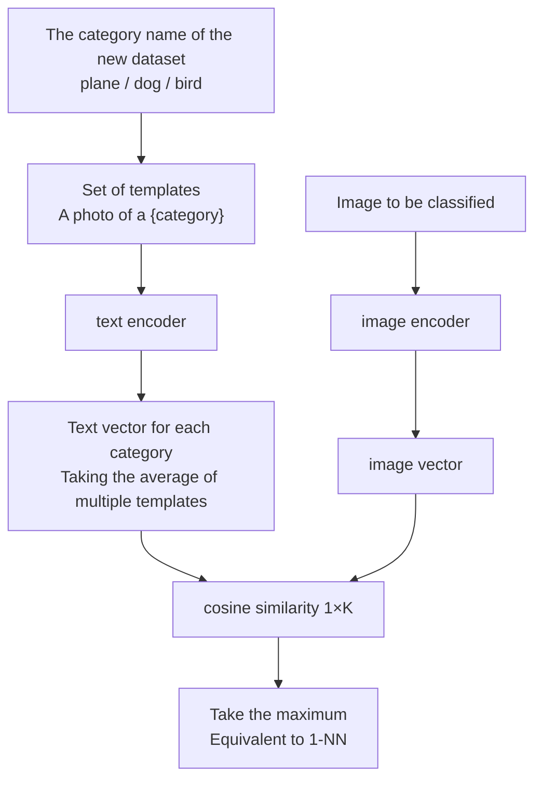

> **Course information**
>
> - **Course name**: Stanford CS231n: Deep Learning for Computer Vision(Spring 2025)
> - **Topic of this lecture**: Lecture 16. Vision and Language
> - **Lecturer**: Ranjay Krishna
> - **Teaching date**: 2025-05-27
> - **Course homepage**: [cs231n.stanford.edu/2025](https://cs231n.stanford.edu/2025/schedule.html)
> - **Official courseware**: [lecture_16.pdf](https://cs231n.stanford.edu/slides/2025/lecture_16.pdf) (148 pages, page-by-page illustrations in the book)
> - **Subtitle source**: [cs231n_sp25_kor_sub · eng](https://github.com/lpaiu-cs/cs231n_sp25_kor_sub/tree/main/eng) (Publicly transcribed in English, Chinese rewritten by this book)
> - **Copyright statement**: The copyright of the slides and course materials belongs to Stanford University and the instructors; this book is an unofficial study note and is only used for study and research.

The default workflow of the first fifteen lectures is "a set of data, a model, and a task": train a classifier for image classification, train a detector for target detection, and then train a segmenter for segmentation. This process has been optimized in every lecture, but it has a premise that has never been questioned——**The task set is known in advance**. Once you switch to an unseen data set or an unseen task, the entire pipeline will have to be redone: re-labeling the data, re-training the model, and re-adjusting parameters.

Ranjay Krishna will dismantle this premise in this lecture. What he wants to answer is: Can you only train once and then rely on "adaptation" instead of "retraining" to cover any downstream tasks? There are four adaptation methods on this road, which also correspond to four different things being replaced: **Exchange loss** (CLIP replaces classification with image and text comparison, in exchange for zero samples), **Change interface** (LLaVA and Flamingo stuff images into the input of LLM or each layer), **Change output** (SAM output masks instead of categories), **Change the combination** (VisProg writes the model into the program as a function). These four lines are not four parallel models, but a layer-by-layer release of constraints: release of labels, release of tasks, release of output space, and release of the capability boundaries of a single model.

## 1. The problem of “one task, one model” can no longer be settled

*(Reference time: 00:00:05 – 00:04:16｜Lecture 16)*

The lecturer did not give a definition at the beginning, but first drew a picture of what the course has been doing, and then spread out the cost of this thing.

The four grids are written exactly the same: Data, Task, Model, and Domain each have a number, and Model 1 to Model 4 each have their own responsibility. This is a recurring pattern in the first fifteen lectures - collect a training set and a test set, train a highly specialized model (image classifier or image descriptor, the two ones written in the homework), and then evaluate it on the test set. It does a good job in each grid, but nothing is shared between grids: the edges, textures, and object parts learned on domain 1 are of no use to domain 4.

After switching to the foundation model, the left half of the diagram collapses into a square: Large Scale and Diverse Dataset are fed to a Foundation Model, and Task 1 to Task 4 are branched out on the right. The line at the bottom is the key to the entire lecture——**Pre-training and Fine-tuning / zero-shot / few-shot are two stages**. The cost on the left is paid in one lump sum and is very large, while the cost on the right is reduced to a minimum: it can be fine-tuned, and only a few examples can be given (few-shot), or not a single example can be given (zero-shot).

### 1.1 How low can the adaptation cost be?

The lecturer's first example is GPT that everyone has used. On the left is Common Crawl plus a huge pre-training stage, and on the right are four arrows pointing to math questions, symbolic reasoning, general knowledge questions and answers, and translation. It is worth noting that these four tasks do not have their own data sets and models - they are "asked" by the same model with different prompt words. The instructor’s statement is: the data required to adapt to new tasks can be very small. **Often not a single sample is needed**.

The weight of this sentence must be seen in the context of the previous lecture. When discussing three-dimensional representation in Lecture 15, changing to another representation requires changing a whole set of downstream operators - point clouds do not have grid simplification and subdivision, implicit functions cannot be directly rasterized, and the pipeline must be rewritten every time a task is changed; here, the concept of "downstream tasks" itself is downgraded to the difference in input format. The real product of the basic model is not a certain capability, but **Downgrade "new tasks" from engineering problems to interface problems**.

This table is a table of contents for the entire lecture. The five columns are Language (ELMo, BERT, GPT, T5), Classification (CLIP, CoCa), LM + Vision (LLaVA, Flamingo, GPT-4V, Gemini, Molmo), And More! (Segment Anything, Whisper, Dalle, Stable Diffusion, Imagen), Chaining (LMs + CLIP, Visual Programming). At the beginning of each subsequent chapter, you will return to this table and light up the column to be discussed in that chapter.

### 1.2 There is only one criterion, the other three are accompanying phenomena

The lecturer was candid that this definition was controversial in the community. But the layering he gives is useful: **Essential** (Always see) there is only one thing - general, robust to many different tasks, the same model can be used in completely different scenarios; **common** (Often see) are three accompanying features: a large amount of parameters, a large amount of training data, and the use of self-supervised pre-training targets. The significance of distinguishing between "essential" and "common" is that the latter is a means of the former rather than a definition. A model with small parameters and little data is still considered a basic model as long as it can really be transferred across tasks; conversely, a model with large parameters but can only do one thing is not counted.

So the first column is excluded. ELMo, BERT, GPT, T5 are the starting point of this revolution, but they fall within the scope of natural language processing classes. This is a clean cut, and explains why all models later have an image encoder: **This lecture discusses "how vision is connected to language", not language itself**.

The remaining four columns are the scope of the entire lecture. It can be seen that "multi-modality" here has a wide scope: there are CLIP, which only aligns and does not generate, and DALL·E, Stable Diffusion, Imagen, which generate pixels, and Whisper, which does the opposite direction (speech to text). What they have in common is not the architecture, but that they both press a non-textual modality into a representation that can be retrieved and called by language.

In order, the instructor chose to start with the simplest column: classification. The reason is that the objective function of the classification task is the cleanest - it only requires a judgment of "whether this picture and this sentence are a pair" and does not need to generate anything. **Get the alignment right first, then talk about generation and inference**, this is the methodological sequence of the entire lecture. Chapters 2 to 5 are constantly adding things to the same alignment target: adding templates, adding decoders, adding LLM, and adding data; in Chapter 6, the output space is replaced.

## 2. A comparison goal is moved from "two views of the same picture" to "pictures and sentences"

*(Reference time: 00:04:26 – 00:14:42｜Lecture 16)*

CLIP is not a new invention. It is a direct extension of the goal in self-supervised learning in Lecture 12. So the lecturer first spent five minutes teaching SimCLR again, and then made only one change: replacing one of the image branches with a text encoder.

The slide splits SimCLR into two sentences: use self-supervised learning to learn good image features; use supervised learning to train small classifiers on these features. Pay attention to the second sentence——**There are no labels at all in the self-supervision stage, and the labels only appear on the last small classifier.**. This is exactly why it can be generalized: as long as you can define "what should be similar", you don't need artificial categories.

The green arrow means "Pull Together" and the red arrow means "Push Apart". The lecturer's original words are: Different enhanced versions of cats should be represented similarly to each other, while other categories such as dogs and monkeys should be pushed far away. There are no semantic tags involved here. All the model sees is "these two pictures come from the same original picture."

The stakes for this step are written in the slide title: the hope is that the representation is general enough that seeing a **Sketch** When the cat is placed, it still falls in a reasonable position in the space, making it easy to classify. This "hope" will be tested repeatedly later - the reason why CLIP is considered meaningful is that it still holds up on out-of-distribution inputs such as sketches, cartoons, and adversarial perturbations.

### 2.1 Only one change: change the other branch to a text encoder

The formulation of the question has changed: since images can be embedded, **Can sentences be embedded in the same space?**? The slide shows two pairs, A matches "a cute fluffy cat" and B matches "My favorite dog is a golden retriever". If this space holds, then the vector of A should be close to the first sentence and far away from the second sentence.

This page just separates the two sentences from the previous page and puts them in the space. The amount of information lies in the hypothetical sentence in the title: **if** The representation space can also embed sentences and phrases, so "query" is no longer limited to images - you can use a sentence to find a picture, or you can use a picture to find a sentence describing it. The three tasks of retrieval, classification, and description become the same inner product operation in this space.

In order to see clearly what has been changed, the slide first restores the wiring of SimCLR: the Image Encoder appears twice, representing two forwards of the same network (or two views sharing a set of weights). This is a typical siamese structure, where the only connection between the two branches is the final contrast loss.

In the second frame, the entire image encoder on the right is replaced and turned into a Text Encoder. The input is three unrelated sentences. **Only one block has been changed in the structure, and the objective function has not changed a word.**. That’s the whole secret of CLIP: it’s not a new loss, but a new pairing—replacing “two views of the same picture” with “the same picture and the sentence that describes it.”

An image and its corresponding text are positive sample pairs, and all other images and all other texts in the batch are negative samples. The lecturer particularly emphasized that this is **Two-way**’s: The picture should be closest to your text, and the text should also be closest to your picture. Loss will be calculated once in each direction and added together. This symmetry is the direct reason why the later "use text encoder to build a classifier" can be established - if the only direction is to find text from images, you cannot use the category name to retrieve images in reverse.

Formalize it. Suppose a batch has  $N$  Yes  $(x_i, t_i)$, the image encoder and the text encoder are given respectively  $z_i^{I}$, $z_i^{T}$ (Both have been normalized), the similarity is calculated as the inner product, and the temperature  $\tau$  is a learnable scalar:

$$
\ell_{i}^{\text{image}\to\text{text}}=-\log\frac{\exp(\langle z_i^{I},z_i^{T}\rangle/\tau)}{\sum_{j=1}^{N}\exp(\langle z_i^{I},z_j^{T}\rangle/\tau)}
$$

Reverse the term in the numerator and denominator  $I$  with  $T$  Reverse, the total loss is  $(\ell^{\text{image}\to\text{text}}+\ell^{\text{text}\to\text{image}})/2$. put  $N$  graph vectors  $N\times d$  matrix, $N$  text vectors  $d\times N$  matrix, one matrix multiplication will give  $N\times N$  The similarity matrix of , the diagonal is the positive sample. **Training is to make the diagonal of this matrix brighter and the remaining positions darker** (Editor's note: This is the standard way of writing InfoNCE loss in image and text retrieval).

An account can be settled here. $N=32768$  When , the similarity matrix has  $32768^2\approx1.07\times10^{9}$  elements; according to fp16, the storage is about 2.1 GB, which is only logits, not including the intermediate amount required for backtransmission. This explains why models such as CLIP must do distributed training and gradient checkpoints, and also foreshadows the following shortcoming: **The larger the batch, the more negative samples, and the more detailed concepts learned; but the video memory is eaten up by the square term.**.

The training data does not require manual annotation, only a weak association such as "the picture and the text next to it". The slideshow uses the Wikipedia entry for Mount Rainier as an example: the entry's illustration has captions below it, forming a pair. The lecturer said that there is a huge amount of this kind of data on the Internet, so the model can be pushed to very large scales - OpenAI's CLIP released in 2021 does just that.

After training, what you get is not a classifier or a generator, but a **Scoring function**: Given a picture and a sentence, output a similarity. This interface is narrower and more general than the classifier - narrow because it only scores, general because any task can be used as long as it can be reduced to "whether the picture and the sentence match."

### 2.2 Step 2: Connect a linear layer and first prove that the features are useful

This slide is copied from the lecture on self-supervised learning: the comparison target is used in the pre-training stage, and the downstream stage is a linear classifier, detection head or segmentation decoder. The lecturer emphasized that the first thing that made people excited when CLIP came out was **Add only one layer of linear probe** (linear probe) can bring about great improvements.

The reading of the figure is worth clarifying: the horizontal axis is not the amount of parameters but the amount of calculations (GFLOPs/image, logarithmic scale), and the vertical axis is the average score of the 27 image classification data sets. The red asterisk is the CLIP-ViT series, ranging from L/14@336px to the top; you can also see the baselines CLIP-ResNet (hollow star), EfficientNet, SimCLRv2, BYOL, MoCo, BiT, and ResNet in the same column. Two conclusions are established at the same time: **CLIP is higher with the same amount of calculation**, **In the same family, the greater the amount of calculation, the higher the score.**. This shows that compared with pre-training, this route is not a "minor repair". Its scaling curve is steeper than that of supervised pre-training.

### 2.3 Language models can achieve zero samples, why can’t CLIP

The lecturer took apart the second paragraph of the language model and looked at it: it never retrains downstream tasks because **All tasks can be written as completions**. Sentiment analysis is to complement a word, translation is to complement a sentence, and question and answer is to complement the answer. The pre-training goal (next word prediction) is completely isomorphic in form with the downstream task (arbitrary text task), which is the source of zero-shot capability.

The problem of CLIP is exposed here: its pre-training goal is "judgment pairing", while the downstream classification task is "select one from K categories", and the two are not homogeneous. You only have a scoring function in hand, and there is no interface for "continue writing". So the usage of the first version of CLIP is still linear probe——**It eliminates labels, but does not eliminate adaptation**.

### 2.4 A clever way around it: use the text encoder as a classifier

There is only one sentence to circumvent: **The category name itself is a string that can be encoded**. Since the image and text are aligned in the same space, "whether this picture is a dog" can be rewritten as "how close the vector of this picture is to the vector of the word "dog"." The 0.27 in the lower right corner of the slide is this match score.

So the process becomes three steps: pass all the category names of the new data set through the text encoder to get K text vectors; pass the image to be classified through the image encoder to get an image vector; find the nearest one among these K vectors. **The K category names are the K "category centers" and do not require a training image.**.

The slide gives specific values: 0.13, 0.27, 0.09. Choose one of the three, and the maximum is 0.27, which is judged as dog. There are no parameters to learn in this step, and no gradients to pass back.

The lecturer gave a very accurate analogy: This is essentially a  **1 Nearest neighbor (1-NN) algorithm**, except that each sample in the "training set" is not a picture, but a word vector, and there is only one sample for each category. This perspective is useful because it immediately points out the weakness: 1-NN is extremely sensitive to the position of the center point. If the center point is offset, the classification boundary will be offset.

### 2.5 Prompt word project: first +1.3%, then +5%

The first improvement is to wrap the category name into a sentence. The reason is not mysterious: CLIP's text encoder is trained on web page text, and there are almost no words that appear in isolation on web pages, and words always appear in sentences. **Use an input format that is isomorphic to the training distribution so that the resulting vector is within the distribution.**. With this single change, ImageNet improved by about 1.3%.

A single template will introduce a bias - "a photo of a" biases towards photos, which will suffer when it comes to sketches. The solution is to write multiple templates for each category and obtain multiple sets of text vectors.

The final step is averaging: you get an average vector per class and go back to 1-NN. This step brings about 5% improvement on ImageNet, which is much larger than the 1.3% of templating. The two sums together illustrate a counter-intuitive fact: **In the zero-sample setting, the way the prompt words are written is part of the model**, which determines where the category center falls in space.

At this point, CLIP's zero-sample classification closed loop is completed, without a single gradient update in the entire process. The instructor added an implementation detail: which vector is finally taken depends on the encoder architecture - ResNet takes the pooling vector of the last layer, and ViT or Transformer takes the output of the CLS token. This detail becomes a big issue in the next chapter: **When you want to connect CLIP to LLM, taking CLS is not the best choice.**.

## 3. Generalization comes from scale, but also from redundancy in language—and where it breaks

*(Reference time: 00:14:53 – 00:25:41｜Lecture 16)*

The fact that zero samples equal supervised training on ImageNet is not surprising in itself: ImageNet is the most common type of image in the CLIP training distribution. What really turned the community around was the next set of experiments——**It holds up on data sets CLIP has never seen before**.

### 3.1 Same batch of categories, change the shooting method

On the left side of the slide is the famous comparison chart in the CLIP paper. On the right side is a sentence: it tied the ImageNet accuracy of ResNet-101, and during the training process **Not a single human tag appears**. Note that the wording of this sentence is "tied" rather than "surpassed" - within the distribution, no label does not win; its value must be realized outside the distribution.

The lecturer deliberately paused here because the next page was the focus. The data set is not a randomly divided test set, but **A new data set collected by another team in a different way**.

The structure of ObjectNet is very deliberate: the category remains unchanged, only the shooting conditions are changed - put the banana on the ground and take a rotten banana. For models trained on ImageNet, these inputs fall outside the distribution and the accuracy drops significantly. The reason is not mysterious: each category in ImageNet basically only appears in the "most typical appearance", and the model learns "typicality" rather than "category".

For the same batch of images, CLIP's zero-sample accuracy is almost unchanged. The lecturer attributed the reasons to two points and emphasized that the first point is the key: **Text scraped from web pages contains much more than just category names**. There will be shapes, colors, materials, scenes, and actions in an alt text. These words also constrain the area around the concept of "banana", so the model learns a wider neighborhood instead of a point. The second point is scale: ImageNet has about 1.3 million images, and there are billions of image-text pairs on the Internet.

These two points together explain a counter-intuitive phenomenon: **The "quality" of the supervision signal is not high (the text on the web page is extremely noisy), but the "coverage" is extremely wide**. The classification label is a 1000-dimensional one-hot that only says "This is category 207"; while a description text is a semantic constraint of several hundred dimensions. The former is precise but narrow, the latter is vague but broad, and the generalization ability comes from the latter.

### 3.2 Sketch, cartoon and adversarial perturbation

The lecturer spread the generalization experiment to three types of out-of-distribution data: graphic (graphics/clip art), sketch (sketch), and adversarial (against perturbation). All three categories point to the same conclusion: CLIP features are not tied to pixel statistics, but to semantics. Sketch only has outlines without texture, cartoons compress colors into color blocks, and adversarial samples add high-frequency noise invisible to the human eye to the pixels - these three destroy the "texture" route, and CLIP also has semantics available.

Please note when reading this picture: it does not compare "CLIP vs supervision", but "CLIP zero sample vs CLIP plus linear probe". Green indicates that the linear probe is better, indicating that there is still room for extraction on these data sets; however, there are also several data sets with zero samples that directly win, indicating that **Adaptation itself brings the risk of overfitting**——When you only have a few thousand downstream images, training a linear layer may be worse than not training at all.

### 3.3 Two accounts of Scale

The title of the slide is just one word: Scale. The small print below is a rhetorical question raised by the lecturer himself——**Why can a model without labels beat the one with labels?**. He answered by giving two specific numbers.

The first number is the architecture upgrade: from ResNet to ViT, the number of parameters is 307 million versus 44.5 million, about 6.9 times. What is changed here is not only the size, but also the inductive bias - convolution writes "locality" and "translational equivariance" into the structure, and ViT leaves it to the data to learn. For tasks such as image and text alignment that require global semantics, the latter is more suitable.

The second number is data: 400 million versus 1.28 million, about 312 times. Multiplying the two multiples, the total calculation amount on the training side differs by more than two orders of magnitude. The lecturer’s conclusion is straightforward: This is not “no labels are smarter than labels”; **Use 300 times more data to overwhelm the marginal value of “labeling”**.

| Dimensions | ImageNet + ResNet | CLIP |
| --- | --- | --- |
| Parameter quantity | 44.5 million | 307 million (ViT) |
| training samples | 1.28 million photos (manually annotated) | 400 million pairs (web page alt text) |
| supervisory signal | 1000 class one-hot | natural language sentences |
| Adaptation method | fine-tuning | Line probe/zero sample |

### 3.4 CoCa: add one more decoder, 10% more

A large number of variants have emerged since CLIP, and the lecturer only picked one to talk about: CoCa (2022). The changes are minimal - the original contrast loss is retained, and a generation loss is added.

The specific method is to connect a text decoder to the output of the image encoder, use cross attention to read image features, and the training goal is standard description generation (captioning loss). So the same image encoder is constrained by two goals at the same time: the comparison goal requires it to match pictures and sentences together, and the generation goal requires it to retain enough details to explain the pictures clearly.

The lecturer’s explanation is worth copying: **The amount of information required to judge "this is a cat rather than a dog" is much less than "describe this picture"**. The discriminative task allows the model to be lazy - it is enough to find those clues that can distinguish 1000 classes, and the remaining information can be lost; the generation task does not allow it, it must encode objects, attributes, quantities, and spatial relationships. So description is a stronger learning target, and the learned features are more useful.

This table is the turning point of the entire lecture. In the list on the left are ALIGN 88.6, Florence 90.1, MetaPseudoLabels 90.2, CoAtNet 90.9, ViT-G 90.5 (plus Model Soups 90.9), and the last two lines are CoCa: **Freeze 90.6, Fine-tune 91.0**. The line chart on the right climbs from GoogLeNet in 2016 to 2024, and the red box circles CoCa. The lecturer said it was people **Abandon designing supervisory objectives for image encoders** Time point: Since self-supervised pre-training can win both freezing and fine-tuning, there is no point in continuing to adjust the supervision target.

### 3.5 Three advantages and their respective prerequisites

There are three items listed in the slide, and each item is worthy of asking why it is expensive:

- **Be proactive and efficient**——Training can therefore be scaled, and inference can therefore be fast. The example given by the lecturer is retrieval of 5 billion images: the image vectors can be calculated offline and stored as indexes, and the inner product is only calculated once during query. This is what vector databases can do.
- **open vocabulary**——Any text description can be used as a query, no predefined set of categories is required. This is another way of saying zero-shot generalization.
- **Can be connected in series with other models**——The lecturer made a foreshadowing here, saying that he would talk about it specifically (CuPL and Visual Programming) later.

The three advantages actually share the same source: the output of CLIP is a **Aligned vector space**, rather than a classification decision. Decisions can be arbitrarily rewritten downstream, but space cannot.

### 3.6 Constitutiveness: CLIP’s shortcomings

The counterexample comes very simply: for the same group of words, only the word order is changed, the similarity given by CLIP is almost the same. The content of the pictures in these two sentences are very different - one shows a mug on the grass, the other a mug with grass - but the bag of words is exactly the same.

The instructor traced the reason to the structure of the training objectives. What can be distinguished by contrast loss is only **Negative samples appearing at the same time in the same batch**. When the batch is 4, the negative sample of the cat may be a truck, and the model can only learn the coarse-grained concept of "four legs with fur"; when the batch reaches 32000, there is a high probability that there is another Corgi in the batch, and the model is forced to distinguish "Welsh Corgi and another kind of Corgi". Therefore, the concept granularity learned through comparative learning is directly determined by the composition of the batch.

The problem is that negative samples that can distinguish word order are in natural data **extremely sparse**. What you want is not "another dog", but another sentence with "the same set of words, different structure" - the probability of this kind of sample appearing in the 32,000 batch elements is almost zero. The lecturer added a realistic constraint: a batch of 32,000 is simply unaffordable for most laboratories.

These three benchmarks (many of which come from the lecturer's own laboratory) all test the same thing: whether the model can separate and then combine "objects" and "relationships". The conclusion is unanimous - no. CLIP is represented more like a **additive bag of words**: Add the vector of "cup" and the vector of "grass". The word order information disappears when added.

### 3.7 It’s hard to ignore the example and its backlash

The first reaction of the community was to manually construct the batch: since random sampling cannot encounter hard negative examples, then artificially put "horse eating grass" and "grass eating horse" into the same batch. This type of method is collectively called hard-to-example fine-tuning (represented by NegCLIP) and has been popular for about a year.

The backlash came quickly. The slide gives three sentences: `A black cat and a brown dog` (Positive sample ✓), `A brown cat and a black dog` (Mismatch ✗, this should be pushed away), `A brown dog and a black cat`(**Also ✗, but it actually describes the same scene**). The third sentence is the so-called hard positive: semantically equivalent and different word order. Training with difficult negative examples will push such sentences far away together, so the model learns that "when the word order changes, it is wrong", which makes it even worse in real scenarios.

The lecturer said that there is no theoretical explanation for this matter - why after adding difficult negative examples, the generalization of the model across environments and data sets will be significantly worse. He left this as an open question to the audience, which is evidence that the matter of "constructing training signals" has not yet been solved.

### 3.8 Image-level description is not enough, even 500 million images are not enough

The third disadvantage is related to data granularity. A picture of a living room is accompanied by the sentence "a living room". This sentence is true for the entire picture, but not for each piece of furniture in the picture. Slides are marked with a check mark: `living room` ✓, `house plants` ✗, `couch` ✗. The model cannot learn from this sentence "The sofa is in the lower left corner of this picture"**Positioning information**.

The solution given by the instructor is to add regional-level supervision: give each box a description so that the alignment occurs in the region rather than on the entire image. This was also the starting point of the later "grounding" journey - the model not only answered "is there any", but also answered "where".

The last one is the most fundamental: even if you capture 5 billion pictures, it still won’t cover what you really care about. The lecturer said that this was the starting point of his own research——**Data filtering has become a cutting-edge issue in this field**, how to filter out truly useful training data from the Internet is more difficult than the model structure. This sentence sets the stage for Molmo in the next chapter.

## 4. Add an eye to LLM: LLaVA’s linear layer and Flamingo’s gated cross-attention

*(Reference time: 00:25:51 – 00:41:31｜Lecture 16)*

The models in the previous chapters can only "judge" but not "answer". The visual language model (VLM) requires the third ability: eating in pictures and text, and spitting out text. This chapter talks about two connection methods. The only difference between them is that **Where do visual features enter the language model?**.

What this column in the table has in common is "input two modes and output one mode". But the same is true of “images and text in, text out.” The layer at which visual information enters the language model will determine the training cost, context length, and supported task formats—this is the next point of difference between LLaVA and Flamingo.

### 4.1 Why start with LLaVA

The motivation is written very directly: the reason why language models are universal is because **All tasks can be written as "Go on"**. So if the image becomes "part of the context", can the image task also be written as "continue writing"? The answer is yes, this type of model is called a vision-language model.

The lecturer deliberately made historical corrections: ViLBERT in 2019 has put the image model and the language model together for cross-task generalization.

The problem is that it doesn't break away from the old paradigm of Chapter 1: one set of tweaks per mission, one set of mission-specific tricks. The example on the slide is reference resolution on RefCOCO - Mask-RCNN is used to first select candidate boxes, and then rearranged according to language scores. **The model can be cross-modal, but in engineering it is still one task and one model**. The significance of LLaVA is to replace this "one task, one model" with "one model + different instructions".

### 4.2 First review the autoregressive decoding

This page is the matrix form of the attention mechanism. The lecturer uses it to explain what the constraints of "autoregression" are: Chapter 1  $i$  The output of positions can only be given by  $0..i$  The key value of the position is determined, and future positions are masked. In the picture  $a_{i,j}$  is the attention weight, $k_j$, $v_j$  is the key and value of the historical location, $\mathrm{softmax}$  Normalize on each row.

It's easy to understand if you switch to the timeline: the input is the three words that have been written down, the model outputs the probability distribution of the next word, and the largest one is obtained.  `Cute`, then connect it back to input to continue. **The entire conversation is just this one action repeated several times**.

### 4.3 Where does image token come from?

LLaVA's approach is so simple that it is almost crude: insert it in front of the text token  $N$  image token, and then let the Transformer process the entire sequence equally. The lecturer’s question at the time is written on the right side of the slide——**Which image tokens are best to use?**. This question is the content of the next four pages.

The reason for choosing CLIP as the visual encoder is not that it is the strongest, but that it **Already aligned with language**. What LLM needs to understand is "what these vectors mean in the language space." Although a purely self-supervised encoder (such as SimCLR) has good features, its space has no correspondence with the word vectors, and the linear layer has much more to learn.

Following the usage of CLIP classification, the first instinct is to take CLS token. After all, all the classification experiments in the first four chapters were done with it, and it is the only vector in the entire encoder that has been directly supervised by contrastive loss.

Problems arise immediately. The contrastive loss only acts on CLS, and the patch tokens do not receive any gradient signals——**They can be random and the loss won't change at all**. The lecturer put it very bluntly: empirically, the characteristics of these tokens are not easy to use.

The solution is to go back one level. The penultimate layer ($L-1$) have not been suppressed by the final pooling. They not only retain the spatial information of "which patch is where", but also indirectly carry semantics because CLS is generated. The sentence at the bottom of the slide is a practical conclusion: **These tokens are best for LLM, and there is a slight improvement if you throw away CLS.**.

### 4.4 Three-step formulation of LLaVA

There are only three moving parts in the whole picture, and the recipe only has three steps:

1. Use a pre-trained language model (such as LLaMA) as the decoder, use pre-trained CLIP as the image encoder, and the weights are initialized.
2. Add a new linear layer to map CLIP features to the input space of LLM——**This linear layer is the only part trained from scratch**.
3. Fine-tune the LLM together with the linear layer.

The bottom of the slide gives the magnitude of the data volume: **Level 100,000 (\>100,000)**  The "input image + input command + output text" triplet can get the available effects. Compared with CLIP's 400 million pairs, this is a gap of three orders of magnitude - because what we need to learn here is not "what an image is", but "how to answer questions about images."

A dimensional account can be calculated here. CLIP ViT-L/14 cut out at 336 pixel input  $24\times24=576$  patch, each token has 1024 dimensions; and the sentence "Cats are so" only has 3 tokens. The image occupies 576 positions and the text occupies 3 positions in the sequence, with a ratio of approximately 192:1. **The context is almost completely filled with images**, which brings two consequences: the video memory increases with the square of the image resolution; the long text reasoning that LLM was originally good at is squeezed out. The two designs of Flamingo in the next section are aimed at these two consequences.

### 4.5 Flamingo: Instead of spelling at the input, insert it in each layer

LLaVA treats image tokens as part of the input sequence; Flamingo thinks this is too crude - image information only enters once at the lowest layer, and later layers are more likely to be overwhelmed by text. Its solution is to make visual features **Can be read at every level**.

In this frame, first mark the "immobile things". The boxes with snowflake symbols in the figure are pretrained and frozen: the visual encoder (two, processing two images each) and each layer of the LLM. The motivation for freezing is to save money and preserve capabilities - the reasoning ability of the language model is trained at a high cost, and fine-tuning it will be forgotten.

The purple square is the trainable part, and there are only two places: Perceiver Resampler and GATED XATTN-DENSE. The innovation of the entire paper falls on these two squares.

The first square solves the problem of length. For images with different resolutions and different numbers of video frames, the number of patches cut out is different; and the query side of cross-attention requires a fixed length. Perceiver Resampler uses a set of learnable query vectors to "read" visual tokens of arbitrary length and output a fixed-length representation. **This is a learning-style pooling that turns "variable length" into "fixed length"**, retains more information than average pooling.

Connect the two squares together to get the whole picture: the two visual pathways on the left go through the encoder and Resampler respectively, and the LLM on the right. A GATED XATTN-DENSE is inserted in front of each layer (layer 1 to layer n).

Compared with the previous frame, this frame has one more line of explanation: What Resampler does is essentially **Learnable downsampling** (learned down-sampling). This wording is important - it elevates "compression" from an engineering skill to part of the model, and the compression rate is determined by the data rather than set by humans.

This frame does not add new annotations, but just lays out the complete wiring: text enters the LLM from the bottom, vision enters the cross-attention of each layer from the left, and the output is at the top. The distribution of parameter quantities is clear at a glance - most of them are frozen and very few are trainable.

### 4.6 Gated cross-attention: two lines of code, one switch

Enlarge one of the squares. The structure is a combination of standard parts: first do a cross-attention (query comes from text, key value comes from image), and then one  $\tanh$  Nonlinearity is the door; pass through another layer of full connection, and then another  $\tanh$  Gate; both segments with residuals. The lecturer's explanation of gating control is very good——**It determines "whether and how much images should be viewed on this layer."**.$\tanh$  The output of  $[-1,1]$, when initialized to 0, the entire module is equivalent to the identity mapping, so the behavior of the model in the early stages of training is completely consistent with the original LLM, and visual information is gradually "opened".

The lecturer specifically emphasized this asymmetry: **There are only two or three more lines in the code, but there is a huge change in model capabilities.**. Because now each layer can decide "when to look and which piece to look at" by itself, instead of just passively receiving it once at the input.

### 4.7 Interleaved image and text training data, and a handwritten mask

Data is not a picture with a sentence, but **A long interleaved sequence with multiple images and segments**: A summary ("These are some cute photos of my pet"), the first picture, a description of it, the second picture, a description of it... The training goal is to complete the last description. In this way, the sequence length, number of images, and rounds seen by the model far exceed the settings of a single image and a single sentence, so that it can support multiple rounds of dialogue.

The key details are here. There are multiple pictures in the sequence, but when generating the description of the first picture **Can't see the second picture**——Otherwise the model will copy the later answers. So the author manually constructed an attention mask: each description can only attend the visual token of its own picture.

Switch to a matrix perspective to see it more clearly: the causal mask between text tokens is still the same (you can only see the left side), and additional restrictions are only added to the "text query → image key" area. this is one **Supervision signals forged by engineering means**, the price is that the data format must be strictly controllable.

Stacking the four frames, the cost structure of Flamingo becomes clear: the trainable parameters only account for a small part (two Resamplers plus cross-attention for each layer), but **Each LLM layer adds one more "query image" calculation**, the memory and latency during inference are higher than LLaVA. In exchange, it comes with native support for multiple images, multiple rounds, and interlaced images and texts - something that cannot be achieved by "typing it once at the input".

### 4.8 Results and context learning

The lecturer said that the significance of this page is not the fraction, but the **Changes in evaluation methods**: In the past, I applied for several classification benchmarks, but now I apply for any task that can be written as a question and answer. As long as the task can be expressed as "give a picture + ask a question → give an answer", you can construct a benchmark.

This picture is the most beautiful page in the whole lecture. Four-line example, each line is "two pictures + answer, third picture + question":

- The first line: Totoro (This is a chinchilla…), Shiba Inu (This is a shiba…), the third picture of flamingo asks  `This is`, fill out  `a flamingo. They are found in the Caribbean and South America.`
- The second line: "Title/Place of Collection" of each of the two paintings, the third one asks "The city where this painting is located", answer  `Arles.`
- Third row: London Underground logo  `Underground`, road signs  `Congress`, the third street sign answers  `"Soulomes"`
- Line 4: Handwriting  `2+1=3`, `5+6=11`, the third  `3×6`  answer  `3x6=18`

The four rows cover four completely different capabilities: fine-grained recognition, world knowledge, OCR, and arithmetic. The lecturer said that this is the definition of in-context learning——**You didn't train it to do these tasks, you just gave it a few examples of behavior**. Remove all examples and the same set of weights becomes zero samples.

This frame expands the scope from "four abilities" to the entire benchmark table. The lecturer’s statement is: Quite a few of these tasks must have been done before **Connect an adapter specifically for CLIP** can be done; now the same frozen Flamingo can be answered by changing a prompt word.

This table is very informative and its reading is worth learning. The three groups on the left are Flamingo-3B, 9B and 80B. Each group is expanded according to the number of shots: 0, 4, 8, 16, 32. Taking the 80B group as an example, VQAv2 rose from 50.6 with zero samples to 57.8 with 32 samples, COCO rose from 84.3 to 113.8, and OKVQA rose from 50.6 to 57.8. **Gain doesn't stop until 32 samples**, and 32 is already the maximum value measured inside and outside the table.

The bottom two rows are the control group: `Zero/Few shot SOTA` (The first line, in parentheses is the number of examples it uses, up to 16) and  `Pretrained FT SOTA` (The last row, in parentheses, is the sample size for fine-tuning, from 6K to 500,000). Two conclusions are thus established: Flamingo's zero-sample has surpassed the specially fine-tuned SOTA in several columns; and it uses 32 examples to approach those models fine-tuned with tens to hundreds of thousands of samples.

This also corrects the intuition that "few-shot equals high sample efficiency"——**What it saves is not examples, but fine-tuning**. Examples are still given in task format, but none of the weights are updated.

## 5. Data is scarcer than architecture: 700,000 pairs vs. 6 billion pairs

*(Reference time: 00:41:41 – 00:54:07｜Lecture 16)*

At the end of the previous chapter, Flamingo had already completed the “universal visual assistant”, but its weight was not made public. This chapter talks about the most realistic hurdle on this road: **Capabilities are locked by the APIs of a few companies**. The lecturer included his own work (Molmo) here to prove that this hurdle can be bypassed, and the way to bypass it is not a larger model, but better data.

### 5.1 A crack in the 11 benchmarks

The way the diagram is organized is the argument itself. The bars are divided into three groups according to source, with three rows of group names on the left: API Only, Open Weights, and Distilled. The top group is surrounded by a red frame, which are seven closed-source models; the bottom group is individually circled with green frames for 13B and 7B (43.9 and 40.7) of LLaVA-1.5. The two dotted arrows point to the seven small pictures on the right - human face, pizza, night scene street, champagne, an economic chart, an animal relationship diagram, and a bill. These thumbnails are examples of benchmark questions that instructors use to remind: **The score axis ranges from 30 to 82, but the difficulty of these questions is not uniform**.

This frame presses a conclusion on the same picture. Note that the wording is not "open models are bad", but "open models are distilled" - the difference is crucial: **The score is not low, but the source is questionable**.

There is only one line of questions on this page, which is the proposition of the entire chapter. The difficulty is that distillation is essentially a kind of "borrowing answers": you use the output of GPT as a supervision signal to train your own model, and you learn the score, but you don't learn "how to create this ability." Once OpenAI no longer opens the API, the entire route is broken.

The lecturer called on three names: Ali’s Qwen, Intern VL, and Phi. They all have public weights, can be downloaded, and can be run - but **No one knows how to reproduce them from scratch**. His original words were: "We can produce them, but only if GPT exists." This sentence defines what "open but non-reproducible" means.

### 5.2 "Complete openness" is four words, not one word

This page breaks down "open" into four verifiable items: Open Weights (can download weights), Open Data (can download training sets and evaluation sets), Open Code (can train by oneself), and Open Evals (can add evaluations by oneself). On the bar chart on the right, Molmo’s four sizes (72B, 7B-D, 7B-O, 1B) are ranked at the top, followed by the API Only group (GPT-4o, GPT-4V, Gemini 1.5 Pro/Flash, Claude 3.5 Sonnet, Claude 3 Opus/Haiku), the open weight group (Qwen VL2, Intern) VL2, Pixtral, Phi3.5-Vision, PaliGemma), the distillation group (LLaVA OneVision, Cambrian, xGen-MM) and the bottommost LLaVA-1.5.

The specific score is worth copying down because it is the only set of comparable cross-sectional data in the entire lecture:

| model | 11 benchmark average | Belong |
| --- | --- | --- |
| Molmo 72B | 81.2 | completely open |
| Qwen VL2 72B | 79.4 | open weight |
| GPT-4o | 78.5 | API Only |
| Gemini 1.5 Pro | 78.3 | API Only |
| Molmo 7B-D | 77.3 | completely open |
| Intern VL2 LLaMA 76B | 77.1 | open weight |
| LLaVA OneVision 72B | 76.8 | distillation |
| Claude 3.5 Sonnet | 76.7 | API Only |
| Gemini 1.5 Flash | 75.1 | API Only |
| Molmo 7B-O | 74.6 | completely open |
| MolmoE 1B | 68.6 | completely open |
| LLaVA-1.5 7B | 40.7 | open weight |

There are two things to note when reading this table. First, **The differences within the same model family are larger than between families**: Qwen VL2's 72B is 79.4, 7B is only 73.7; LLaVA OneVision's 72B is 76.8, while the LLaVA-1.5 7B a year ago is only 40.7. Second, Molmo's 72B is 2.7 points higher than GPT-4o. This "high" is only true on academic benchmarks and may not necessarily depend on human preferences (as you will see on the next page).

The lecturer rotated the picture so that the right side was free for examples. The legend of this picture lists "Open Weights / Data / Code / Evals" separately, which is a repetition of the four elements of "fully open" on the previous page.

This page gives the scale: **325,000 pairwise comparisons, 870 human annotators**. This was the largest human preference evaluation in the field of VLM at the time. Why do you do this? The lecturer’s explanation is that the academic benchmark tests “whether you can answer the question correctly”, while what users care about is “whether they are willing to use it”.

Expressed in Elo, Molmo is only 1 point away from GPT-4o—"almost a coin toss" in the instructor's words. But pay attention to the gap between this page and the previous page: **Molmo is first on 11 academic benchmarks and second on human preferences**. This contrast itself is a lesson: there is a systematic bias between benchmark scores and true usability, and the direction of the bias depends on who performed the benchmark.

The 7B model is ranked where only the 72B model should be. This is the most practical piece of information in the entire chapter: **A model that can fit a single GPU is already as good as the flagship from a year ago.**. The lecturer later emphasized this point - single-card operation means that researchers can fine-tune, students can experiment, and small companies can deploy, and this is the actual meaning of "complete openness".

### 5.3 The gap between a research group and several large companies

This page is a collection of social media screenshots from the day of the launch. The lecturer uses it to explain something that has nothing to do with scores: **A downloadable 7B model reaches a completely different audience than an API**——Can be modified, fine-tuned, and run locally.

The lecturer quoted something that people at NVIDIA also said: No matter how well the private model does, the open source community will eventually catch up. This sentence has a specific meaning here - an academic laboratory used far less computing power than the industry to tie on the same list.

This page is Molmo’s real point of technical differentiation. Ordinary VLMs just spit out a number when asked "how many ships". This number has no basis, so it is often an illusion. Molmo's approach is **First point out each ship (output point coordinates), and then give the number**. The lecturer's statement is "let decisions fall on pixels" - this sentence will appear again when talking about SAM in Chapter 6, because the action of "pointing" is a universal interface connecting language and pixels.

### 5.4 700,000 and 6 billion

The two circles are larger and smaller, and the area difference is close to four orders of magnitude: **6 billion versus 700,000, about 8600:1**. The lecturer didn't stop at the number, but explained why the smaller one was more useful.

This page is the best summary of the entire lecture. Picture-text pairs on the Internet arise "by the way": the uploader writes "Pink, Japan, nice photo" and "I like this winter photo". These words describe **Uploader’s feelings**, not the image content. Manually annotated data is "intentional": the annotator's task is to make the image content clear.

The difference between the two is not the size of the noise, but the **missing types of information**. The lecturer gave a very specific example: no one would write "this thing is to the left of another thing" on the Internet, because this is nonsense to human readers; but for the model, this is the type of spatial information it lacks the most.

Read this description to see what "intentional" specifically looks like: `desk is large and rectangular, made from a polished rich wood` (size, shape, material, surface treatment), `four distinctive A-shaped legs` (structure), `a tall, vertical screen placed behind and to the right of a wider, horizontal computer monitor` (relative position), `pinkish marble tiles` (color and material). These attributes almost never appear together in web page alt text.

This one is even more extreme: In order to explain clearly a tablet home screen, the annotation should read  `time 11:48`, `battery 67%`, `four out of five bars`, `three-quarters Wi-Fi`, and then describe the folders, Gmail, YouTube, map icons and three navigation keys at the bottom one by one. **Descriptions of this density are not available from the internet, they can only be written by people**.

### 5.5 Use questions to pry rather than use instructions to write

Seven questions constitute a collection protocol: `What is the image at first glance?`, `What are the objects and their counts?`, `What does the text say?`, `What are the positions of the objects?`, `What subtle details are noticeable?`, `What is in the background?`, `What is the style and color?`. Note that every question asks **The hardest thing for a model to learn spontaneously**: Quantity, text, location.

The lecturer said that they spent two years doing this type of elicitation research, repeatedly testing which method of asking could elicit the most information. This is no longer data annotation; **data engineering**.

This page explains a counter-intuitive operational detail. If asked to write, he will unconsciously abide by the "Gricean Criterion" - not to say anything too obvious, so sentences such as "The cup is on the left" will never be written. **By changing to dictation, these constraints will be loosened.**: People will talk about everything they see, including those "obvious" spatial relationships. 60 to 90 seconds of speech is automatically transcribed into text and goes directly to pre-training.

### 5.6 The model has not changed, what has changed is the data

The lecturer said something very important here: **The model structure of Molmo is no different from that of LLaVA**- CLIP encoder comes in, a linear layer does the connector, and LLM comes out. The trainable parts, the number of parameters, and the wiring method are all the same.

If the architecture is the same but the results are more than 30 points different, then the difference can only come from the data. This also explains why "completely open data" is the most difficult and most critical of the four openings: **The weights can be downloaded and the code can be reproduced, but if the data is not open, others will not be able to reproduce your results.**.

These two pages treat "finger" as an output modality. The first frame is counting - it does not report a number directly, but points out the coordinates of each ship one by one, and finally gives the total.

The second frame switches to the interface and traffic scene: point out where the menu items are, where the search options are, and where the route number on the bus is. Note that this is not a picture frame - the frame has four numbers, and the dots only have two numbers. **Dot is a cheaper and more general reference for**. And it brings capabilities that other models cannot: tell you "where", not just "what".

### 5.7 From finger to hands

This is the first time "concatenation" appears in the whole lecture, although it appears in the fifth chapter rather than the last chapter. The link is very short: **Molmo outputs a point → SAM 2 uses this point as a prompt → outputs a mask → the mask is tracked in the video**. Every step is a ready-made model, and no step requires retraining.

The lecturer talked about the experiment played in the office: let Molmo point to the water bottle → simple motion planning to send the robot to the water bottle → then point to the dirty dishes/sink → move over → then point to the empty space in the sink → put it down. No module in the entire chain is trained for "robots". This is the most practical value of the "basic model": **It turns new applications into interface splices**.

The lecturer answered an on-site question here: If the image resolution is always fixed, can the model still be accurate? The answer is that modern VLMs can accept any resolution, the position encoding changes with the image size, and therefore the coordinate system of the pointing changes. This is also one of the reasons why the output of "finger" is easier to migrate than "box"——**Changing the resolution only requires recalculating the position and does not require retraining the output head.**.

## 6. The output is not necessarily words: SAM’s prompt interface and stringing the model into a program

*(Reference time: 00:54:12 – 01:07:05｜Lecture 16)*

The output in the previous chapters is text, category, or point coordinates. This chapter replaces the last constraint: **The output can be masked**. Once the output becomes a mask, "how does the user tell the model what he wants?" becomes the core issue - this is the entire difficulty of SAM.

Segment Anything in this column represents the category where the "output space is replaced": it does not generate text, nor does it output categories, but only outputs pixel-level masks. The lecturer said that changing the output from "word" to "mask" exposed a problem that was covered up by language in the first five chapters——**Which one does the user want?**.

### 6.1 What exactly is the “basic model” of segmentation?

This page uses Mask R-CNN (He et al., 2017) as a comparison. The boundaries of its capabilities are locked by the number of categories in the training set: anything outside 80 categories, it will not give you a mask - not misclassification, but **I don't know how to divide it at all**.

SAM puts the goal in two sentences: the training data must have a huge number of categories; the output must be able to target any object that the user cares about. The first sentence is a data issue, and the second sentence is an interface issue.

The slide puts two question marks directly on the picture, which is equivalent to giving an outline of this chapter. The instructor's choice is to answer the second one first - because it is an architecture question and the first one is a data question.

This is where the ambiguity comes from. The sentence "Cats" is paired with a picture of two cats. There are two correct answers. **The task definition itself is not unique**. Any training method that uses a single mask for supervision will be forced to make a wrong choice here.

### 6.2 Three-stage: encoder, prompt encoder, lightweight decoder

Each of the three components does one thing: the image encoder  $H\times W\times3$  Press it into a group of embeddings (heavy work, count once for each picture); prompt the encoder to encode user input (points, boxes, text, rough masks) into vectors (light work); the mask decoder combines the two to output a mask (light work, can be called repeatedly). **Separation of heavy work and light work** This is the key to SAM being able to do interactive segmentation: changing a prompt only requires re-running the decoder.

Compared with the previous frame, this frame displays all four forms of prompts. This explains why the prompt encoder must exist -**The four input modalities need to be mapped into the same space**, otherwise the decoder cannot handle it uniformly.

### 6.3 Ambiguity resolved with three masks

Even when points are given, the ambiguity does not disappear. The same point can point to "the entire pair of scissors", "the grippable section", or "one of the handles". All three are reasonable answers.

This is a trap in the design of training objectives: using a single mask for supervision is equivalent to treating "the user's intention" as the only certainty, and the model can only learn "the most likely one on average."

The solution is to replace "an answer" with "a set of answers." This frame first gives the structure: the decoder no longer outputs a single mask, but outputs several candidates, each candidate comes with its own score.

The specific method is clearly written on this page: one output **three** Masks of different granularities are each assigned a score; **The loss is calculated only for the one closest to the true value**, the other two are not penalized; the model is also trained to predict the confidence of each mask. The lecturer said that this is equivalent to returning the decision-making power of "which one to choose" to the user - the model is responsible for giving all reasonable answers, and the person is responsible for choosing.

This design has a direct consequence: the model will not be forced to average at ambiguities during training, and multiple candidates can be given during inference. **It is better to export uncertainty explicitly than to have it flatten out implicitly.**.

### 6.4 Image 6x, Mask 400x: Growth occurs in density

Two multipliers deserve separate mention: ~6x for the image and ~400x for the mask. The multiple of the mask is much higher than that of the image, indicating that the increase is not "more scenes", but **The number of annotated objects in each image**——From "one object in one picture" to "dozens of objects in one picture". This is exactly how "covering massive categories" is achieved.

The first frame looks at the "annotation granularity": in a planogram, every distinguishable thing has its own color.

These two pages explain what a "category" is in SAM: not a semantic label like "cat/dog/car", but **any area that can be pointed out**. Every cucumber in the vegetable pile and every color area in the painting can be a mask. This annotation does not rely on a semantic system and therefore can be extended to any image.

Where does the data come from? The lecturer gave the process: first mark a small part manually, train a model, use the model to mark the rest, and then let others correct the mistakes, and so on. **Model-in-the-loop**  The annotation method makes masking of this scale possible manually.

### 6.5 Results and zero samples

The power of this image lies in its density: hundreds of instances, each with its own mask and boundary. The traditional segmentation model will degenerate into "foreground/background" in this scenario.

If you change the picture, the density of segmentation remains consistent with the quality of the boundary. What these two pages want to explain is that **same set of weights**: None of the pictures were fine-tuned for this shelf scene.

This page is the focus of the entire chapter. The training data are natural images, and the test images are cells under a microscope——**The distribution is completely different, but the mask is still clean**. This shows that what SAM learns is not "what the object looks like", but the more abstract concept of "what are the regions that can be separated".

The lecturer did not give SAM numerical indicators, but used these two pages to explain the meaning of the "basic model" in segmentation: **It does not solve a certain segmentation task, it solves the "segmentation" itself**.

### 6.6 Concatenation: When CLIP doesn’t recognize those four words

The last column "Chaining" is not a model, but a usage: putting together the models in the first three columns. The instructor said that this column has been the most active direction in the past two years because it does not require training anything.

The lecturer gave a test on the spot. The four pictures are rainbow parrot, marimba, viaduct, and butterfly dog, and the four words are marimba, viaduct, papillon, and lorikeet (the slide lists the four words in alphabetical order and does not align with the pictures, which itself is part of the title). The listener guessed correctly, but CLIP couldn't - it had few clues available for the four words and got all four wrong.

The key observations are: **CLIP has not seen the "names" of these words, but it has seen sentences describing these things**. So the task was divided into two steps - the first step was to ask GPT "What does papillon look like" and get a description; the second step was to use this description to calculate the similarity with the image.

This is CuPL. It replaces "A photo of a {category}" in Chapter 2 with "A passage about {category} written by LLM". The template changes from human writing to model writing, and the coverage immediately becomes wider - because the LLM knows more things than the person who wrote the template.

The example given by the lecturer is fine-grained classification: specific types of flowers, specific models of cars, and specific types of pets. What these categories have in common is **The name itself contains no information**(`papillon`  The word has zero information for someone who has not studied French), while the description contains information ("a small dog with ears like butterflies"). The improvement comes from here.

### 6.7 Write the problem into a program

Visual Question Answering (VQA) is the first candidate. You can train a VQA model, or you can go another way——**Use existing specialized models to spell out the answer**.

The statement is a sentence, but to judge it, you need to count four times (people on the left, people on the right, boats on the left, boats on the right) and then do arithmetic.

The left-right comparison is straightforward. On the left is "train a new model", which can handle this type of task, but it needs to be retrained every time the question is asked; on the right is "write a script", in which the VQA function is called twice and then added together——**It can handle any number of pictures, but the script is written by humans**.

This page replaces "people write scripts" with "models write scripts". The program output by GPT calls VQA twice and then adds them together. The execution result is  `False`——In other words, the model can not only answer questions, but also **Write a piece of code to answer the question**.

The three examples are all image editing tasks: `Hide the face of Nicole Kidman with :p`, `Create a color pop of the white Audi`, `Replace the red car with a blue car`. Each paragraph demonstrates the same writing method - first  `Seg`  Leave the area and then  `Select`  Pick out the target and finally  `Replace`  or  `ColorPop`.**Examples don’t teach knowledge, they teach calling conventions**.

This table answers "How does the model know which functions are available": **The function list itself should be included as part of the prompt**. Each line is marked with the implementation (e.g.  `Select`  Using CLIP-ViT, `Replace`  Stable Diffusion is used), so the entire system is "a unified calling layer for a bunch of heterogeneous models."

The program only has seven lines, but the tasks are broken down cleanly: `ANSWER0`  with  `ANSWER1`  Count the people in the picture on the left and the picture on the right, `ANSWER2`  with  `ANSWER3`  Count the boats on the left and right, `ANSWER4`  use  `Eval`  Substitute the four numbers into  `{ANSWER0}+{ANSWER1}==6 and {ANSWER2}+{ANSWER3}==2`, finally  `RESULT=ANSWER4`. output  `False`  It means that the sum of the four counts does not match the statement.

This page is the most convincing part of VisProg: **Errors are localizable**. intermediate amount  `ANSWER0..3`  Print them all, and you can immediately determine whether "the number of people is wrong" or "the number of ships is wrong"; if the wrong  `Vqa`  module, that means the problem lies in counting and has nothing to do with language understanding. By contrast, with an end-to-end VLM, you have no clue when you answer incorrectly—you can only change the clue word and try again.

This example shows the usage of the knowledge retrieval module: `List(query='main characters on the TV show Big Bang Theory', max=7)`  Ask GPT-3 to spit out seven names, `Classify`  Match detected faces with names, `Tag`  Draw the label on it. **The language model is not the answerer here, but the knowledge base**.

The last example pushes "concatenation" to the generation side. The lecturer's statement is: The image editing model is still in its infancy. Rather than expecting it to be corrected at once, it is better to **First use segmentation to circle the area you want to change and only change that part of the pixels.**, and then synthesize it back. The three steps are all ready-made models, and the effect is much more stable than end-to-end editing.

## 7. Summary: Four "changes", one main line

*(Reference time: 01:07:10 – 01:09:44｜Lecture 16)*

The lecturer brought back the opening picture to illustrate that this lecture has a closed loop: the opening is "The paradigm should become like this" and the ending is "The paradigm has become like this." The middle five chapters are about "how to fill in this square."

This table is the most important set of numbers to remember throughout the course. On the left is the process: `2. Create dataset classifier from label text` (Send the category name set template into the text encoder to get  $T_1..T_N$), `3. Use for zero-shot prediction` (The image is encoded into  $I_1$, with each  $T$  Calculate the inner product and take the maximum). On the right is a comparison of six data sets:

| Dataset | ImageNet ResNet-101 | CLIP ViT-L (zero sample) |
| --- | --- | --- |
| ImageNet | 76.2 | 76.2 |
| ImageNet V2 | 64.3 | 70.1 |
| ImageNet Rendition | 37.7 | 88.9 |
| ObjectNet | 32.6 | 72.3 |
| ImageNet Sketch | 25.2 | 60.2 |
| ImageNet Adversarial | 2.7 | 77.1 |

The first row was a tie, and the last five rows were crushing - the most exaggerated was the confrontation set: 2.7 vs. 77.1. This is not "CLIP is more accurate"; **CLIP’s decision-making basis is different**: The texture features that ResNet relies on are eliminated by adversarial perturbations, CLIP and semantics.

The third frame shows the evidence of "changing interfaces": the same set of frozen weights, four different lines of examples, and four different capabilities. Note that it reuses the in-context table on slide 82 - the lecturer did not change the example and ended with the same picture.

The fourth frame is evidence of "switching output": a crowded commercial street, each pedestrian and each distinguishable area are individually segmented. The density of this picture is higher than that of the shelf, which shows how fine the mask output can be.

The fifth frame is two columns of evidence for "changing the combination method": CuPL on the left ("What does a platypus look like" → GPT-3 writes a description → CLIP uses descriptions to classify), and VisProg on the right (instructions → GPT-3 writes a program → the program calls split, select, and replace modules).

The last three frames leave one piece of evidence for each of the three branches: Flamingo's four in-context tasks, SAM's dense segmentation, and the concatenation of CuPL and VisProg. They respectively correspond to "changing the interface", "changing the output" and "changing the combination method".

The next lecture is Robot Learning, where the example of "pointing to the water bottle → planning → grabbing" at the end of Chapter 5 will unfold.

- **The only criterion for the basic model is “common across tasks”**, big parameters, big data, and self-supervised objectives are just common accompanying features, not definitions.
- **CLIP replaces the loss function, not the architecture**: By replacing an image branch of SimCLR with a text encoder, you get a zero-shot classifier and an open vocabulary retrieval interface at the same time.
- **Zero sample classification = 1-NN + prompt word engineering**: The category text encoder is turned into a vector, templated +1.3%, multi-template averaging +5%, both improvements come from "let the input fall within the training distribution".
- **The generalization gap only appears outside the distribution**: Zero samples are tied with supervision on ImageNet, 72.3 vs. 32.6 on ObjectNet, and 77.1 vs. 2.7 on the adversarial set.
- **The weakness of contrastive learning is its compositional nature**: The concept granularity is determined by the composition of the batch. Word order negative samples are too sparse in natural data; difficult negative examples can be supplemented, but this will push away the semantically equivalent hard positives.
- **The difference between the two connection methods of VLM is "at which layer the vision enters"**: LLaVA uses linear layers to insert the input (cheap, only needs 100,000 samples), and Flamingo uses gated cross-attention to insert each layer (expensive, but supports image and text interleaving and multiple rounds).
- **When architectures converge, data becomes the only variable**: Molmo has almost the same structure as LLaVA, using 700,000 artificially dense descriptions (instead of 6 billion web page pairs) to get 81.2 on 11 benchmarks.
- **Concatenation turns "ability" into "combination"**: CuPL allows LLM to write prompts, and VisProg allows LLM to write programs. The cost is computing power and delay, and the benefits are that errors can be located and modules can be replaced.
