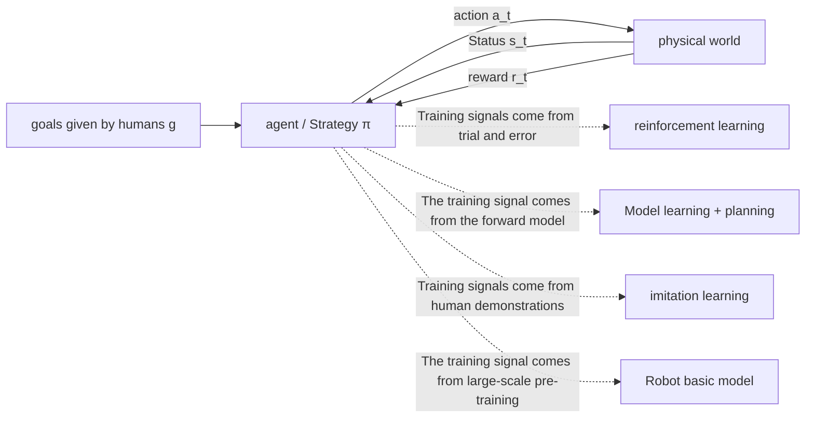

> **Course information**
>
> - **Course name**: Stanford CS231n: Deep Learning for Computer Vision(Spring 2025)
> - **Topic of this lecture**: Lecture 17. Robot Learning
> - **Lecturer**: Yunzhu Li
> - **Teaching date**: 2025-05-29
> - **Course homepage**: [cs231n.stanford.edu/2025](https://cs231n.stanford.edu/2025/schedule.html)
> - **Official courseware**: [lecture_17.pdf](https://cs231n.stanford.edu/slides/2025/lecture_17.pdf) (103 pages, page-by-page illustrations in the book)
> - **Subtitle source**: [cs231n_sp25_kor_sub · eng](https://github.com/lpaiu-cs/cs231n_sp25_kor_sub/tree/main/eng) (Publicly transcribed in English, Chinese rewritten by this book)
> - **Copyright statement**: The copyright of the slides and course materials belongs to Stanford University and the instructors; this book is an unofficial study note and is only used for study and research.

This lecture is the last of the guest teacher series. The speaker is Yunzhu Li, an assistant professor at Columbia University—he will still be a postdoc at Stanford in 2023 (the collaborators are Fei-Fei Li and Jiajun Wu), and it was at that time that he took this course. This background determines the teaching method of this lecture: it does not elaborate on the details of the algorithm, but breaks down "robot learning" into a main line that is repeatedly questioned——**What are you going to pay to produce an action?**. The price of real interaction is reinforcement learning; the price of training a world model is model-based planning; the price of human demonstration is imitation learning; the price of large-scale pre-training is the basic robot model.

All the previous content of this course answers "what to see", and this lecture will answer "what to do". The difference between the two is not in the size of the model, but in the direction of causation: the prediction of image classification will not change the picture being predicted, but the robot's actions will change the world it sees next. Each section of the lecture shows the specific form of this difference under different budgets.

## 1. From "predicting" to "changing the world": the extra arrow

*(Reference time: 00:01:36 – 00:11:38｜Lecture 17)*

The success of the first sixteen lectures can be compressed into one sentence: given input, predict output. The instructor first spreads the line across two pages and then breaks it down on the third page.

Classification, regression, target detection, semantic segmentation, and image description all fall into this sentence: the loss measures the distance between the prediction and the label, and the gradient changes the parameters along this distance. This framework has a premise that is not written out——**The data is given by others, the labels are marked by others, and the model cannot touch the data. How is it generated?**.

Self-supervision removes the label: clustering, dimensionality reduction, feature learning, density estimation, and autoencoders all rely on auxiliary losses constructed from the data itself to learn representation. Its efficiency in utilizing massive amounts of unlabeled data has been the main source of vision progress in the past few years. But both slides share the same world view: **The model is a bystander**. The distribution it reads is fixed, and the predictions it writes do not in turn change that distribution.

Robot learning adds an extra arrow to this picture: action  $a_t$. The lecturer phrased this point very directly - "No matter what action you decide to take in the real world, the world will change because of this action." So the goal is no longer to fit a certain label, but to maximize an objective function under physical constraints; the data is no longer given, but sampled by your own strategy.

This picture is the skeleton of the whole lecture: the loop in the middle remains the same, what changes is **Where does the signal come from?**. The four paradigms replace the "learning signal" line on the same picture, rather than four unrelated fields.

The evidence on the first page that "this field is growing" is not a paper, but a video frame: the lower left corner of each of the four grids is marked  `autonomous` (autonomous execution) and double speed, two of which are two-arm robotic arms stacking cartons and grinding coffee on a wooden table, one is a humanoid robot walking around in the laboratory, and the other is two humanoid robots in a home scene. The double-speed mark itself is a signal: these films are played at accelerated speed, and the real speed is much slower - this will be brought up as a question by the lecturer himself in Chapter 6.

The second page directly puts the financing titles together: Physical Intelligence takes \$400 million (November 2024, Bezos and OpenAI participated), Figure takes \$675 million (February 2024, Microsoft, NVIDIA, OpenAI participated), Skild AI \$300 million (July 2024), The Bot Company \$150 million, 1X \$100 million B Wheel (January 2024). What the lecturer wants to illustrate with these numbers is not the "bubble", but the cost structure of this type of company: general-purpose robots need to build their own data collection links and iterate their own hardware, and robot data cannot be crawled from the Internet like text - money is spent on "creating data", which is the biggest difference between this industry and pure software AI.

The third page changes to major manufacturers: Toyota Research Institute, Meta AI Research, Google Robotics, NVIDIA Research. The purpose of the two pages side by side is not to compare who has more money, but to show that the structure of participants has changed - this direction is no longer a subject of several laboratories, but an industrial track where both start-up companies and the research departments of large companies are betting.

The order of the seven items in the outline is very particular: first formalization (write "doing an action" as an object that can be optimized), then perception (where the input of the action comes from), then three learning methods that are increasingly less real-interaction-friendly, and finally fall into the part of "this road is not finished yet". Every time you enter a new topic, this outline will appear again, and the progress will be marked with a red box (the red box on page 21 covers the first two items) - this outline appears 8 times in total and is the progress bar of the entire lecture.

### 1.1 A template: goal, status, action, reward

The lecturer formalized robot learning into four things: \*\*goal\*\* can be a verbal instruction given by a human, or it can be a scalar function that measures the quality; \*\*state\*\* is the agent's estimate of the current situation of the environment; \*\*action\*\* is the instruction it gives to the actuator; \*\*reward\*\* is the environment's rating of the quality of this step. The four together define a sequential decision-making problem. The difference from computer vision is that vision seeks a representation of the environment, while the robot seeks a set of action sequences based on this representation and subject to physical constraints.

The lecturer gave the only "definition" comparison here: computer vision is mainly about learning the representation of high-dimensional input, while robot learning is about solving a constrained optimization problem. The constraint is the physical world, the objective function is defined by goal, and the solution is a series of actions. This sentence explains why there is almost no talk about network structure later in this lecture, only about **How does the signal come from and how much does it cost?**.

### 1.2 Seven examples: same template, different reward shapes

The most classic entry-level example is cart-pole: four dimensions of state (angle of the pole, angular velocity, position of the cart, horizontal speed), one dimension of action (horizontal force exerted on the cart), and a reward of 1 for each time step when the pole remains upright. Its value lies in "the state is completely observable, the rewards are dense, and the dynamics are known" - all three conditions are met, so it is just a toy used to calibrate intuition, not a representative problem of robot learning.

Switch to a quadruped robot, and the same template immediately becomes heavier: the state is the angle, position, and speed of all joints, the action is the torque applied to each joint, and the reward is 1 for each step when "staying upright and moving forward." The source of the figure is noted in the lower right corner of the slide (Schulman et al.,  *High-Dimensional Continuous Control Using Generalized Advantage Estimation*, ICLR 2016) - This is a key step in pushing the policy gradient method to high-dimensional continuous control, and is also the predecessor of a series of subsequent PPO work.

Atari swapped out the nature of states: states were raw pixels on the screen, actions were discrete up, down, left, and right, and rewards were instantaneous increases and decreases in scores. Its significance is to plug "perception" and "decision-making" into the same network - as you will see in Chapter 3 later, this setting directly gave rise to the practice of using CNN to fit the Q function.

This page only contains goals, without status, actions, or rewards - the lecturer intentionally left it blank. He first released the "wanting to win" thing, and then completed it on the next page into a form that can be read by a machine.

Go is the opposite extreme: the state is the position of all the pieces on the board (discrete, huge), the action is the position of the pieces, and the reward **Only given in the last hand**, win 1 and lose 0. The reward changed from "one for each step" to "only one for the whole game", and the "credit allocation" puzzle in Chapter 3 grew out of this.

The prompt itself is a joke—"The CS231n midterm exam is \_\_\_"—but it lays out what the word "state" means in the language: state is the words that have been written down.

The lecturer also stuffed the large language model into this template: the state is the existing word in the sentence, the action is the next word, and the guess is 1, and the guess is 0. This mapping may look like it was forced together, but it actually points out one important thing——**Autoregressive language models are a special case of "rewards are immediately available at every step"**, so it can be trained in a purely supervised manner; once the reward moves to the end of the trajectory, supervised learning becomes ineffective.

"Being a good companion" is a goal that even humans can't explain, which is the reason for choosing it: the harder it is to write a goal into a formula, the more it can only be scored by people.

The chatbot gives rewards to humans: the status is the current conversation, the action is the next reply, +1 for satisfaction, -1 for dissatisfaction, and 0 for neutrality. This is the purest form of "rewards are not differentiable and can only be sampled", and it also explains why this type of system requires people to continuously mark preferences in the loop.

From this page on, the goal shifts from abstraction to physical action: folding a piece of cloth into a decipherable shape. The difficulty is not in the action of "folding", but in the state of an object like "cloth" which can hardly be described by low-dimensional vectors.

Folding clothes is the closest example to a "real robot" in this group: the state is a multi-view RGB or RGB-D observation (not a low-dimensional vector, but an image), the action is the movement of the end effector plus the opening and closing of the gripper, and the reward is 1 or 0 when a human judges whether the clothes are folded. The instructor specifically emphasized that "whether to close or open the gripper" is also part of the action - the gripper is not a tool, but a dimension of the action space.

> Editor's note: The State line on page 20 of the slide follows the "Current conversation" on the previous page, which is a copy of the remnants of the production. According to the lecturer's oral instructions, the state here should be multi-view RGB/RGB-D observation, as well as the robot's own position and gripper state.

### 1.3 Reward design: the part that cannot be explained in one sentence

The formalization only stopped when it said "with rewards". The lecturer then added a piece of content that is rarely covered in courses: how to determine rewards is an open question in itself. The same is true for autonomous driving, "reaching as quickly as possible" and "passengers can sit comfortably" are rewards in two opposite directions; the same is for folding clothes, some people require the smallest area after folding, while others require the surface to be as flat as possible. The slide only contains a general criterion of "whether a person considers this piece of clothing folded well." However, in a real product, the details of the reward determine the entire behavior of the strategy.

This paragraph foreshadows a judgment that will appear repeatedly later: the most expensive thing in robot learning is often not the network, but the **Translate a vague human intention into a scalar that does not bias the strategy**. The "non-stationarity" in Chapter 3 and the "difficulty in evaluation" in Chapter 6 are essentially the sequelae of this incident.

## 2. Robot perception: what is rewritten by embodiment, initiative, and contextualization

*(Reference time: 00:12:38 – 00:18:22｜Lecture 17)*

### 2.1 Perception is the edge from state to agent

The same agent picture is brought up, this time the red arrow points to the left  `State s_t`. The lecturer's definition is very simple: the physical world provides high-dimensional observations (RGB, RGB-D, or maybe touch), and what the robot needs to do in perception is to extract from it **Structured knowledge useful for downstream decisions**——Not to describe the scene more completely, but to bring out the part related to the action.

The slideshow lists three troubling realities. **incomplete knowledge**: Occlusion, sensor noise, only seeing one side of the object. **Imperfect movements**: Grasping may not be successful. Slipping something with your hand will in turn change the environment. The perception system must be able to handle the state after "I messed up the situation."**The environment will change**: Not only rigid bodies, but also deformable objects such as cloth, ropes, and particles, as well as dogs, children, and other people moving around in the same space.

Together, these three points explain an engineering fact: robots don’t just have a camera. As long as some kind of sensor can provide useful information, install it - the tactile sensation can tell you whether you have a good grip, the camera can tell you the overall situation, and the sound can make up for the moment when the vision is blocked. The real design difficulty is not to "install a few", but to make them in the same representation **complementary**: Touch gives the local contact state, vision gives the global pose, and the time scales of the two are different.

### 2.2 Sensors: Multi-modality is not about stacking materials, but about division of labor

The left side of the slide depicts the five senses (eyes, ears, nose, tongue, hands) surrounding the brain, and the right side is a row of real devices: inductive proximity sensor, depth camera, lidar, ultrasonic module, event camera, industrial code reader, and gripper attached to the tactile array. What this picture wants to say is the specific meaning of "multimodality" in robots - it is not about piecing together several types of data and feeding them to a large network, but rather each sensor is responsible for a segment of data. **It can only be measured physically** information.

The second page gives a specific platform to achieve the ultimate in "multimodality" (the picture source is marked as HKU Advanced Robotics Laboratory). The annotation can read all the accounts of a real machine: two fisheye cameras on the head; a 3D laser scanner and a binocular camera in the multi-sensor head; a perception computer composed of three Intel Core i7s; Robotiq three-finger adaptive gripper; six-axis force/torque sensor; IMU; strain gauge pressure sensor; 30 degrees of freedom driven by 24 hydraulic actuators and 6 motors; 3.7 kWh lithium battery; running Linux + ROS.

What this picture really wants to say is: perception is not a model, but the bandwidth and power supply of a machine. With so many channels of data entering the same computer at the same time, the key to engineering lies in calibration and synchronization - all sensors must fall on the same coordinate system and the same timeline, otherwise "complementarity" will turn into "mutual interference."

### 2.3 Three differences between robot vision and computer vision

This page is the sharpest comparison in the entire lecture. On the left is the familiar instance segmentation from the course: given a 2D image, label each pixel as an instance and draw an outline. On the right is what the same type of task looks like in a robot: there is a pile of things on the table that look like "one object", or it may be several parts that are set together——**You can't tell the difference just by looking.**. The robot must decide on its own "what action should I take to see clearly": push it, dial it, change its perspective, and use actions to exchange information.

The slide divides the differences into three adjectives, each with a definition, which is worth taking note of:

- **embodied**: The robot has a physical body and directly experiences the world; its movements are part of the dynamics of the world and are immediately fed back to its own feelings.
- **active**: The robot is an active perceiver; it knows why it wants to perceive, and it chooses what to see, how to see and where to see. The example given by the lecturer is very common - if you want to know what is behind the desk, just stick your head over it.
- **situated**: When robots are in the world, they are not dealing with abstract descriptions, but "here and now"; the world directly shapes the behavior of the system.

In contrast, the vast majority of computer vision data sets are **Passive collection** Of: Someone took the photos and marked them in advance, and the model was only responsible for reading. This difference is not a philosophical rhetoric, it determines who controls the distribution of training data - in the passive data set, the things the model has seen are the same ones it will encounter; the things the robot encounters are picked out by its own strategy.

### 2.4 Perception-Action Loop: Why "Seeing the Whole" Is Wrong

The slide shows three systems: a drone flying in the woods, a PR2 doing autonomous grabbing in front of a green screen, and a two-arm robot working next to a human. The source is marked under each picture. What these three examples have in common is that perception is never an independent module, it is embedded in a cycle of "seeing-moving-seeing again".

The next three frames are frame-by-frame annotations of the same picture (this is the typical "construction page" of this lecture). The first frame only has photos and documents; the second frame circles and labels two locations on each photo.  `Perceive`  with  `Act`——In the grid of the drone, the sensor is around the camera on the belly, and the movement is in the rotor; in the grid of the PR2, the sensor is in the head camera, and the movement is in the gripper; in the grid of the arms, the sensor is in the head, and the movement is in the wrist. The two rings are connected by an arrow, pointing to the conclusion of the next frame.

In the third frame, a sentence was added to the original image: **A key challenge for robot learning is to close the perception-action loop.**. The lecturer gave a very practical criterion here: the robot does not need to know the complete state of the environment. When buttoning a shirt, one only needs to know the local area around that button; so the accuracy, range, and frequency of perception should be consistent with the task and downstream decisions. **joint design**, instead of making a general perceptron first and then connecting it to the strategy. This sentence will be repeated in different forms in each subsequent chapter: what should the model represent, where should the strategy be looked at, and where should the data be collected? The answers are all determined by the task.

## 3. Reinforcement learning: How far can you go through trial and error, and where do you hit the wall?

*(Reference time: 00:18:31 – 00:37:02｜Lecture 17)*

### 3.1 First write "trial and error" into an algorithm

The most straightforward solution is to let the robot interact with the world as much as possible: collect empirical data, observe "this action leads to high reward, that action leads to low reward", and then move the behavior in the direction of high reward. Reinforcement learning formalizes this fact—an agent constantly interacts with the environment and uses trial and error to maximize rewards (or minimize costs).

This diagram unfolds on the timeline: the environment gives  $s_t$, the intelligent agent generates  $a_t$, environment return  $r_{t+1}$  with  $s_{t+1}$, then repeat. Note that it is almost structurally identical to the supervised learning loop - both are a loop of "input in, output out, and feedback received". The difference lies entirely in the nature of the feedback.

Putting the two side by side, the lecturer asked a question: **Why is reinforcement learning different from ordinary supervised learning?**  The question hangs there on the slide, and is answered one by one on the next four pages.

### 3.2 Four differences, one more fatal than the other

| difference | Specific performance | direct consequences for algorithms |
| :--- | :--- | :--- |
| stochasticity | For the same action, the environment may give different next states and different rewards. | You cannot assume that "one failure = this action is wrong", you can only estimate expectations |
| credit assignment | reward  $r_t$  Not necessarily directly dependent on actions  $a_t$, and may even appear only in the final game | It is necessary to spread the scalar value at the end back to dozens or hundreds of actions. |
| nondifferentiable | It cannot be reflected back to the world, it cannot be calculated  $\partial r_t / \partial a_t$ | Zero-order gradient estimation can only be achieved by relying on large-scale sampling. |
| nonstationary | What the agent experiences depends on how it moves. | The distribution of training data drifts with the policy, and the i.i.d. assumptions of supervised learning are invalid. |

The lecturer used pushing boxes to explain randomness: for the same push, if the distribution of the ground support force is slightly different, the angle at which the box turns may be different. So "whether this action is good or not" itself is a random variable, and the strategy should optimize expectations rather than a certain result. This is also the reason why robot strategies inherently need to be "robust" - it's not about engineering mystique, it's about the noise in the problem definition.

The classic scenario of credit allocation is Go: you don’t know whether you won or lost until the last move; and this 0/1 result may have been buried in the first move. It is one of the core difficulties in reinforcement learning theory to fairly distribute a scalar value of the end game back to hundreds of decisions in the middle game or even the beginning.

The third difference is the most critical in engineering: in supervised learning, the entire chain is differentiable, and the gradients are returned all the way to the parameters; while the environment (the real world or a game simulator) is usually not differentiable. $\partial r_t/\partial a_t$  Doesn't exist at all. The lecturer mentioned the industry's approach - relying on large-scale sampling to make zero-order estimates of the gradient, and using "perturb it to see how the reward changes" to approximate the direction. The price is sample size, and sample size on real robots is time and wear.

The fourth is the most hidden: in supervised learning, what you predict will not affect the next sample in the data set; in sequential decision-making, your actions determine what state you will see next. Once the strategy changes, the data distribution changes. The "training set" and "test set" are no longer two batches of independent samples, but the same timeline that is constantly being rewritten by itself.

### 3.3 Atari: Stuffing the Q function into a convolutional network

The setting of the Atari case appeared in Chapter 1, and is repeated here as the first "end-to-end" sample: the state is the raw pixel, the action is the four discrete button presses, and the reward is the score change for each step. The source of the slide annotation is the Deep RL work of Mnih et al. in 2013 - the predecessor of DQN.

This page is worth remembering every number, because it is the most classic engineering configuration of "deep reinforcement learning": the network input is  $4\times 84\times 84$——The last 4 frames of grayscale images are stacked (first do RGB→grayscale, downsampling, and cropping). The purpose of stacking 4 frames is to allow the network to see the speed and direction from the differences between frames; the first layer  `Conv(4→16, 8×8, stride 4)`, second floor  `Conv(16→32, 4×4, stride 2)`, then  `FC-256`, finally  `FC-A`  Output the Q value for each action. When there are four actions, the last layer is given  $Q(s_t,a_1),Q(s_t,a_2),Q(s_t,a_3),Q(s_t,a_4)$  Four numbers.

The definition of Q function is "in state  $s$  Execute action next  $a$  Afterwards, the discount builds up to the expectation of future rewards". Its usage is extremely simple: feed the current state, get four numbers, and execute the action with the largest value. The entire set of decisions is therefore compressed into a single forward propagation - this is the biggest engineering attraction of Q-learning: **Training can be expensive, inference must be cheap**.

There is only a YouTube link on the slide, and the video of the Breakout training process is shown in the class. The lecturer explained it in three stages: after 10 minutes of training, the agent was able to touch the ball, but often missed the ball; after 2 hours of training, the ball became stable and could continue to score points by rebounding; after training for longer, the agent discovered a strategy rarely used by human players - hit the ball above the left wall, let the ball bounce back behind the bricks, and eliminate a large area at a time. This is where reinforcement learning is most convincing: **It can find solutions that humans never thought of**. The lecturer added a piece of trivia by the way: AlphaGo Zero is equivalent to "learning" three thousand years of human Go knowledge in 40 days - at the cost of an order of magnitude of staggering computing power.

### 3.4 AlphaGo pedigree: what was replaced in four steps

This page ranks four generations of systems together. AlphaGo (January 2016) used imitation learning for initialization, tree search for decision-making, and reinforcement learning for self-improvement, defeating 18-time world champion Lee Sedol. What AlphaGo Zero (October 2017) did was subtraction: it no longer used human chess records for imitation learning, but started playing chess by itself from scratch, defeating Ke Jie, who was ranked number one at the time.

The lecturer inserted a comment here called "the bitter lesson" (Richard Sutton), which is what he really wanted to convey when talking about AlphaGo Zero: **Sometimes the simplest recipe wins**, because it is more compatible with scaling. The imitation learning module is removed not because human knowledge is useless, but because after removing it, the entire pipeline can play unlimited games against itself and increase computing power infinitely; the fewer modules, the easier it is to scale up. This experience will come back in another form in Chapter 6 - pre-training and post-training of the basic robot model, which is essentially "as little manual design as possible + as much data and computing power as possible".

The second frame was supplemented by Alpha Zero (December 2018): the same self-playing algorithm is no longer limited to Go, but extended to chess and shogi. The new information added in this frame is "decoupling the algorithm from the game" - there is no need to write heuristics for each type of chess, the rules are the interface.

The third frame is the most critical shift in the genealogy: MuZero (November 2019) no longer assumes that the rules of the game are known, but learns a dynamic model of latent space and makes plans in this model. Note the correspondence between this step and the four paradigms at the beginning of this chapter - it moves from "pure trial and error" to "learning model + planning", which is the theme of Chapter 4.

The fourth frame has no new content, but only completes the complete citations of the four papers (Nature 2016, Nature 2017, Science 2018, arXiv 2019). The purpose of the courseware is to make this pedigree traceable: behind every "removal of a module" there is an independent paper, rather than a gradual adjustment of parameters along the same route.

The fifth frame added a photo of Lee Sedol and two quotes (quoted from Yonhap News Agency's report on November 27, 2019): "With the emergence of AI in Go, I realized that even if I try my best to become the first, I am not the top"; "Even if I become the first, there is an existence that cannot be defeated." The lecturer did not comment on this passage, but just placed it after the fourth generation system - the end of a technical genealogy and a person's career.

The lecturer inserted a personal experience here, which is a rare "why do you do this" in this lecture: When AlphaGo came out in January 2016, he was deciding the direction of research. He had previously done computer vision; after seeing this news, he turned to decision-making problems and worked his way to today's robot learning. The reason he gave was "I'm not satisfied with just processing passively collected data sets."

Following that are two more complex games: StarCraft II’s AlphaStar and Dota 2’s OpenAI Five. The lecturer's judgment on this step was very straightforward: as long as the computing power is sufficient and the training infrastructure is properly designed, games several orders of magnitude more complex than Go can be conquered; conversely, **If the rules of a domain can be accurately simulated, sooner or later it will be eaten up by reinforcement learning**. This judgment is the baseline for all subsequent "why real robots are different".

### 3.5 Real Robot: Motion control is close to being solved, but operation is still far away

On the left is ETH’s work published in Science Robotics 2020: a quadruped robot traverses snow, shrubs, and gravel. The lecturer said that this paper changed his view on reinforcement learning - before this, the success of RL basically stayed in the game, because the game can be infinitely copied, training and testing are equally distributed; while real robots have a simulation-to-real gap. The conclusion of this work is: **The simulation does not have to simulate bushes and snow. As long as the parameters such as friction and geometry are randomized wide enough, the real world is just a sampling point in this distribution.**.

On the right is Unitree’s demonstration in December 2024: the same set of ideas makes more extreme dynamic actions. The lecturer made the boldest judgment in this lecture - in the subfield of locomotion, the problem is close to being solved, and the solution is reinforcement learning. He also gave a limitation: in these demonstrations, there are still people giving high-level instructions (which direction to go in, whether to turn around), and the robot is responsible for translating the high-level instructions into the torque of each joint.

Manipulation is less optimistic. In 2019, OpenAI allowed a dexterous hand to learn to turn a Rubik's Cube in simulation, and then transferred it to a real machine; the lecturer specifically pointed out two facts behind the video: the success rate was very low, and the number of trials actually tested in the paper was also very limited. Visual Dexterity (Science Robotics 2023) on the right advances this to "in-hand reorientation of arbitrarily shaped objects", but the instructor still classifies this as "success on an isolated task" rather than a general ability.

### 3.6 Four ceilings of model-free RL

The slide begins collecting. The first is the learning method: pure trial and error means that every bit of progress must be exchanged for real interaction. The second one is magnitude: the lecturer used AlphaGo Zero as an example - learning three thousand years of human chess in 40 days sounds very romantic, but converted to a robot it is equivalent to several decades of computer time; if this task still has a huge sim-to-real gap and can only be practiced on a real machine, then this magnitude is a direct death sentence.

Three lines were added to the second frame. **safe**: The class showed a video of the process of a humanoid robot learning to walk. There were a lot of weird postures in the middle - these postures would be a disaster if they happened on a real machine. **Interpretability**: Strategy is a black box. When a problem occurs, it is difficult to locate which decision-making step was broken. **Correction**: When the behavior is wrong, there is no intuitive interface to tell it "what it should be".

In the third frame, the control object is changed to humans: we don’t just learn by trial and error, we have a knowledge about the world. **intuitive model**, I can "imagine" the result before taking action, so I can learn the same thing once or twice, and can transfer it to scenes I have never seen before. This frame is the turning point of the whole lecture - it changes the question from "How to make trial and error more efficient" to "Can I also learn a model?"

## 4. Model learning and model-based planning: learn to imagine first, then reversely interpret the actions

*(Reference time: 00:37:15 – 00:53:56｜Lecture 17)*

### 4.1 Write "Imagine" as a differentiable forward model

The red box has moved from the intelligent agent to the physical world. What we want to learn in this chapter is the state transition function  $P(s_{t+1}\mid s_t,a_t)$: Give me the current state and action, and predict the next state. With it, decision-making changes from "trying" to "calculating".

The slide writes the plan as a three-step cycle. The left side is geometric intuition: the gray dot is the current state, the red dot is the target, the several dotted lines are the trajectories of different action sequences in the model, and the green line is the selected one, which is the smallest distance from the target. On the right is the algorithm: **Execute the first action → get the new state from the environment → re-optimize the entire action sequence using gradient descent**. The reason why we only perform the first step is because the model must be inaccurate. It is safer to recalibrate after taking one step than to go all the way to the dark side.

There are two "keys" on this page that are worth remembering separately. `Key: GPU for parallel sampling / gradient descent`——Because the model is differentiable, the cost of the entire trajectory can be derived from the action, and the GPU can simultaneously sample hundreds of candidate trajectories and calculate gradients in batches. This is the direct reason why this type of method suddenly became practical after 2017. `Key question: what should be the form of s_t?`——The entire remaining chapter is devoted to answering this question: What should the state be represented as?

### 4.2 Three status representation, three generations of work

The earliest option is "state is image". Deep Visual Foresight (Finn & Levine, ICRA 2017) uses an encoder-decoder with LSTM to predict the next frame: the input is  $64\times64\times3$  The current frame, action and terminal state (5 dimensions each) are tiled into feature maps and then put into the middle layer. The decoder uses the CDNA kernel to generate 5 sets of transformed images, and then uses compositing masks to synthesize the final prediction. Its historical status lies in: this is the first batch of work to prove that "pixel-level forward models can be used for planning", and it is also the starting point of the later "world model" line.

The planning method is very straightforward: feed the candidate action sequence to the model, get a series of predicted frames, calculate the pixel distance between them and the target frame, and select the one with the smallest distance for execution. The lecturer pointed out two hidden costs of this type of method: the pixel distance is not equal to the task distance (a slight change in the background will swamp the displacement of the object), and the error will accumulate after predicting multiple frames.

The second generation shrinks the representation from "all pixels" to "a few key points" (Manuelli, Li, Florence, Tedrake, CoRL 2020): Mark a number of key points on the object, track their positions in 3D space, and learn a model of "given thrust and contact points, how the key points move". The state dimension is reduced from tens of thousands to dozens, making the model easier to learn and faster to plan.

This page is a video frame: the KUKA robotic arm pushes a paper box on a wooden platform. The fourth candidate trajectory is marked in the upper left corner, and the colored trajectory lines of key points can be seen in the small window in the lower right corner. What it shows is the actual rhythm of "planning-execution-replanning": each frame is re-solved using the current key point positions instead of following a pre-calculated trajectory.

The third generation is aimed at objects with a higher degree of freedom: particles, dough, and cloth. The approach is to represent the object as a set of particles (Wang, Li, Driggs-Campbell, Fei-Fei, Wu, RSS 2023), and the state is the position of all particles. The slide lists four moments horizontally: In the real scene, the robotic arm pushes a pile of dark particles from the lower right to the circular target area in the upper left corner (the target area is marked with a goal mask). The lower line is the corresponding particle representation - the distribution shape of the particles corresponds one-to-one with the outline of the real particle pile.

The same model has to handle particles of different sizes: cereal, rice, diced carrots, candy. The purpose of this page is to illustrate the versatility of "particle representation" - it does not assume that the object is a rigid body, nor does it assume that the particles are of uniform size. As long as the observations can be converted into a set of points, the model can be used.

This page is a demonstration of the effect, labeled "24x speed": the robot pushes the pile of particles from one shape to another, eventually spelling out letters. The task is divided into two stages - first do non-trivial overall redistribution (move most particles to the target area), and then align the details (edges, strokes). The lecturer emphasized that this type of task relies on "feedback + re-planning" to be reliable: model predictions will be biased, but new observations can be obtained from the environment at every step, and errors will not accumulate out of control.

### 4.3 From pellets to dough: RoboCook’s two-level decision-making

This system (Shi, Xu, Clarke, Li, Wu, CoRL 2023, Best System Paper Award) uses the previous particle model to make dumplings: there are 15 3D printing tools (numbered 1–15, including platens, rollers, hooks, molds) on the workbench, four RGBD cameras reconstruct the geometry from different angles, and the red box is the dough and fillings. Robots have to decide for themselves **Which tool to use**, and **How to use**.

This page is the most technically dense in the entire lecture. The model is a graph neural network (GNN): initial state  $s_0$  Expand gradually along the timeline, taking in an action at each step  $a_t$, output  $s_{t+1}$, after five steps we get  $s_5$. In the visualization, the red particles are tools and the blue particles are objects. The three pictures on the left are the initial configurations seen from the top view, side view, and perspective view respectively; the 5 columns on the right are predictions, and the row below them are the true values. The task of this frame is "grabbing". It can be seen that the deformation of the particle pile when the tool is pressed down is predicted to be quite close to the true value.

The second frame is changed to "Press": the red plate is pressed down from above, and the pile of blue particles is flattened and spread to both sides. Compared with the previous frame, the new difficulties here are the large contact area and strong deformation nonlinearity - but the prediction column and the true value column are still consistent, indicating that the particle representation is also valid for large-scale contact.

In the third frame, the tool is changed again: the cylindrical roller presses on the blue thin layer, and the deformation is transmitted along the rolling direction. Looking at the three frames together, the selling point of this model is not "accurate prediction", but **There is no need to retrain when changing tools, actions, or materials.**——The physical semantics of particles are universal, tools are just another set of particles.

This page is the video frame with the most information in this lecture. Don’t be fooled by its lack of title. The upper left corner of the screen is marked  `12x speed`; There is a piece of dough in the middle of the countertop, and on the wooden board in the upper left corner are several dumplings that have been wrapped. There is a metal dumpling mold in the middle, and 15 tools are neatly lined up on the right side. The real key is the stage axis at the bottom: `Initial dough → Knife → Gripper → Press → Roller → Circle cutter → Pusher → Skin spatula → Filling spatula → Hook → Dumpling`, a total of eleven stages.

This axis explains why the decision-making is split into two levels in the ledger in the next section: the entire task is a long-term pipeline. At each step, the robot must decide not only "which stage it is at now and which tool to use" (discrete, few options), but also "how to use this tool specifically" (continuous, multiple degrees of freedom). It also explains how "recovery" is achieved - after a person destroys his face, the senior management judges that the current observations are more consistent with a certain stage upstream, so they turn the pointer back and start going down again from there. The so-called robustness in this system is a stage state machine that can jump back.

### 4.4 The ledger of this method

The lecturer added three engineering details in the Q&A, which was more informative than the slides themselves.

- **No physical simulation**. There is no simulator based on physical equations in the system; the control group used the best deformable body simulator at the time, MPM (Material Point Method). Even though a lot of system identification was done to estimate material parameters, the accuracy of the identified model was still obviously not as good as the model learned directly from real interactions. The lecturer's statement is that "our open-loop predictions align well with the true values, more accurately than any physics simulator."
- **Sampling is done offline, and only strategies are run online.**. Sampling hundreds of trajectories for each decision during testing was too slow, so they did large-scale sampling in the offline phase and used the data to distill a policy network; only one forward propagation was performed during deployment. This is still a neural network strategy, but its training signal comes from the model's predictions rather than human demonstrations.
- **Two-level decision making is trained separately**. The high level is the classifier of "which tool to use", which is trained on data collected 10 times by a human operator; the low level is the strategy of "given the tool, what to do next". The advantage of the two-level separation is recovery ability: after humans destroy the dough that has been kneaded, the high-level classifier can judge from the current observation to "return to an earlier stage" instead of going down the road.

This also explains the most dramatic scene in the video in the class: people keep adding ingredients to the table, pushing the dough away, and even destroying the entire finished product, but the robot can still start over. The lecturer's summary of this scene is "This reflects the patience and robustness of the system" - but what supports it is not patience, but re-evaluating the status, re-selecting tools, and re-planning at every step.

## 5. Imitation learning: turning "how to do it" into a supervision signal

*(Reference time: 00:54:49 – 01:03:08｜Lecture 17)*

### 5.1 The same circuit diagram, change the frame

This time the red box falls on  `Agent`  on. The position given by the lecturer is one sentence: **Imitation learning is supervised learning from demonstration data sets**——The state is the input and the action is the label. Chapter 4 uses supervised learning to "learn the world", and this chapter uses supervised learning to "learn strategies"; both share the same premise, that is, the data has been collected.

The slideshow showed a very life-like photo: the mother held a red building block to her ear and "made a phone call", and the child held a green building block and followed suit. The lecturer explained that this matter is not new - humans have learned a large number of physical movements and social behaviors through imitation from a very young age, and robots have just moved this process to robotic arms. This also explains why imitation learning has been studied in the field of robotics for decades, but has only really become useful in recent years: what has changed is the ability to express the strategy, not the idea itself.

The most classic algorithm is behavioral cloning (BC): learn an algorithm from observations  $o_t$  to action  $a_t$  mapping  $\pi_\theta(a_t\mid o_t)$. The picture on the left shows how it breaks down: the black line is the training trajectory, and the red line is the actual trajectory of the strategy. They almost coincide at the beginning, and then diverge sharply after a certain position - because the input of the strategy there has slightly deviated from the training distribution, the actions it gives are even more biased, and the deviation is magnified. The picture on the right draws this matter as a runway: the yellow band is the data coverage area near the expert's trajectory. Once the strategy deviates outside the band, it is directly written on the picture.  `No data on how to recover` (There is no data to teach it how to recover), and finally hit a red cross.

this is **cascading error**: The single-step error is very small, but it pushes the state beyond the training distribution. The error in the next step is larger and exponentially amplified along the time axis. The fundamental difference between it and supervised learning is that in supervised learning, each sample is independently and identically distributed, and the wrong prediction of one sample does not affect the next sample; and here the  $t$  The output of step is  $t+1$  step input.

The engineering solution is to close this loop: first use experts to demonstrate and train a version of the strategy, run it in a real environment, specifically collect failed positions, and then ask experts to provide corrective actions at these positions (or people directly take over the demonstration), and add the corrected data to the training set for retraining. The slide depicts exactly this cycle - experts provide feedback and demonstrations, generate training data, supervised learning obtains strategies, the strategies are rolled out in the environment to generate trajectories, and the trajectories return to the experts. The lecturer said that this is the standard life cycle of "any imitation learning system in the real world".

### 5.2 The other way around: learn rewards first, then learn actions

Behavioral cloning has an implicit penalty: it throws away the task itself. The demonstration only wrote "how to do it", not "why to do it", so what the strategy learned was the superficial statistics of the action, not the goal. Inverse reinforcement learning (IRL) goes in the opposite direction: first derive a reward function from the demonstration, and then use this reward to run standard reinforcement learning. The slide makes this very clear with two arrows - RL is "behaviors algorithmically rewarded" and IRL is "behaviors algorithmically rewarded".

This page is a video placeholder: the embedded video is not rendered when exporting the PDF, leaving only a black box on the page. The lesson was about Stanford’s early helicopter aerobatic flying work - the work of Pieter Abbeel, Andrew Ng and others, which allowed model helicopters to learn radical maneuvers such as inverted flight and roll. The lecturer specifically emphasized that this was very old work, but at the time it was amazing to be able to make such an action on a real machine; its methodological significance was to prove that the path of "reversely deducing rewards from human demonstrations" can be closed-loop.

### 5.3 Expression forms of strategies: explicit, implicit, diffusion

The slides divide the strategies into two categories. **explicit strategy** (explicit policy) is a function  $F_\theta(o)$, calculate actions directly from observations - behavioral cloning is this category, and are trained using regression or classification. **implicit strategy** (Implicit policy) does not give actions directly, but gives an energy function  $E_\theta(o,a)$, the action is  $\arg\min_{a\in\mathcal{A}} E_\theta(o,a)$  Find it during inference.

This change solves one of the most embarrassing failure modes of behavioral cloning: **Multimodal presentation**. For the same task, people may go around from the left or from the right; using L2 regression to fit the two demonstrations, what is learned is the average of the two - a middle route that no one has walked, often directly hitting an obstacle. The energy function does not require a single answer, it only requires "the actions used by experts have low energy", so multiple modes can exist at the same time.

This page shows the effect of IBC on a real machine: there are two black trays on the table, with blue blocks on the left and yellow blocks on the right. The robot arm needs to sort the mixed blocks into colors. This kind of task with "rich contacts and variable initial configurations" is where explicit regression is most likely to collapse - each initial placement corresponds to a slightly different trajectory, and fitting with a single mean will keep hitting the edge of the tray. The lecturer used this set of results to illustrate that after switching to an energy model, the strategy can converge stably on multi-modal demonstrations.

The third grid is the most quoted picture in this lecture. It lays out three generations of strategies side by side:

- **(a) Explicit strategy**:Action by  $F_\theta(o)$  Work it out in one go. Three output parameterizations are drawn in the dotted box - scalar regression, mixed Gaussian, and classification histogram; all three are "using one distribution to suppress multiple modes", and when there are more modes, they pull each other away.
- **(b) Implicit strategy**:Learn an energy aspect  $E_\theta(o,a)$, action is the lowest point of energy. The heat map in the middle is the energy terrain, and the white curve is the energy contour; the problem is to perform inner-layer optimization during inference, which is slow and may fall into a local minimum.
- **(c) Diffusion strategy**: Instead of finding the lowest point directly, learn the gradient of the energy field  $\nabla E(a)$, iterating from a noise action  $K$  Step by step "push" it to a low energy area. The arrow diagram on the right is the learned gradient field, the white curve is the target manifold, and the arrows point to it everywhere.

Where this analogy falls is: **Policy learning can borrow the entire toolbox of generative models**. Behavioral cloning corresponds to regression, IBC corresponds to energy model, and diffusion strategy corresponds to diffusion model; every time the generation model is changed, a type of failure mode is replaced. The lecturer added that the work was originally done at Columbia University and that the principals now teach at Stanford—he chose this example in part because "a lot of the work has a connection to Stanford."

The last page is a full-screen video frame: a white robotic arm is suspended above a white material bin, and green and orange instance masks are superimposed on the screen, indicating that the input to the strategy is indeed pixel-level perception, rather than a structured list of objects. It only appears once in the book and serves to pass the scene to the next chapter.

## 6. Basic model of robot: a strategy and an exam with no questions yet

*(Reference time: 01:03:08 – 01:18:25｜Lecture 17)*

### 6.1 What counts as a "robot basic model"

The lecturer first draws a clear boundary: the basic model of the robot **No** explicit status representation, also **No** Explicit transition function; it is a strategy, the input is the observation (or state) plus the goal, and the output is the action. This is important - it means that the "world model" of Chapter 4 is abandoned here, and the model squeezes everything about the world into weights.

The slide then asks: What is the difference between this and the previous imitation learning and reinforcement learning? The answer is **There is no essential difference, only scale and generalization requirements**. The representative of the imitation learning side is Diffusion Policy (Chi et al.), and the representative of the reinforcement learning side is OpenAI's one-handed Rubik's Cube operation. They use the same type of function approximator, but the difference is that the basic model needs to work on a large number of tasks and a large number of embodiments.

The lecturer gave a very useful definition - analogy to the current visual language model: the output of VLM is not always perfect, but it will always generate **something reasonable**. The goal of the basic robot model is the same: the synthesized actions are not always optimal, but the generated trajectories are always "beautiful and reasonable". He took apart these two words and explained them on the spot: `beautiful`  Refers to no twitching or shaking, smooth and continuous; `reasonable`  Refers to understanding verbal instructions. The slide lists aliases at the end: Vision-Language-Action Models (VLA), Large Behavior Models (LBM) - different names for the same thing.

The timeline lays out the rhythm: RT-1 starts in December 2022, and there will be a new model approximately every six months thereafter - RT-2 (July 2023), RT-X (October 2023), OpenVLA (June 2024), π0 (October 2024), and 2025 will be an explosion: Figure's Helix, Physical Intelligence's Hi-Robot, Google’s Gemini Robotics, π0.5, NVIDIA’s GR00T, DYNA-1. The lecturer's evaluation of this paragraph was very restrained: this field is "noisy" because once you call it a basic model, you promise "wide generalization", and this requires a lot of evidence to prove - evidence is exactly what is lacking.

### 6.2 π0: pre-training + post-training, two stages

The lecturer chose π0 as the only expansion example, and the reason was straightforward: this was a piece of work that convinced him that "this type of model can perform reliable and dexterous operations in real environments." The six cells on the slide are laundry, wiping countertops, stacking cartons, clearing the table, grinding coffee, and cleaning up debris. Each cell is labeled  `autonomous`  And double speed - note that the double speed here is mostly 1x to 2x, which is close to the real rhythm, rather than the common accelerated promotional video.

The left column of the panorama is data: π’s own trans-embodied data set, labeled in the grid  `bus table`, `pack bottles`, `bag groceries`, `open popcorn`, `load dishes`, `sort legos`, `make coffee`, `sweep table`, `empty dryer`, `set table`, `pack shelf`, `flatten box`  and other tasks, from a variety of different robotic arm platforms. The lecturer's statement is: Any model that wants to be called a basic model must have fuel, and the fuel is data - the data here comes from both publicly available data sets and self-collected data in academia.

The red frame moves to the middle. The key design of pre-training is **Don't start from scratch**: The base is a VLM that has been trained on massive visual-language data, and an action expert is connected to the right. The two are trained together with two types of goals - one is action prediction, and the other is a goal moved from the visual question and answer task. The former type allows the model to take actions, while the latter type allows the model to not lose semantic knowledge. The lecturer emphasized the significance of this combination: generalization at the semantic level is "free" because VLM has already learned it; what needs to be supplemented by robot data is generalization at the action level.

The red box moves to "High Quality Post-Training Data" below. The logic of this piece is borrowed from the large language model community: the base model gives a good starting point, but to do a good job on a specific task, you must use the data of the task for post-training. The slide separates the post-training data into two piles - high dexterity tasks and unseen tasks.

On the next three pages, the red box continues to move on the same picture, this time marking the evaluation gear. The first gear is **Zero-sample in-distribution tasks** (zero-shot in-distribution), the top of the page is marked "Simple in-distribution task" - run directly using the base model, an example is clearing the dining table (bus table). The lecturer's statement is: These tasks have most likely seen similar forms in the pre-training stage, and the base model is enough.

The second gear is **Specialized post-training for difficult tasks** (specialized post-training to difficult tasks), marked "Complex intra-distribution tasks" at the top of the page. Examples are emptying the apartment dryer and folding shirts in batches. The tasks are still distributed, but the requirements for dexterity and long-range consistency are much higher and must be fine-tuned with task data.

The third gear is **Efficient post-training for unseen tasks** (efficient post-training to unseen tasks): Putting things back in drawers, replacing paper towel rolls. The key word for this level is "efficiency" - instead of retraining the model, it uses a small amount of task data to quickly adapt. The three levels together are actually three budgets for the same problem: **Buy as much performance as you have task data**.

This page was taken by the lecturer with his mobile phone in the Physical Intelligence office the day before: two black robotic arms folded a cardboard box on a wooden table, next to an open notebook. Its function is to bring all the previously refined demonstration videos back to the scene - no lighting, no editing, and the camera is still shaking. The lecturer used this material to illustrate that this type of system can already operate in "engineering sites" rather than in "photo studios".

The last page is the open source announcement: Released on February 4, 2025, repository  `Physical-Intelligence/openpi`,Apache-2.0 license. The README states that the warehouse contains two types of models - π0 (flow-based diffusion VLA) and π0-FAST (autoregressive VLA based on FAST action tokenizer), and provides pre-trained base checkpoints on more than 10,000 hours of robot data, as well as examples of out-of-box use and fine-tuning on your own data set. There is also a very practical disclaimer in the announcement: π0 was developed for their own robots, unlike common platforms such as ALOHA and DROID, so "it may not work for you, but you are welcome to try it."

The lecturer added three questions and answers, which contain more information than the slides:

- **Why is it slower than others?**. The demonstration data was collected by humans remotely operating the same robot. However, remote operation itself is slower than using one's own hands - the body shape is unfamiliar, the robotic arm is far away from the body, and there is obstruction. The operator has to constantly change the perspective to confirm "should we enter the next stage now?" Strategies are learned from this kind of data, and the speed limit is locked by the data collection method.
- **How far can a long-range mission go?**. He was pleased with the performance on a long-range task like folding cardboard boxes, but made it clear that he didn't believe "one giant strategy" could cover everything in a domestic scenario (folding laundry, making beds, cleaning floors). His judgment is that high-level abstractions - scene graphs, symbolic representations and the like are needed as conditions to feed VLA to assign tasks.
- **Where does generalization come from?**. Generalization at the semantic level comes from pre-trained VLM, which is free; generalization at the action level must be supplemented by post-training on robot data, and there is no shortcut in this part.

### 6.3 Evaluation: the real bottleneck in this line of work

The lecturer puts evaluation first among all challenges on the grounds that it determines whether "common progress" can be achieved in this field. The current situation is that evaluation is mainly done in the real world: the picture shows the ALOHA 2 station array of Google Robotics. Rows of remote control stations are arranged in a grid, which is used for both data collection and evaluation. The price is **Expensive and noisy**: The results depend on how the initial configuration is placed, how the lights are turned on, and how much friction the table has. If someone else does the same evaluation, the numbers will be different. He quoted the other party's words - "Our budget is big enough to keep moving forward" - this sentence itself is a commentary on the current situation.

Even more terrible is the second one: **There is only a weak correlation between training loss and true success rate**. In supervised learning, the loss directly measures the quality of the model. The loss here measures the accuracy of single-step action prediction, and the success of the task depends on the accumulation of dozens or hundreds of steps; the training goal is the single-step likelihood, and the evaluation indicator is the task success rate. The short-range is looked at during training, and the long-range is tested during testing. If the three dislocations are stacked together, no cheap indicator can replace the real machine evaluation.

Can the review be moved to simulation? The slide lists five stuck points: the sim-to-real gap is completely different in rigid bodies, deformable bodies, and cloth; asset generation efficiency is low (a scene takes a long time to build); the digitization of the real world itself is a difficult problem; procedural generation must ensure authenticity and diversity at the same time; and finally and most importantly -**Does the ranking in the simulation correlate with the ranking in the real world?**, no one can guarantee this. The figure gives two representatives: the BEHAVIOR benchmark made by the Stanford Physics Laboratory (virtual scenes of a large number of family activities), and Meta's Habitat 3.0 (family simulation with humanoid robots and humans).

There is a red box in the upper right corner of the slide that says  `ImageNet in Embodied AI?`——This is the landing point of the whole section. ImageNet was successful because for a few years "progress in ImageNet" was almost equivalent to "progress in computer vision"; what embodied intelligence lacks is such a platform: a benchmark on which any progress can be measured and is strongly related to the real world.

### 6.4 From basic strategy to basic world model

The lecturer gave his own definition here: the world model is **Future prediction of action conditions** (action-conditioned future prediction). The slide shows a very economical structure: the same batch of "robot interaction data for action conditions" is fed all the way to the basic strategy and all the way to the basic world model, with two-way arrows between the two.

The reason he gave was an observation that should not be wasted: now everyone collects large-scale action condition interaction data in order to train strategies; these data contain a lot of dynamic knowledge, and "it would be too wasteful" if they were only used for strategy learning. In turn, the world model can provide an imaginary rollout to the strategy, and the strategy can provide a more relevant data distribution to the world model - this is the replay of Chapter 4 "Learning Model + Planning" on the basic model scale.

This page puts four clues side by side: on the left is the famous illustration of World Models (a cyclist thinking about himself riding a bicycle) - the core of the world model is this ability to "go through it in his mind first"; in the upper right corner is the three-frame prediction of the foyer scene by the 1X world model; in the lower left is the structure of DayDreamer (hidden state)  $h_t$  Recursion, encoder/decoder reconstructs observations, predicts next frame  $\hat{x}_t$); The lower right is NVIDIA’s basic model of the Cosmos world.

Listed on the right side of the slide are four unanswered questions that are worth copying down as a research list: Do you want 3D? Do we need structural priors? How much does study and physics account for? How to ensure relevance to the real world? These four questions appeared in Chapter 4 in the form of "What should the state be represented as", but on a larger scale.

In the next three pages, the lecturer made it clear that  `I can maybe skip through` (I can skip quickly), so I just did the stripping, but the judgment on the page still holds. The argument on this page is that the existing basic models are not designed for embodied agents - LLM/VLM will fail on tasks involving geometry, embodiment, and physical interaction; the corresponding research direction is to promote "reinforcement learning from human feedback" (RLHF) to "reinforcement learning from embodied feedback". At the bottom of the page are three iconic models: GPT, Segment Anything, and DINOv2, which means: the success of general vision and language models has not yet been automatically transformed into embodied capabilities.

The second page talks about adaptation: adapting to new scenarios, adapting to human preferences, self-improvement/lifelong learning. The middle picture is very interesting - the horizontal axis is the activity ranking (1 to 2090), the vertical axis is the preference score, the blue area is marked BEHAVIOR-1K, and the bubble says "How much will you benefit if the robot does this for you". It is actually asking a question beyond evaluation: **Among the more than two thousand activities, which ones are really worth doing by robots?**.

The third page is the one that the lecturer thinks is most easily ignored: **Every robot job is a system job**. The left picture is Figure's Helix: System 2 is 7B's pre-trained VLM, running at 7-9 Hz for semantic reasoning; System 1 is an 80M transformer, running at 200 Hz for fast response control; the two communicate through latent vectors, with robot images at 20 Hz, joint angles at 7-9 Hz, and finger positions at 20 Hz. The picture on the right is PI's Hi-Robot: the high-level strategy (VLM) outputs "low-level language instructions", and the low-level strategy (VLA) combines joint status to output actions. What the two pictures have in common is that **frequency stratification**——Think slowly and act quickly. Latency, computing power, and how modules talk to each other are not implementation details, they determine the entire architecture.

The penultimate page is a picture of eight AI-generated household robots: sweeping the floor, wiping tables, doing laundry, packing luggage, frying eggs, serving burgers, shoveling snow, and drinking tea with the elderly. The lower left corner of the page is marked honestly  `Images generated using AI`. The lecturer ended it in a very restrained way - this is not a roadmap, but a list of requirements: only a handful of these scenarios can currently be reliably completed by existing systems.

The last page is a preview of the next lecture: Human-Centered AI, presented by Fei-Fei Li.

## 7. Summary

*(Reference time: 01:18:08 – 01:18:25｜Lecture 17)*

- The dividing line between robot learning and computer vision is not the model, but the **The action changes the input for the next step**; All algorithmic problems (non-stationary, credit assignment, non-differentiable) are corollaries of this causal edge.
- The four paradigms are "learning signals" on the same loop diagram: trial and error is the most expensive but has the highest upper limit, the learning model saves the most samples but relies on representation, the copying demonstration is the fastest to implement but will be bitten by distribution deviation, and the basic model is the most versatile but under-evaluated.
- The choice of state representation is the entire method: the three representations of pixels, key points, and particles correspond to three solvable object complexities. Choosing the wrong representation will make subsequent optimizations impossible to learn no matter how you adjust it.
- "The simulation does not have to be perfect, the randomization just needs to be wide enough" This experience has been verified on locomotion, but it is still an open problem in operation - the root of the difference is contact and deformable bodies.
- The failure mode of imitation learning is cascading errors. The engineering solution is not to change the loss function, but **Iteratively collect correction data**;The expression form of the strategy (explicit/energy/diffusion) determines how many presentation modes it can accommodate.
- The basic robot model does not have an explicit world model. It puts physics into the weights; pre-training provides semantic generalization, and post-training buys task performance. "Buy as much performance as you have task data" is its pricing method.
- Evaluation is the real bottleneck in this industry: real-machine evaluation is expensive and noisy, the relevance of simulation evaluation is unknown, and training loss is weakly related to success rate - before the emergence of "embodied ImageNet", progress is difficult to measure together.
