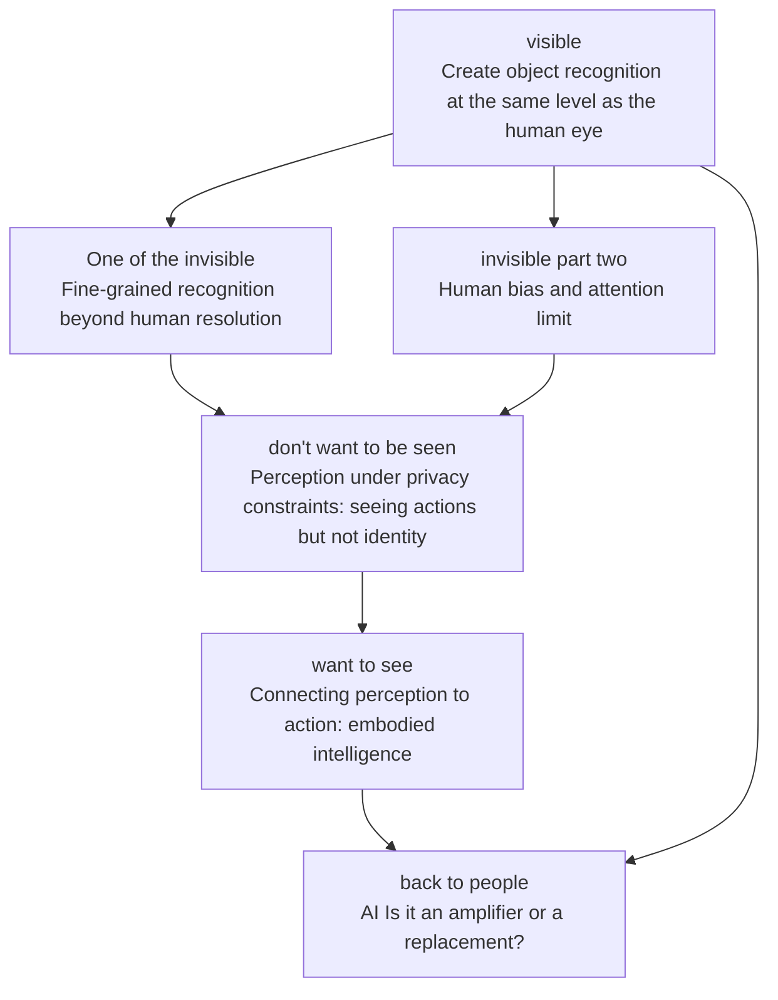
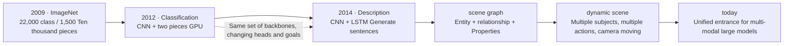
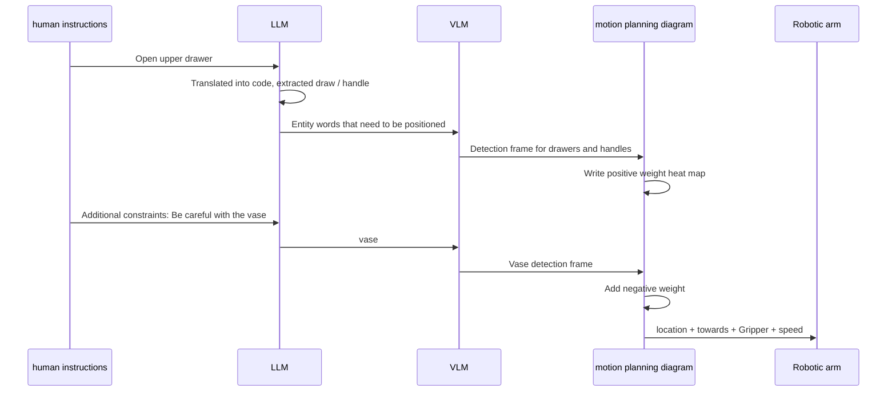
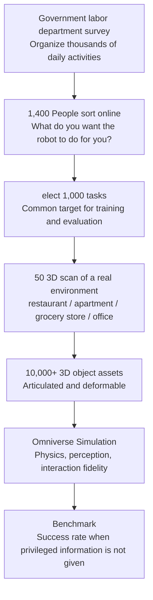

> **Course information**
>
> - **Course name**: Stanford CS231n: Deep Learning for Computer Vision(Spring 2025)
> - **Topic of this lecture**: Lecture 18. Human-Centered AI
> - **Lecturer**: Fei-Fei Li
> - **Teaching date**: 2025-06-03
> - **Course homepage**: [cs231n.stanford.edu/2025](https://cs231n.stanford.edu/2025/schedule.html)
> - **Official courseware**: There is no public courseware for this lecture - the slides link of Lecture 18 in the 2025 course schedule is commented out, and the 2024 slides link is commented out.  `lecture_18.pdf`  Belongs to another lecture "3D Vision". Therefore, the book does not contain any slide illustrations, and all the content is reconstructed based on classroom subtitles; the framework of the speaker's dictation is repeated using Mermaid and tables, both of which are marked "organized based on the speaker's dictation."
> - **Subtitle source**: [cs231n_sp25_kor_sub · eng](https://github.com/lpaiu-cs/cs231n_sp25_kor_sub/tree/main/eng) (Publicly transcribed in English, Chinese rewritten by this book)
> - **Copyright statement**: The copyright of the slides and course materials belongs to Stanford University and the instructors; this book is an unofficial study note and is only used for study and research.

There are no new algorithms in this lecture, and it does not contain any formulas that need to be derived. It is a step back for the entire course: putting the technologies that were dismantled in the previous seventeen lectures - classification, detection, segmentation, video, generation, robots - back on a longer timeline, and adding a dimension that has never been a separate chapter in the course, the value of people. The topic given by the speaker is two juxtaposed verbs: what we see (what we see) and what we value (what we value).

This combination is not rhetorical. Every performance improvement in the previous seventeen lectures answers the same question: can machines do what humans can do. What this lecture wants to ask is two other things - whether machines can do things that humans can't do, and for whom they do these things. The first question determines the boundaries of capabilities, and the second question determines whether this technology will be accepted. The entire lecture was cut into three sections, corresponding to the two ways of asking these two questions plus an ending. The titles of the three sections were "Create vision as strong as the human eye", "Create vision that can see what humans cannot see", and "Create what humans want to see."

## 1. Three main lines: visible, invisible, and wanting to see

*(Reference time: 00:00:05 – 00:04:46｜Lecture 18)*

The story of vision begins 540 million years ago. Trilobites grew photoreceptor cells, and for the first time life could actively detect the outside world. Zoologist Andrew Parker explains: Once vision emerged, survival became an arms race—either evolve better eyes and faster reactions, or be eliminated. The explosion of species brought about by this competition is called the Cambrian explosion, and the speaker used a more straightforward term: the Big Bang of evolution. She specifically added a qualification: not all animals rely on vision, but vision is still the first sensory channel for many animals, especially for humans - from survival, work, entertainment, social interaction, to learning and development.

The contrast between technology and evolution falls in the 1960s. The "Summer Vision Project" at that time envisaged allowing a few undergraduates to build "an important part of the visual system" in one summer. This thing is exactly the same as the problem in the history of AI: **Polaris is clear, distance is seriously underestimated**. The speaker said that this problem probably still exists today, but a lot of things have indeed happened - in the wave of autonomous driving, image understanding, and generative AI, vision is both a participant and often the leader.

According to the speaker's dictation, the main thread of the entire lecture is the following three sentences, and the last sentence is her real focus:

These three lines seem to be three periods of history in the same field, and their experimental acceptance standards are completely different. The success of the first line is defined by humans - if humans can do it, the model will pass if it does it, and the indicator is classification accuracy. The second line is to cross the ceiling of human labeling: fine-grained bird species and rare relationships, humans themselves cannot answer correctly. At this time, "aligning with humans" is no longer the goal, but "surpassing humans" is. The success criteria of the third line are not in the model at all: who benefits, who is seen, and who is replaced. These quantities do not enter the loss, but they determine whether the technology can be implemented. Confusing the standards of the three lines is the most common misunderstanding outside of this course.

What is worth recording is the speaker's positioning on "why I am talking about this now". She admitted that for the sake of completeness of material, there was a slight overlap between this lecture and other parts of the course, but hoped that it would be more comprehensive when placed on a longer time scale. This self-limitation actually defines the nature of this lecture: it does not provide new knowledge; **Give existing knowledge a coordinate system**.

There is a reason to regard vision as the main line. Vision is the name of this course, and it is also the earliest perception ability to be industrialized in this round of AI: autonomous driving relies on it, image understanding relies on it, and it also participates in and leads the wave of generative AI. Therefore, the question "where do we come from and where are we going?" is the most practical question to ask here in vision - it has a history of 60 years of engineering and a history of 500 million years of biology, and you can check both ends.

## 2. People are the measuring stick: 150 milliseconds, two failures and a number between 30,000 and 100,000

*(Reference time: 00:04:48 – 00:11:06｜Lecture 18)*

### 2.1 Two experiments: 100 milliseconds for one frame and 150 milliseconds for one judgment

The first experiment is half a century old. The subjects watched a never-before-seen video played at 10 Hz—each frame stayed on the screen for only about 100 milliseconds—and were tasked with identifying a target, this time a person, in a complex scene with no prior knowledge. The human eye has no difficulty. The speaker used this experiment to emphasize not "finding quickly", but "how stable object-centered understanding is": the frame rate is pushed to a critical value and the scene is completely unfamiliar, but human object-level understanding still does not require hesitation.

The second experiment comes from neurophysiology at the turn of the century. Researchers used an EEG cap to measure brain electrical signals and asked subjects to distinguish between "animals" and "non-animals" - a conceptually quite complex judgment - which was completed about 150 milliseconds after the stimulus appeared. The speaker commented: This speed is astonishing considering the physical limitations of the wetware under the skull. For people who do engineering, the real meaning of these two numbers is: **The human eye is a reasoning pipeline that has been compressed to the extreme by evolution. It does not have an explicit stage of "detect first and then classify". Instead, it reaches a conclusion in one forward step.**.

### 2.2 Is there really an "object area" in the brain?

Neuroscience has also given us a stronger evidence: there are specialized corresponding areas in the brain for object understanding—face area, scene (location) area, and body parts area. The fact that evolution is willing to carve out a separate space for "recognizing objects" shows that it plays an extremely important role in survival. (Editor's note: These three places in the literature are usually written as fusiform face area, parahippocampal place area, and extrastriate body area; the subtitles only describe the functions and do not give abbreviations.)

This evidence explains the path dependence of computer vision for decades: Since there is a part of human intelligence dedicated to object recognition, the first step for a machine to acquire visual intelligence is naturally to recognize objects.

### 2.3 Task definition and why it is mathematically difficult

The definition of the original problem is almost innocuous: given an image, let the computer tell what objects are in the image. People do this effortlessly, but once it is formalized, trouble immediately arises - lighting, texture, background, occlusion, perspective, scale, each of them is a continuously changing dimension, and the combination is an infinite variety of possible inputs. The same object can be located at any distance in pixel space. The speaker's statement is: After studying this course, you will know that this is a fundamentally difficult task in mathematics, rather than a problem of "re-adjusting parameters".

### 2.4 First attempt: dismantling objects into parts (1970s–1990s)

The first wave of attempts before deep learning was inspired by psychology - and it was a somewhat self-deprecating psychology: people rely on self-introspection to speculate on how they work, and sometimes introspection goes too far. The conclusion of introspection is: when we look at an object, we first see the geometric parts, and then combine the parts into an object in a certain configuration. So there was a modeling route of "preset components + configuration", which lasted from the 1970s to the 1990s, using different component collections and configuration rules to match different categories.

The speaker's comment was straightforward: mathematically elegant and simple, but it doesn't work. The reason was revealed in the next wave - the components are specified by humans, the configurations are designed by humans, and the rules themselves do not learn anything from the data. As soon as the pose, occlusion, and texture of the real world change, the configurations that need to be enumerated explode, and manual rules cannot grow accordingly.

### 2.5 Second attempt: Statistical learning comes on the scene (2000s)

The second wave is a truly important shift in the field of AI. The speaker described it as "the marriage of computer programming and statistical modeling", the starting point of machine learning. This turn brought about three insights, each of which overturned a little of the first wave of assumptions:

- **The world is too complicated**, it is impossible to generalize the model by hand tuning;
- **Need to learn parameters**, and it is necessary to design a model family with "learnability" and corresponding learning rules;
- **Must have data**——At that time, I didn’t know how much I needed, I just knew I needed it.

As a result, a number of models such as random fields, Bayesian networks, and support vector machines blossomed at the same time. By the first decade of the 21st century, there were already international benchmark competitions for object recognition, but the number of categories was very small: everyone first compared the algorithms on the same small field. The speaker's wording is "we are moving forward a little bit" (inching together). This kind of moving speed is obviously not enough.

### 2.6 Biederman Numbers: 30,000 to 100,000

The last unlocking point comes from cognitive science. Psychologist Irv Biederman has long suspected that people can recognize an extremely large number of object categories - he assigned a number to this conjecture, and children aged 6 to 7 can recognize approximately  **30,000 to 100,000** Different visual categories. The numbers come from a composite of two sources of evidence: the number of nouns in dictionaries, and studies of children's behavior in identifying objects. The speaker said she privately called it the "Biederman number."

This number was a wash of cold water for computer vision at the time. Halfway through the first decade of the 21st century, this field was still dealing with dozens of categories and tens of thousands of images, and the "training set" of a seven-year-old child was of this magnitude. Data scale then became the next bottleneck that must be overcome - it points directly to ImageNet.

The speaker's criticism of the route of introspection is actually very sharp: we "sometimes over-introspect" and treat our own cognition as a design drawing. The problem with component models is not just that the wrong components are selected; **It mistakes "how people describe what they see" for "how people see"**. People can say "handle, cup body, cup lid", but speaking these words is the product of the language system, not the calculation steps within the visual system. This distinction was later repeatedly verified by deep learning: the features trained end-to-end are not consistent with the manually named components.

The second wave also left a more lasting legacy: **benchmark** this habit. Only by comparing algorithms on the same batch of data can the conclusions be comparable. This is the significance of the international challenge. This habit continues to this day - including the robot benchmark to be discussed in the last chapter. The idea is exactly the same, except that the "image" is replaced by an "interactive three-dimensional environment".

## 3. The door in 2012: 15 million images turn object recognition into an engineering problem

*(Reference time: 00:11:15 – 00:14:57｜Lecture 18)*

### 3.1 22,000 categories, 15 million sheets, and one division

The ImageNet project took the Biederman numbers seriously. The data set it constructs is approximately  **22,000 object categories, over 15 million images**——The magnitude is exactly the same as that predicted by psychologists. Do a simple division: 15,000,000 ÷ 22,000 ≈ 680, which is an average of less than 700 pictures per category. This number shows that ImageNet’s contribution is not “more images”, but **For the first time, the granularity of categories approaches human daily vocabulary**; The density of a few hundred images per class is not extravagant, it is just enough for a high-capacity model to learn the boundaries between classes.

Let’s do another calculation in the opposite direction. If we use ImageNet's average density of about 680 images per category to cover the upper limit of Biederman's number (100,000 categories), about 68 million images are needed - nearly five times larger than ImageNet. This is a magnitude estimate, assuming the density of each class is the same; in a real long-tail distribution, rare classes will only be sparser. This account explains why ImageNet stopped at 22,000 classes instead of 100,000: **The number of classes and the density of each class are a pair of quantities that must be compromised simultaneously.**, any data set can only choose a point between the two, and the way of selecting the point determines what the algorithm will look like in the next ten years.

| frame of reference | Number of visual categories | image size |
| --- | --- | --- |
| Children aged 6–7 years (Biederman conjecture) | 30,000–100,000 | From daily experience, uncountable |
| ImageNet (since 2009) | Approximately 22,000 | More than 15 million |
| If the ImageNet density covers 100,000 categories | 100,000 | About 68 million (estimated) |
| Benchmark competition before deep learning | A small number of categories (the speaker only said tiny, without giving a number) | few images |

### 3.2 Three things collided in 2012

The ImageNet Challenge provides the data; the convolutional network provides the algorithm; and two GPUs provide the computing power. The three came together in 2012, the moment the speaker called the birth of deep learning. In the absence of any of these three items, the door will not open - the scale of the data determines the changes that the model can see, the computing power determines how deep the network can be run, and the algorithm determines whether the gradient can pass through so many layers and signal. Over the next decade, the challenge itself spawned a string of architectures: variants of convolutional networks, ResNet, and more. They have been broken down layer by layer in the previous chapters of this book. The structural details will not be repeated here, only its position on the timeline will be retained.

(Editor’s note: Two GPUs were used in that submission. The direct reason was that the parameters and activations of the network could not be accommodated in a single card at that time. Cutting the model to two cards was an engineering choice forced by the video memory, rather than a set of parallel training methodologies. This detail is worth remembering - all parallel strategies discussed in Chapter 11 of this book start from the same constraint.)

There is another detail that illustrates the audience assumption of this lecture: when talking about the basic schematic page of convolutional networks, the speaker directly said, "I skip this page, you have all learned it." By lecture 18, it was meaningless to explain convolution, so she devoted all the time she saved to history and judgment.

### 3.3 The boundaries of a mature problem: the long tail

Today, you can use algorithms to look at any picture in the world and recognize objects that are large or small and oriented in any direction. Is it 100% reliable? No – there are always long-tail problems waiting to be solved. But in terms of industrial applications, object recognition has gone very far. The speaker used the word: a mature problem.

This sentence gives the entire course a coordinate. Most of the technologies discussed in the previous seventeen chapters—better normalization, less attention, and stronger data enhancement—are used to make marginal improvements in accuracy and efficiency in this already mature track. What has not yet been solved is the content of the next chapter: object recognition only answers "what are the names in the picture", but does not answer "what happens between these things".

## 4. Names Are Not Enough: Relationships, Stories and Unresolved Dynamics

*(Reference time: 00:15:05 – 00:23:26｜Lecture 18)*

### 4.1 Same set of objects, two stories

The speaker uses two pictures to illustrate the difference. There are alpacas and a person in both pictures; if only object labeling is done, the two pictures will get exactly the same set of labels. But when I looked at the second picture, the story completely changed—not that the species had changed, nor that the number of people had changed, but that **The spatial and semantic relationship between humans and alpacas has changed**. The labeling system is unaware of this change.

This example highlights the problem of representation capabilities: a representation that only outputs category names throws away all information about how objects are organized into a scene. Human beings rely on this part of the information to understand a picture.

### 4.2 Writing relationships into representations: scene graphs

Psychologist Jeremy Wolfe has written a very clear paper arguing that understanding complex natural scenes requires encoding relationships between objects into representations. Computer vision then followed this suggestion. The representative work was the thesis of Ranjay Krishna, who was still a doctoral student at the time: using \*\*scene graph\*\* as a representation - nodes are object entities, edges are relationships between entities, and attributes are hung on nodes to describe specific forms.

The density of the scene graph is worth noting. A photo of "two people, one of whom is feeding the other a cake" has only three or four entities at the object level, but because actions, postures, body parts, food, and containers can all become nodes, a fairly dense picture can be generated in the end. This also explains why the cost of annotating this type of data is high: the size of the graph grows super-linearly with the complexity of the scene, and natural scenes are always more complex than they appear.

### 4.3 "Uncommon relationships" with zero samples

After object recognition, this line builds Visual Genome: putting objects, relationships, and longer narrative descriptions in the same data set. The speaker’s favorite one among Ranjay’s batch of work is **Zero-shot learning of uncommon relationships**:

- It is common for people to ride horses; it is common for people to wear hats; it is uncommon for horses to wear hats.
- It is common for a person to sit on a chair; it is common for a fire hydrant to be on the lawn; it is not common for a person to sit on a fire hydrant.

The latter type of combination is extremely rare in natural images and cannot be collected by repeated sampling of big data. However, using the combined scene graph representation, you can first learn the common relationships, and then recombine the "subject-relationship-object" in the representation space to derive unseen combinations. The comparison given in the paper shows that this approach achieved the best recognition rate among a batch of methods at that time. The mechanics here are worth remembering: **Zero-shot capability comes from the decomposability of the representation, not from more data**.

### 4.4 From annotation to narrative: CNN + LSTM in 2014

Relationships are not enough. The speaker’s judgment is that being able to tell a richer story and tell it in natural language is the next big goal. The year was 2014—just two years after AlexNet’s breakthrough—and the field was already accelerating.

The approach is to put together a convolutional network and a language model: CNN extracts features, and LSTM generates word by word. Andrej Karpathy's doctoral thesis was one of the first systematic works in this line, showing both image captioning and dense captioning - the latter bringing description down to the regional level, with contributions from Justin Johnson, who later became a co-instructor of this course. This line was greatly advanced from 2015 to 2018; today's large multi-modal models have pushed it up a notch, but the starting point is the assembly of "CNN + LSTM" in 2014.

According to the speaker's oral summary, from "naming the object" to "telling the story", the form of the question changes every time the form goes up a level:

This ladder deserves a table to see what the "truth value" of each level is - because it determines who can evaluate the model:

| Task form | Model output | Where does truth value come from? | Main evaluation methods |
| --- | --- | --- | --- |
| Object classification | a category name | Manually annotated class names | Accuracy/Top-5 |
| scene graph | Entity + Relationship + Attribute | Manually labeled dense graphs | Relation recall, graph matching |
| Image description | One or more sentences of natural language | Manually written reference sentences | BLEU / CIDEr class text indicator |
| Dynamic activity understanding | Who did what when | Time sequence action annotation | Joint accuracy of actions and relationships |

Reading this chart from top to bottom, you see that two things get worse at the same time: true values become increasingly difficult to write, and evaluations become increasingly unreliable. At the level of dynamic scenes, even the "correct answer" needs to be judged by people - "What is he doing" in a video may have three or four reasonable answers at the same time. This is also the second reason why the speaker said it was "unsolved": it's not just the model that doesn't work, **The review itself hasn’t been finalized yet**.

### 4.5 Dynamic Scenario: The speaker clearly states that it is still unresolved

After the static images, there are dynamic scenes, and the difficulty is on another level: the relationships are more complex, the movements are more complex, the camera itself is moving, and the actors in the scene are doing different things. The work of the speakers and collaborators (Ehsan Adeli, etc.) is called multi-object multi-actor activity understanding, which was published only a few years ago. To simultaneously grasp "who", "what is being done", "with whom to do it", and "what might be done next", the speaker's judgment is that it is still an unsolved problem.

The engineering consequences of this judgment are straightforward. If you are in Silicon Valley, you will hear a lot of excitement about robots; but if there are really robots that can live with people in daily environments, they must be able to understand who is doing what in this scene and what is the next step. The 17th lecture on robot learning addresses "how to learn actions". This lecture points out that "the scene representation fed to it is still far from adequate".

### 4.6 Two legacies of the first paragraph

The speaker concludes this paragraph with two sentences worth remembering separately:

1. **Data, computing power, and neural network algorithms truly converged around 2012/2013**, where modern AI began. This is not the victory of one curve, but the intersection of three curves at the same moment.
2. **The definition of almost every problem on this road comes from cognitive science, psychology and neuroscience**, in turn AI is helping brain research. The speaker believes this two-way relationship will continue.

Taken together, these two sentences actually define the matter of "creating vision as strong as the human eye": it is never a pure project, and the target is drawn by someone else (the brain).

## 5. Seeing what humans cannot see: superhuman discernment, human vulnerabilities and the reverse constraints of privacy

*(Reference time: 00:23:37 – 00:38:17｜Lecture 18)*

### 5.1 Fine-grained: People are really not good at this

The title of the second paragraph is "Creating vision that can see what humans cannot see", which means pushing AI beyond human capabilities. The cleanest example is fine-grained classification: most people can't recognize a few dinosaurs, let alone tens of thousands of birds and tens of thousands of car models - except for a few children who have memorized illustrations.

This line is called fine-grained object categorization. The speaker’s judgment is two-fold: this is still a problem that has not been fully solved; and in the era of generative AI and multi-modal large models, it has been left out because it is not part of the mainstream narrative. But she thinks it will become relevant again sooner or later.

An early experiment trained a classifier on a data set of about 4,000 bird species and then looked at error rates by level of the classification tree. The result is monotonic: **The more specific the name (going towards "species"), the higher the error rate; the more general the name (going towards "object" and "gang"), the lower the error rate.**. In other words, the model is already available at a coarse-grained level, but is still unreliable at the "specific" level. This monotonic relationship itself is a diagnostic tool - it tells you that the bottleneck of the model is not feature extraction, but that the difference between classes is so small that it is close to imaging noise.

The causes are worth taking apart. The further down the classification tree, the smaller the differences between classes, while the differences within classes (posture, lighting, individual differences) do not decrease with the level. At the "species" level, the signals required for discrimination may only be a few pixels different in beak length and one color level in feather color - which are at the same level as imaging noise and compression artifacts. At this time, the model is not "not learned", but **Usable signal-to-noise ratio is approaching its limit**. This also explains why fine-grained tasks are much more sensitive to data quality than ordinary classification: with the same number of annotations and lower noise, the benefits are huge.

### 5.2 Use the car as a social lens

Another example that the speaker prefers is car model identification. The lab trained a fine-grained vehicle classifier classified by make/model/year. How big is the category space for this task? After the 1970s, there were thousands of combinations of different makes, models, and years.

Then came the crucial step: they didn't stop at "recognition." They took Google Street View images, covering about 100 to 200 major cities in the United States, used this classifier to read the specific model of each vehicle on the street, and then aligned these distributions with social indicators. The results are highly correlated: vehicle model distribution is highly correlated with education level, income level, voting behavior, and environmental indicators.

The significance of this matter is not the recognition accuracy, but the **Measurement capabilities**. No single person, or even any group of human censors, could do a car-by-car tally of hundreds of city streets on this scale. Vision here is not "seeing for people", but allows people to see a quantity that would otherwise be impossible to see. The speaker thus gives the central sentence of this paragraph: AI is pushing the boundaries of "what people can see".

### 5.3 Three human vulnerabilities: Stroop, change blindness, and gauze in the operating room

But human vision also has hard limits. The speaker used three examples to illustrate this.

**Stroop test**: You can read all the words, but if you are asked to "say the color of the word as quickly as possible" instead of the word itself, read it from left to right, top to bottom, you will find that it fights with you - red is written as "green", and yellow is written as "purple". It’s a competition between visual attention and automatic reading.

**change blindness**: Two pictures flash alternately, with a rather big change in the middle (the example given by the speaker is the hood of a car), which you have to look at for a few seconds to notice. If your attention is not there, the change will not exist.

**medical errors**: This one is no longer a fun experiment. Medical errors are the third leading cause of death in the U.S. healthcare system. The iconic image is of "scissors left inside the patient," but the reality is more trivial and difficult to prevent: stitches, needles, a small piece of gauze. Today, most hospitals rely on manual counting and listing; if the numbers do not match, the operation must be suspended, and the average suspension time is close to an hour - the patient is exposed to bacteria and bleeding risks for an extra hour just to retrieve one thing.

AI’s place here is specific: a demonstration system for counting gauze intraoperatively. The speaker specifically emphasized that this was a demo, not a deployable system, and the fidelity was not high enough. But the direction is clear——**It does not make judgments for doctors, but provides "eyes that will not tire" for doctors.**.

### 5.4 Checkerboard illusion: deviations written in the visual system

The speaker said that one of her favorite optical illusions is that of a checkerboard: the grayscales (brightness) of squares A and B are actually exactly the same. She gives you the answer directly. If you look at the picture above, you will still "see" that they are different - even though the picture below has two pieces of gray placed side by side.

The reason is that evolution has pre-installed a set of common sense physics about the world into vision: objects have shapes, light sources have directions, and shadows have generation rules. The brain first assumes illumination, and then infers surface reflectance. This set of priors is so deep that you cannot cover it with your will.

From this the speaker advanced to the most critical sentence of this lecture: **There are biases in the human visual system**. Bias can come from evolutionary constructs, it can come from social experience, it can come from the data you're exposed to. Some biases are harmless illusions, while others can turn into unfairness - facial recognition algorithms from a few years ago were significantly worse on certain skin colors and genders, and such errors will fall into high-risk scenarios such as autonomous driving and medical care. Her observation for 2025 is: the problem is not solved, but at least academia and industry are looking at it, which is much better than "no one was paying attention" a few years ago.

### 5.5 What you shouldn’t see: Privacy is a design constraint, not an afterthought

There is a third kind of "invisibility" in the second paragraph, and it is intentional: some information should not be seen in the first place because of respect for privacy. So the question becomes – how to create something that can help people see, but not see what people don’t want to be seen.

From a machine learning perspective, there are a series of ready-made methods for this path. But first we need to see how broad the problem itself is - going back to her lab's paper on smart cameras in wards: the camera needs to help doctors see better, and at the same time it has to process not just faces, but also entire body information, and even the room itself (the layout of the home will reveal living habits). Privacy here is not a switch, but a set of boundaries that need to be decided on a case-by-case basis: which pixels are allowed to leave the device, which ones can only stay locally, and which ones should not even be stored locally. The means and their respective trade-offs are as follows:

| means | What is protected | What available information is retained | main cost |
| --- | --- | --- | --- |
| Blurry / out of focus | identity, facial details | Scene layout and approximate location | Action details are erased altogether |
| masking | designated area | Everything outside the zone | You must first know where to cover |
| Dimensionality reduction | Identity level details | Low-dimensional structures and statistics | Decreased accuracy of downstream tasks |
| federated learning | The original data does not come out | Gradient/model update | Increased communication and system complexity |
| Encryption | Transmission and storage | Ciphertext domain computing power | Computing power overhead |

The first row of this table best illustrates the conflict: **Blur and loss of focus protect privacy, but they also erase "what this person is doing" - and for many applications, that is the only useful information.**. This isn't an engineering detail, it's a conflict of goals: the object being protected falls on the same pixels as the desired signal.

The speaker used a work she admired very much to explain how to circumvent this conflict (she specifically stated that this was not work in her laboratory and was led by students in the collaborative team). The method is a joint design of hardware and software: a customized lens is used to filter the picture in a specific way at the optical level - in the picture actually captured by the camera, neither the face nor the appearance of the body can be seen; because this lens is specially designed for the supporting software, the software can still recover motion and activity information from the filtered signal. So the system keeps "what this child is doing", but cannot get "who this child is".

The value of this idea lies in the level: privacy protection is put into the optical path, instead of coding after getting the high-definition image. The former does not physically collect identity information, while the latter just hides the collected information.

### 5.6 Conclusion of the second paragraph: AI is an amplifier

The three things in this paragraph—superhuman discrimination, human bias, and reverse constraints on privacy—finally converge into one judgment: AI can both amplify our abilities and amplify our problems. If we have biases, AI will amplify them; if we have an attention limit, AI can make up for it; if we don’t want to be seen, AI must learn not to look.

Therefore, when building AI, we should not only take a technical perspective, but also a human perspective: proactively study its impact and guide it to respect human values. This is the second take-home of the whole lecture, and it is also the step from "technology" to "people".

## 6. From seeing to action: shortage is closer to reality than "substitution"

*(Reference time: 00:38:23 – 00:47:23｜Lecture 18)*

### 6.1 Labor: Those who are affected are actually white-collar workers

The title of the third paragraph is "Creating things that humans want to see", and it's not just about seeing - it's about connecting seeing and doing. The entry point is today’s society’s biggest anxiety about AI: labor.

The speaker's attitude is to lay out both ends first. On the one hand, it is wrong to deny job changes: every technological change in human history has changed the labor market. Some changes are very painful, and in some cases they even lead to civil wars and wars; but on the other hand, such changes are sometimes inevitable. Headlines like "robots taking jobs" simplify the picture.

And then a counter-intuitive addition: The biggest impact of generative AI in the past two years has not been manual labor, but white-collar jobs, especially software engineering and analytical work in offices. In other words, the long-standing narrative of "machines replacing manual workers" is misaligned with what is actually happening this time.

### 6.2 Shortage on the other side: who is taking care of the elderly

If we only look at alternative narratives, we miss the other half of the picture - there is a shortage of labor, and the shortage is where people are needed most: elderly care and medical care.

The chain is like this: the progress of modern medicine has increased life expectancy, and society as a whole is getting older, which is a good thing; but at the same time, young people have to work so that society can be dynamic. So who will take care of the elderly and who will take care of patients with chronic diseases? The turnover rate of nursing staff in American hospitals has been so high that "there are not enough hands, ears, and eyes to care for patients." The speaker's conclusion is: Instead of using replace to describe this matter, it is better to use augment.

### 6.3 Dark space and “ambient intelligence”

There are a number of places in the medical system that are chronically short of human attention: operating rooms, wards, pharmacies, and patients’ homes. The speaker gave them a name - healthy **dark spaces of health**. What these spaces have in common is not that there is no data, but that there are not enough people to continuously interpret the data.

The corresponding technical route is called ambient intelligence: it combines smart sensors with machine learning algorithms to extract signals critical to health from these scenarios and alert patients, family members or doctors in a timely manner. This line is led by Ehsan Adeli and others, and the results were published in a paper a few years ago. The following three examples are its concretization.

### 6.4 Hand hygiene: Depth sensor plus action classification, equivalent to approximately four inspectors

Hospital-acquired infections are one of the leading causes of death in the United States. The speaker gave a comparison: It kills three times as many people every year as traffic accidents in the United States. Such germs are mainly spread through the flow of personnel between wards and then multiply in the environment. Hand hygiene is therefore a key component, and this project started long before COVID.

The difficulty lies in "how to measure". The hospital has tried manual examiners, but there are not enough nurses, and it is impossible to hire enough examiners. Moreover, people are tired, have limited attention span, and are subject to change blindness as mentioned earlier. The technical solution tried RFID badges: the badge was recorded once it was near a hand sanitizer dispenser. The problem is that it's too non-specific - wards and corridors are narrow, and standing next to hand sanitizer doesn't equate to washing your hands.

Their plan is to install smart sensors that only collect depth information into the ward (the picture is a blue depth video, without color texture), and then use a visual algorithm to classify actions: This person is washing his hands or not. This is already a low-cost design in terms of privacy - there are no facial details in the depth map. As a result, compared with the artificial truth value, the algorithm's detection is more accurate and stable than that of humans; the speaker gave a very convincing conversion: to achieve similar quality to the algorithm, almost four people would have to watch the same video, which is completely unfeasible in terms of operation. If you only send one person to look at it, the detections will be very sparse.

### 6.5 ICU: 1% of GDP and four types of actions

The second example is the intensive care unit. The ICU is where patients struggle with life and death, and it’s also where money is spent: the speaker’s figure was that it costs about 1% of U.S. GDP. Making ICUs more efficient and safer is therefore the highest priority.

One of the goals of the ICU is to safely transfer patients out, into step-down units or even home. One of the key actions in recovery is early mobilization - getting the patient to move, and it must be done correctly. This matter is extremely complex in terms of process: it requires the assistance of a nurse, the doctor gives orders, it is carried out according to the specified time, and it is necessary to evaluate whether the actions are in place. What’s instinctive for healthy people is therapeutic for ICU patients.

They worked with Stanford and Intermountain Hospital in Utah to install sensors in the ICU to monitor four types of movements: getting out of bed, getting in bed, getting out of the chair, and entering the chair. With reliable detection and prediction, doctors can know "whether and how much this patient moved today" despite the shortage of manpower.

### 6.6 Home care and the ceiling of sensors

The third example is aging in place: the elderly want to live independently and healthily in their own homes. The speaker pointed to lessons learned in the early days of COVID—high death rates among the elderly were largely due to hospitals being overwhelmed and systems being overloaded, so keeping people safely at home was a medical capability in itself.

Sensors can do a lot here: use thermal imaging for early detection of infections, monitor mobility, and understand sleeping and eating patterns. These are where AI plus smart sensors come in.

But the speaker then pointed out the ceiling of this road: the sensor is an information collection system. It cannot go over and turn the patient over, carry water, or deliver medicine to the elderly. After the information is in place, a pair of hands are still needed. So the topic naturally turns to the last technical topic-embodied intelligence, a large part of which is robots.

Looking at the four scenes in this chapter side by side, the boundaries will be very clear:

| scene | What the sensor can provide | What sensors can’t do | Who needs to make up for it? |
| --- | --- | --- | --- |
| operating room | Inventory of instruments and gauze, identification of process nodes | Handing instruments, suturing | Nurses and Surgeons |
| Ward | Classification of hand hygiene actions and infection risk signals | Remind and correct current behavior | On-site medical care |
| ICU | Detection and trends of four types of activities | Help patient to stand and assess pain | nurse |
| home | Early signs of infection, sleep, diet, mobility | Bring water, deliver medicine, turn over | family or robot |

This table is a one-way gap when read from left to right: **The output of the perception system is "information", and the output of care is "action"**. Information can be copied on a large scale, but actions cannot - this is the reason why embodied intelligence exists, and also explains why it is an order of magnitude more difficult than perception: if the perception is wrong, you can re-read it, but if the action is wrong, it will hurt people.

## 7. Embodied Intelligence: Open Instructions, Zero Score Benchmarks, and Preference Rankings of 1,400 People

*(Reference time: 00:47:29 – 01:04:23｜Lecture 18)*

### 7.1 Why close the loop: Eyes and movement are the same thing

The reason the speaker is excited about embodied intelligence is not that "robots are cool"; **Close the loop between perception and action**. She pulls the ring back to the Cambrian: as soon as the eyes appear, the animal begins to move. Seeing and acting are evolutionarily two sides of the same coin, not two modules.

Reality is difficult. Robots are slow, clumsy, and have difficulty adapting to situations that require generalization. Today, the field of robot learning has made great progress, and Stanford is one of the centers. However, most work is still limited to the triple constraints of short-term tasks (grabbing, placing), case-based experimental settings, and the lack of standard benchmarks. These three constraints correspond to the three things that will be discussed in the next section: where the tasks come from, how to build the environment, and how to compare the results.

### 7.2 Open instructions: LLM writes code, VLM locates, and heat map does planning

The first constraint is where the tasks come from. If the set of tasks had to be specified in advance, the robot would always be trapped in a closed world; today's LLM is completely open - you can talk to it about anything. The speaker's students wanted to fill this gap: could a robot be given a command it had never been trained on and it would do it?

The setting of the example is small: "that kind of gate" is in the training set, "this kind of gate" is encountered in the wild, and the goal is to generalize in the wild. The technical route is to treat LLM and visual language model (VLM) as two-level "translators":

1. When an instruction comes in (such as "open the upper drawer"), LLM translates it into code, and entity words such as draw and handle appear in the code;
2. Give these entity words to VLM, and VLM detects the positions of drawers and handles in the scene;
3. The detection results update a motion planning map - using a heat map to indicate where the robotic arm should exert force and where it should not touch;
4. Add another constraint ("Be careful with that vase") and follow the same link. This time you get a negative weight, which is superimposed on the previous picture;
5. The planning map not only encodes the position, but also encodes the end orientation, gripper opening and closing, and speed, and is finally handed over to the robotic arm for execution.

According to the speaker’s oral summary, the timing relationship of this closed loop is:

The key is that there is no link in this link that requires "training a policy for this task." LLM is responsible for splitting natural language into executable symbols, VLM is responsible for dropping symbols into pixel coordinates, and the planner is responsible for turning these coordinates into fields with positive and negative weights. Each of the three modules is a general model, and the combined generalization ability comes from the open vocabulary of language and vision, rather than from the coverage of robot data. The same system can also perform hinged object operations (opening and closing cabinet doors, drawers), spreading paper towels, sweeping the floor, taking toast, setting the table, and responding to online disturbances.

From a system design perspective, this approach shifts the burden of "generalization" from the policy network to the general model. The generalization boundary of traditional imitation learning is determined by the distribution of teaching data; here, all objects that can be named by LLM and positioned by VLM can enter the planning map, and the boundary is determined by the knowledge of the general model. The cost is equally clear: the entire link is open-loop symbol transfer. If the code generated by LLM has the wrong entity name, VLM will faithfully detect a non-existent object and give a heat map. The system has no mechanism to detect "wrong language layer". What is missing is the layer that uses execution feedback to correct deviations—that is the home field of policy learning, and this link currently only has open-loop symbol transmission.

### 7.3 What is missing is a ruler

The second constraint is environment and performance. Robot research still lacks good benchmarks: experimental conditions in the laboratory are controllable, but the real world is more complex, more uncertain, more variable, more dependent on interaction and sociality, and multi-tasking.

The contrast is stark: both natural language processing and computer vision have benefited greatly from the creation of large-scale data sets (both for training and benchmarking); there is no equivalent in robotics. The laboratory's project is called BEHAVIOR - Benchmark for Everyday Household Activities in Virtual, Interactive, and Ecological Environments, which literally translates to "a virtual, interactive, and ecological daily housework activity benchmark." The three adjectives in the name are its design goals: daily household chores (not grabbing building blocks), interactive (not watching videos), and ecological (not isolated scenes).

### 7.4 Who decides what the robot should do: Ranking of 1,400 people

There is a value issue before establishing a benchmark. The speaker specifically singled it out: Why should we decide what tasks the robot should do?

She started with a joke: Every graduate student working on a robot only wants two tasks - laundry and a dishwasher. That’s fine, but outside of graduate school, who makes the to-do list?

What they did was not pat themselves on the head, but do a people-centered survey. The steps are: first sort out from government surveys of labor departments in the United States, Europe and other places **Thousands of daily activities**; Then recruit as many people as possible online (1,400 people were eventually found), ask them to judge "what do you want the robot to do for you", and then rank the results.

The conclusion is partly consistent with and partly contrary to intuition. The consistent part: the cleaning category is overwhelmingly at the top - mopping the kitchen floor, scrubbing the toilet, mopping the floor, people really want it. The opposite is more telling: You don’t want a robot to play squash for you, buy you a wedding ring, or even make baby cereal for you. The speaker’s explanation is: Some actions have emotional or social meaning to us, and their value lies not in “being done” but in “who does it.” She also conducted a live poll - many people raised their hands when mopping the kitchen floor, shoveling snow, and folding clothes; when making breakfast, the answers began to split; almost no one was willing to open Christmas gifts.

The speaker also took the initiative to explain the limitations of this survey: she wanted to include as diverse a group of people as possible, but she said that "there is still room for improvement." 1,400 people make judgments on thousands of activities. The sample size and coverage are just starting points; more importantly, different cultures may have different answers to "what should be done by machines", and this version of the survey mainly covers Europe and the United States. In other words, **This ranking is a priori with a position, not an objective task list.**——It writes "human preference" into the benchmark's genes, and this is precisely where its value lies.

### 7.5 50 scenes, 10,000 assets, Omniverse

With sorting, there is a ruler that can be used to make decisions: choose from thousands of items **1,000 items** The tasks that people most want help with are used as training and evaluation targets. Next is building the environment. The workload of this part is often underestimated:

- **scene**: Scan or acquire 50 three-dimensional scenes of real environments, covering restaurants, apartments, grocery stores, offices, etc.;
- **object**: Collect more than 10,000 three-dimensional object assets (the speaker said this number is outdated, but it is actually more), each with attributes - whether it is articulated and whether it is deformable;
- **Simulation**: Working with NVIDIA’s Omniverse team, the goal is to achieve high fidelity in physics, perception, and interaction, including effects such as thermal conductivity transparency, and the deformability of cloth and liquid;
- **Verify**: Use human subjects’ perceptual realism research to compare with other simulation environments.

According to the speaker's oral summary, there is a one-way assembly line from "what people want" to "whether they can do it":

Subtraction occurs at every level of the pipeline: thousands of activities reduced to 1,000 tasks, 50 real environments reduced to simulated scenes, 10,000 assets reduced to rigid and soft bodies with physical properties. The basis for subtraction is always "people want" rather than "engineering is easy to do" - this is the biggest difference from general benchmarks.

### 7.6 Zero points, and how "privileged information" can buy them back

Here are the most important numbers to remember. Throw today's robot algorithm into BEHAVIOR, and do not give any privileged information - you are not allowed to know where the object is, you are not allowed to know the success determination, just put it directly into the environment -**Success rate is 0**.

"Zero score" is worth saying more, because this is not that the model has collapsed, but that the task definition refuses to take tricks. BEHAVIOR's tasks are long-term: finding objects, sorting among multiple sub-goals, and recovering after failure; and "not giving privileged information" means that you are not allowed to directly read the object pose in the simulator. Most robot strategies today are trained on the premise of "knowing where the object is." Once this premise is removed, it is not surprising that the success rate returns to zero - what it exposes is the gap between the training settings and the evaluation settings, not that a certain network structure is not deep enough.

Once you start giving privileged information, or using assumptions that make the task easier (magic motion, perfect memory, etc.), the scores start to move. There are two sides to the speaker's reading: just looking at the "no privileged information" line would be frustrating for today's robots; but it's good news for graduate students, because it means there's still a lot of room.

The robot in the demonstration also confirmed this point: it moved very slowly when tidying up the room (the speaker specifically stated that the playback was not accelerated), could not pick up bottles, walked in the wrong direction, and put things in the wrong place. The same set of tasks has a "digital twin" in the digital environment and the real environment, which is used to measure the migration from simulation to real (sim2real); the speaker's judgment is still: it has not been solved and there is still a long way to go. This environment is also used to study visually impaired patients - putting patients into a safe virtual environment for research is itself an ethical improvement.

### 7.7 Brain waves: turning "thinking" into action

The last demo was closer to science fiction. They worked with psychologists and doctors to use an electroencephalogram (EEG) hat to control a robotic arm: a student wore the hat, and the robotic arm made a Japanese meal "based on ideas." The speaker emphasized that this is non-invasive and the signal comes from scalp electrical signals, not implanted electrodes.

The prerequisite is calibration: "ideas" need to be pre-trained and aligned with action primitives (lift, place, drop, etc.) before continuous EEG signals can be used to drive the entire task. The speaker positioned it in the clinic - the real future of this technology is to help severely paralyzed patients regain the ability to use their hands, and this happened just last year.

### 7.8 The landing point of the third paragraph

The speaker summarized the purpose of the BEHAVIOR project in three words: augmenting people, large-scale and diverse, real and ecological physics and perception. These three together are her definition of embodied intelligence - not to build a more flexible robotic arm, but to build an environmental intelligence agent that can share tasks for people in the human environment. The source of the task list must be human preference, not the convenience of engineers.

## Summary

*(Reference time: 01:04:29 – 01:05:00｜Lecture 18)*

- **Three sections of road correspond to three acceptance standards**: Align with humanity, surpass humanity, and serve humanity. Using classification accuracy to measure the third paragraph is the most common misunderstanding in this type of discussion.
- **The year 2012 is the product of three quantities**, it is not a victory of a curve: the category granularity of the data, the computing power of the GPU, and the trainable deep network cannot open the door without any one of them.
- **People are both inspiration and ceiling**: The recognition speed of 150 milliseconds and the number of categories from 30,000 to 100,000 define the target; while Stroop, change blindness, and checkerboard illusion indicate that people themselves are not reliable sources of truth.
- **The stronger trunk will not automatically eliminate the long tail**: Object recognition has matured in the industry, which does not mean that it has matured in rare species, rare relationships, and dynamic scenes; but if the same fine-grained model is used differently, the output changes from "prediction" to "seeing" - reading out the distribution of car models in thousands of cities, you get an observation dimension that does not exist originally.
- **Privacy needs to be addressed before collection**: Blurring and coding erase the identity while also erasing the movements, which are exactly the useful information; customized optical plus software decoding is the only way to preserve both at the same time.
- **The opponent of AI in medical scenarios is not doctors, but fatigue**: It takes four people to watch the same video to tie an algorithm. This conversion explains the problem better than any accuracy number.
- **The bottleneck of embodied intelligence is not a single action**: Three things: open command, long-term, and reproducible benchmarks. The "zero score" on BEHAVIOR is the most honest scale of this track at the moment.
- **What the robot should do is determined by human preferences**: Cleaning is required, but wedding rings are not required; engineering feasibility cannot answer this question.
