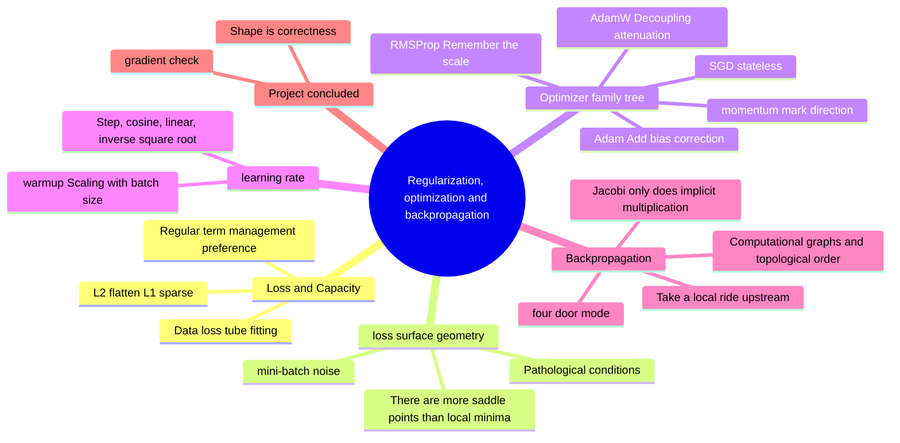

> **Course information**
>
> - **Course name**: Stanford CS231n: Deep Learning for Computer Vision(Spring 2025)
> - **This module covers**: Lecture 3. Regularization and Optimization (119 pages) + Lecture 4. Neural Networks and Backpropagation (147 pages)
> - **Lecturer**: Zane Durante(Lecture 3), Ehsan Adeli(Lecture 4)
> - **Teaching date range**: 2025-04-08 – 2025-04-10
> - **Course homepage**: [cs231n.stanford.edu/2025](https://cs231n.stanford.edu/2025/schedule.html)
> - **Official courseware**: [lecture_3.pdf](https://cs231n.stanford.edu/slides/2025/lecture_3.pdf) (119 pages), [lecture_4.pdf](https://cs231n.stanford.edu/slides/2025/lecture_4.pdf) (page 147)
> - **Subtitle source**: [cs231n_sp25_kor_sub · eng](https://github.com/lpaiu-cs/cs231n_sp25_kor_sub/tree/main/eng) (Publicly transcribed in English, Chinese rewritten by this book)
> - **Copyright statement**: The copyright of the slides and course materials belongs to Stanford University and the instructors; this book is an unofficial study note and is only used for study and research.


Lecture 2 left us with a work-in-progress: given a set of weights  $W$  The loss can be calculated, but two questions are not answered - whether this set of weights is considered "good" and where this set of weights comes from. Lecture 3 fills these two gaps at once: first add a "preference" to the loss function so that "good" is no longer defined only by the training set; then turn "finding W" from a search problem into a process that can be executed repeatedly. Lecture 4 Change what is being optimized—from one linear map to multiple nonlinear stacks—and build a machine that can compute gradients at any depth. The four clues are therefore strung together into a line: **loss surface geometry** (What does the terrain look like) → **Regularization and Capacity Control** (Which solution do we want) → **Optimizer Family Tree and Learning Rate Scheduling** (How to get there) → **Back propagation engine** (Where does the gradient come from). The first two paragraphs and the optimizer in Lecture 3 belong to Lecture 3, and the last paragraph belongs to Lecture 4; there is an easily skipped question hidden in the seam of the two lectures - what the optimizer eats.  $\nabla_W L$  who produced it. If this question is not answered, all the algorithms in Lecture 3 can only stop at the 3072-dimensional linear model. The first three pages of the handout are course matters, which are covered quickly in class, but they determine the rhythm of the next two weeks, so they are recorded first.


Assignment 1 will be released the day after this lecture and ends at 23:59 on 4/23; the Q&A time will only deal with high-level issues, and the page says No Code Show Policy - you have to position yourself for things like wrong gradients and mismatched dimensions. This policy goes hand-in-hand with the gradient check at the end of Chapter 3: the course doesn’t teach you debugging, but it does give you ways to check for errors yourself.


Proposal ends on 4/25; the teaching assistant’s expertise and Q&A time (offline and Zoom hybrid) are posted on  `cs231n.stanford.edu/office_hours.html`. Before choosing a topic, confirm which teaching assistant understands the direction you want to go in, which is much easier than asking after the fact.


You must read all the pinned posts on Ed. Corrigendums and additional explanations are posted there; students who want to take the midterm exam on campus need to send an email to  cs231n-staff-spr25@stanford.edu  Registration (CGOE).

## 1. Three decisions made last week and one question that hasn’t been asked yet
*(Reference time: 00:00:17 – 00:11:05｜Lecture 3)*


The review is not to retell the previous lecture, but to lay out the three decisions that have been made and see which one will collapse today: use data instead of rules to classify, use a distance measure of "similarity", and use linear functions to map images into scores. The first two decisions were upheld in Lecture 2, and the third decision will be overturned in Chapter 8 of this lecture.


**The first difficulty is not in the algorithm, but in the representation.**  What people see is the concept of "cat", what the machine gets is a picture  $32\times32$  A grid of pixels with three integers at each position, for a total of 3072 discrete values. From this pile of numbers back to the semantic label, there is a semantic gap in between. It also explains why the width of all subsequent matrices is 3072: $32\times32\times3$, is not a random number.


The six pictures correspond to six difficulties, two of which deserve to be described in more detail than the pictures. cats are typical **deformable object**: Can twist, curl up, and stretch. The same category has no stable shape at the pixel level, and any rules that rely on "shape templates" will be invalid. The blocked one is even more severe - there is only a tail sticking out of the seat in the picture. People rely on "the shape of the tail + common sense of cat behavior" to complete it, but the algorithm has no common sense. Coupled with background clutter and intra-class differences, if-else rules are not inaccurate, but the number of combinations of rules will explode.


The data-driven approach is to save training samples, and when a new sample comes, vote with the nearest neighbors: 1-NN directly copies the label of the nearest neighbor, 5-NN takes the majority vote of the last 5, and 5 here is the hyperparameter  $k$. The data should be cut into three parts instead of just two——**The validation set is used to pick hyperparameters**, the test set only answers "How does it perform on completely unseen data?" If the two are mixed, the process of selecting hyperparameters will leak test set information into model selection.


After flattening the graph into a 3072-dimensional vector, $W$  is  $10\times3072$  matrix (the lecturer said it as 3071 when dictating, press  $32\times32\times3$  should be 3072), $b$  It's 10 dimensions. There are three ways to read the same thing, and all three will be used in this chapter: **algebraic reading**——$W$  Each row of is a category grader, with  $x$  Do inner product and add bias; **Template reading**——Reshape a certain line back  $32\times32\times3$  Drawing it is a weighted template of "what does this category look like"; **geometric reading**——Each row is a hyperplane in the input space, $w^\top x+b=0$  is the decision boundary, and the sign determines which side the sample falls on. The geometric reading method is the most useful: draw the data and you can see at a glance whether the red and blue points can be separated by a straight line; if they cannot be separated, the problem is not optimization, but the model family itself.


Specific to this score table: the cat column  $(3.2,\,5.1,\,-1.7)$  The correct category is only ranked second, car’s 5.1 is higher, and the judgment is wrong; car’s column  $(1.3,\,4.9,\,2.0)$  The correct category is the highest and it is judged correct; frog is the column  $(2.2,\,2.5,\,-3.1)$  Correct category bottom. The "goodness" of the three columns of scores cannot be sorted by the naked eye - cat only lost 1.9 points and frog lost 5.6 points. Why do you say the latter is worse or how much worse? So we need a function that compresses the entire list of fractions into a number:

$$
L=\frac{1}{N}\sum_{i=1}^{N}L_i\left(f(x_i,W),\,y_i\right)
$$

this is **data loss**, measures how closely the prediction matches the label. The problem is that by minimizing only this term, the model will try to fit the training set at all costs - including learning the noise as a rule. The loss function is still missing one item; filling in this item is the entire content of the first half of this lecture, and "where does this W come from" is the entire content of the second half.

## 2. Regularization: the only knob that "deliberately makes the training loss a little worse"
*(Reference time: 00:11:07 – 00:24:22｜Lecture 3)*


The second thing to do may sound contradictory: **Deliberately make the model perform worse on the training data**. The lecturer made it very straightforward - the purpose of this item is not to improve the score on the training set, but to prevent the model from "doing too well" on the training set so that it can do better on unseen data. The training set becomes worse and the test set becomes better. These two things must happen at the same time, otherwise it is not called regularization.


Why is "too good on the training set" a bad sign? A picture of a toy with only five dots will tell the story.


Given these five points, an infinite number of curves can be drawn through them. There are only two candidates in the picture: $f_1$  with  $f_2$.


$f_1$  Passing through every point accurately, the data loss is almost 0; $f_2$  Every point is a little bit different. Just look at the training loss, $f_1$  Complete victory. But if these five points are sampled from a smoother law and contain measurement noise, then  $f_1$  What I learned is "what noise looks like", $f_2$  What you learn is "what the rules look like."


The conclusion is the line at the bottom of the page: Regularization resists the force of "don't fit too well", and its effect is **Not fitting the noise in the data**. The same intuition has a name in philosophy - Occam's razor: among multiple competing hypotheses, choose the simplest one first; only when the simple hypothesis is proven wrong, try more complex ones.


Written as a formula, it is to put a penalty behind the data loss, and then use a coefficient to sew them together:

$$
L(W)=\underbrace{\frac{1}{N}\sum_{i=1}^{N}L_i\left(f(x_i,W),y_i\right)}_{\text{数据损失}}+\underbrace{\lambda R(W)}_{\text{正则项}}
$$


$\lambda$  is **Regularization strength**, another artificially set hyperparameter, with values ranging from 0 (completely unregularized) to arbitrarily large (punishment overwhelms). It's not learned through training, it's like  $k$  Scan on the validation set as well. The reason why this item is important is that it changes "whether the model is good or not" from a single objective to a weighted sum of two objectives: the data loss says "you have to be responsible for the training set", and the regularization term says "don't work too hard".


The three specific forms all operate on the weight matrix element by element and then sum: L2 is the sum of squares  $R(W)=\sum_k\sum_l W_{k,l}^2$;L1 is the absolute value sum  $R(W)=\sum_k\sum_l|W_{k,l}|$; Elastic net divides the two according to coefficients  $\beta$  Mix it up. The difference between them is not in the length of the formula, but in **Penalties for large numbers and small numbers are different**, the next section will use a live question to figure it out.


The right side of the page also lists a series of regularizations that are "less like penalty terms": Dropout, batch normalization (BatchNorm), stochastic depth (stochastic depth), and fractional pooling (fractional pooling). What they have in common is that some randomness or constraints are injected into the network during training so that the model cannot rely on a certain fixed path; the cost is that they will change the network structure itself, which is much more troublesome to adjust than L1/L2. According to the lecturer, there are new papers on this type of method every year and it is an active research direction. This course only covers a small part.


There are three reasons given on the page, and the third one is the most easily ignored. **express preference**: If you believe that the solution to this problem should be "spread" or "sparse", write this preference into the objective function with the corresponding penalty term. **Simplified model**: If regularization suppresses high-order polynomial terms, the model will indeed become simpler. **Improve optimization**: The L2 term is a square, which is a parabola when drawn. Adding it is equivalent to adding a curvature to the loss surface, which makes it more convex and easier to optimize. This will not be discussed in this lesson, but it means that regularization not only affects generalization, but also affects the speed of training itself. The first two are both "making the model simpler", but the lecturer specifically corrected a popular misunderstanding: regularization does not always make the model simpler. Dropout is a counterexample - it makes the model more "difficult to learn" during training, more complex in structure, but better on the test set. There is only one truly unified definition: **Worse on the training set, better on the test set**.

![Fill-in-the-blank question: Given x=\[1,1,1,1\] and two weight vectors, which one does L2 prefer?](</attachments/cs231n-f8ca462857a0b2f003bd8da5.png>)

The input is  $x=[1,1,1,1]$, two candidate weights  $w_1=[1,0,0,0]$  with  $w_2=[0.25,0.25,0.25,0.25]$. The inner product of both is equal to 1, that is **Data loss is exactly the same**——The fitting ability to the training set is exactly the same, the only difference is how the weights are distributed.


Do the math and you’ll understand: $R_{L2}(w_1)=1^2=1$, while  $R_{L2}(w_2)=4\times(1/4)^2=1/4$, the latter is four times lower. So L2 will choose among the two solutions that "can also score 1 point" $w_2$——It puts weight **disperse** to all input dimensions rather than betting on a single dimension. In the class vote, the majority of the candidates were correct. The lecturer's statement was that "L2 likes to spread the burden of weighting."


The next problem is traps. L1 is the sum of absolute values: $R_{L1}(w_1)=1$, $R_{L1}(w_2)=4\times0.25=1$, **The two answers are tied**. Most people in the class raised their hands and chose No. 1 (the sparse one). Their intuition was right, but the reason was wrong - looking at the loss function alone, the two solutions were completely equivalent. The lecturer's approach was straightforward: admit that this is a trap, and then give why number 1 is indeed seen in practice. This step of derivation is worth supplementing (Editor’s note: Just derive the derivatives of the two items separately): The gradient of L2 to a certain weight is  $2W_{k,l}$, the closer the weight is to 0, the smaller the force being pulled back, so it can stop at a small non-zero value; the gradient of L1 is  $\mathrm{sign}(W_{k,l})$, as long as the weight is not 0, there will always be a fixed force pushing it toward 0. The result of the superposition is: L2 gets a set of weights that are "all small, but none are zero", and L1 gets a set of weights that are "a large number of exact zeros" - this is the source of sparsity and the origin of the sentence "L1 is equivalent to doing a linear model with fewer coefficients." The instructor used the intuition of squaring (0.001 squared becomes  $10^{-6}$, the penalty almost disappears), and the conclusion is consistent with derivation.


The review page re-links the entire chain, and the explanation about Softmax is worth copying: it **any set of real numbers** Becomes a set of probabilities that sum to 1; the class probabilities with higher scores are closer to 1, and the rest are pushed closer to 0. This matter is important because the loss takes the negative logarithm of the "probability of the correct class": when the probability is close to 1, the loss is close to 0, and when the probability is close to 0, the loss tends to infinity - the behavior at both ends is exactly in line with "the more outrageous the mistake, the heavier the penalty."


There is only one more thing in the second version: add after the average of the sample-wise loss  $\lambda R(W)$. How to evaluate a "here" $W$"It has been completely determined: data loss governs fitting, regular terms govern preferences, $\lambda$  Control the exchange rate between the two. There is only one question left, which is the entire content of the second half of this lecture——**Where does this W come from?**. Someone in the class asked, "Why does using weight range for regularization mean that the model is simpler?" The lecturer admitted that the L1 situation is relatively straightforward (fewer coefficients), but the general situation does not hold true. In the end, we have to return to the definition of "poor training, good testing".

## 3. The loss surface is an invisible terrain: from random search to analytic gradient
*(Reference time: 00:24:37 – 00:33:51｜Lecture 3)*


Once the loss function is determined, the problem becomes a pure optimization problem:  $W$  Find a let in the high-dimensional space formed by  $L(W)$  The smallest point. The metaphor used by the lecturer is terrain (loss landscape): think of the loss value as the altitude, the parameters as the coordinates, and the training is to reach the lowest valley on this terrain.


There is an obvious flaw in this metaphor: when a person stands on a mountain, he can look up and see which side is lower and where the valley is.


The lecturer fixed the loopholes himself——**Blindfold the person walking**. I can't see the distant view, I can only use my feet to feel the inclination and slope of this point under my feet, and then take a step downhill. This revised version is the real situation of the optimization algorithm: it always only knows the local slope of the current position. There are countless strategies for "how to go" in this setting. Let’s first look at a strategy that we know is stupid, but is worthy of being used as a lower bound.


Random search is a for loop: randomly generate a thousand  $W$, count the losses one by one, and keep the best. There's no math, no directional information.


It gets it on CIFAR-10  **15.5%**— slightly better than 10% random guessing in 10 categories, while the best methods at the time were already doing about  **99.7%**. The meaning of this number is to give a reference to the magnitude: any "real" optimization algorithm should far exceed it, otherwise the gradient will not work at all. The lecturer's evaluation of it was very restrained: it is not rigorous, but it is better than the random baseline, and it is not the worst choice when you are desperate.


The second strategy formalizes the movements of a blindfolded person: Feel the slope beneath your feet, take a step downhill, repeat. All subsequent algorithms - Momentum, RMSProp, Adam - just tinker with this action.


The slope in one dimension is the derivative, defined by the familiar limit:

$$
\frac{df}{dx}=\lim_{h\to0}\frac{f(x+h)-f(x)}{h}
$$

When there are multiple dimensions, calculate each dimension once and get **gradient** $\nabla_W L$, one and  $W$  Vectors of the same shape. Two properties will be used later: any direction  $u$  The slope on is equal to the dot product of the gradient and that direction  $\nabla_W L\cdot u$;The downhill direction with the steepest slope is **negative gradient** $-\nabla_W L$. Gradient points uphill, negative gradient points downhill - this sentence explains the minus sign in all subsequent update formulas.


The most direct implementation is to hard calculate the limit definition. On the left are the current nine weight components (0.34, −1.11, 0.78, 0.12, 0.55, 2.81, −3.1, −1.5, 0.33, …), and below is the current loss 1.25347; the right column is full of question marks.


take  $h=0.0001$, change only the first component to  $0.34+0.0001$, calculate forward again, and the loss becomes 1.25322 - 0.00025 smaller than the original.


thus  $\partial L/\partial W_1\approx(1.25322-1.25347)/0.0001=-2.5$. A negative number means "increase this component and the loss will decrease", which is in line with expectations.


Replace the second component: $-1.11+0.0001$, the loss becomes 1.25353, which is larger than the original.


$\partial L/\partial W_2\approx(1.25353-1.25347)/0.0001=+0.6$. The positive sign means that the update should go in the opposite direction.


third component  $0.78+0.0001$  After that, the loss is still 1.25347, exactly the same to five decimal places.


$\partial L/\partial W_3\approx0$. This 0 is not a miscalculation: the loss is only printed to five decimal places, and the change is less than  $10^{-5}$, converted into gradient is  $|g|<0.1$  This magnitude - in display accuracy it looks like 0.


This is where the judgment can be made. To fill the entire gradient vector, get it right **every** Do a full forward for each component: 3072 times for 3072 dimensions, millions of times for millions of parameters. And it's only an approximation -$h$  If it is set too high, the truncation error will be large. If it is set too small, significant digits will be lost in floating point subtraction, which is not a win-win situation for both ends.


So the lecturer said "This is silly". The loss is simply  $W$  Explicit function of: from  $W$  Getting to the fraction is a matrix multiplication, and going from the fraction to the loss is Softmax plus logarithm. The whole process is a composite of elementary functions - of course it is differentiable.


Since it is differentiable, we can directly use the chain rule to  $\nabla_W L$  Write it out. $x_i$  with  $y_i$  is data and treated as a constant, only  $W$  are variables; there are exponents and logarithms in between, but the derivation process is mechanical. This derivation was left as homework, and only the shape of the result was emphasized in class.

![The analytical gradient is filled in at once: dW=\[−2.5, 0.6, 0, 0.2, 0.7, −0.5, 1.1, 1.3, −2.1, …\]](</attachments/cs231n-2936c39bfe670b1d1cdef07f.png>)

The question marks in the column on the right are filled in at once: $dW=[-2.5,\,0.6,\,0,\,0.2,\,0.7,\,-0.5,\,1.1,\,1.3,\,-2.1,\dots]$, which is completely consistent with the first three components calculated by the numerical gradient. The difference lies in the cost: one forward plus one reverse will get all 3072 components, and the total cost is a constant multiple of a single forward; numerical gradient requires 3072 forwards. The only difference here is one  $N$  times, not a constant factor.


The comparison table is worth memorizing: the engineering conclusion is not to choose one of the two, but to "always train with analytical gradients, but test once with numerical gradients" - this process is called **gradient check**: put  $h$  get  $10^{-4}$  Magnitude, compare whether the calculated components on both sides are of the same magnitude and sign. This is what the gradient check in the job does. This process in Lecture 4 will end with  `gradcheck`  The name appears in every framework, and the "analytic gradient" there is no longer derived by humans, but automatically generated by computational graphs - this is the reason for the existence of Lecture 4. There is another question worth remembering in class: If a certain loss function is better, but it is not differentiable, can it be hardened using numerical gradients? The lecturer answered in two levels - it is difficult to construct a "better but non-differentiable" loss in itself; and if the loss is non-differentiable in most parts of the domain (such as a bunch of disconnected points), it makes no sense to go in the steepest direction, because you don't have a continuous terrain to walk on. On the other hand, this downhill approach works well if the function is convex. This also explains why deep learning losses are almost all differentiable: not because it is more elegant, but because gradients can only be used if they are differentiable.

## 4. The three lesions of SGD all arise from the issue of "only looking at local slopes"
*(Reference time: 00:33:56 – 00:44:44｜Lecture 3)*


With gradients, the algorithm only has one line:

$$
W\leftarrow W-\alpha\nabla_W L(W)
$$

$\alpha$  is the step size (learning rate). The only thing that needs explanation in the formula is "how far to go": $\alpha$  is fixed, but the gradient itself changes, so **The actual displacement is  $\alpha$  Multiply the module of the current gradient**——The short walk on the flat places, the long walk on the steep places. This can immediately turn into trouble.


It is better to understand it by switching to a top view: the color is the loss value, purple and blue are the high points, red and yellow are the valley bottoms, and the white dotted line is the trajectory out. The trajectory does not point to the "global center", each step only points in the local downhill direction of the current point - this is exactly how a blindfolded person walks. The lecturer added a detail that is often overlooked here: there is no "stop" item in the update formula. If it is written according to the formula, it will loop forever. In practice, there are only two ways to stop. One is **Fixed number of iterations**, the second is **Look at the change in loss**——Only decrease each step  $10^{-5}$  even  $10^{-9}$  Stop when the magnitude is reached.


Push the camera closer, and only a curved valley remains. This picture without text is a necessary transition: the real high-dimensional loss surface is not concentric circles, but this long, narrow, curved shape with extremely uneven scales. The next three "lesions" all come from this geometry.


The next issue is settling the score. The complete gradient must be correct  $N$  Sum the samples, $N$  When the level is one million, one step update requires traversing the entire data set, which is an unacceptable cost. **Stochastic Gradient Descent (SGD)**  The method is to only sample a small batch (minibatch) at each step, and use the average gradient of this batch as an estimate of the entire batch. The batch size is 32/64/128, which is the most common. Because each time a random subset is collected, it is called "random"; in practice, the data set will not be randomly selected, but the data set will be scrambled, taken in sequence, and then scrambled again——**Traverse all samples one epoch at a time**. So far, SGD can run, but it has three structural problems. What's interesting is that these three problems are not implementation bugs, but the consequences of "only looking at the local slope" itself.


The first question is **Poor conditioning**. What is drawn in the picture is the equal loss line: horizontal  $w_1$  Very flat, vertical  $w_2$  It's very steep, and the contour lines are stretched into circles of extremely flat ovals.


The answer is the red sawtooth: **Very slow progress along gentle directions, jittery back and forth along steep directions**. The reason is not difficult to deduce: the direction of the negative gradient is almost perpendicular to the direction of the valley bottom, so each step is "crossing the valley" rather than "going down the valley"; the components in the steep direction are repeatedly crossed and then pulled back, and all the energy is consumed in oscillation. If the learning rate is larger, the oscillation amplitude will gradually increase, and finally fly directly out of the valley.


The marginalia at the bottom of the page gives this thing a name: loss function **condition number**  Very large, defined as the ratio of the largest singular value to the smallest singular value of the Hessian matrix. If the second-order derivative in the steep direction is large and the second-order derivative in the flat direction is small, the ratio will be large; the larger the ratio, the flatter the contours will be, and the more difficult it will be to walk SGD. This quantity will appear again and again later - it is what momentum and RMSProp want to deal with.


The second question is **The point where the gradient is zero**. There are local minima on the loss surface, and there are also saddle points: in one direction it is a valley, in another direction it is a ridge.


At this point the gradient is 0 and the update amount  $\alpha\cdot0=0$, the parameters remain motionless. Falling in the local minimum is considered "bad luck but not wrong", while falling in the saddle point is a pure waste of time - there is obviously a deeper valley next to it, and it can't even feel the direction.


The lecturer highlighted a counter-intuitive empirical fact: **The higher the dimension, the more saddle points and fewer local minima.**. The intuition is that for a point to become a local minimum, all directions must curve upward; as long as one direction curves downward, it is a saddle point. As the parameters increase from tens of thousands to hundreds of millions, the number of directions increases accordingly, and the probability of "all bending upwards" sharply decreases. The slide cites the 2014 paper by Dauphin et al. that focuses on saddle point problems in high-dimensional non-convex optimization.


The two-dimensional saddle point is best recognized: like a saddle, the front and rear directions are downward, the left and right directions are upward, and the slope of the middle point is 0 in both directions. It cannot be drawn in more than three dimensions, but the structure of "half pointing up and half pointing down" is the same.


The third problem comes from SGD itself: the gradient is an estimate of the mini-batch, not the full true value, so every step is noisy. The direction is generally towards the bottom of the valley, but every step will deflect. This noise is both a trouble (slow convergence, end-point jitter) and a benefit (it can push parameters away from the saddle point) - the subsequent trade-off between momentum and batch size is related to this point.


This quadruple diagram is the turning point of this lecture: SGD (black) and SGD+momentum (blue) are drawn once for each of the four scenarios of local minimum, saddle point, ill-conditioned conditions, and gradient noise. The blue trajectory is more "straight" in all four scenes - it does not stop at saddle points, does not jitter in steep directions, and is not biased by noise. Let’s look at what Momentum has changed from the code level.


```python
while True:
    dx = compute_gradient(x)
    x -= learning_rate * dx
```

Two lines, no status. All subsequent optimizers differ by inserting "memory" between these two lines.

## 5. Optimizer family tree: putting memory and scale into "where to go"
*(Reference time: 00:44:47 – 00:59:12｜Lecture 3)*


The physical analogy of momentum is that of a ball rolling down a hill: the ball does not re-determine its direction every moment, it carries with it the speed it has accumulated along the way. Written in code, there is only one more state variable:

```python
vx = 0
while True:
    dx = compute_gradient(x)
    vx = rho * vx + dx
    x -= learning_rate * vx
```

$v_x$  is the speed, $\rho$  is the attenuation coefficient. $\rho$  The larger it is, the more the new speed depends on the old speed and the longer the memory. The first version of the slide  $\rho$  It's called "friction".


In the second frame, only one word was changed, but it was correct: friction is what makes speed attenuate, and here  $\rho$  It's what leaves the old velocity behind, and it's more accurately called momentum. Why can this change treat four diseases at the same time? The lecturer has corresponded one by one: local minimum - rush over with speed, $\rho$  If it is large enough, you can climb over a small slope; saddle point - although the gradient is 0, the speed is not 0, it will continue to walk for a while in the original direction; ill-conditioned conditions - the positive and negative components in the steep direction cancel each other out when accumulated, and the components of the same sign in the square direction accumulate larger and larger, which is equivalent to automatically filtering out the jitter and amplifying the progress; gradient noise - the noise direction is random and cancels each other out after accumulation, and the true direction shared by the four scenes is retained. In other words, momentum does a moving average of gradients. Someone in class asked: Will the momentum become more difficult to converge because it has been overshot? The lecturer answered "yes" - it may converge slower, but it is more likely to stop at a better point; which one is better? **empirical question**, SGD without momentum is actually faster on some models, so the practical approach is to try all of them.


Slides also give you another way to write, merging speed and updates into one step. The lecturer clearly stated that this page "skips the proof in order to rush for time", but the conclusion should be remembered: two ways of writing produce **Exactly the same parameter sequence**, just put  $v_x$  The difference between being saved explicitly or derived implicitly. When looking at other people's code, don't assume that the algorithms are different just because the formulas look different.


Momentum records the direction of the gradient, and RMSProp records the gradient. **size**. It maintains a "moving average of squared gradients":

```python
grad_squared = 0
while True:
    dx = compute_gradient(x)
    grad_squared = decay_rate * grad_squared + (1 - decay_rate) * dx * dx
    x -= learning_rate * dx / (np.sqrt(grad_squared) + 1e-7)
```

The key is in the last line: the gradient is divided by  $\sqrt{\text{grad\_squared}}$. If the gradient of a certain dimension has been very large in history, the denominator will be large, and this step will be short; if the gradient of a certain dimension has been very small, the denominator will be small, and this step will be long. in the denominator  $10^{-7}$  Just prevent division by zero.


The official name of this mechanism is **per-parameter learning rate**  or **adaptive learning rate**. There is only one nominally  $\alpha$, but the actual step size obtained for each dimension is  $\alpha/\sqrt{s}$, $s$  Different dimension by dimension - it is equivalent to assigning its own learning rate to each parameter, and this learning rate is automatically estimated from the historical gradient. Note its fundamental difference from momentum: what momentum changes is **direction**, what RMSProp changes is **scale in each direction**.


The question was thrown back to the students in class: How would RMSProp go in this long and narrow valley?


The answer is the literal translation of the above derivation: **The steep direction is suppressed and the flat direction is accelerated.**. In the case of pathological conditions, RMSProp will quickly reduce the "across the valley" component and amplify the "down the valley" component, so the trajectory quickly turns to the direction of the valley bottom - this is the thing that SGD lacks the most.


The three trajectories are very clear when put together: SGD is slow and jittery; the momentum will overshoot and then turn back (the lecturer mentioned "overshooting" again here); RMSProp is the fastest to turn in the right direction, because it is changing every step. **direction**, instead of just changing the speed.


Adam just stacks the above two mechanisms, each taking care of half:

```python
first_moment = 0
second_moment = 0
while True:
    dx = compute_gradient(x)
    first_moment = beta1 * first_moment + (1 - beta1) * dx
    second_moment = beta2 * second_moment + (1 - beta2) * dx * dx
    x -= learning_rate * first_moment / (np.sqrt(second_moment) + 1e-7)
```

The first moment is the velocity term of momentum, and the second moment is the square term of RMSProp. The so-called "first-order/second-order" are just words borrowed from physics and statistics: one records the mean of the gradient, and the other records the mean of the square of the gradient.


The problem is with the initialization: $m_0=0$, $v_0=0$, while  $\beta_1,\beta_2$  Both are close to 1 (0.9 and 0.999). first step  $m_1=(1-\beta_1)dx=0.1\,dx$, $v_1=(1-\beta_2)dx^2=0.001\,dx^2$, the denominator is  $\sqrt{0.001\,dx^2}\approx0.032\,|dx|$, the numerator is  $0.1\,dx$——Dividing the two, the step size is amplified by about 3 times, and the amplification depends only on  $\beta$, independent of gradient size. The instructor's statement was that "the denominator is almost 0, so the first step is ridiculously large."


The modification is to assign a time step-dependent correction to each of the two moments:

$$
\hat m_t=\frac{m_t}{1-\beta_1^t},\qquad \hat v_t=\frac{v_t}{1-\beta_2^t}
$$

No.  $t$  step time  $m_t$  is the weighted sum of past gradients, and the sum of weights is only  $1-\beta_1^t$, divided by it, it makes up for the "insufficient savings in the early stage". $t$  After getting bigger  $1-\beta^t\to1$, the correction disappears automatically - it only works for the first few dozen steps.


The default value given by the slide is  $\beta_1=0.9$, $\beta_2=0.999$, learning rate  $10^{-3}$  or  $5\times10^{-4}$, and added the sentence "It is a good starting point for many models." These three sets of numbers are the starting point, not the optimal solution.


Four tracks stacked into one image, Adam's shape is indeed somewhere in between: turning quickly like an RMSProp at the start, holding direction like momentum in the middle. This is visual evidence that "the two mechanisms do not conflict".


Next is the most easily skipped section of this lecture, but the most practical in engineering: **Where should L2 regularization be added?**.


The answer is "it depends on where you put it". Both methods are legally called "L2 regularization", but the optimizer perceives them completely differently.


The standard Adam approach is to put  $\lambda R(W)$  Added together with the data loss to find the gradient, then this gradient enters the first-order moment and the second-order moment, **Participated in all calculations of momentum and scaling**. The consequence is: the intensity of regularization will be rescaled by the adaptive learning rate - if a certain weight has been greatly attenuated, its historical gradient will be large and the denominator will be large, and the actual attenuation will slow down.


AdamW separates the two: moment estimation only uses the gradient of the data loss, and weight decay is added as a separate step at the end. In this way, "where to go" is completely determined by the loss. The attenuation is only responsible for pulling the weight toward the origin, and is not affected by the loss.  $\beta$, $\epsilon$  interference. That's where the name weight decay comes from - it's a separate shrinkage step, not part of the gradient.


The curve on the right side of the slide is the accuracy of the same network on ImageNet (the source is fast.ai's 2018 article about AdamW): the one using weight decay (blue) is on top of the L2 one (orange) throughout the training process, about 0.94 vs. 0.93 at 30 epochs, and the difference is more obvious in the first 10 epochs (about 0.87 vs. 0.82). The lecturer added an observation from the industry: Meta’s Llama series all use AdamW, and he speculated that it was because of this difference (Editor’s note: This is the lecturer’s speculation, not the conclusion of the paper). Someone asked in class: Since the effect is almost the same, why do you need to write one more step? Lecturer explanation - you want the speed and momentum to be **loss** function instead of **weight itself** function; if you want the optimization process to follow the loss as much as possible, you have to remove the regularization term from the moment estimation, but you don’t want to give up regularization, so you put it in the last step. This argument comes up again graphically in Lecture 4: $R(W)$  It is originally an independent branch in the calculation graph. Whether it is added to the same node as the data loss determines the distinction between the two Adam. Each additional component on the family tree cures a disease: momentum cures the short-sightedness of "only looking at the current step", RMSProp cures the roughness of "all dimensions share a step size", Adam stacks the two, and AdamW solves the side effect of "regularization being rewritten by the optimizer" - there is no substitution relationship between the four components, only a superposition relationship. The following table flattens the family tree, and clearly states the state price each family has to pay - the "extra state" column will become part of the video memory ledger in Lecture 4, because the optimizer needs to store one or two additional amounts of the same shape for each parameter:

| optimizer | Extra status (per parameter) | Main lesions to be treated | Key hyperparameters | Typical failure scenarios |
| :--- | :--- | :--- | :--- | :--- |
| SGD | None | None, as baseline | Learning rate, batch size | Ill-conditioned conditions, saddle points, noise |
| SGD + Momentum | 1 speed | Saddle points, noise, jitter in steep directions | $\rho$(0.9 / 0.99) | Canyon bottom overshoot |
| AdaGrad | 1 square sum | Pathological conditions | learning rate | The step size decays monotonically to 0 |
| RMSProp | 1 part squared moving average | Pathological conditions, dimension-wise scaling | decay rate, learning rate | lack of directional memory |
| Adam | 2 copies (first moment, second moment) | All of the above | $\beta_1,\beta_2,\epsilon,\alpha$ | The deviations and regularities in the previous steps have been rewritten |
| AdamW | 2 parts + decoupled attenuation | All of the above + decoupling regularization and optimization | Same as above + weight decay | The attenuation coefficient and learning rate need to be adjusted jointly |

From the perspective of Lecture 4, there is still one column left in this table: **All six optimizers consume the same thing**——Same shape as the parameter  $dW$. No matter how complicated the family tree is, there is only one interface at the input end; if the interface is wrong, the momentum will amplify the error direction, and Adam will normalize the error scale to make the errors more consistent.

## 6. The learning rate is not a constant: the scheduler is the real author of the shape of the training curve
*(Reference time: 00:59:15 – 01:03:26｜Lecture 3)*


All previous algorithms assume  $\alpha$  is a fixed number. This section will remove this assumption: the learning rate can not only be a variable, but also **variables in almost all modern models**.


The four learning rates are drawn on the same loss curve, and the reading is very straightforward: if it is too high, it will oscillate and diverge, if it is too low, it will be too slow to notice a decline, and if it is too high but does not diverge, it will jump back and forth near the optimal point and can no longer be suppressed.


Then the lecturer broke down the problem: **All four may be correct.**——Depends on how far you have trained. In the early stage, a large learning rate is required to decrease rapidly, and in the later stage, a small learning rate is required for refinement; the "best" learning rate is always changing during the same training process. So it is logical to introduce scheduling: let  $\alpha$  Changes with training progress.


The simplest one is **step decay**: When a fixed number of epochs are reached, multiply the learning rate by 0.1. The classic formula of ResNet is to drop once in each of the 30th, 60th, and 90th epoch. Three cliffs can be directly seen on the picture: each time the learning rate is lowered, the curve will immediately "explore a little further" - this is direct evidence that "the learning rate is too high and cannot be suppressed".


The second is **cosine decay**, the curve is half a cosine: from  $\alpha_0$  Smoothly drops to 0. The formula given in the slide is

$$
\alpha_t=\frac{1}{2}\alpha_0\left(1+\cos\frac{t\pi}{T}\right)
$$

Among them  $\alpha_0$  is the initial learning rate, $\alpha_t$  It's the first  $t$  The learning rate of epochs, $T$  is the total number of epochs. The difference between it and the step decay lies in the shape: the step is piecewise constant, has sudden changes, and the cosine is continuous everywhere - it starts gently, is steepest in the middle, and becomes gentle again at the end. The literature list on the same page can also show the trend: the line of cosine refers to the pre-training report of SGDR (Loshchilov & Hutter, ICLR 2017) and GPT.


In this frame, only the left graph has been changed - from "learning rate changes with epoch" to "training loss changes with epoch", and the horizontal axis is stretched to 300 epochs. It can be seen that the loss has been steadily decreasing in the middle period (not flattening out early), and it is close to 0 until about 250 epochs. This is what the lecturer wants to say: **The shape of the loss curve is largely determined by the scheduler**, when using it to compare different models, the scheduling must be aligned first.


In the third frame, a line was added to the formula area. **Linear attenuation** $\alpha_t=\alpha_0(1-t/T)$, change the left side to a straight line. The literature in the lower right corner has also been changed to BERT - only representative works using this kind of scheduling are retained in each frame. This detail itself shows that "which kind of scheduling" is often tied to "which model family".


The fourth frame is added **inverse square root** $\alpha_t\propto1/\sqrt{t}$, change the reference to Transformer. By this frame, all four scheduling formulas are available, and the shapes cover four categories: "piecewise constant, cosine, linear, and power law". According to the instructor, there is no upper limit on the number of variants. Which one to choose depends on the model and data. You can only try.


What is more easily overlooked than "how to get down" is "how to get started". **linear warmup**  The approach is to linearly increase the learning rate from 0 to  $\alpha_0$, followed by cosine or inverse square root. The reason is that when the initial learning rate is too large, the gradient direction of the first few steps is not reliable, and taking a big step directly will cause the loss to explode; warmup is equivalent to giving the optimizer a "trial period". There’s another rule of thumb on the same page: **Batch size scaling  $N$  times, the initial learning rate is also magnified  $N$  times** (Goyal et al.’s 2017 article on training ImageNet in one hour). The lecturer emphasized that this is an empirical rule rather than a theorem - the variance of the gradient within the batch decreases with the batch size, so a single step can go further, but the "linear" ratio is fitted experimentally. The lecturer couldn't even remember the name accurately (first he said linear scaling hypothesis, then linear scaling law), which just shows its status: an engineering formula, not a theorem to be tested in the course.

## 7. Second-order methods are unaffordable: Hessian is N squared, inversion is N cubed
*(Reference time: 01:03:35 – 01:05:47｜Lecture 3)*


After talking about scheduling, the lecturer spent the last few minutes explaining a branch that "just knows it exists": second-order optimization. Let’s first look at what the thing we’ve been using looks like – construct one using the gradient of the current point **linear approximation**.


The specific method is two steps: use the gradient to cut a straight line (or hyperplane) at the current position to approximate the loss, and then go to the minimum point of this approximation. For the linear approximation the minimum is at infinity, so what is actually done is "take a fixed step in this direction" - this is exactly gradient descent. All first-order methods (SGD, momentum, RMSProp, Adam) belong to this category, the only difference is "which direction to go and how far to go".


The second-order method changes the approximation from a straight line to a parabola: using not only slope but also curvature.


Written as a formula, it is a second-order Taylor expansion

$$
J(\theta)\approx J(\theta_0)+(\theta-\theta_0)^\top\nabla_\theta J(\theta_0)+\frac{1}{2}(\theta-\theta_0)^\top H(\theta-\theta_0)
$$

Let the derivative be 0 and solve for the extreme point, we get **Newton update** $\theta^*=\theta_0-H^{-1}\nabla_\theta J(\theta_0)$. Note the difference from gradient descent: the step size is no longer a scalar  $\alpha$, but the matrix  $H^{-1}$——It automatically takes small steps in the direction of large curvature, and automatically takes large steps in the direction of small curvature. Ill-conditioned conditions are corrected at once. This also answers the previous question: "Can Hessian be used to determine the direction?" - Yes, that's it.


The problem is settling accounts. Hessian is  $N\times N$  The matrix of $N$  is the number of parameters, and the magnitude given in the slide is "tens to hundreds of millions": that means  $10^{14}$  There are no elements of magnitude that can be stored; the inversion is  $O(N^3)$, not to mention immovable; and these overheads are multiplied by the meaning of "mixed partial derivatives of each parameter and all other parameters" - the GPU memory hits the wall first. The lecturer added a very practical judgment: Even if you are willing to spend this time, if you use the same computing power to feed more data, the benefits will usually be greater. Therefore, in today's network scale, second-order methods basically do not appear.

## 8. The real problem in the next lecture: No matter how good the optimizer is, it cannot optimize a linear function.
*(Reference time: 01:05:58 – 01:08:33｜Lecture 3)*


At the end, I gave three suggestions that can be applied directly. **Adam or AdamW is selected by default**: Run it first on new problems, and you can often get usable results even if the learning rate is fixed. **SGD's added momentum can sometimes exceed Adam's**, but the price is that there are more things to adjust - without RMSProp to help with scaling, you have to try many learning rates, and you also have to try scheduling. **If you can afford full batch updates** (The entire training set is crammed into one batch), which means that the data or model is not large. Only then is it worth looking at second-order and higher-order methods.


The last question is left for the next lecture: for all the optimization techniques discussed in this entire lecture, the optimization object is always the linear scoring function.  $f(x,W)=Wx$. If the model itself is not strong enough, no matter how good the optimizer is, it can only optimize it to its own upper limit - this sentence is the ceiling of all engineering suggestions in this lecture.


The object to be optimized in the next lecture looks like this: $f=W_2\max(0,W_1x)$. Two weight matrices, sandwiched by a ReLU (element-wise  $\max(0,\cdot)$), this is the smallest neural network. in shape  $x\in\mathbb{R}^{D}$($D=3072$), $W_1\in\mathbb{R}^{H\times D}$, $W_2\in\mathbb{R}^{C\times H}$($C=10$), the middle one  $H$  is the hidden layer width, which becomes a new hyperparameter - the parameter quantity changes from the linear model's  $10\times3072$  become  $H\times(D+C)$, the capacity of the model is determined by this  $H$  decision. Don’t miss the parenthesis at the bottom of the slide: in practice, each layer will also add a learnable offset, which is omitted for clarity when writing the formula.


Why do we have to include that nonlinearity? If you go back to the geometric reading in Chapter 1, you will understand: the red and blue dots on the picture are in a circle. **No straight line can separate them**. If you just stack two linear transformations ($W_2W_1x$), together it is still a linear transformation, which is equivalent to adding nothing.


The way out is to change the data to another space first. The example given in the slide is polar coordinates  $f(x,y)=(r(x,y),\theta(x,y))$, replace the points on the plane with "distance from the origin + angle", and the original structure of a circle within a circle becomes two groups that can be cut with a straight line in the new coordinates. Each layer of the neural network does exactly this - except that this transformation is not designed by hand, but learned together with the classifier.


By the way, give me a name. The word "neural network" is too broad. A more accurate name for the structure to be discussed in this lecture is **fully-connected network**, sometimes also called **Multilayer Perceptron (MLP)**. It is called "fully connected" because every neuron between two adjacent layers is connected to every neuron in the next layer, and there is no artificial zero position in the weight matrix.


Next, let’s talk about two things: the neural network itself, and backpropagation - it answers the question "How do you calculate after multiple layers are stacked up?" $\partial L/\partial x$". This lecture explains how to push gradients (for  $W$  Seek guidance, guide  $x$  When a constant) becomes a chain in a multi-layer structure, the chain rule must be used systematically, which is the content of computational graphs and backpropagation. The question in parentheses on the page—How do you calculate dx for neural nets?—is the domain of Lecture 4.

## Appendix A: Backup pages of Lecture 3 from previous years (not shown in class)
The last 22 pages of the handout are marked Appendix (Slides from Previous Years) and will not be covered in the 2025 class. They are not scraps: they include Nesterov momentum, AdaGrad, and L-BFGS, three methods mentioned in the main text but not expanded upon, as well as a complete derivation that uses SVM loss to re-explain "zero loss is not unique". Record page by page in original order for review.


This page speaks for itself: the following does not fall within the scope of the course in 2025 and is simply historical material retained by the lecture notes. It is more appropriate to read it as an extension of "I will talk about it if there is still time" rather than as required reading.


Momentum updates are split into three parts: velocity, gradient, and actual steps. One sentence summary is "combine the gradient of the current position with the speed to get the step size that is actually used to update the weight."


The right half is Nesterov's change: instead of taking the gradient of the current position, **Take a step forward according to the speed first**, take the gradient of the "point to be reached", and then mix it with the speed. This "look ahead" is the only difference between it and ordinary momentum.


What is marked on the picture is the look-ahead point - it is not at the current position of the parameter, but one step forward in the direction of velocity.


A problem ensues: the gradient of the look-ahead point cannot be written directly into the update formula with the current position as the independent variable. What is written on the slide is "Annoying, usually we want update in terms of current point".


After the substitution, the form becomes clean again, at the cost of adding a correction to the gradient in the definition of velocity. The lower right corner of the page points to the course handouts  `neural-networks-3`  One section.


The only difference between this page and the previous page is the expansion of variable substitution, and the conclusion is the same: the only difference between Nesterov and ordinary momentum is "at which point the gradient is taken", and the implementation is still two lines.


The three trajectories are juxtaposed: SGD is the shakest, and the momentum will overshoot. Nesterov's overshoot is smaller - because it "sees" the slope is going to slow down before it arrives.


AdaGrad is the ancestor of the RMSProp section of the main text: the gradient is also scaled by dimension, but the denominator is **Cumulative sum of squared historical gradients**, no attenuation.


The question is the same as the RMSProp page: In a valley with "one direction is steep and one direction is flat", what trajectory will be followed by the step length scaled by the cumulative sum of squares?


The answer is consistent with RMSProp - the steep direction is suppressed and the flat direction is accelerated.


The second question is to extend the time scale: the denominator only increases but not decreases, how will the step size change with time.


Because the denominator is a monotonically increasing cumulative sum, the step size will be **Decay all the way to 0**, almost stopped at the end of training. This is exactly the flaw that RMSProp aims to fix.


Replace "accumulation" with "moving average with attenuation", the denominator will no longer grow infinitely, and the step size will not return to zero. The name given by the slide is very vivid: leaky AdaGrad.


Since  $O(N^3)$  The inversion of is not feasible, so a series of rank-1 updates are used to gradually approach the inverse Hessian, each time only  $O(N^2)$——This is the BFGS class method. L-BFGS goes one step further: it does not even store the complete inverse Hessian, only the vector pairs of the most recent steps.


Its boundaries are clearly written: **Full batch, deterministic** of  $f(x)$  The performance is very good; the results will be significantly worse when switching to small batch random settings. Getting the second-order method right in small batches is still a research topic (the page cites the K-FAC work of Le et al. 2011 and Ba et al. 2017).


It is almost the same as the advice on page 91 of the text, except for the last difference: the recommendation here is "try L-BFGS in full batches if you can, and remember to turn off all noise sources" instead of "look at the second-order method".


same group  $W$, $x_i$, $b$  Calculate the same set of fractions  $(-2.85,\,0.86,\,0.28)$, the label is Category 2: 1.58 for hinge loss and 0.452 for cross entropy. Same set of predictions, two completely different values ​​- this also reminds one thing: loss values ​​are only comparable within the same loss, and comparing losses across models is meaningless.


The next three pages are replaced by SVM loss and re-examine "Zero loss is not unique": Assume that a set of weights has been found that makes the total loss 0, and ask whether this solution is unique.


The answer is not the only one: put  $W$  If the whole thing is doubled, the loss is still 0.


This page completes the calculation: it turns out that the loss in the car column is  $\max(0,1.3-4.9+1)+\max(0,2.0-4.9+1)$, both items are 0; after doubling the whole score, it becomes  $\max(0,2.6-9.8+1)+\max(0,4.0-9.8+1)$, still 0. That is to say  $W$  with  $2W$  are completely equivalent on the training set, but their generalization behavior is not the same.


The last question goes right back to Chapter 2: Since  $W$  and  $2W$  To tie, the selection criteria can only come from other than data loss——**regular term**. This also explains why the L2 penalty is directly related to the "global scaling of weights": among all equivalent scalings, it picks the one with the smallest module length.

## 9. Handover: Lecture 3 treats the gradient as input, Lecture 4 must create it
*(Reference time: 01:06:04 – 01:08:33｜Lecture 3; 00:00:05 – 00:01:08｜Lecture 4)*

All the algorithms in the previous eight chapters are based on an unchecked assumption: $\nabla_W L$  Already in your hands. Momentum does a moving average on it, RMSProp scales it dimension by dimension, Adam does two things at the same time, and the scheduler decides how much to multiply  $\alpha$——Six optimizers, four types of scheduling, a set of second-order analysis, all with the same input vector. Lecture 3 does not answer the question of where this vector comes from from beginning to end, because in  $f=Wx$  This model is so good: $dW$  It is a one-page matrix calculus, and you can write it once. The real problem arises after the model is replaced. Lecture 3 given in Chapter 8  $f=W_2\max(0,W_1x)$  There are only two levels, and the chain rule can still be calculated by hand after expansion; but if the number of levels is increased to a hundred, the closed-form derivative becomes the multiplication of a hundred matrices, and no one will write it. The continuous screening at the beginning of Lecture 4 puts the scale right in front of you: DALL-E, GPT-4, Segment Anything, Sora, all stacked with thousands of layers of differentiable functions, with billions of parameters. For these models, "hand-derived derivatives" are either slow or unwritable. There is also a more hidden account: **cost of replacement loss**. The gradient derivation in Lecture 3 is for Softmax; if you want to change the loss to Hinge, you have to push it all over again according to the manual route, and you have to push it again every time you change the network structure. Lecture 4 turns this thing into a one-time investment - as long as each gate can calculate its own local derivative, changing the loss is just changing a node on the graph. Two tables explain this handover clearly. The first one is "Two identities of the same quantity in two lectures":

| concept | Identity in Lecture 3 | Identity in Lecture 4 |
| :--- | :--- | :--- |
| loss  $L$ | objective function to be minimized | The root node of the calculation graph, the starting point of the reverse direction  $\partial L/\partial L=1$ |
| gradient  $\nabla_W L$ | Optimizer input, consumed | The output of backpropagation, is produced |
| parameters  $W$ | The party being updated | The leaves of the picture are also the ones that are updated. |
| regular term  $\lambda R(W)$ | A term in the objective function, added to the data loss | An independent branch on the graph, converging before the loss node |
| cost of an iteration | One forward + one parameter update | One forward + one reverse + one update |
| typical failure | Ill-conditioned conditions, saddle points, noise, excessive learning rate | Shape mismatch, gradient accumulation missing copy gate, explicit construction of Jacobian |

The second picture is the calculation of the three gradient calculation methods. The gradient check in Chapter 3 is connected to the calculation graph in Chapter 4:

| way | Get the cost of all partial derivatives | What to do in exchange for losses | How deep can it go? | location in book |
| :--- | :--- | :--- | :--- | :--- |
| numerical gradient | forward each parameter once, $O(N)$  times forward | No need to change anything | It is not feasible if there are too many parameters. | Lecture 3 Chapter 3 |
| Hand-push analytical gradient | A constant multiple of the forward direction | Recommend from the beginning | Two or three layers, no more than I can write | Lecture 3 Chapter 3 |
| Computational graph + backpropagation | A constant multiple of the forward direction | Change a door | Arbitrary depth, linear with number of nodes | Lecture 4 All |

These two tables together explain a phenomenon: reading these two lectures will give you a strong sense of déjà vu - the same two-layer network slide, in Lecture 3 it says Next Class, in Lecture 4 it says Now. Because of this, the order of lecture 4 is not arbitrary: first spend half the time talking about "what the model looks like" (nonlinear stacking, activation function, capacity), then "how to get the gradient" (computation graph, chain rule, gate mode), and finally "how to write vectors and matrices" (Jacobian, shape rule). The model determines what the graph looks like, and the graph determines how to proceed in the reverse direction - this dependency does not hold true in reverse. First, backpropagation will lose all specific graphs.

## 10. Review: The entire assembly line is complete, only the "model" link is missing
*(Reference time: 00:00:05 – 00:09:53｜Lecture 4)*


The lecturer gave two judgments at the beginning, neither of which were rhetorical. The first is a personal statement: when he was studying in his early years, he often referred to this machine as "a magical process that allows the network to learn from its own mistakes, but it is more organized and a little more mathematical than people." The second one is harder: every algorithm that will be covered throughout the semester uses some form of backpropagation - so this lecture is not one of many topics, but the foundation of the entire course.


Project proposals are due on Friday, April 25, and the expertise of each teaching assistant is listed on the office hours page. It is easier to find someone to ask according to the direction before choosing a topic than to inquire afterward.


The discussion class the next day was led by Matthew Jin and assisted by Emily Jin. The topic happened to be backpropagation. The discussion class is scheduled the day after the main class, which is equivalent to leaving a slow replay for today's derivation-this itself is a signal: today's content cannot be explained in one go.


Separator pages only have titles. Its function is to remind: everything in the next five minutes is "known conditions".


This page is worth reading block by block, because all symbols that follow follow its writing pattern. The data is  $(x_i,y_i)$  The set of ; the scoring function takes a linear form  $s=f(x;W)=Wx$;There are two common ways to write losses:

$$
L_i=-\log\frac{e^{s_{y_i}}}{\sum_j e^{s_j}},\qquad L=\frac{1}{N}\sum_{i=1}^{N}L_i+R(W)
$$


$$
L_i=\sum_{j\neq y_i}\max\left(0,\;s_j-s_{y_i}+1\right)
$$

The flow chart on the right is a map of the entire course: $W$  All the way to the score function, and then to the data loss; at the same time  $W$  There is also an independent branch heading towards regularization loss; two branches are  $L$  Add up everywhere. The lecturer specifically responded to a question that was asked repeatedly - why only Softmax was used throughout the class. The answer is that it is not the only option, but the most commonly used one in classification; Hinge (called SVM loss in the early years) is also common. The difference is that Hinge does not turn the score into a probability. It only requires that the score of the correct category is at least one margin higher than other categories. The one in the picture  $+1$  It's the border. The loss is 0 when the condition is met, and grows linearly from the boundary when it is violated. This comparison is very practical: Softmax cares about "how big the probability mass of the correct category is", and Hinge cares about "whether the correct category is ahead and whether it is enough". The former performs global normalization on scores, while the latter only looks at pairwise comparisons. Neither changes what we are going to talk about today - no matter which loss is taken, the gradient must be passed back from the loss all the way to each  $W$.


The instructor drew the loss function as a valley, with the bottom being the minimum value, and each point on the mountain corresponding to a set of weights. Training is about going down this terrain: figuring out  $\nabla_W L$, take a step in the opposite direction, and the step length is determined by the learning rate. The value of this metaphor is that it explains why "gradient" is the only necessity - you don't need to know the global shape of the terrain, just the direction of the steepest descent from this point under your feet.


The division of labor between the two gradients is worth remembering. Numerical gradients use differential approximation, which is slow and only approximate, but almost impossible to make mistakes; analytical gradients use closed-form expressions derived from the chain rule, which are fast and accurate, but are prone to errors in derivation and implementation. In practice, the approach is not to choose one of the two, but to "write the analytical version and use the numerical version for unit testing" - this is the gradient check in Chapter 3, and it is also used in all subsequent frameworks.  `gradcheck`  The origin of.


The total loss must be corrected  $N$  Sum the samples, $N$  It's unacceptably expensive for one. The method of mini-batch is to sample dozens to hundreds of samples, and use the average gradient of the subset as an estimate of the full gradient. Common batch sizes are 32, 64, 128, and 256. There is an assumption hidden here that will be used repeatedly later: the subset gradient is an unbiased estimate of the full gradient, and the noise decreases as the batch size increases.


The four optimizers are arranged in a line according to "whether to use historical gradients": SGD only looks at the current gradient; Momentum does an exponential moving average of historical gradients to pass through the oscillations in the narrow valley; RMSProp scales the step size according to the square of the historical gradient of each parameter; Adam does both. The lecturer did not go into details, but only gave a practical experience: the further back the optimizer is, the less need to manually adjust the attenuation.


Four kinds of scheduling are given side by side: the ladder multiplies the learning rate by 0.1 at a fixed epoch (the examples in the slide are still ResNet's 30, 60, and 90 rounds), cosine smoothness drops to 0, linear constant speed drop, inverse square root press  $1/\sqrt{t}$  Attenuation. $\alpha_0$  is the initial learning rate, $\alpha_t$  It's the first  $t$  The learning rate of the round, $T$  is the total number of rounds. The lecturer added a word about the current changes: Adam and its variants encode this step into the optimizer, and in many cases explicit attenuation is no longer needed - this is an extension of the AdamW line in Chapter 5.

## 11. Ten years later: the same base, but the scale has changed by an order of magnitude
*(Reference time: 00:09:53 – 00:10:13｜Lecture 4)*


The review ends here. The lecturer pushed the topic away with one sentence: "With that, I want us to get to the topic of neural networks and see how we can actually build neural networks and solve more exciting and harder problems." This was followed by a continuous screening with almost no narration. Starting from this separator page, the masterpieces of recent years were played in one breath. The amount of information in this screening is not in the explanation, but in **their common structure** inside.


These three pictures require explanation in 2022: the objects, scenes, and styles that appear in the text descriptions are all generated out of thin air by the model. Beyond picture quality, the real new thing is that "the same model can respond to any combination of semantics" rather than classifying a certain category.


The two words in the title of the paper later became a common recipe: hierarchical (hierarchical generation first coarse and then fine) and CLIP latents (shared semantic space learned by comparing images and texts). Both clues will reappear after Lecture 12.


The prompts for the first example spelled out the scene, material, and style, and the picture was almost realized step by step: the details of the fur, the texture of the clothing, and the composition of the medium shot were all included in the conditions.


The second example switches to a completely different theme and painting style to show that this is not an effect adjusted for a certain type of prompt words. The corresponding paper title is Improving image generation with better captions - treating "understanding long descriptions" as an independent ability.


The leap from language model to visual tasks seems huge, but the underlying training paradigm has not changed.


From generation to segmentation, the form of the task is very different, but the structure is the same thing: the input (image, text, point or box prompt) passes through a huge differentiable function, the output (pixel, token, mask), in the middle is a huge number of parameters, all relying on gradient training.


The subtitle of Sora is "video generation models as world simulators" - this wording replaces "generating pixels" with "predicting how the world will evolve", and also pushes the requirements for the model from single-frame rationality to temporal consistency.


Two usages illustrate the problem: a static picture of a Shiba Inu wearing a beret can be "animated"; a live video can be rewritten into a "rainbow highway in space" or replaced with a Joshua tree scene. It requires the model to maintain both temporal consistency and semantic controllability.


The last page condenses the conclusion into three words: more compute. The same architecture and the same data distribution only increase the training computing power by 4 times and 32 times, and the physical rationality and detailed stability of the samples will be improved to a higher level. The lecturer did not comment on this page, but it is very directly related to this lecture - the prerequisite for computing power to exchange for quality is that the gradient can be calculated correctly, quickly, and not explode on thousands of layers. This also explains why the optimizer set in Lecture 3 must be matched with the engine in Lecture 4: the larger the scale, the higher the cost of gradient miscalculation.

## 12. What you buy by adding a layer is not depth, but a reusable template.
*(Reference time: 00:10:13 – 00:17:24｜Lecture 4)*


The lecturer picks up from the most familiar place: $f=Wx$  It is the "most basic neural network" because it has only one layer. This statement is not a word play. It defines "layer" as a combined unit of "one linear mapping + one element-by-element nonlinearity", so adding a layer means adding a  $W$  and a non-linearity.


Just add a layer  $Wx$  Put another one outside  $W_2$  and element-by-element nonlinearity: it originally outputs fractions directly, but now it first outputs a set of intermediate quantities, and then combines the intermediate quantities into fractions.


Starting from this page the symbols must be memorized: Enter  $x\in\mathbb{R}^D$, the first layer weight  $W_1\in\mathbb{R}^{H\times D}$, the second layer weight  $W_2\in\mathbb{R}^{C\times H}$, among which  $D$  is the feature dimension, $C$  is the number of categories, $H$  is the number of hidden layer neurons—a hyperparameter of your choice. There is another sentence at the bottom of the slide that is easy to skip: In practice, each layer will also add a learnable offset, but it is omitted for simplicity when writing the formula. Dimension alignment is the only thing that cannot go wrong in this type of network: $W_1$  put  $D$  maintain pressure into  $H$  dimension, $\max(0,\cdot)$  does not change shape, $W_2$  again  $H$  Dimensionally mapped into  $C$  dimension. If any layer is written in reverse, the subsequent matrix multiplication will immediately report an error - this also explains why when we talk about backpropagation later, "is the shape correct" will become the most effective way to check the gradient.


This picture appeared at the end of Lecture 3: two types of points intersect into two crescents, which cannot be cut by any straight line. What it says is not "linear classifiers are bad", but "in this coordinate system, the class boundaries are not linear".


Take each point from  $(x,y)$  map to polar coordinates  $(r,\theta)$, the two points are immediately separated by a straight line in the new space. The lecturer used this example to illustrate: What is really needed is not "a more complex classifier", but "a transformation that moves the data to a separable space." What the neural network does is make the transformation itself learnable -$\max(0,W_1x)$  inside  $W_1$  What we learned is exactly such a mapping, except that it does not require people to specify whether to use polar coordinates or other coordinate systems. This example also implies a boundary: hand-designed feature transformations are completely sufficient for low-dimensional, visualization problems, but the image has 3072 dimensions, and no one can write the correct transformation by observation. Learnability is not elegant here, it is the only feasible path.


The term "neural network" is too broad, and the instructor suggested using a more accurate term in class: fully-connected network, or multi-layer perceptrons (MLP). The reason is that structurally it only has matrix multiplication and element-wise nonlinearity, nothing "neuron" specific. Note the correspondence with Lecture 3: the same slide is "Preview" in Lecture 3, but here it is "Definition".


The number of layers can be stacked continuously, but what really determines the behavior of the network is how the dimensions of each layer change, not the number of layers themselves.


This page is the most practical accounting page in the whole lecture: the input 3072 dimensions ($32\times32\times3$) by  $W_1$  Become 100 dimensional  $h$, again  $W_2$  Becomes a class 10 score.

The number of parameters without bias is 308,200, 99.7% of which are concentrated in the first layer. This distribution is not a coincidence, nor is it a problem: the first layer needs to cover all directions of the input space, and the second layer only needs to do linear combinations in 100 already "meaningful" directions.


When talking about linear classifiers, I said that 10 outputs correspond to 10 templates, and each template is a pixel-level prototype of the entire image. Now there are 100 more neurons in the middle, which allows the network to learn 100 templates, and these 100 templates can be shared by 10 classes. The lecturer's example is very specific: birds, cats, deers, dogs, frogs, and horses all have eyes, so the "eyes" template does not have to be learned once in each class. It is learned once in the hidden layer and then reused by multiple output classes with different weights. This is the meaning of "composition" - the hidden layer learns not the whole object, but the parts that can be reused. The two summary sentences on the slide are worth copying: learn 100 templates instead of 10, and share templates between classes.


The slide first lays out the problem: What happens if you try to build a network without an activation function?


This question and answer is the first key argument of the whole lecture. remove  $\max$  The later model becomes  $f=W_2W_1x$; and  $W_2W_1$  Itself is a matrix, denoted as  $W_3$, so  $f=W_3x$——The number of layers is still there, but the expression ability has returned to a single-layer linear classifier. In other words, **Depth must be "locked" by nonlinearity**, otherwise all linear layers will be collapsed into one layer by matrix multiplication. This is also the first question to ask when talking about any new structure (convolution, residual, attention) later: "Where is the nonlinearity?"

## 13. Activation functions are properties of "layers": seven candidates and one default answer
*(Reference time: 00:17:24 – 00:26:09｜Lecture 4)*


This page draws seven candidates side by side, and the ReLU circled in red says "a good default choice for most problems":

- **ReLU**: $\max(0,x)$, the positive semi-axis derivative is always 1, and the negative semi-axis derivative is always 0. Cheapest to compute, the gradient does not decay in the positive range.
- **Leaky ReLU**: $\max(0.1x,x)$, leaving a small slope on the negative semi-axis to avoid "dead neurons" - when the input is negative for a long time, the gradient of ReLU is always 0, and this neuron will never be updated.
- **ELU**: For negative half shaft  $\alpha(e^x-1)$, the instructor believes it is better than Leaky ReLU because the output is closer to the zero center.
- **GELU**: $x\cdot\Phi(x)$, using Gaussian cumulative distribution for gating, which is the most common in Transformer.
- **SiLU**: $x\cdot\sigma(x)$, Google has used it in models such as EfficientNet.
- **Sigmoid / Tanh**: Push the value into  $(0,1)$  and  $(-1,1)$, the problem is also here - the derivatives at both ends approach 0, and the gradient disappears as soon as the layer is deep. The lecturer's statement is: These two are usually not placed in the middle of the network, but are placed in the final output layer to binarize the results or press them into a probability interval.

The only defining feature shared by the seven functions is "nonlinearity", and the rest of the differences are engineering trade-offs: whether it is differentiable, whether it is zero-centered, whether it is saturated, and whether it is cheap to calculate. The weights of these four items are different in different architectures, which is why there are so many types at the same time. The Q&A at the end of this section is more informative than the main text because it is a sample of "how engineers make decisions when there are no theorems." Which activation function should be chosen for the new problem? The lecturer's answer was very straightforward - in most cases it is empirical. The starting method is to follow the architectural convention: whatever is commonly used in CNN and what is commonly used in Transformer, use that one first. What exactly do these functions share? To create nonlinearity, the rest are secondary attributes - differentiability (otherwise it cannot be backpropagated), zero center, and smoothness will affect the convergence speed, but they are not defining. Can all neurons in the entire network use the same activation function? Usually yes, this is almost always done in fully connected networks; the exception is at the output layer. Behind this answer is an engineering convention: **The activation function is a property of the "layer type", not a property of the "neuron"**.


Naming confusion is the most common pitfall for beginners: when talking about "3-layer network", it usually refers to the weighted layer (two hidden layers + one output layer), so it is the same thing as "2 hidden layer network"; and "1 hidden layer network" is actually a two-layer network. The slide shows the two names side by side, which means: when you hear the number of layers, first ask "Can you count the input layers?"


This page turns the abstract formula into code: the input is  $3\times1$, the two hidden layers each have 4 neurons and output 1 scalar; $W_1$  is  $4\times3$, $W_2$  is  $4\times4$, $W_3$  is  $1\times4$. The forward direction is three rows of matrix multiplication sandwiched by two activations, and the last layer is not connected to the activation function - whether the output layer should be non-linear depends on whether the task is regression or classification. This page demonstrates the regression-style scalar output.

## 14. Twenty lines of code and one knob: Who should control the capacity?
*(Reference time: 00:26:09 – 00:35:41｜Lecture 4)*


The lecturer gave a very specific explanation: Use Python to write the training of a two-layer network in less than 20 lines. The premise for this to be true is to cut the code into four pieces, and each piece is not too long. This page first gives the titles of the four blocks: defining the network (dimension and initialization), forward propagation (calculating activation and loss layer by layer), analytical gradient, and gradient descent. The lecturer points out here: the first three blocks can be written according to the formulas, the real difficulty is only in analyzing the gradient, and the rest of the lecture is almost entirely spent on it.


The first frame lays out the data shape: $N$  is the number of samples, $D_{in}$  is the input dimension, $D_{out}$  is the output dimension, $h$  is the number of hidden layer neurons; $x$, $y$  Randomly generated, $W_1$, $W_2$  Random initialization. The reason why this step is framed separately is because the shape of all subsequent gradient formulas is determined by these four quantities.


What is extra in the second frame is the forward direction: multiply the input by weights layer by layer, over-activate, obtain predictions, and then calculate the loss. Note that there is no "training" happening here - the forward just calculates the loss for the given parameters, it also keeps the intermediate values ​​used in the backward in memory.


The third frame is the core of the entire page, and it is also the part where the lecturer repeatedly emphasizes that "we haven't really gone in yet". What it wants to answer is: given the intermediate amount left forward, $\partial L/\partial W_1$  with  $\partial L/\partial W_2$  How to write matrix multiplication in a few lines.


The fourth frame completes the loop: after calculating the gradient, it updates in the negative direction.  $W_1$, $W_2$, one iteration ends here. The four pieces put together are a complete training cycle - define the network, calculate the loss forward, calculate the gradient in the reverse direction, update according to the gradient, and then return to the forward direction. The shape of this loop will not change later: changing the data set, changing the loss, changing the optimizer, all that changes is what to fill in the two middle blocks; what backpropagation wants to solve is the "calculating gradient" part, a general process that can automatically derive the derivation of any complex forward graph.


This page trains the same two-classification problem with networks of different capacities. The rules are very intuitive: when there are only a few neurons in the hidden layer, the boundary is close to a straight line or a simple curve, which is underfitting; when the number of neurons increases to dozens, the boundary begins to fit the data distribution; if there are more neurons, the boundary will bypass individual points and islands will appear - that is overfitting. The lecturer directly compared this phenomenon to kNN in Lecture 2: $k=1$  At this time, each point is self-contained, and the boundaries are too fragmented to be generalized; if the network is given too much capacity, the effect is the same.


This page is a clear rule given by the instructor: **Don't expect to "make the network smaller" to cure overfitting**. The reason is not theoretical, but engineering - the network size is a variable that takes several days of training to see the effect, and it is ridiculously expensive to try it as a regularization knob. The correct approach is to first choose a network that is "slightly larger than needed" and then use the regularization strength  $\lambda$  To suppress overfitting. The slide shows two demonstrations that you can drag parameters in the browser to see the boundaries: ConvNetJS's classify2d and TensorFlow Playground. Some students at the scene asked: Why?  $\lambda$  Is it under-fitting if it becomes larger? The lecturer broke down the two items of loss and answered: $\lambda$  Controls the weight of the regular term in the total loss, and the regular term is only defined in  $W$  On the other hand, it does not care whether the prediction is correct or not; $\lambda$  The bigger, $W$  The smaller the degree of freedom, the more "universal" and smoother the boundary, and finally even the details of the training set are given up. Both ends are bad: $\lambda=0$  record data, $\lambda$  Too old to remember anything. So  $\lambda$  It is a balance knob, not a bigger-is-better safety valve - this sentence connects the hyperparameter in Chapter 2 of Lecture 3 back to capacity control. There are two further questions worth remembering: Why can't we just ask "how many neurons are needed for this problem?" Because there is no universal prescription, we can only look at similar data and the scale used by others for similar tasks, and then start from that range and then increase or decrease. Is there any theoretical method to directly determine these hyperparameters? There are studies, and there are automated search methods, but each is based on certain assumptions that may not hold true for your data set.

## 15. Biological neurons: an analogy that only works
*(Reference time: 00:35:51 – 00:38:50｜Lecture 4)*


The next few minutes are the historical baggage of "Why is this thing called a neural network?" The lecturer had a shot in the arm: If someone with a neuroscience background is sitting here, don’t take these examples as fact—these analogies are very loose.


Four parts are marked on the diagram: dendrite, cell body, axon, and presynaptic terminal. The corresponding function is "input summary → threshold judgment → output transfer".


The second frame clearly marks the direction of the signal: the impulse travels along the dendrite **flow direction** cell body, along axon **leave** cell body. This directionality is the origin of "forward" in artificial neurons - information only flows in one direction, and during back propagation, only gradients flow, not signals.


This page replaces the "cell body" step with a sigmoid: biological neurons make a nonlinear decision on the accumulated input in the cell body, while artificial neurons make an activation of the weighted sum. The lecturer used this comparison to explain the reason for the existence of the activation function - it corresponds to the non-linear action of "whether to fire". Without it, the neuron degenerates into a wire.


Stratification is not a biological fact, it is a computational fact. The connections of biological neurons are complex three-dimensional networks. Artificial networks arrange the connections into layers so that neurons in the same layer can be parallelized and the weights can be transformed into regular matrices. This is a structure optimized for GPU and matrix multiplication, not a replica of the brain.


This counterexample picture is very convincing: randomize the network connection method, and as long as it is given enough searches, the performance can be equivalent to that of a manually designed regular network. Since "rule layering" is not a necessary condition for performance, it can only be interpreted as a choice for engineering efficiency.


This page lists three cracks in the analogy: there are many types of biological neurons, but all units in the artificial network use the same function; dendrites themselves can perform complex nonlinear operations, and the artificial network summarizes the entire input into a dot product; and the synapse is not a single scalar weight, but a complex nonlinear dynamic system. The conclusion of these three points is very clear: calling artificial neurons "neurons" is a historical naming, not a mechanism equivalence. The lecturer paused here and said that if he wanted to talk about neuroscience, he could continue after class.

## 16. Calculation graph: move the derivation from scratch paper to the graph
*(Reference time: 00:39:01 – 00:43:53｜Lecture 4)*


Now all the parts of the model are here: input the  $W_1$,activate, $W_2$  to get the score, run the score into Hinge or Softmax to get the data loss, plus  $R(W)$  Get the total loss.


The lecturer wrote the question on this page into a simple sentence: as long as it can be calculated  $\partial L/\partial W_1$  and  $\partial L/\partial W_2$, you can learn these two matrices. The rest of the lecture is spent answering "how to calculate".


The slide lists three shortcomings of the "paper derivation" approach. First, it is cumbersome: to do calculus on matrices, many sheets of scratch paper are needed. Second, fragility: If you want to replace Hinge with Softmax, you have to start all the derivation from scratch. Third, it is not feasible: Model 1 is complex and closed-form derivatives cannot be written at all. These three items are not efficiency issues, but maintainability issues - it means that the cost of "changing a loss function" is equal to "rewriting the entire derivation process".


The construction method of the calculation graph is very simple: each operation (multiplication, addition, hinge, regularization) in the network is drawn as a node, the input and parameters are the leaves, and the loss is the root. In this little picture  $x$  and  $W$  Collect the fractions first  $s$, $s$  Enter hinge to get data loss, $W$  Enter separately  $R$, adding the two paths gives  $L$. Note  $R$  That branch: it's on the graph with data loss **parallel**, which is exactly the graphical version of the structure AdamW argued in Chapter 5.


Zooming this picture into a real network looks like this: an input image on the left, a dozen layers stacked in the middle (each layer has its own weight), and a loss in the lower right corner. Note that the topology of the graph does not become more complex—only the number of nodes increases.


Even more extreme than AlexNet is the structure with external memory: the graph must not only be expanded, but also the operations of reading and writing memory must be drawn.


Neural Turing Machine is the example chosen by the lecturer because it has two difficulties at the same time: it has external memory in structure, and it needs to be sequentially unfolded (unrolling) in time. After expansion, the same set of weights will appear dozens or hundreds of times on the graph according to time steps. It is an impossible task to manually write the derivatives for each copy. This explains why "automatic" derivation is needed, rather than "faster manual" derivation.


## 17. A chain rule to complete the graph: start from (x+y)z
*(Reference time: 00:43:53 – 00:52:47｜Lecture 4)*


The function has only one line: $f(x,y,z)=(x+y)z$. There are two nodes on the graph: an addition handle  $x$, $y$  becomes an intermediate quantity, and a multiplication sums the intermediate quantities  $z$  become  $f$.


Name the intermediate quantity  $q=x+y$  After that, the entire function becomes a concatenation of two simple operations: $q=x+y$, $f=qz$. The meaning of the name is that the chain rule requires "segment-by-segment derivation", and each segment must have an identifiable output.


Plug in specific numbers. Calculating the forward direction first is not just the process sequence: the local gradient to be used in the reverse direction (such as  $\partial f/\partial q=z$, $\partial f/\partial z=q$) all rely on forward-computed values, which must be cached.


The first step forward is  $q=-2+5=3$.


The forward direction ends here, $f=-12$. Next, the entire backpropagation will produce three numbers: $\partial f/\partial x$, $\partial f/\partial y$, $\partial f/\partial z$.


It is impossible to calculate these three partial derivatives at once. You can only walk backwards along the graph from right to left, and write down the derivatives at each node.


Backpropagation always starts from  $\partial f/\partial f=1$  Start. This is not a trick, but a boundary condition of the chain rule: the derivative of the loss with respect to itself is 1, and all upstream gradients are multiplied from this 1.


$z$  with  $f$  There is only one multiplication node between them. $\partial f/\partial z=q=3$. This step does not require the chain rule because  $z$  directly connected  $f$.


Same reason  $\partial f/\partial q=z=-4$. The local derivative of multiplication is "another factor", which is also the source of the "mul gate is a switch" later.


$y$  and  $f$  separated by one  $q$, this is the first time the chain rule is actually used: $\partial f/\partial y=\partial f/\partial q\cdot\partial q/\partial y$.


$\partial q/\partial y=1$ (The partial derivative of addition is 1 for either input), so  $\partial f/\partial y=-4\times1=-4$.


$x$  with  $f$  Also separated between  $q$, the path length is the same, just another input to the addition gate.


$\partial f/\partial x=-4$. It's no coincidence that the gradients of the two inputs are the same: the local derivative of the addition gate is 1 for both inputs, so it distributes the upstream gradient unchanged to both sides.


This frame gives names to two factors. **upstream gradient**  It is the gradient returned from the loss and reaching the current node; **local gradient**  is the partial derivative of the output of the current node to an input. The product of the two is the gradient of the input.


The lecturer pointed out an important structural fact here: the local gradient only depends on the function of the node itself and has nothing to do with the rest of the network; the upstream gradient only depends on the graph after the node and has nothing to do with the node itself. Multiply the two, and a node can complete its job without knowing the overall situation.


This is the origin of "the addition gate is a gradient distributor", and it is also the foreshadowing of memorizing the gate pattern later.


eventually  $\partial f/\partial z=3$, $\partial f/\partial q=-4$, $\partial f/\partial x=\partial f/\partial y=-4$. The entire reverse process only does four multiplications, each of which is "upstream multiplication local".


The next six frames are step-by-step annotations of the same node, with the purpose of abstracting the previous approach into a universal template.


The local gradient is written inside the node because it is only represented by  $f$  Decision: $f$  If it is addition, it means two 1s. If it is multiplication, it means the value of the other party. If it is sigmoid, it means  $\sigma(1-\sigma)$.


The upstream gradient is written on the right arrow, it is "the sensitivity of the loss to the output of this node".


The downstream gradient is written on the left arrow and the formula is  $\partial L/\partial x=(\partial z/\partial x)(\partial L/\partial z)$——Take the local ride upstream.


This picture is the template for all subsequent implementations. The so-called backpropagation is to perform this set of operations from the root to the leaves in topological order: each node receives the upstream, multiplies the local, and sends out the downstream. The key to the establishment of the template is that the downstream gradient will become the upstream gradient of the previous node. Therefore, the entire graph does not require any global formula, only each node needs to calculate its own local derivative.

## 18. The eight-door ledger: a sigmoid taken apart
*(Reference time: 00:52:53 – 01:00:01｜Lecture 4)*


This time the function is much longer: $f(w,x)=\dfrac{1}{1+e^{-(w_0x_0+w_1x_1+w_2)}}$. In the picture, it is broken down into eight gates: two multiplications, two additions, and one multiplication gate.  $-1$, an exp, an addition of 1, and a reciprocal. What the lecturer means is that although it looks complicated, it is actually just replacing the two nodes in the above example with eight nodes, and the method is exactly the same.


The five input values are first marked on the leaf nodes. Next, do the forward direction, and the output of each gate is written on its own exit edge.


$w_0x_0=2\times(-1)=-2$, $w_1x_1=(-3)\times(-2)=6$. These two numbers are the source of the local gradient in the subsequent reverse direction, so they must be calculated and cached first.


$-2+6=4$, plus bias  $w_2=-3$  Got  $1$. This ends the linear part.


This page gives two things at the same time: the forward chain of final values ($1\to-1\to0.37\to1.37\to0.73$), and the four local derivative rules to be used in the reverse direction——$e^x$  The derivative of is  $e^x$, $ax$  The derivative of is  $a$, $1/x$  The derivative of is  $-1/x^2$, $c+x$  The derivative of is 1. These four items are all the math that needs to be used.


Reverse from  $\partial f/\partial f=1$  Start. The local gradient of the reciprocal gate is  $-1/x^2$, put  $x=1.37$  Substitute it in and get it  $-0.53$, multiplied by the upstream 1 or  $-0.53$.


$+1$  The local derivative of this gate is 1, so  $-0.53$  Continue walking back without making any changes. This type of "translation" type operation is always a transparent transmission of gradients.


The local gradient of an exponential gate is equal to its own output, $0.37$; $-0.53\times0.37\approx-0.2$.


Taking the local derivative of the negative gate is  $-1$, so the gradient becomes  $+0.2$. Note that what changes here is not only the value, but also the direction: if the negative sign is missed in the previous step, the update direction of all subsequent parameters will be reversed.


The addition gate is the next gate to be processed: it has two inputs (the 4.00 one and  $w_2$), there is only one upstream gradient.


Addition does not enlarge or reduce, it just copies. So  $w_2$  get  $+0.2$, $4.00$  Got that one too  $+0.2$, this is the "gradient allocator" that will be summarized later.


The local gradient rule for multiplicative gates is "exchange": the partial derivative with respect to the first input is equal to the value of the second input, and vice versa.


There are two addition gates in series in the picture: $q_3+w_2$  After that, there is another  $q_1=w_0x_0$  with  $q_2=w_1x_1$  Added doors. The gradient does not change when passing through these two gates, so the upstream values obtained by the two multiplication gates are  $0.2$.

![A pair of results of the addition gate: \[0.2\]×\[1\]=0.2, both inputs are 0.2](</attachments/cs231n-fb8efeb6a20d3fe8ba026128.png>)

This frame writes the full result of the second addition gate: $[0.2]\times[1]=0.2$, both inputs are this value - how much is upstream, and how much is taken by each side.


According to the exchange rules, $w_1$  The local gradient of is  $x_1=-2$, $x_1$  The local gradient of is  $w_1=-3$, respectively take the upstream  $0.2$  Got  $-0.4$  and  $-0.6$.


The other one is the same: $w_0$  Got  $-0.2$, $x_0$  Got  $0.4$. At this point, the loss has all the partial derivatives of the five inputs, and a backpropagation is completed.

## 19. Folding and four-door mode: compress eight doors into a backable table
*(Reference time: 01:00:01 – 01:03:56｜Lecture 4)*


The lecturer emphasized a methodology: the computational graph representation may not be unique, and you should choose a drawing method in which "the local gradient of each node is easy to write out." The function in front of me goes from multiplication to reciprocal, which is exactly  $\sigma$  definition, so the entire line can be folded into a node.


The folded return is here: $\sigma$  The derivative of can only be used  $\sigma$  expressed himself, $\sigma'(x)=(1-\sigma(x))\,\sigma(x)$. There is no need to recalculate exp or save intermediate values.

![Substitute in: \[1.00\]×\[(1−1/(1+e^−1))(1/(1+e^−1))\]=0.2](</attachments/cs231n-0af70a423682af0bbdb77c8d.png>)

The upstream gradient is still  $1.00$, the local gradient is  $\sigma$  expand into  $\frac{1}{1+e^{-1}}$.

![Numericalization: \[1.00\]×\[(1−0.73)(0.73)\]=0.2](</attachments/cs231n-5aa8a9e1131538d161861580.png>)

$\sigma=0.73$, $(1-0.73)\times0.73\approx0.2$. This result is exactly the same as going door by door - the folding does not change the mathematics, only the number of entries. This is also the motivation for the "fused kernel" in deep learning frameworks: same gradient, fewer nodes, less memory, and less startup overhead.


The pattern of the addition gate is best remembered: inputs 3 and 4 add to get 7, and the upstream gradient is 2, so both inputs get 2 each. It plays a "distribution" role in the graph. The more branches connected to it, the more the gradient is copied.


The mode of the multiplication gate is "exchange": $5\times3=15$, if the upstream is 2, then  $5$  Get it this way  $2\times3=6$, $3$  Get it this way  $2\times5=10$. The local gradient is always "another factor", there is no need to calculate anything new.


When a value is copied to multiple consumers, the gradient of each channel must be reversed **add up**. The one on the picture  $4+2=6$  It is the result of the confluence of two downstream streams. This is the easiest thing to miss in implementation: as long as a variable appears twice in the graph, its gradient must be accumulated.


The max gate only sends the gradient to the winning input, and the loser gets 0: input 4 and 5, output 5, all upstream 9 fall to the 5 path, and the 4 path gets 0. This explains why the gradient of ReLU is a 0/1 mask, and also explains why the "dead neuron" never updates once it loses - it cannot even receive the gradient. The four modes combined are four sentences: add is the gradient allocator (forward  $x+y$, two local derivatives are 1, it is easy to miss one when there are many branches), mul is the exchange multiplier (the local gradient takes another input, the premise is to cache the value forward), copy is the gradient accumulator (each path is added, must be used in the implementation  `+=`  instead of  `=`), max is the gradient router (the winner gets everything, the loser gets 0; $x=y$  How the time is divided depends on the framework, usually each side gets half, which makes the gradient check slightly different at the tie point).

## 20. Flat code, modular objects and the line in the framework
*(Reference time: 01:03:56 – 01:05:55｜Lecture 4)*


The so-called "flat" implementation is to flatten the graph into a piece of linear code: calculate it in order in the forward direction and save the intermediate quantities, and handwrite each step in the reverse order in the reverse direction.

![The first line of reverse: base case grads\[z\]=1](</attachments/cs231n-f7d7512ab439d3ae8fac1d0a.png>)

The first sentence in reverse is always to set the output itself to 1. Without this line, all subsequent multiplications would lack a starting point.


The sigmoid step is just one line in the code: multiply the upstream gradient by  $(1-s)s$, among which  `s`  It is the output saved in the forward direction.


The addition gate corresponds to two rows  `+=`, note that it is accumulation rather than assignment - because a variable may be used multiple times in the graph.


In this frame, both sides of the addition gate are completed, and the opposite direction continues towards the leaf.


The multiplication gate requires two input values that are saved forward. This is also the most direct example of "why the forward must cache the intermediate results."


By this frame, the backpropagation of the entire example has been written. The advantage of flat implementation is that it is intuitive, but the disadvantage is also obvious: every time a new function is added, a new reverse code must be written by hand, and the functions cannot be reused.


The modular approach is to upgrade "functions" to "objects": `forward`  Responsible for calculating the output and storing the value to be used in the reverse direction. `backward`  Collect the upstream gradient, retrieve the cache, and multiply out the downstream. The right side of the slide is directly given to PyTorch  `Multiply`  Implementation, three lines of comments explain three things clearly - cache value, receive upstream, upstream multiplies part:

```python
class Multiply(torch.autograd.Function):
    @staticmethod
    def forward(ctx, x, y):
        ctx.save_for_backward(x, y)      # 缓存反向要用的值
        z = x * y
        return z

    @staticmethod
    def backward(ctx, grad_z):           # grad_z 是上游梯度
        x, y = ctx.saved_tensors
        grad_x = y * grad_z              # dz/dx * dL/dz
        grad_y = x * grad_z              # dz/dy * dL/dz
        return grad_x, grad_y
```


This page arranges the operators in the framework side by side. They all inherit the same base class and follow the same set of  `forward`/`backward`  Agreement. In other words, the dozen or so doors you pushed in Chapters 17 to 19 are, in the framework, a dozen instances of the same type of object.


Looking at the source code will feel strange: `forward`  It does almost nothing, just a single line of calls.


The answer is in the next frame: the real calculation is written in C++/ATen, and the Python layer is just the glue. What you see on the front end is "one line of Python", running the compiled kernel, plus the automatically generated reverse function.


The reverse half is equally simple: get the upstream  `grad_output`, use the output stored in the forward direction to calculate the local gradient, multiply and return. All the things that were pushed by hand in the whole talk are finally converged into these dozen lines of patterns in the framework.

## 21. Vectors and Jacobians: Shape rules are better than formulas
*(Reference time: 01:05:55 – 01:09:34｜Lecture 4)*


In all previous examples  $x$, $y$, $z$  All are scalars. In real networks, they are large matrices, and this step requires generalizing the conclusion.


The derivative of a scalar to a standard is still a scalar, which means "if the input moves a little, the output will move a lot."


when  $x$  is  $n$  dimensional vector, $y$  is a scalar, the derivative becomes a  $n$  dimensional vector, each component answers "This component moves a little, $y$  How much does it move?"


When both sides are vectors, the derivative is a matrix (Jacobian), th  $(i,j)$  item answer"$x$  of the  $j$  Move the weight a little, $y$  of the  $i$ "How much does each component move?" This page lays out the three situations side by side, because all subsequent discussions of dimensions start from this table.


The structure is exactly the same, except that each edge is no longer a number, but a vector.


loss  $L$  It is always a scalar quantity - it is the number to be minimized. So the upstream gradient  $\partial L/\partial z$  the shape of  $z$  Same.


This frame just puts the name on it: the vector coming in from the right is called the upstream gradient.


Read element by element: $\partial L/\partial z_i$  measure  $z$  of the  $i$  The contribution of each component to the loss. This is obvious in the scalar case, but needs to be written explicitly in the vector case, since it will be relied upon later to align the shapes.


internal to node  $\partial z/\partial x$  and  $\partial z/\partial y$  Now the matrices, the downstream gradients are obtained by multiplying them with the upstream.

![The shape of the Jacobian: ∂z/∂x is \[Dx×Dz\], ∂z/∂y is \[Dy×Dz\]](</attachments/cs231n-df21d7258cce4ed8af81f357.png>)

The shape rules are finalized on this page: $\partial z/\partial x$  The number of rows is  $x$  The number of dimensions and columns is  $z$  of dimensions. In this way, "matrix multiplied by the upstream vector" can be obtained with  $x$  Isomorphic results.

![Matrix multiplication vector: \[(Dx×Dz)\]×\[Dz\]=\[Dx\]](</attachments/cs231n-e8aafca6eb6f70da12015080.png>)

This is called "implicit multiplication": we never actually construct that matrix, only implement the function "multiply a vector by the Jacobian".


This conclusion is worth remembering alone: $\partial L/\partial x$  must be related to  $x$  Isomorphic. It is the first level to check the implementation - if the shape is wrong, there must be something written wrong.

## 22. Element-wise operator: The reverse of ReLU is a mask
*(Reference time: 01:09:34 – 01:11:13｜Lecture 4)*

![Vector version example: x=\[1,−2,3,−1\], z=max(0,x)=\[1,0,3,0\]](</attachments/cs231n-ea5a3641abf0de28036e918d.png>)

ReLU is the most typical element-wise operator: each of the four inputs is passed through  $\max(0,\cdot)$, negative numbers are pressed to 0.

![Given the upstream gradient dL/dz=\[4,−1,5,9\]](</attachments/cs231n-a43104f405915823f002572c.png>)

Upstream is a four-dimensional vector with four components independent of each other.


Because each output depends only on its corresponding input, the Jacobian only has nonzero diagonals: the first and third inputs are positive so their derivatives are 1, and the second and fourth are truncated so they are 0.


Multiplying a matrix by a vector means multiplying each component by 0 or 1.

![Result dL/dx=\[4,0,5,0\]](</attachments/cs231n-e2998387871f51dad4b81fc4.png>)

The gradient corresponding to the negative input is cleared, and the positive input passes through unchanged. This is exactly what "ReLU reverse is a mask" is all about.


If you really press  $4\times4$  To save, 12 of the 16 numbers are 0; if the input is one million dimensions, the matrix is one million times one million. Therefore, the implementation never constructs it and uses mask multiplication directly.


The lecturer's conclusion is very straightforward: if you know how the function acts element by element, you will know how the gradient acts element by element. There is no need for the huge matrix in the middle.

## 23. Matrix Multiplication: 256 GiB Lesson
*(Reference time: 01:11:13 – 01:16:17｜Lecture 4)*


In the case of matrices (or even tensors), the rule "gradients are isomorphic to variables" still holds: $dL/dx$  The shape of is always equal to  $x$.


The upstream gradient is a matrix with the same shape as the output, and the downstream gradient is a matrix with the same shape as the input.


The problem is that local gradient in the middle: it takes  $y$  Each element pair of  $z$  The partial derivative of each element of is loaded in.

![Shape: \[(Dx×Mx)×(Dz×Mz)\]](</attachments/cs231n-c4e002a67326286768c88ffc.png>)

The Jacobian between two matrices, the dimension is the product of the number of elements on both sides. This number is growing very fast, and the next page is a concrete example.

![Numerical example of matrix multiplication: x\[N×D\] and w\[D×M\] are multiplied to obtain y\[N×M\], dL/dy is the same shape as y](</attachments/cs231n-de317bdfa0ff56c27f965624.png>)

Example  $x$  is  $2\times3$, $w$  is  $3\times4$, $y$  is  $2\times4$, $dL/dy$  Also  $2\times4$. A derivation link to the course notes is given at the bottom of the slide (`linear-backprop.pdf`), this matter is discussed in more detail in the handout.

![The real size of Jacobian: dy/dx is \[(N×D)×(N×M)\], dy/dw is \[(D×M)×(N×M)\]](</attachments/cs231n-19adfa7f3ac05c0ecaa63013.png>)

Settlement: take  $N=64$, $D=M=4096$, then  $dy/dx$  Yes  $(64\times4096)^2\approx6.9\times10^{10}$  elements, according to float32, it is about 275 GB (the slide says about 256 GB). This is just one matrix multiplication, one batch of Jacobians.


Since you can't construct, you can only use structure. The first step is to ask: $x_{n,d}$  changes will affect  $y$  Which elements of?


The answer is the whole line - because  $y_{n,m}=\sum_d x_{n,d}w_{d,m}$, No.  $n$  Elements outside the row are the same as  $x_{n,d}$  Nothing to do.


The second step asks for specific values.


$\partial y_{n,m}/\partial x_{n,d}=w_{d,m}$. This is actually the matrix version of the "exchange" rule of the multiplication gate: $x$  The gradient of  $w$  Come and calculate.

![dL/dx=(dL/dy)Wᵀ: Shape \[N×D\]=\[N×M\]×\[M×D\]](</attachments/cs231n-d93ac809325f02044b81f5c5.png>)

Adding up the effects of all elements, we get the first formula: $\partial L/\partial x=(\partial L/\partial y)W^\top$.

![dL/dw=Xᵀ(dL/dy): shape \[D×M\]=\[D×N\]×\[N×M\]](</attachments/cs231n-66f3a451b17aff2677ba5a1b.png>)

The same applies to Article 2: $\partial L/\partial w=X^\top(\partial L/\partial y)$. The slide gave a very practical notation - these two formulas are "the only way to make the shapes line up": $[N\times D]=[N\times M]\times[M\times D]$  Can only rely on transposition  $W$  get, $[D\times M]=[D\times N]\times[N\times M]$  Can only rely on transposition  $X$  get. If you forget the formula, just look up the shape. The shape will tell you how to transpose.

## 24. Summary: One assembly line, three perspectives
*(Reference time: 01:16:17 – 01:16:39｜Lecture 4)*


This page breaks down the entire lecture into five items: Fully connected network is a stack of "linear function + nonlinear activation", and its expressive power far exceeds that of linear classifiers; backpropagation is the recursive application of the chain rule along the calculation graph, used to find the gradient of all inputs, parameters, and intermediate quantities; maintaining a graph is achieved, and the nodes are exposed  `forward()` / `backward()`  Two interfaces; `forward`  Calculate the results and store the intermediate values required for gradient calculation into memory; `backward`  Use the chain rule to calculate the gradient of the loss with respect to the input.


The topic of the next lecture is convolutional neural networks. Editor's note: Fully connected layer  $32\times32\times3$  The image is flattened into 3072 dimensions and then fully connected to 100 neurons. The two-dimensional adjacency relationship of the pixels is lost in the first step. Convolution is the way to write this prior back into the structure. Important to the narrative of this book are training loops, backpropagation, `forward`/`backward`  There is no need to change a single line of this set of things. Looking at the two lectures together, there are three perspectives on the same thing: **geometric perspective** Think of training as walking on terrain (first half of Lecture 3), **Optimize viewing angle** Split the movement into two designable components: direction and scale (the second half of Lecture 3), **computational perspective** Think of gradients as the multiplication of local derivatives on a graph (Lecture 4). The three perspectives describe the same pipeline, and if one is missing, there will be a fault: with only geometry and optimization, the model will always be linear; with only calculation, you don’t know what to do with the gradient you calculated.

## engineering laws
*(Reference time: 01:16:17 – 01:16:39｜Lecture 4)*

1. **Regularization only recognizes one criterion**: The training set is worse and the test set is better. Sparse, smooth, and small capacity are all the results or means of this matter, not the definition; conversely, any change that "the training set is better and the test set is worse" is not regularization.
2. **The optimizer only changes two things**: Direction and scale of each dimension. Every time a component is added, there is an additional state with the same shape as the parameters, and the memory account must be calculated first - Adam's two moments are more than ten GB on a billion-parameter model.
3. **The learning rate is the only hyperparameter that must change over time**. When changing models, align the schedule first and then compare the loss curves, otherwise you are comparing the scheduler, not the model.
4. **Gradient is only valuable if it is "correctly calculated"**: Numerical gradient is the ruler, hand-pushed analytical gradient is the product, and computational graph backpropagation is the production line; the division of labor among the three should not be confused.
5. **Locality is the only source of composability**. Each gate only knows its own local derivative, so the graph can be lengthened arbitrarily; once someone starts to push the global closed-form derivative on paper, the depth is capped.
6. **Shape is correctness**.$\partial L/\partial x$  Must go with  $x$  Isomorphic; the two formulas for the inverse of a matrix can be deduced from the shape alone. If you forget, just look up the shape.
7. **Never construct a Jacobian explicitly**. The Jacobian of a matrix multiplication can reach 256 GB, and only the action of "Jacobian multiplication vector" is retained in the implementation.
8. **For capacity  $\lambda$  Adjustment without layer adjustment**. Use a slightly larger network than needed before overfitting; making the network smaller is expensive and uncontrollable regularization.



The way to read this picture is from top to bottom: first decide "what solution you want", then understand "how bad the terrain is", then choose "moving method" and "step length", and finally return to "where does the gradient come from". If there is a problem in any layer, the symptoms will appear upward - the gradient calculation error looks like the learning rate is not adjusted properly, and the regularization is not adjusted properly, it looks like the model capacity is insufficient.
