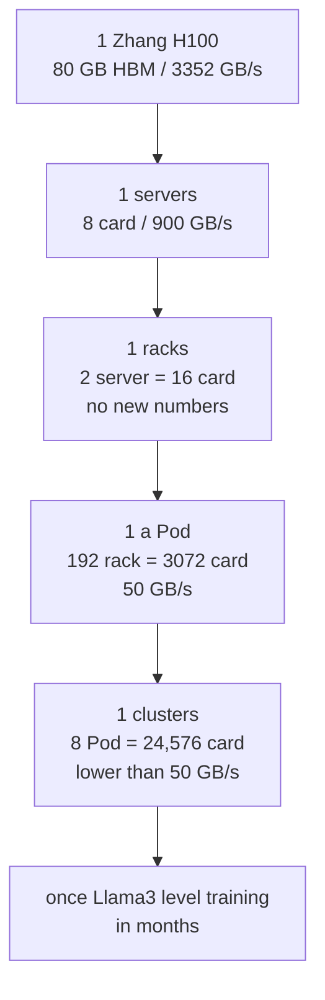
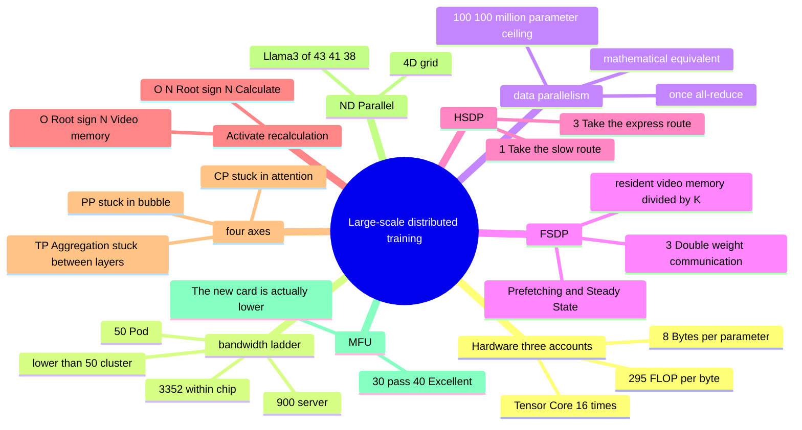

> **Course information**
>
> - **Course name**: Stanford CS231n: Deep Learning for Computer Vision(Spring 2025)
> - **This module covers**: Lecture 11. Large Scale Distributed Training (single lecture module, 148 slides)
> - **Lecturer (each lecture)**: Justin Johnson
> - **Teaching date range**: 2025-05-06
> - **Course homepage**: [cs231n.stanford.edu/2025](https://cs231n.stanford.edu/2025/schedule.html)
> - **Official courseware**: [lecture_11.pdf](https://cs231n.stanford.edu/slides/2025/lecture_11.pdf) (148 pages, page-by-page illustrations in the book)
> - **Subtitle source**: [cs231n_sp25_kor_sub · eng](https://github.com/lpaiu-cs/cs231n_sp25_kor_sub/tree/main/eng) (Publicly transcribed in English, Chinese rewritten by this book)
> - **Copyright statement**: The copyright of the slides and course materials belongs to Stanford University and the instructors; this book is an unofficial study note and is only used for study and research.

This lecture will answer a question: How should training continue when the parameters, gradients, optimizer states, and intermediate activations of a network add up to more than the capacity of any single graphics card? The answer is not "buy more cards", but split a gradient update into thousands of copies, and ensure that the number calculated after the split is the same number as the number calculated on a single card. The first few lectures focused on what the model can represent - the previous lecture dealt with video input with a time dimension, and no matter how large the model was, it still fit in the video memory of a card; starting from this lecture, the model itself became the size of the cluster, and the problem changed from "how to design the network" to "how to calculate the network."

This is the first time in the book that we leave the "model" and look at the "machine". The lecturer's reference selection is very practical: Llama3-405B is not the strongest model, but it is one of the few industrial-grade samples that has the cluster scale, parallel recipe, and throughput figures written into the paper, and can be checked item by item. The structure of the entire lecture is therefore divided into two halves: first, look at the physical parameters of a card and a computer room, and then put a price on each parallel strategy on this parameter table. This book compresses these two halves into two through lines——**Display account** (Where should a byte be placed and how many copies should be placed) and **Communication account** (How many bytes need to be moved in one synchronization, which line should be taken, and whether it can be hidden behind the calculation). Each subsequent parallelism is just a way of balancing the two accounts.

## 1. Three ledgers: Tensor Core gives the computing power, and the storage level gives the upper limit.

*(Reference time: 00:00:05 – 00:14:39｜Lecture 11)*

There are only two schedules on the second page, midterm review on Friday, May 9th and class midterm on Tuesday, May 13th. The lecturer did not expand it. The amount of information on this page lies in its location: this lecture is ranked before the midterm, and it tests judgment rather than derivation - given the model size, number of cards, and sequence length, can you tell which kind of parallelism should be opened and which account the cost falls on.

A cutscene page with only a title. It limits the next fifty minutes to one topic, and the footer line Stanford CS231n 10th Anniversary incidentally explains the time coordinate of this course: Ten years ago, "training a model on one card" was still the default approach.

Two pieces of material are juxtaposed on the page. On the left are the original words of the GPT-4 technical report: Considering the competitive landscape and the security impact of large models, the report no longer discloses the architecture (including model size), hardware, training computing power, data construction and training methods. On the right is Llama3, a model open sourced by Meta in April 2024. The paper separates the model and training details, especially the system infrastructure part. The reason why the lecturer uses it as a running example is very straightforward: if you want to know how today's large models are trained, you need a sample that can check the ledger; Llama4, which will be released in April 2025, only has an initial model and no papers, so it is temporarily unable to take on this role.

The separator page splits the lecture in half: a photo of the H100 board on the left represents the hardware, and a photo of the cabinet on the right represents the algorithm, with the title GPUs and How to Train On Them. This layout will appear repeatedly during the lecture, with half of it lighting up each time, which is equivalent to a progress bar.

When the same page is frozen for the second time, there is only one change: the right half and the line "How to train on lots of GPUs" are pressed into a gray background. There is no new text, but the semantics are clear - for the rest of this period, just look at the card itself. The following six pages are a layer-by-layer enlargement of this board.

GPU is Graphics Processing Unit, born for graphics and now a general-purpose parallel processor. This photo can directly read the physical layout: the square in the middle is the computing core, and a circle of small dark squares around it is the video memory. The legacy left by the graphics era is that "the same instruction needs to cover a large number of pixels", which is why it can later be transformed into the structure of a general-purpose parallel processor.

There is only one more frame in this frame, enclosing the central computing core. The reason why it needs to be boxed separately is because all the subsequent figures about computing power occur in this box, and the video memory is only responsible for supplying materials. Separating "calculation" and "existence" physically is the prerequisite for understanding every subsequent bottleneck.

Notes add graphics memory: 80 GB of HBM (High Bandwidth Memory), and 3352 GB/s bandwidth between core and graphics memory. The two numbers should be read together - the capacity determines "whether the model can be put in", and the bandwidth determines "no matter how fast the calculation is, it will not be enough". The lecturer's statement is that it can move about 3 TB per second. This speed sounds great, but it makes sense when compared with the figure of 4096 FLOPs per cycle in the next section.

The camera moves into the core, and the picture becomes a neatly arranged small square. It looks like the core layout of a CPU, but the order of magnitude is completely different: a CPU has several to dozens of cores, and here it is one. There are also finer structures sandwiched between the blocks. Those are caches and interconnects, which determine how data travels between cores.

This frame marks 50 MB of L2 cache. It's three orders of magnitude smaller than 80 GB of video memory, but physically located next to the compute unit, with much lower latency. Put that together with 80 GB, and you get the H100's storage hierarchy: VRAM big and far away, L2 small and close. The lecturer made a self-deprecating comment here - he thought he was learning deep learning, but he was actually learning computer architecture - and this hierarchical structure is the battlefield for all subsequent performance optimizations.

The last layer of annotation gives the protagonist: 132 Streaming Multiprocessors (SM), parallel cores independent of each other. There is also a line of small text on the page that is very critical - there are actually 144 drawn on the picture, and only 132 are enabled because of yield (yield). In chip manufacturing, this is called hierarchical shipment: it is impossible for all 144 units in a whole chip to be intact. The manufacturer sets the shipment according to "at least 132 units can be used", thereby selling most of the wafers. This detail usually does not affect writing code, but it explains why paper specifications always have to be discounted a little.

Zoom one more level into a single SM. The analogy the slide gives is "kind of like a CPU core with vector instructions." This analogy needs to be remembered on both sides: it can process more data (vectors, matrices) simultaneously than a CPU core, but has a slower clock and much weaker branch prediction capabilities, so it doesn't make sense to compare it to a CPU core one-to-one; it's more accurate to think of it as "a small shop willing to do a lot of repetitive arithmetic."

This frame complements the SM's internal storage: 256 KB of L1 cache and 256 KB of register file. There are three tiers of storage here - 256 KB L1, 50 MB L2, and 80 GB HBM. The closer the computing power is, the smaller and faster it is. This rule is the same in GPU as in CPU; people who write high-performance kernels spend a lot of time on "the timing of data transfer between three levels" rather than on arithmetic itself.

Next comes the arithmetic unit: 128 FP32 cores, each doing one per clock cycle  $a\cdot x+b$, one multiplication and one addition calculates 2 floating point operations, so the entire SM outputs per cycle on FP32  $128\times2=256$  FLOP. Remember this number, it is the reference for the next frame.

The last frame is the 4 Tensor Cores marked in red. The lecturer thinks that the name is a bit misleading, they are actually "matrix kernels": they do only one thing, fixed-size matrix multiplication and addition. Each Tensor Core is counted once per cycle  $[16\times4]\cdot[4\times8]+[16\times8]$, one floating-point operation is calculated for each multiplication and each addition.  $16\times4\times8\times2=1024$  FLOPs; the four combined are 4096 FLOPs/cycle, exactly 16 times the FP32 path.

Putting these two paths side by side, the first conclusion of the whole lecture comes out: **Almost all of this chip’s throughput comes from that 16x**, so if you want the GPU to run full, the calculation must be done as matrix multiplication and fall on Tensor Core. There is another pitfall that is very easy to step on in engineering - Tensor Core does mixed precision, inputs 16 bits and accumulates 32 bits; if you forget to convert the model to 16 bits in PyTorch, the calculation will fall back to the FP32 core, and the actual measurement can be as slow as one twentieth. This is "the easiest thing to regard as a detail and the easiest thing to overturn in a real project".

| Two arithmetic paths for an SM | Things to do every cycle | FLOPs per cycle | Relative to FP32 |
| --- | --- | --- | --- |
| 128 FP32 cores | Once per core  $a\cdot x+b$ | 256 | 1× |
| 4 Tensor Cores | every time  $[16\times4]\cdot[4\times8]+[16\times8]$ | 4096 | 16× |
| Whole block SM (16-bit matrix times peak) | 4 Tensor Cores in parallel, 4096 FLOP/cycle | 4096 | 16× |

The horizontal axis is time (2012 to 2025), and the vertical axis is the peak throughput of a single device, with the blue line FP32 and the green line Tensor Core. Several points are worth looking at one by one: the K40 in 2013 only had 5 TFLOP/s; the P100 around 2016 was 10.6; the V100 was 15.7 FP32 plus 125 Tensor Core——**V100 is the first card to introduce Tensor Core, and the green line only appears from here**; A100 is 19.5 vs. 312; H100 is 67 vs. 989; B200 in 2025 is 83.3 vs. 5000. The reading is more important than the numbers: the blue line has only increased about 16 times in twelve years, the green line has increased 40 times, and the green line is the real throughput. The lecturer used K40 during his PhD. He said: the weight, size and feel of the two cards are almost the same in the hand, but the speed difference is 1000 times.

This frame adds a line of notes to the picture: 1000 times faster than in 2013. The lecturer gave a judgment criterion - anything that changes 1,000 times in ten years is worthy of stopping and taking it seriously, because it will definitely change the boundaries of technical capabilities. He calls this the main reason for the progress of deep learning in the past ten years: it is not that the algorithm suddenly becomes smarter, but that there is a sudden increase in computing power by three orders of magnitude that can be eaten up.

The second frame adds another sentence: we can also use more than one GPU. This sentence connects the story of the single card curve to the cluster - if 1000 times a single card is enough to explain the past ten years, then stacking thousands of such cards is the real source of scale for these models today. The next chapter will go from "a card" to "a data center".

### 1.1 The accounting standards of the three books of accounts

The hardware parameters are here, but the parameters themselves are not the conclusion, the ratio between the parameters is. Each subsequent section of this module calculates three accounts, and the caliber is determined first - the first two accounts (video memory, communication) are the main lines, and the third account (computing power) is the exchange rate used to price the first two accounts:

- **Display account**: How many numbers does a parameter occupy during training? At 16-bit precision, there are a total of 4 numbers, 2 bytes each, for the weight, gradient, and Adam's two second-order moments, that is  $M_{\text{param}}=8\Psi$; If you save another exponential moving average of parameters, it will be 5 numbers, and the same account will be multiplied by  $10/8$. Activate another book, the magnitude is  $B\cdot S\cdot D\cdot L$  Multiply a constant associated with the operator.
- **Computing power account**: One time forward plus backward approximation  $6\Psi N$  FLOP (forward 2, reverse 4, calculated per parameter per token), divided by the device peak value is the theoretical time. The H100's 989.4 TFLOP/s is a 16-bit matrix multiplication aperture, while its FP32 only has 67 TFLOP/s, a difference of 14.8 times -**Every judgment of "whether this calculation can be counted on Tensor Core" must be discounted using this ratio.**.
- **Communication account**: Divide the number of bytes to be moved in a certain synchronization step by the bandwidth of that link. It is always meaningful compared with the computing power account: whether communication can be covered by computing, just look at  $T_{\text{comm}}/T_{\text{compute}}$  This ratio.

By the way, a checkable backend is made: 132 SMs each have 4096 FLOP/cycle, totaling 540,672 FLOP/cycle; divided by 989.4 TFLOP/s, an effective clock of approximately 1.83 GHz is obtained. This book works backwards from the slide numbers, assuming that all SMs are fully loaded and the clock is constant - this magnitude is consistent with the public H100 specifications, indicating that the numbers on the page are self-consistent with each other.

There is also a ratio that is used throughout the lecture: 989.4 TFLOP/s divided by 3352 GB/s, which is approximately  **295 FLOP/byte**. This means that every time 1 byte is moved from the display memory to the computing unit, nearly 300 floating point operations must be performed for the Tensor Core to be considered idle. The arithmetic density of matrix multiplication is  $O(N)$($N\times N$  multiply  $N\times N$  is  $O(N^3)$  Operation  $O(N^2)$  data), so it is well fed; the arithmetic density of element-wise operations (activation, residual, LayerNorm) is constant level, and is destined to run on the FP32 core and is bandwidth-limited. Putting the same ratio at the cluster scale, it becomes "can communication be covered by computation?" - that is a recurring theme after Chapter 5.

## 2. Five-level bandwidth ladder: 3352 → 900 → 50 → \<50 GB/s

*(Reference time: 00:15:08 – 00:26:10｜Lecture 11)*

Start from this picture and work your way up. The first layer is an H100: 3352 GB/s from video memory to computing unit. This is the fastest connection in the entire system and the only connection with "enough bandwidth to feed Tensor Core". Each time you go up a level, this number will drop, and how much it drops directly determines which kind of parallelism can be placed at which level.

The second tier is a GPU server: almost all GPU servers come in 8-card boxes, with about 900 GB/s between any two cards. Compared to the 3352 GB/s on the card, this is a drop of about 3.7 times. This "only 3.7 times drop" is critical - it means that it is cost-effective to do parallelism that requires frequent exchange of weights (later FSDP, tensor parallelism) within 8 cards.

The third level is the rack: the Llama3 cluster crams two 8-card servers into a rack, for a total of 16 cards. The page doesn't give new bandwidth numbers at the rack level, just the fact that there are 16 cards - the first magnitude difference won't wait until the next level.

The fourth level is Pod: 192 racks connected, 3072 cards, about 50 GB/s between any two cards. Compared to the 900 GB/s in the server, this is another 18 times drop. Physically this is a room that you can walk into, and there should be passages between racks for people to walk through - this is why Pod is a real architectural unit, not a logical concept.

The fifth level is a complete cluster: 8 Pods make up 24,576 cards, and the bandwidth across Pods is "less than 50 GB/s" - the lecturer could not find the exact number from the paper, but can only confirm that it is slower than within the Pod. This ambiguity is precisely the point: at this level, the connection is no longer a line that can be calculated, but a network that needs to be routed. The Llama3 cluster is not yet the largest in the world. Clusters of 50,000 cards and 100,000 cards already exist, but they are not public enough to be cited one by one.

| Hierarchy | scale | Inter-card bandwidth | Relatively superior | What to carry |
| --- | --- | --- | --- | --- |
| On-chip (HBM → SM) | 1 card, 80 GB | 3352 GB/s | starting point | Weight and activation of each read and write |
| server | 8 cards | 900 GB/s | ÷3.7 | Weight sharding and tensor parallelism to be exchanged at each layer |
| rack | 16 cards (2 servers) | The page does not give new numbers | — | Same level as the server, still considered "express" |
| Pod | 3072 cards (192 racks) | 50 GB/s | ÷18 | Data-parallel gradients once per iteration |
| cluster | 24,576 cards (8 Pods) | Less than 50 GB/s | Downshift again | You should only do the synchronization you "have to do" |

The way to read this picture is to ask "how many times it dropped" every step you take from top to bottom: 3352 to 900 is 3.7 times, 900 to 50 is 18 times, and you can't test it any higher. **The choice of parallel strategy is essentially to arrange the most communication-intensive part of the calculation on the layer with the highest bandwidth.**  This sentence will appear repeatedly in the form of FSDP, HSDP, and ND parallelism.

### 2.1 What kind of machine does 24,576 cards put together?

Treating 24,576 cards as a machine for accounting, we get this set of numbers: 1.875 PB of GPU memory, 415 million FP32 cores, 13 million Tensor Cores, 24.3 EFLOP/s (i.e.  $24.3\times10^{18}$). You can do a verification: $1.875\ \text{PB}\div24576\approx76\ \text{GB}$, slightly less than the 80 GB per card, the difference being the portion of each card that is reserved for the system and runtime. The instructor's attitude was "treat it like a computer": don't think that you are dealing with 24,576 cards, but that you are dealing with a machine with 24,576 cores, 1.875 PB of memory, and 24.3 EFLOP/s. This mental model directly determines how all subsequent algorithms are written - what you have to do is to arrange a schedule for this machine in which "all cores have work to do". Following this number, you can do an accounting: If this machine is fully loaded for two consecutive months (approximately  $5.2\times10^{6}$  seconds), can be delivered approx.  $24.3\times10^{18}\times5.2\times10^{6}\approx1.3\times10^{26}$  FLOP. This is an estimate derived from the book's slide numbers and "full load" assumptions, multiplied by a 30%–40% utilization discount for real training (see MFU in Chapter 7). The intuition it gives is: the amount of floating point operations consumed by a cutting-edge training today is  $10^{25}$–$10^{26}$  this interval. As for "how long does training take?", the lecturer's experience is that the longest batch of training in ten years was measured in months, and the restriction was not mainly technical - scheduling, collaboration, and personnel all had to keep up. Training that ran for more than a year at a time was extremely difficult to maintain organizationally.

The biggest rival besides GPU is Google's TPU (Tensor Processing Unit), which has been iterated to the sixth generation. The page gives the specifications of v5p: each 459 TFLOP/s (BF16), 95 GB video memory, and can form up to 8960 Pods. It is of the same order as H100. The difference lies in the way of obtaining it - TPU cannot be purchased and can only be used within Google or rented on Google Cloud. The lecturer judged by the way: The Gemini series almost certainly runs on TPU, but the official does not say so.

The page also lists two companies: AMD's MI325X, 1300 TFLOP/s (BF16), 256 GB video memory; AWS's Trainium2, 667 TFLOP/s (BF16), 96 GB video memory, installed in a set of 64 UltraServers. The parameters on paper are not weak. The lecturer’s judgment is that NVIDIA and TPU are still far ahead in terms of ecology and usability, and the others are catching up. The component of this paragraph is not in the parameter table, but as a reminder: the abstraction layer of the parallel algorithm (all-reduce, broadcast, sharding) must be designed to be independent of the specific chip, otherwise it will have to be rewritten for a new generation of hardware.

The hardware half ends here, and the separator page returns to the "two panels" form. Compared with page 6, the picture still has the board on the left and the computer room on the right dark. The only change is that the word "Today" is added to the title - semantically it means "the above are the two things to be talked about today" rather than "the hardware is finished".

The last frame is inverted: the left half fades away along with A bit about GPU hardware, and the cabinet photo on the right becomes the clear subject. So far, the "stuck" thing is over: the computing power is concentrated on the 16 times Tensor Core, and the bandwidth decreases in four levels: server, rack, Pod, and cluster. The remaining six chapters can be summarized in just one sentence——**How to make these thousands of cards work at the same time, and do the same thing.**

## 3. Four axes with one all-reduce: data parallelism is mathematically free

*(Reference time: 00:26:12 – 00:40:53｜Lecture 11)*

The algorithm map of the entire lecture is this page: a  $L$  The layer model operates on a three-dimensional tensor of shape (Batch, Sequence, Dim), so there are exactly four tangent directions. Data Parallelism (DP) cuts batches, Context Parallelism (CP) cuts sequences, Pipeline Parallelism (PP) cuts layers, and Tensor Parallelism (TP) cuts feature dimensions. The four names sound different, but when placed in this picture, there is only one sentence: **They are cutting the same three-dimensional tensor plus a layer axis, so this list is complete**——There is no fifth direction, only the combination of these four.

This frame is textually identical to the previous frame and is the second freeze frame of the animation. Its function is not to provide new information, but to make these four abbreviations present: the following 114, 126, 134, and 144 will return to this overview page repeatedly, and each time a parallel is finished, it will come back and light up a grid - it is the progress bar of the whole lecture.

### 3.1 From average loss to one-time all-reduce

The starting point is a fact that everyone is familiar with: mini-batch losses are usually  $N$  average the samples. This sentence is an "implementation detail" on a single card, but it becomes the basis for segmentation in distributed systems - because averaging and summing are both linear.

The idea is very straightforward: if you can put it on a card  $N$  I have a sample on hand  $M$  If you have a card, use it  $M\times N$  A large batch of , each card is assigned  $N$ . There is only one question left: the gradient calculated in this way, and running on a card  $MN$  Are the gradients of the two samples the same thing?

The answer is the same. Write the loss of large batch as

$$
L=\frac{1}{MN}\sum_{i=1}^{M}\sum_{j=1}^{N}\ell\left(x_{i,j},W\right)
$$

Yes  $W$  Taking the derivative and changing the order of summation, we get

$$
\frac{\partial L}{\partial W}=\frac{1}{M}\sum_{i=1}^{M}\left(\frac{1}{N}\sum_{j=1}^{N}\frac{\partial \ell\left(x_{i,j},W\right)}{\partial W}\right)
$$

The item in brackets happens to be "on a certain card." $N$  Do a normal backward" on each sample. **Because the gradient is linear to the sample, the order of summation and averaging can be changed at will.**, so this is not an approximation, it is the same number. The lecturer called this step "a little clever algebra", and the legitimacy of the entire data parallelism is based on this line of algebra.

So the inner layer does not need any communication: each card is in its own  $N$  Go forward and reverse on each sample to get a local gradient. This part is "true parallel", the cards have nothing to do with each other, and no synchronization is required - the 900 GB/s line between the GPUs is completely idle during this time.

The rest is the outer one  $\frac{1}{M}\sum$: Average the local gradients of all cards. This communication is the entire cost of data parallelism—an all-reduce. **Other than that, DP does not change any mathematics**: The semantics of learning rate, momentum, and weight decay are consistent with those of a single card, which is why it can become the default solution.

### 3.2 Six-step execution, and the overlap between the fourth and fifth steps

Landing on the device, the first step is for each card to save a complete copy of the model weights, optimizer state and gradient buffer. The instructor specifically explained that "only 3 cards are shown in the picture because the layout can accommodate them, and the real number is much greater than 3." This step also determines the ceiling of DP: the entire set of parameters, gradients and optimizer states must be accommodated in the video memory.

The second step is to load the data separately: GPU 1 takes  $x_{1,\cdot}$, GPU 2 takes  $x_{2,\cdot}$, GPU 3 takes  $x_{3,\cdot}$. The lecturer inserted a real bug story here: his and the student's code accidentally caused all cards to load the same batch of data - the training would not report an error, it would just run in vain, and it was extremely difficult to see from the loss curve. **"The data of each card must be different" is the first correctness condition of DP**, it's more worth checking first than any performance issue.

The third step is to move forward individually and obtain local losses.  $L_1,L_2,L_3$. This step has zero communication and zero dependence, and the three cards can complete their forward motion completely asynchronously.

The fourth step is to reverse each direction to obtain the local gradient of the four weight matrices.  $\partial L_i/\partial W_1 \dots \partial L_i/\partial W_4$. Also zero communication: each card has a complete copy of the weights, so it can calculate the gradient of the entire link locally.

The fifth step is communication: all-reduce. It does two things at the same time - each card sends out its own gradient, and collects the gradients of all cards at the same time. In implementation it is usually  $O(\log M)$  Finished within a wheel (ring or tree shape) instead of  $M$  Round point-to-point; after this step, each card has exactly the same average gradient for the entire macro-batch.

Step 6: Each card updates its own weight with the same gradient. Because the starting point is the same and the gradient is the same, the updated weights are also the same (provided that it is determined arithmetic). This step is zero communication again - the price was paid in step five.

The real engineering gist is in this frame: steps 4 (reverse) and 5 (communication) can be parallelized. Backpropagation is pushed forward from the last layer. Once the gradient of the last layer is calculated, you can perform all-reduce on the last layer while continuing to calculate the reverse direction of the penultimate layer. The deeper the layer, the greater the space for "communication hidden behind calculations". Ideally, the gradients have been summarized when the reverse calculation is completed, and there is no need to wait for weight updates.

But it's not free. When the lecturer was asked "Whether step 4 or step 5 will become the bottleneck", the answer was "it depends" - it depends on how fast the device is, how big the model is, how big the mini-batch is, and how fast the interconnection between cards is. **In large-scale training, the answer to almost all questions is "test it on your cluster."**, this sentence is worth remembering as a methodology. There is also an asymmetry at the implementation level: inside a single card, many asynchronous copies of CUDA are automatically scheduled by the hardware; at the cluster level, no hardware will arrange such a schedule for you, and the overlap of communication and calculation must be explicitly orchestrated by the software - PyTorch  `DistributedDataParallel`  It’s the layer that encapsulates this arrangement.

### 3.3 Why not use asynchronous SGD: the boundary between local and global

Someone in class asked a natural rhetorical question: Since communication is so expensive, why not just let each card take a few steps and sync it occasionally? The lecturer said that this road has really been walked by some people, and it is called asynchronous SGD (asynchronous SGD): maintaining multiple copies of the model, updating each independently, and averaging once every other time. Google had used this set before developing its own TPU Pod, and some networks in the early 2010s were trained this way. Its problem is not theoretical, but engineering: training is more unstable, debugging and reproduction are extremely difficult, and the final effect is usually a little worse. So as long as the synchronization solution works, everyone still chooses synchronization——**Because synchronization allows the whole thing to be reasoned about and reproduced**. The lecturer also left an open judgment: as the cluster continues to grow larger, "no one machine can have a God's perspective on the whole situation" will become more and more prominent, and asynchronous methods may come back in new forms.

There is another conceptual distinction that is easily overlooked: during backpropagation, each card only needs its own "local upstream gradient" to calculate, but to get the "global upstream gradient" it must communicate. The two look the same in the code, but they are two different things in the distribution -**All all-reduce is changing "local" into "global", and each conversion requires bandwidth.**

### 3.4 Ceiling of this path: 8 bytes per parameter

DP cuts the data very cleanly, but the weights are copied rather than divided, so the model size is locked by the single-card graphics memory. The page calculates the account very carefully: each weight requires four numbers - the weight itself, its gradient, and Adam's two second-order moments.  $\beta_1,\beta_2$; 2 bytes per number at 16-bit precision, totaling 8 bytes/parameter. So 1 billion parameters requires 8 GB, and 10 billion parameters requires 80 GB - exactly the entire video memory of an H100. That is, the upper limit of pure DP is about 10 billion parameters, and the target model is one to two orders of magnitude larger than that: 405 billion parameters is 3.24 TB at this caliber.

The solution given on the page is only one line: cut the model weights to multiple cards. This line is all about the next chapter - it changes "copy" to "sharding" at the cost of going from "one all-reduce" to "two broadcasts plus one gradient summary per layer". Note the change in nature of this step: DP cuts the data, and the model is complete on each device; starting from the next chapter, the model itself begins to be cut.

### 3.5 The first line of the communication account: $P/(3\beta N)$

It is now time to do the first accounting of the DP's correspondence. In an all-reduce, each card moves approximately  $2\Psi$  Bytes ($\Psi$  is the number of parameters, 16 bits); the calculation amount of one iteration is approximately  $6\Psi N$ FLOP, $N$  It is the number of tokens assigned to this card. Divide two equations, parameter quantity  $\Psi$  be eliminated:

$$
\frac{T_{\text{comm}}}{T_{\text{compute}}}=\frac{2\Psi/\beta}{6\Psi N/P}=\frac{P}{3\beta N}
$$

This result is worth a pause: **The communication overhead of DP has nothing to do with the model size, but only depends on the "number of tokens per card" and the machine's  $P/\beta$  Than**. H100 at 900 GB/s  $P/(3\beta)\approx366$  tokens; switching to 50 GB/s across Pods, the same ratio becomes about 6,600 tokens. Substitute several batches according to this caliber:

| Number of tokens per card  $N$ | Communications/Compute at 900 GB/s | Communications/Compute at 50 GB/s |
| --- | --- | --- |
| 2,048 | about 18% | about 322% |
| 8,192 | About 4.5% | about 80% |
| 32,768 | About 1.1% | about 20% |
| 262,144 | About 0.14% | about 2.5% |

This table is an order of magnitude estimate based on the slide numbers in this book (assuming full bandwidth, no latency, all-reduce per card  $2\Psi$  Bytes), not actual measurement. Its usage is to answer "Which level should this communication be placed at?": The same synchronization only takes a few percentage points on the fast line, but can exceed the calculation itself on the slow line. **This is why HSDP needs to put 3 times the traffic into the server and 1 times the traffic across Pods.**  The 0.14% in the last row of the table also explains a counter-intuitive phenomenon: Llama3's global batch of 16 million tokens, looking at bandwidth alone, cross-pod all-reduce only accounts for 2.5% - what makes FSDP expensive in real systems are layer-by-layer small messages, startup delays and "must be equal" synchronization, not the lower limit of this equation.

## 4. ZeRO and FSDP: three weight-level communications per layer, in exchange for 1/K of resident video memory

*(Reference time: 00:41:03 – 00:48:50｜Lecture 11)*

Let me first explain the naming: the section title of the courseware refers to this mechanism as FSPD, while the text page, summary page and ZeRO paper are all written as FSDP (Fully Sharded Data Parallelism). This book uses FSDP uniformly.

The starting point of FSDP is to convert each weight matrix  $W_i$  Assigned to an "owner" card that is responsible for the global gradient and optimizer state of this weight. The granularity of segmentation is a layer rather than a single scalar - what you manage is a "weight matrix of a certain layer", not a number. The picture shows a 2-card, 4-layer network: GPU 1 has  $W_1,W_2$, GPU 2 has  $W_3,W_4$. After this step, the resident video memory of each card is reduced from "full set weight" to "$1/M$  Set weight plus its gradient and optimizer state".

But after the weights are cut, the forward direction cannot be calculated directly: the calculation of the first layer requires a complete  $W_1$, and only GPU 1 has it in hand. So step 1 is broadcast - before counting  $i$  before layer, $W_i$  The owner issues it to all cards. This step is pure communication without any calculation.

Step 2: Get all cards  $W_i$  Then each moves forward, delete the local copy immediately after the calculation, and return the video memory to the next layer. Therefore, the property of "weight sharding" is restored at the end of each layer: at any time, each card only has the complete weight of the current layer (and the next layer in prefetch), and the remaining layers only have the piece it owns.

This frame adds a key optimization to the entire solution: prefetching. Since it needs to be deleted at the end of step 2, what about the next step?  $i$  You can layer it at the same time  $W_{i+1}$  Pull over - Green Fetch  $W_{i+1}$ while computing forward with $W_i$  That's it. Without this step, each layer would have to stop and wait for a broadcast. The deeper the network, the greater the waste; with it, communication is stuffed into the calculation time of the previous layer.

In this frame you can see prefetching in progress: GPU 1  $W_1,W_2$  It’s already solid (calculated), $W_3$  It's a light-colored block being pulled from GPU 2 by the red arrow. $W_4$  Still gray (not picked up yet). The list on the left still stops at items 1 and 2, indicating that it shows "the same two-step process repeated layer by layer" rather than a new mechanism.

051 is the next frame of this animation. There is no addition of text, and the diagram on the right continues to move forward. What it wants to convey is actually already written in the list: steps 1 and 2 will be repeated exactly on each layer, so **The forward communication volume is equal to "the entire set of weights is completely broadcast once"**——The weight of each layer must undergo a transfer from the owner to the owner.

052 is the last freeze-frame of the same animation, and there is also no new text. Looking at the three frames together, it is not about a new mechanism but a rhythm: as long as the weights are fragmented, each layer must be taken first, calculated and then thrown away. The more layers, the longer the pipeline, and the more communications that prefetching can cover.

After the reverse starts, the same process has to be repeated: count the  $i$  Before the reverse of the layer, $W_i$  The owner of broadcasts again. This time the broadcast reuses the same weight, but it has been deleted at the end of the forward direction, so it must be retransmitted. At this point, the FSDP communication account already has 2 weights (once for forward and once for reverse).

The first optimization is given in the upper right corner of the page: do not delete the weight of the last layer at the end of the forward direction. Because all the cards have just received it and will use it in the reverse direction immediately, it is a waste to delete it and then upload it again. This optimization only saves "one layer" of communication traffic, but it is zero cost and will be done in practice.

Step 4: Use this weight to calculate the ranking of each card.  $i$  The reverse of the layer, get your own part of the  $\mathrm{d}L/\mathrm{d}W_i$, and then delete the weights. Note that the gradient generated here is "local" - it only reflects the card's  $N$  samples.

Step 5: Each card sends the local gradient to the owner and deletes it locally. This is different from DP's all-reduce: DP is "everyone needs a global gradient", FSDP is "only the owner needs the global gradient" - each card only needs to send the gradient back to the owner, and does not need to broadcast to everyone. **The direction of communication has changed, and the traffic has also changed.**: This is a reduce-scatter instead of an all-reduce.

Step 6: The owner accumulates the received local gradients into complete gradients and updates them in place  $W_i$. There is no need to broadcast again after the update - it will be used naturally next time forward, and then it needs to be sent out.

Starting from this frame, the page demonstrates the "steady state of the reverse phase". Green annotations mark how three things overlap: Count  $W_{i-1}$  When in reverse direction, the  $W_{i+1}$  weight, summarize and update  $W_i$. So at any time, there are three levels moving on the assembly line at the same time.

There is a red mark on the right side of this frame  $\partial L_1/\partial W_4$  with  $\partial L_2/\partial W_4$: Both local gradients of the last layer have arrived at the owner GPU 2 and are being synthesized into the global gradient. You can see that the gradient is gradually accumulated by "layer", starting from the last layer forward.

One frame further forward, $\partial L/\partial W_3$  Came in too. A rule can be seen here: every time a layer is advanced in the reverse direction, the gradient of one layer is summarized and a weight update is triggered, while at the same time the weight of the next layer is being prefetched - the three things are strictly staggered by one layer.

This frame writes the steady state into three lines, which is also the summary of the whole page: All at the same time——Send  $W_3$  gradient and update  $W_3$, use  $W_2$  Run reverse, prefetch  $W_1$. The lecturer's description of this paragraph is "In a very deep network, these three things are always happening at the same time in the steady state."

062 and 063 respectively complete the gradient panels on the two devices: GPU 1 and GPU 2 each collect four layers of local gradients. At this point, a complete FSDP iteration is closed.

Comparing the two pictures, you can see the structural difference between FSDP and DP: in DP, each card has four complete gradients, while in FSDP, only its own copy is "complete", and the rest are parts sent by others.

The last frame adds the data side: replace the next batch of data and repeat the entire process; and the data loading is completed asynchronously during this round of forward and reverse (usually running on the server CPU). The lecturer calls this type of system a "parallelized machine" - GPUs must overlap internally, GPUs must overlap, and data loading must also overlap. There is only one goal: **Keep Tensor Cores as free of idle cycles as possible.**

### 4.1 FSDP account: video memory divided by K, communication multiplied by 3

By folding the above process into two accounts, the benefits and costs of FSDP are clear at a glance.

The memory account is clean: the resident part is from  $8\Psi$  down to  $8\Psi/K$($K$  is the number of shards, that is, the number of cards in the group), plus activation. The cost is a small constant - you must have the complete weight of the "current layer" in hand at any time, as well as the "next layer" in prefetch, so the peak value is  $8\Psi/K + 2\times 2\Psi_{\text{layer}}$  this magnitude. This is why the benefits of FSDP are only obvious on large models: the more layers and thinner the single layer, the smaller the proportion of "temporary complete weight". The communication account has three weights: one forward broadcast  $\Psi$, reverse broadcast once  $\Psi$, reversely send the local gradient back to the owner once  $\Psi$, a total of about  $3\Psi$  bytes/iteration. Compare DP's  $2\Psi$, FSDP is only 1.5 times more expensive, but reduces the resident video memory to  $1/K$——**This exchange ratio is the entire reason for this chapter's existence**. But it has a weakness that DP does not have: this  $3\Psi$  Not one big transfer in one piece, but cut into  $L$  Each small message is triggered layer by layer, and there is a synchronization point in the middle that "must wait until this layer is complete before it can be counted." The smaller the message and the higher the number of layers, the higher the proportion of startup latency and pipeline jitter. This is why the table in Chapter 3 has another discount on FSDP: **The bandwidth account is only the lower limit, and the delay account is the real enemy after hundreds of cards.**

## 5. HSDP and the second wall: 3 times the traffic on the fast line, 1 times the traffic on the slow line

*(Reference time: 00:48:56 – 00:53:22｜Lecture 11)*

FSDP can already train large models, but its communication volume is proportional to the number of cards. After expanding to hundreds of cards, communication begins to overwhelm computing. HSDP (Hybrid Sharded Data Parallelism) method is to divide the card into  $M$  group, each group  $K$  Zhang: Do FSDP within the group (cut the weights into  $K$  portion), do ordinary DP between groups (save a complete weight for each group). The example given on the page is  $M=2$, $K=4$, and indicate  $K$  can arrive  $O(100)$  this magnitude.

This frame adds a key sentence: This is multidimensional parallelism -**Use two different parallel strategies simultaneously**, arrange the GPUs into a two-dimensional grid. The coordinates of each GPU in the grid  $(m,k)$  It also determines its role in two strategies: $k$  is its serial number in the FSDP group, $m$  is its group number in the DP dimension.

This page is the reason for the existence of HSDP, and it is also the most practical account in the whole lecture: FSDP within a group requires three weight-level communications (one forward, two reverse - once for weight and gradient), and only one DP between groups (gradient all-reduce). Since you have to pay 3 times the amount within the group, you should put it on the fastest layer - the same server or the same Pod; it is acceptable for the line between groups to be slower because it only happens once.

This line of reasoning connects the bandwidth ladder from Chapter 2 directly to the algorithm here: **It's not "which kind of parallelism is faster", but "which kind of communication should be placed on which level of line".**  If 900 GB/s in the server accepts 3 times the traffic, and if less than 50 GB/s crosses the Pod, it only accepts 1 times the traffic, the account will be even. Take the one from Chapter 3  $P/(3\beta N)$  Reading the table upside down leads to the same conclusion: the 50 GB/s line is only worthy of "one" synchronization.

Looking at DP, FSDP, and HSDP together, the benefits are in magnitude: the account of 1 billion parameters has just been calculated (8 GB), here it is replaced by 100 billion parameters - 8 bytes/parameter requires 800 GB, which cannot be installed on one card, but if it is cut to 80 cards, it will be 10 GB per card. **The constraint "the model cannot fit into a card" is no longer valid from this page.**

But after the weights are solved, the second bottleneck immediately comes up: the activation value. The page calculated an account using Llama3-405B: 126 layers, model dimensions  $D=16384$, sequence length 4096, only the activation of the FFN hidden layer is  $2\times126\times(4\times16384)\times4096$  Bytes ≈ 63 GB. Take it apart and look at this formula: 2 is the number of bytes of 16 bits, $4D=65536$  is the middle width of FFN, 4096 is the sequence length, 126 is the number of layers——**This is the amount that a sample takes up in one forward direction.**, not counting attention and other intermediate results, nor multiplying the batch per card. This is the half other than the weight in the second account (video storage account): the parameters are static, the activation is dynamic, and they expand linearly with the length of the batch and sequence. The weight can be amortized using sharding, but the activation must actually exist for the "layer being calculated" - unless you don't save it.

The solution on the page is another line: Do not store all activations in the video memory, and recalculate when needed. This sentence sounds like the cliche of "exchanging time for space", but the curve it produces is very beautiful - the next chapter will figure it out: video memory from  $O(N)$  fall to  $O(\sqrt N)$, calculated from  $O(N)$  rise to  $O(N\sqrt N)$.

## 6. Activate recalculation: replace O(N) video memory with O(√N) at a cost of O(N√N) calculation

*(Reference time: 00:53:27 – 00:55:50｜Lecture 11)*

To settle this account, first look at the network from a different perspective: each layer is actually two functions. Forward position  $i$  The activation of the layer becomes the  $i+1$  layer activation, $A_{i+1}=F_i^{\rightarrow}(A_i)$;Reversely take the upstream gradient and the activation of this layer to calculate the gradient of this layer, $G_i=F_i^{\leftarrow}(A_i,G_{i+1})$.**The key is to have both in the reverse input  $A_i$  and  $G_{i+1}$**——This is why ordinary training must retain the activation of each layer. left column  $A$  It is the product of the forward direction, the column on the right  $G$  It is the product of the reverse, and the staggered relationship between the two columns determines the memory curve.

The page asks a question that can be calculated by hand: if each  $F^{\rightarrow}$  with  $F^{\leftarrow}$  All  $O(1)$  The calculated sum of  $O(1)$  How much does it cost to perform a complete forward and reverse operation of video memory? In order to be able to count clearly, using a 4-layer network as an example, two counters are given in the upper right corner of the page: Current Memory and Peak Memory.

### 6.1 No recalculation: the peak value is exactly equal to the number of layers

The first forward end, $A_1$  After landing, the current video memory is 1, and the peak value is also 1. The counter starts running.

The second level is finished. $A_2$  Also keep it, the current video memory becomes 2, and the peak value rises to 2. It can be seen that under the naive approach, "current" and "peak" are the same number - because it only increases but does not decrease.

The third level is calculated, current 3, peak 3. The rule is already clear here: for each additional layer, an additional activation is stored, and the peak value is equal to the number of layers.

All four floors are completed forward, $A_1$  Arrive  $A_4$  All in video memory, current 4, peak 4. Yes  $N$  layer network, which is  $O(N)$  Video RAM – also where the 63 GB at the end of Chapter 5 comes from.

Nothing changes in the frame before the reverse starts: current is still 4, peak is still 4. The function of this frame is to nail the concept of "peak value" - all subsequent optimizations only suppress the peak value, not the average.

The reverse direction starts from the last layer. Finished  $G_4$  after  $A_4$  It is useless, delete it, and the current video memory drops back to 3; but the peak value is already recorded at 4 and will not drop.

Moving on, current 2, peak 4. The curve begins to decrease monotonically, but the peak value does not move.

The reverse direction ends, and there is currently only 1 left, and the peak is still 4. The conclusion of these four frames can be summarized in one sentence: **The time for simple training is  $O(N)$, the memory peak is also  $O(N)$, and the peak value appears at the moment when the forward direction just ends.**

The page writes the conclusion on the right: Forward+backward Yes  $O(N)$  calculation, $O(N)$  video memory. There is no new mechanism here, it just changes "why the video memory is not enough" from a feeling to a formula.

The real idea is in the last line: Idea - recalculate activation during the reverse process. Since  $A_i$  Can be obtained from  $A_{i-1}$  Calculate it again, then don’t save it and calculate it when you use it. The cost is also clear: more calculations. The following fourteen accounting frames count how much this "more" is.

### 6.2 Full recalculation: video memory dropped to constant, calculation increased to square

The second round of demonstration changed the strategy: go forward to level 1 and get  $A_1$  It is discarded immediately, and only a count of the "starting point" state is retained. Current 1, Peak 1.

The second layer is processed in the same way, and the video memory does not increase. This is what "no memory activation" means literally: the memory curve is squeezed to 1.

Frame 3, the count is still 1. This round has exposed the shape of the cost: every time you want to use activation, you have to start from the nearest starting point and calculate forward. The closer you are to the front end of the network, the more layers you have to go through at a time——$N^2$  It just grew out of here.

After walking the entire forward direction, the peak value is still 1. Compared with the peak value of 4 in the first round, **Video memory from  $O(N)$  dropped  $O(1)$**.

But the price is immediately apparent: now I only have the activation of the last layer in my hand. To calculate the reverse of the third layer, I have to first activate it.  $A_3$  Calculate it again.

Recalculation begins and the counter increases from 1 to 2. Note that the peak value has also changed from 1 to 2 - the recalculation itself also takes up a bit of video memory, and the constant has changed from 1 to 2.

This frame enters an alternating rhythm: one layer of recalculation and one layer of reverse transmission. Current 2, Peak 2.

Continue to alternate, the video memory stabilizes at 2 and no longer increases. This is exactly the desired effect: **No matter how deep the network is, the peak value does not increase with the number of layers.**

This frame the current value falls back to 1: the activation just recalculated is released after the backpropagation. The peak value is still 2.

Another round, now back to 2: This time the starting point is further forward, and you have to count several levels in succession to get the required activation.

In frame 11, the rhythm remains unchanged: one layer of recalculation, one layer of reverse pass, and one layer of release. The peak value is pinned to 2 and does not move.

Currently back to 1, another temporary activation is released after the backpass.

Current 2, the next period of recalculation begins. The further you go toward the front end, the more layers you need to recalculate at a time, but the peak value remains the same—what changes is the time.

Last release, current 1, peak 2. By the end of the entire reverse, the peak is locked at 2 instead of 4. After counting fourteen frames, there are two conclusions: video memory  $O(1)$, time  $O(N^2)$.

The page places three curves side by side. Article 1: Full recalculation. Video memory is  $O(1)$, the calculation is  $O(N^2)$——Because the first  $N$  The reverse direction of the layer needs to be recalculated  $N-1$  layer, no.  $N-1$  Layer needs to be recalculated  $N-2$  layers, which add up to  $N+(N-1)+\dots+1$.

Followed by a comment: $N^2$  calculation is unacceptable. For 126-layer Llama3, this means redoing the forward direction dozens to hundreds of times - the saved video memory is wasted because computing power becomes a new bottleneck.

### 6.3 Segmentation Checkpoint: Why the optimal point happens to be C = √N

Compromise: Each  $C$  A checkpoint is stored in each layer and is only recalculated within this segment. The number of layers between checkpoints becomes smaller, and the cost of recalculation drops from "the entire network" to "a segment of the network".

Written as a formula: $C$  checkpoint corresponding to  $O(N^2/C)$  The calculated sum of  $O(C)$  of video memory. Intuitive understanding - the length of each paragraph is about  $N/C$, the cost of intra-segment recalculation is  $(N/C)^2$, a total of  $C$  segment, total  $N^2/C$; while the resident video memory only needs to store  $C$  checkpoint.

To balance the two exponents, take  $C=\sqrt{N}$, get  $O(N\sqrt{N})$  The calculated sum of  $O(\sqrt{N})$  of video memory. This result is worth a pause: **Video memory from  $O(N)$  down to  $O(\sqrt N)$, calculated only from  $O(N)$  rise to  $O(N\sqrt N)$**.

| Strategy | Peak memory | Calculation amount | Video memory at 126 layers | Calculation at 126 layers (by level) |
| --- | --- | --- | --- | --- |
| All deposit activation | $O(N)$ | $O(N)$ | 126 servings | 1× |
| Full recalculation | $O(1)$ | $O(N^2)$ | 1 serving | About 126× |
| every  $C$  checkpoint | $O(C)$ | $O(N^2/C)$ | $C$  portion | approx.  $126^2/C$ |
| take  $C=\sqrt{N}\approx11$ | $O(\sqrt N)$ | $O(N\sqrt N)$ | Makes about 11 servings | About 11× |

The last column of the table is an estimate based on the formula in this book, not an actual measurement. It explains two things. First, activating checkpoints to "slow everything down" is not rhetorical: 126-level fetch  $C=\sqrt N$  When , the amount of forward calculation must be multiplied by approximately  $\sqrt N\approx11$  times, although the recalculation only occurs on the part of the layer required for the reverse direction, the magnitude is still there. Second, $C=\sqrt N$  It's just the theoretical optimal point under "strictly limited video memory" - in real training, video memory is only one of the constraints, and engineers often decide based on "one batch can be put down" $C$ (For example, one every 4 to 8 layers), because computing power is easier to buy than video memory. There is another boundary worth writing down (editor's note): The prerequisite for recalculation is that the same input can be reproduced forward. Otherwise, the recalculated activation will not be exactly the same as the first time, and the gradient will have a slight deviation. In practice this requires fixed randomness (random seeds for dropout, random streams for data augmentation) that are replayable per layer; this is why activation checkpointing is often discussed in conjunction with "deterministic training".

## 7. Recipe and Compass: 80% HFU vs. 30/40 MFU Threshold

*(Reference time: 00:55:53 – 01:03:03｜Lecture 11)*

At this point, I already have four tools in hand, and I can give you a recipe that can be followed directly:

- **first stage**: The model has about 1 billion parameters and the number of cards is within about 128. It can be parallelized with ordinary data and it works very well.
- **second stage**: Each card batch is always opened to the maximum value that the video memory can bear. This is almost always true.
- **The third stage**: The model exceeds 1 billion parameters, consider FSDP; further up, you will encounter the activation memory bottleneck, turn on the activation checkpoint - it will slow down the training, but it will allow you to continue to grow.
- **Stage 4**: When the number of cards reaches several hundred (more than 256 on the page), FSDP communication becomes uneconomical, so switch to HSDP.
- **The fifth stage**: Only when the number of cards exceeds a thousand, the model exceeds 50 billion parameters, and the sequence length exceeds 16K, more complex means such as CP, PP, and TP are needed. The threshold verbally given by the lecturer is "the sequence length is about 10,000", and the caliber of the page is 16K - the two numbers are almost the same, and both point to the range where the "sequence begins to dominate the video memory".

There is also a line of small print under the recipe, which is the turning point of the whole lecture: The problem is that there are too many knobs to adjust - global batch, batch per card, dimensionality of HSDP, dimensionality of FSDP, how many layers to recalculate - how to set it? The answer is to optimize a metric: Model FLOPs Utilization (MFU).

### 7.1 HFU: How much of the theoretical peak is actually realized?

The theoretical peak of the H100 at 16-bit matrix multiplication is 989.4 TFLOP/s. This number is the upper bound of "if everything is perfect", so a natural question arises: How much can you actually get? The metric that measures this is called Hardware FLOPs Utilization (HFU) - what percentage of the matrix multiplication performance you can theoretically achieve is actually achieved. The reference in the footer is the PaLM paper, and this indicator was promoted in that work.

The definition itself is very simple, but the difficulty is to measure it accurately. The instructor emphasizes that this is nothing complicated: write a few lines of PyTorch, run a loop, time it, divide it.

The benchmark test given on the page is deliberately "optimal": it only runs dense matrix multiplication and does nothing else. There is also a very practical pitfall - it must be set up  `CUDA_LAUNCH_BLOCKING=1`, otherwise the GPU kernel is started asynchronously, and the time you measure on the Python side is not the real time consumption of the kernel at all, and the number will be completely wrong. This is the most common type of error in performance measurement: **What is being measured is not what you think it is being measured.**

The horizontal axis is the matrix size (from 512 to 32000) and the vertical axis is the HFU. The curve converges to about 80% at large matrices: This shows that the simply written PyTorch matrix multiplication can achieve 80% of the theoretical peak as long as the scale is large enough. This also explains why "small batch training" is inefficient - the matrix is ​​too small, 80% will drop to a very low level, and the Tensor Core array cannot be filled.

But HFU has a fatal flaw: it only counts matrix multiplications. Real training also includes activation functions, normalization, residuals, data loading and enhancement, optimizer updates, and recalculations caused by activation checkpoints - these are not in HFU. So an indicator is needed that takes into account the "entire training cycle".

### 7.2 MFU: Five-step algorithm and 30/40 empirical line

The definition of Model FLOPs Utilization is: What proportion of the theoretical peak of the GPU is used in the "model" forward and reverse directions. The algorithm is divided into five steps:

1. Calculate a matrix multiplication FLOP of forward plus reverse according to the model structure. The reverse can be approximately 2 times the forward; ignore element-wise operations such as nonlinearity, normalization, and residual, because they run on the FP32 core.
2. Check the theoretical peak value of the device, H100 is 989 TFLOP/s.
3. Calculate theoretical time  $t_{\text{theoretical}}=\text{FLOP}_{\text{theoretical}}/\text{FLOP/s}_{\text{peak}}$.
4. The actual measurement time of a complete iteration includes data loading, forward, reverse, and optimizer updates.
5. Divide the two, $\text{MFU}=t_{\text{theoretical}}/t_{\text{actual}}$.

The page gives a measured example: a wide MLP with only ReLU, a very large batch, a single H100, and the MFU is about 49%. This number is much lower than 80% of HFU, and the difference is the overhead that is "not included in matrix multiplication" - this is exactly what MFU wants to expose. The two numbers should be remembered together: 80% is the upper limit of the hardware, and 49% is the upper limit of an ideal model with almost no communication and no recalculation. Real training will only be lower.

Therefore, there is only one objective function for parameter adjustment: adjust all adjustable knobs to the maximum MFU. The instructor's statement is "When you are lost in the ocean of GPU parallelism, MFU is your guiding light."

The experience threshold is very simple: above 30% is considered good, significantly below 30% indicates a huge bottleneck in the system, and above 40% is already a good level.

Compare with real numbers: Llama3-405B used 8000 to 16000 H100 in the final stage, and the MFU was roughly 30% to early 40% (the configuration table in Chapter 9 is 43%, 41%, 38%). The instructor said that's good enough - it's basically impossible to go much higher on the H100.

The last page is the most counter-intuitive conclusion of the entire lecture: new generations of devices often have lower MFU than the previous generation. The reason is that the computing power increases faster than the bandwidth - from A100 to H100, the theoretical computing power is about 3.1 times, and the memory bandwidth is only about 2.1 times. **The numerator rises quickly and the denominator cannot keep up, so the ratio of utilization rate naturally declines.**  This also explains why the previous generation of cards can sometimes reach more than 50%: it is not that those cards are better, but that their computing power and bandwidth are better matched, and the ledger is easier to balance.

## 8. There are three remaining axes: CP is stuck in attention, PP is stuck in bubbles, and TP is stuck in interlayer aggregation.

*(Reference time: 01:03:09 – 01:11:18｜Lecture 11)*

The lecturer confessed one thing here: the first ones (DP, FSDP, HSDP, checkpoint, MFU) are what most people will really use, because few people can encounter a cluster of 10,000 cards; the next three axes are more about "knowing that it exists and knowing what problems it solves." But they are not abstract - each corresponds to a specific communication mode and a specific performance curve, and the three failure locations are completely different: CP is stuck in attention, PP is stuck in bubbles, and TP is stuck in inter-layer aggregation.

The progress bar returns to the starting point. The focus of this round is on the remaining three squares; the instructor took the precaution first - they appear much less frequently than the previous set of combo punches, and the cost of understanding is not high, because each axis is just answering "Who does this calculation depend on?"

This frame has the same text as the previous frame, and its function is to realign the screen to "Talk about CP from scratch".

### 8.1 Context Parallelism: Only attention disobeys

Context Parallelism (CP) cuts the sequence dimension: one  $L$  Long sequences are no longer occupied by one card, but different positions are allocated to different GPUs. The page is specially marked Usually for Transformers - because all its discussions are based on the premise that "the model has a sequence axis that can be stretched very long", and when the sequence grows to hundreds of thousands of tokens, the activation of the video memory is to press  $S$  Rising linearly.

The good news is that most of the structures in Transformer are position-by-position independent of the sequence: LayerNorm and residual connections have no weights, just cut them apart, and there is no need for communication. **To judge whether an operator can be divided for free, just look at one thing: whether its output only depends on the input at the same position.**

MLP can also be cut - each token passes through the same MLP independently - but there is weight in MLP. So each card retains a complete weight, and synchronizes the gradient once in reverse, exactly the same as the DP in Chapter 3. **Therefore, the cost of CP on MLP is equal to a small DP on this layer.**

The real trouble is attention. This is also the watershed between CP and DP: the data of each card in DP is irrelevant to each other, while attention requires interaction between any two positions in the sequence - the output of the first token must be used in the output of the first token.  $S$  The key of a token.

This picture paints the difficulty very clearly. The sequence is cut into 3 segments, each segment projects its own  $Q_j,K_j,V_j$;all  $(i,j)$  All combinations are counted once  $Q_iK_j^{\top}$, so we get a  $3\times3$  block matrix  $E$——The arrangement on the picture is "column arrangement K, row arrangement Q". Then softmax is normalized along the column direction (arrow marked Sum), and then combined with  $V$  Multiply and reduce along the columns  $Y_j$.**As long as the sequence is cut, this  $3\times3$  The matrix must cross device boundaries**: Each card in hand only has its own column (or row), and it is necessary to calculate the complete  $Y_j$  Just have to see other people's blocks.

The first step is to deal with the simple parts first: QKV projection is just a linear transformation by position, which can be divided into sequences. The gradient synchronization method is consistent with DP. This step does not change the difficulty of the problem, it just takes the "easy part" out of the difficult part.

The rest is the core attention operator. The page gives two routes.

Ring Attention cuts the complete attention matrix into blocks and distributes them to each GPU, allowing them to process them in turn in the correct order: the outer loop query block, the inner loop key/value block, and the blocks are passed along the ring. After each card calculates one block, the KV is passed to the next one. It turns "all-to-all" into "relay between neighbors" and therefore scales to very long sequences; at the cost of implementation complexity - you have to order the blocks yourself and handle online normalization for softmax (a common practice for numerical stability).

Ulysses' idea is more ingenious: Since Transformer uses multi-head attention, it should be divided according to "heads" - each card is responsible for a part of the head, and the attention matrix itself is not cut. The implementation is much simpler, but the upper limit of parallelism is the number of heads: a 32-head model can be spread out on 32 cards at most, and if you want to expand it, you can only change other axes.

The actual usage is in stages: the first stage of Llama3 training has a sequence length of 8192, without using CP at all; in the second stage, the sequence is stretched to 131,072, and 16 context parallelism is enabled. Therefore, each sequence is processed collaboratively by 16 cards, and each card is responsible for 8192 positions. The lecturer added a very intuitive conversion: This is equivalent to the batch size becoming 1/16 - each card cannot even get a complete sample. **The benefit of CP is not in throughput, but in "this sequence cannot fit a card at all"**.

The contextual parallelism ends here, and the screen returns to the four-axis overview page. The next thing to look at is the grid in the lower left corner - cut the layers out.

This frame is literally the same as the previous frame, and is a re-alignment before entering the pipeline parallelism.

### 8.2 Pipeline Parallelism: Bubbles can be calculated

Pipeline Parallelism (PP) cuts the layer axis: 4 cards, each responsible for a continuous layer, and activation values are transferred between layers. It is the most "natural" cutting method - the models are originally stacked. After cutting, each card only stores its own weight and optimizer status.

The problem is order dependence: GPU 2 must wait for GPU 1 to finish computing before starting, and in reverse has to wait for the downstream gradient. Drawing the timeline, the busy intervals of the four GPUs are staggered steps - only one card is working at the same time.

This timing diagram gives a cruel conclusion: $N$  The upper limit of MFU of road PP is  $1/N$. 8-way PP is 12.5%, 4-way is 25% - unacceptable numbers for training purposes.

The empty space on the diagram is labeled Bubble. **The bubble is the time the GPU is waiting for upstream data.**, which is the core contradiction of PP: the finer the cut, the smaller the pressure on a single card's video memory, but the higher the proportion of bubbles.

The solution is to cut a batch into several microbatches and let them flow on the same pipeline at staggered peaks: when GPU 1 is calculating the forward direction of microbatch 2, GPU 2 is calculating the forward direction of microbatch 1. This way the bubble is filled with other microbatch calculations.

Quantified results on this page: 4-way PP with 4 microbatch, ideal MFU from  $1/4=25\%$  promoted to  $16/28\approx57.1\%$. The denominator 28 is all the grids with 4 cards × 7 time grids, and the numerator 16 is the live grids. Change to general form: $N$  level flow, $m$  microbatch, each card is busy  $2m$  grid, total length  $2(N+m-1)$  grid,

$$
\text{MFU}_{\text{PP}}\approx\frac{m}{N+m-1}
$$

$m=1$  time degenerates into  $1/N$, $m\to\infty$  approaches 1 - this is why PP always appears in practice with microbatch, **PP alone makes little sense**.

But microbatch is not free: each flying microbatch must retain its own activation, so the video memory has increased again and must cooperate with the activation checkpoint in Chapter 6. The lecturer said the most honest sentence in the whole lecture here: Should we cut more pipelines, use less microbatch, or recalculate more radically? ——As usual, turn the MFU to the maximum. According to the above formula, if a 16-way PP like Llama3 wants to increase the MFU to more than 50%, more than 16 microbatches need to be flying at the same time, and each flying microbatch is eating up video memory. This debt can only be repaid by recalculation.

The progress bar returns to the overview page again, with only the lower right corner of the four grids left untouched. It makes sense to leave it to the end: the first three cut "different data, different layers, different positions", only TP cuts different columns in the same multiplication - so its communication mode is also different from the first three.

### 8.3 Tensor Parallelism: Two layers of pairing, communication is only paid once

Tensor Parallelism (TP) cuts the feature dimension. Most calculations in Transformer are  $XW=Y$: $X$  is  $[N\times D]$, $W$  is  $[D\times D]$, $Y$  is  $[N\times D]$.

The approach is to  $W$  cut into columns  $W_1\dots W_4$, each card uses its own  $W_i$  multiply by the complete  $X$, get  $Y$  of a piece. This is block matrix multiplication: the block shape is  $[1\times1]$, $[1\times4]$, $[1\times4]$. Note the difference between it and FSDP——**FSDP cuts "different layers", while TP cuts "the same matrix in the same layer"**. The former only communicates at the layer boundary, while the latter communicates within the layer.

The problem is: the next layer needs to be complete  $Y$, so each piece must be aggregated once after each layer. What's worse is that this communication cannot be masked by calculation - it is stuck between the two layers, a hard synchronization point. Once per layer, too many layers is unacceptable.

The solution is given on the page: If you use TP for two consecutive layers, let the first layer be cut by columns and the second layer by rows. In this way, the intermediate results do not need to be assembled into a complete matrix, and each card can continue to be calculated locally.

Spread out the two layers and look at them: the first layer  $XW=Y$, second floor  $YU=Z$. four  $Y_i$  Separate four cards, four  $U_i$  Also separated are four cards.

![Block shape of two-layer TP: W is \[1×4\], U is \[4×1\]](</attachments/cs231n-88db009f40a5584e284e1b67.png>)

The corresponding block shape is  $W$: $[1\times1]\,[1\times4]\,[1\times4]$, $U$: $[4\times1]\,[1\times1]$.**The first layer is cut into columns and the second layer is cut into rows, the dimensions are just right.**——This also explains why this technique is particularly useful in Transformer: FFN is naturally a two-layer MLP, which can be applied in pairs.

Algebraically, $Z=Y_1U_1+Y_2U_2+Y_3U_3+Y_4U_4$. Each item only uses what is already available locally on one card——$Y_i$  It just calculated it, $U_i$  is what it holds. This is the most beautiful thing about block matrix multiplication: the multiplication is sliced ​​open, the addition is on the outside.

So each card is counted first  $XW_i=Y_i$, then calculate  $Y_iU_i$, get  $Z$  an addend. There is no communication during the entire process.

There is only one communication left: adding the four addends. The page says "Each card counts.  $Z$  one item and then broadcast it to other cards" - a one-time all-reduce replaces the original once-per-layer aggregation. **Therefore, TP's communication account is reduced from "once per layer" to "once per two layers", and its parallelism is limited by the bandwidth of a single machine: an all-reduce is stuck between layers and cannot be hidden in the calculation, so it can only be placed at the fastest 900 GB/s level.**

### 8.4 A general ledger of six mechanisms

All four axes have been seen, and these six mechanisms can be put into the same table. The way to read this table is to look at "communication volume per iteration" first, then "resident video memory", and finally "whether communication can be hidden" - the combination of the three columns determines which level of the bandwidth ladder a mechanism can be placed on.

| mechanism | What to cut | Traffic per iteration | resident video memory | Can communication be hidden in computing? | Typical size |
| --- | --- | --- | --- | --- | --- |
| DP | batch | $2\Psi$ (gradient all-reduce) | $8\Psi$ + activate | Can (reverse overlap layer by layer) | ≤128 cards, ≤1B parameters |
| FSDP | Layer granularity weight | $3\Psi$ (Forward broadcast, reverse broadcast, gradient summary) | $8\Psi/K$ + activate | Yes (pre-remove one layer) | 1B–50B parameters, hundreds of cards |
| HSDP | Intra-group FSDP, inter-group DP | Express  $3\Psi$ + slow line  $\Psi$ | $8\Psi/K$ + activate | part (3 times that part can) | Hundreds – Thousands of cards |
| CP | sequence | Each layer of attention exchanges K/V and output across cards, and the amount varies  $S$  Rising; MLP last DP gradient synchronization | $8\Psi$ + activate $/CP$ | Difficult (attention is hard synchronization) | Sequence \>16K |
| PP | layer | Stage boundary pass activation, once per microbatch | $8\Psi/PP$ + Activation of microbatch on the fly | Fill bubbles with microbatch | \>1K card |
| TP | Eigendimension (rows and columns of the same matrix) | All-reduce, tensor, once every two layers  $2\cdot\text{tokens}\cdot D$  Bytes, about 2x per card under ring implementation | $8\Psi/TP$ + activate $/TP$ | No (hard synchronization between layers) | 8 cards in a single machine |

Inside and outside  $\Psi$  is the parameter quantity, $K$  is the number of cards in the FSDP group, and the communication volume is calculated in 16 bits. The three judgments can be read directly from the table: **The communication between DP and FSDP can be hidden by the pipeline, so it can cross nodes; the communication between CP and TP is a hard synchronization point and can only stay on the fast line; the bottleneck of PP is not the bandwidth but the hole in the timeline.**

Then put the three easiest to mix together to see their applicable boundaries:

| border | FSDP | HSDP | TP |
| --- | --- | --- | --- |
| Split granularity | Cut weights by layer, one owner per layer | Cut by layer within a group and copy between groups | Cut the columns and rows of the same layer of matrix |
| Single card weight | $8\Psi/K$, $K$  Can reach hundreds | Same as FSDP, $K$  Usually  $O(100)$ | $8\Psi/TP$, TP generally does not exceed 8 |
| Communication form | All-gather layer by layer, with many small messages | Fast line small message + slow line once all-reduce | All-reduce every two layers, the message is large |
| Topology requirements | All stuck in the same high-speed domain | The group must be on the same node or Pod | Must be on the same server |
| when to choose it | Model \>1B, number of cards ≤ hundreds | The number of cards is \>256, starting to cross Pods | You can’t fit it into a single layer, or you want to lower the weight of each card by one level. |
| Failure symptoms | Communication overwhelms calculation, GPU is idle, etc. all-gather | The group crossed a slow line, and 3 times the traffic was stuck at 50 GB/s. | When there are many layers, the number of aggregations is too many and the scalability is limited to 8. |
| Can it be superimposed with other axes? | Yes (HSDP is FSDP plus DP) | Energy (one dimension of ND) | Energy (one dimension of ND, usually placed in the innermost layer) |

## 9. ND Parallel: The same batch of cards, but the formula is different, the difference is 5 points

*(Reference time: 01:11:23 – 01:12:05｜Lecture 11)*

After the four axes are finished, the screen returns to the overview page. At this point, you have four independent knives in your hands, and the first thing to do in real training is to decide how to stack these four knives - which leads to the last picture.

A question and answer has been added to the page: Which one should be used for the largest model? The answer is All of them. This is not to be clever - the HSDP in Chapter 5 is already two-dimensional, and the current situation in industry is four-dimensional.

The ND parallel approach is to open TP, CP, PP, and DP at the same time, and arrange the GPUs into a four-dimensional grid. The coordinates of each GPU are its ranks in the four parallel dimensions. The example on the right side of the page shows 16 cards arranged in a  $2\times2\times2\times2$, each square is marked with its number in the four dimensions of TP, CP, PP, and DP. The real formula is in the table in the lower right corner - three real configurations of Llama3-405B:

| Number of GPUs | TP | CP | PP | DP | sequence length | batches per DP | global token | TFLOPs/GPU | BF16 MFU |
| --- | --- | --- | --- | --- | --- | --- | --- | --- | --- |
| 8,192 | 8 | 1 | 16 | 64 | 8,192 | 32 | 16M | 430 | 43% |
| 16,384 | 8 | 1 | 16 | 128 | 8,192 | 16 | 16M | 400 | 41% |
| 16,384 | 8 | 16 | 16 | 8 | 131,072 | 16 | 16M | 380 | 38% |

This table is worth reading row by row, and note that it controls comparisons: the global tokens in the three rows are all 16M, $TP\times PP\times DP$ (The third line multiplied by CP) is equal to the number of cards. first line  $8\times16\times64=8192$; The second line only increases DP from 64 to 128, doubles the number of cards, reduces the batch per DP from 32 to 16, the global batch remains unchanged, and MFU drops from 43% to 41%; the third line increases CP to 16, DP to 8, and the sequence is pulled from 8192 to 131,072 (each card is still 8192 positions), MFU It further dropped to 38%, and the computing power of a single card dropped from 430 to 380 TFLOP/s. **The same model, the same batch of cards, the same global batch, but different recipes can cause a 5 percentage point difference in throughput.**  The difference between these three lines is not "who is more advanced", but "who puts the communication in the right place": the first line keeps the most communication in the homogeneous topology of 8192 cards, and the third line has to make CP cross-device for long sequences, and the cost is 38%. This is why Chapter 7 uses the MFU as a compass.

The lecturer finally added a methodology: Different parallel mechanisms have different communication requirements. If you arrange the various axes along different levels of the cluster (put the axis with the densest communication on the fastest line), you can reap the dividends of the bandwidth ladder in Chapter 2. This sentence sews the two halves of the whole story together -**The topology of the hardware determines the price of communication, and the price of communication determines the parallel recipe, and MFU is the only acceptance criterion.**

## Summary: The two accounts finally concluded with five numbers

*(Reference time: 01:12:10 – 01:12:44｜Lecture 11)*

The summary page breaks the entire lecture into two columns. Two sentences on the left: A GPU is a parallel processor with hundreds of cores, and a cluster is a large machine with tens of thousands of cards. We want to program it as a machine. On the right, four axes are listed first—divided along (Batch, Seq, Dim) and layer axes; then two more lines are added: use activation checkpoints to save video memory, and adjust the parallel recipe to the maximum MFU.

The last page only contains the topic of the next lecture: Self-Supervised Learning. There is a premise worth pointing out here - all parallelism and scheduling discussed in this lecture are based on "the training data has artificial labels": because of the labels, the loss can be averaged over the samples, and the gradient can be linearly all-reduce. In the next lecture, the labels will be removed and the supervision signal must be constructed from the data itself. What changes then is the objective function, not the physical laws of the machine.

Take away judgment:

- Almost all the computing power of a card comes from the 16 times of the Tensor Core, and it requires about 295 FLOP/byte; operators with insufficient arithmetic density are destined to run on the FP32 core, and no matter how many cards are replaced, they cannot be saved.
- The accounting of video memory is easy to calculate: each parameter under 16-bit Adam is 8 bytes, and an 80 GB card therefore limits pure DP to about 10 billion parameters; beyond this line, the weight must be cut.
- The communication account only recognizes one ratio  $P/(3\beta N)$: The same all-reduce accounts for a few percentage points at 900 GB/s and can exceed the calculation itself at 50 GB/s, so the essence of the recipe is to select lines for communication.
- Among the four axes, only the communication between DP and FSDP can be hidden in the pipeline. CP and TP are hard synchronized within the layer and can only stay on the fast line. The price of PP is not the bandwidth but the hole in the timeline - the failure locations of the three are different from each other.
- Activating recalculation is the only "rate": video memory drops to approx.  $1/\sqrt N$, the recalculated forward calculation increases approximately  $\sqrt N$  times; at 126 layers, it is about 11 copies of video memory and 11 times of recalculation. It is only worth replacing when "cannot put it down" is a hard constraint.
- Parallelism is not a free degree of freedom: from 8192 to 16384 cards, the MFU dropped from 43% to 41%; changing the formula of the same batch of cards can result in a 5 percentage point difference in throughput.

## engineering laws

*(Reference time: 01:12:25 – 01:12:44｜Lecture 11)*

1. **Let’s calculate 295 first, and then talk about optimization.**  989.4 TFLOP/s divided by 3352 GB/s is about 295 FLOP/byte; if the arithmetic density of any operator is lower than this number, the bottleneck lies in the memory bandwidth rather than the computing power. Changing parallelism, adding cards, or changing frameworks will not be useful.
2. **The video memory is first estimated at 8 bytes/parameter, and then padded at 2 bytes/activated element.**  The weight, gradient, and two second-order moments of the 16-bit Adam are 2 bytes each; this estimate allows you to answer "whether this model can be trained" before writing the code - the 405B parameter is a static account of 3.24 TB.
3. **Communication only view  $P/(3\beta N)$, regardless of "whether the traffic volume is large".**  The absolute value of an all-reduce is meaningless, divide it by the bandwidth of that line, and sum  $6\Psi N/P$  Only by comparing it can you know whether it can be hidden; the watershed of H100 at 900 GB/s is about 366 tokens per card.
4. **Communication at hard synchronization points can only be placed on the fastest line.**  TP's inter-layer aggregation and CP's attention exchange cannot overlap with calculations, so TP is usually limited to 8 cards on a single machine; only when reverse DP/FSDP can be hidden can it cross Pods.
5. **There is only one exchange rate between video memory and computing power: $\sqrt N$.**  take  $C=\sqrt N$  During a checkpoint, the video memory changes from  $O(N)$  Arrive  $O(\sqrt N)$, calculated from  $O(N)$  Arrive  $O(N\sqrt N)$; This exchange rate is very poor, so you only exchange it when "you can't put it down". Don't use recalculation if it can be solved by sharding.
6. **Parallelism has a marginal cost. Before adding a card, confirm where the bottleneck is.**  In the three-row configuration of Llama3, doubling the number of cards will result in a 2-point drop in MFU; if the bottleneck is communication or bubbles, adding cards will only amplify the bottleneck.
7. **Use MFU for acceptance instead of card acceptance.**  30% is the passing line and 40% is excellent; while the lower MFU of the new cards is structural - the computing power from A100 to H100 has increased by 3.1 times, the bandwidth has only increased by 2.1 times, and the numerator runs faster than the denominator.

