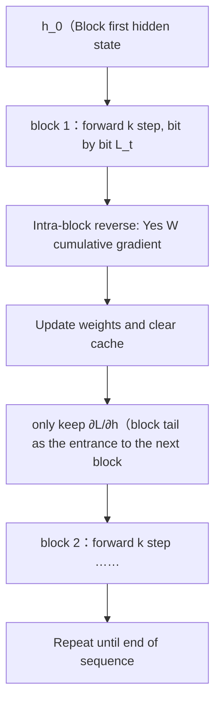
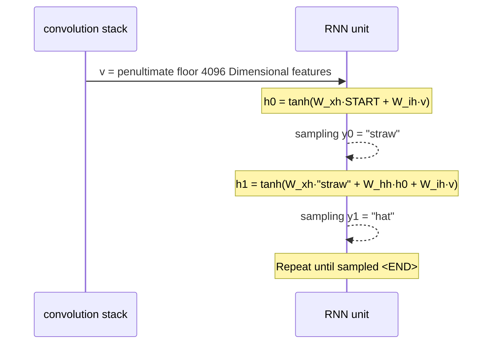
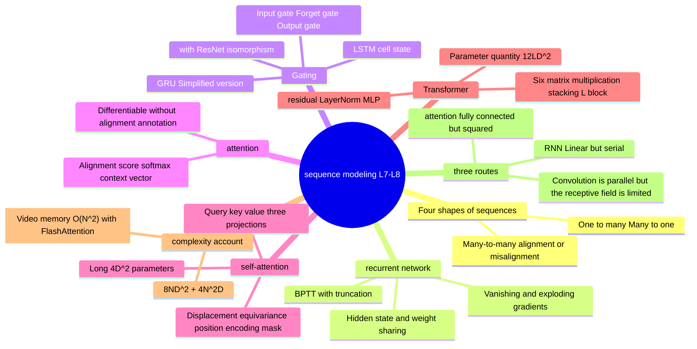

> **Course information**
>
> - **Course name**: Stanford CS231n: Deep Learning for Computer Vision(Spring 2025)
> - **This module covers**: Lecture 7. Recurrent Neural Networks; Lecture 8. Attention and Transformers (246 slides in total)
> - **Lecturer (each lecture)**: Zane Durante(Lecture 7); Justin Johnson(Lecture 8)
> - **Teaching date range**: 2025-04-22 – 2025-04-24
> - **Course homepage**: [cs231n.stanford.edu/2025](https://cs231n.stanford.edu/2025/schedule.html)
> - **Official courseware**: [lecture_7.pdf](https://cs231n.stanford.edu/slides/2025/lecture_7.pdf) (124 pages); [lecture_8.pdf](https://cs231n.stanford.edu/slides/2025/lecture_8.pdf) (122 pages)
> - **Subtitle source**: [cs231n_sp25_kor_sub · eng](https://github.com/lpaiu-cs/cs231n_sp25_kor_sub/tree/main/eng) (Publicly transcribed in English, Chinese rewritten by this book)
> - **Copyright statement**: The copyright of the slides and course materials belongs to Stanford University and the instructors; this book is an unofficial study note and is only used for study and research.

All the networks in the first six lectures share the same assumption: the input is a fixed-length tensor and the output is a fixed-length vector. $224\times224\times3$  The image goes in and the 1000-dimensional score comes out. No matter how many convolutions and residuals are piled in the middle, the shape is fixed from beginning to end. Language, video, and audio are not in this shape—the number of words in a sentence is variable, the number of frames in a video is variable, and the length of the output may not be equal to the input. What this module needs to deal with is how to change the network after "the length itself is a variable".

The two lectures combined actually only teach three solutions to one thing. The first is to press the history into a fixed-length hidden state and let the same set of weights be called repeatedly along time (RNN); the second is to open a bypass outside the hidden state that only performs element-by-element multiplication, so that the information can be passed on without being truncated by the activation function (LSTM); the third is to simply cancel the "transmission" and let each position be directly compared with all positions once (attention). The number of parameters, parallelism, and memory bills of the three are different, and the winner or loser between them is never a question of expression ability, but a matter of expression. **Whether information can be selectively passed through and whether calculations can be parallelized** problem. It is worth always carrying a ruler when reading this module: this structure has  $N$  When it increases tenfold, how much does the amount of parameters, calculations, and video memory increase?

## 1. In addition to the fixed-length assumption: first settle the two accounts in the previous lecture
*(Reference time: 00:00:05 – 00:04:37｜Lecture 7)*

Zane Durante started with just two things: two deadlines, and two clarifications left on Ed's forum from the previous lecture. The latter is worth looking at carefully, because they are all inconsistencies between the "slide writing method" and the "library implementation" - this inconsistency will appear again in every subsequent formula, such as which dimension along which softmax is done, $c$  Take it in the end  $h_T$  Or calculate it separately.


There are only two lines on the transaction page: Assignment 1 is due at 23:59 the next day (4/23), and the project proposal is due on this Friday (4/25). It is placed here because it marks the time coordinate - all the structures taught in this module are things that students need to implement in homework two.


Two clarifications are listed side by side on the contents page: how Dropout scales probabilities during testing, and whether normalization can save bad initialization. The lecturer's original words were that both questions had been asked in class, and his answers needed to be corrected.


The background of the first problem is standard Dropout (Srivastava et al., JMLR 2014): each forward propagation randomly zeroes out a portion of neurons, discarding the proportion  $p$  is a hyperparameter, 0.5 is the most common. The trouble lies  $p$  In terms of semantics -**Most libraries  $p$  It is defined as a drop probability, and the implementation of the slide in the previous lecture treats it as a retention probability.**, the same symbol points to opposite operations under two sets of conventions.


There is only one criterion for judgment: all neurons are alive during testing, so the activation must be scaled to "test period output = expectation of training period output". 25% is lost during training, and the test is multiplied by 0.75 - during the training period, the output of this neuron has a 25% probability of being set to zero and a 75% probability of being itself. The expectation is  $0.75a$;Everyone is present during the test period, and the output is  $a$, the two sides are right.


This rule can be condensed into six words: lose it in training and shorten it in testing. Most frameworks today default to the opposite, dividing the retained activations by the keep probability during the training period, and nothing needs to be done during the testing period - the only difference between the two writing methods is which side the constant factor is placed on, but **When reading other people's code, you must first confirm which side he is standing on**.


The second question is answered with a toy experiment that can be drawn on paper: the input is a 2-dimensional point, the network is a two-layer ReLU, and the goal is to output 1, 2, 3, 4 by quadrant (upper right 1, upper left 2, lower left 3, lower right 4). Run each of the four combinations - good Kaiming initialization and bad initialization with too large standard deviation, each with or without LayerNorm.


The conclusion of the first frame is a significant improvement: after bad initialization and LayerNorm, the error curve changed from "close to the ceiling" to "can go down".


The second frame says it all: the gap remains. Bad initialization with LayerNorm can fall into  $2\times10^{-2}$  Nearby, good initialization can press  $10^{-2}$, and bad initialization does not deserve normalization all the way to hang on  $10^{-1}$  magnitude. **Normalization can save more than half, but it can’t save the last part.**; For best performance, initialization still has to be done right.


The third frame is a counterexample, and it is also the one that should be remembered most among the three frames: normalization may not make sense. The quadrant task only requires knowing "which direction the point is approximately". Subtracting the mean and dividing the standard deviation will not change the quadrant affiliation, so it is useful; but if the task requires precise coordinates, normalization will delete the position information, and LayerNorm will be worse. **Normalization is throwing away information. If it is thrown correctly, it is regular, and if it is thrown wrong, it is destruction.**


After the clarification, the lecturer compiled the entire process of "acyclic network" into a list: one-time setup (activation function, preprocessing, weight initialization, normalization, transfer learning), training dynamics (following the training process, parameter update, hyperparameter optimization), evaluation (validation set performance, test-time enhancement). This list is the entire content of the first six lectures, and it is also what this lecture will avoid.


He recommended a tool for the second and third items on the list: the parallel coordinate chart of Weights & Biases, with one hyperparameter in each column and color-coded verification set accuracy. The figure shows the dropout column - the run with low dropout has higher overall accuracy, and TensorBoard is a similar alternative.


Finally, the route: first discuss sequence modeling, then talk about the simple models used by people before Transformer (RNN and its variants), and finally use a page to explain RNN and today's **state space model** (state space model, such as Mamba) What is the relationship? His judgment is clear: the key concepts of RNN are not outdated, but have been covered by Transformer for a long time.


## 2. Four shapes of sequences: one hidden state should contain the entire history
*(Reference time: 00:04:49 – 00:13:53｜Lecture 7)*

Loosen the "fixed length" constraint, and you will first get four input and output shapes: one-to-many (image description: a picture generates a word, the loss falls on each generation step), many-to-one (action recognition: a stack of frames produces a category, the loss only occurs in the last step), many-to-many misalignment (video description: a frame sequence generates a description sequence, each step has a loss), many-to-many alignment (frame-by-frame video classification: one label per frame). The difference between them is not how deep the network is, but **Which dimension is variable and at which time steps the loss falls?**. Once you recognize these four shapes clearly, all subsequent architecture diagrams will be able to match them. The vanilla neural network is the baseline case outside these four: a fixed-length input is mapped to a fixed-length output, and it is also the only shape dealt with in the first six lectures. All new things that follow are based on this shape.


The first is one-to-many: input a picture and output a string of words or characters, the length is determined by the model itself.


The second is many-to-one: input a sequence of video frames and output an action category - the output form is the same as image classification, except that the input changes from one picture to a stack of pictures.


The third type is many-to-many and not aligned: input a stack of frames and output a description. The length of the two sequences can be different, and they do not have to correspond one to one.


The fourth is many-to-many and aligned: each frame has a label, and the input and output are of equal length. This is the main battlefield in the first half of this module, because **Each time step has input, output, and loss.**, is most suitable for taking apart the circulation mechanism.


After the shape is laid out, let’s enter the RNN itself. The easiest way to draw it is a box labeled RNN. $x$  Enter from below, $y$  Coming out from above, an arrow on the side circles back to itself——**When you see the arrow pointing back, you know that this layer is a circulation layer.**.


This arrow has only one meaning: the RNN has a function that is constantly updated as the sequence is processed. **internal state**, usually called hidden state. Every time a new input comes, use it and the previous hidden state to calculate a new hidden state.


It is easy to get dizzy when calculating the gradient using the square drawing method, so the standard method is to calculate the gradient by time. **Expand** (unroll): No.  $t$  The output of the block is fed to the  $t+1$  blocks, each block receives an input  $x_t$, spit out an output  $y_t$. After expansion, "the current hidden state depends on the current input and the previous hidden state" becomes an ordinary chain calculation graph.


The formula is written in only two lines. Hidden status update is


$$
h_t = f_W(h_{t-1}, x_t)
$$


Among them  $h_{t-1}$  It’s the old state, $x_t$  is the input vector of the current time step, $f_W$  with parameters  $W$  function. It has no essential difference from the previous layers - it is still "multiplying the weight matrix and passing an activation function", but now it is a recursive formula.


The output is given by another function:


$$
y_t = f_{W_{hy}}(h_t)
$$


$W_{hy}$  Do two things: change the dimension of the hidden state into the dimension of the output (the two can be different), and perform a learnable linear transformation on the hidden state. So **calculate hidden state** and **Calculate output** There are two sets of parameters and two functions, but they are shared in time.


Expanding the graph also requires a starting point: the hidden state must be initialized to a certain  $h_0$. In principle it can be a learned vector, in this case it is given directly.


At this point we can point out one of the most important properties of RNN: **The same function and the same set of parameters are used at every time step**. The number of parameters is therefore independent of sequence length, at the cost of  $t$  The step information must be squeezed into the same fixed-length vector.


The simplest form is vanilla RNN, also called Elman RNN (named after Jeffrey Elman): hidden state process  $\tanh$,


$$
h_t = \tanh\left(W_{hh}h_{t-1} + W_{xh}x_t\right), \qquad y_t = W_{hy}h_t
$$


choose  $\tanh$  The reason for is very practical: it compresses the value in  $-1$  Arrive  $1$  Repeated iterations will not fly out of the order of magnitude; it has zero center and can be expressed both positive and negative. The simplest case on the output side is a matrix multiplication without an activation function.


There are two questions worth remembering in class. One, the old one  $y$  Can it affect new ones?  $h$? Yes, the most common approach is to use the output of the previous step as the input of this step, which is autoregressive modeling - the subsequent character-level language model and image description all rely on this. Secondly, $h_0$  and  $x_1$  What's the difference? They are multiplied by different weights: $h_0$  The set of parameters from hidden state to hidden state, $x_1$  Take the set of parameters input to the hidden state. This distinction becomes critical in many-to-one and one-to-many situations.

## 3. Handwritten RNN for fifteen numbers: Design "memory" as a row of the matrix
*(Reference time: 00:13:57 – 00:21:39｜Lecture 7)*

After explaining the abstract formula, the lecturer immediately gave an example of how to calculate to the end: the input is a 0/1 sequence, and it is required to "output 1 when the current bit and the previous bit are both 1, otherwise output 0". The corresponding output of the sequence 0,1,0,1,1,1,0,1,1 is 0,0,0,0,1,1,0,0,1. This is a bit-aligned many-to-many task, and it is also the only place in the entire module where all matrix multiplications are written out.


The question was reduced to one sentence: What should be installed in the hidden state? The answer is derived from the information bottleneck - the output only looks at the hidden state, and the judgment requires two things, so the hidden state must at least hold the "previous input" and "current input".


The specific method is to take the hidden state into 3 dimensions, and the third component is always 1, which is equivalent to assigning a constant bias to ReLU; the two functions  $f_W$  with  $f_y$  Both take ReLU to make the arithmetic possible orally. $h_0$  initialized to  $(0,0,1)$, meaning "two 0s have been seen before, so it shouldn't trigger".


The weights are handwritten, and the entire logic is a cycle:

```python
w_xh = np.array([[1], [0], [0]])
w_hh = np.array([[0, 0, 0],
                 [1, 0, 0],
                 [0, 0, 1]])
w_yh = np.array([1, 1, -1])

h_t_prev = np.array([[0], [0], [1]])
for t, x in enumerate([0, 1, 0, 1, 1, 1, 0, 1, 1]):
    h_t = relu(w_hh @ h_t_prev + (w_xh @ x))
    y_t = relu(w_yh @ h_t)
    h_t_prev = h_t
```

The three matrices have a total of 9 + 3 + 3 = 15 numbers. These are all the parameters of the entire model——**The number of parameters has nothing to do with the length of the sequence** This thing, on this page, is literal.


first matrix  $W_{xh}$  is  $3\times1$  column vector of  $(1,0,0)^\top$, whose only responsibility is to write the current input into the first cell of the hidden state: $x=0$  time contribution zero vector, $x=1$  time contribution  $(1,0,0)$.


$W_{hh}$  The first row of is all zeros, so cell 1 is never contaminated by history - it is always equal to the current input.


The second line is  $(1,0,0)$, it moves the 1st cell of the previous moment (that is, the "current position at that time") to the 2nd cell, so the "current" becomes the "previous position" of this moment.


The third line is  $(0,0,1)$, pass the constant 1 as it is, and the output layer relies on it for subtraction.


Output weight  $W_{hy}=(1,1,-1)$, a dot product is  `ReLU(当前 + 上一位 − 1)`: When both are 1, you get 1. As long as one of them is 0, it falls to 0 or a negative number and is truncated by ReLU.


This set of weights does work, but it was made by hand. If you change the task, "what to write in which cell" is no longer obvious - so the question becomes: **These  $W$  How to find it in practice?**  The answer is gradient descent, and the gradient of RNN must go along time, so first write the expansion graph as a calculation graph. By the way: using this set of weights to train other tasks is transfer learning, but the 3-dimensional hidden state is too small and will not be useful in practice.


## 4. Computational graphs, BPTT and truncation: the same  $W$  The gradients of
*(Reference time: 00:21:47 – 00:36:30｜Lecture 7)*

This step is the foundation for all "gradient disappearance" discussions later in the whole module: once the RNN is expanded into a calculation graph, $W$  It is no longer a parameter on a node, but **Appeared on the picture  $T$  times**. This incident determines both the way backpropagation is written and its memory bill. The computational graph starts with one step: $h_0$  and  $x_1$  into the same function  $f_W$, come out  $h_1$.


The second step is just to connect the same block again: $h_1$  with  $x_2$  given  $h_2$.


Until the first  $T$  step. The entire chain is the same function being called.  $T$  times.


Therefore, only one can be marked on the diagram  $W$: **Each time step reuses the same weight matrix**. This sentence means  $W$  Appeared in the calculation graph  $T$  times, the gradient must be  $T$  Add up all the contributions at all points - this is the most easily missed step in backpropagation, and it is also the answer to "Why is the gradient of RNN a summation instead of a single point".


Connecting the output is many-to-many: each  $h_t$  Pass by each other  $W_{hy}$  get  $y_t$.


each  $y_t$  There are corresponding losses  $L_t$.


The total loss is added up item by item: $L=\sum_{t=1}^{T}L_t$. When backpropagating, you can calculate each separately first.  $\partial L_t/\partial W$  If you want to find the sum again, you can also calculate it all at once - because  $W$  It's the same thing, and the two ways of writing are equivalent.


Changing the shape is many-to-one: only take one in the last step  $y$, there is only one loss.


But for tasks like video classification, taking the output only at the last frame is wasteful: the entire video contains information. A more common approach is to do average pooling or maximum pooling on the hidden state at each time step, and then calculate  $y$- What should be reserved for pooling, rather than going all-in on the last vector.


The opposite direction is one-to-many: only the first step has input, and one is spit out at each subsequent step.  $y$.


The problem is with the subsequent steps  $x$  From where. The question mark on the picture is this gap: $f_W$  There are two entrances, one expects the input vector, and the other expects the previous hidden state. The second entrance cannot be empty.


The easiest way to fill in is to fill in zeros.


A more useful way to fill in is to take the output of the previous step and connect it back, which is autoregressive - this is exactly what image description does: the "input" the model sees is the word it just wrote.


With the graph, we can talk about backpropagation. The name is **Back propagation through time** (backpropagation through time, BPTT): Calculate the loss by walking the entire sequence in the previous direction, and then calculate the gradient by walking the entire sequence in the reverse direction.


Its cost is written directly in the video memory: the activations and gradients of each time step are retained for use in the reverse direction. As the sequence gets longer, this part explodes - according to the lecturer, almost all troubles when training neural networks ultimately come down to insufficient video memory and NaN loss.


The practical solution is **Truncate BPTT** (truncated BPTT): Cut the sequence into fixed-length blocks, and only forward and reverse within the block each time.


The hidden state is passed down time as usual, but the gradient is only passed back  $k$  step.


If the task only has one output at the end, the truncation still holds: each time step still counts the gradient, but there is no longer "the step's own loss", and it is all driven by the gradient passed down from the upstream.


The implementation is to slide this window: only one quantity is transferred between blocks - the gradient of the loss of the first hidden state of the block. The rest are discarded, the weights are updated, the cache is cleared, and the next block is replaced.



Truncate the video memory from  $O(T)$  down to  $O(k)$, the price is that the gradient is no longer accurate. The lecturer's attitude was very direct: Of course it would be better to put everything into the video memory, and truncation is the only solution when there is no other way.

Three follow-up questions are worth remembering. **Why not use a separate set for each time step?  $W$?**  That is not recursive. It is equivalent to training an independent model for each position: the number of parameters increases linearly with the length, the length must be known in advance, the variable-length sequence directly fails, and the performance is usually worse. **What is lost by truncation?**  What is lost is the long-range gradient across blocks, so it is an approximation - one training becomes several independent updates, and the calculated direction is not the same as the precise gradient of the large batch. **Where have you seen this?**  In distributed training, each card calculates its own gradient and then applies it uniformly to the same weight. The structure is exactly the same; the only difference is that what is measured here is equipment, and what is measured here is time.

## 5. 112 lines of Python: character-level language model from gibberish to Shakespeare
*(Reference time: 00:36:34 – 00:48:14｜Lecture 7)*

The weights in the previous example were made by people, but the weights in this one were learned. The task is small enough to fit on one page: the word list is only four characters  `[h,e,l,o]`, the training sequence is  `"hello"`, the model looks at the current character and guesses the next character. The input is encoded with one-hot, and the output is softmaxed to get the score of each candidate character. The label is the character shifted one position to the right in the sequence——**No manual annotation is required, the text itself is the label**.

![Character-level language model: vocabulary \[h,e,l,o\], training sequence "hello", one-hot input](</attachments/cs231n-60603482af4e26da3ac618a2.png>)

Stack the hidden state formula and you can see the entire chain: each one-hot vector is  $W_{xh}$  Enter the current hidden state, the previous hidden state has been  $W_{hh}$  Come in, add the two together  $\tanh$.


The last frame is connected to the output layer: each hidden state is  $W_{hy}$  The 4-dimensional score is obtained, and the target characters (e, l, l, o) are marked at the beginning of the line. The first column of scores is  $(1.0, 2.2, -3.0, 4.1)$, and the goal is  `e`——**The model gives the highest score to the wrong character at this step**, so the loss in this step will be huge.


The process during testing is reversed: starting from a certain character, sampling step by step and feeding back the sampling results. The first step is to enter  `h` (one-hot is  `1,0,0,0`), hidden state  $(0.3,-0.1,0.9)$, output score  $(1.0,2.2,-3.0,4.1)$, after softmax we get  $(.03,.84,.00,.13)$, sampled to get  `e`.


There is a detail worth remembering here: the instructor pointed out on the spot that the softmax column on this page does not match the logits - the largest score is the 4.1 item, while .84 falls on the second item. He confirmed with the students that "no one has found this page for several years," and then continued to use it to talk about sampling, because the mechanism to be talked about was not affected. collected  `e`  After that, connect it back to the input terminal, and the second column will grow.


The second step  `e`  Feed it back and the hidden state becomes  $(1.0,0.3,0.1)$, score  $(0.5,0.3,-1.0,1.2)$, softmax gives  $(.25,.20,.50,.05)$, sampled to get  `l`.**The generation process is done one by one in this way.**.


The third step is the same, `l`  Keep feeding it back. The so-called "generating text with RNN" means that this picture is repeated many times.


There is another engineering detail on the input side: the actual implementation does not actually feed the one-hot vector into the model, but uses **embedding layer** (embedding layer). Using one-hot for matrix multiplication has the effect of "extracting a certain column from the weight matrix"; in this case, it is better to directly maintain a  $D\times D$  The embedding matrix ($D$  is the vocabulary size), fetch a row by index. What is omitted is multiplication, and what is obtained is a dense vector that can be learned - initialize with small values ​​​​such as Kaiming, and only update the fetched row during training, which is better optimized than one-hot sparse gradient.


How long is such a set? **112 lines of Python**. Karpathy's gist is the complete implementation and can train a variety of tasks.


The accompanying blog was written in 2015, and the author is Andrej Karpathy, the former lecturer of this course; the left side of the slide is the original text of Shakespeare's sonnets, and the right side is still the RNN block - the entire input to the model is such a stack of plain text, without any annotation. His conclusion was that RNN was "unreasonably effective" at generating text.


The comparison of the training process is the most convincing. It was pure gibberish at first, because  $W$  It's still random; after training for a period of time, English-like words will begin to appear; and later on, I can write grammatical sentences, and even make up my own character names and imitate Shakespeare's line breaks and dialogue format.


The sample after convergence looks like this: the character names (PANDARUS, VIOLA, KING LEAR), line branches, and dialogue turns are all correct, and the sentences are sometimes smooth and sometimes deviated——**The formats are very similar, but the semantics are only half correct.**.


If you continue to train, the paragraphs will become longer and longer: the parts will become more and more similar, and the whole will become more and more off-topic. The lecturer called this curve of "more and more similar with more training" a preview of the later AI era - his evaluation of this picture was that at the time it was already very similar to the behavior of today's large models, but the scale was several orders of magnitude smaller.


Switch to code corpus (Linux source code) to train the same model, and it starts to generate C code: indentation, brackets, and comments are all decent. The lecturer's judgment was "I don't know if it can be compiled, but it seems reasonable."


This road later became what it is today: Codex, GitHub Copilot, and Cursor all use the same task, except that "predicting the next character" is replaced by "predicting the next token" - a token is a set of characters, and how to cut it depends on the model. **The mission has not changed, but the scale has.**


Character-level RNN also has one advantage that other models rarely have: **Hidden status can be viewed directly**. Draw the activation values of tanh aligned character by character, $-1$  painted red, $+1$  Painted blue, each grid is the value of a certain neuron at a certain character.


Most of the grids appear to be noise, but a few have obvious structure. The paper (Karpathy, Johnson, Fei-Fei, "Visualizing and Understanding Recurrent Networks", ICLR Workshop 2016) picks out several interpretable ones from these grids.


The first is quotation mark detection: it lights up as soon as the quotation mark is opened, and turns off when the quotation mark is closed. The model must know "there is a quote left open" because it is trying to predict when to close the quote.


The second one tracks the line width: it starts out high at the beginning of the line and gets lower as it approaches the newline - it's counting how long the line is.


The third one corresponds to the if statement: it continues to light up after entering the if block, and then goes back down after the block ends.


The fourth distinguishes quotes from comments - both must wait for a terminator, but the terminator is different.


The fifth is the code indentation depth: for each level of nesting, the activation is increased by one level.


The meaning of these five grids is not the big talk of "RNN has learned grammar", but that **In Chapter 3 we wrote by hand  $W$  Let the hidden state remember the "previous input", where the model itself grows something equivalent**——The same are several interpretable status bits, but one is designed by humans and the other is found by gradient descent. By the way: This set of interpretability comes from "only one vector per time step". Wait until Lecture 8 to spread the sequence into  $N$  After vectors, this reading method of "one cell corresponds to one concept" becomes invalid.

## 6. CNN sees, RNN says: The pipeline of image description and its illusion
*(Reference time: 00:48:19 – 00:58:22｜Lecture 7)*

Calculate the account of RNN clearly, and then talk about its use in vision. Four advantages and two disadvantages all come from the design of "weight sharing in time": it can handle inputs of any length, and theoretically  $t$  Steps can use information from many previous steps, the input becomes longer while the model size remains the same, and each time step is processed symmetrically.

The disadvantage is equally direct: recursive calculation is slow - Chapter  $t$  steps must wait  $t-1$  After the steps are calculated, the time dimension cannot be parallelized during training, which will become a bottleneck when the amount of data increases; in practice, it is difficult to really obtain the information many steps ago - the hidden state is of fixed length, and the longer the sequence, the more early information is squeezed out. These two items, one related to speed and one related to capacity, constitute the target to be demolished in Lecture 8: **The first is a parallelism issue, and the second is a bandwidth issue. Attention has answered both of them.**


The most classic application on the visual side is image description. There's a bunch of work in this thread: Mao et al.'s "Explain Images with Multimodal Recurrent Neural Networks", Karpathy & Fei-Fei's "Deep Visual-Semantic Alignments for Generating Image Descriptions" (CVPR 2015), Vinyals et al.'s "Show and Tell", Donahue et al.'s LRCN, Chen & Zitnick's Recurrent Visual Representations - the schematic on the slide is from Karpathy That article.


The architecture is two-part splicing: a convolutional network encodes the image into a vector, and an RNN turns this vector into the next word together with the generated word.


Go through it with a specific example. The test image is a straw hat (CC0 Public Domain).


The image enters the convolution stack from the top, working its way down: two groups of conv-64, pooling, two groups of conv-128, pooling, two groups of conv-256, pooling, six groups of conv-512, pooling, and finally two 4096-dimensional fully connected layers.


The key step is **No classification layer**: Throw away the last 1000-dimensional score and take the 4096-dimensional activation of the penultimate layer as the image vector  $v$. This is the same routine as the transfer learning in the previous lectures - the classification labels are from ImageNet, and this layer retains common visual features.


The first input of RNN is the start symbol  `<START>`, the model produces the first word accordingly.


Therefore, the hidden state formula has one more item: originally there were only "input × weight" and "hidden state × weight", but now the image vector must be  $v$  by  $W_{ih}$  Add it in, that is  $h=\tanh(W_{xh}x+W_{hh}h+W_{ih}v)$.**The image only appears in this item, and each subsequent time step relies on this hidden state to carry the visual information.**——This is the specific form of the bandwidth problem: all the contents of a picture are pressed into 4096 dimensions, and then pressed into the hidden state.


The first word sampled is  `straw`.


Second time step: $y_0$  write down  `straw`, and at the same time put  `straw`  as new input  $x_1$  Send it back, the hidden state changes from  $h_0$  become  $h_1$.


The second word is  `hat`, put it together  `straw hat`.


The third time step continues, and the hidden state is pushed to  $h_2$.


Until the model samples  `<END>`, the generation process ends. **The length is not limited, and the termination condition is given by the model itself.**——This is the most different thing from fixed-length classifiers.


Draw the entire circuit as a timing diagram. The visual information is only injected once at the beginning, and then it is carried entirely by the hidden state:



In the standard test drawings of that year, the description given by this set of models was quite reasonable: a cat sitting on a suitcase, a dog running on the grass, a tennis player on the court, a giraffe standing on the grass, and a surfer walking on the beach carrying a board.


Failure cases are more informative and fail in a highly consistent manner: **Treat co-occurrence relationships in the training set as cause and effect**. The cupped hand → guessed as a mouse; the fur collared coat → guessed as holding a cat; the beach → guessed as holding a surfboard; the baseball glove catching the ball → guessed as a pitching ball. The lecturer's statement is that this type of illusion is still very common in today's visual language models: just because an object is common in the scene, it does not mean that it is present in this picture.


The second application was visual question answering (VQA), which had two typical writing methods at the time. One is to change the description model to "give questions and generate answers", multiply the probability of each token of the answer to get the probability of the entire answer; the other is more common: send the image, question, and several candidate answers together into the model, and output the probability of each candidate. **Make a classifier that can choose one of four**.


The third is a visual dialog: multiple rounds of back and forth around a picture. At that time, this was called an independent task, but today a single model can do it.


The fourth is visual language navigation: given the instruction "go to the living room", the agent encodes the instruction and uses RNN to generate movement actions step by step, and the visual input changes with each step -**The output becomes the next input**, which is exactly the three-dimensional version of the autoregressive structure discussed in Chapter 4.


There is another fact that is easily overlooked: the RNNs shown above are basically multi-layered. Multi-layer RNN is organized in the same way as multi-layer CNN, but the time dimension brings an additional rule -**Each layer only recurses on its own timeline**, layer 1  $h_t$  Relies only on layer 1  $h_{t-1}$, the layers are connected only by "the output of the lower layer is used as the input of the upper layer", so the entire calculation graph becomes a depth × time grid. To calculate the value in the upper right corner, you must first calculate the entire grid.


This also explains why RNN training is slow: each column of the grid depends on the previous column, and the time dimension cannot be parallelized; the number of parameters is very economical - each layer shares the same set of weights in time, and only parameters are exchanged between layers. **This demarcation of "depth can be parallelized but time cannot be parallelized" is the starting point for all subsequent architectural choices.**

## 7. Why does the gradient disappear: $\tanh$  The derivative of  $W$  singular value of
*(Reference time: 00:58:22 – 01:04:11｜Lecture 7)*

Before LSTM appears, it is necessary to determine the "cause" of vanilla RNN. The slide shows two models side by side: a vanilla RNN on the left and an LSTM on the right (Hochreiter & Schmidhuber, "Long Short Term Memory", Neural Computation 1997). The right side is obviously much more complex - the problem it wants to solve is hidden in this complexity.


The cause of the disease starts from a picture: what each time step does is " $h_{t-1}$  and  $x_t$  put together, multiply  $W$, passed  $\tanh$". During backpropagation, from  $h_t$  Post back to  $h_{t-1}$  It is this block that needs to be crossed.


The cost of crossing it is one  $W_{hh}$ (strictly speaking yes  $W_{hh}^\top$). One step is fine, $T$  The first step is  $T$  times.


put  $T$  Looking at the steps together, the problem becomes the shape of the product: **The gradient is  $T$  multiplication of factors**, each factor is  $\tanh$  The derivative of  $W_{hh}$. It is clearer to write it as an equation, so  $a_t=\tanh'(z_t)$  is a diagonal matrix, then


$$
\frac{\partial h_t}{\partial h_{t-1}}=\mathrm{diag}(a_t)\,W_{hh},\qquad \frac{\partial L}{\partial h_1}=\frac{\partial L}{\partial h_T}\prod_{t=2}^{T}\mathrm{diag}(a_t)W_{hh}
$$


Take the four steps and expand them into a specific example: $x_1..x_4$  Enter in sequence, $h_0..h_4$  Produced in turn, each  $h_t$  Each produces  $y_t$.


In reverse, the loss in step 4 is passed all the way back to step 1. The total gradient is the sum of the contributions of each step  $\partial L/\partial W=\sum_t \partial L_t/\partial W$, and each term is a continuous multiplication of the Jacobian matrix.


The structure of each factor in the multiplication chain is the same: $\tanh$  multiplied by the derivative of  $W_{hh}$. So the fate of the entire chain is determined by these two things.


Look first  $\tanh$  the derivative of. Its maximum value is at 0, which is equal to 1; the remaining positions are all less than 1, $|x|$  If it is slightly larger, it will quickly approach 0. **Multiply a bunch of numbers less than 1, $T$  Return to zero as soon as one rises**——This is the vanishing gradient.


So the slide concludes: these factors are almost always less than 1, and the gradient disappears.


What if the nonlinearity is removed? hypothesis  $\tanh$  Changing to an identity mapping, the factors remain  $W_{hh}$, the gradient becomes  $W_{hh}$  of  $T$  Power.


The behavior of the matrix power is determined by the singular values: if the maximum singular value is greater than 1, the vector is repeatedly stretched and the gradient explodes; if it is less than 1, the vector is repeatedly compressed and the gradient disappears. **In other words, if you want the gradient to be stable, $W_{hh}$  The spectrum would have to stop exactly around 1 - which is almost impossible to maintain through learning.**


The prescriptions for the two directions are different. Explosion is easy to handle: **gradient crop** (Gradient clipping) - When the gradient norm exceeds the threshold, it is scaled back as a whole, with the direction unchanged and the length limited.


Disappearance is difficult to deal with, so the structure can only be changed.


It's worth doing the math a little more granular here, because it explains why "better initialization" doesn't save RNNs. If you put  $W_{hh}$  The eigenvalues of are written as  $\lambda_i$, $T$  step after  $i$  The gradient amplitude in each direction is roughly  $|\lambda_i|^T$  Zoom: $|\lambda_i|=0.9$  time  $T=40$  Only  $0.9^{40}\approx0.015$, $T=100$  time is  $2.6\times10^{-5}$; On the contrary  $|\lambda_i|=1.1$  time  $T=100$  will be enlarged to  $1.1^{100}\approx1.4\times10^{4}$.**Only those directions that fall exactly around 1 survive past a hundred steps, and the optimization process has no reason to stop the spectrum exactly there.**  This is the quantitative version of "Gradient disappearance is not a parameter adjustment problem, but a structural problem."

## 8. The conveyor belt of LSTM: build a multiplication-only bypass for the gradient
*(Reference time: 01:04:17 – 01:09:02｜Lecture 7)*

LSTM was proposed in 1997 and was used until the rise of Transformer. The instructor clearly stated the requirements for the class: **No need to know the details of LSTM**, but understand what it's trying to alleviate, because today's state space models are alleviating the same set of problems.


The idea is to turn "a hidden state" into "a hidden state + a cell state" (cell state), and use four gates to control the entry and exit of information: input gate, forget gate, output gate, plus a candidate gate.


When calculating specifically, consider  $h_{t-1}$  and  $x_t$  Put them together and multiply them by a large matrix  $W$($4h\times 2h$, $h$  is the hidden state dimension), obtained at once  $4h$  dimensional vector, then cut into four parts: the first three parts are obtained by sigmoid  $i,f,o\in(0,1)$, the fourth copy passed  $\tanh$  Get candidate values  $g$. Under the same hidden state width, this  $W$  4x larger than vanilla RNN – the benefits of gating are not free.


Each of the four gates is responsible for one thing: $i$  Decide how much to write into the cell, $f$  Decide how much old content to erase, $o$  Determines how much of the cell is exposed to hidden states, $g$  It is the "content to be written" itself.


input gate  $i$  Appears in two places: it multiplies the candidate value  $g$, determines how much is written into the cell at this moment.


oblivion door  $f$  Multiply directly on the old cell state  $c_{t-1}$  on, decide how much history to retain.


output gate  $o$  ride on  $\tanh(c_t)$  to determine how much of the hidden state is exposed at this moment.


Together they are the three-line formula of LSTM:


$$
\begin{pmatrix}i\\f\\o\\g\end{pmatrix}=\begin{pmatrix}\sigma\\\sigma\\\sigma\\\tanh\end{pmatrix}W\begin{pmatrix}h_{t-1}\\x_t\end{pmatrix},\qquad c_t=f\odot c_{t-1}+i\odot g,\qquad h_t=o\odot\tanh(c_t)
$$


The key step is to update the cell state: $c_t=f\odot c_{t-1}+i\odot g$. Backpropagation from  $c_t$  return to  $c_{t-1}$, just need to multiply element-wise by one  $f$, **No matrix, no tanh**.


So when passing back along time, the gradient goes along the "conveyor belt" above: only element-by-element multiplication is done along the way, as long as  $f$  If it is not close to 0, the information can be passed on forever.


Does this solve the disappearing problem? The answer is qualified: **It makes "retaining information" easy to learn**——If  $f=1$, $i=0$, the content of this cell can be retained as it is for any number of steps; while vanilla RNN needs to learn a method that can retain information for a long time.  $W_{hh}$, the difficulty is not at the same level at all. But it does not guarantee that the gradient will not disappear or explode, it just provides an easier path.


Spread out the parameter account: the same hidden state width  $h$, the circulant matrix of the vanilla RNN is  $h\times h$, LSTM is  $4h\times 2h=8h^2$——**Four times the gating results in a gradient path that does not need to pass through the matrix.**. This transaction will be repeated in another form in the later Transformer: the parameter amount of the self-attention block is  $12D^2$  order of magnitude, much more expensive than an RNN of the same width, but it trades in parallelism. This conveyor belt has the same idea as the ResNet mentioned in the previous chapters: ResNet uses skip connections to let gradients bypass the convolution block, and LSTM uses cell states to let gradients bypass the activation function. The difference is only in the dimensions - one jumps to the number of layers (depth), and the other jumps to the time step (length).


There is another stop in the middle: Highway Networks (Srivastava et al., ICML DL Workshop 2015), which uses gated jump connections to do this idea first, a little earlier than ResNet.


Incidentally, GRU: it was only mentioned as a candidate for the decoder unit in class (the formula in Lecture 8  $s_t=g_U(\cdot)$  inside  $g_U$  Can be LSTM or GRU), no expansion derivation. Editor's note: GRU is a simplified version of LSTM. It merges the input gate and forget gate into an update gate, and merges the cell state and hidden state into one state. Therefore, it has one less set of gating parameters than LSTM - this is why it is often regarded as a "lighter alternative".

## 9. Turning point: The serial accounts can no longer be settled
*(Reference time: 01:09:12 – 01:11:39｜Lecture 7; 00:00:04 – 00:02:20｜Lecture 8)*

The last content slide of Lecture 7 brings the topic back to today. RNN In the past two years, **state space model** The name (state space model) is back: the structure is still "summarizing history with a hidden state", but the calculation amount is reduced to be proportional to the sequence length, and there is no upper limit on the context length. RWKV and Mamba are representatives of this line.


Why is this line suddenly valuable? The answer is Transformer's account: the amount of attention calculation increases with the square of the sequence length, and the context window becomes a hard constraint. The industry uses techniques such as RoPE to extend it, but the square term is always there. Linear time plus infinite context just fills this gap - of course the cost is real: recursion cannot be parallelized, and the throughput cannot be increased during long sequence training.


The lecturer concluded with five points: RNN has a large architectural space; vanilla RNN is simple but not easy to use; the value of complex variants (LSTM, Mamba) lies in "selectively transmitting information"; gradients will explode or disappear, and explosion depends on cutting and disappearing by changing the architecture, while gradient calculation is inseparable from BPTT; better architecture is still the hottest research direction at the moment.


The next lecture is about the opponents of this line. Justin Johnson started by defining two words separately: **Attention is a new primitive that operates on collections of vectors**, **Transformer is a network architecture that uses attention everywhere**. Primitives are the parts that can be plugged into any network, and the architecture is the assembly of the parts.


The transaction page of Lecture 8 has only two lines: Assignment 2 was released yesterday (4/23), and the project proposal is due tomorrow (4/25). The time coordinates it marks are - Assignment 2 corresponds to the recurrent network, and the project proposal requires students to pick a visual task.


The review page only has the title "Last Time: Recurrent Neural Networks", and the content is all filled in verbally: one-to-many, many-to-one, many-to-many, and "the input can be a variable-length sequence".


The first frame of today’s route juxtaposes two definitions: attention is a primitive and Transformer is an architecture. This difference in level is important - the first three quarters of this lecture are building the parts, and the last quarter is assembling it into a machine.


The second frame adds three lines of text, the most critical of which are the last two lines: Transformer is used everywhere today, but it is actually a branch of RNN, so we must start with RNN. The lecturer inserted a piece of field history here: The moment Transformer was born was not like a "tsunami", because before 2017, the ideas of alignment, soft alignment, and attention had been fermenting in the machine translation circle for several years. **New architectures are often the result of stripping old mechanisms out of old hosts**, rather than an invention appearing out of thin air.


"Starting from RNN" is not a narrative preference, but a settled account. Arranging the contents of the two lectures into a table according to "How information moves across time", you can see what has been changed in each generation:

| intergenerational | stride path | Parameter (width  $d$) | Calculate | Training parallelism | represent |
| :--- | :--- | :--- | :--- | :--- | :--- |
| Vanilla RNN | $h_t=\tanh(W_{hh}h_{t-1}+W_{xh}x_t)$, traverse the matrix once at each step | $O(d^2)$ | $O(N)$  serial | The time dimension is completely serial | Elman RNN |
| LSTM | cell state  $c_t=f\odot c_{t-1}+\dots$, the gradient is only multiplied by the element-wise gate | $O(8d^2)$ | $O(N)$  serial | The time dimension is completely serial | Hochreiter & Schmidhuber 1997 |
| RNN + attention | At each decoding step, all encoding states are weighted and summed, with a path length of 2 | $O(d^2)$  Plus  $f_{att}$ | $O(N^2)$  But decoding is still serial | Encoders can be parallelized and decoded serially | Bahdanau et al. 2015 |
| Self-attention + Transformer | Any two locations are directly connected in one step, the path length is 1 | $O(12D^2)$  per block | $O(N^2)$, four matrix multiplications | The sequence dimension is fully parallel | Vaswani et al. 2017 |

The most eye-catching column in this table is "Parallelism". RNN's  $O(N)$  Computation should be an advantage - you can take as many steps as the sequence is long, and the cost of each step is fixed; but on the GPU, $N$  step serial means  $N$  Secondary core starts, $N$  Waiting times, the computing power utilization is directly divided by the sequence length. **Pay attention to changing the "path length" from  $N$  Pressed to 1, the cost is to reduce the "calculation amount" from  $O(N)$  Lift to  $O(N^2)$; In an era of excess computing power and scarcity of latency, this exchange is a bargain.**  The remaining part of Chapter 8 is to make this exchange step by step.

## 10. Encoder-Decoder: The entire sentence is pressed into a fixed-length vector
*(Reference time: 00:02:20 – 00:09:03｜Lecture 8)*

The motivational problem is machine translation: input  $x_1,\dots,x_T$ (English), output  $y_1,\dots,y_{T'}$ (Italian), neither the length nor the word order of the two sequences need correspond. The encoder is an RNN, $h_t=f_W(x_t,h_{t-1})$, feed "we see the sky" word by word, and spit out four hidden states. Four words correspond to four function calls, parameters  $W$  Full sharing - this is the only structural advantage of RNN over fully connected layers.


In the second frame, only one line and two squares are added: the last hidden state  $h_4$  Take it out and record it as a context vector  $c$ (usually just take  $c=h_T$), add another starting point for the decoder  $s_0$. take  $h_T$  The reason comes from the recursion itself: it has "seen" all the previous words, so it is naturally a summary of the entire input. $s_0$  How to set it up is another topic, and the end of Chapter 11 will be dedicated to settling this account.


The decoder is another RNN, $s_t=g_U(y_{t-1},s_{t-1},c)$, parameters  $U$  Not shared with encoders. It eats three things at each time step: the output word of the previous step, the hidden state of the previous step, and the fixed  $c$. The first decoding gives  $y_1=$"vediamo", the input is  $y_0=$\[START\].


Stack one more square: $s_1$  received  $s_2$, spit out "il". Compared to the previous frame, the only new additions are  $s_2$  with  $y_2$  two squares; the one from  $c$  Leading line **no changes**——same  $c$  Being used over and over again, that's exactly the problem.


The last frame is completed with "cielo" and the terminator \[STOP\], and the decoder completes four steps. The context fed to the decoder in the four steps is always the same  $c$, the shape is  $[D]$, it has nothing to do with whether the input has 4 words or 400 words.

![Frame 5: cielo and \[STOP\], translated in one sentence](</attachments/cs231n-b168ea6d99dc3c6ef78a6615.png>)

This frame has a line of red text on the entire picture: The input sequence must pass a fixed-length  $c$  to reach the output if  $T=1000$  What? The magnitude given by the lecturer is  $c$  May be a 128-dimensional or 1024-dimensional floating point vector -**This number is fixed during modeling and will not grow longer as the input becomes longer.**. It is reasonable to squeeze four words into 1024 dimensions; pushing an entire paragraph, an entire book, and an entire corpus into 1024 dimensions is equivalent to requiring the encoder to perform the same lossy compression on all inputs.


Make a deducible estimate to get a feel for the magnitude: If  $D=512$, the encoder hidden state for 1000 words is  $1000\times512$  number (about 2 MB under fp32), while  $c$  Only 512 numbers (about 2 KB). The compression ratio is 1000:1, and the network does not have any selection mechanism for "this part can be lost and this part must be kept". The key to a narrow mouth is not insufficient capacity; **Information cannot be selectively passed through**.


## 11. Put attention into RNN: scoring, softmax, weighted sum
*(Reference time: 00:09:23 – 00:20:53｜Lecture 8)*

Transformation starts from scratch: the encoder does not move in one line and still needs to give an initial decoding state  $s_0$. This is what is circled in red  $s_0$——It will be compared with the four encoder hidden states one by one. Pay attention to the direction of the arrows on the diagram: the information comes from  $s_0$  flows to the input sequence rather than from the input sequence  $c$  Then flows to the output, where the entire bottleneck structure is reversed.


Newly added are four small squares  $e_{t,i}=f_{att}(s_{t-1},h_i)$, each is a scalar. Implementation  $f_{att}$  Just a linear layer: put the decoder state  $s$  with a certain encoder status  $h$  Splice it into a vector, and then linearly transform it into a number. **It does not have any special structure, it is just a set of ordinary learnable parameters**, so it can be directly inserted into the calculation graph and learned using gradient descent together with other parameters.


$e$  The value is  $(-\infty,+\infty)$  Any real number on, directly weighted will make the value out of control. So add a layer of softmax on top: $a_{t,i}=\exp(e_{t,i})/\sum_j\exp(e_{t,j})$, get  $0<a_{t,i}<1$  and  $\sum_i a_{t,i}=1$. These four numbers can then be read as "the relative importance of each position in the input sequence given the current decoder state", which is a discrete distribution.


The fourth step is the weighted sum: $c_t=\sum_i a_{t,i}h_i$. it is still  $[D]$  vector, but **This vector is calculated for the current step**, not copied from the end of the encoder. on the picture  $c_1$  Coming out of the summation block on the right, and  $s_0$  Convergence.


finally  $c_t$  Access the decoder: $s_t=g_U(y_{t-1},s_{t-1},c_t)$, among which  $g_U$  Can be LSTM or GRU. The structure of the decoder has not changed up to this point - only the "$c$  Where does it come from?: Originally it was the last hidden state of the encoder, now it is a weighted average calculated at each time step.


The picture gives a set of specific numbers: when you want to generate "vediamo" (equal to "we see" in English), $a_{1,1}=a_{1,2}=0.45$, $a_{1,3}=a_{1,4}=0.05$. The sum of the four numbers is exactly 1. What this distribution means is: the decoder pays 90% of its attention to "we" and "see" and almost never looks at "the" and "sky". **This is not a hard-coded rule, but a preference developed by the model itself.**


What this frame adds is the key fact on the training side: from  $s_{t-1}$  Arrive  $e$, to  $a$, to  $c_t$, and then  $s_t$, all differentiable operations. Therefore, there is no need for any annotation of "the third English word corresponds to the second Italian word". The loss function is still the softmax plus cross entropy at the output end, and the gradient follows  $c_t$  all the way back to  $f_{att}$. The lecturer emphasized that if we really want to do alignment annotation, this kind of data cannot be obtained on a large scale——**Differentiability is the premise for this mechanism to be established, not the implementation details.**.


In the second frame, the entire process is repeated: take  $s_1$  with four  $h_i$  Recalculate the alignment score, re-softmax, and re-weight to get  $c_2$. Note that it reuses the same  $f_{att}$- A set of parameters shared by all decoding time steps.


$c_2$  with  $y_1$  Enter the decoder unit together and get  $s_2$  with "il". The picture also marks the root that was missed in the previous chapter.  $s_0$  Arrive  $s_1$  arrow - the lecturer laughed at himself, "I probably dropped this line." This slip of the tongue itself shows that the picture expresses "the decoder is recursive inside."


Same reading: when generating "il" ("the"), $a_{2,1}=a_{2,2}=0.05$, $a_{2,3}=0.8$, $a_{2,4}=0.1$——The mass changes from "two 0.45 splits" to "one 0.8 spike" because "il" corresponds to the single word "the" in English ($h_3$), while "sky" ($h_4$) leaving only a margin of 0.1. The sum of the four numbers is still 1. Comparing the two frames, you can understand the full expressive power of attention: **It is a differentiable soft pointer that changes with the decoding status.**.


Draw the four time steps side by side: $c_1,c_2,c_3,c_4$  Each corresponds to a decoding step, and each is a different weighting of the four hidden states. Compared with the one in Chapter 10, there is only one  $c$  In the figure, the bottleneck disappears: the input sequence no longer needs to be compressed first, but is retained in four hidden states, which are accessed on demand at each decoding step.


Someone in class asked "How to initialize the decoder". The lecturer points out that the word is overloaded twice: **Weight initialization** Refers to the random initialization of the decoder as a parameterized network at the beginning of training, which is no different from other networks; **Hidden state initialization** Refers to giving each time a new sequence is processed  $s_0$  Fixed value, there are three common methods - directly taking the last hidden state of the encoder, using a learned linear projection to  $h_T$  mapped to  $s_0$, or simply set to zero. All three can be used, provided that training and inference always use the same convention.

The price was also written on the same page, but no one said it clearly at the time: **Each decoding step requires scoring the entire input sequence.**. Enter length  $T$  The larger the value, the calculation amount of this part increases linearly; if it is extended to self-attention, it will become the sum of Chapter 16  $O(N^2)$  account. Note that the seam between the two lectures has been buried here: the RNN in lecture 7 is "pressing history into the state", and the focus of this chapter is "leaving history where it is and looking back on demand"——**The former is compression and the latter is retrieval.**.

## 12. A readable attention matrix and the universal operators hidden in it
*(Reference time: 00:20:53 – 00:31:27｜Lecture 8)*

Attention has a by-product: the weights themselves are data. Since each step of decoding will produce a "distribution of the input sequence", stacking the distributions of all steps by rows will result in a  $T'\times T$  The matrix can be viewed directly as a heat map. According to the lecturer, these are the few people who can **Directly observe what is happening inside the network** One of the mechanisms because no one ever told it how to align it.


The example is changed to English-French translation (the lecturer specifically stated that he cannot read French). The input is "The agreement on the European Economic Area was signed in August 1992." and the output is "L'accord sur la zone économique européenne a été signé en août 1992.". This sentence was chosen deliberately: it contains a three-word noun phrase (European Economic Area), rearranged in French as zone économique européenne, and also contains word order differences such as prepositions and dates.


A diagonal line appears on the graph from the upper left to the lower right: when predicting "le", the mass is all on "the", and when predicting "accord", the mass is all on "agreement". diagonal means **There is a one-to-one correspondence between words at the same position in the two sequences**, which is the most trouble-free literal translation situation. The lecturer's statement was very restrained: the network itself decided this matter, and humans only provided a mechanism to "look back".


The really interesting thing is in the middle: European Economic Area has a different word order in French, and a reverse diagonal line appears on the heat map; and where two words in French correspond to one word in English (or vice versa), a small 2×2 square appears, indicating that attention cannot separate them cleanly. **The shape of the matrix directly exposes the grammatical differences**, which is more intuitive than any accuracy number.


At this point, the lecturer took a breath: This set of things was invented to repair RNN, but it is actually a universal, independent, and very powerful operator. The next step is to turn our attention away from the RNN **cut out**, making it a separate layer.


Renaming is the first step to detachment. Hidden state change of decoder **Query vector (query)**: "I want to produce this piece of output, so I'm going to find something"; the encoder's hidden state is renamed **data vector (data)**: "These are materials that may be useful"; and the output  $c_t$  Change name **Output vector**. The rules also become cleaner: each query scores all data vectors and gets **one** Output vector. As for where the next query comes from, the attention layer doesn't care - this sentence is its license to break away from RNN.


A new page defines this layer from scratch. The first frame only writes  `Inputs: Query vector q [D_Q]`, the right side is still the RNN picture, $s_0$  Marked by a red box - it reminds the reader where this abstraction comes from. In the next few frames, the list on the left will be filled line by line, while the picture on the right will never move. This comparison itself illustrates the meaning of detachment: **The topology of the graph belongs to RNN and the formula belongs to attention**.


The second line is  `Data vectors: X [N_X x D_X]`——$N_X$  data vectors, each  $D_X$  dimension. At this point the query and data dimensions can be different ($D_Q$  Yes  $D_X$), because the first version of the similarity function  $f_{att}$  It is arbitrary and does not require both sides to be of the same dimension.


The third line is  `Similarities: e [N_X]`, $e_i=f_{att}(q,X_i)$. Note the shape of the output: a query pair  $N_X$  Score the data and get the length of  $N_X$  vector——**The score is "one to many", which determines all subsequent shapes.**.


fourth line  `Attention weights: a = softmax(e) [N_X]`. At this point, a query has become a set of weights. The sum of this set of weights is 1, which can be read as "the distribution ratio of this query on each data vector."


last line  `Output vector: y = Σ_i a_i X_i [D_X]`. The output dimension is equal to the data dimension  $D_X$  rather than query dimensions  $D_Q$——Because the output is a linear combination of data vectors, it can only fall in the space spanned by the data. This rule remains unchanged in every subsequent edition of Attention.


After completing the five definitions, there is an additional line "Let's generalize this!" on the page. Do three promotions in the following three sections:  $f_{att}$  Change to dot product, add scaling, and then expand the single query into multiple queries.


## 13. Three promotions: dot product, scaling, multi-query, and key-value separation
*(Reference time: 00:31:27 – 00:45:44｜Lecture 8)*

The first change is to let  $f_{att}$  Make it simple: Since any function with "two vectors in and scalar out" will work, then use the simplest one - dot product  $e_i=q\cdot X_i$. The price is the dimensionality constraint: the dot product requires both sides to be of the same dimension, so  $q$  shape from  $D_Q$  Change to  $D_X$. The lecturer's statement is "simplify and promote at the same time", because the dot product also brings a form that can be batched.


The second change is scaling: $e_i=q\cdot X_i/\sqrt{D_X}$.


This step looks like a little trick, but the reason will be in the next frame. What is given on the page is the constant vector argument: given by  $a\cdot b=|a||b|\cos\theta$, if  $a,b$  are all constant vectors, then  $|a|=(\sum_i a_i^2)^{1/2}=a\sqrt{D}$, so the dot product of two constant vectors follows  $D$  Linear growth. The larger the score, the closer the softmax is to one-hot, and the smaller the derivative of the output with respect to the score. **gradient disappears**. divide by  $\sqrt{D_X}$  Later, growth was suppressed  $\sqrt{D}$  magnitude, softmax falls back into the interval with gradient.


> Editor's note: A more common equivalent is to start from randomness - if the components of the two vectors are independently and identically distributed and have a variance of 1, then the variance of the dot product is  $D$, divided by  $\sqrt{D}$  The variance then returns to 1, regardless of dimensionality. The slide uses the constant vector version, and the conclusion is the same.

Why is this change important? The reason given by the lecturer is "scale": the network will get bigger and bigger, and the vector dimension will go up. If the scale of similarity drifts with the dimension, the same set of hyperparameters can be trained in 128 dimensions but cannot be trained in 1024 dimensions. So **Everywhere in the architecture the question "What happens when the dimensions are ten times larger?"**, this is a recurring inspection posture in Lecture 8. In RNN we never have more than one query - the decoder has one at each step. So put  $Q$  written as  $[N_Q\times D_Q]$  matrix, processing an entire batch at a time:


$$
E=QK^\top/\sqrt{D_X}\in\mathbb{R}^{N_Q\times N_X},\qquad A=\mathrm{softmax}(E),\qquad Y=AX\in\mathbb{R}^{N_Q\times D_X}
$$


Each of the three operations has a clear matrix interpretation. The score is "the inner product of all pairs between the two vector sets", which is exactly a matrix multiplication; the normalization is done along the "data" dimension, so that each query becomes a distribution; the weighted summation is "using  $A$  Each row of  $X$  row", which is also a matrix multiplication.


Regarding which dimension along which softmax should be performed, there is a place on the page that is easy to misread: the formula reads:  `softmax(E, dim=1)`  And mark the shape  $[N_Q\times N_X]$, but the picture is **Keys are arranged in rows, queries are arranged in columns**, so the lecturer verbally said "normalize each column". Both statements refer to the same thing - normalize along the data/key dimension so that each query gets a distribution. It is enough to remember this convention: **The rows are the query, the columns are the keys, and the sum of each row is 1**. So far  $X$  It is used twice in a forward pass: once to calculate the similarity with the query, and once to do the addend of the weighted sum. The lecturer thought this was a bit awkward -**"What to use to match" and "what to retrieve after matching" should be two different things.**. So two learnable projections are introduced:


$$
K=XW_K\in\mathbb{R}^{N_X\times D_Q},\qquad V=XW_V\in\mathbb{R}^{N_X\times D_V}
$$


$W_K$  Project the data to the dimension of the query (because you need to calculate the dot product), $W_V$  Project to output dimensions  $D_V$ (Can be used with  $D_Q$  different). The subsequent process remains unchanged: $E=QK^\top/\sqrt{D_Q}$, $A=\mathrm{softmax}(E)$, $Y=AV\in\mathbb{R}^{N_Q\times D_V}$.


The analogy used by the lecturer is a search engine. You type "what is the best school in the world" in the box, this is **Query**;This query needs to be compared with the backend record **key** to match; and what you want to get back **value** It's "Stanford" - it's nothing like the sentence you typed in. The content of the three should not be the same, so it is natural to separate them. As for "how to split the data vector into keys and values", the answer is the same as before: don't tell it how to split it, just give it two projection matrices and let the gradient descent decide by itself. The lecturer interprets this as **Do two different filters on the same vector**: The query only matches part of the features and retrieves another part of the features.

From this page on, the RNN graph completely disappears, leaving only the operator itself. The first frame lays out four queries  $Q_1..Q_4$  and three data vectors  $X_1..X_3$, three serial numbers 1, 2, and 3 are marked on the right side, corresponding to the next three steps.


In the second frame, three purple squares are added to the data side.  $V_1,V_2,V_3$——The value is the data  $W_V$  The result of projection. At this point the query isn't related to anything yet, it's just standing there.


Third frame fill key  $K_1..K_3$, and expand one on the right  $4\times3$  of  $E$  Grid: rows are keys ($K_1..K_3$), the column is the query ($Q_1..Q_4$), in the grid  $E_{i,j}$  It's the first  $j$  query with the  $i$  Scaled dot product of keys. This grid is  $QK^\top$  all content.


In the fourth frame, softmax is passed through each grid, and it is clearly written that "softmax normalizes each column: each query predicts a distribution on the key." The grid of three rows and four columns becomes  $A$, the sum of each column is 1. At this point, the name "attention" is worthy of its name: **Each column is an allocation decision**.


The fifth frame is added on the right  `Product(→), Sum(↑)`: put  $A$  Each column of is multiplied by the corresponding value and added together to get  $Y_1..Y_4$. Each output is a linear combination of all value vectors, with the weight determined by that column. The lecturer gave a summary here: **An output is a mixture of information from all values, with the proportion determined by the query.**.


The title of the same picture is changed to Cross-Attention Layer. This layer has two inputs (query and data), two learnable parameters ($W_K,W_V$), input two strings of vectors, output one string of vectors, and can be inserted into any network like a convolutional layer. It's called "crossover" because the query and data come from two different sources; the next chapter will look at a more common version that has only one input and compares each vector to every other vector in the same group.


Putting the accounts of the three versions of attention side by side, we can see clearly what "promotion" has brought us:

| Version | similarity function | key shape | Learnable parameters | cost |
| :--- | :--- | :--- | :--- | :--- |
| Additivity (Chapter 11) | $f_{att}(s,h)$, after splicing, pass through the linear layer | $q[D_Q]$, $X[N_X\times D_X]$, $e[N_X]$ | $f_{att}$  first floor | Each (query, data) pair has to go through the small network and cannot be written as a matrix multiplication |
| Dot Product (Promotion 1) | $q\cdot X_i$ | force  $D_Q=D_X$ | None | Scale varies  $D$  growth, softmax saturation |
| Scaling dot product (generalization 2) | $q\cdot X_i/\sqrt{D_X}$ | Same as above | None | one more scalar division |
| Scaling dot product + key value (Promotion 4) | $QK^\top/\sqrt{D_Q}$ | $Q[N_Q\times D_Q]$, $K,V[N_X\times\cdot]$ | $W_K,W_V$ | Parameter quantity  $D_XD_Q+D_XD_V$ |

The four steps are all just "handle" $f_{att}$  Change it to a form that can be calculated in batches", but the last step is a qualitative change: **It changes the focus from "a decoder accessory" to "a layer that relies only on matrix multiplication"**, and as long as a layer consists only of matrix multiplication, it can be stacked, parallelized, and crammed into any architecture. What we will do in Chapter 14 is combine the query and data into the same input.

The entire data flow can be read as one sentence: the query only participates in scoring, and the data is divided into two paths - one path  $W_K$  Become a key to score, all the way through  $W_V$  The values become weighted. **The output is always in the value space, not in the query space.**, this is the most commonly ignored item when calculating dimensions later.

## 14. Self-attention: one input, three projections, and two remedies for "sequence"
*(Reference time: 00:45:44 – 00:55:30｜Lecture 8)*

Self-attention combines the two sets of cross-attention inputs into one set: only one  $X\in\mathbb{R}^{N\times D_{in}}$, but it is projected into three parts: query, key, and value at the same time——$Q=XW_Q$, $K=XW_K$, $V=XW_V$, the three weights are all  $[D_{in}\times D_{out}]$. One sentence on the page illustrates the simplification of shape: **almost always  $D_Q=D_V=D_{out}$**. The lecturer also admitted that he "wrote the marks more generally than they actually were" and that he had hardly seen any in such a long time.  $D_{in}\neq D_{out}$  self-attention layer.


The second frame adds a practical tip: put the three weight matrices together along the output dimension and calculate it in one go


$$
[Q\ K\ V]=X\,[W_Q\ W_K\ W_V],\qquad [N\times 3D_{out}]=[N\times D_{in}]\,[D_{in}\times 3D_{out}]
$$


The reason is purely hardware efficiency -**A few large matrix multiplications are more cost-effective than many small matrix multiplications**, the GPU can only be fully occupied on a large matrix. This habit of "putting together as many matrices as possible" will be used in Chapter 16 when counting the number of matrix multiplications.


The third frame is drawn on the picture  $E$  grid, $E_{i,j}=Q_i\cdot K_j/\sqrt{D_Q}$. The shape is  $[N\times N]$——The number of queries and the number of keys in self-attention are both  $N$, this is the most substantial difference between it and cross-attention, and it is also  $O(N^2)$  source.


The fourth frame  $E$  normalized into  $A$, also one distribution per column. Note that both "column" and "row" are long at this time  $N$, the matrix is square, so it's easier to look at the wrong axis - the criterion is always "which direction sums to 1": **Each query is on a line that sums to 1**.


For the fifth frame  `Product(→), Sum(↑)`  get  $Y_1..Y_3$. At this point, all four steps have been completed, and the remaining two sections discuss the "side effects" of this mechanism.


The lecturer asked a seemingly harmless question here: What would happen if the order of the input vectors was disrupted? Slide handle  $X_1,X_2,X_3$  Replace with  $X_3,X_1,X_2$.


The second frame gives the first conclusion: because  $Q,K,V$  are vector-by-vector linear projections, so scrambling the inputs will just cause them to be scrambled in the same way, **The content is perfect**.


Third frame: Similarity is dot product, and dot product does not look at the position, so  $E$  Every number in it is still there, but the rows and columns have been changed. on page  $E$  The grid's row labels start from  $K_1,K_2,K_3$  become  $K_3,K_1,K_2$, column labels from  $Q_1,Q_2,Q_3$  become  $Q_3,Q_1,Q_2$, the numbers in the grid move accordingly.


The fourth frame: softmax is done column by column. After shuffling the rows and columns, each column is still the same column, but the column number is changed. **Normalization does not introduce any coupling across vectors**, so it doesn't destroy this property.


Closing of the fifth frame: The result of the linear combination is naturally the same output, but the order has changed.


The four frames combined are an exact algebraic property: $F(\sigma(X))=\sigma(F(X))$, called **permutation equivariance**. The lecturer deliberately juxtaposed it with the translation equivariance in Lecture 5 - convolution is equivariant to translation, and self-attention is equivariant to displacement. The meaning is: self-attention does not really work on "sequences", **it works on collection**, but this set happens to be packed into an ordered matrix. This also explains why it can simultaneously process data with completely different structures such as language, image patches, and point clouds.


Equivariance is a double-edged sword. "cat eats fish" and "fish eats cat" are the same set in the eyes of self-attention, and the output only differs by one permutation. This is fatal to the language, so something has to inject the order into it.


The solution is **positional encoding**: Right  $i$  input plus a vector  $E(i)$, which is a fixed function of the subscript and does not contain learnable parameters (it can also be learned, but the essence is the same). Marked on the picture  $E(1),E(2),E(3)$  Three additional items. After addition, the same word becomes different input vectors at different positions, and the substitution equivariance is broken——**The cost of the injection sequence is just to store more for each vector  $D$  values**.


The second remedy is **Masked self-attention**. The approach is straightforward: calculate  $E$  After that, directly overwrite the positions that are not allowed to be viewed as  $-\infty$;after softmax  $e^{-\infty}=0$, the weights of those positions are exactly zero, and the output  $Y$  It no longer relies on the value vector of the corresponding position. on the right side of the page  $A$  In the matrix, the blocked grids are all 0 - in the picture, they are arranged according to "keys are in rows and queries are in columns", and the zeros are in the lower left corner; if it is written like "rows are queries", the upper right triangle is erased. **No matter how you draw it, the meaning is the same: information can only flow from the past to the future.**


Why is this needed? Because once the RNN is removed, self-attention can directly do language modeling: input "attention is very" and predict the next word "cool". But during training, the entire sentence is fed in at the same time. If the second position can see the third position, "predicting the next word" becomes copying the answer. The mask guarantees the first  $t$  The output depends only on the previous  $t$  input. The lecturer's comment on this page is written in the title - "This is pretty cool" because it uses a  $-\infty$  Overwriting satisfies both parallelism during training and causality during inference.


## 15. Bullishness: Not a cycle, but a batch dimension
*(Reference time: 00:55:30 – 00:56:42｜Lecture 8)*

The next question is "why not more copies". Since the experience of deep learning is "bigger and stronger", then copy the same set of self-attention  $H$  The copies run in parallel, and each copy is called one **head**.


The key details are: three heads **The architecture and calculation are exactly the same, the only difference is the weight**, and are randomized into different values during initialization, so they will be differentiated into three different similarity measures after training. The lecturer's input  $X_1,X_2,X_3$ "Is it the same copy?" the answer is simple: it is the same copy, fed to three copies with different parameters.


In the third frame, the output is pressed  $Y_{i,h}$ (No.  $i$  Input, No.  $h$  heads) are stacked into a matrix. So far, there has been no cross-head exchange of information—the three heads each speak their own words.


The fourth frame was added  $W_O$: Stacked  $H$  The outputs pass through a linear layer and are merged into one. **This is the only place in the bull market where different heads can see each other.**, which is also the reason why it is stronger than "run three times and then average" - the fusion weight can be learned.


This frame clearly describes the entire set of shapes, and it is also the page most worth copying: $X$  is  $[N\times D]$, all three projections are  $[D\times HD_H]$; split into  $H$  after portion  $Q,K,V$  Each is  $[H\times N\times D_H]$, the similarity and weight are both  $[H\times N\times N]$ (softmax along  `dim=2`, that is, the dimension of the key); the output of each head is spelled back  $[N\times HD_H]$, finally by  $W_O[HD_H\times D]$  Press back  $[N\times D]$.

There is also a key agreement on the page: **Usually  $D_H=D/H$**, so that the input and output dimensions are the same, and the blocks can be stacked layer by layer. By the way, let’s calculate the parameters: the three projections total  $3D\cdot HD_H=3D^2$, output projection  $D^2$, total  $4D^2$, regardless of the number of heads. So the long doesn't increase the parameter budget, what it does is **Cut the same budget into  $H$  parts, allowing the model to learn at the same time  $H$  different similarity measures**. It is precisely because of this that $H$  Going from 16 to 96 doesn’t mean attention becomes more expensive—it just makes  $D/H$  This head dimension is cut more finely (original  $1024/16=64$, GPT-3 is  $12288/96=128$).


The last frame is the project conclusion: no need to write  `for h in range(H)`, merge all heads into the batch dimension of a batch matrix multiplication, and calculate it in one go. The lecturer said that this is a way of writing that is "used everywhere in practice"——**Bullishness is not a cycle, it is a batch dimension**.


## 16. Four matrix multiplications and  $O(N^2)$  graphics deposit account
*(Reference time: 00:56:42 – 00:58:21｜Lecture 8)*

The title of this page was changed to "Self-Attention is Four Matrix Multiplies!", and the input list on the left and the formula on the right remained unchanged——**It's just the perspective that changes**: Instead of asking "what is it", ask "how many matrix multiplications does it take". The answer is given in four frames.


First time: $[N\times D]\,[D\times 3HD_H]\Rightarrow[N\times 3HD_H]$, then split + reshape into three  $[H\times N\times D_H]$. The cost this time is  $2N\cdot D\cdot 3HD_H=6ND^2$ (take  $HD_H=D$).


Second time: $[H\times N\times D_H]\,[H\times D_H\times N]\Rightarrow[H\times N\times N]$. The cost is  $2N^2D$——It is the first square term in the four steps, and it is also the only one that must really be  $H\times N\times N$  The steps to calculate the similarity matrix, the graphics and storage account to be calculated below are all on it.


The third time: $[H\times N\times N]\,[H\times N\times D_H]\Rightarrow[H\times N\times D_H]$, then reshape back  $[N\times HD_H]$. The cost is also  $2N^2D$.


The fourth time: $[N\times HD_H]\,[HD_H\times D]\Rightarrow[N\times D]$, spend  $2ND^2$. Four steps add up: $8ND^2+4N^2D$.**The previous term is linear in  $N$, the latter term squared to  $N$**, the dividing point where the two are equal is  $N\approx 2D$; $D=1024$  time is approximately  $N\approx 2048$. This dividing line explains why the bottleneck of Transformer is in the parameters for short sequences and the attention matrix for long sequences.


The lecturer wrote the question into a line and hung it in the lower right corner of the page: "With the number of vectors  $N$  Increase, how much computing power does this cost? "Notice that he didn't ask "Is it expensive?", but first asked "How to increase the price"——**Complexity is a property of the architecture, absolute time consuming is a property of the hardware**.


answer  $O(N^2)$, from the 2nd and 3rd matrix multiplication  $N\times N$  Pair. $N=1000$  At one million points, it was relatively cheap; $N=10^6$  It is one trillion points at a time, and no hardware can take it.


The second question is changed to memory. This step is more fatal than the computing power, because the computing power can wait slowly, but if the video memory is not enough, it will not be able to run.


The answer is still  $O(N^2)$: $E$  and  $A$  two  $[H\times N\times N]$  The matrix must be implemented.


Substitute specific numbers: $H\times N\times N=64\times10^5\times10^5=6.4\times10^{11}$  elements. According to fp16, 2 bytes per element, yes  $1.28\times10^{12}$  Bytes, about 1.2 TB - consistent with the 1.192 TB printed on the page (the difference comes from the conversion caliber between TB and TiB). For comparison, the video memory of a mainstream data center GPU is on the order of 80 GB. **The difference is more than an order of magnitude**. This is the true meaning of the phrase "attention is expensive": expensive is not just one  $N\times N$  The matrix multiplication is the intermediate result that must be written back to the video memory.


The solution is given in the last frame: FlashAttention (Dao et al., 2022) combines steps 2 and 3 (scoring and weighting), **Use it immediately after calculation, do not use the whole sheet  $A$  Write back to video memory**, so the video memory changes from  $O(N^2)$  down to  $O(N)$, big  $N$  It became feasible. The lecturer did not expand on the block details of this algorithm, leaving only the conclusion; for readers of this book, it is enough to remember that "the expensive thing is the intermediate matrix, not the calculation itself."


## 17. Three primitives for processing sequences: trade-offs determined by a table
*(Reference time: 00:58:21 – 01:02:36｜Lecture 8)*

This page only has a title, which is used to collect all the previous content into a horizontal comparison. From convolutions in Lecture 5, RNNs in Lecture 7, to self-attention in this lecture, we have seen three primitives for processing sequences, and the next three frames put them side by side.


The account in the RNN column is very clear: it works on a 1-dimensional ordered sequence, and its theoretical advantages are **For long sequences it is still  $O(N)$  computing and memory**——There are as many steps as the sequence is long, and the cost of each step is fixed. The shortcoming is the fatal one: the hidden state depends on the next step. **Cannot parallelize**, there is no work that can be started simultaneously in the sequence dimension.


Add a convolution column. Convolution works on  $N$  On a dimensional grid (images are 2 dimensions, speech is 1 dimension, and videos are 3 dimensions), its advantage is **Can be parallelized**: The calculation of each position when the convolution kernel slides is independent of each other. The disadvantage is the receptive field - if you want an output to see the entire image, you must either use a very large kernel or stack many layers, and the "stack" itself introduces serial depth.


The third column adds self-attention: working on a collection of vectors, the advantage is **Each output on a long sequence depends directly on all inputs** (One layer is enough, no need to stack), and it is highly parallel (four matrix multiplications). The shortcomings are exactly what we calculated in the previous section: $O(N^2)$  computing power, $O(N)$  Video memory (here refers to the memory after FlashAttention is configured).


The last frame just replaces the footer with "Vaswani et al, NeurIPS 2017" - the title of that paper is "Attention is All You Need", which is also the answer on this page. The lecturer’s original words were: Among the three, **You can go far with just your concentration**.


Combining the three columns into a table, all sequence modeling choices in this course can fall on these four columns:

| primitive | Object of action | How far can you see from a single layer? | Compute/Video Memory | Parallelism | main weakness |
| :--- | :--- | :--- | :--- | :--- | :--- |
| RNN(L7) | 1D ordered sequence | Theoretically unlimited, but actually limited by hidden state bandwidth | $O(N)$ / $O(1)$ | time dimension serial | Long-range information is squeezed out by the fixed-length state |
| Convolution (L5) | $N$  dimensional grid | Kernel size × number of layers | $O(N\cdot k^2)$ / $O(N)$ | Complete parallelism in spatial dimensions | Receptive fields rely on stacking, and if they are deeper, they will be serialized. |
| Self-attention (L8) | collection of vectors | See everything on one floor | $O(N^2)$ / $O(N)$(FlashAttention) | Fully parallel | Square level computing power, long sequence video memory is tight |

There are two follow-up questions in class that are worth remembering. The first one is "What is the use of parallelism?" The reason given by the lecturer is hardware history: the single-core main frequency has basically stagnated since the mid-2000s, and the increase in computing power comes from the number of cores. Therefore, the algorithm that can really expand is the algorithm that "gives 10,000 processors and can be 10,000 times faster", rather than the algorithm that "must be run sequentially on a very smart processor". The second question is "$N^2$  Is it a fatal flaw?" The lecturer had the opposite attitude: $N^2$  means more computation, and more computation means the network has more room to "think" on the input, so it's expensive, but not necessarily a bad thing -**The real thing to worry about is video memory, which can be replaced with FlashAttention and more GPUs**.

## 18. Transformer block: The only place where vectors can talk to each other occupies only one grid
*(Reference time: 01:02:40 – 01:04:36｜Lecture 8)*

With the primitives in place, next comes assembly. The input is still a set of vectors  $x_1..x_4$, the output needs to be of the same shape - so that it can be layered layer by layer. This frame only draws the input, the entire block is still empty.


The second frame fills in the first component: multi-head self-attention, which the page says is "through which all vectors interact." This is the whole block **only** Where information exchange occurs across vectors, each subsequent component only looks at a single vector.


Add residuals to the third frame: $x+\mathrm{SA}(x)$. The reason is exactly the same as ResNet - giving the gradient an identity path will not degrade when stacking deeply. The lecturer specifically emphasized that this is not "the invention of Transformer", but a mature approach borrowed from CNN.


The fourth frame is connected to LayerNorm, and the formula is done independently for each vector:


$$
\mu_i=\frac{1}{D}\sum_j h_{i,j},\qquad \sigma_i=\Big(\frac{1}{D}\sum_j (h_{i,j}-\mu_i)^2\Big)^{1/2},\qquad y_i=\gamma\cdot\frac{h_i-\mu_i}{\sigma_i}+\beta
$$


Note the range of statistics: $\mu_i,\sigma_i$  is **One scalar per vector** (in  $D$  (find within the dimension), $\gamma,\beta$  is  $[D]$  Learnable zooming and translation, shared by all vectors. This is exactly the opposite of BatchNorm in Lecture 6 - it does not span samples or batches, so the behavior of training and inference is consistent. **This difference is a hard requirement during inference: the language model only generates one token at a time, and there are no other samples in the batch to count.**


Add MLP to the fifth frame: for each vector **independent** Running a two-layer network, the classic configuration is  $D\to4D\to D$, also called FFN (feed-forward network). It has a clear division of labor with self-attention - self-attention is responsible for "between vectors", and MLP is responsible for "within vectors".


The sixth frame also adds residuals to MLP. At this point, there are two residuals and two normalized positions in the block, and the structure becomes symmetrical.


In the seventh frame, add a second LayerNorm to the exit of the block and output  $y_1..y_4$  Same shape as the input. **Isomorphism is the prerequisite for blocks to be stacked**, which has not been broken in all subsequent variants.


This frame is the ledger of the entire lecture: self-attention is the only cross-vector interaction, LayerNorm and MLP are both vector-by-vector; the main calculation of the entire block is  **6 matrix multiplications - 4 from self-attention (QKV projection, QK, AV, output projection), 2 from MLP ($D\to4D$  with  $4D\to D$)**. This sentence explains why Transformer is hardware-friendly: its calculation graph is almost six GEMMs, with no branches, no loops, and no data dependencies.


Compress seven frames into one sentence: the input set is put into multi-head self-attention, and the residuals are added and passed through LayerNorm; then passed through MLP vector by vector, and the residuals are added and passed through the second LayerNorm; the output is the same as the input. The two residuals bypass the only cross-vector interaction (self-attention) and the only feature expansion (MLP) in the block. **As long as the input and output remain the same shape, the box can be copied in place  $L$  times.**

By the way, if you put the "units" of the two lectures on the same ruler and measure them, you will find that their choices are almost mirror images:

| control item | LSTM unit (L7) | Transformer block (L8) |
| :--- | :--- | :--- |
| Step/cross location path | Cell state element-wise multiplication  $f$, path length  $N$ | One-step direct connection from attention, path length 1 |
| Number of parameters (width  $d$) | $8d^2$($4h\times2h$) | $12d^2$($4d^2$  attention + $8d^2$ MLP) |
| Time/sequence dimension parallelism | Not parallelizable | Fully parallel |
| normalization | None (relying on gate control) | LayerNorm, vector by vector |
| Calculation amount | $O(N)$ | $O(N^2)$ |
| main cost | Hardware idling caused by serial | $N\times N$  Intermediate matrix memory |

The page is then drawn with three stacks. According to the lecturer: Structure from 2017 to present **Basically nothing has changed, what has changed is the scale.**.


Original Transformer (Vaswani et al, 2017): 12 blocks, $D=1024$, $H=16$, training sequence length  $N=512$, 213 million parameters.


GPT-2 (Radford et al, 2019): 48 blocks, $D=1600$, $H=25$, $N=1024$, 1.5 billion parameters. The number of parameters has increased by 7 times, and the number of blocks has increased by 4 times.


GPT-3 (Brown et al, 2020): 96 blocks, $D=12288$, $H=96$, $N=2048$, 175 billion parameters. The same architecture has spanned three orders of magnitude in eight years.


Here you can check the parameters yourself by doing each block  $4D^2$ (attention) + $8D^2$(MLP, $D\to4D\to D$  Two projections) = $12D^2$. Original 12 pieces, $D=1024$: $12\times12\times1024^2\approx1.5\times10^8$, after adding vocabulary embedding, approximately  $2.1\times10^8$, which matches the 213M on the page; GPT-2 is 48 blocks, $D=1600$, $12LD^2\approx1.5\times10^9$, 1.6B after adding embedding; GPT-3 is 96 blocks, $D=12288$, $12LD^2\approx1.7\times10^{11}$, 1.8B with embeds – all three numbers match the numbers on the page.

This shows **The main term of parameter quantity is  $12LD^2$, with  $N$  irrelevant**. This leads to a counter-intuitive conclusion: put  $N$  Adjusting from 512 to 2048, this formula will not increase by a penny - what the variable length context buys is "how many tokens can be seen in each forward direction", not "how big is the model". GPT-3 is 800 times larger than the original version, thanks to  $L$  From 12 to 96, $D$  From 1024 to 12288, not the sequence length. By the way, the head dimension can also be calculated: $1024/16=64$, $1600/25=64$, $12288/96=128$——The number of heads is changing, and the head dimensions are basically between 64 and 128.

## 19. Two wirings of the same block: language model and ViT
*(Reference time: 01:04:36 – 01:05:20｜Lecture 8)*

Transformer itself only accepts vector sets, so there must be an entrance to turn discrete symbols into vectors: learn one  $[V\times D]$  embedding matrix, $V$  is the vocabulary size. Its function is to look up the table - Chapter  $i$  The vector of a word is the third of the matrix  $i$  OK. **This step has no non-linearity and no position information**, pure table lookup.


The second frame is supplemented with causality: mask self-attention is used within the block to ensure that the  $t$  tokens can only be seen before  $t$ . This one is the same thing as the mask in Chapter 14, just changed from a "trick" to an "architectural necessity" - without it, the language model is just copying the answer when training.


Add one at the exit in the third frame  $[D\times V]$  projection matrix, put each  $D$  Dimensional vector type  $V$  Dimension score, each component corresponds to a word in the vocabulary. It is the exact transpose of the entry's embedding matrix shape, but is usually two independent parameters.


The last frame is the loss: do softmax for each position, and calculate cross-entropy with the real next token. The sentence "Attention is all you need" on the page runs across the entire image, which just demonstrates the meaning of masking - only "Attention" can be seen when predicting "is", and only the first three words can be seen when predicting "all". **The entire language model is "look-up table → $L$  Block → Projection → Cross Entropy" these four steps**, there is no other agency.


Switching to images, the question becomes "How to turn a picture into a set of vectors". The answer of ViT (Dosovitskiy et al., ICLR 2021) is extremely simple: cut the picture into small pieces and use each piece as a token.


In the second frame, the cat face is cut into  $16\times16\times3$  of small pieces. press  $224/16=14$  Calculate, a picture is exactly cut into  $14\times14=196$  patch——**This 196 is the sequence length of ViT  $N$**.


The third frame puts each block  $16\times16\times3$  Flattened to 768 dimensions ($16\times16\times3=768$, exactly), then multiply by  $[768\times D]$  linear layer. This step turns the pixels into something isomorphic to the word embedding——**From this moment on, images and text make no difference to the Transformer**.


The lecturer paused here and posed the question to the class: dicing + flattening + linearity, how else to describe it?


The answer is: **this is one  $16\times16$, step size 16, 3 input channels, $D$  Convolution of output channels**. When the convolution kernel size is equal to the step size, the windows do not overlap each other, each output position corresponds to exactly one patch, and the number of output channels is  $D$. So ViT's "patch embedding" is not a new operator, it just uses the convolution in Lecture 5 as a non-overlapping slicer.


The fourth frame clarifies this correspondence: $N=196$  a  $D$  The dimensional vector is the input set of the self-attention layer.


The fifth frame complement position encoding. Note that the encoding here is **2D position** (rows, columns), rather than one-dimensional subscripts - after pulling the 196 patches into a line, the one-dimensional subscripts no longer directly tell you "who is on top of whom, and who is on the left of whom", and the spatial structure of the image is precisely determined by these two things.


The sixth frame illustrates the presence or absence of masks: image classification has no causal requirements, so with complete self-attention, each patch can see the remaining 195. **"Whether to use a mask" depends on whether the task has a time direction, and has nothing to do with the architecture.**.


Frame 7: After the blocks are stacked, each patch position has one  $D$  Dimensional output.


The last frame is the classification header: put 196  $D$  Dimension vectors are average pooled into 1, and then one  $D\to C$  The linear layer of  $C$  category scores. Here you can easily compare the scale: ViT’s attention matrix is  $196\times196\approx3.8\times10^{4}$  scores, and the language model  $N=2048$  time is  $2048^2\approx4.2\times10^{6}$——**The sequence of image patches is two orders of magnitude shorter, so  $O(N^2)$  In vision, it is not a bottleneck for a long time.**, which is why ViT can start with a smaller sequence length, but the language model must rely on FlashAttention to support long contexts.


## 20. After-school reading: Four modern changes, none of them touch the main theme
*(Reference time: 01:05:20 – 01:05:28｜Lecture 8)*

At this point, the lecturer's original words were "There have been some small changes to Transformer in recent years, but there is not enough time, so I left them for after-class reading", and then went directly to the summary. Therefore, pages 110–120 were only turned over in class and not explained; this section keeps them here in the original order of the deck, with the instructions for each page taken from the slides themselves and no longer pretending to be class content.


This page gives the baseline: Residual Connection + LayerNorm + MLP, which is the block in Chapter 18; the following four groups of pages respectively correspond to four changes that are already very common in modern implementations. The arrangement of the original version is "Sublayer → Addition → Normalization", and the normalization is located in the residual **outside**. The criticism given in the slide is very direct: in this way, the residual path also has to go through normalization, the model cannot actually learn the identity mapping (identity), and the optimization will become brittle when stacking deeply.


There is only one change: move LayerNorm to self-attention and MLP  **before**, put inside the residual, so the residual path is a clean addition chain. The cost is that there is one more normalization on the output side, and the benefit is that the training is much more stable (Baevski & Auli, 2018). This is also the most common arrangement in open source implementations today.


RMSNorm deletes the entire "minus mean" section of LayerNorm, leaving only division by root mean square:


$$
y_i=\frac{x_i}{\mathrm{RMS}(x)}\cdot\gamma_i,\qquad \mathrm{RMS}(x)=\sqrt{\varepsilon+\frac{1}{N}\sum_{i=1}^{N}x_i^2}
$$


The only parameters left are scaling  $\gamma$, translation  $\beta$  No more. The absence of the two reduction steps of "finding the mean" and "subtracting the mean" is a real bandwidth saving on large models; the evaluation on the page is that "the training is slightly more stable" (Zhang & Sennrich, 2019).


Let’s start with the classic MLP: $W_1\in[D\times4D]$, $W_2\in[4D\times D]$, $Y=\sigma(XW_1)W_2$, parameter quantity  $8D^2$.


SwiGLU splits the middle layer into two parallel branches, one for overactivation and one for underactivation, and then multiplies them element by element and then performs output projection:


$$
Y=\big(\sigma(XW_1)\odot XW_2\big)W_3,\qquad W_1,W_2\in[D\times H],\ W_3\in[H\times D]
$$


The parameter quantity is  $3DH$. order  $H=8D/3$, exactly equal to  $8D^2$——**"Parameters remain unchanged, expression is stronger" is the only arithmetic on this page**.


The third frame quotes the famous self-deprecating line from Shazeer's paper: "We offer no explanation as to why these architectures seem to work; we attribute their success, as all else, to divine benevolence." This sentence is worth remembering because it marks the nature of this type of change: **Experimental benefits first, explanation later**.


Mixture of Experts copies the MLP of each block  $E$  portions, call one for each portion **expert**, the weight shape is from  $[D\times4D]$  expand into  $[E\times D\times4D]$.


Each token is only sent  $A<E$  expert, and the rest do not participate in the calculation. So **Parameters increase  $E$  times, calculation only increases  $A$  times**——This article decouples "model capacity" and "inference cost", which is also the reason why MoE can support trillions of parameters.


The page named GPT-4o, GPT-4.5, Claude 3.7, and Gemini 2.5 Pro models of this generation, judging that they "almost certainly" use MoE and have parameters exceeding 1T, and pointed out that the manufacturers have no longer released details. The methodological significance of this sentence is greater than the conclusion: **When architectures converge, the information that can be disclosed will degrade from "structure" to "scale"**.


The last page lists four changes: Pre-Norm (move normalization to residuals), RMSNorm (change to a normalization layer), SwiGLU (change to an MLP shape), MoE (learn  $E$  MLP, each token uses  $A$ ). All four items are only partially changed, leaving the main line "self-attention is the only cross-vector interaction" unchanged - this is the evidence for the sentence in Chapter 18: **Nine years have passed and the skeleton has not changed.**


## 21. Summary
*(Reference time: 01:05:28 – 01:06:16｜Lecture 8)*

The lecturer ended by returning to the two definitions at the beginning: attention is a primitive that acts on a collection of vectors, and Transformer is an architecture with attention as the core; almost all large-scale AI models today—language, vision, and speech—are its descendants.


The next lecture will change tasks but not the skeleton: target detection, semantic segmentation, visualization and interpretability to see what other problems this architecture can be applied to.


Condensing these two lectures into several judgments that can be taken away:

- **The constraint of sequence modeling is bandwidth, not depth**: RNN presses history into a fixed-length state, and LSTM uses gating to determine "how much to write and how much to erase." Neither of them breaks out of the framework of "a vector holds a piece of history."
- **BPTT’s bill is video memory  $O(T)$, truncation reduces it to  $O(k)$**, the price is that the gradient becomes approximate; don’t truncate it if you can put it all into the video memory.
- **Vanishing gradient is a multiplication problem**: $\tanh'$  less than 1 and  $W$  The singular value of deviates from 1, multiplied by  $T$  It is destined to be unbalanced; cutting can only cure explosion, but disappearance must be cured by changing the structure.
- **The nature of attention is differentiable soft retrieval**: The query determines where to look, the key determines what to compare, and the value determines what to retrieve; the three are learned separately by three projections, and humans only provide the shape "can be aligned".
- **Self-attention acts on sets**: Permutation equivariance is its defining property, order is injected by positional encoding, and causality is injected by masking.
- **The cost of one level is  $8ND^2+4N^2D$**: $N\approx2D$  is the dividing point between linear terms and square terms; the real hard constraint is  $O(N^2)$  The intermediate matrix that FlashAttention bypasses.
- **Stackability comes from isomorphism and division of labor**: Self-attention manages "between vectors", MLP and LayerNorm manage "within vectors", and the residual ensures that the gradient has a way to go; six matrix multiplications, no branches, and no loops are the fundamental reasons why it is hardware-friendly.
- **What has changed in nine years is the scale, not the skeleton.**: From 12 blocks 213M to 96 blocks 175B, the main item of parameter quantity is always  $12LD^2$; Pre-Norm, RMSNorm, SwiGLU, and MoE are all replacement parts only.

## engineering laws
*(Reference time: 01:05:28 – 01:06:16｜Lecture 8)*

The judgments that appeared repeatedly in the two lectures were divided into eight items. Each item can be found on the specific page and can be directly used in design decisions.

1. **The parameter amount is decoupled from the sequence length, which is the first hard indicator of all sequence architectures.**  RNN does this with "reuse of the same set of weights along time" (15 parameters in Chapter 3), and Transformer does this with "replication of the same set of weights along depth" (15 parameters in Chapter 3). $12LD^2$  with  $N$  irrelevant). For any solution where the number of parameters increases with the input length, first doubt whether it degenerates into "an independent model for each position".
2. **Whether the gradient can go through depends on whether there is a matrix on the path.**  The stride path for a vanilla RNN is  $\mathrm{diag}(\tanh')\,W_{hh}$, the cell state path of LSTM is element-wise multiplication  $f$, the Transformer's cross-location path is residual addition. **Every additional matrix multiplication on the path is an additional gamble on spectral radius.**
3. **The degree of parallelism can be changed, but it needs to be purchased with the amount of calculation.**  Used by RNN  $O(N)$  Calculate and change serial, use attention  $O(N^2)$  Compute in parallel. The direction of this deal will not be reversed when single-core frequency stagnates and core counts continue to grow - this is the underlying driving force behind the evolution of architecture over the past decade.
4. **Complexity depends on two items, not just the index.**  The level of self-attention is  $8ND^2+4N^2D$, the dividing point is at  $N\approx2D$: The parameters are the bottleneck when the sequence is short, and the attention matrix is the bottleneck when the sequence is long. **The same architecture in different  $N$  The bottlenecks under the**, calculate this dividing point before tuning.
5. **Calculate the video memory first, then the computing power.** $N=100$K, $H=64$  The attention weight is 1.192 TB, which cannot be accommodated by any single card; the computing power can wait, but the video memory is not enough and it cannot run directly. The value of FlashAttention is not that it can be calculated faster; **Do not write intermediate matrices back to video memory**.
6. **Structural equivariance determines what additional injections you have to make.**  Convolution is equivariant to translation, so position information naturally exists; self-attention is equivariant to displacement, so order must be injected by position coding, and causality must be injected by masking. **There is no free inductive bias, only explicit injection.**
7. **The position and shape of the normalization is just as important as whom it normalizes.**  LayerNorm works vector by vector and does not span batches, so the behavior is consistent during inference; Pre-Norm moves normalization into the residual, allowing deep stack learning to obtain identity mapping. Changing normalization can often stabilize training more than changing attention.
8. **After the architecture converges, the only remaining variables are scale and data.**  From 2017 to 2025, the structure of the block has barely moved;  $L$, $D$, $N$  and the number of experts; when manufacturers no longer announce structural details, the marginal benefit of "structural innovation" is already lower than the marginal benefit of "scale and data" - this is also the opposite of the same thing when inviting RNN back at the end of Lecture 7: **When scale hits the square term, structure becomes valuable again.**


