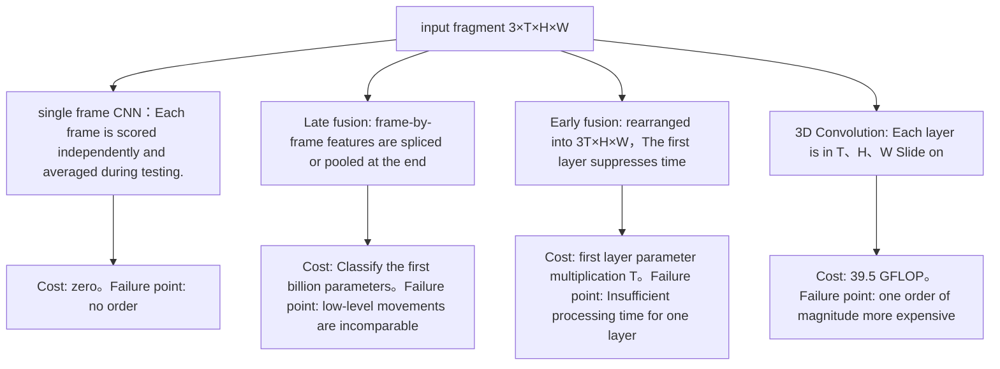
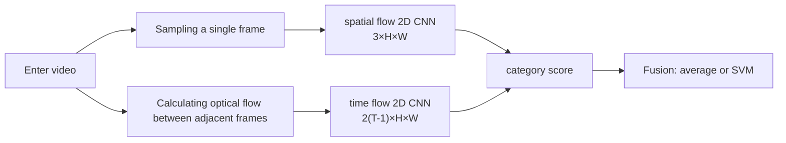
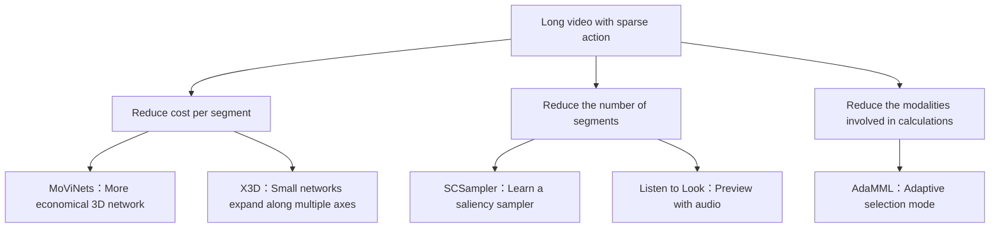
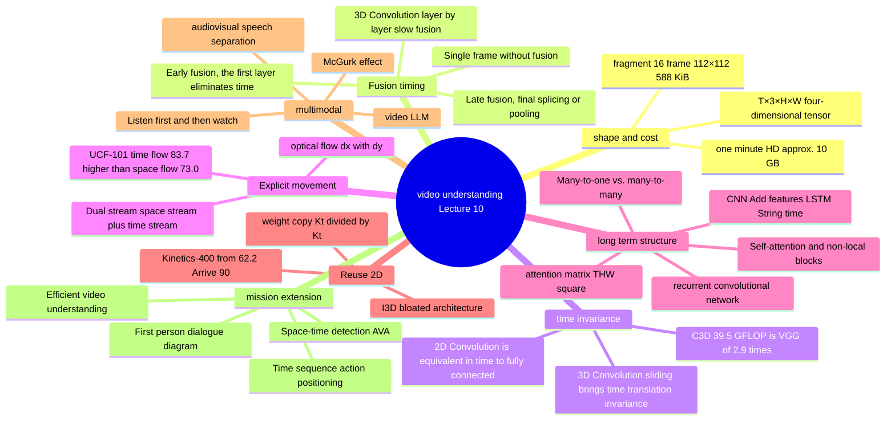

> **Course information**
>
> - **Course name**: Stanford CS231n: Deep Learning for Computer Vision(Spring 2025)
> - **This module covers**: Lecture 10. Video Understanding (103 slides)
> - **Lecturer (each lecture)**: Ruohan Gao (Lecture 10, Guest Lecturer; University of Maryland, College Park)
> - **Teaching date range**: 2025-05-01
> - **Official section**: Perceiving and understanding the visual world
> - **Course homepage**: [cs231n.stanford.edu/2025](https://cs231n.stanford.edu/2025/schedule.html)
> - **Official courseware**: [lecture_10.pdf](https://cs231n.stanford.edu/slides/2025/lecture_10.pdf) (103 pages, page-by-page illustrations in the book)
> - **Subtitle source**: [cs231n_sp25_kor_sub · eng](https://github.com/lpaiu-cs/cs231n_sp25_kor_sub/tree/main/eng) (Publicly transcribed in English, Chinese rewritten by this book)
> - **Copyright statement**: The copyright of the slides and course materials belongs to Stanford University and the instructors; this book is an unofficial study note and is only used for study and research.

By the end of Lecture 9, the 2D vision interface has been pushed to "a set of boxes plus a mask": classification is given a label, semantic segmentation is given a category for each pixel, detection is given a box for each object, and instance segmentation is given a mask for each box. The four tasks share the same backbone, the difference is only in the output shape of the head, and they share the same premise——**The input is always one frame**. This lecture dismantles this premise: the input becomes T frame, and the shape changes from 3×H×W to T×3×H×W. The extra dimension goes far beyond "storing a few more pictures": a one-minute HD original film is 10 GB, and moving a VGG-style network as a whole to three dimensions costs 39.5 GFLOPs forward, while the top-1 on Kinetics-400 goes from 62.2 in the single-frame model all the way to 90. So the real answer in this lecture is not "how to feed video into the network", but **At which layer is the temporal information fused, how much computing power is required for fusion, and are there any other modalities available besides pixels?**.

These three questions also mark this module's position in this series. Lecture 5 gave the convolution operator, Lectures 7 and 8 gave the two sets of sequence tools of looping and attention, and Lecture 9 gave the detection head; this lecture puts the three things on the same timeline, and for the first time makes "training cost" a first-class citizen in architecture selection. For this reason, it is immediately followed by the large-scale distributed training in Lecture 11: when accuracy depends on larger models and larger-scale pre-training, the object of discussion changes from "network structure" to "training system".

## 1. The extra dimension: from a picture to a volume of T×3×H×W

*(Reference time: 00:00:05 – 00:03:10｜Lecture 10)*

The first few pages are a review, but they are not redundant at the module level: every new architecture after this lecture has to be compared with a single-frame classifier that treats video as an image. First lay out the ruler, so that each subsequent increase will have a frame of reference.

### 1.1 Ten years, one guest lecturer, and one track change

The title page puts three things side by side: Lecture 10, Video Understanding, and the footer line Stanford CS231n 10th Anniversary. This lecture is the first guest lecturer of the 2025 spring semester - it was announced at the beginning of the course that several people who have taught this course before will be invited to come back and each will give a lecture on the direction they are most familiar with. The resume on the slide can be read by time: Ph.D. at UT Austin; worked as a postdoc at Stanford from 2021 to 2023, with Fei-Fei Li, Jiajun Wu and Silvio Savarese; served as a lecturer in CS231n during the 2022–2023 academic year; also stayed at Meta; now he is an assistant professor at the University of Maryland, College Park, hosting the Multisensory Machine Intelligence Lab. His key word is "multimodality": in addition to vision, sound and touch channels are also used. This background explains the sudden turn in the last third of this lecture - in his eyes, video is never a "moving image", but an event with sound.

### 1.2 What 2D vision can and cannot answer

The setting of image classification is condensed into a single line: given a set of candidate labels  $\{dog, cat, truck, plane, \dots\}$, which one of them is output. Its input is a three-dimensional tensor, and its output is a C-dimensional fractional vector. There is neither "position" nor "order" in the middle - the position is filled in by Lecture 9, and the order is filled in by this lecture.

The previous lecture advanced this set of interfaces three steps forward. The four-frame diagrams respectively marked what they gave up: classification "no spatial extent" (no spatial extent); semantic segmentation "no objects, only pixels"; detection starts to process "multiple objects"; instance segmentation requires two dogs of the same type to each have a mask. What the four have in common is **The input is always one frame**——They can all answer "what is in this picture and where", but there is no place to store "when".

When the toolbox is moved to a real scene, the gap is even more obvious: there are dogs and babies in the living room, and the detection frames and masks can be drawn, but the real message of this video is that the dog pounces and the baby laughs. **event**. A single frame cannot distinguish between "pounce" and "lying" because the postures of the two can be almost the same; the difference is only in the displacement between adjacent frames.

### 1.3 Two axis sequences, and three quantities that must be recalculated

There is no content on the middle page, just a title bar for the tenth anniversary. It appears twice in this lecture (and once on page 88), and its function is to cut the "2D visual review" and the "video itself" into two parts; it is recorded in this book because it marks the speaker's ventilation point.

The real definition is on this page: a video is a sequence of images, and the shape is a four-dimensional tensor  $T\times 3\times H\times W$, can also be written as  $3\times T\times H\times W$. These two ways of writing are not typographical preferences. The former puts the three channels of one frame together (frame priority), and the latter stacks all frames of the same channel together (channel priority); early fusion starts with  $T\times 3$  Flatten directly into  $3T$  For each channel, frame priority is used, while the convolution library requires channel priority.

> **Editor's note**:PyTorch  `nn.Conv3d`  accept  `(N, C, D, H, W)`, among which  `D`  That is, the time dimension; TensorFlow’s  `conv3d`  Default  `(N, D, H, W, C)`. This book is written  $3\times T\times H\times W$  Always refers to the "channel first" arrangement, which is consistent with PyTorch.

If the same video is changed to another axis sequence, the first layer of convolution kernel will see completely different things - this will become a specific parameter account in Chapter 3. For now, remember three quantities that must be recalculated: **The activation value grows linearly with T** (Feature map from  $D\times H\times W$  become  $D\times T\times H\times W$, video memory and computing power increase together); **The "neighborhood" of receptive fields, pooling, and normalization needs to be redefined.** (In addition to the spatial neighborhood, there is also a temporal neighborhood); **The sampling strategy itself becomes part of the model**, it will appear in three aspects in this lecture - segment sampling during training, multi-segment averaging during testing, and Chapter 12 "Which segments are worth counting".

## 2. Calculate storage first and then discuss architecture: 10 GB per minute and the compromise of “fragments”

*(Reference time: 00:03:37 – 00:08:16｜Lecture 10)*

### 2.1 Change tags from nouns to verbs

The interface of video classification is exactly the same as that of image classification, only the label set has been changed: swimming, running, jumping, eating, and standing. Since it is still "one tensor in and one fractional vector out", cross entropy, back propagation, and SGD can be moved over intact. The lecturer made the difficulty very clear: the first level of difficulty in video understanding is not the loss function, but how to turn the pixels into a feature that can be fed to the loss function.

This page spreads out the differences: here are dog, cat, fish, truck, all **noun**;The video here is swimming, running, jumping, eating, standing, all **verb**. Nouns can be determined by the texture and shape of a single frame, but verbs cannot - the definition of "run" naturally contains a time span. There are two steps to the inference: the input must be "a paragraph" rather than "a piece"; all architectural disputes boil down to the same sentence, how to compress this paragraph into a vector.

### 2.2 How many bytes are there in one minute?

Here's the math: ~30 frames per second, 3 bytes per pixel. The two figures given in the slide are that SD (640×480) is about 1.5 GB per minute, and HD (1920×1080) is about 10 GB per minute. It will be more reliable to test it yourself: $1920\times1080\times3=6{,}220{,}800$  Bytes per frame, multiplied by 1800 frames is  $1.12\times10^{10}$  Bytes, which is 11.2 GB (10.4 GiB); SD is 921,600 bytes per frame, per minute  $1.66\times10^{9}$  bytes (1.55 GiB). The page size is ~10 GB and ~1.5 GB, using GiB size.

The weight of these two numbers lies in their approximation to the hardware: one minute of HD original footage is close to the video memory of a 24 GB graphics card, and training a batch takes far longer than one minute. The lecturer also added a cost that is often ignored - not only the input must be stored, but also the weights and activation values ​​of the convolutional network.

The solution is on this page, reduce two things at the same time: frame rate and spatial resolution. The example given in the slide is  $T=16$, $H=W=112$, 3.2 seconds at 5 fps, 588 KB. This number can be calculated by hand: $16\times112\times112\times3=602{,}112$  bytes, exactly 588 KiB. The prerequisite for such a reduction is inter-frame redundancy - the lecturer's original words are "You don't have to take 30 frames per second, just 5 frames, because there is a lot of redundancy in the video frames."

| express | Number of frames × single frame bytes | Uncompressed size | Relative to the same length HD original film |
| --- | --- | --- | --- |
| HD one minute | 1800 × 6,220,800 B | $1.12\times10^{10}$ B(10.4 GiB) | 1× |
| SD one minute | 1800 × 921,600 B | $1.66\times10^{9}$ B(1.55 GiB) | about 1/7 |
| Training clips (T=16, 112×112) | 16 × 37,632 B | 602,112 B(588 KiB) | About 1/990 |

Downsampling is not free: 5 fps will blur fast movements such as swings and jumps into a blur, and 112×112 will make small objects in the distance disappear. The caliber of the slide is "If you have the computing power, of course you can use a larger resolution" - this sentence will turn into an account of 39.5 GFLOPs in Chapter 5, and it is also the same trade-off that appears repeatedly in this lecture: both spatial resolution and timing granularity cost money, the only difference lies in which layer it is spent on.

### 2.3 Train on segments, test on segments averaged

There is only one timeline on the page, labeled "Long and High FPS." What it wants to illustrate is: the complete video is not a sample that can be sent to the network at all. The length ranges from tens of seconds to several hours, and the frame rate is also much higher than the range that the model can bear.

Sliding window sampling is used during training: the long video is cut into segments of many T frames. Each segment inherits the label of the entire video and is trained as an independent classification sample. This step converts the trouble of "variable-length input" into "fixed-length input + more samples". The cost is that the samples are highly correlated - adjacent segments almost overlap, and the effective information in the gradient is not as much as the number of samples seems.

When testing, do the opposite: sample a number of clips from a long video (about 10 were mentioned in class), score each clip separately, and then average the probabilities as predictions for the entire video. Someone in the class asked "how many frames should be taken?" The lecturer's answer was: All models in this lecture assume a fixed length (16 or 32 frames). How to aggregate segment-level predictions is another question.

This "train on segments, test on average" protocol is a common premise for all subsequent models. It has two implicit assumptions that are worth breaking here. One is **clip tag equals video tag**——This is true for a video like Sports-1M, which contains only one kind of sport in its entirety, but not for unedited videos. The temporal action positioning in Chapter 10 is designed to dismantle this assumption. The second is **Segments can be averaged**——If the action only occurs within ten seconds, most of the ten randomly sampled clips will be empty, and the average value will be diluted. This is what Chapter 12's "Efficient Video Understanding" is about.

## 3. Four divisions of fusion positions: single frame, late fusion, early fusion and slow fusion

*(Reference time: 00:08:29 – 00:19:16｜Lecture 10)*

With the unified input of "segment", there is only one question left: At which layer is the information of T frames merged? The four answers are arranged by fusion position - no merging at all (single frame), last merging (late fusion), frontmost merging (early fusion), layer-by-layer merging (3D convolution). The lecturer talks in this order, using two pages each for late fusion and early fusion. On the second page, only a line of red text is added to the previous page, and that line of red text marks the point where the plan fails. So the way to read this chapter is to focus on the red letters rather than the structure diagram.

### 3.1 Single-frame CNN: run this baseline first

The most trouble-free way is to treat the video as an image: each frame is passed through a 2D CNN, and the probability of each frame is averaged during testing. Each of the seven frames on the slide passes through a CNN, and all output "Running". The lecturer gave it a very high evaluation——**This tends to be a very strong baseline**: For clips like running, there is little change between frames, and the static appearance is enough to distinguish. You should run any video model before designing it. Don’t write 3D convolution right away.

The real problem is thus pushed to sampling. The lecturer paused here and said, "How to collect frames is a key issue in itself and an active research direction." The stupidest way is to uniformly sample (one frame per minute for a one-hour video). A better way is to use the result of the first judgment to decide where to look next. This foreshadowing is recycled in Chapter 12.

### 3.2 Late fusion: combine T feature maps into a giant vector

The first step of late fusion is still to pass the 2D CNN frame by frame, but it no longer directly outputs the category, but takes the middle layer feature map, shape  $T\times D\times H'\times W'$. Then flatten and splice to get one  $TDH'W'$  Dimensional "segment features" are then sent to MLP to map to C category scores. It is called "late" because each frame is processed independently to a very late stage, and the time information is not put together until the end.

It is not difficult to calculate the parameter account, and once you have done the calculation, you will know that this road will not go far. take  $D=512$, $H'=W'=7$, $T=16$: The features of each frame are 25,088 dimensions, and together they are 401,408 dimensions; if the first layer is fully connected and has a width of 4096, this layer is  $401{,}408\times4096\approx1.64\times10^{9}$  parameters. ResNet-50 has about 25.6 million parameters, and this classification head is more than sixty times that, and this number grows linearly with T - the fragment is pulled from 16 frames to 32 frames, and the classification head doubles directly.

The modification method is very straightforward: instead of splicing, do average pooling in space and time, and  $T\times D\times H'\times W'$  Press it into a D-dimensional fragment vector, and then pass through a linear layer to obtain C scores. The number of parameters dropped from billions to  $512\times C$, and no longer increases with T.

The price is written in red on the next page: **Low-level motion between frames becomes difficult to compare**. The lecturer used the runner's feet in the picture as an example - the foot position marked by the red circle is different in each frame, which is the most direct clue to judge "running"; but the frame-by-frame 2D CNN is convolutional and pooling all the way to the deep layer, and the feature map no longer has position-level information such as "in which frame the foot was raised", and only the semantic-level appearance is left. Average pooling then suppresses the timeline, leaving no order left.

This is the true meaning of "late": the later the fusion occurs, the more abstract the thing being fused is. Deep features are good at answering "Does it look like running in the picture?" but not good at answering "How much did the feet move between two frames?" The lecturer added an intuition: the earlier the feature is extracted, the closer it is to the original frame, and the more likely it is to retain low-level motion; the further back, the more semantic it is. Late Fusion fixes this choice at the "backward" end.

### 3.3 Early fusion: suppress 3T channels at one time

Early fusion goes to the other extreme: directly stacking the three channels of the T frame into 3T channels and rearranging them into  $3T\times H\times W$, let **first floor**  2D convolution maps the channel dimension from 3T to D. From then on, the entire network is a standard 2D CNN, except that the time information has been compressed into a  $D\times H\times W$  The feature map of - this sentence is written very straightforwardly on the slide: collapses all temporal information.

The advantage is that the time receptive field is in place in one step: the first layer of convolution kernel covers all T frames in time. The parameter cost is not small: the first layer is  $D\times3T\times3\times3$, $T=16$  When input channel 48, if  $D=12$  Then there are 5,184 parameters; for the same D and convolution kernel size, the late fusion layer only has  $12\times3\times3\times3=324$ , a difference of 16 times. This 16 times is the direct result of "time being folded into the channel".

The red letter points out its faults: **Just relying on one layer for time processing may not be enough.**. The first layer of convolution is linear weighting plus nonlinearity. It can express "which positions of which frames are lit at the same time", but it is difficult to express the sequential relationship of "first A, then B" - and actions are precisely defined by order. The lecturer's statement was "We are too greedy and want to grab everything on one floor."

### 3.4 3D convolution: Let the receptive field grow together in time and space

The third way is 3D convolution: both the convolution kernel and the pooling kernel have one more time dimension, and the input is  $3\times T\times H\times W$, the features of each layer in the network are four-dimensional tensors  $D\times T\times H\times W$, the time dimension is gradually reduced layer by layer. Karpathy and others call it "slow fusion" - not at the front or at the end, but dispersed into every slide of each layer.

### 3.5 Put the four fusion methods into a table

The differences between the four routes can be squeezed into a table. The last column of the table is the reason for the existence of this table: each fusion method has a clear failure point, and these failure points cannot be eliminated by adjusting parameters, but can only be eliminated by changing positions.

| Plan | At which level does time information enter? | time perception field | represents parameter account | Can you express "A first, then B"? | main failure point |
| --- | --- | --- | --- | --- | --- |
| Single frame CNN | No entry (only average probability during testing) | 1 frame | Same as 2D network | Can't | Inter-frame order is completely lost |
| Late Fusion + FC | Last (spliced backward MLP) | all T-frames, but only in the last step | Classification header approx.  $1.64\times10^{9}$ (T=16, D=512, 7×7, hidden layer 4096) | Theoretically, it is possible, but in practice it is limited by the fact that the features have been semantically | Parameters grow linearly with T |
| late fusion + pooling | Finally (spatiotemporal average pooling) | All T-frames, no order | $512\times C$ | Can't | Low-level sports are incomparable |
| early fusion | First layer 2D convolution | All T frames, the first step is in place | Ground floor  $D\times3T\times3\times3=5{,}184$(T=16, D=12) | Weak (single layer linear weighting) | Insufficient time processing in one layer; no time translation invariance |
| 3D convolution (slow fusion) | every layer | Grows up layer by layer: 3 → 6 → 14 → 20 | Ground floor  $D\times3\times3\times3\times3=972$ (D=12); C3D entire network 39.5 GFLOPs | Strong (multi-layered space-time nonlinearity) | Computing power is an order of magnitude more expensive |

The bifurcation point of the four branches is the position of the "fusion layer": B is not fused at all, C is fused at the end, D is fused at the first layer, and E is fused at every layer. The amount of parameters, time receptive field, and whether the order can be expressed are all determined by this position. **Late fusion leaves time to the end, early fusion puts time at the front, and 3D convolution spreads time to each layer - three routes, three costs.**

## 4. From 2D convolution to 3D convolution: turn the kernel into a cube, and then use three ledgers to check the calculation

*(Reference time: 00:19:16 – 00:26:06｜Lecture 10)*

The last path in the previous chapter requires a clear explanation of "3D convolution", and the best way to explain it clearly is to review 2D convolution first - because the extra dimension changes three things: the shape of the kernel, the shape of the output, and "how much input does an output value see?"

The 2D convolution kernel only slides in the H and W directions, and the third dimension (channel) is full at once: $5\times5\times3$  The core slides through  $32\times32\times3$  As input, each position outputs a scalar, and we get  $28\times28\times1$  activation map. The channel here is not "space", but "the length of the feature vector at each position".

3D convolution turns the kernel into  $k_t\times k_h\times k_w$  The cube: not only slides across the x and y of the screen, but also slides across the timeline. The three sets of numbers (6×6×6, 5×5×5, 4×4×4) marked on the slide are the kernel sizes of the three-layer convolution. The square itself depicts the feature body being reduced layer by layer, and finally connected to the FC layer to output the category score. Note that only three axes are drawn on the figure, and the channel dimension C is omitted - the real tensor is  $C\times T\times H\times W$, each grid point is a complete C-dimensional vector. The lecturer specifically reminded this because four-dimensional objects cannot be drawn on paper, and all schematic diagrams of 3D convolution are missing one dimension.

### 4.1 Three toy ledgers: one input, three sensory fields

The next eight pages are a frame-by-frame build of the same table. The input is unified as  $3\times20\times64\times64$ (20 frames, 64×64), the layer width is deliberately made small, and the lower right corner of the slide also states "The actual model is much larger." The correct way to read these eight pages is to focus on "what is more in this frame than the previous frame": the table has one more row each time, and the node graph below has one more layer each time. The red dot marks exactly "how many inputs an output value has seen."

There are only two lines of data in the first frame: Input is  $3\times20\times64\times64$,Conv2D(3×3, 3→12) output  $12\times20\times64\times64$, feeling field  $1\times3\times3$. Note that T is still 20 - this layer only slides on H and W, and the time dimension is not even touched.

In the second frame, a node graph is added below the table: the Input row is a blue dot, the Conv(3×3) row is also a dot, and the three red dots in the middle converge into one red dot. this is  $1\times3\times3$  The origin of - an output is only connected to three adjacent inputs; there are no cross-frame connections in the time dimension, so the first number is 1.

Add a row to the third frame Pool2D(4×4): the size becomes  $12\times20\times16\times16$, feeling field  $1\times6\times6$. The node graph correspondingly has an additional Pool (4×4) layer, and the red dots expand from 3 to 6 - pooling enlarges "one output to see several inputs".

The fourth frame is supplemented with Conv2D(3×3, 12→24): $24\times20\times16\times16$, feeling field  $1\times14\times14$, the node graph grows to four layers. The first conclusion "Build slowly in space" appears on the right side at the same time.

Fifth frame completion and late fusion: GlobalAvgPool  $24\times20\times16\times16$  pressed into  $24\times1\times1\times1$, jump to the feeling field column  $20\times64\times64$, the entire node chain turns red. The sentence on the right is completed as "Build slowly in space, All-at-once in time at end" - the time receptive field is not grown, but covers all 20 frames at once at the moment of global averaging.

Early fusion is added in the sixth frame: the first layer after Input is Conv2D (3×3, 3\*20→12), and T disappears directly in the output size ($12\times64\times64$), the first row of the receptive field is  $20\times3\times3$;The following Pool2D and Conv2D will only continue the long space, and the time is always 20. Change the label on the right to "All-at-once in time at start".

The seventh frame adds 3D CNN: Conv3D(3×3×3, 3→12) rear receptive field  $3\times3\times3$, after Pool3D(4×4×4)  $6\times6\times6$  And T drops from 20 to 5, and then a Conv3D to  $14\times14\times14$. The two lines on the right have quotation marks "Slow Fusion" next to "Build slowly in space, Build slowly in time".

Nothing is added to the last frame, only a line of words appears in the center of the table: What is the difference? The three accounts are put together, and the difference is only one sentence: **Is the time perception field on the last layer, the first layer, or does it grow on each layer?**.

There is another observation hidden in the three ledgers that is easy to miss: the Size column in the column that was merged early is missing one dimension ($12\times64\times64$  instead of  $12\times20\times64\times64$), because it folds 20 frames into the channel; and the Size column of the 3D CNN remains T until the last GlobalAvgPool. **"In which column time disappears" describes a fusion method more accurately than any written description.**  Also remember the downsampling rhythm of the 3D column: Pool3D presses T from 20 to 5 at a time, and the receptive field jumps from 3 to 6 - the downsampling of the time dimension in the 3D network must be radical, because T is inherently short and cannot be consumed.

## 5. Temporal translation invariance: the real buying property of 3D convolutions, with a bill of 39.5 GFLOPs

*(Reference time: 00:26:12 – 00:39:10｜Lecture 10)*

The toy table in the previous chapter puts early fusion and 3D convolution together. The time receptive field of both can eventually cover the entire segment, and the difference is reduced to "the first layer grows or each layer grows." This chapter expands that sentence into two questions: What exactly does 2D convolution do in the time direction? On which layer does the overpay for 3D convolution go?

### 5.1 2D convolution is "fully connected" in the time direction

This picture uses 2D convolution on a tensor where "time has been spelled into the channel": input  $C_{in}\times T\times H\times W$, the weight is  $C_{out}\times C_{in}\times T\times3\times3$——Note that there is indeed a T dimension in the core, but it is the entire paragraph "read at once", not "sliding". It slides on x and y, and the channels are full at one time (that is, all 3T channels are connected), and the output is still  $C_{out}\times T\times H\times W$, T=16 is no less. Therefore, the "2D convolution" of early fusion appears to be convolution, but in the time direction it is actually **Fully connected**: Each output grid point is connected to all 16 frames.

The conclusion follows: **No time translation invariance**. If the same "blue to orange" transition occurs in the 4th and 15th frames, the convolution kernel uses different slices (the 4th slice and the 15th slice) in the weight at these two moments, and must be learned separately. This is not the case spatially at all - whether the same edge appears in the upper left corner or the lower right corner, the same set of 3×3 weights is used, which is why convolution works on images.

The slide puts the question into a questioning question: How to move between space and time? **Anywhere** Identify the transition from blue to orange? The answer is not in 2D convolution, because its temporal weights are bound moment by moment.

### 5.2 What 3D convolution buys is "the same kernel slides through all times"

Switching to 3D convolution, the weight is  $C_{out}\times C_{in}\times3\times3\times3$, the extra one dimension allows the kernel to only cover 3 frames in time (T=3 marked on the figure is the time width of the kernel, and the input is still 16 frames). So each position in the output only depends on a local window of 3 frames, rather than all 16 frames.

This is what I bought **Time translation invariance**: The same core is shared from t=1 to t=14. No matter which moment the change from blue to orange occurs, it is responded to by the same set of weights. The lecturer classified this as "representation efficiency" - there is no need to learn a kernel for each moment. The three ledgers in Chapter 4 are really closed here: what 3D convolution saves is not parameters, but **The number of patterns to be learned**.

The rewards are directly visible on this page. The first layer filter is therefore a  $3\times4\times5\times5$  The small videos can be played one by one like a GIF: some kernels only respond to color patches (almost degenerating into 2D filters), some respond to motion in a certain direction, and some respond to temporal changes in edges. The lecturer reminded that this is not just a visualization technique, it shows that 3D convolution is indeed learning patterns such as "motion", rather than just stacking frames.

### 5.3 Sports-1M: Single frame 77.7, 3D convolution 80.2

This page of the data set shows the scale and difficulty: 1 million YouTube videos, tagged with 487 sports categories, down to the difference between marathon and ultra marathon that a layman can’t tell (the lecturer’s original words are “I don’t know the difference between the two”). The blue box on the picture is the annotation box, the green words are correct predictions, and the red words are wrong predictions - it is also a visualization of the model output.

The lecturer added some troubles unique to the data set: the videos were too large to be packaged and distributed like ImageNet, and Sports-1M initially only released a list of YouTube URLs; ten years later, users deleted and changed videos, and the lecturer estimated that "about half of the one million links back then are no longer there."**This means that the numbers from 2014 are difficult to replicate today.**, take this into account when reading old papers.

The results page is the first counter-intuitive result of this lecture: the single-frame model is 77.7, the early fusion is 76.8 (but lower), the late fusion is 78.7, and the 3D CNN is 80.2. Fusion of time information does not automatically bring improvement - the linear projection of the layer fused early cannot take the order, and the pooling of late fusion smooths out the low-level motion. Only the 3D convolution of layer-by-layer fusion gets 2.5 points. The two comments on the right side of the slide are the lecturer's conclusion: the single-frame model is very strong, always try it first; 3D convolution has made great progress since 2014.

### 5.4 C3D: Move VGG as a whole to three dimensions

The idea of ​​C3D is "3D version of VGG": input  $3\times16\times112\times112$ (Exactly the 588 KB fragment in Chapter 2), all convolutions are 3×3×3, and all pooling are 2×2×2, with the exception of Pool1, which uses 1×2×2—without downsampling in time, halve the space first. The eight convolutions are followed by FC6 and FC7, each with 4096 dimensions, and FC8 outputs class C. It publishes the weights after pre-training on Sports-1M. Many people use it as a video feature extractor: after extracting the features and then connecting it to a linear classifier, you save money on training a 3D network.

This page adds the most important column: layer-by-layer MFLOPs. Adding these numbers up is exactly 39.5, which is consistent with the 39.5 GFLOPs of C3D marked on the left side of the page; for comparison, AlexNet 0.7 GFLOPs, VGG-16 13.6 GFLOPs, and C3D is 2.9 times that of VGG. You can choose a layer to check: Conv3b is a 3×3×3 convolution of 256→256, and the output  $8\times28\times28$, $256\times256\times27\times8\times28\times28\approx1.11\times10^{10}$, exactly corresponding to 11.10 in the table above. This layer alone accounts for 28% of the entire network.

| network | input | single forward | Relative to VGG-16 |
| --- | --- | --- | --- |
| AlexNet | single frame image | 0.7 GFLOP | 0.05× |
| VGG-16 | single frame image | 13.6 GFLOP | 1× |
| C3D | Fragment 16×112×112 | 39.5 GFLOP | 2.9× |

It is clear where the money is spent: the same 3×3 kernel is multiplied by 3 in time, and the feature map has one more dimension T=8. The multiplication of the two terms is an expansion of more than twenty times. The computing power of 3D convolution is not "slightly more expensive", but an order of magnitude more expensive.

There is another account that can be read directly from this table: Conv2 and Conv3b are tied for the most expensive (11.10 each). The reason is that Pool1 uses 1×2×2, and T is still 16 in the second layer. If Pool1 is also downsampled in time by 2×2×2, the FLOPs of Conv2 will be immediately halved to 5.55. **C3D took the initiative to pay this sum in order not to sacrifice time resolution in the early stages.**——This is the explicit choice of "computing power for time resolution" that is the clearest in the whole lecture: the 1×2×2 of Pool1 only compresses space, not time, and the cost is directly recorded in 11.10 in the Conv2 line.

After adding C3D, the histogram becomes 77.7 / 76.8 / 78.7 / 80.2 / 84.4. C3D is 6.7 points higher than a single frame and 4.2 points higher than the 3D CNN in 2014 (the lecturer's caliber is "about 4% top-5 gain"). This page also marks the baseline for the first half of this lecture: **At a budget of 39.5 GFLOPs, Sports-1M has a top-five accuracy of approximately 84%**. All architectures in the second half - dual-stream, RNN, non-local blocks, I3D - can be understood as "wanting to exceed this line with less computing power, or to exceed more with the same computing power."

## 6. Appearance and motion are calculated separately: optical flow, dual flow, and the counter-intuitive idea of “stronger motion flow”

*(Reference time: 00:39:59 – 00:45:22｜Lecture 10)*

3D convolution stuffs space and time into the same core, at the cost of multiple times in time for each core  $k_t$, the output has one more dimension T, and the stacking of the two items is an expansion of an order of magnitude. Let’s ask another question in this chapter: space and time are two signals with different properties. Can they be processed separately by two independent channels and then combined at the fractional level? The instructor first gives a human experiment as motivation, then gives tools to explicitly measure motion, and finally the two-stream network and its results on UCF-101.

### 6.1 Only movement is enough to recognize actions

The slide refers to Johansson's 1973 classic experiment (point-light display): only a few joint points on the human body are retained as bright spots, and the rest are blacked out. The observer can still recognize "walking", "running" and "sitting". The freeze frame on this page is almost completely black, with only a few bright spots - the lecturer played a short clip live to let the audience guess the action: there is no appearance, no background, no color, just the movement trajectory of the dots. This page establishes a premise: **Movement itself is a strong discriminant signal**, no need to rely on textures and objects. In this case, there is no reason to force a convolution kernel to learn appearance and motion at the same time.

### 6.2 Optical flow: Write "where the pixels go" into two channels

An explicit tool for measuring motion is optical flow: take two adjacent frames and estimate how much each pixel has moved from one frame to the next. There are only two frames of original images on the page, and there are no arrows - let people see what the input is first.

The second frame adds the definition: optical flow is a displacement field  $F$, map each pixel of the t-th frame to the position of the t+1-th frame, $F(x,y)=(dx,dy)$, satisfy  $I_{t+1}(x+dx,\,y+dy)=I_t(x,y)$. The lecturer mentioned that there are many assumptions for the specific algorithm (the most commonly used one is "brightness constant": the brightness of the same point does not change after moving), but no matter which one is used, the output is a two-channel image.

Take it apart in the third frame and look at it: the horizontal component  $dx$  with vertical component  $dy$  Each is a grayscale image. The bright areas of the former move horizontally, and the bright areas of the latter move vertically. The sentence on the right side of the slide is "Optical flow highlights local motion." This step is very important, because the next input of the dual-stream network is "the  $(dx,dy)$  Stack them up as two channels."

### 6.3 Dual-stream network: one looks at appearance, the other only looks at movement

The structure is on this page: the previous entry **spatial flow** (spatial stream) eat a single frame  $3\times H\times W$, which is an ordinary image classification network; the following one **time flow** (temporal stream) Eat stacked optical flow, the number of input channels is  $2(T-1)$——T frames generate T−1 flow fields, each field has two channels. The structures of the two streams are completely symmetrical (conv1 7×7×96 step size 2, conv2 5×5×256 step size 2, conv3–5 are all 3×3×512, fc6 4096, fc7 2048), and are finally fused at the class score layer. Special note on the slide: The first layer of 2D convolution of the time stream processes all optical flow maps at once, that is, early fusion is used inside the time stream.

This design actually uses the four-part rule from the previous chapter: "single frame" for appearance, "early fusion" for motion, and "late fusion" between the two paths. **Three convergence strategies appear in the same network, each managing a section.**——This is the most easily overlooked point of Shuangliu, and it is also the reason why it can obtain evidence of both appearance and movement at the same time.

Results on UCF-101 (101 classes of actions): 3D CNN 65.4, spatial stream only 73.0, temporal stream only 83.7, two-stream average 86.9, two-stream + SVM fusion 88.0. The most worth stopping at are the second and third pillars——**The time flow that only looks at movement is 10.7 points higher than the spatial flow that only looks at appearance.**. The lecturer's explanation is a hypothesis: the appearance flow is easy to overfit the background (the background and category of many videos in UCF-101 are strongly related), while the motion flow is almost only the action itself, which makes it harder to cheat.

This section should be given three boundaries. First, optical flow is pre-computed. The first half of inference is based on traditional algorithms, and end-to-end training only covers the second half of the network. "One model" is actually "one model + one algorithm." Second, the two streams do not share gradients, doubling the training cost; the video itself is already more expensive than the image, so this is a big deal. Third, "stronger motion flow" is a phenomenon on UCF-101. The lecturer himself uses the word hypothesis - on a data set where background and action are decoupled, this conclusion may not be true.

## 7. Five seconds away: CNN extracts features, RNN serializes time, and then hits parallelism

*(Reference time: 00:45:22 – 00:51:42｜Lecture 10)*

As of Chapter 6, all models only process 2 to 5 seconds of clips - this is not a design choice, but a physical limitation of the receptive field: there are more than a dozen layers of 3D convolution stacks, and the temporal receptive field is only a few dozen frames. The time scale of possible actions can range from "raising a hand" to "cooking", with the latter spanning several minutes. This chapter lays out the problem, answers it using the tools in Lecture 7, and finally sees why it has not been used.

### 7.1 Outside the local window

The limitation is written in the title of the slide: Previous temporal convolutional networks only modeled "local motion within a very short segment and between frames." So what about long-term structures? A CNN timeline covering about 5 seconds is drawn at the bottom of the page, with First event and Second event marked on both sides - the two events are far apart and cannot fit in any local window.

The second frame points the answer to tools already learned: sequence modeling with recurrent neural networks (RNN). This is not new knowledge, but the tools used in lectures 7 and 8 have been transferred and used - this is exactly the recurring pattern in this lecture: video understanding rarely invents new operators, but mostly rearranges the ready-made parts of images and sequences.

### 7.2 Two steps: CNN extracts local features, LSTM extracts global features

The specific approach is divided into two steps. The first step is feature extraction: segments are taken at fixed intervals along the time axis, and each segment is passed through a CNN (2D or 3D) to obtain a series of feature vectors. The role of CNN here has degenerated from "classifier" to "fixed-length local encoder".

The second step is to feed this string of features to the LSTM. At this time, the time span is no longer limited by the receptive field of the CNN - as long as the hidden state is passed on, the information of the first second can affect the output of the tenth second.

There are two output forms. **many to one** (many-to-one) Only take the output at the last time step to get a video-level label, corresponding to the setting of "One category for the entire video" in Chapter 2.

**many to many** (many-to-many), each time step is output, which is suitable for frame-by-frame annotation tasks. The temporal action positioning in Chapter 10 falls into this category. The same network can serve two tasks by changing the readout method.

The slide gives a very practical engineering suggestion: In order to save video memory, you can **Do not back-propagate gradients back to CNN**, but pre-train the CNN, freeze it, and only train the subsequent loop part. Otherwise, end-to-end training of a "convolution + loop" giant network will be very difficult. This suggestion appeared in the work of Baccouche and others in 2011, and was popularized by Donahue et al.'s LRCN in 2015 - the lecturer added: The 2011 article was far ahead of its time, because AlexNet did not appear until 2012.

This page puts the properties of the two side by side: each value inside the CNN is **Fixed time window** function (local time structure), each vector inside RNN is **All previous vectors** function (global time structure). The question naturally becomes: Can the two be combined into one network?

### 7.3 Circular convolutional network: convert matrix multiplication into convolution

First review the shape of multi-layer RNN: the horizontal axis is time, the vertical axis is depth, and each grid point  $h_t^l$  Receive at the same time the previous moment of the same layer  $h_{t-1}^l$  at the same time as the layer below  $h_t^{l-1}$. The instructor said that the same grid can be used to process videos, except that each grid point is changed from a vector to a feature map.

A recurrent convolutional network is a convolutional version of this grid: all states are  $C\times H\times W$  Each grid point relies on two inputs - the feature map of the same layer at the same time, and the feature map of the previous layer at the same time; each layer has its own set of weights, and the weights are shared in time.

The comparison page first shows ordinary 2D convolution: an input feature map  $C\times H\times W$, an output feature map  $C\times H\times W$.

Then draw the loop unit: the new state is the "old state" and "current input" passing through a certain parameter  $W$  The result of the function. This step is no different from standard RNN.

The key line is on this page: take the vanilla RNN  $h_t=\tanh(W_h h_{t-1}+W_x x_t)$  All matrix multiplications in are replaced by 2D convolutions, $W_h$, $W_x$  From the matrix to the convolution kernel, the results of the two convolutions are added and then passed through tanh to obtain the latent feature map at the current moment. The parameter size therefore changes from "the square of the state dimension" to "core size × number of channels", independent of the time length.

This page puts the three time spans side by side: the receptive field of a regular CNN is **limited**, only the fixed window can be seen; the memory of the fully connected RNN is **unlimited** Yes, you can look back at the entire history; the same is true for circular convolutional networks **unlimited**, but its state update is implemented using convolution - local connections and weights are shared over time, and the memory is still passed down all the way through the hidden state.

The price also came. The recurrent convolutional network combines the locality of convolution and the infinite memory of loops, but it inherits the fatal shortcomings of RNN: **Time steps must be calculated serially**, a video of one thousand frames requires one thousand forward passes, and the parallelism of the GPU is almost useless. The lecturer said that this is the reason why this type of model "has not been used" - it is not that the effect is not good, but that it is too slow.

| structure | time perception field | Dependencies for each location | Parallel across time | represent |
| --- | --- | --- | --- | --- |
| 2D / 3D CNN | Finite (depth × core width) | Frames within a fixed window | is | C3D, I3D |
| Fully connected RNN | unlimited | All history (hidden state) | No | LRCN |
| recurrent convolutional network | unlimited | All history (convolution updates) | No | Ballas et al., ICLR 2016 |
| self-attention | Unlimited (see all at once) | overall space-time position | is | non-local block |

This table opens the door to the next chapter: among the four structures, the only one that satisfies both "infinite time span" and "parallelism across time" is self-attention. Chapter 8 begins here.

## 8. Non-local blocks and expansion: buy “global” and “pre-training” at the same time

*(Reference time: 00:51:42 – 00:58:20｜Lecture 10)*

The table in the previous chapter points out the answer very clearly: an operator that can see the overall situation and be parallelized is needed. The answer has already appeared in Lecture 8 (Attention and Transformer) - self-attention. This chapter first moves self-attention into a pluggable block, and then answers what the 3D CNN outside it should look like.

### 8.1 Self-attention review: Turn "where to look" into a matrix multiplication

Each position in the self-attention emits three vectors of query, key, and value at the same time ($q=xW_q$, $k=xW_k$, $v=xW_v$), the alignment score of any two positions is  $e_{ij}=q_j\cdot k_i/\sqrt{D}$, get the weight after softmax  $a_{ij}$, the output is  $y_i=\sum_j a_{ij}v_j$. The key is: **Alignment of all positions can be calculated simultaneously**, no time step dependence.

### 8.2 Non-local block: seven frames create a pluggable block

Moving self-attention to the video is a nonlocal block (Wang et al., CVPR 2018). The first frame first lays out the undertaking structure: the input fragment is first passed through 3D CNN to obtain  $C\times T\times H\times W$  Characteristics, then enter this block.

Three 1×1×1 convolutions are added to the second frame: they map the C-dimensional features to the C' dimension, and obtain three queries, keys, and values.  $C'\times T\times H\times W$  feature map. The reason for using 1×1×1 instead of 3×3×3 is to allow this block to only take care of the “global relationship” and leave the local structure to the external 3D convolution.

The third frame is the core: flatten and transpose the spatial and temporal dimensions of queries, and multiply them with keys to get a  $(THW)\times(THW)$  The attention matrix is then softmaxed row by row. The "non-local" here means literally - every position is in and **all** Compare spatio-temporal locations instead of just looking at neighborhoods.

In the fourth frame, use this matrix to weight the values and get a  $C'\times T\times H\times W$  new feature map. At this point, the new feature of each position is the weighted sum of the features of all positions.

In the fifth frame, a 1×1×1 convolution is added to map C' back to C so that it can be aligned with the original input.

The sixth frame adds residual connection (+), and the output of the block = original feature + attention result. This is the premise that it can be plugged into any network: in the worst case, the identity mapping will be learned and the existing features will not be destroyed.

The last frame strings the blocks together: 3D CNN → Non-local block → 3D CNN → Non-local block → Running. The slide also raises the question: non-local blocks can be inserted into any 3D CNN, but **What is the best 3D CNN architecture?**? This brings the topic to I3D.

There is an account that must be settled here. The attention matrix is  $(THW)\times(THW)$, if in  $T=16$, $H=W=56$  Based on the characteristics of $THW=50{,}176$, the matrix has  $2.5\times10^{9}$  elements, half-precision requires 5 GB—a single layer would overwhelm the video memory. So non-local blocks can really only be placed on layers whose resolution has been downgraded a few rounds, e.g.  $T=8$, $28\times28$  time  $THW=6{,}272$, the matrix is about  $3.9\times10^{7}$  elements, approximately 78 MB. **"Global" has a price, and the price increases with the square of the feature map area.**, this is also the direct reason why Transformer needs to factorize attention in the following video.

### 8.3 Expansion: Moving 2D architecture into three dimensions

I3D (Carreira and Zisserman, CVPR 2017) has only one idea: take a mature 2D CNN and convert each  $K_h\times K_w$  The convolution or pooling layer is replaced by  $K_t\times K_h\times K_w$  3D version of. In this way, the topology, number of channels, and depth of the network remain unchanged, but the core has one more dimension.

The specific object to be expanded is the Inception block: four parallel branches (5×5 convolution, 3×3 convolution, 1×1 convolution, 3×3 maximum pooling), each branch is preceded by a 1×1 convolution for dimensionality reduction, and finally spliced along the channel.

After expansion, 5×5 becomes 5×5×5, 3×3 becomes 3×3×3, 1×1 becomes 1×1×1, and even the maximum pooling becomes 3×3×3. The topology is exactly the same, and the expansion factor of the parameter quantity is given by  $K_t$  decision.

### 8.4 Weights can also be inflated: copy K\_t copies and divide by K\_t

The structure can expand, and so can the weights. The method is: copy the 2D convolution kernel along the time axis  $K_t$  parts, and then divide the whole by  $K_t$, use it to initialize the corresponding 3D convolution. The reason is a line of algebra - if you enter the video  $K_t$  The frames are exactly the same (constant video), the output of the 3D convolution is

$$
\frac{1}{K_t}\sum_{t=1}^{K_t}\sum_{c,k_h,k_w} w_{c,k_h,k_w}\,x_{c,k_h,k_w}=\sum_{c,k_h,k_w} w_{c,k_h,k_w}\,x_{c,k_h,k_w},
$$

Exactly equal to the result of 2D convolution on a single frame. **This ensures that the expanded network will not degrade on "still video"**, the edge and texture detectors learned on ImageNet are retained as they are, and the remaining time dimensions are fine-tuned from the video data. The slide writes this thing into three actions: duplicate input  $K_t$ times, copy kernel $K_t$ times, divide by $K_t$, and noted that "when given a constant video input, the output is the same as 2D convolution."

The results page separates the two factors of "architecture" and "pre-training": Per-frame CNN 57.9→62.2, CNN+LSTM 53.9→63.3, Two-stream 62.8→65.6, Inflated CNN (I3D) 68.4→71.1, Two-stream inflated 71.6→74.2. Three things are worth remembering: the CNN+LSTM trained from scratch is only 53.9, which is worse than a single frame, indicating that the loop part is difficult to train; pre-training compensates this level the most (+9.4); the expansion itself (68.4 vs. 62.8) already brings 5.6 points, without any new data.

There is another inference: Two-stream inflated is 3.1 higher than Inflated CNN, indicating that "inflation" and "two-stream" are two independent benefits that can be superimposed - the former models time, and the latter makes motion explicit.

## 9. From 62.2 to 90: Transformer comes into play and what three types of evidence the model relies on

*(Reference time: 00:58:20 – 01:01:16｜Lecture 10)*

Chapter 8 uses dilation to get around the question “What is the best 3D CNN?” without actually answering it. The curve on Kinetics-400 gives another way: instead of changing the convolution, replace the protagonist of sequence modeling with Transformer, and let the pre-training scale fill in the data.

### 9.1 Three routes: decomposing attention, pooling to reduce tokens, and masked autoencoding

Transformer is divided into three routes after entering the video. The slides only list the papers but do not expand on them: **Break down attention** (Attention is done separately in space and time, represented by Bertasius et al.'s "Is Space-Time Attention All You Need for Video Understanding?", ViViT, and Video Transformer Network); **Pooling module** (Reduce the number of tokens layer by layer, represented by MViT and MViTv2); **Video mask autoencoding** (Moving MAE to video, represented by VideoMAE, VideoMAE V2 and "Masked autoencoders as spatiotemporal learners"). The three routes are respectively solving the three cost items of attention: the square of the number of tokens, the number of tokens themselves, and the dependence on annotated data.

### 9.2 Ten-year curve

Putting the numbers together: Per-frame CNN 62.2, CNN+LSTM 63.3, Two-stream 65.6, I3D 71.1, Inflated I3D 74.2, SlowFast 16×8+NL 79.8, MViTv2-L 86.1, VideoMAE V2-g 90. From 62.2 to 90 is 27.8 points, and the sources of points increase at each level are different.

| Model (Kinetics-400, top-1) | Accuracy | Newly introduced parts | Relatively previous level |
| --- | --- | --- | --- |
| Per-frame CNN | 62.2 | ImageNet pre-training + single frame | baseline |
| CNN + LSTM | 63.3 | loop | +1.1 |
| Two-stream | 65.6 | optical flow | +2.3 |
| I3D(Inflated) | 71.1 | 3D dilation + pre-training | +5.5 |
| Two-stream I3D | 74.2 | Dual flow + expansion | +3.1 |
| SlowFast 16×8 + NL | 79.8 | Double rate + non-local block | +5.6 |
| MViTv2-L | 86.1 | Multi-scale Transformer | +6.3 |
| VideoMAE V2-g | 90.0 | Masked autoencoding pre-training | +3.9 |

This table must be accompanied by three readings. First, the increase is uneven: 3D convolution is only worth 5.5 points, dual-stream adds 3.1 points, and the two steps after 79.8 (multi-scale Transformer, mask pre-training) total 10.2 points, relying on model capacity and pre-training data, not new time operators. Secondly, the 6.3 points between SlowFast and MViTv2 cannot be entirely attributed to the architecture - SlowFast is a dual rate (one slow and wide, one fast and narrow), MViTv2 is a multi-scale layer, and the training recipes of the two are also different. The third and most important boundary is: **This table is the top-1 of Kinetics-400 and is not directly comparable to the top-5 of Sports-1M in Chapter 5**, two data sets, two indicators, and two batch divisions.

### 9.3 What the model is looking at: Three types of evidence created by gradient ascent

After the classification is done, it is natural to ask what the model is looking at. The method follows the same method as in Lecture 9: randomly initialize an appearance map and an optical flow map, calculate the score of a certain category in forward direction, and calculate the score in reverse direction. **input** Find the gradient and modify the input along the gradient to make the score larger. There is an extra step in the video: adding a spatial smoothing term to the optical flow and adjusting the penalty coefficient can force out two types of evidence: "slow motion" and "fast motion" respectively.

The answer is not shown on the slide, but only three panels are shown: appearance, slow motion, and fast motion, allowing the audience to guess what movements they are. The lower right corner of this page is signed Slide credit: Christoph Feichtenhofer, and the material comes from his two works analyzing action representation.

The answer is revealed: weightlifting. What’s even more interesting is the content of the two exercise panels—the slow exercise column is optimized for barbell shaking (Bar Shaking), and the fast exercise column is optimized for push overhead (Push overhead). **The same action is broken down into evidence on two time scales**, indicating that the network does utilize slow and fast motion information respectively, rather than just remembering a static posture.

Another action: the three-panel layout remains unchanged, and the two columns on the right are still marked Fast motion appearance, but the optimized textures have been changed - change the category in the same way, and you will get another set of evidence that these panels are not fixed templates.

The answer is Apply Eye Makeup. This kind of visualization doesn't prove that the model "understood" the movement, but it can illustrate what kind of cues the model relied on — useful for debugging data set bias: if there are barbells in the background, the model may just be recognizing the equipment.

### 9.4 Put the costs of the five options in a table

At this point, all the time modeling routes that have appeared in this lecture have been completed, and their costs can be viewed in the same coordinate system.

| Plan | time operator | Single layer weight shape | Time parameter sharing | Time translation remains unchanged | main cost | representative work |
| --- | --- | --- | --- | --- | --- | --- |
| 2D convolution (early fusion) | Only slide on H and W | $C_{out}\times C_{in}\times T\times3\times3$ | No (one piece per time) | No | First layer parameters multiplied by T | Karpathy et al., 2014 |
| 3D convolution | Swipe on T, H, W | $C_{out}\times C_{in}\times3\times3\times3$ | is | is | FLOPs times  $k_t$  with T | C3D, I3D |
| double flow | Optical flow + two 2D CNNs | Same as 2D, input channel  $2(T-1)$ | No (the flow field already contains displacement) | No (early fusion inside time stream) | Optical flow precomputation + twice forward | Simonyan and Zisserman, 2014 |
| non-local block | global self-attention | three groups  $C\times C'\times1\times1\times1$ | is | Yes (global, non-sliding) | $(THW)^2$  attention matrix | Wang et al., 2018 |
| Video Transformer | spatiotemporal or decomposed attention | projection matrix | is | is | The square of the token number or the number of tokens | ViViT, TimeSformer, MViT |

Reading this table horizontally, you can see a main line: each solution changes positions between "time-aware granularity" and "parallelism/cost". 2D convolution cannot provide time translation invariance, 3D convolution can provide it but is an order of magnitude more expensive. Dual flow externalizes motion into optical flow and uses twice the forward direction for explicit displacement. Non-local blocks use  $(THW)^2$  To change the global situation, the Transformer uses the token number to change the capacity. There will be an additional column in Chapter 12: Can these costs be directly reduced by "counting fewer fragments"?

## 10. Beyond fragments: timing positioning and spatio-temporal detection

*(Reference time: 01:01:16 – 01:02:21｜Lecture 10)*

Up until Chapter 9, the task has been "give an edited clip and say what action it is." Real video is not like this: it's unedited, long, and most of the frames are uninformative. This chapter treats all the previous models as parts to see what new tasks they can create.

The page returns to the label picture in Chapter 2: swimming, running, jumping... The difference is that this time it is placed here as a "completed part".

The task definition of temporal action localization is very clear: given a long, unedited video, find the frame interval corresponding to each action. The example on the slide is a corridor surveillance section, with blue boxes marking Running and red boxes marking Jumping, with frames without action sandwiched in between. The method is borrowed from detection: **First generate timing proposals, and then classify the proposals**, corresponding to the two-stage structure of Faster R-CNN, except that the two-dimensional anchor box is replaced by a one-dimensional time window.

The next step is spatio-temporal detection: not only asking "which seconds", but also "who is the person and where in the screen". The slide shows an example of the AVA dataset - each actor has a box and an action label at each second. At this point, the detection frame in Lecture 9 and the time window in this chapter are combined into a three-dimensional positioning problem: the output changes from "frame + category" to "time window + frame + category".

The title of this page is Today: Temporal Stream, and the text only lists three lines: 3D CNN, Two-Stream Neural Network, Spatial-Temporal Self-Attention. It is the table of contents for the first half of this lecture and the starting point for the second half - what is to be added next is not a new architecture, but a new modality.

## 11. Sound is not a supporting role: McGurk, audiovisual separation and audiovisual classification

*(Reference time: 01:02:21 – 01:05:10｜Lecture 10)*

Up to this point, the input has been pixels. The lecturer changed the question in the last twenty minutes: If the video originally had sound, why did it only read the picture? This chapter starts from an experiment on the human ear and goes to his own "separating sound with eyes".

The second appearance of the separator page marks the shift from "pixels" to "sound". The same picture appearing twice in a lecture usually means that the speaker has to change to a completely different knowledge domain-in this case, the modality is changed.

The class shows a demonstration here: the same face video, first marked as "Ba Ba Ba...", the source is McGurk & McDonald 1976, and the video source is BBC.

Then mark it as "Fa Fa Fa...". The images on the two pages are the same, but the labels are different, pointing to the fact that "what is heard will be rewritten by what is seen."

The third page contains only one line of credit: McGurk & McDonald (1976), video source BBC.

> **Editor's note**: The McGurk effect means that when auditory and visual speech information conflict, the syllables heard by people will be changed by the mouth shape seen - for example, the dubbing is /ba/, the mouth shape is /ga/, and subjects often report hearing /da/. The slide uses a two-page comparison of "Ba" and "Fa" to demonstrate this point. This lecture uses this to explain that video understanding cannot only look at pixels.

The lecturer started from this: There is also the dimension of sound in the video. Without it, the two types of information "emotion" and "interaction" are lost - the baby's laughter, the barking of the dog, who is talking, and whether the tone is fierce or soft, all are in the audio track. This is also his own research direction: **Use vision to aid hearing**.

### 11.1 Separating sounds with your eyes

This page lists more than a dozen documents (Gao et al. ECCV 2018, Afouras et al. Interspeech 2018, Owens and Efros ECCV 2018, Ephrat et al. SIGGRAPH 2018, Gao and Grauman ICCV 2019, Gao et al. CVPR 2021...), which is a timeline in itself: visually-guided audio source separation in 2018 Before and after becomes an independent direction.

The task setting is explained clearly with a page of waveforms: the input is a speech mixture, two people speak at the same time, and the waveforms are stacked together.

The output is the separated single-channel speech - the left speaker's voice. Note that the visual information used here is **Who speaks when?**: The path that aligns the mouth opening and closing with the sound envelope is the path that should be left.

The other path is the voice of the speaker on the right. The two pages combined explain: The same mixed audio can be split into two independent audio tracks when paired with images. However, blind separation of pure audio is difficult to achieve when two people are talking at the same time.

The same idea can be extended to music: the slide shows the separation of instruments (Gao and Grauman, ICCV 2019), and the training set is 100,000 segments **No label** Based on the multi-sound source video clips, the model learns to associate "which object is moving" with "which audio track is sounding", and then migrates to the new video for separation. The supervision signal here is not manual annotation, but the fact that "visual events and sound events occur at the same time."

### 11.2 Audiovisual classification

Once audio is admitted as the input, video classification itself also changes: cut the audio spectrogram into patches and feed them into the Transformer together with the video patches (Attention Bottlenecks, Nagrani et al., NeurIPS 2021), or use a masked autoencoder to predict image patches and spectral patches simultaneously (Audio-Visual MAE, Zhang et al., CVPR 2022). These works are the same as the VideoMAE in Chapter 9, except that the modality is changed from one to two; the slides also include Audio-Adaptive Activity Recognition (Georgescu et al., ICCV 2023), which deals with cross-domain issues.

## 12. Efficiency and cutting-edge: listen before watching, first person, and connecting video to LLM

*(Reference time: 01:05:10 – 01:08:41｜Lecture 10)*

The final engineering issue is efficiency. The protocol in Chapter 2 is to run the model on all sampled clips, but the clips with real action in the long video only account for a very small part - most of the computing power is spent on empty shots.

The slide draws this sentence as a long film: Action recognition needs to be done in long videos, and most of the frames have nothing to do with the category (picture signed Korbar, etc.).

Four complementary routes: **MoViNets** (Make 3D networks more economical, Kondratyuk et al., CVPR 2021), **X3D** (Extending a small network along multiple axes, Feichtenhofer, CVPR 2020), **SCSampler** (Learn a "which fragments are significant" sampler, Korbar et al., ICCV 2019), **AdaMML** (Adaptively selecting modalities, Pandal et al., ICCV 2021). The first two reduce the cost of a single segment, and the latter two reduce the number of segments and modalities.

The instructor’s own proposal is on the last page: **Use audio as preview** (Listen to Look, Gao et al., CVPR 2020). An LSTM travels along time. At each step, it issues two queries based on the current hidden state. It selects the most relevant segment (Index I and Index A in the figure) from the image feature sequence and the audio feature sequence respectively, and then proceeds to the next step after fusion. Audio is much cheaper than video. Use it to locate "what's worth seeing" first, and then do expensive visual calculations on only those frames - this is "listen first and watch later". Write this sentence as a line title at the bottom of the slide: Audio as a preview mechanism for efficient action recognition.

Further forward are two directions. The first is first-person (egocentric) video: there is a microphone array on the frame of the smart glasses, and a camera next to it records the picture and multi-channel audio from the wearer's perspective. The task is **Conversation graph prediction** (Ego-Exo Conversational Graph, Jia et al., CVPR 2024) - Determine who is speaking to whom and who is listening to whom in the picture. The output is a directed graph. The prediction map and the truth map are placed side by side in the lower right corner of the slide. This type of task is difficult to do with vision alone: ​​a person's mouth is not moving when his back is to the camera, but the direction of the sound tells you that he is speaking.

The second one is the hottest line at the moment: video understanding + large language model. Representative works include Video-LLaVA (Lin et al., EMNLP 2024), Video-ChatGPT (Maaz et al., ACL 2024), and VideoLLaMA 3 (Zhang et al., 2025). The method is to cut the video into tokens, map it to the embedding space of LLM, and then use natural language to ask - "What is this person doing?" - the model outputs a text description. The lecturer summarized it as "connecting video understanding to LLM" and explained that this is work in progress and not a solved problem.

The course ends here: the next lecture returns to the training system itself - large-scale distributed training.

This arrangement is not arbitrary. The curve in Chapter 9 shows that the 10 points from 79.8 to 90 mainly come from larger models and larger-scale pre-training; while the 39.5 GFLOP in Chapter 5 is just a fragment, a forward account. Multiplying these two things - the amount of video data × the number of segments × the computing power of 3D convolution - is the scale problem to be dealt with in Lecture 11: it cannot fit on a single card, and it cannot be run on a single machine. We can only talk about data parallelism, model parallelism and communication overhead. For the first time, video understanding is not a "model design problem", but a "system engineering problem".

## Summary

*(Reference time: 01:08:27 – 01:08:41｜Lecture 10)*

- The extra dimension of video is not “a few more pictures”: the shape becomes  $T\times3\times H\times W$, the activation value, receptive field, pooling neighborhood and sampling strategy must be recalculated.
- Single-frame CNN is the baseline that must be run first: 77.7 on Sports-1M, but 76.8 for early fusion - fusion time information does not automatically equal an increase point.
- The fusion position determines the cost: the classification head of late fusion grows linearly with T (16 frames, 4096 width is 1.6 billion parameters), the first layer parameters of early fusion multiply T and have no time translation invariance, and 3D convolution is fused layer by layer but is an order of magnitude more expensive.
- What 3D convolution really buys is time translation invariance: the same 3×3×3 kernel slides through all moments, and there is no need to learn a “blue to orange” detector for each moment; the cost is written in 39.5 GFLOPs, Conv2 and Conv3b each account for 28%.
- Separating appearance and motion pays off: only the time stream on UCF-101 is 83.7, which is higher than the only spatial stream 73.0; but this is a phenomenon on a data set with "strong correlation between background and category", which the lecturer himself calls hypothesis.
- The loop scheme loses to parallelism rather than expressiveness: infinite time span and cross-time can be parallelized, only self-attention can be satisfied at the same time, at the cost of  $(THW)^2$  attention matrix.
- 2D architecture and weights can be expanded and reused: I3D pushed the dual stream from 65.6 to 74.2 on Kinetics-400, and the entire curve went from 62.2 to 90 in ten years; the latter is top-1 and cannot be directly compared to the top-5 of Sports-1M.

## engineering laws

*(Reference time: 01:08:27 – 01:08:41｜Lecture 10)*

- **Let’s run a single-frame baseline first, and then talk about time modeling.**  The single-frame CNN is 77.7 on Sports-1M and 76.8 on early fusion; any new architecture that cannot exceed this line on the same data partition has not proven its complexity.
- **Write "at which layer time is suppressed" into the architecture document.**  The differences between the four fusion methods all fall in this position. The parameter amount, receptive field, and whether the order can be expressed are all its inferences. An architecture diagram that cannot explain this point is equivalent to not explaining what the model is learning.
- **The computing power budget is accounted for in three dimensions: "clip × number of frames × resolution".**  C3D's 39.5 GFLOP is not "a little more expensive than VGG", but 2.9 times; the two most expensive layers (Conv2 and Conv3b are 11.1 each) respectively come from "T has not been lowered yet" and "the channel has been turned to 256". The position of T drop affects the general ledger more than the positions of H and W drop.
- **Where translation invariance is required, the kernel is allowed to slide, and where globalization is required, attention is calculated.**  3D convolution buys time translation invariance, and non-local blocks buy global receptive fields. The cost structures of the two are completely different: one is linear in T, and the other is square in THW.
- **The preprocessed modal is half the model.**  The dual-stream time flow is stronger than the spatial flow, but the optical flow must be calculated before inference; Listen to Look uses audio as a preview, which saves visual computing power. Including pre-calculation costs into the general ledger will prevent overestimation of such solutions.
- **The bottleneck of long videos is sampling, not the backbone.** "Train on clips, test on average" assumes that clip labels are equal to video labels, and clips can be averaged; once the actions are sparse, both assumptions are invalid at the same time, and SCSampler and AdaMML repair the protocol rather than the network.
- **Modals are free second-way supervision.**  Audio-visual separation uses the fact that "visual events and sound events occur at the same time" and does not require manual annotation; the McGurk effect reminds people that when the two modalities conflict, people will take vision as the criterion - this is both an opportunity and a source of bias.
- **The accuracy curve must be referenced together with the data set and indicator.**  62.2→90 is the top-1 of Kinetics-400, and 77.7→84.4 is the top-5 of Sports-1M; cross-dataset comparison is the most common error in this type of review.

The skeleton of the entire lecture can be compressed into a picture: the shape determines the cost, the cost determines the fusion position, the fusion position determines the architecture, and only outside the architecture are the layers of tasks, modalities, and efficiency.

