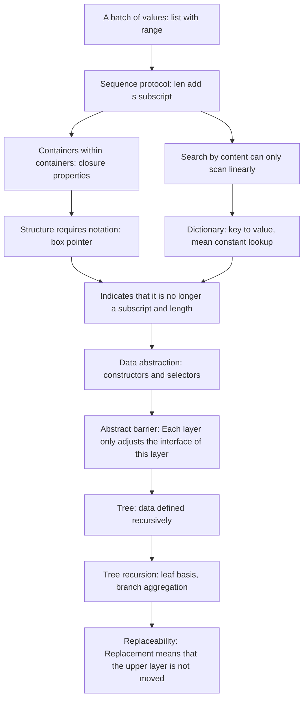
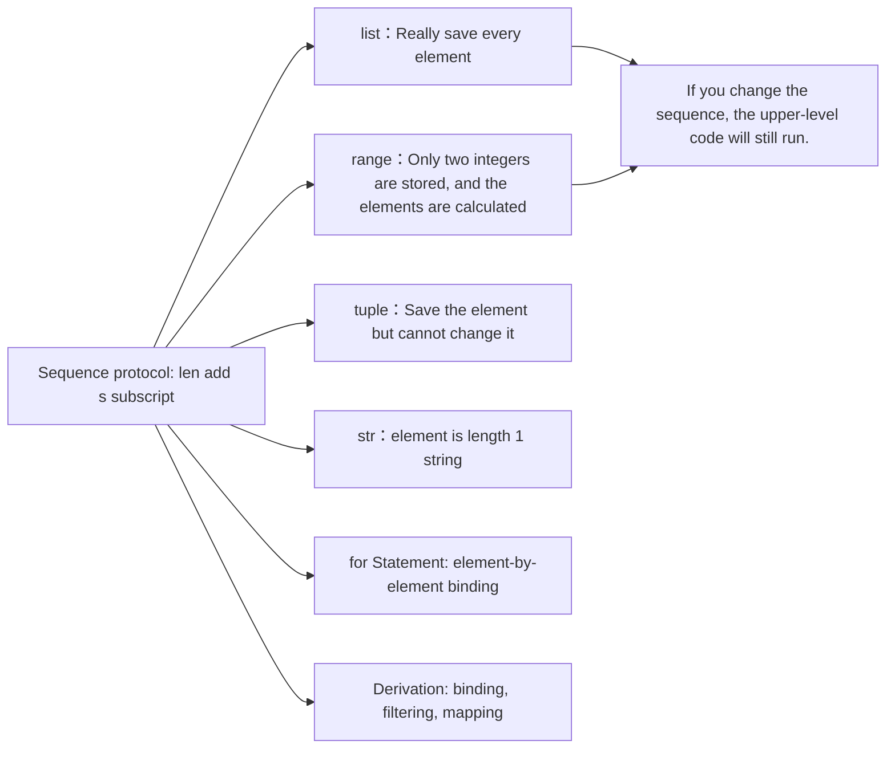
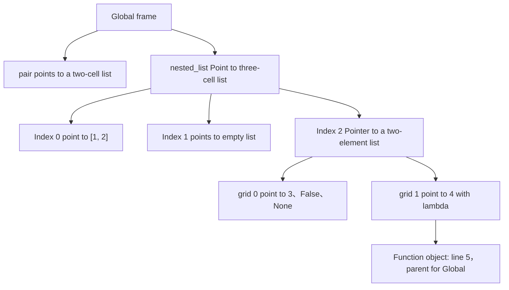
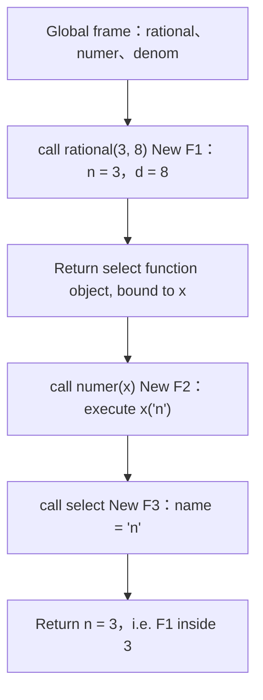
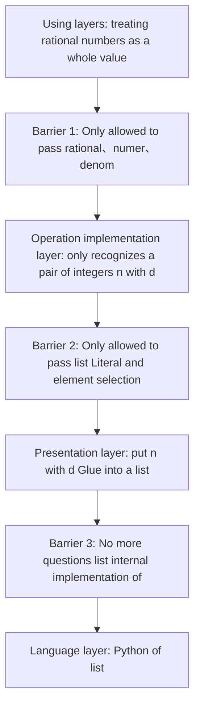
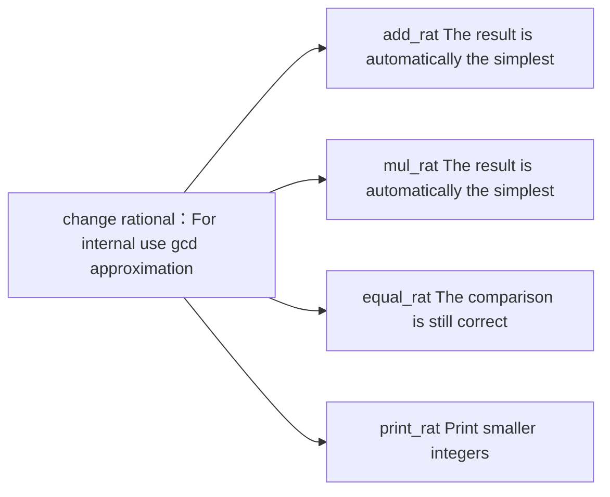
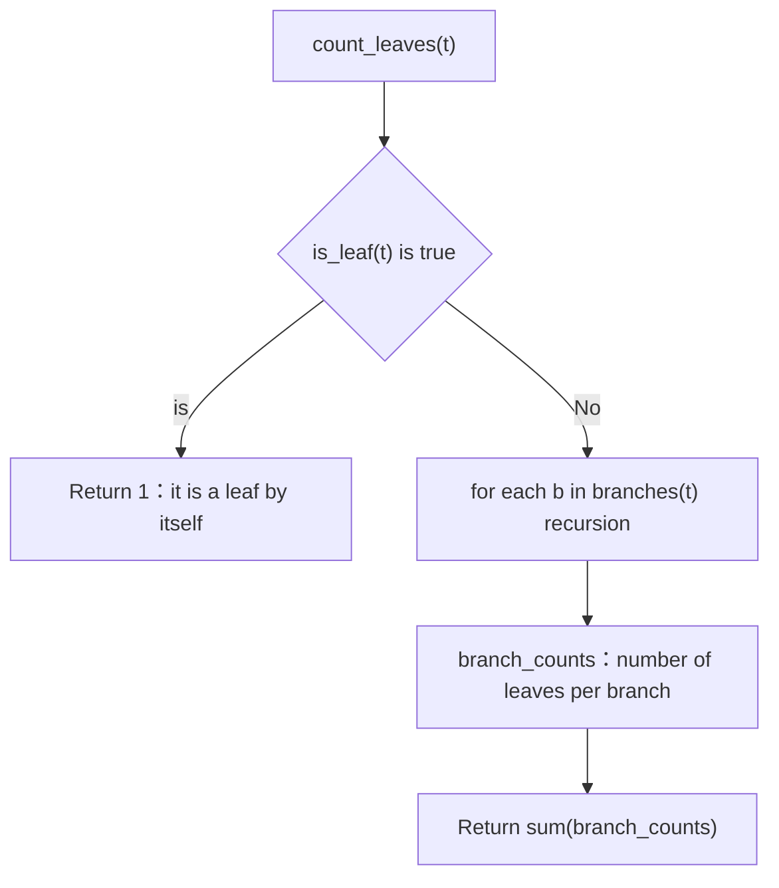
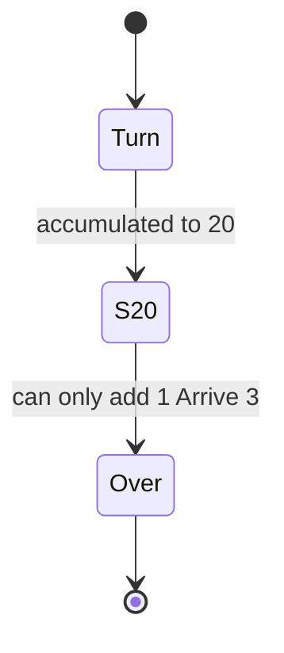
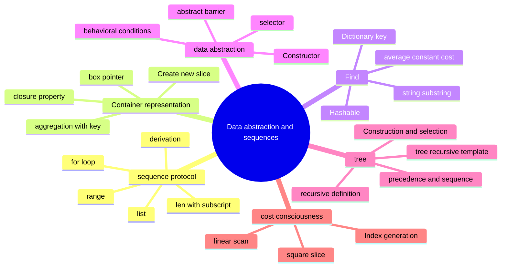

> **module**: M3 CS61A-data, including Lecture 11–14 (Sequences, Containers, Data Abstraction, Trees)
> **total duration**: 01:53:48(22:15 + 27:53 + 29:08 + 34:32)
> **Collection**: [CS61A Fall 2024 Chinese subtitles collection](https://www.bilibili.com/video/BV1sy411z7nA), this module corresponds to points P 11–14
> **courseware**: `10-Sequences.pdf` (12 pages), `11-Containers.pdf` (16 pages), `12-Data_Abstraction_1pp.pdf` (17 pages), `13-Trees_1pp.pdf` (14 pages), 4 official PDFs totaling 59 pages, rendered page-by-page as text illustrations
> **subtitles**: Original English subtitles from Station B; the film sources of Lecture 12 and Lecture 13 are edited versions, and the pages that exist in the courseware but are not covered in the film source are retained and marked in logical locations.
> **Copyright**: The copyright of the course and courseware belongs to the UC Berkeley CS61A teaching team (Fall 2024); this article is a secondary compilation of Chinese for learning purposes, not a sentence-by-sentence translation

## 0. Module Navigation

*(Reference time: 00:00:01 – 00:00:53｜Lecture 11)*

The first two modules deal with "a value". By Lecture 11, data appears in batches for the first time, and the question becomes "How to put, find, and change this batch of values". The fourth lecture is the four steps surrounding this sentence: organize a batch of values ​​into a sequence; admit that the representation of the sequence will become complicated and the search will become expensive; equip the complex representation with a set of management means; use this set of means to create a type that defines itself recursively. The four lectures are **a causal chain**——Sequence only promises  `len(s)`  with  `s[i]`; Once the container can hold the container, this promise is no longer enough (two nested structures may be printed exactly the same, but the actual structures are different), so first you need to "structure the representation" (box pointer), and then you need to "clearly specify the interface" (abstract barrier). The nature of barrier delivery can be summed up in one sentence: **The interface remains unchanged, indicating that it can be replaced**.

### 0.1 Lecture List

| speak | Topic | duration | Number of courseware pages | points P | What are you responsible for in this module? |
| :--- | :--- | :--- | :--- | :--- | :--- |
| 11 | Sequences | 22:15 | 12 | [P11](https://www.bilibili.com/video/BV1sy411z7nA?p=11) | Establishing a protocol: construction, selection, traversal, generation according to formula |
| 12 | Containers | 27:53 | 16 | [P12](https://www.bilibili.com/video/BV1sy411z7nA?p=12) | Exposed representations: nested, shared, sliced, aggregated, dictionary |
| 13 | Data Abstraction Data Abstraction | 29:08 | 17 | [P13](https://www.bilibili.com/video/BV1sy411z7nA?p=13) | Setting up barriers: constructors, selectors, behavior conditions |
| 14 | Trees | 34:32 | 14 | [P14](https://www.bilibili.com/video/BV1sy411z7nA?p=14) | Acceptance: Encapsulating recursive data structures with barriers |

### 0.2 Main line diagram



The left branch is **means more and more complex**, the right branch is **Interfaces are becoming more and more abstract**, the two branches meet at the "abstract barrier". The bottom node is what this module really wants to leave behind: there is a demonstrable criterion for replaceability - change one place and count how many lines of code in the upper layer need to be changed accordingly.

### 0.3 Duplicate pages across lectures

The four courseware are spliced together from different weeks of the same course, and some pages appear in more than one PDF. The rules of this module are **Appears once per page**, the chapter determines which side to talk about.

| content | Appear in | Processing of this module |
| :--- | :--- | :--- |
| Two Lists example (press y to find x) | lec12 page 13, lec13 page 9 | §3.6 Lecture  `key`  usage, both are in this section |
| Prefixes and Midterm Questions | lec12 page 14, lec13 page 11 | §7.3 Parallel, indicating that it is the same question |
| Parking Parking plan | lec12 pages 15–16, lec13 pages 12–13 | §7.4 is divided into two parts: one is about modeling and the other is about recursion. |
| Data Abstraction summary page | lec13 page 17, lec14 page 4 | §5.8 Side by side, compare the wording of the two versions |
| Data Abstraction Sectioned Page | lec13 page 16, lec14 page 3 | §5.4 and §5.8 |

> **Editor's note**: The video source of Lecture 12 starts from the box pointer, and the video source of Lecture 13 starts from the middle, so the first half of the pages of these two lectures do not have corresponding explanations in the video; this module puts them where they should be logically, and adds annotations where inferences are involved.

## 1. Sequence: a capability, not a type

*(Reference time: 00:00:01 – 00:16:37｜Lecture 11)*

The first time a "batch of numbers" appears in a program, the most direct way is to open a bunch of variables; this approach doesn't work because the number of variables must be written in the code, and the number of data is often not known until runtime. The sequence collects "an undetermined number of values" into one value, so the function can collect any number of numbers and return any number of results. It also has a second layer of value: **Condensing the "batch of values" operation into two capabilities**——Know how long (`len`), can be clicked to select (`s[i]`), it is enough to write traversal, filtering, summation, and search; as for whether the internal memory is continuous memory, a linked list, or calculated each time, the user does not need to know. This is the data abstraction used again and again in the last three lectures, but here it is provided for free by built-in types.


> **Editor's note**: The video of this lecture is from  `list`  The content starts directly, there is no announcement spoken in the subtitles, and page 2 is kept in page number order.

### 1.1 Construction, selection and offset model


```python
odds = [1, 3, 5, 7]
>>> odds[3]
7
>>> len(odds)
4
>>> odds[odds[3] - odds[2]]
5
```

The last element has a subscript of 3 and a length of 4. This is where almost everyone stumbles. The model given by the instructor is not the formula "Python starts counting from 0", but **The subscript is the offset from the beginning (offset)**:Offset 0 is the beginning itself, offset 3 is the last element. So "the last subscript = length − 1" becomes "the last element leaves the head with  `len - 1`  A direct translation of "step". Element selection is **expression**, both sides can be nested (`odds[odds[3] - odds[2]]`  Calculate 2 first, then take  `odds[2]`); it also has function writing method  `operator.getitem`, downgrading "getting elements" to ordinary actual parameters, so they can be passed around - the same idea as "functions are values".

### 1.2 Four basic operations of sequences

There is a page in the courseware of Lecture 13 that compresses "the most important operations on a number list" into four interactive lines. The content belongs to this section - it is a list-style review of sequence operations.


```text
>>> s = [5, 7, 9, 11]  # Make a list using a list literal
>>> s[0]               # Get the first element using item selection
5
>>> s[1:]              # Get the rest using slicing
[7, 9, 11]
>>> [3] + s            # Make a longer list using addition
[3, 5, 7, 9, 11]
```

The verbs in the comments are chosen accurately: make, get, get the rest, make a longer; two of the four actions are "make" and two are "take" - most of the algorithms in the sequence are "take out a part and make a new one".

| Operation | Writing method | Return | Whether to create a new object | cost |
| :--- | :--- | :--- | :--- | :--- |
| structure | `[5, 7, 9, 11]` | list | is | Proportional to the number of elements |
| choose one | `s[0]`, `getitem(s, 0)` | 0th element | No | constant |
| take a section | `s[1:]` | new list | is | Proportional to segment length |
| Splicing | `[3] + s` | new list | is | Proportional to the total length of the two segments |
| length | `len(s)` | integer | No | constant |

The column "Whether to create a new object" is the most easily ignored: `s[1:]`  Create a new list, so changing the fragment will not change the original text; `s[0]`  No new object is created. If the 0th element itself is a list, the "retrieval" will still get the same list.

> **Editor's note**: "Proportional to the length" is an asymptotic statement: in CPython  `s[1:]`  with  `[3] + s`  All  `O(n)`, while  `s[0]`  with  `len(s)`  is  `O(1)`. In addition  `*`  Element references are copied, and nested lists share inner layers.

### 1.3 Nesting, `in`  with linear scan

```python
>>> pairs = [[10, 20], [30, 40]]
>>> pairs[1][0]
30
>>> 8 in [1, 8, 2, 8]
True
>>> [1, 8] in [1, 8, 2, 8]
False
```

`pairs[1][0]`  is **Combining expressions**: Take element No. 1 first, and then take element No. 0 of that element. The lecturer said the most crucial sentence of this lecture here: **A list is a value that represents a collection of other values**——So "whether a certain value appears in this set" becomes a question that must be answered. `in`  Just do **Element-wise equality comparison**, three common misunderstandings can be compressed into a table:

| the expression being tested | result | Reason |
| :--- | :--- | :--- |
| `'1' in [1, 8, 2, 8]` | `False` | No type conversion is performed, strings and integers are not equal |
| `[1, 8] in [1, 8, 2, 8]` | `False` | Do not search subsequences, only compare first-level elements |
| `[1, 2] in [[1, 2], [3, 4]]` | `True` | `[1, 2]`  Exactly a first-level element |
| `[1, 2] in [[[1, 2]]]` | `False` | The first level element is  `[[1, 2]]`, it doesn’t count if you go deeper. |

`in`  There's no "burrowing into the structure looking for anything that looks like a match." This decision is very trouble-free, but the price is that it cannot express "searching at any depth" - for that kind of need, you can only write recursion yourself, and the foreshadowing of the second half of the process has been laid here: **Once the structure of the container is hierarchical, you can no longer rely on a general operator to complete the process for you.**. There is a second dimension to the cost: each decision is a linear scan,  `in`  Put into a loop that iterates over the same list, the whole thing becomes squared—the whole reason for the existence of dictionaries in Chapter 4.

### 1.4 `for`: Incorporate the traversal boilerplate code into the syntax

```python
def count(s, value):
    total, index = 0, 0
    while index < len(s):
        element = s[index]
        if element == value:
            total += 1
        index += 1
    return total

def count(s, value):
    total = 0
    for element in s:
        if element == value:
            total += 1
    return total
```

In the above five steps, there are only  `if`  That step is the real logic, and the other four steps are all in service of "walking the list from beginning to end."`for`  One line replaces three things: initializing the subscript, checking the boundary, and advancing each round. More importantly, it removes the failure mode from the writer's vision:

| criterion | `while`  Version | `for`  Version |
| :--- | :--- | :--- |
| Requires explicit subscripting of variables | need | No need |
| Termination condition | handwriting  `index < len(s)` | Automatic sentence judgment |
| Advance each round | handwriting  `index += 1` | Statement automatic advancement |
| Which frame is the loop variable bound to? | current frame | Current frame (also does not create a new frame) |
| Typical errors | If you forget to advance, there will be an endless loop; the boundary is written as  `<=`  Cross the line | These two types of errors basically do not exist |

`for`  There are only three semantics: evaluate the header to get **Iterable value (iterable)**;Bind names to each element and execute suite; binding occurs in **The first frame of the current environment** Here, no new frame is created. The third is the key difference from function calls - loops do not provide scope isolation; the second is that it differs from  `while`  The source of equivalence, because the expansions appear at the same time  `s[i]`  with  `len(s)`, which explains why "iterable" can be directly understood as "sequence" at this moment. There is another flexibility in the head: `for x, y in pairs:`  You can write multiple names, provided that each element has a fixed length - this is called **sequence unpacking**, isomorphic to multiple assignment, and therefore also requires length matching.

### 1.5 `range`: Two integers represent a sequence of integers


The drawing method in the courseware is worth repeating: imagine a number line filled with integers, `range(-2, 2)`  is cut out on the number line **a limited period**, from  `-2`  Count to the right  `2`  before. Both arrows on the diagram point to the gap to the left of the number: `-2`  Falling within this range, `2`  Being blocked from the range. Including the starting point and excluding the end point may seem weird at first, but it makes two things easier at the same time: **length** is the end value minus the start value (`2 - (-2) = 4`), **Element selection** is the starting value plus a subscript (subscript 3 is  `-2 + 3 = 1`); neither formula is needed  `±1`  Tinkering, that's the return in the half-open range.

thus  `range`  It satisfies the sequence protocol: it has length and can be pressed to retrieve elements. The lecturer concluded based on this——**it has  `len`  and element selection, so it must be a sequence, even if it is not a list**. This sentence is the hinge of the entire module: a sequence is not a specific type, but a set of capabilities.

```python
>>> list(range(-2, 2))
[-2, -1, 0, 1]
>>> range(5, 8)
range(5, 8)
```

The second line of echo is worth noting: `range(5, 8)`  The value obtained is still  `range`  object, the line on the screen is just its representation; to see the element you must explicitly call  `list`. The lecturer emphasized that after understanding the semantics  `[5, 6, 7]`  It can be directly derived. `list`  only for **Confirm**.



What this picture illustrates is a counter-intuitive thing: `range`  with list in **There is no common ground in memory**, in **The interface is completely consistent**; `for`  And comprehensions only rely on interfaces, so they work equally well for both - this is abstraction at its most naive.

> **Editor's note**: `range`  Not saving elements and calculating the formula each time is called lazy. There are two consequences: `range(10**12)`  Takes up almost no memory; `range`  It cannot be modified in place, nor can it be used.  `+`  splice another  `range`.

## 2. Derivation: compress "traversal + processing + collection" into an expression

*(Reference time: 00:18:38 – 00:22:12｜Lecture 11; 00:23:22 – 00:25:21｜Lecture 12)*

`for`  is **statement**: It takes up a line of title, an indent block, and an empty result container must be prepared first. The reader has to read five lines to see "what each element becomes", but the real message is only one expression. List comprehension compresses these three things into an expression form; its value is not just short, but the use of fixed syntax slots to carry the intention - if any slot is empty, the person reading the code will immediately know what is missing.

### 2.1 Three-paragraph grammar


```text
[<map exp> for <name> in <iter exp> if <filter exp>]
[<map exp> for <name> in <iter exp>]     # 短版本
```

```python
odds = [1, 3, 5, 7, 9]
>>> [x + 1 for x in odds]
[2, 4, 6, 8, 10]
>>> [x for x in odds if 25 % x == 0]
[1, 5]
>>> [x + 1 for x in odds if 25 % x == 0]
[2, 6]
```

| composition | grammatical position | function | Example |
| :--- | :--- | :--- | :--- |
| data source | `<iter exp>` | Provide an iterable object | `odds`, `range(2, n)` |
| Binding name | `<name>` | Each round points to an element | `x`, `e` |
| mapping expression | `<map exp>` | Determine output elements | `x + 1` |
| filter expression | `<filter exp>` | decide whether to keep | `25 % x == 0` |

The result of the third line is not  `[1, 5]`  plus one, but for each passing  `x`  Calculate directly  `x + 1`——The order is always **Filter first, map later**, despite  `if`  Write it on the back. remember"`if`  It is a guard, and guarding precedes processing." The derivation can also be combined with  `+`  Combination, the last example of this lecture separates the "trivial solution that always holds true" from the cycle:

```python
def divisors(n):
    """Return the divisors of n.

    >>> divisors(4)
    [1, 2]
    """
    return [1] + [x for x in range(2, n) if n % x == 0]
```

`[1]`  Take it out alone, because 1 divides any positive integer; take it out of the loop, and the loop can start with 2, which is untenable. `range(2, n)`  The upper bound of  `n`  instead of  `n + 1`, relies on "excluding the end point".

> **Editor's note**: Trial division is  `O(n)`  of. If  $d$  is  $n$  factor, then  $n/d$  Yes, so we only need to enumerate to  $\sqrt{n}$  Then collect in pairs; implementing this requires concatenating two lists and dealing with duplication caused by perfect square numbers.

### 2.2 Two lists of equal length: no "alignment" in representation


```python
xs = range(-10, 11)
ys = [x*x - 2*x + 1 for x in xs]
xs_where_y_is_below_10 = [xs[i] for i in range(len(xs)) if ys[i] < 10]
```

`ys`  Every item of  `(x - 1) ** 2`, so "less than 10" is equivalent to  `x - 1`  fall on  $-3$  Arrive  $3$  between, the answer should be  `[-2, -1, 0, 1, 2, 3, 4]`, consistent with the courseware echo. The real problem exposed by this question is: **The correspondence between the two lists only exists in the subscript convention in the programmer's mind.**——The container itself does not record "the i-th element belongs to the same record", so every function that uses them must be rewritten  `for i in range(len(xs))`  And ensure that the two subscripts are synchronized; if they are misaligned by one space, the program will not report an error and only give a result that looks reasonable. **A relationship is uncheckable when it can only be maintained by subscripting**, this symptom will not be cured until the dictionary in Chapter 4 and the abstract data type in Chapter 5.

### 2.3 `promoted`: Group and preserve order


```python
def promoted(s, f):
    """Return a list with the same elements as s, but with all
    elements e for which f(e) is a true value placed first.

    >>> promoted(range(10), odd)  # odds in front
    [1, 3, 5, 7, 9, 0, 2, 4, 6, 8]
    """
    return [e for e in s if f(e)] + [e for e in s if not f(e)]
```

The answer is the addition of the two derivations. The source of stability is very simple: the two derivation formulas respectively press  `s`  The original sequence is output, and splicing only occurs between segments. For this writing method to be valid, one condition must be met——**The two groups are mutually exclusive and exhaustive**: `f(e)`  with  `not f(e)`  They are exactly complementary, so each element must fall in and only fall in one group; if it is replaced by two irrelevant judgments, the elements will be repeated or lost. The cost is to traverse twice, `f`  called  $2n$  times; if  `f`  It is very expensive, so it should be replaced by one traversal and two accumulation lists.


The same question appears again in the courseware of Lecture 12, as the opening of "list derivation review": the mode is simple (grouping), the constraints are clear (ordering is preserved), and the answer is short (one line). It is the smallest sample to test "whether you can really write derivation".

### 2.4 Evaluation process and scope

The evaluation of derivation can be broken down into four steps. These four steps were formally mentioned in Lecture 12 when teaching dictionary derivation, and they are also fully applicable to list derivation:

1. Create a new frame, the parent frame is **current frame**;
2. Create an empty result container, which is the value of the entire expression;
3. Evaluate the iteration expression and bind the name to each element in the new frame;
4. If the filter expression is true, the value of the mapping expression is added to the result container.

"Container first, entries later" is the key to understanding nested derivation: the inner derivation is **subframe of outer frame** evaluated inside, so it sees the name of the outer binding. There is another point in Article 1 related to  `for`  Opposite details: `for`  The loop variable is tied to the current frame, but the derivation has its own frame, so  `[x for x in odds]`  After execution, the outer layer  `x`  It's still the same one before execution.

> **Editor's note**: `for`  Leaking loop variables and not leaking comprehensions is a Python 3 behavior (Python 2's list comprehensions also leak). `list(map(f, s))`  with  `[f(e) for e in s]`  Equivalently, `list(filter(f, s))`  with  `[e for e in s if f(e)]`  Equivalent, except that the first two return an iterator computed on demand.

## 3. Containers and representation: closure properties, slicing and aggregation

*(Reference time: 00:00:10 – 00:12:15｜Lecture 12)*

So far, containers have been used as "a series of numbered cells." The focus of this lecture has changed: instead of asking "how to get it", ask "what is the thing taken out". What triggers the turn is a small linguistic fact—the elements of a list can be a list. So there are two situations in the program with the same structure and completely different meanings: sharing and copying, and the two print out exactly the same. Starting from this lecture, "representation" becomes an object that must be explicitly discussed: first there must be a notation that can draw the structure, then there must be an analysis that can judge the cost, and finally there must be an interface that can restrict access.


### 3.1 Closure properties: why containers must contain containers


> **Editor's note**: The source of this lecture starts from the box pointer. There is no spoken announcement in the subtitles. Page 2 is kept in page number order.

The courseware explains this turning point in one term: **closure property**——A method of combining data values satisfies closure if and only if "the result combined by this method can itself be combined again by the same method"; putting it on a list means: if you can put elements into the list, you should be able to put the list into the list. Closures make possible hierarchical structures: folders within folders, sections within chapters, subtrees within syntax trees. Without closure, the data structure can only be a flat table; with closure, any model in which "the whole contains parts, and parts contain smaller parts" can be expressed by the same type. The price appears once in §1.3: once a list can contain a list, "which element is on which level" is no longer a matter of glance.


### 3.2 Box pointer: two kinds of arrows draw a clear structure

**box-and-pointer notation**  There are only two rules: draw the list in a row **Adjacent squares with index labels**, one grid for each element; each grid is either directly filled with **primitive value**, or point an arrow to a **compound value**.

```python
pair = [1, 2]

nested_list = [[1, 2], [],
               [[3, False, None],
                [4, lambda: 5]]]
```

`nested_list`  is a list of three elements, so there are three adjacent grids on the screen; its three elements **It's all a list**, and the list is a composite value, so the contents of the three grids are not numerical values but arrows. The instructor gave a general rule: lists are composite values, functions are composite values, and anything "made up of multiple parts" has an arrow pointing to its depiction.




Index 1 points to the empty list, and there is an arrow saying "empty list" on the screen; grid 0 at index 2 points to  `[3, False, None]`, grid 1 points to  `[4, lambda: 5]`, while  `lambda`  It is a function and a composite value, so it is drawn as an arrow pointing to the function object.

> **Editor's note**: When the lecturer dictated, he referred to the last inner list as "the element at index 3", but on the screen it was index 2——`nested_list`  There are only three positions: 0, 1, and 2. This is a minor verbal slip.

To read the environment diagram, you only need to distinguish between two types of arrows: **name → value** It's binding, **value → component** It is included; the method of reading pictures is fixed - first find the object by its name, and then go down layer by layer along the grid. This process is the same as Chapter 6's treatment of tree recursion.

### 3.3 Printed text is not a structure

```python
def f(s):
    x = s[0]
    return [x]

t = [3, [2+2, 5]]
u = [f(t[1]), t]
print(u)          # [[4], [3, [4, 5]]]
```

Go in order of evaluation: `t`  is  `[3, [4, 5]]`; `f(t[1])`  The actual parameter is that  `[4, 5]`  the list itself (not a copy), `x = s[0]`  Got 4, `return [x]` **New** list  `[4]`;so  `u[0]`  point to the new list, `u[1]`  point to  `t`  myself.


What this question really wants to ask is the last step: the line on the screen  `[[4], [3, [4, 5]]]` **Completely unable to distinguish structural differences**——If  `u`  The second element of is  `t`  A separate copy of , the printed result will be exactly the same, but there will be two arrows pointing to different lists in the environment diagram. The same value may correspond to two structures, but the value itself does not carry this information. This conclusion is the premise of Chapter 5 Abstract Barrier: Since printed text is not enough to describe the structure, "how this data type is allowed to be used" cannot be determined by observing the printed results. There must be other explicit provisions - that set of explicit provisions are constructors and selectors.

> **Editor's note**: The video does not discuss this page. The environmental map analysis and printing results are written by the editor according to the courseware code. `print`  The square bracket form of the output is a list  `repr`, is not the same thing as "how the list looks in memory".

### 3.4 Slicing: `range`  Compact writing of rules

```python
>>> [odds[i] for i in range(1, 3)]    # 先看推导式版
[5, 7]
>>> odds[1:3]                          # 切片只是它的紧凑记法
[5, 7]
>>> odds[:], odds[1:], odds[:3]
([3, 5, 7, 9, 11], [5, 7, 9, 11], [3, 5, 7])
```


`range(1, 3)`  Given 1 and 2, **Does not contain**  3; Slicing follows the same rule: including the lower bound and excluding the upper bound. Omitting the starting point defaults to 0, omitting the end point defaults to the end, and omitting both ends results in a copy of the entire list.

| expression | Semantics | value |
| :--- | :--- | :--- |
| `odds[1:3]` | Starting from index 1 and before 3 | `[5, 7]` |
| `odds[:3]` | before index 3 | `[3, 5, 7]` |
| `odds[:]` | a copy of the entire list | `[3, 5, 7, 9, 11]` |

Immediately following is the most important sentence of this section: **Slicing always creates new values**. The courseware uses three slices to illustrate this sentence: `digits = [1, 8, 2, 8]`  cut out  `[:1]`, `[1:3]`, `[2:]`, after completion, there will be a total of **four** list, `digits`  I haven't changed a single square. But "new outer layer" and "copy element" are two different things: `nested[:]`  A new list is created, and the two inner lists are still the original two - this is a shallow copy.

The most practical use of slicing is to fix the "window" into several grids. The question of the courseware is: Judgment List  `s`  Is there any **two adjacent** 8.


```python
def double_eights(s):
    for i in range(len(s) - 1):
        if s[i] == 8 and s[i + 1] == 8:
            return True
    return False


def double_eights(s):
    if s[:2] == [8, 8]:
        return True
    elif len(s) < 2:
        return False
    else:
        return double_eights(s[1:])
```

The upper bound is written as  `len(s) - 1`  There is a reason: the loop body needs to access  `s[i + 1]`, `i`  The maximum can only reach  `len(s) - 2`. The recursive version treats the slice as a window and discards the first element if it misses; `elif len(s) < 2`  is the exit, the location must be after the real judgment, otherwise  `[8, 8]`  This input is blocked as "too short" before being compared.

| criterion | Loop version | recursive version |
| :--- | :--- | :--- |
| How to move the window | `i`  self-increasing | `s[1:]`  Throw away the first element |
| export | Return after completing the cycle  `False` | `len(s) < 2` |
| total cost | `O(n)` | `O(n^2)`, copy the remaining elements at each step of slicing |

Recursive version every time  `s[1:]`  Create a new list and copy it to any length  $n$  Decreasingly, the total cost is square. The courseware shows the two writing methods side by side for the purpose of comparing "two expressions of the same problem" and does not imply that the costs are equivalent.

> **Editor's note**: The video does not talk about this page. It faces  `range`  The analysis of the upper bound, exit position, and cost of the two writing methods are supplemented by the editor. If  `s`  is a string, window comparison should be written as  `s[:2] == '88'`, the recursive version still holds.

### 3.5 Aggregation: fold the entire traversal into one value

When processing values in a container, most operations are "traverse all elements and finally get a result". Python has a number of built-in functions specifically designed to do this: they accept **iterable **Parameter, collapse a batch of values into one value. This type of operation is called** sequence aggregation**.


```text
sum(iterable[, start]) -> value
max(iterable[, key=func]) -> value
max(a, b, c, ...[, key=func]) -> value
all(iterable) -> bool
```

Square brackets in documentation **It doesn’t require you to write square brackets when calling**, but the convention of "this parameter is optional"; after reading "optional", `max`  The difference between the two forms is clear at a glance: the former collects a container, and the latter collects a string of actual parameters.

```python
>>> sum([2, 3, 4], 5)
14
>>> sum([[2, 3], [4]], [])
[2, 3, 4]
```

`start`  The essence of is not "adding an extra number", but **Tell the aggregator which addition to use and which identity element to start from**. When no starting point is given  `sum`  Starting from 0, the first step is  `0 + [2, 3]`, adding numbers to lists is illegal; given an empty list, the entire iterable is "connected" into a list. Returns when iterable is empty  `start`  It is also a corollary of the same design.

| criterion | `sum` | `max` | `all` |
| :--- | :--- | :--- | :--- |
| Optional parameters | `start`: starting point of addition | `key`: Comparison basis | None |
| folding rules | Add up one by one | Keep the largest | Take one by one  `bool`  Then take "all true" |
| Empty input | Return  `start` | Throw  `ValueError` | Return  `True` |

> **Editor's note**: Two common pitfalls. `all(range(5))`  Return  `False`, because  `bool(0)`  Is a false value - if you want to express "0 to 4 are all less than 5", you need to pass the predicate result instead of the number itself. `max([])`  Throw  `ValueError`: An empty collection has no maximum value, and returning the default value will only mask the caller's error. `min`  with  `any`  They are  `max`  with  `all`  of duality.

The three aggregate functions also reveal something that was not covered in the previous lecture: `for`  is a statement, and "fold" could have been **expression**.`sum(xs)`  The difference from handwritten loops is not just that it is short, but that it moves "traversal" from the statement level to the expression level, so it can appear in derivation expressions, be embedded in other calls, and be used as  `key`  return value.

### 3.6 `key`: Pass "what to compare" as a parameter

`max`  The documentation is written  `key=func`, but didn’t say what it does. The lecturer’s explanation is: `key`  The specified function will be **Apply to each candidate element**, compare by these **return value** Proceed; the final returned element is still the original element.

```python
>>> max(range(10), key=lambda x: 7 - (x - 4) * (x - 2))
3
```

This parabola is in  `x = 3`  takes the maximum value of 8, and  `max`  Returned is the element 3 that produced this value. The criteria can be compressed into two lines: `max(s)`  Compare the elements themselves and return the largest element; `max(s, key=f)`  compare  `f(元素)`, return to make  `f`  The largest element. `key`  Therefore, it is a mechanism to "inject comparison basis": `max`  Responsible for traversing and retaining, `key`  Responsible for defining what "big" means.

> **Editor's note**: this line  `max(range(10), key=...)`  Restore the dictation according to the subtitles: The lecturer said "7 minus (x minus 4) times (x minus 2)", which is exactly  $-x^2 + 6x - 1$, the vertex is at  `x = 3`, the value is 8; the code is typed out on the spot, and there is no corresponding slide.

`key`  There is another usage, which just follows the question "Two equal-length lists" in Chapter 2. The courseware gives two lists of the same length and aligned by position, and asks "the x corresponding to the smallest y":

```python
xs = range(-10, 11)
ys = [x*x - 2*x + 1 for x in xs]
>>> min(ys)
0
>>> min(xs, key=lambda x: x*x - 2*x + 1)
1
```


`min(ys)`  Returns 0, which is  **value of y**, not x; there is no automatic alignment between the two lists. Give the same expression to  `key`, `min`  will be right  `xs`  for each candidate  `x`  Calculate the corresponding y first, and then retain the one that "minimizes y" `x`——`key`  What it does here is **Alignment channel between two lists**.


The same sample question page also appears once in the courseware of Lecture 12. The two coursewares use the same one.  `xs`, `ys`  Same answer as 1. Together we get a transferable technique: **When the relationship exists but the container does not know it, use a function to re-express the relationship**.

> **Editor's note**: This page is not in the video. The answers and explanations are written by the editor according to the courseware. `x*x - 2*x + 1`  Constant equal to  `(x - 1) ** 2`, so the minimum value is  `x = 1`  Take 0 everywhere.

## 4. Strings and dictionaries: two "sequences that are not like sequences"

*(Reference time: 00:12:18 – 00:23:21｜Lecture 12)*

There is a question left at the end of the previous chapter: the container itself does not know the correspondence between the two lists. This chapter offers responses in two opposite directions. A string is also a sequence, but its "element" and "container" are of the same type, so  `in`  The semantics of "find an element" quietly changed to "find a substring"; the dictionary simply gave up "numbering by position" and switched to key positioning, so "search by content" changed from linear scan to average constant time. The two are placed in the same chapter because they jointly prove one thing: **There is no single correct implementation of the word "sequence"**.

### 4.1 Strings are an abstraction

The lecturer started by saying that strings were his favorite topic because they were a **abstraction**: It hides "how to encode", but it does carry information. The courseware uses three types of examples to explain what it means -**numbers** (Scientific notation and decimal points are all strings, and the shape itself conveys information), **Language** (The courseware quotes Shakespeare's poem, stringing together language, computer science and abstraction: what abstraction does is "give nothing a name"), **program** (Python source files themselves are strings).


The last point was demonstrated live: `curry = lambda f: lambda x: lambda y: f(x, y)`  Write to the source file, `curry`  It's defined; similarly, if you create it as a string in the interpreter, it's "just a string", and **execute** This string, `curry`  Just appeared.

> **Editor's note**: To reproduce this demonstration, you need to use the built-in  `exec`  Execute a string: `from operator import add`  after  `exec('curry = lambda f: lambda x: lambda y: f(x, y)')`, again  `curry(add)(2)(3)`  Got  `5`; `exec`  It is not included in the subtitles and courseware of this lecture. There are three ways to write strings: single quotes and double quotes are equivalent, triple quotes can span multiple lines; newline writing  `\n`, the backslash together with the following character in the character sequence is actually just **one** element.

### 4.2 String is a sequence, but the element type is itself

```python
>>> len('Berkeley')
8
>>> 'Berkeley'[3]
'k'
>>> 'here' in 'where'
True
>>> [2, 3] in [1, 2, 3, 4]
False
```

Select an element from a string and get **a string**, but the length is one; the lecturer deliberately compared it with the list - the third element of the numeric list index is a number, but this is not the case for strings. This difference is **self-similar** The inevitable result: the container type of string is  `str`, if the element type is not  `str`, this type is not closed (`s[0]`  The obtained value cannot be further indexed or concatenated with other strings). After stipulating that "the element is a string of length 1", the entire type is closed on itself - this is exactly what the closure property in Chapter 3 means. **type level** version, and the list does not require this. The same self-similarity explains  `in`  Why the semantics were changed: Since any substring is also a string, "whether a string appears in another string" is a completely legal question within the type.

| criterion | list  `list` | string  `str` |
| :--- | :--- | :--- |
| what are elements | any value | string of length 1 |
| `s[i]`  Return | No.  `i`  element itself | string of length 1 |
| `x in s`  What to look for | a complete element | a continuous substring |
| Element types and container types | can be different | Identical (self-similar) |

### 4.3 Dictionary: a container that only goes in one direction

A dictionary stores the pairing of "key + value": the key is used to look up things, and the value is the thing that is looked up. The syntax for looking up values ​​by key is the same as using square brackets for lists, but the brackets put keys instead of indexes.

```python
numerals = {'I': 1, 'V': 5, 'X': 10}
>>> numerals['V']
5
>>> numerals['X-ray']
KeyError: 'X-ray'
>>> list(numerals)
['I', 'V', 'X']
```


There is a directional restriction that must be kept in mind: **You cannot use the value to look up the key**——Want to press  `5`  find out  `'V'`  It's not possible, just write  `numerals[5]`  You only get key errors; the instructor's statement is that "dictionaries only go in one direction". Dictionaries are also sequences, and are **sequence of keys**: `list(numerals)`  given all keys, `for k in numerals`  Iterate over the keys one by one. If you want to traverse it, it’s worth changing the entrance.  `numerals.values()`, it is a type of sequence but not a list, but it can be summed and  `for`  Traverse; wrap one layer if you really need a list  `list`  That’s it—the analogy used by the lecturer is  `range`: A special sequence related only to a certain type of thing. Dictionaries can also represent more complex structures than "one-to-one correspondence" because **Values can be anything complex**: `len(d)`  What counts is the key. It always answers "the number of entries in the container", but does not answer "how many contents there are".

> **Editor's note**: The subtitles only say  `list(numerals)`  with  `numerals.values()`; More commonly used when actually writing code  `numerals.items()`, given in pairs  `(键, 值)`, so we can write  `for k, v in numerals.items():`.`sorted(numerals)`  Sort by key, `sorted(numerals.items(), key=lambda kv: kv[1])`  Sort by value. As of Python 3.7, dictionaries maintain insertion order.

### 4.4 Two restrictions on keys and the cost of search

There are two restrictions on dictionary keys, from completely different sources. **Keys cannot be repeated**: `{1: 'first', 1: 'second'}`  Get the key in the dictionary  `1`  Appears only once; if you want to associate multiple values with a key, the correct way is to associate the key with one **list**.**The key itself cannot be a list or dictionary**:

```python
>>> {[1, 2]: 'a'}
TypeError: unhashable type: 'list'
>>> {'a': [1, 2]}
{'a': [1, 2]}
```

The lecturer hit the brakes here: unhashable is an important term, and he really wants to make it clear now, but "you have to leave something for 61B"; at the same time, he emphasized **Restrictions are only for keys**, a dictionary can be used as a value completely. The two restrictions are of different nature——**Hashability** from dictionary **underlying implementation**; **Keys are not repeated** From the dictionary this **The convention of abstraction itself**: The responsibility of the dictionary is to "give you the key corresponding to **one** Value", it doesn't matter "which value" if the same key appears twice. So the entire meaning of the dictionary can be condensed into one sentence: **Find the value for a key**.

> **Editor's note**: The subtitle clearly states that unhashable belongs to the content of 61B. The following is the editor’s addition. The bottom layer of the dictionary is **hash table**: Calculate first when saving keys  `hash(key)`, take the modulus of the number of buckets and fall into a certain bucket; when searching, calculate the same key again and jump directly to that bucket, so the average time-consuming of "finding one key among 1 million keys" is about the same as "finding one key among 10 keys". The price is that the key must **stable**: The hash value cannot change while the key is alive; lists and dictionaries are mutable. Once they are allowed to be used as keys and then modified after being put into the dictionary, the hash will change, the bucket bit will become invalid, and the key will never be found again. So the key is required to be hashable - equal keys have the same hash value and the hash value is unchanged. For built-in containers, this is equivalent to "keys must be immutable". The same mechanism also explains  `set`: Elements must be hashable, deduplicated with  `in`  Determine the average constant time; the empty set must be written  `set()`, because  `{}`  is an empty dictionary.

### 4.5 Operations and costs of five built-in containers

| criterion | `list` | `tuple` | `str` | `dict` | `set` |
| :--- | :--- | :--- | :--- | :--- | :--- |
| literal | `[1, 2]` | `(1, 2)` | `'ab'` | `{'a': 1}` | `{1, 2}` |
| Is it variable? | mutable | immutable | immutable | mutable | mutable |
| element | any value | any value | string of length 1 | key plus value | hashable value |
| subscript access | `s[i]` | `t[i]` | `s[i]` | No subscript, only  `d[k]` | No subscript |
| `len`  statistics | number of elements | number of elements | Number of characters | Number of keys | number of elements |
| `in`  Semantics | Elements are equal | Elements are equal | substring matching | Does the key exist? | Does the member exist? |
| `in`  cost | `O(n)` | `O(n)` | `O(n)`  magnitude | average  `O(1)` | average  `O(1)` |
| add one | `append`, amortized  `O(1)` | Not supported | Not supported | `d[k] = v`, average  `O(1)` | `add`, average  `O(1)` |
| Can be used as dictionary keys | Can't | Yes, provided all elements are hashable | can | Can't | Can't |
| Typical uses | ordered batch of values | Fixed length record | text | Related search, counting | Duplication removal and member judgment |

The three lines inside and outside the table are most worth remembering: `in`  semantics, `in`  The price and whether it can be used as a key. "Why do we need a dictionary?" that appeared repeatedly in the previous four lectures, the answer lies in "`in`  The cost of this line - the member judgment of lists and strings can only be scanned, while dictionaries and sets are directly located by hashing. The line "Can it be used as a key?" turns hashability from an unfamiliar term into a checkable property: **Mutable things do not have stable hashes and therefore cannot be used as keys**.

> **Editor's note**: `tuple`, `set`  They are not within the scope of Lecture 11–14. They are listed to provide a complete comparison of "protocol sharing and implementation differences". in table  `O(1)`  Both are average costs, and will degrade in the worst case; `append` "Amortization" refers to a single possible  `O(n)` (Expansion), evenly distributed to each time  `O(1)`.

### 4.6 Dictionary derivation and  `index`

The only difference between dictionary comprehension and list comprehension is one colon. The evaluation process is still the four steps in Chapter 2. The difference is only in the "filling" step: the list stores the value of the mapping expression, and the dictionary stores a pair of "key value + value value".

```text
{<key exp>: <value exp> for <name> in <iter exp> if <filter exp>}
```


```python
>>> {x*x: x for x in range(1, 6) if x > 2}
{9: 3, 16: 4, 25: 5}
```

The best example of using derivation is  `index`: It receives a string of keys, a string of values, and a two-parameter  `match`  Function that returns a dictionary - for each key  `k`, the value of that entry in the dictionary is  `values`  all envoys  `match(k, v)`  is true  `v`  composed of **list**. The lecturer deliberately stopped at one sentence when reading the question: When the question says "a dictionary from keys to lists", it means that each item of the dictionary **There is a key**, and its corresponding value **is a list**——This just takes advantage of the restriction in §4.4.

```python
def index(keys, values, match):
    """Return a dictionary from keys k to a list of values v in values
    for which match(k, v) is a true value.
    """
    return {k: [v for v in values if match(k, v)] for k in keys}

>>> index([7, 9, 11], range(30, 50), lambda k, v: v % k == 0)
{7: [35, 42, 49], 9: [36, 45], 11: [33, 44]}
```

Go through the four steps block by block: **key expression** That’s it  `k`; **value expression** is the inner list comprehension, which traverses  `values`  Only matching values are left; **Iteration source** is  `keys`, the outer layer does not require filtration. Two names that can be used in inner layers deserve separate mention: `v`  It is bound by itself, `k`  from the outer layer. The reason why it can be written like this is that the first step of the four-step evaluation-the dictionary derivation is in **new frame** is evaluated in, the inner list comprehension is evaluated in its sub-frame. When looking up the name, go up the parent frame and naturally find it.  `k`. The lecturer's original words were: "Because this list comprehension is in this dictionary comprehension, this expression can both refer to  `v` (value), can also be quoted  `k` (key). "

> **Editor's note**: The code on this page was typed by the lecturer on the spot and is not on the slide; the docstring is organized according to the subtitles. The order of keys in the return value depends on  `keys`  order. The cost of this code is  `O(|keys| × |values|)`——Every key must be scanned through the value list. When the value list is large, this secondary structure is the bottleneck.

## 5. Data abstraction: hide the representation behind the interface

*(Reference time: 00:00:34 – 00:15:51｜Lecture 13; 00:01:23 – 00:02:36｜Lecture 14)*

The first four chapters deal with "containers given by others". At the beginning of this lecture, we have to define the data type ourselves. The trigger point is a very practical difficulty: rational numbers cannot be represented exactly by floating point numbers, `1 / 3`  Only limited approximations can be given. To be precise, you must combine the numerator and denominator **in pairs** Save. But how to save "save in pairs" specifically? List, dictionary, tuple, or two closures? Once this choice is written into the code, it will permeate every place where rational numbers are used—unless there is a way to limit the choice to one place. The method for this lesson is to cut the program in half: one half is responsible for "how the data is represented", the other half is responsible for "how the data is used", and a barrier is established in the middle. The cutting method itself is simple, but the difficulty is **cut clean**: The criterion is not whether the code can run, but whether it assumes the underlying representation.

### 5.1 Behavioral Conditions: What counts as a rational number

A value is a rational number not because it looks a certain way, but because it **performance** Gotta be like rational numbers. The specific writing method is one **behavioral condition**:If  $x$  by molecules  $n$  with denominator  $d$  constructed, then use two selectors to disassemble it and then perform division, it must be restored  $n/d$:


$$
x = rational(n, d) \quad \Longrightarrow \quad \frac{numer(x)}{denom(x)} = \frac{n}{d}
$$


This equation ties three things together: the constructor  `rational`, two selectors  `numer`  with  `denom`, and an operation between the selector results. You can only know by looking at the constructor that "it accepts two integers", and you can only know by looking at the selector that "it spits out two numbers". Only by putting in the same equation can a verifiable definition be formed. The lecturer’s statement was very simple: **Unless something behaves like a rational number, you don't have a representation of a rational number**; In turn, this equation is also the source of freedom - as long as it holds, it doesn't matter how the underlying numbers are placed.

### 5.2 Write the usage layer first: the contract of three functions

If rational numbers are really to be used, addition, multiplication, equality judgment, and printing are required. This batch of codes consists of **Use layers**. The lecturer's statement is very straightforward: these functions "do not make any assumptions about the representation itself, and only require the existence of constructors and selectors." This statement sounds mundane but is counter-intuitive: it means **You can write the operation first and then the data**.

```python
def mul_rat(x, y):
    return rational(numer(x) * numer(y),
                    denom(x) * denom(y))


def add_rat(x, y):
    nx, dx = numer(x), denom(x)
    ny, dy = numer(y), denom(y)
    return rational(nx * dy + ny * dx, dx * dy)


def equal_rat(x, y):
    return numer(x) * denom(y) == numer(y) * denom(x)
```

Three details are worth mentioning separately. `add_rat`  The name is given first because the numerator and denominator each appear twice in the expression. `nx, dx = numer(x), denom(x)`  This not only avoids repeated calls to the selector, but also makes the formula and code match each other at a glance; `mul_rat`  Each selector appears only once, so there is no need to name it. `equal_rat`  Cannot compare item by item: `rational(1, 2)`  with  `rational(2, 4)`  is the same number, but its components are  `(1, 2)`  with  `(2, 4)`, the item-by-item comparison will result in "not equal", the correct way is to cross-multiply - the comparison is the value, not the writing. The third detail is most easily overlooked: **None of these three functions have been implemented.**, they are still readable, deducible, and reviewable at this moment, because the contract has been established.


> **Editor's note**: The source of this lecture is an edited version. The subtitles start from "The Purpose of Maintaining Abstract Barriers". The announcement content is not spoken. Page 2 is kept in page number order. The code for rational numbers is typed in the editor in the video, but there is no corresponding code on the courseware page; the subtitles for the printed functions are not given names, and this article is written uniformly.  `print_rat`.

### 5.3 Another representation: let the function carry data

With a contract, the first thing to do is to prove that it can be exchanged. Constructor no longer returns  `[n, d]`, but define a function called  `select`  small function, put  `n`  with  `d`  Lock it inside and hand over this function:

```python
def rational(n, d):
    def select(name):
        if name == 'n':
            return n
        elif name == 'd':
            return d
    return select


def numer(x):
    return x('n')


def denom(x):
    return x('d')
```

Constructor  `select`  is sent as the return value, so "a rational number" becomes a **function**;The selector changes its writing method——`numer(x)`  Instead of taking bids, **call** `x`. run again  `rational(1, 2)`  with  `rational(3, 8)`, `print_rat(mul_rat(x, y))`  Still printing  `3/16`. Has it really been changed? Of course I changed it, because  `x`  is now a function - and **Just using functions is enough, not even the built-in list type is needed**.



What is worth remembering about this picture is its **shape**: The data is not in any statement, but in the parent frame of a function object - name  `n`, `d`  Already followed  `rational`  The call ends and "leaves" the active environment, but  `F1`  because of being  `select`  The parent pointer is pointed at so it does not disappear. This is the first time closures are treated as **data representation** Use.

| criterion | List representation | function representation |
| :--- | :--- | :--- |
| structure | Return  `[n, d]` | Return closure  `select` |
| Take the numerator | `x[0]` | `x('n')` |
| Do you want to change the usage layer? | No need | No need |
| Dependent built-in types | `list` | only functions |
| What does it print out? | `[1, 2]` | a function object (shows only the address) |

The last line is the price of this replacement: once a rational number becomes a function, it will no longer work to "take a look at what it is". Visibility is sacrificed in exchange for "the ability to create composite data without any built-in composite types."

### 5.4 Abstract barrier: one layer of use, three layers of representation


At this point, the lecturer started again: "A new abstract method." The starting point is **compound value**: The date is made up of year, month, and day, and the geographical location is made up of latitude and longitude; "operating this kind of thing as a whole" is itself an abstraction. Data abstraction goes one step further than "packaging": cut any program that uses data in half——**How to express data**, with **How the data is used**. The result of layering is four layers: **Use layers** Do calculations with rational numbers, here it is an overall data value; **Computational implementation layer** Think of it as "a pair of numerator and denominator", but you don't need to know how they stick together, just use  `rational`, `numer`, `denom`; **presentation layer** To actually implement these three functions, think of it as a list of two elements; **language layer** It's the list itself. People who write selectors shouldn't worry about how the list is implemented.



Each barrier in the picture is drawn as a line in class **very thick line** of. The meaning of the thick line is very hard: the part of the code that performs calculations with rational numbers is only allowed to use the functions provided above this line, and is not allowed to reach for functions on another level. The program written in this way makes assumptions about "which representation is used?"**as little as possible**.

| layer | At this level, rational numbers are regarded as | The only allowed call | Consequences of crossing the line |
| :--- | :--- | :--- | :--- |
| Use layers | an overall value | `add_rat`, `mul_rat`, `equal_rat`, `print_rat` | It is tied to a certain expression, and the entire section becomes invalid when the expression is changed. |
| Computational implementation layer | Numerator plus denominator | `rational`, `numer`, `denom` | Assuming that the bottom layer is a list, the calculation result is wrong when changing the representation. |
| presentation layer | List of two elements | List literals, element selection | Assuming the internal layout of the list, it will be affected when the language layer changes |
| language layer | language provided  `list` | Literals and subscript operators | Crossing the boundary is equivalent to rewriting a list yourself |

"Is that all?" The lecturer asked himself and answered: There are far more abstraction layers in the program than these three layers. The list itself is something implemented in Python. We don't need to know how it is arranged internally or how to expand its capacity; there are only two things we need to know - it can be created using literals and it can be split using element selection. This results in a transferable rule: **Every thick line is a barrier; when writing a program, use the level of abstraction that matches the current task**.

### 5.5 The cost of crossing the line: the worst part is that it temporarily

```python
def div_rat(x, y):
    return rational(numer(x) * denom(y), denom(x) * numer(y))


def div_rat(x, y):                                  # 违规版本
    return [x[0] * y[1], x[1] * y[0]]
```

The above two versions are a comparison of compliance and violation. Illegal version **No error reported**, even gives the correct answer under the current implementation. The lecturer's original words were: It works and won't throw exceptions, "but we did something extremely wrong" - we violated the abstraction barrier. The mistake can be split into two parts: **It assumes that the representation**, write  `x[0]`  It is equivalent to declaring that "a rational number is a list of two integers"; **it bypasses the constructor**, to be changed in the future  `rational`  This part of the code will not change accordingly. The lecturer's reaction fully demonstrated the weight of this rule: once is not enough, it is violated twice in a row; "If I see such code on someone else's computer, I will set the computer on fire and watch it burn - because code that violates the abstraction barrier should be burned."

| criterion | Compliant  `div_rat` | Illegal  `div_rat` |
| :--- | :--- | :--- |
| How to get parts | `numer(x)`, `denom(y)` | `x[0]`, `y[1]` |
| way to create results | `rational(...)` | handwritten list |
| Can it be run through under the current implementation? | can | Can (this is where the danger lies) |
| After changing to function representation | still correct | Error immediately |
| change  `rational`  whether to follow | follow | do not follow |

The last two lines are the crux of this lecture: **The worst thing about crossing the line is not that it is wrong, but that it is temporarily right.**. The error was deferred until the day of "representation change". barrier is **Agreement**, rely on naming, rely on code review, and rely on actually changing the expression every once in a while to test.

### 5.6 A real change: only change the constructor, everyone will benefit

Multiplication  $\frac{3}{2} \times \frac{5}{3}$  The literal translation according to the code should be  $15/6$, but the answer in class is  $\frac{5}{2}$——15 and 6 are both divisible by 3; the same goes for addition: $\frac{2}{5} + \frac{1}{10}$  Cross-multiply to get 25, the denominator is 50, and approximately subtract 25 to get  $\frac{1}{2}$. Why make an appointment? The lecturer’s answer was very pragmatic: **Make the integers as small as possible to make them easier to read and understand.**. So there is a new requirement: rational numbers **forever** Expressed in the simplest form, that is, the numerator and denominator are relatively prime - pay attention to the wording, not "reduction when printing", but "the expression itself should be the simplest".

How? The lecturer turned the question upside down: **Addition and multiplication are inherently correct**, wrong is  `rational`  The definition of; the reduction should be completed at the moment when rational numbers are created.

```python
from math import gcd


def rational(n, d):
    g = gcd(n, d)
    return [n // g, d // g]
```

`gcd`  Both properties of must be used: it is  $n$  with  $d$  of **common divisor**, can divide both; it is also **maximum** The one, so the two numbers after division are relatively prime. $15/6$  of  $g$  is 3, get  `[5, 2]`. What really matters is the next sentence: **`add_rat`, `mul_rat`, `print_rat`  No need to change a word**——Because every result of them is passed  `rational`  Made.



This is the only time in this lecture that "benefits are realized": the abstract barrier is not an aesthetic requirement, and its benefits are measurable——**Changing a function affects all places that call it, and no code needs to be changed anywhere.**. This property has an alias: fungibility.

### 5.7 Direct manipulation of representations vs. via interfaces

```python
# 直接操作表示：把"有理数 = 两个整数的列表"焊进代码
def div_rat(x, y):
    return [x[0] * y[1], x[1] * y[0]]

# 经由接口：只认构造函数与选择器
def div_rat(x, y):
    return rational(numer(x) * denom(y), denom(x) * numer(y))

# 直接操作表示：把"树 = 标签在第一个位置"焊进代码
def leaf_count(t):
    if len(t) == 1:
        return 1
    return sum(leaf_count(b) for b in t[1:])

# 经由接口：只认构造函数、选择器与校验函数
def count_leaves(t):
    if is_leaf(t):
        return 1
    return sum(count_leaves(b) for b in branches(t))
```

The two pieces of logic are exactly the same, but their interchangeability is completely different. Once the paragraph on the left represents changing from a list to a dictionary  `{'label': ..., 'branches': [...]}`  Everything collapsed; the paragraph on the right only needs to be rewritten  `tree`, `label`, `branches`, `is_leaf`  Four functions, the rest of the code does not change. Chapter 6 will actually do this replacement.

| data | direct manipulation representation | via interface | What happens to the left after changing the representation? |
| :--- | :--- | :--- | :--- |
| rational numbers | `x[0]`, `x[1]`, `[n, d]` | `numer(x)`, `denom(x)`, `rational(n, d)` | Immediately invalid under function representation |
| straight line | `f[0]`, `f['slope']` | `slope(f)`, `y_intercept(f)` | Invalid after changing to "two points" |
| tree | `t[0]`, `t[1:]`, `len(t) == 1` | `label(t)`, `branches(t)`, `is_leaf(t)` | Invalid after changing to dictionary |

There is a very mechanical way to determine which column a piece of code belongs to: **Ask what it assumes**. If there are statements like "what element is it", "what is its key called" and "what is its length", it is in the left column; only if there are statements such as "it has a numerator and a denominator", "it has labels and branches", it is in the right column.

> **Editor's note**: The left column is not always wrong. When code and representation are written at the same layer and only serve this representation (for example  `numer`  itself), the subscript operation is legitimate; the criterion for judging whether it crosses the boundary is whether there is **Cross-layer**.

### 5.8 Two other objects of the same argument


The courseware uses the last page to extend this principle to another type of data. **A small number of functions enforce an abstract barrier between "representation" and "use"**: Take a straight line (affine function) `f`  For example - use  `slope(f)`  instead of  `f[0]`  or  `f['slope']`, use  `y_intercept(f)`  instead of  `f[1]`  or  `f['y_intercept']`. There are two reasons: the code is easier to read and change; and, in the future, a straight line can be expressed as two points, and **You don’t need to change a single line of code using Straight Line.**.


The courseware of Lecture 14 shows the same page again before talking about trees as a review of "data abstraction". There is one noteworthy difference in the wording between the two versions: the tree version has "as a Python function" at the end - the third possible representation of a straight line. The rational numbers in §5.3 have already demonstrated this representation; juxtaposing the three just illustrates how wide the range of representations that the abstract barrier can accommodate.

> **Editor's note**: These two pages are the closing summary pages of the courseware. The source of the film is after the lecture.  `gcd`  It ends after constructing the constructor. There is no corresponding oral explanation for the straight line example and the "two points" statement. Here it is reproduced according to the original text of the courseware; the extra "Python function" in the Lecture 14 version also has no oral explanation.

## 6. Tree: data defined recursively, processed recursively

*(Reference time: 00:02:36 – 00:34:29｜Lecture 14)*

Chapter 5 gives a general approach: define a small set of constructors and selectors and use them to block the presentation. The representation that was blocked at that time was just "a list of two integers", which was very small. This lecture uses a truly complex representation to test this approach - a tree. At the bottom of the tree are nested lists, with neither a fixed number of levels nor a fixed width; if the code that processes the tree is directly subscripted to the second level, it will immediately be overwhelmed by the nested structure. And once the tree is sealed with four functions, processing it recursively becomes a matter of three or four lines. The other line is the second appearance of "recursion": the previous module is processed recursively **number**, Chapter 2 uses recursion to process **string**, this lesson uses recursion **structure**——And the structure itself is defined recursively, and definition and processing share the same set of shapes.

### 6.1 Two descriptions: wooden tree and family tree


The announcement for this lecture focuses on the project and homework rhythm: Project 2 (CATS) has been released, two phases need to pass checkpoints before Thursday, and the entire project is due next Tuesday; the lecturer also previewed the next lecture **mutability**, and gave the only suggestion for the entire course: **Try not to fall behind and use your hands a little bit every day**. Trees deserve a separate talk for three reasons: they appear repeatedly; they themselves are a universal modeling tool for "representing hierarchical relationships"; and they use both sides of recursion.


**Recursive description (wooden trees, wooden trees)**  Composed of four rules: one tree **tree** There is one **root tag** and a **branch list**;each **branch **It is also a tree in itself; a tree without any branches is called** leaf**; tree from **root **Start. The key lies in the second point: branches are trees. So "leaf" is not another type, but just a degenerate case of "the branch list is empty" - it still has its own root label, just without the underlying layer. **Relative description (family trees, family tree)**  Then you don't ask "how to construct", just ask "where is a certain position": each position is called** node**, each node has a **label**, one node can be another node's **parent node** or **child node**, the top one is called **root node**.

| criterion | Wooden tree (recursive description) | Family tree (relative description) |
| :--- | :--- | :--- |
| basic objects | The tree itself: root label plus list of branches | Location: node |
| Organization | Recursion: branches are also trees | Relative: father, son, ancestor, descendant, brother |
| end concept | The leaf means that the branch list is empty | No child node position |
| suitable answer | How to construct and process recursively | What is the relationship between the two positions? |
| Implementation in code | `label(t)`  with  `branches(t)`  Go on recursively | while traversing  `t`  with  `branches(t)[i]` |

The two sets of statements are often used interchangeably. The comment at the end of the courseware points to this omission: **People are accustomed to using location to refer to tags**——"Each parent node is equal to the sum of its child nodes". The tree on the picture exactly satisfies it: 3 = 1 + 2, 1 = 0 + 1, 2 = 1 + 1, so it is **Fibonacci tree**. The courseware also marks a **path**: Starting from root 3, passing through 2 and 1, and falling to the leaf labeled 0; the path can stop at the leaf or at a node in the middle - the last half of the sentence is very important, and the path counting question in §6.7 hangs on it.

### 6.2 Interface: Five things users are allowed to do


Establish the interface first, then write the implementation. **The constructor receives two values**: a root tag, and a list of branches; **Each item in the list must be a tree**. The courseware writes down user permissions very strictly: to a tree  `t`, **can only** Get root tag  `label(t)`, get the branch list  `branches(t)`, take the first place  `i`  branches  `branches(t)[i]`, determine whether it is a leaf  `is_leaf(t)`, put  `t`  Treat it as ordinary **value**; Actions outside the list are considered out of bounds.

There is a question that will inevitably arise here: Since a list is used in the constructor, doesn't this break the abstraction barrier? **Doesn’t count**. Because "a tree has a list of branches" is inherently part of the abstraction - the list belongs **abstraction**, does not belong to **express**; What really belongs to the expression is the decision to "use the first element of the list to store the label and the remaining elements to store the branch". This distinction is worth repeating: **An abstraction can contain concrete data structures as long as it does not commit to a concrete layout of the structure**.

### 6.3 Implementation and self-testing


```python
def tree(label, branches=[]):
    return [label] + branches


def label(tree):
    return tree[0]


def branches(tree):
    return tree[1:]

>>> tree(3, [tree(1), tree(2, [tree(1), tree(1)])])
[3, [1], [2, [1], [1]]]
```

Indicates choice **Nested lists**: A tree is a list, the first element is the label, and the remaining elements are branches; the branches are lists of the same shape. `tree`  Put the tag into a single element list and then splice it with the branch. `label`  Remove the subscript 0, `branches`  Use slices to take out "all that's left". printed  `[3, [1], [2, [1], [1]]]` **Just a by-product of representation**, is not something that users care about.


The above three functions can create trees, but there is no guarantee that "all trees are created": any list can be mixed in. Therefore, the constructor needs to add two checks:

```python
def tree(label, branches=[]):
    for branch in branches:
        assert is_tree(branch)
    return [label] + list(branches)


def is_tree(tree):
    if type(tree) != list or len(tree) < 1:
        return False
    for branch in branches(tree):
        if not is_tree(branch):
            return False
    return True


def is_leaf(tree):
    return not branches(tree)
```

The first check confirms that each branch is indeed a tree one by one. If it is not satisfied, throw it away on the spot.  `AssertionError`;Second pass  `list(branches)`  First convert the incoming stuff into a list and then splice it. `is_tree`  Three: The type must be  `list`;Length is at least 1; **All branches must be trees**——The third one makes it become a tree recursive function. `assert`  It's not decoration here: it turns the abstract convention "every branch is a tree" into **Executable checks**.`is_leaf`  then completely relies on the "empty list is false value" convention, so it only works for **Legal format** The tree is reliable.

> **Editor's note**: `branches=[]`  It is the default parameter, which is used to interpret "only one label" as "a leaf". Python's default parameters are evaluated once when the function is defined and shared by all calls. You should usually be careful when using variable values as default values; here  `tree`  Just put  `branches`  Read it out and spell it into a new list, never modify it in place, so you won't step into this trap.

### 6.4 Generate a tree: `fib_tree`  with its call tree


```python
def fib_tree(n):
    if n <= 1:
        return tree(n)
    else:
        left, right = fib_tree(n - 2), fib_tree(n - 1)
        return tree(label(left) + label(right), [left, right])
```

Functions whose input is a tree or whose output is a tree are often tree recursive themselves; in practice, constructors are rarely used to build trees one by one, and more are allowed to be generated by the program according to rules. The three-paragraph structure corresponds to three oral statements: **Base case** is  `n <= 1`  directly returns a leaf; **recursive call** The two branches are each generated by one recursion; **Assemble** The label is "left tree label + right tree label". `fib_tree(4)`  The labels of the two subtrees are 1 and 2 respectively, and the root label is 3. Counting the leaves, there are exactly five leaves; `fib_tree(10)`  The 10th Fibonacci number hangs on the top, but the leaves have  **89**  slices, and 89 is exactly the next Fibonacci number.

> **Editor's note**: `fib_tree`  The source code is not in the courseware of this lecture (the lecturer writes it live in the editor). The above is restored sentence by sentence according to the subtitles; the branch order is taken from the left  `n-2`, right  `n-1`, if replaced, the subtree of each node will be mirrored left and right as a whole. The number of leaves satisfies  $L(n) = L(n-1) + L(n-2)$, $L(0) = L(1) = 1$, therefore equal to the next Fibonacci number. The total number of nodes is also exponential: the entire tree is actually drawn by naive Fibonacci recursion. **call tree**, which also explains why naive recursion finds  `fib(40)`  Unacceptably slow.

### 6.5 Traverse templates: `count_leaves`


Tree handling functions have an almost fixed skeleton: **Processing the leaves** usually **Base case**; **recursive case** usually for **Recurse once for each branch**, and then put the result **aggregation** Get up.

```python
def count_leaves(t):
    if is_leaf(t):
        return 1
    else:
        branch_counts = [count_leaves(b) for b in branches(t)]
        return sum(branch_counts)
```



Base case answer "If  `t`  It's just a leaf and it has several leaves" - the answer is 1, not 0. In the recursive case, first count each branch to get a list of numbers, and then add up the numbers. Follow the instructions of the instructor again: `t`  Come in, you don’t know whether it is a big tree or a small tree; if it is just leaves, the answer is definitely 1; otherwise, count the leaves recursively for each branch and sum the results; finally **Don't forget to return**. This set of reasoning of "first looking at the smallest case, then assuming that the recursive call is correct, and finally only doing aggregation" is the specific form of the "recursive leap of faith" on the tree. price and **Number of nodes** Proportional - each subtree is visited exactly once; compare this to  `fib_tree`  It’s interesting to look at them together: **generate** A tree is exponential, **Traverse** A tree is linear, and the difference between the two is the size of the tree itself.

The order of access becomes important here for the first time. `count_leaves`  The return value of depends on the children, so all branches must be calculated first; and  `print_tree`  On the contrary, process this node first and then go down. These two scan orders have fixed names:

| criterion | Pre-order: process this node first | Postorder: process all child nodes first |
| :--- | :--- | :--- |
| The timing of processing this node | The moment you enter the node | After returning from all branches |
| flow of status | Pass down: `indent`, `so_far` | Upload: Sub-results are aggregated into layer results |
| Examples in this lecture | `print_tree`, `print_sums` | `count_leaves`, `increment_leaves` |
| Intuition | Announce first, dive later | Collect evidence first, then report |

The order is not a matter of style; **Dependency issues**: If the answer of this layer wants to use the child's answer, it can only be in the last order; if the information of this layer is to be passed to the child, it can only be in the first order.

> **Editor's note**: The subtitles of this lecture do not use the terms "pre-order traversal" and "post-order traversal". The lecturer uses descriptions such as "print labels first, and then recurse for each branch". to  `tree(3, [tree(1), tree(2, [tree(1), tree(1)])])`  For example, if you order first, you get 3, 1, 2, 1, 1, and if you order later, you get 1, 1, 1, 2, 3.

### 6.6 Four questions and two aggregation strategies


Before you get started, answer these four questions: **What recursive calls will be made?**, **What type of value do they return?**, **What these return values might mean**, **How to use them to complete the current layer**. The four questions correspond to the four muscles of the recursive function: determining shape, determining type, determining semantics, and determining aggregation. by  `increment_leaves`  For example - return a new tree with exactly the same structure, but with 1 added to the leaf labels: recursive calls are "once for each branch", they return **tree**, meaning "what that branch will look like after being transformed", hand over the new tree to the constructor as it is, with **unchanged** The result is obtained by labeling this node. if **Every node is treated the same**, there is no need for a separate leaf benchmark case:

```python
def increment_leaves(t):
    if is_leaf(t):
        return tree(label(t) + 1)
    else:
        bs = [increment_leaves(b) for b in branches(t)]
        return tree(label(t), bs)


def increment(t):
    return tree(label(t) + 1, [increment(b) for b in branches(t)])
```

The second version has one line and no  `if`, still tree recursion. Where did the baseline case go? **Hidden in a list comprehension**: When  `t`  When it is a leaf, `branches(t)`  is an empty list, list comprehension evaluates the empty list to get an empty list, and no recursive call will occur. The reason why the recursion stops is because each level descends one level into the tree, and the leaves have no next level. This experience is worth remembering: **The base case does not necessarily have to be written as  `if`, as long as the input of the recursion is actually structurally smaller**.

The third strategy is to put information **Passed as argument into recursive call**. Task: For each path from root to leaf, print the sum of all labels on this path.

```python
def print_tree(t, indent=0):
    print('  ' * indent + str(label(t)))
    for b in branches(t):
        print_tree(b, indent + 1)


def print_sums(t, so_far):
    so_far = so_far + label(t)
    if is_leaf(t):
        print(so_far)
    else:
        for b in branches(t):
            print_sums(b, so_far)
```

indented version  `print_tree`  inside, `'  ' * indent`  is two spaces multiplied by the number of levels. When recursing for each branch,  `indent + 1`  Pass it on, so the number of indentation levels of each line is exactly equal to the number of the tag in the tree. **Depth**:Whether the value is correct or not  `print_tree`, check whether the structure is indented correctly. `print_sums`  Then when entering the door, first merge the label of this node into  `so_far` (Do this for both leaves and non-leaves), print only after reaching the leaves: `print_sums(tree(3, [tree(4), tree(5, [tree(6)])]), 0)`  Output 7 and 14; change to a string tree and change the initial value to  `''`, the same function outputs  `has`, `hat`, `he`.**This is where the accumulator strategy can be reused**: As long as the "combination" operation exists, the shape of the function remains completely unchanged.

> **Editor's note**: The four functions in this section were written by the lecturer on the spot and are not in the courseware. The function body is restored orally. `print_sums`  Output is only generated at the leaves, so its output order is neither pure node first order nor node post order, but "along each root-to-leaf path, reporting once at the end point."

### 6.7 Path Count: `count_paths`

Topic: Given tree  `t`  And number  `total`, return **Starting from the root and ending at any node in the tree**, the sum of labels along the way is exactly equal to  `total`  the number of paths. Two words must be pronounced correctly: **any node**, it doesn’t have to be a leaf, it counts as a path if you stop halfway; **start from root**, only the "root to a certain node" type. The tree in the courseware has three branches extending from root 3: there are two branches asking "how to add to 7" (3 + 1 + 2 + 1 and 3 + 1 + 3); there are also two branches asking "how to add to 4", but these two branches have not gone to the end; asking "how to add to 3", one is **Root oneself**, the other one is 3 + 1 + (-1). This example exposes two things: it is possible to figure out just by looking at the root tag  `total`, so you must settle accounts at this level before "looking down"; after you find a path, you have to continue looking, because there may be something below - the second point determines the shape of the code, **Can't** Written as "As soon as you find it" `return 1`, otherwise count the following ".

```python
def count_paths(t, total):
    if label(t) == total:
        found = 1
    else:
        found = 0
    return found + sum([count_paths(b, total - label(t)) for b in branches(t)])
```

There is only one candidate for the first category - "Contains only  `t`  The path of this node", which is equal to  `total`  if and only if  `label(t) == total`, so  `found`  Takes 1 or 0; `found`  Must have value on both roads, if  `if`  It is not established and there is no  `else`, the line behind  `return`  Can throw  `UnboundLocalError`. The second type of paths are **passed  `t`**, they can gather  `total`  The premise is that "the paragraph below" can fill in the remaining part, so the second actual parameter of the recursion is  `total - label(t)`. The instructor explained this step using the original example: to find 7, you had to first subtract 3 from the root, and then go down to find a path that adds up to 4. **Subtraction is the argument of recursion, addition is the aggregation on return.**

Use the previous example to check  `total = 7`: root tag 3 is not equal to 7, `found`  is 0, and the actual parameters are all 7 − 3 = 4; entering the branch of label 1, 1 is not equal to 4, and the actual parameter going down is 3. The label 2 in its child continues to reduce 3 to 1, and finally it is established on the node of label 1 and counts 1; the node of label 3 on the sibling branch counts 1 on the spot, and returns to the root to get 2. This algorithm **No pruning**: Because labels can be negative (3 + 1 + (-1) appears in the example), "the remaining total becomes 0 or a negative number" does not mean that there is no need to go down.

### 6.8 Trees and Lists: Three Differences in Recursive Processing

| criterion | Recursion on lists | Recursion on the tree |
| :--- | :--- | :--- |
| shape of data | linear sequence | A root plus a list of branches |
| How many times to adjust each layer | Usually once (`s[1:]`) or twice (`s[0]`  with  `s[1:]`) | Once for each branch, the number of times is determined by the data |
| Base case | Empty list, or length less than 2 | No branches (leaves) |
| return value | Mostly an aggregate value | It may be either a value or a new tree of the same shape. |
| Typical traps | The subscript crosses the boundary and forgets to advance. | Missing the root layer, the exit returns  `[]`  instead of  `['']` |
| Representatives of this module | `double_eights`, `max_product` | `count_leaves`, `count_paths` |

The three most essential differences are in the second, fourth and fifth lines. **How many times to adjust each layer**: The number of calls to list recursion is hard-coded, and the number of tree recursions is determined by the width of the data. **return value**: List recursion usually compresses the results of a path into one value, and tree recursion often requires "new trees of the same shape" to be handed over to the upper layer, so constructors appear as frequently as selectors in recursion. **Trap**: The classic mistake of list recursion is crossing the boundary and forgetting to advance; the classic mistake of tree recursion is missing the root level——`largest_label`  Forgot  `label(t)`  Put in candidates, `count_paths`  Forgot  `found`, all the same error.

> **Editor's note**: Tree recursion is called "structural recursion" in purely functional languages: recursion is based on the structure of the data itself, not a counter. This is why tree processing functions almost never need to figure out the "tree size".

### 6.9 Two-page blank practice


```python
def largest_label(t):
    if is_leaf(t):
        return label(t)
    else:
        return max([largest_label(b) for b in branches(t)] + [label(t)])
```

The first question returns the largest label in the tree, which is still the same skeleton, but the aggregation is replaced by  `max`. The key is the one at the end  `+ [label(t)]`: Only taken from branches  `max`  will be missed **root itself** label - this is related to  `count_paths`  of  `found + ...`  It's the same lesson.


```python
def above_root(t):
    def process(u):
        if label(u) > label(t):
            print(label(u))
        for b in branches(u):
            process(b)
    process(t)
```

The second question prints all in the tree **Strictly greater than the root tag** label. It needs to always read the "label of the root" when traversing, and  `process`  will be called recursively and cannot get the original  `t`——So let it be an inner function and read it from the outer scope  `label(t)`.`process`  The parameter is "the subtree currently to be processed" `u`, comparison baseline  `label(t)`  From the layer that wraps it, this is the inner function written  `t`  instead of  `u`  The reason is also **closure** Typical usage in tree traversal; in addition, `process`  Judgment first and then enter the cycle, naturally **precedence**.

> **Editor's note**: These two answers are written by the editor according to the blank spaces in the courseware, and there is no explanation in the video. Fill in the blanks in order: `largest_label`  for  `label(t)`, `max`, `largest_label(b)`, `[label(t)]`; `above_root`  for  `label(u) > label(t)`, `label(u)`, `u`.

## 7. Practice Ground: Use the tools from the four lectures together

*(Reference time: 00:21:14 – 00:22:12｜Lecture 11; 00:27:30 – 00:27:51｜Lecture 12; 00:26:59 – 00:29:05｜Lecture 13)*

There are a number of pages in the four coursewares that are not covered in the video: some are discussion exercises (pages 5–7 of Lecture 13), some are exercises to prepare for the next get out of class (pages 10–13), and there are three example questions at the end of Lecture 11. They deserve a separate chapter, because each question requires the use of tools from more than two lectures at the same time: recursion and aggregation are used for state inversion, the decomposition of "first element + remainder" is used for the maximum product, and the prefix sum is used for slicing, `sum`, the derivation is pushed into one line, and the parking plan is tree recursion on the string. The anchor point of this chapter is the time when each lecture concludes, marking the lecture times to which these pages belong - they do not have corresponding oral broadcasts, so there is no "minute when a certain page is spoken".

### 7.1 Twenty-One: Divide states into good and bad


The rules are short: two players take turns adding 1, 2 or 3 to the current total; the total starts at 0; the game ends when it reaches 21 or more; **The last person to add up loses**. The key observation given in the courseware is "some states are good, some states are bad", and 20 is pointed out on the picture - "when it is your turn, this is bad": if the total is already 20 when it is someone's turn, no matter he adds 1, 2 or 3, the total will immediately reach or exceed 21, and the "last person to add" is himself, so he will lose.



So 20 is **bad state**;Conversely 17, 18, 19 are **good condition**, because starting from them you can add 3, 2, and 1 respectively, leaving 20 for your opponent. This chain of "pushing bad states onto each other" goes all the way back: 16 is bad (falling into 17–19 no matter how many are added), 15, 14, 13 are good, and so on. This question has two connections with the technical main line of this module: **State is determined by numerical values, not by history**; Backward push is to do an aggregation in the reverse direction along the state diagram, and  `count_paths`  Aggregating down the tree is the same kind of reasoning.

> **Editor's note**: Working backwards, it can be proven that the bad state is exactly a multiple of 4 (20, 16, 12, 8, 4, 0), so starting at 0 is a bad state, and the first player will lose when both sides are optimal. This promotion is not in the courseware or oral broadcast, but is based on the definition of "a good state can lead to a bad state in one step, and a bad state can lead to a good state in every step." It also provides a standard solution to this type of game problem: first find the bad state near the end, and then mark it in pairs.

### 7.2 Two questions on list recursion: maximum product and summation scheme


```python
def max_product(s):
    """Return the maximum product that can be formed using non-consecutive elements of s.

    >>> max_product([10, 3, 1, 9, 2])  # 10 * 9
    90
    >>> max_product([])
    1
    """
    if len(s) == 0:
        return 1
    elif len(s) == 1:
        return s[0]
    else:
        return max(s[0] * max_product(s[2:]), max_product(s[1:]))
```

The answer is the greater of two options: either **choose** `s[0]`, then be sure to skip  `s[1]`, so multiply by  `max_product(s[2:])`;or **Do not select** `s[0]`, the whole problem degenerates into  `max_product(s[1:])`. The two branches exhaust all alternatives - any legal alternative to  `s[0]`  There are only two attitudes: "use" and "not use". When using,  `s[1]`  Must be abandoned. There are reasons for each of the two baseline cases: an empty list returns 1, since the identity of the product is 1 and "selecting none" is also a legal solution; a single-element list returns the element itself. If the empty list is written to return 0, the first time "select  `s[0]`"The branch will be swallowed by 0.

> **Editor's note**: This way of writing is exponential: `max_product`  Expand two branches for each position, and repeated subproblems (same suffix) will be solved repeatedly; if implemented outside the classroom, you can use a table cached by suffix length to reduce it to linearity. The idea is exactly the same as "repeated call tree of Fibonacci tree".


```python
def sums(n, m):
    if n < 0:
        return []
    if n == 0:
        sums_to_zero = []
        return [sums_to_zero]
    result = []
    for k in range(1, m + 1):
        result = result + [[k] + rest
                           for rest in sums(n - k, m)
                           if rest == [] or k != rest[0]]
    return result
```

The second question is more complicated: `sums(n, m)`  Returns all "elements and is  `n`, each element is no more than  `m`  A list of positive integers without adjacent repetitions; the two counterexamples on the right side of the courseware are circled in red pen. `[1, 1, 3]`  with  `[1, 2, 2]`  All are illegal because of adjacent repetitions. Structurally it is still "classified by first element": first element  `k`  Take 1 to  `m`, the remaining sum is  `n - k`, solved by recursion; filter conditions  `rest == [] or k != rest[0]`  Handle "adjacent parts cannot be the same" - if the remaining part is empty, explain this  `k`  is the last element, otherwise it requires  `k`  Different from the first element of the remainder. The two base cases are again asymmetric: `n < 0`  Return  `[]` (There is no plan), `n == 0`  Return  `[[]]` (A solution, the content is an empty list), the nested square brackets in the second line are the most likely place to make mistakes.

### 7.3 Prefix sum: slicing, aggregation and derivation in one line


```python
def prefix(s):
    """Return a list of all prefix sums of list s.

    >>> prefix([1, 2, 3, 0, 4, 5])
    [1, 3, 6, 6, 10, 15]
    """
    return [sum(s[:k+1]) for k in range(len(s))]
```

a sequence of numbers **prefix sum**, is before it  `n`  The sum of elements; it is required to return the sum of all prefixes, arranged in ascending order of prefix length. The two spaces can be deduced by following "which prefix corresponds to each position in the output": the length is  `k + 1`  The prefix is exactly the slice  `s[:k+1]`, give it to  `sum`  We get the sum of this prefix, so  **(a) Yes  `sum(s[:k+1])`**; `k`  Want to take  `0`  Arrive  `len(s) - 1`  can cover the entire length, so  **(b) Yes  `range(len(s))`**. The five options given in the courseware are  `s`, `[s]`, `s[1:]`, `range(s)`, `range(len(s))`:The iteration source must give integers one by one, so only the last item holds.


`prefix([1, 2, 3, 0, 4, 5])`  Verify item by item: 1, 1+2=3, 1+2+3=6, 6+0=6, 6+4=10, 10+5=15, consistent with doctest. The answer is only one line, but it uses three tools of this module at the same time - slicing to give prefixes, `sum`  The aggregation and derivation are responsible for the length of the enumeration; the cost must be clearly seen: every time a prefix is calculated, it must be added again, and the total cost is square.

> **Editor's note**: The prefix sum can be accumulated linearly at one time, at the cost of maintaining one more "running sum"; the courseware chooses this writing method because it combines slices, `sum`, derivation presses one line. The same midterm question appears once in Lecture 12 and Lecture 13, and the fill-in-the-blank positions and options are exactly the same in both versions.

### 7.4 Parking scheme: tree recursion on strings


Two types of vehicles can be parked in a row of parking spaces: motorcycles occupy  **1**  parking spaces, occupied by cars  **2**  adjacent parking spaces. Use length as  `n`  string representation of  `n`  adjacent parking spaces, `%`  Indicates motorcycle, `<>`  Indicates cars, `.`  Indicates an empty space (the courseware example is  `'.%%.<><>'`);request to return all parked cars  `n`  The scheme string of adjacent parking spaces. The parking spaces can be left empty.

```python
def park(n):
    """Return the ways to park cars and motorcycles in n adjacent spots.

    >>> park(1)
    ['%', '.']
    >>> park(2)
    ['%%', '%.', '.%', '..', '<>']
    >>> len(park(4))
    29
    """
    if n < 0:
        return []
    elif n == 0:
        return ['']
    else:
        return ['%'+s for s in park(n-1)] + ['.'+s for s in park(n-1)] + ['<>'+s for s in park(n-2)]
```

The recursive structure consists of "**What to put in the first parking space?**"Complete decision: motorcycles occupy 1 space and the rest  `n - 1`  grid; leave a blank space to occupy 1 grid, and leave the remaining  `n - 1`  grid; the car occupies 2 grids and the remaining  `n - 2`  Grid. Answer set for three branches **Disjoint**, because the first character of each scheme is different, so direct splicing will not cause duplication. The way of writing the two exits seems counterintuitive, but there are hard reasons for each: **`n < 0`  Return  `[]`**, because a negative number of cells means "there are not enough parking spaces left", and there is no legal solution on this branch; **`n == 0`  Return  `['']`**, because zero grid means "just full", there is and is only one solution at this time - nothing is placed, it must be used **empty string** means; if return  `[]`, upper level  `[前缀 + s for s in []]`  Nothing is produced and all solutions disappear halfway.

`park(2)`  This resulted in 5 options: `'%' + park(1)`  Given two, `'.' + park(1)`  Given two, `'<>' + park(0)`  Give one. Counting satisfies recursion  $f(n) = 2f(n-1) + f(n-2)$, among which  $f(0) = 1$, $f(n<0) = 0$, so  $f(1) = 2$, $f(2) = 5$, $f(3) = 12$, $f(4) = 29$, consistent with 29 in doctest.


The same pair of pages also appeared in the Lecture 12 courseware. The content is the same and the position is after "Aggregation and Derivation" - this question does require derivation to spell strings and a recursive enumeration scheme. It makes sense that it appears before the lesson on trees: `park`  The calling structure is a tree, each node has three branches, and the depth varies with  `n`  growth; it just writes "branch" in three parallel derivation formulas, rather than in one  `branches`  in the list.

> **Editor's note**: The courseware only gives questions, spaces, and answers. It explains why the three branches are mutually exclusive, why the two exits are written like that, and  $f(n) = 2f(n-1) + f(n-2)$  The counting analysis was all supplemented by the editor. $f(n)$  The growth rate of  $x^2 = 2x + 1$  The root determination of is approximately  $2.414^n$, than Fibonacci's  $1.618^n$  Fast; but the call tree shapes of the two are of the same type. This question also implicitly uses string immutability: `'%' + s`  A new string is created each time, so the generated scheme will not be overwritten by subsequent splicing.

## Engineering Laws and Design Checklists

*(Reference time: 00:15:53 – 00:20:33｜Lecture 13)*

The following ten items are the most important things to take away from this module. Give a reason for each article. The reasons are criteria, not rhetoric.

1. **Sequences are capabilities, not types.**  only rely on  `len`  with  `s[i]`  The code can accept any sequence; the thinner the interface, the more alternative implementations.
2. **The subscript is the offset, and the interval is half-open.**  The half-open interval allows "length = end minus start" and "element = start plus subscript" to be true at the same time, omitting all  `±1`  Border patching.
3. **If a container can hold a container, it must be able to draw a structure.**  Printing text cannot distinguish between sharing and copying, and structure judgment can only rely on the box pointer.
4. **Slices are always new values, the elements are still references.**  Saying "a slice is a copy" misses sharing, saying "a slice is a view" misses a copy, and both statements are wrong about nested structures.
5. **Traverse first  `for`, only used when location is needed  `range`.**  There is only one criterion: whether to use it in the loop body or not.  `s[i]`.
6. **Aggregation is better than handwriting loops, the two injection points are  `start`  with  `key`.**  Turn "which addition to use" and "what ratio to size" into parameters, and the loop skeleton only needs to be written once.
7. **If you want to store multiple values for a key, make the values a container.**  The key is only an abstract agreement and cannot be circumvented; `index`  Functions are examples of this rule.
8. **Define data with behavior: constructors, selectors, behavior conditions.**  The shape will change, but the behavior will not; only when the criterion falls on the behavior will there be room for substitution.
9. **Out-of-bounds code is temporarily correct, judged by what it assumes.**  The error is postponed until the day of "changing the expression", so the barrier must be maintained by review and "really changing the expression".
10. **Ask about dependencies first, then order.**  The answers at this level depend on the children in the last order, and the information at this level is passed on to the children in the first order; the order is determined by data dependence, not by preference.

If you can only remember one of the ten items, remember item 9. It pushes the entire course from "writing code that can run" to "writing code that can be replaced", and the gap between these two abilities is exactly what the three functions in Lecture 13 and the four functions in Lecture 6 demonstrate.

## Module knowledge overview (Mermaid mindmap)

*(Reference time: 00:00:01 – 00:22:12｜Lecture 11; 00:00:01 – 00:27:51｜Lecture 12; 00:00:01 – 00:29:05｜Lecture 13; 00:00:00 – 00:34:29｜Lecture 14)*



The way to read this overview is to "go down one level from the center and ask yourself if you can tell the criteria for the next level." If the "sequence protocol" branch cannot be explained  `len`  For the relationship with subscripts, go back to Chapter 1; if the "container representation" branch cannot explain the difference between printing and structure, go back to §3.3; if the "data abstraction" branch cannot tell what the behavior conditions are, go back to §5.1, which is the only real definition in the whole module; if the "tree" branch cannot tell  `count_leaves`  of four lines, back to §6.5. The last "cost consciousness" does not belong to any one lecture, but is an intuition that grew out of the four lectures together: when is it linear, when is it inevitable that it is square, and when is it exponential.

## Attached: Slide index for this module

*(Reference time: 00:00:01 – 00:22:12｜Lecture 11; 00:00:01 – 00:27:51｜Lecture 12; 00:00:01 – 00:29:05｜Lecture 13; 00:00:00 – 00:34:29｜Lecture 14)*

The four coursewares total 59 pages, and each page appears exactly once in the text. The table below is arranged by lecture order, with the position column pointing to the chapter in the module in which it is covered.

| speak | page | content | Appear location |
| :--- | :--- | :--- | :--- |
| 11 | 1 | Title page Sequences | §1 |
| 11 | 2 | Announcements opening announcement page | §1 |
| 11 | 3 | Sectioned Page Lists | §1.1 |
| 11 | 4 | Section page Ranges | §1.5 |
| 11 | 5 | The Range Type: Semi-open interval and two formulas | §1.5 |
| 11 | 6 | Sectioned Page List Comprehensions | §2.1 |
| 11 | 7 | List comprehension syntax (including short version) | §2.1 |
| 11 | 8 | Example Two Lists: Pair filtering | §2.2 |
| 11 | 9 | Sectioned Page Example Promoted | §2.3 |
| 11 | 10 | First in Line: `promoted`  answer | §2.3 |
| 11 | 11 | Sectioned Pages Example Twenty-One | §7.1 |
| 11 | 12 | Twenty-One Rules and Good and Bad Status | §7.1 |
| 12 | 1 | Title page Containers | §3 |
| 12 | 2 | Announcements announcement page | §3.1 |
| 12 | 3 | Sectioned Pages: List Comprehension Example Promoted | §2.3 |
| 12 | 4 | Promoted: Two derivation splicing | §2.3 |
| 12 | 5 | Section page Strings | §4.1 |
| 12 | 6 | Sectioned Page Box-and-Pointer Notation | §3.1 |
| 12 | 7 | Representation of box pointer in environment graph | §3.2 |
| 12 | 8 | Discussion question: Environment diagram and printing results | §3.3 |
| 12 | 9 | Section page Slicing | §3.4 |
| 12 | 10 | Double-Eights: loop version and recursive version | §3.4 |
| 12 | 11 | Sectioned Page Processing Container Values | §3.5 |
| 12 | 12 | Aggregation: `sum`, `max`, `all` | §3.5 |
| 12 | 13 | Example Two Lists: x corresponding to minimum y | §3.6 |
| 12 | 14 | 2023 Spring Midterm Question: Prefix Sum | §7.3 |
| 12 | 15 | Sectioned Page Tree Recursion with Strings | §7.4 |
| 12 | 16 | Parking: parking solutions | §7.4 |
| 13 | 1 | Title page Data Abstraction | §5 |
| 13 | 2 | Announcements announcement page | §5.2 |
| 13 | 3 | Sectioned Pages Manipulating Lists | §1.2 |
| 13 | 4 | Four basic operations on lists of numbers | §1.2 |
| 13 | 5 | Section Page Discussion 4 | §7.2 |
| 13 | 6 | Max Product: Maximum product of non-adjacent elements | §7.2 |
| 13 | 7 | Sum Fun: The sum is n and there are no adjacent repeats | §7.2 |
| 13 | 8 | Section Page Min Practice | §3.6 |
| 13 | 9 | Example Two Lists: x corresponding to minimum y | §3.6 |
| 13 | 10 | Section page Slicing Practice | §7.3 |
| 13 | 11 | 2023 Spring Midterm Question: Prefix Sum | §7.3 |
| 13 | 12 | Sectioned Page Tree Recursion with Strings | §7.4 |
| 13 | 13 | Parking: parking solutions | §7.4 |
| 13 | 14 | Section pages Dictionaries | §4.3 |
| 13 | 15 | Dictionary Comprehensions Grammar | §4.6 |
| 13 | 16 | Sectioned Page Data Abstraction | §5.4 |
| 13 | 17 | Summary of abstract barriers: straight lines and replaceability | §5.8 |
| 14 | 1 | Title page Trees | §6.1 |
| 14 | 2 | Announcements announcement page | §6.1 |
| 14 | 3 | Sectioned Page Data Abstraction | §5.8 |
| 14 | 4 | Data Abstraction: Abstract Barriers and Line Examples | §5.8 |
| 14 | 5 | Sectioned Page Trees | §6.1 |
| 14 | 6 | Tree Abstraction: Two sets of descriptions and terminology | §6.1 |
| 14 | 7 | Using the Tree Abstraction: Five Actions | §6.2 |
| 14 | 8 | Tree implementation: constructors and selectors | §6.3 |
| 14 | 9 | Plus the implementation of verification: `is_tree`  with  `is_leaf` | §6.3 |
| 14 | 10 | Sectioned Page Tree Processing | §6.4 |
| 14 | 11 | Tree processing template: `count_leaves` | §6.5 |
| 14 | 12 | Four questions before writing recursive functions | §6.6 |
| 14 | 13 | Exercise: `largest_label` (Not shown in class) | §6.9 |
| 14 | 14 | Exercise: `above_root` (Not shown in class) | §6.9 |

**Provenance and permission**: Course content comes from UC Berkeley  [CS61A: Structure and Interpretation of Computer Programs](https://cs61a.org), lecture notes, courseware and recordings for Fall 2024 semester; the four courseware are  `10-Sequences.pdf`, `11-Containers.pdf`, `12-Data_Abstraction_1pp.pdf`, `13-Trees_1pp.pdf`, the text and illustrations are all rendered page by page from the official PDF without any modification of the content. The copyright of the course and courseware belongs to the UC Berkeley CS61A teaching team; this article is a study note rewritten for Chinese readers, using the "restatement + comparison + editor's supplement" writing method. It is not a sentence-by-sentence translation, nor does it represent the official position of the course. The paragraphs marked "Editor's Note" in the article refer to external knowledge added during the secondary arrangement (hash table implementation, Python version differences, complexity analysis, exercise answers, etc.). Please retain the source and this explanation when quoting or reprinting.
