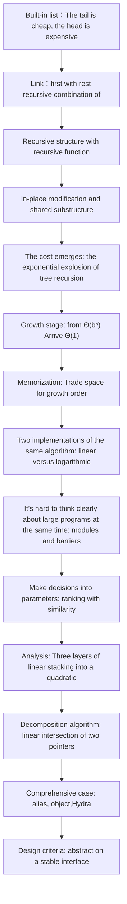
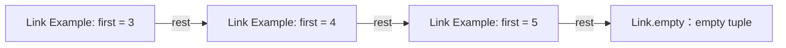
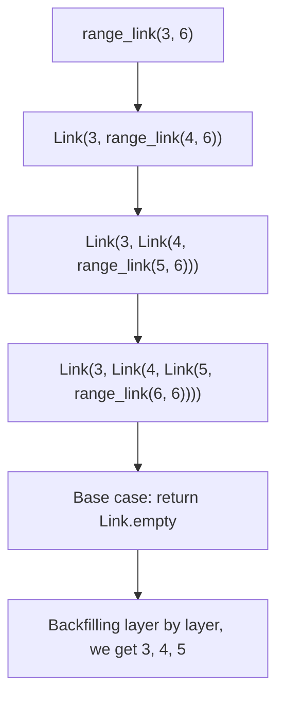
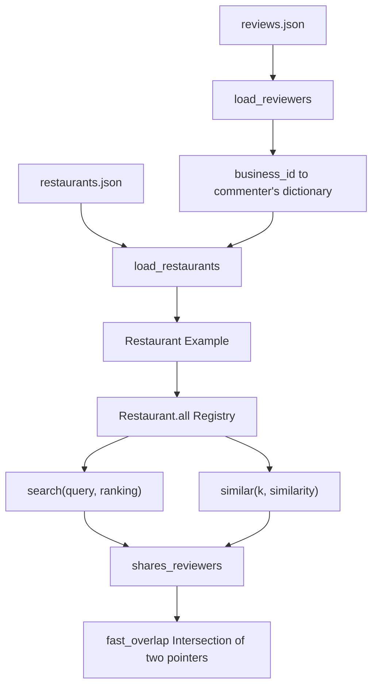
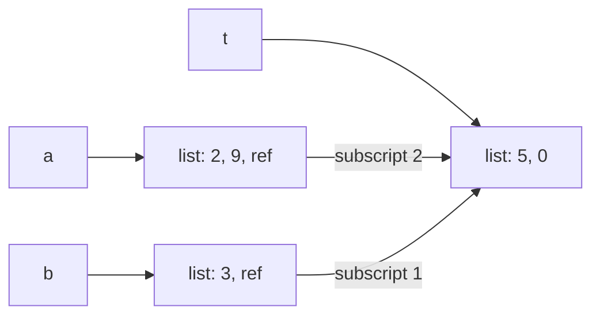
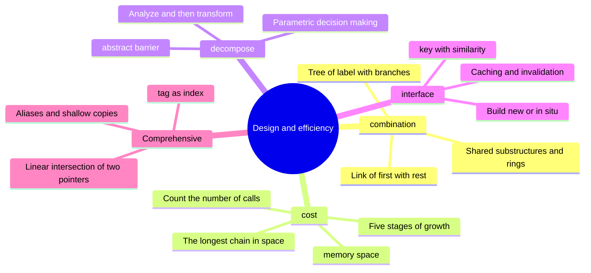

> **module**: M5 CS61A-design, including Lecture 22–25 (Composition, Efficiency, Decomposition, Data Examples)
> **total duration**:02:15:46 (33:16 + 36:37 + 27:16 + 38:37), corresponding to station B score P 22–25
> **Collection**: [CS61A Fall 2024 Chinese subtitles collection](https://www.bilibili.com/video/BV1sy411z7nA), this module starts from P 22
> **courseware**: `21-Composition_1pp.pdf` (16 pages), `22-Efficiency_1pp.pdf` (15 pages), `23-Decomposition_1pp.pdf` (14 pages), `24-Data_Examples_1pp.pdf` (14 pages), 59 pages in total, all rendered page-by-page as text illustrations
> **subtitles**: Original English subtitles at Station B; the four lectures have complete sources, but a considerable number of pages in the courseware (increasing step exercises, linked list exercises, tree review, some mid-term questions) have not been taught. This article includes them according to their logical positions and is marked in the text.
> **Copyright**: The copyright of the course and courseware belongs to the UC Berkeley CS61A teaching team (Fall 2024); this article is a secondary compilation of Chinese for learning purposes, not a sentence-by-sentence translation

## 0. Module Navigation

*(Reference time: 00:00:01 – 00:00:08｜Lecture 22; 00:00:01 – 00:00:13｜Lecture 23; 00:00:00 – 00:00:07｜Lecture 24; 00:00:01 – 00:00:32｜Lecture 25)*

The first four modules answer "what should the program look like": how to evaluate expressions, how to abstract functions, how to ensure correctness of recursion, and how to hide and represent data. These four lectures changed to a more difficult question——**With the program right, is it still affordable?**  Once you ask this question, all the previous clean abstractions will be weighed on the scale: how is the linked list better than the built-in list, how wide is the recursive call tree, where does the time saved by memoization come from, and why is a search that can run through so slow that it cannot be interacted with.

Four lectures are one **order of payment**: Lecture 22 creates a new structure, and then finds that its cost is completely different from the built-in list; Lecture 23 turns the cost into a nameable growth order, and gives the first tool that can change the growth order; Lecture 24 zooms out to an entire program; Lecture 25 uses a series of small cases to put three things on the same piece of paper. The main line is: **Composability and affordability need to be weighed repeatedly, and abstraction is the only way to improve both at the same time - provided the abstraction is placed at the right level.**

### 0.1 List of Four Lectures

| speak | Topic | duration | courseware | points P | What are you responsible for in this module? |
| :--- | :--- | :--- | :--- | :--- | :--- |
| 22 | Composition | 33:16 | 16 pages | [P22](https://www.bilibili.com/video/BV1sy411z7nA?p=22) | Use classes to organize data into recursive structures and pay for "changing pointers" for the first time |
| 23 | Efficiency | 36:37 | 15 pages | [P23](https://www.bilibili.com/video/BV1sy411z7nA?p=23) | Name the cost with the number of calls and the growth order, and use memoization to change the growth order. |
| 24 | Decomposition | 27:16 | 14 pages | [P24](https://www.bilibili.com/video/BV1sy411z7nA?p=24) | Split large programs into modules, make decisions into parameters, and reduce quadratic to linear |
| 25 | Data Examples Data Cases | 38:37 | 14 pages | [P25](https://www.bilibili.com/video/BV1sy411z7nA?p=25) | Use aliases, objects and trees to practice the tools in the first three lectures together |

The cover pages of the four courseware are as follows, each of which marks the starting point of this lecture.


### 0.2 Main line diagram



The first half of this picture is **The structure is becoming more complex**, the second half is **The price is being forced to be paid**. The two lines intersected for the first time at the "memory" point, and the lesson given was "change the growth order ratio to optimize the constant to save money"; the same lesson later appeared in Lecture 24 - changing the pairwise comparison of reviewers to double pointers, the program dropped from 1.7 seconds to 0.7 seconds.

### 0.3 How to string four lectures into a line

| speak | the tools it gives | the questions it leaves behind | Who caught it |
| :--- | :--- | :--- | :--- |
| 22 | `Link`  with  `Tree`  Two recursive types; in-place modification, shared substructure, loop | Where and how slow is it? Only stopwatch reading, no language | 23 |
| 23 | Call counting, memorization, five growth stages, spatial account of activity environment | A single function can calculate the cost, but how to organize a real large program? | 24 |
| 24 | Modules, abstract barriers, parametric decision-making, analysis and then transformation | The criteria for decomposition have only been tested on "Game/Search" | 25 |
| 25 | Formalization of aliases and shallow copies, `ordered`  of  `key`, two kinds  `merge` | Put the tools from the three lectures into the same question: design an own data structure | This article §5 |

The third column is the focus of this table: each lecture **Leave an unsettled account**, the next lecture is not a new chapter, but a checkout. Remember the causal chain of "structure → cost → organization → joint training", which can be derived from any position in the lecture.

### 0.4 About this 59-page courseware

The four PDFs are not synchronized with the classroom lectures. This must be explained first:

- Pages 3–4 of Lecture 22 (List Efficiency) only have pictures and no spoken words; pages 9–16 are linked list exercises and mid-term questions.
- Pages 3–7 of Lecture 23 are a review of trees, and the video only starts on page 8; the midterm question on page 15 is not covered either.
- Lecture 24 Page 14 **All are practice pages**, the main topic "restaurant search" was typed out on the spot, and there was not even a single slide.
- Pages 3–5 and 12–14 of Lecture 25 are not spoken.

Therefore the arrangement principle is: **Pages follow the content, not the lectures**. Used for pages not mentioned  `编者说明`  Mark "the pictures are taken from the courseware, and the comments are supplemented by the editor", and do not disguise the supplementary interpretation as the original words of the class.

### 0.5 Reading Route

- Just want to know "Is the linked list worth it": speed comparison between §1 and §2.2.
- Just want to know "Why is my recursion so slow": §3, focus on the call count and the three-column table.
- Just want to get started designing one thing: skip directly to §5, where there are seven steps from requirements to caching.

## 1. Two implementations of sequences: interface, cost and representation

*(Reference time: 00:00:09 – 00:07:13｜Lecture 22)*

At the end of the previous module, readers already have in their hands  `class`, properties, inheritance, `__repr__`, but the things built with them are still small things where "one object does one thing". This chapter uses the same set of tools to create **container**: An object contains another object of the same type, so "how many there are" is no longer hard-coded, but determined by the reference chain at runtime. This is composition.

As soon as you start, you will run into a question that must be answered first: Python already has  `list`  Okay, why do you need to create a sequence yourself? The answer is not "Practice writing classes", but  **`list`  The cost structure is simply inappropriate for some operations**. So this chapter starts with a time-consuming chart.

### 1.1 Built-in list account: the speed depends on "whether you want to move it or not"


There are only two sentences in the judgment of the courseware: **Appending, subscript assignment, and list comprehensions are fast; inserting at the beginning or in the middle, slicing, and adding two lists are slow.**. The dividing line is not "what has been done", but "should the already placed elements be moved?"


| Writing method | means of expansion | true cost | Time taken for n = 100,000 |
| :--- | :--- | :--- | :--- |
| `using_list_comprehension` | Derive a new table at once | Allocate once, write n times | 1.58 ms |
| `using_append` | Write into the reserved trailing space | Amortized constant | 1.76 ms |
| `using_assign` | First press the length to occupy the space, then press the mark | Constant, but first create a placeholder table | 2.58 ms |
| `using_insert` | Squeeze to the front every time | Linear: existing elements are moved back one space as a whole | 1,470 ms |
| `using_add` | Copy the entire table every time | Linear, and copied at each step | 9,210 ms |

```python
def using_list_comprehension(n):
    return [k * k for k in range(n)]

def using_append(n):
    s = []
    for k in range(n):
        s.append(k * k)
    return s

def using_insert(n):
    s = []
    for k in range(n):
        s.insert(0, k * k)
    return s
```

The top three are all "put to the back": `list`  It occupies a whole continuous space and deliberately leaves redundant capacity. `append`  Just write the value into the next empty slot; it will be reallocated and moved entirely when the capacity is exhausted, and it will still be a constant every time. `using_insert`  Every time **Beginning** Insert a cell, move k elements at the kth time, and the total amount of movement is  $n^2/2$; `using_add`  It is necessary to copy the entire table one more time.

> **Editor's note**: $n^2/2$  At n = 100,000 it is  $5 \times 10^{9}$  The second pointer moves, and modern  `memmove`  It can move billions of pointers per second, which is exactly on the order of seconds, which is consistent with the reading of 1,470 ms. When you see the square-level moving amount, first calculate whether it is enough for one "second".

This table illustrates something counterintuitive: **The cost distribution of a sequence is determined by its interfaces**.`list`  It promises "random access by subscript", which forces it to place elements continuously, and continuous placement will inevitably lead to "queuing in the middle to move". If you change the sequence, give up random access, and only allow growth from the head, "head insertion" can be reduced from linear to constant - at the cost of "taking the kth" from constant to linear.

### 1.2 Recursive definition of linked list: one  `first`, one  `rest`


The definition is only one sentence: **A linked list is either empty or has a "first value" plus "the rest of the sequence"**. Put the first element in the non-empty linked list  `first`, put the remaining elements into a **The same is a linked list** object, hanging on  `rest`  on.




Get one from each non-empty linked list **smaller linked list** as one's own  `rest`, the only exception is the empty linked list at the end - it does not  `first`  Neither  `rest`, only means "end". Written as an expression, the constructor is layered layer by layer:

```python
Link(3, Link(4, Link(5, Link.empty)))
```

There is an evaluation rule at work here: **Calling an expression evaluates the operands before applying the function**. To calculate the outermost  `Link(3, ...)`, Python must first calculate the second operand, and that is a call, so the evaluation drills all the way inward to the deepest point, and then builds out layer by layer. This "inside first, then outside" order is why the recursive constructor is established: **Make the tail first, then use the tail to make the head**.


The same page stacks three views: the property table, two side-by-side constructors, and the row of slashed boxes at the bottom. A box with an arrow is not an official symbol, but is commonly used in the industry: **The arrow pointing to the empty linked list is not drawn and replaced with a slash.**. The one in the lower left corner  `<3 4 5>`  It is in print form, which corresponds exactly to  `str`  with  `repr`  division of labor.

### 1.3 `Link`  Class: Write invariants into the constructor


```python
class Link:
    empty = ()      # Some zero-length sequence

    def __init__(self, first, rest=empty):
        assert rest is Link.empty or isinstance(rest, Link)
        self.first = first
        self.rest = rest
```

`__init__`  The first action of is not to store the value, but **Check**: `rest`  Either that  `Link.empty`, or a  `Link`  Examples, and reject all others. This assertion turns an inductive rule into an executable check - Misinformation  `Link(3, [4, 5])`  An error will be reported at the moment of construction instead of throwing an inexplicable error when the traversal reaches a certain depth.  `AttributeError`.

Each of the three details has its own particularities. For inspection  `is`  instead of  `==`: The termination condition is always the same object, and identity comparison is the original intention. use  `isinstance`  instead of  `type(rest) == Link`: The former is also true for subclasses, so if you write "ordered linked list" as a subclass in the future, the same constructor can still be used. `empty = ()`  It is a design choice: the empty linked list is originally a zero-length sequence, and the use of empty tuples eliminates a concept. The price is that whenever an empty linked list is used, it must be judged first.  `is Link.empty`.

### 1.4 Cross-lecture comparison: `Link`  with  `list`  interface, cost, variability

| criterion | Built-in  `list` | linked list  `Link` |
| :--- | :--- | :--- |
| interface promise | `len`, `s[i]`, slice, `for`, `+` | only  `first`  with  `rest`, no subscript syntax |
| Press to select the kth | Θ(1): First address plus offset, one positioning | Θ(k): Shun  `rest`  Take k steps |
| insert in head | Θ(n): Move all elements back one space | Θ(1): Create a node pointing to the old head |
| Insert in the middle | Θ(n): The second half moves backward as a whole | Θ(k) Find the position, then only change the two pointers |
| Append to the end | Amortized Θ(1): Write into reserved capacity | Θ(n): If there is no tail pointer, you have to go to the end |
| cut a section | There is grammar  `s[i:j]`, copy that paragraph | There is no syntax, you have to write the recursive function yourself |
| splice two sequences | `+`  Create a new table, Θ(n+m) | Only tails can be shared: `Link(0, s)`  Yes Θ(1) |
| memory layout | A whole piece of continuous space with redundant capacity | Two fields per node, scattered on the heap |
| variability | Modifiable elements, scalable length | Can be changed  `first`/`rest`, can create rings |
| Share | Multiple names can point to the same list | A tail can be shared by any number of chains |
| suitable algorithm | Random access, batch sorting, slice iteration | Header plugging, incremental construction, streaming |

The easiest thing to overlook is the "mutability" line. `list`  The variable is **element level** of; `Link`  The variable is **structural level** of: `s.rest = t`  What was changed was a reference, so it could be extended, broken, or even linked back to itself. This degree of freedom is both the full power and all the risk of linked lists.

## 2. Algorithms on recursive structures: creating new structures, changing pointers and sharing

*(Reference time: 00:08:54 – 00:33:14｜Lecture 22)*

Chapter 1 only made structures. This chapter looks at two things: **What shape does the function that handles recursive structures look like?**, and **After allowing in-place modification, what new writing methods and dangers will be introduced in the program?**.

### 2.1 Three-piece set: realize it yourself  `range`, `map`, `filter`

`range`, `map`, `filter`  They are all built-in, but they do not recognize user-defined classes, so you have to write one for each.

```python
def range_link(start, end):
    if start >= end:
        return Link.empty
    else:
        return Link(start, range_link(start + 1, end))

def map_link(f, s):
    if s is Link.empty:
        return s
    else:
        return Link(f(s.first), map_link(f, s.rest))

def filter_link(f, s):
    if s is Link.empty:
        return s
    filtered_rest = filter_link(f, s.rest)
    if f(s.first):
        return Link(s.first, filtered_rest)
    else:
        return filtered_rest
```

The shapes of the three functions are exactly the same: **First ask if it is empty, and then call it a day; if not, process the first element and hand over the rest to recursion.**. The difference is only in two places: `range_link`  The "scale" of is characterized by two integers. The base case is  `start >= end`; `filter_link`  Screen the tail first and then decide whether to keep the current element——**Recurse first, decide later**, otherwise the tails will be counted once in each of the two branches.



The recursive unrolling process is flattened: the four calls are first stacked in the "downward" direction and do not stop until the base case is reached; then  `Link`  Start from the innermost layer and build it layer by layer outward. **The shape of the recursive function on the linked list is exactly the shape of the linked list itself**.

> **Editor's note**: These three functions were written by the instructor on site and are not on the courseware page. There is another fact not mentioned in the courseware: the recursive version ties the call depth to the chain length. If the chain length exceeds Python's recursion limit (default is about 1000), it will throw  `RecursionError`. This is exactly what §2.2 The 100,000 element demonstration must use  `while`  reason.

### 2.2 Two implementations of the same algorithm: `double`  with  `double_link`

The courseware uses a "repeated insertion" question to put the two structures on the same ruler: put each equal to  `v`  Make a copy of the element and insert it after it.


```python
def double(s, v):
    i = 0
    while i < len(s):
        if s[i] == v:
            s.insert(i+1, v)
            i += 2
        else:
            i += 1
```

`i += 2`  is the key: the copy just inserted itself is also equal to  `v`, just jump one space and another copy will be inserted after the copy, doubling infinitely.


```python
def double_link(s, v):
    while s is not Link.empty:
        if s.first == v:
            s.rest = Link(v, s.rest)
            s = s.rest.rest
        else:
            s = s.rest
```

Three translations: The loop condition changes from "The subscript is less than the length" to "The empty linked list has not been reached yet"; the value changes from  `s[i]`  become  `s.first`;Promote from  `i += 2`  become  `s = s.rest.rest`——First walk to the newly inserted copy, then step over it. All the work of inserting is to change a reference. **No elements are moved**.


| realize | structure | Real action for every insertion | Time consuming |
| :--- | :--- | :--- | :--- |
| `double(cycle(5, 100000), 3)` | built-in list | `insert`  Move all following elements back one space | 299 ms |
| `double_link(cycle_link(5, 100000), 3)` | linked list | Create a node and modify one  `rest` | 14 ms |

Twenty times worse. The reason is not "recursion is slower than loops", but **cost of insertion**. in the lower right corner of the same page  `cycle_link`  Also explained "Why is the linked list not slow": it maintains the tail pointer  `last`, each time a new node is attached to  `last.rest`  Update again  `last`, so the table construction is linear. **The linked list needs to be appended in constant time, so you have to remember where the end is.**

### 2.3 Shared substructures and rings: two sides of structure-level variability

| Writing method | What was changed | scope of influence | Typical uses |
| :--- | :--- | :--- | :--- |
| `s.first = 7` | the value of a node | All links pointing to this node | Update an element in place |
| `s = s.rest` | name  `s`  pointing | Only affects this local name | Advance cursor while traversing |
| `s.rest = t` | a structure reference | The shape of the entire chain may affect the sharers | Insert, splice, disconnect |

The third type is the real strength of linked lists. Creating a new chain only requires one line——`t = Link(0, s)`--no nodes are replicated, `t`  of  `rest`  That’s it  `s`  itself. This is called **shared structure**, functional-style programs rely heavily on it: the old structure is not changed, only a new layer is wrapped on top of it.

The other side of sharing is that changing one thing equals changing many. Starting from the three-element linked list, two assignments can close a ring:

```python
>>> s = Link(1, Link(2, Link(3)))
>>> s.first = 5
>>> t = s.rest
>>> t.rest = s
```

At this time  `s`  is  `5, 2, 3`, `t`  is  `2, 3`, while  `t.rest`  was changed to  `s`  After that, the chain is connected end to end. number  `rest`  The placement points follow an odd-even pattern: `s.rest.first`  fall on  `t`  on (2), `s.rest.rest.first`  fall back  `s` (5), walked five times and landed on  `t`  Above (2) - There are three elements in total, but it can answer "the fifth time" `rest` "value" because the structure has changed.

This leads to the safety boundary of the linked list: all traversals later in this lecture start with  `is Link.empty`  As a base case, once there is a link in the chain, this condition will never wait. The reason why linked lists "usually do not change their structure" is not only a style preference, but also a prerequisite for termination.

### 2.4 Recursion is only for side effects: `add`  with three pages of exercises

There is another way of writing that does not appear: **Recursive calls do not return the values to be used, they are only responsible for completing the work.**.

```python
def add(s, v):
    assert s is not Link.empty
    if s.first > v:
        s.first, s.rest = v, Link(s.first, s.rest)
    elif s.first < v and s.rest is Link.empty:
        s.rest = Link(v)
    elif s.first < v:
        add(s.rest, v)
    return s
```

The three branches correspond to three positional relationships: `v`  If it is smaller than the current head, it is inserted in front of the head; if it is larger than the current head and the successor is empty, it is connected to the end; if it is larger than the current head and there are nodes behind it, go down. **`v`  When equal to the head, none of the three conditions are true.**, the function goes directly to the end  `return s`——"No repeated insertion" does not rely on explicit equality, but relies on the gaps left by the complementarity of three conditions. The most memorable thing is  `add(s.rest, v)`  That line doesn't have  `return`: This call is not to calculate a value, but **Remove the addition on the remaining parts**.

| criterion | `map_link`  formula recursion | `add`  formula recursion |
| :--- | :--- | :--- |
| Return value of recursive call | The structure of the next level must be used to spell out the result. | If no one uses it, just throw it away. |
| Whether to change the actual parameters | No changes at all, just create a new structure | Change on the spot  `first` / `rest` |
| The role of recursion | Calculate | advance to a position |
| Base case | `s is Link.empty` | Stop when you find the insertion point, no need to go all the way |
| space cost | The new linked list is the same length as the original linked list | Just one more new node |


`slice_link`  Using two counters to simulate subscripts is a common routine of "jump first and fetch later": `j`  Said "I still need to take a few more", `i`  Say "There are a few more to skip." When  `j`  Returns an empty list when zeroed or the chain is empty; `i`  Leave the current element when zeroing and let  `i`  keep 0; `i > 0`  When the current element is discarded, both counts are decremented by one.

```python
def slice_link(s, i, j):
    assert i >= 0 and j >= 0
    if j == 0 or s is Link.empty:
        return Link.empty
    elif i == 0:
        return Link(s.first, slice_link(s.rest, i, j-1))
    else:
        return slice_link(s.rest, i-1, j-1)
```


`insert_link`  There is a sequence trap: let the position of "subscript 0" become  `x`", the caller holds in his hand  `s`  This object itself, only copies the entire table (expensive) or **Transform the current node into a new head** Two roads. The order of the three lines cannot be reversed: first package the old head value and the original successor into  `second`, then cover  `s.first`  with  `s.rest`;if written first  `s.first = x`, the old head value is lost.

```python
def insert_link(s, x, i):
    if s is Link.empty:
        print('Index out of range')
    elif i == 0:
        second = Link(s.first, s.rest)
        s.first = x
        s.rest = second
    elif i == 1 and s.rest is Link.empty:
        s.rest = Link(x)
    else:
        insert_link(s.rest, x, i-1)
```


```python
def tens(s):
    def f(suffix, total):
        if total % 10 == 0:
            print(total)
        if suffix is not Link.empty:
            f(suffix.rest, total + suffix.first)
    f(s.rest, s.first)
```

The inner function only takes two parameters: the segment that has not been added, and the sum that has been added. The outer layer is only adjusted once, and "the first element has been included" `total`" is written into the initial argument so that the length 1 prefix is not missed. **Printing occurs on the way "downward", so the output order is naturally equal to the prefix length order**——The recursive access order is the output order.

### 2.5 Tree: Same combination, change direction

The tree has been implemented using data abstraction earlier in this course, this time it is replaced by a class. The two definitions are almost the same: **A tree has a root label and a list of branches, each branch is a tree**; A linked list has a first element and the rest. The only difference is **number of forks**.

```python
class Tree:
    def __init__(self, label, branches=[]):
        self.label = label
        for branch in branches:
            assert isinstance(branch, Tree)
        self.branches = list(branches)

    def is_leaf(self):
        return not self.branches
```

`self.branches = list(branches)`  Do two things: keep a copy, and convert any sequence into a list. If you write directly  `self.branches = branches`, the outer list and the tree share the same memory, and the caller goes in outside the tree  `append`  For something that is not a tree, the invariant is bypassed. **Copy once at the boundary so that the inside does not need to be checked again.**.

| criterion | linked list  `Link` | tree  `Tree` |
| :--- | :--- | :--- |
| recursive component | `first`  add  `rest` | `label`  add  `branches` |
| Number of successors | at most one | zero or more |
| Base case | Empty linked list  `Link.empty` | leaves (no branches) |
| Can it be bifurcated? | No, you can only connect one link | Yes, as many as you want |
| Traversal mode | There is only one kind from beginning to end | Root first, root last, or layer by layer can be used |
| Typical uses | Sequence, stack, queue, adjacency list | Expressions, syntax trees, decision trees, file systems |

Compared with the data abstraction version, the difference focuses on "whether to explicitly write the selector": data abstraction needs to invent a way to put the fragments into a whole, and then write  `label(t)`, `branches(t)`  Get it back; the class version doesn't have to make any decisions about how to put the pieces together, the property name is the representation. **Abstraction brings replaceability, and classes saves trouble.**.

`fib_tree`  The price is buried in one fact: `fib_tree(6)`  To create 25 nodes, and  `fib(6)`  Just 8 additions—**The cost of generating a tree is much greater than counting a number**, because every intermediate result must be left behind.

## 3. The cost of tree recursion: call counting, memoization and space accounting

*(Reference time: 00:00:01 – 00:10:47｜Lecture 23)*

Lecture 23 takes the most familiar tree recursion - recursively finding Fibonacci - as a specimen, counts how many function calls it has made, and then gives a tool that can change this number. The conclusion can be said in advance: **Time depends on the number of nodes in the call tree, space depends on the longest chain of the call tree, and changing the growth order is more valuable than optimizing any constant value.**

### 3.1 Tree review on the courseware: two sets of interfaces and two recursion questions

The courseware for Lecture 23 begins with a five-page tree review, which is not covered in the video (the lecturer goes directly to efficiency from here).


This page puts two sets of tree abstractions side by side: the left uses classes (`t.label`, `t.branches`), data abstraction is used on the right (`label(t)`, `branches(t)`). Its appearance in the lecture on "efficiency" is not casual: **`fib_tree(n)`  with  `fib(n)`  The calling structure is exactly the same**, the only difference is that the former keeps every intermediate node - the same call tree, in  `fib`  There it is reflected as "how many times it has been called", in  `fib_tree`  It is reflected here as "how much memory is occupied".


`twins`  Counting "sibling node pairs with the same label": double loop counting sibling pairs under the same parent node (`j`  from  `i+1`  Start by counting each pair only once) and recursively add up the pairs within each branch. It is worth paying attention to the double cycle: the "wider" the node is, the more expensive it is. If 100 branches are hung on a root, the root layer will be compared 4,950 times——**Number of nodes multiplied by average width**, the same shape as the quadratic growth discussed in Chapter 4.


`remove`  Demonstrates a more advanced way of writing: the title has been provided  `exclude(t, x)`, which returns a tree removing the non-root node marked x **new tree**, while  `remove`  What I want is **Modify in place**.

```python
def remove(t, x):
    t.branches = exclude(t, x).branches
    return t
```

Two lines. The idea is "borrow an answer and only move the branch": Since  `exclude`  The correct branch structure has been calculated and the branch list of the new tree is connected to  `t`  The in-place modification is completed; the root label remains unchanged, which is exactly in line with "only delete non-root nodes". This is the first decomposed sample in this module: **When someone has already done half of something right, don't rewrite that half.**

> **Editor's note**: Pages 3–7 do not appear in the subtitles, and the first sentence of the video is already "Calculate Fibonacci using recursion". face above  `twins`, `remove`  The explanation and the analysis of "Why the page is focused on efficiency" were all supplemented by the editor.

### 3.2 `fib`  The call tree: where the index comes from


When it comes to "how long", the first ruler is not a stopwatch. If you run the same piece of code twice, the readings may differ by an order of magnitude. The reliable quantity is **How many times the function was called**: It is only determined by code and data, and has nothing to do with the machine.


```python
def fib(n):
    if n == 0:
        return 0
    elif n == 1:
        return 1
    else:
        return fib(n-2) + fib(n-1)
```

`fib(5)`  Expanded into a tree: `fib(3)`  Calculate first  `fib(1)` (return 1), then calculate  `fib(2)` (expanded into  `fib(0)`  with  `fib(1)`, returns 1), then returns 2. The courseware marks the return value of the base case under the leaves, and then uses dotted lines to connect the entire tree in the order of actual occurrence: first all the way to the left and down to the end, and then back to the bifurcation point layer by layer.

After walking, you will see something dazzling: `fib(3)`  Got counted twice, `fib(2)`  Got counted three times. **The same subtree is pruned and recalculated**, that's the whole reason it's expensive. In order to avoid counting by hand, write a decorator to automate counting:

```python
def count(f):
    def counted(n):
        counted.call_count += 1
        return f(n)
    counted.call_count = 0
    return counted

fib = count(fib)
```

`call_count`  hang on **function object** instead of hiding it in a closure, so it is read from the outside  `fib.call_count`  can get it; take it  `fib`  rebind to  `counted`  This is the key to making recursive calls also use wrappers. The numbers from the class are straightforward: `fib(5)`  return 5, count 15; `fib(30)`  Returns 832040 at the cost of  **2,692,537 calls**.

> **Editor's note**: The number of calls is sufficient  $C(n) = 1 + C(n-1) + C(n-2)$, the solution is  $C(n) = 2F(n+1) - 1$. Check: n = 10 is 177, n = 20 is 21891, n = 30 is 2692537. The ratio of adjacent two terms is stable around 1.618, which means that every time you add n, you do about 60% more work - this is the fingerprint of exponential growth.

### 3.3 Memorization: Keep the calculated results with you


Since the waste occurs in "recalculating the same subtree", the solution is only one sentence: **Remember the results of previous calculations**.


```python
def memo(f):
    cache = {}
    def memoized(n):
        if n not in cache:
            cache[n] = f(n)
        return cache[n]
    return memoized
```

`cache`  is the dictionary in the closure, the keys are parameters and the values are  `f`  The return value on this parameter. `memoized`  Do a member check first: only if it is not in the cache  `f(n)`  coexist; then unify  `return cache[n]`——The first time is counted as the same return path as the subsequent ones. The only difference is whether to call it or not.  `f`.

The courseware is in  `return memoized`  A second comment hangs next to it: "Same behavior as f, if f is a pure function". This is the whole trick **Prerequisites**: A pure function always returns the same value for the same parameters and does not produce side effects. Skipping repeated calls will not change any observable results; if  `f`  It can print, modify parameters, and read clocks or random numbers. Skipping the call means one less side effect or one less different value.


After memorization, `fib(3)`  It's your turn after returning  `fib(4)`, its left child  `fib(2)`  In the cache, hits are returned - those  `fib(0)`, `fib(1)`  call **won't happen at all**.

| n | Number of purely recursive calls | Number of calls to the memoization wrapper | real execution  `fib`  times | Ratio of calls |
| :--- | ---: | ---: | ---: | ---: |
| 10 | 177 | 19 | 11 | about 9 times |
| 20 | 21,891 | 39 | 21 | About 560 times |
| 30 | 2,692,537 | 59 | 31 | About 46,000 times |

31 is easy to explain: there are only 31 parameters that really need to be calculated, and each value from 30 to 0 is only counted once. 59 then counts calls: each k (2 ≤ k ≤ n) is requested twice, once from the first child of k+2, once from the second child of k+1, plus the top  `fib(n)`, exactly  $1 + 2(n-1)$. Pure recursion multiplies by 1.6 for each additional n, and memoization only multiplies by 2 for each additional n—**The same recursive definition falls from exponential to linear just because an external dictionary is added.**  Of course the price is: `cache`  All calculated parameters must be saved.

### 3.4 Space: activity environment and longest chain

To find out who is occupying the memory, you must first ask: **Which environments are still in use at any given moment?**  The rule is: at any time there is a set of **active environments**, the values and frames occupy memory, and the ones that are not in it can be recycled. The frame of a call that is being evaluated and has not yet returned is active; another rare situation is that of a function in an active environment. **parent environment**——When a function is defined inside another function, as long as the function is needed, the outer frame is needed.

This thing can be seen. Python Tutor has a "Do not display exited functions" switch. After it is turned on, the returned frames will be deleted directly. It can also be counted in the code: write one  `count_frames`  Decorator, when entering, add one to the "number of open frames" and update the historical maximum value, and then subtract one before returning. wrap it up  `fib`  call again  `fib(20)`, `max_count`  is  **20**.

Why 20? Take any moment: the left branch is finished, the right branch has not started yet, and is about to start from a certain  `fib(1)`  Return, the active frame at this moment is "those calls on the current chain that have not yet returned". The length of the longest chain is n. So here is the most memorable set of comparisons in this module: **`fib(20)`  The number of calls is more than 20,000, but there are only 20 frames at the same time.**  The time is determined by the number of nodes in the call tree, and the space is determined by the longest chain.

### 3.5 Three-column comparison: recursion, iteration and memorization

| criterion | Pure recursion (no caching) | Iterate | memoized recursion |
| :--- | :--- | :--- | :--- |
| time | Θ(φⁿ): Same order as the number of nodes in the call tree | Θ(n): one scan | Θ(n): Each parameter is counted only once |
| space | The stack depth is equal to the tree height | one or several cursors | Stack depth Θ(n) plus cache Θ(n) |
| Prerequisites | None | Status can be written to the cursor | Cached functions must be pure |
| Readability | One-to-one correspondence with mathematical definitions | You need to think about the invariants first | Same shape as the original recursion, only one more layer of packaging |
| fatal failure | Repeated subproblems exponentially explode | If there is a loop, there will be an endless loop | When the hit rate is low, memory is occupied in vain. |
| Can I change the growth stage? | No, it is the source of the growth order | No, just change the constant factor | Yes, the exponent can be compressed into a linear |
| Examples of this module | `fib`, `twins` | `length`, `append`, `double_link` | `memo(fib)` |

The most important line is the last line. Recursion and iteration are just **Two writings of the same algorithm**, no one can change the growth stage——`length`  Both the recursive and iterative versions are Θ(n). Memorization is different. It changes the algorithm: changing "each sub-problem is counted once" to "each sub-problem is only counted once", so the index becomes linear. **Changing the growth order is much more valuable than digging into the details of constants**.

## 4. Measurement and decomposition: from growth order to order of large programs

*(Reference time: 00:17:40 – 00:24:52｜Lecture 23; 00:00:08 – 00:26:44｜Lecture 24; 00:00:32 – 00:00:47｜Lecture 25)*

Chapter 3 only takes one cost seriously: the number of calls. This chapter turns it into a nameable stage, and then answers "What to do when you know it is slow". The answer is divided into two levels: **algorithm layer** Change to an algorithm with a lower growth order (halving each level, double pointers); **structural layer** Take the program apart so that the "slow part" can be replaced individually. The former manages a function, and the latter manages an entire program.

### 4.1 Five Growth Orders: Naming the Curve


The words linear, constant, and quadratic have precise mathematical definitions, and their uses are: **You can prove which order a function belongs to without actually running the program.**.


| growth stage | Big Θ writing | Big O writing | A word of intuition | Examples of this module |
| :--- | :--- | :--- | :--- | :--- |
| Index | Θ(bⁿ) | O(bⁿ) | n plus 1, time multiplied by a constant | unmemorized  `fib` |
| secondary | Θ(n²) | O(n²) | n plus 1, time plus n times the constant | `overlap`  double cycle, `max_sum` |
| Linear | Θ(n) | O(n) | n increases by 1, time increases by a constant | `near_pairs`, `prefix`, `fast_overlap` |
| Logarithm | Θ(log n) | O(log n) | When n is doubled, a constant is added to the time | `exp_fast`, `search_sorted` |
| constant | Θ(1) | O(1) | n No matter how you change it, it won’t affect time. | Dictionary key search |

The constant line is the most likely to give people pause: where did n go? The answer is that n is not there because the constant grows in **Increasing n does not affect time at all**, writing n is wrong. Big O and big Θ look the same but have different meanings: **Big O only describes the upper bound, Big Θ gives both upper and lower bounds**. For the notation to be valid, it is also necessary to specify what n is - when n is the length of the sequence, it is also necessary to specify worst, best, or average.

The four orders can also be written as a set of equations to answer the same question: **Is the bill you pay for each time the input gets larger a multiplication, an addition as n increases, or a constant?**  Multiplicative correspondence  $T(n+1) = b\cdot T(n)$, the addition corresponding to the increase of n  $T(n+1) = T(n) + a(2n+1)$, constant corresponding to  $T(n+1) = T(n) + a$;The special case of logarithms is "doubling before adding a constant", $T(2n) = T(n) + a\log 2$.


```python
def prefix(s):
    "Return a list of all prefix sums of list s."
    t = 0
    result = []
    for x in s:
        t = t + x
        result.append(t)
    return result
```

only one layer  `for`, each element is added once and once  `append`, both are constant time, so it is  **Θ(n), linear**. The value of this question is to remind you: judging the growth stage depends on "how many layers of loops are nested and how many times each layer is walked", not "whether the code looks long" - if  `result.append(t)`  Replace it with "put the whole  `result`  Copy it once and add another item, and the same loop immediately becomes a second one.

> **Editor's note**: The video ends at 00:36:34, and the lecturer did not talk about this page; the questions and codes are taken verbatim from the courseware, and the analysis and answers are added by the editor.

### 4.2 Conversion algorithm instead of constant: `exp`  with  `exp_fast`

`fib`  The problem is a "duplicate subproblem", `exp`  The problem is "each layer only shrinks a little bit". The question is to find b raised to the nth power. The goal is not to "do fewer multiplications", but to **Let one more multiplication double the exponent**. Let’s first look at a writing method that fails to achieve the goal:

```python
def exp(b, n):
    if n == 0:
        return 1
    else:
        return b * exp(b, n - 1)
```

it corresponds to  $b^n = b \cdot b^{n-1}$, the definition is correct, but every time the exponent is increased by 1, there is one more layer of recursion and one more multiplication. And  $b^n$  More than one mathematical definition: when n is an even number  $b^n = (b^{n/2})^2$, first calculate half of the exponent and then square it; when n is an odd number, return to the previous definition and change n to an even number.

```python
def exp_fast(b, n):
    if n == 0:
        return 1
    elif n % 2 == 0:
        return square(exp_fast(b, n // 2))
    else:
        return b * exp_fast(b, n - 1)
```

For even-numbered branches  `n // 2`: Since n is known to be even, floor division gives exactly half. **Recursive shapes deserve separate emphasis**: appears twice in the function body  `exp_fast`, looks like tree recursion, but any call can only take one of the branches, so it is **linear recursion**.**The shape is determined by the execution path, not by the writing form.**

| criterion | `exp` | `exp_fast` |
| :--- | :--- | :--- |
| recursive basis | $b^n = b \cdot b^{n-1}$ | Square even numbers, take one step back for odd numbers |
| n plus 1 | 1 more multiplication | Up to 2 multiplications |
| Number of multiplications (n = 200 / 400 / 800 / 1600) | 200 / 400 / 800 / 1600 | 10 / 11 / 12 / 13 |
| growth stage | Θ(n) | Θ(log n) |

The stopwatch was also checked once: `exp`  The curve of is a straight line (2¹⁶⁰⁰ about 4 milliseconds), `exp_fast`  Each doubling is only about 0.002 milliseconds longer.

> **Editor's note**: Single timing and  `timeit`  Taking the median is two different measurement methods. The absolute values are not directly comparable, only the trends can be compared. 1,024 = 2¹⁰, so "increase input 1000 times" in logarithmic time only corresponds to "do 10 more fixed jobs".

### 4.3 Exercise page for Lecture 24: Calibrate the ruler first

The courseware for Lecture 24 starts from the announcement page, and the next two sections are all exercises-growth order pairing and linked list review. The main topic "Restaurant Search" was typed out by the lecturer on the spot, and there was not even a single slide, so the slides in this chapter are concentrated in this section and §4.6.


```python
def search_sorted(s, v):
    if len(s) == 0:
        return False
    center = len(s) // 2
    if s[center] == v:
        return True
    if s[center] > v:
        rest = s[:center]
    else:
        rest = s[center + 1:]
    return search_sorted(rest, v)
```

Each time the midpoint is used to cut the search range in half, leaving only the half that may contain the target, so it is **Logarithmic growth**:n Doubling only adds one more level of recursion.

> **Editor's note**: This version also comes with a linear cost: `s[:center]`  The slice will be copied, and the total cost is  $O(n \log n)$. to really do it  $O(\log n)$, the subscript range should be passed instead of the subscript list. The courseware only requires identifying the growth stage according to "halved scale".


`near_pairs`  There is only one loop: `count`  Remember the length of the current continuous repeat segment, `max_count`  The longest recorded history, `last`  Note an element; `count == 0`  Process the first element without  `last`  Comparable boundaries. Adding one to n is one more constant job, **Linear**.`max_sum`  It is a double-layer cycle: the outer layer has a fixed starting point  `i`, the inner layer starts from  `i`  Accumulate all the way (accumulation only takes constant time), the total number of steps is approximately  $n + (n-1) + \cdots + 1 \approx n^2/2$, **secondary**.

| function | growth stage | One sentence reason |
| :--- | :--- | :--- |
| `search_sorted` | Logarithm | Cut the interval in half at each level, and double n to only have one more level. |
| `near_pairs` | Linear | Single level loop, constant work per element |
| `max_sum` | secondary | The outer layer determines the starting point and the inner layer accumulates. The total number of steps is approximately  $n^2/2$ |

The three questions taken together are calibrations of three common shapes. They do not produce new knowledge, but they produce an ability: **When you see a cyclic structure, you can tell its order**——This ability becomes available immediately in §4.6.

### 4.4 Decomposition: Let a module only know its own things

Assuming that a single function is fast enough, will the entire program be slow? Yes, and the reason is often not that the algorithm is wrong, but **No one can think through all the parts of it at the same time**. The answer to modular design is: split the program into several **small but quite independent** components so that they can **swap in swap out**, being affected by various **abstract barrier **separated. The goal is** Separation of concerns**.

The course project Hog is a dice scoring game that is divided into three components: simulator rules, event sequence, and winning or losing status. **Don't know at all** How to write the explanation; the explanation function takes care of how events are described, and does not care how the rules are defined, nor what the players do; the player strategy manages the decision-making rules and strategy parameters, and also does not care about scoring and explanation. The three are not unrelated: both the explanation function and the strategy function are passed as parameters  `play`, the key is  `play`  Just need to know "this thing can be called".

| components | what to care about | Make it clear what you don't care about |
| :--- | :--- | :--- |
| Hog emulator | Rules, sequence of events, scores and outcomes | Commentary, player strategies |
| Interpretation function | How the event is described and the state required for interpretation | How the rules are defined and how players make decisions |
| player strategy | Decision rules, strategy parameters | Scoring rules and explanation format |

ANTS is an enlarged version of the same division of labor: the simulator manages the sequence of actions, the total amount of food, and whether the game is over, the action function manages the personality of each animal, and the map manages tunnels and locations. The three blocks can be advanced in parallel. At this point, "decomposition" has a stricter definition: **Not only does it split a long function into several smaller functions, it also means that different aspects of the program are isolated into different code locations**;The inspection rules are also clarified——**If modifying the game rules only requires modifying the simulator, the design is more modular.**

How fine should it be cut? Granularity and coupling are two sides of the same coin.

| Granularity | What does a unit manage? | Typical coupling method | the cost of replacing it | Examples of this module |
| :--- | :--- | :--- | :--- | :--- |
| expression level | a value | No coupling | change one line | `query in r.name` |
| function level | an action | Parameters and return values (data coupling) | Change call point | `search(query, ranking)` |
| object level | A state plus behavior | Properties and methods (shared state coupling) | Modify the structure and all access points | `Restaurant.all` |
| module level | a focus | Interface convention (control coupling) | Change interface and implementation | loader, search engine, similarity |
| system level | a service | Protocols and data formats | Change the agreement | Not covered in this module |

The "coupling method" column is the key to the criterion. **data coupling** The loosest: only receiving values through parameters and delivering goods through return values. **control coupling** Medium: One party passes a flag to direct the other party which branch to take, and the directed party can no longer evolve independently. **shared state coupling** Tightest: If two modules modify the same variable object, changes by either party may cause bugs in the other party's territory. Therefore, the direction of decomposition is not "the smaller the better", but **Push things that change to the more loosely coupled side**.

> **Editor's note**: The classification of the granular table and "data/control/shared state coupling" is the result of organizing the two test methods given by the lecturer at 00:02:39–00:04:37 into a list. The extended part belongs to the editor.

### 4.5 Parameterization: Turn unthought-out areas into interfaces

The most economical way to decompose is **parameterization**: Instead of making a decision for the user, it is better to make the decision into parameters. The restaurant search in the second half of Lecture 24 takes this trick to an extreme.

The data is a batch of Yelp records. Each restaurant is a dictionary containing name, star rating (1–5), price range (1–3) and  `business_id`; `business_id`  It is meaningless in itself, but it is between two data files. **unique connection key**. Reviews are another dictionary, each containing which restaurant it is about, who wrote it, the number of stars, text and date. The dataset size is 133 restaurants with about a thousand reviews.

| Field | Appear in restaurant documents | appear in comment files | Purpose in this program |
| :--- | :--- | :--- | :--- |
| `business_id` | is | is | The only connection key: link the review to the restaurant |
| `name` | is | No | Do substring matching when searching |
| `stars` | Yes (average restaurant score) | Yes (single rating) | Restaurant side for default sorting |
| `review_count` | is | No | This program does not use it, instead uses the reviewer list |
| `user_id` | No | is | Calculate the similarity of "common reviewers" |

After seeing the data, the real work begins: What does it mean to look up by name? What does it mean for two restaurants to be "related" - close to each other, rated similarly, or reviewed by the same people? The lecturer's attitude is: first write out the program skeleton, **Leave undecided decisions as parameters**.

```python
def search(query, ranking=lambda r: -r.stars):
    """Return restaurants whose names contain query, ranked by ranking."""
    results = [r for r in Restaurant.all if query in r.name]
    return sorted(results, key=ranking)
```

This code cannot be run when I write it down (`Restaurant`  not yet defined), but it already has the correct shape. Sorting rules are one of the most important concerns of search engines. Instead of hard-coding a certain sorting, it is better to pass it in as a parameter; the cost is that you have to prepare a function for each call, so you need a default value - the default is from high to low by star rating. `sorted`  They are arranged from smallest to largest, so the star rating is negative: the one with the highest star rating has the smallest negative value and is ranked first.

| Dimensions | ranking | similarity |
| :--- | :--- | :--- |
| Answered questions | Who ranks first? | How similar are the two restaurants? |
| function signature | One parameter: a certain restaurant | Two parameters: two restaurants |
| Default implementation | `lambda r: -r.stars` (star rating descending order) | Number of common commenters |
| consequences of substitution | Only affects the order of results | Affects the entire meaning of "related recommendations" |

A natural class is used to represent a restaurant, and a place is needed to record "all restaurants". Instructor’s choice **class attribute**: `all = []`  Initialized in the class body, in  `__init__`  inside  `Restaurant.all.append(self)`, so each instance is automatically registered. Two bugs were encountered when writing this code: written as  `all.append(self)`  time  `all`  is parsed into a built-in function (it does not  `append`  attributes), the class attributes must be written in full; when printing a restaurant directly, a default, uninformative representation appears on the screen, so you need to add  `__repr__`.

The third hole to be filled is  `similar`. The instructor starts by just writing the docstring—"Return the k restaurants most similar to self"—and leaving the implementation blank. **When you can’t write anymore, write the interface first**, is a micro version of the same set of decomposition ideas.

```python
def similar(self, k, similarity):
    """Return the k most similar restaurants to self."""
    others = list(Restaurant.all)
    others.remove(self)
    ranked = sorted(others, key=lambda r: -similarity(self, r))
    return ranked[:k]
```

There are four key points in the four lines: make a copy first and then  `remove` (Otherwise the registry will be quietly destroyed), delete by element instead of subscript, and  `self`  tied in advance  `lambda`  let  `key`  Keep it unary and use slicing at the end to get the first k items. The results of the first run even prompted the lecturer to change the wording: change "similar" to "**Share reviewer**"——It shows **The definition of similarity determines the meaning of the results**, and this is exactly  `similarity`  Made into the value of the parameter.

### 4.6 From analysis to transformation: three layers of linear stacking into a quadratic

The program works, but is too slow: search for one  `Thai`  And it takes 0.7 seconds to list similar restaurants for each result. Change to  `cafe`  It takes 1.7 seconds. The instructor did not time the code step by step, but directly read the code structure.

| layer | what do you do every time | scale | growth stage |
| :--- | :--- | :--- | :--- |
| first floor | Traverse the restaurants and determine whether the name contains query | Number of restaurants n | Linear |
| second floor | For each hit result, traverse the remaining restaurants and calculate the similarity | Number of restaurants n | Linear |
| third floor | For each pair of restaurants, compare the reviewers pairwise | Number of commenters m | secondary |
| total | Three levels of nested multiplication | Dominated by reviewer length | Quadratic (relative to m) |

The third layer is the deepest: `len([x for x in r.reviewers if x in s.reviewers])`  Here, iterate through each commenter in R, and do it again in the list of S for each person  `in`  Find, and list of  `in`  It is a linear scan in itself. **There are two linear layers and one quadratic layer among the three layers. After multiplication, the dominant term is the quadratic term.**

The key question therefore becomes: can the **linear time** How to calculate "the number of people who commented on both R and S"? The answer is yes, the trick is just one sentence: keep it **sorted** List of reviewers, and write a linear process to count the overlap of two ordered sequences. The courseware for Lecture 25 just puts the two versions of this question together.


```python
def fast_overlap(s, t):
    k = 0
    while s and t:
        if s.first == t.first:
            k, s, t = k + 1, s.rest, t.rest
        elif s.first < t.first:
            s = s.rest
        elif s.first > t.first:
            t = t.rest
    return k
```

Since both sides are in order, you can make the two cursors move forward in one direction: if they are equal, the two cursors will take one step together and score one point; whichever side has a smaller element, move that side forward, because it can no longer be equal to any element on the other side. When any linked list reaches empty, matching cannot occur again.

| step | s side current value | Current value on side t | judgment and action | count |
| :--- | :--- | :--- | :--- | :--- |
| 1 | 3 | 1 | 1 \< 3, advance t | 0 |
| 2 | 3 | 3 | Equal, both sides advance at the same time | 1 |
| 3 | 4 | 5 | 4 \< 5, advance s | 1 |
| 4 | 6 | 5 | 5 \< 6, advance t | 1 |
| 5 | 6 | 7 | 6 \< 7, advance s | 1 |
| 6 | 7 | 7 | Equal, both sides advance at the same time | 2 |
| 7 | 9 | 8 | 8 \< 9, advance t | 2 |

use  `s = [3, 4, 6, 7, 9, 10]`  with  `t = [1, 3, 5, 7, 8]`  Go through it again, the result is 2, and the common elements are 3 and 7; the upper bound on the number of steps is the sum of the lengths of the two chains, because each step consumes at least one node.


Page 5 of the courseware shows the slow writing method for comparison: `count_if`  Put "should you count" externally? `contained_in`  It is currying (first remember the beginning of the linked list and return a judgment function that only waits for elements), `overlap`  Put the two together. The price is visible at a glance - yes  `s`  for each element of `contained_in(t)`  All have to  `t`  Sweeping from beginning to end, the total number of steps is approximately equal to the product of the lengths of both sides. **It’s short to write but expensive to run.**

There is one more step after the transformation is completed, which is the most important in this chapter: `fast_overlap`  We should not stay in the concept of "reviewer", because this process **Don't care what's in the list**.

```python
def shares_reviewers(r, s):
    return fast_overlap(r.reviewers, s.reviewers)
```

Business concepts are reduced to one line, while  `fast_overlap`  Have no idea what a "restaurant" or "reviewer" is. The algorithm focuses on "how to find intersection in linear time", and the business focuses on "which two lists need to be intersected". The two are separated by a clear interface.



In this module dependency diagram, the arrow always points from "caller" to "callee". `Restaurant`  Not aware that the file exists; `search`  with  `similar`  only know  `Restaurant.all`; `fast_overlap`  Only two ordered lists are known. **Changing the internal implementation of any layer will not adversely affect the upper layer.**

The effect is immediately visible: the cafe group dropped from 1.5 seconds to 0.7 seconds, and the Thai restaurant group dropped from 0.7 seconds to 0.5 seconds - 0.5 seconds means that the program is responsive enough to be made interactive.

> **Editor's note**: 0.7 / 1.5 / 0.5 seconds are the readings on the screen during the demonstration. It is worth remembering the order of magnitude and structural change (quadratic → linear), not the specific milliseconds. "Presort + double pointers" is only available if **The same list is intersected repeatedly** Only cost-effective: if each list only needs one intersection, the sorting itself  $O(n \log n)$  Will eat up all the gains.

The experience in this chapter can be summarized in one sentence: **First there is the ruler, then there is decomposition, and finally there is transformation.**  Without the order of §4.1–4.3, we cannot see that the third level is quadratic; without the module boundary of §4.4, we can figure out  `fast_overlap`  There is nowhere to put it; without decomposition, the transformation can only stop at "making the loop shorter".

## 5. Design a data structure from scratch: course registration list

*(Reference time: 00:27:02 – 00:27:14｜Lecture 24; 00:32:22 – 00:38:29｜Lecture 25)*

The first four chapters give three things: `Link`  Representation and operation, ruler of increasing order, discipline of decomposition and parameterization. This chapter applies them to one specific thing—**Design a data structure from scratch**. What is to be designed is  `Roster`: The registration list for a course requires six items - insert records by (score, name), get the top k names, count the number of people in a certain score range, merge two lists, find the intersection of the two lists, and can be read in an interactive session.

### 5.1 Step 1: Write down the interface first

The most common mistake when designing data structures is to write the representation first. The correct order is to write first **Commitment**: This table is not only a document for users, but also an acceptance standard for yourself.

| Operation | Semantics | target complexity | Whether to modify the object |
| :--- | :--- | :--- | :--- |
| `add(name, score)` | Insert one to keep the whole in order | Want to achieve Θ(1); actual Θ(n) | is |
| `top(k)` | Top k records | Want to achieve Θ(k); actual Θ(n) | No |
| `count_between(lo, hi)` | The number of people whose scores fall within the range | Θ(n) | No |
| `merge(other)` | Two ordered lists combined into one | Θ(n+m) | No (create something new) |
| `intersect(other)` | Number of people appearing in both lists at the same time | Θ(n+m) | No |

The difference between "want to achieve" and "actual" is the drama of this chapter. `add`  On the linked list it is Θ(n) because **Find a location** You have to walk; this is not because the implementation is not working hard enough, but because the interface and the representation are interfering with each other. This table should also explain two things: **Who owns the return value**, and **How to express failure**.

### 5.2 Step 2: Choose a representation and accept its constraints


each  `Link`  The example is a two-cell box: `first`  Store value, `rest`  Save the arrow pointing to the next paragraph; the last paragraph  `rest`  point to  `Link.empty`, drawn as a slash. This notation separates "where the data is" from "what it points to".

choose  `Link`  instead of  `list`  There are three reasons, and they all have costs: the list is **incremental maintenance**, and the insertion of the linked list only changes the pointer and does not move the elements; the list requires **orderly**, every time you insert, you have to go Θ(n) first to find the position, there is no way to avoid it; list **No random access required**, no operation requires "who is the 7th". **Choosing means not choosing the better one, but choosing the one whose "cost falls on the side you don't feel bad about".**

Linked lists also have one more natural ability: the elements themselves can be linked lists.


```python
>>> s = Link(2, Link(3, Link(4, Link(5))))
>>> t = Link(2, Link(3, Link(Link(4), Link(5))))
>>> print(t)
<2 3 <4> 5>
```

The difference is only in the third paragraph: `s`  The third element of is a number  `4`, `t`  The third element of is a line containing  `4`  linked list; `__repr__`  Recursively writes itself as a sequence of elements in angle brackets, so the nested one is written as  `<4>`.


The way to read the property chain is to evaluate it piece by piece from left to right: `s.rest.first.rest.rest.first`  all the way  `rest → first → rest → rest → first`, the one parked on the inner layer only contains  `7`  on the chain - it returns **linked list object** instead of numbers, so it appears as  `Link(7)`.`Roster`  You won’t be using this ability for the time being, but you need to know that it is: **It means that being able to express a little more than the current needs is a good thing, and being able to express something less is a disaster.**

### 5.3 Step 3: Construction and traversal, first recursive and then iterative


`length`  There is only one counter difference between the two versions of  `k`: The recursive version splits "length" into "1 plus the length of the remaining part", and the iterative version uses  `s, k = s.rest, k + 1`  Advance the chain pointer and count at a time. The order of construction is exactly the opposite: **Set up the latter section first, and then connect it after the current element**, so the iterative version must start from  `end - 1`  Go backwards - each time a new one is created  `Link`  It can only be connected in front of an existing chain.

`Roster`  The choice is **Iterate plus tail pointer**. The reason comes from the space account in Chapter 3: the initial list may have 100,000 entries, and the recursive version will be deleted around the 1000th level.  `RecursionError`  Stop. **The cost of the same algorithm in the two versions is equivalent, but not equivalent in terms of "whether it can be run to completion".**

### 5.4 Step 4: Insertion and deletion, first decide "in place or create a new one"


in global frame  `t`  Point to the first paragraph; `f1: append`  frame  `s`  At first it also pointed to the first paragraph, `x`  Yes 6. Repeatedly executed in a loop  `s = s.rest`;Execute when reaching the last paragraph  `s.rest = Link(x)`, connect the new box at the end. due to  `t`  Always point to the original head, `t`  Naturally, I "saw" the new end.


The branch conditions in the two versions are exactly the same, except that one is written as  `if`, one is written as  `while`. Although the recursive version calls itself, it does not combine the return values——**It's advancing, not calculating**.


```python
def pop(s, i):
    assert i > 0 and i < length(s)
    for x in range(i - 1):
        s = s.rest
    result = s.rest.first
    s.rest = s.rest.rest
    return result
```

`assert`  Writing the premise into the code also explains why it cannot delete the header element: deleting the header requires changing the external reference to the chain, which is the caller's responsibility. Go in a loop  `i - 1`  step, `s`  Stop at No.  `i`  elements **previous paragraph**;The next two lines first store the value to be returned, and then let  `s.rest`  Skip the deleted paragraph.

`Roster.add`  Here are three rules: **Modify and return in place  `None`** (with  `list.append`  consistent); **For preconditions  `assert`  pin**; **Throw an exception out of bounds instead of printing**——The one in the courseware  `print('Index out of range')`  It's a teaching method. In production code, it will mix "error" and "normal output".

### 5.5 Step 5: Calculate the total cost clearly

Just because each of the three operations is Θ(n) does not mean that the entire program is Θ(n). The real answer is: **How much is the total payment for entering n records?**

| Strategy | action per insert | Enter the total cost of n items | when available | failure mode |
| :--- | :--- | :--- | :--- | :--- |
| A every rearrangement | `append`  Post-whole  `sort` | Textbook form Θ(n² log n) | Very little data, or only inserted a few times | The data will fluctuate when there is too much data. |
| B incremental ordered insertion | Go past the insertion point and change the two pointers | Θ(n²) | It must be checked while recording | The input stage is slow, which is obvious when n is large. |
| C Sort once after saving in batches | only  `append`, finally  `sort`  Build the chain again | Θ(n log n) + Θ(n) | You can save it first and check it later. | Cannot check while saving |

Strategy B is  `Roster.add`  The natural implementation: first go Θ(n) each time to find the position, and then change the pointer Θ(1), n times totaling Θ(n²). Strategy C changes "sorting" from n times to 1 time at the cost of **Not an online algorithm**.

> **Editor's note**: Strategy A will actually perform better than textbook estimates: CPython's  `sort`  is Timsort, which is Θ(n) for nearly ordered data with "one more element at the end". This happens to be a negative teaching material——**The specific implementation will hide the growth order, so you need to calculate the order first and then look at the readings.**.

Which one to choose depends on the scenario, and the scenario is already written in the requirements: "Teaching assistant checks people temporarily during class" means checking while recording, so choose B. **For multiple-choice questions about cost, the answer is always in the requirements, not in the code.**

### 5.6 Step 6: Add cache and then invalidate it immediately

`top(k)`  will be called repeatedly. of Chapter 3  `memo`  You can move here, but you must move together: **Only safe for pure functions**.`top`  What is read is  `self`  variable state of  `self`  It can change at any time, so the cache must have an invalidation mechanism.

| Where is the cache located? | hit condition | Failure mode | cost |
| :--- | :--- | :--- | :--- |
| Dictionary within object, key is k | same k | every time  `add`  Clear the entire table | Simple, very low hit rate when reading and writing alternately |
| Dictionary within object, keys are  `(k, version)` | k is the same as version | The version number is increased by one and the old item is invalidated. | The hit rate is high, and old items need to be cleaned regularly |
| immutable snapshot | Snapshot identity is the same | If it does not expire, replace it with a new snapshot. | One more Θ(n) copy per modification |

The third method turns the alias knowledge in Chapter 6 directly into a design tool: `top`  Instead of reading mutable objects, read a copy **frozen snapshot**;The old snapshot is immutable and the cache uses it as the key **always correct**, no failure logic is required. The criterion therefore becomes—**It is more cost-effective to freeze when there are more queries than to modify; it is more cost-effective to fail on write when modifications and queries alternate.**

### 5.7 Step 7: Make replaceable parts into parameters

Three places are clearly "points of concern". **comparison rules**: Hard-coding "by score" can only serve one kind of ranking list. Extracting the comparison key as a parameter can sort by name or student number. **merge strategy**: Whether to create a new linked list or change it in place depends on whether the original list will be used after the merger. **intersection algorithm**: `intersect`  Direct reuse  `fast_overlap`——It only recognizes two ordered sequences and does not know what a "list" is.

```python
class Roster:
    def __init__(self):
        self.head = Link.empty
        self.size = 0
        self._cache = {}

    def add(self, name, score):
        self.head = insert_sorted(self.head, (score, name), key=lambda r: r[0])
        self.size += 1
        self._cache.clear()

    def top(self, k):
        if k not in self._cache:
            self._cache[k] = take(self.head, min(k, self.size))
        return self._cache[k]

    def merge(self, other):
        return merge(self.head, other.head)

    def intersect(self, other):
        return fast_overlap(self.head, other.head)
```

Finally, there is another engineering habit: **Test first with three items**. Lecture 24 Under Construction  `Restaurant`  class, before reading any data files, use three manually created restaurants to  `search`  Got through. Three records are enough for verification  `add`  the orderliness, `top`  truncation, `merge`  base case -**Running the logic through before the data is in place is the only way to separate "data problems" from "code problems".**

### 5.8 Criteria for this chapter

- **Interface before presentation**: Write down the commitment and complexity first; if you cannot write this table, it means that the requirements have not been clearly thought out.
- **It’s a multiple-choice question, the answer is in the requirements**: Random access and head insertion cannot have both, choose the side that doesn't bother you.
- **Online or batch, determines the growth stage**: Incremental ordered insertion is Θ(n²), batch sort is Θ(n log n).
- **Cache must be invalidated**: Memoization is only safe for pure functions; if the cache is hung on a variable object, the invalidation condition must be written clearly.

## 6. Comprehensive case: aliases, objects and trees

*(Reference time: 00:00:47 – 00:38:35｜Lecture 25)*

Lecture 25 doesn't contain half a new grammar. It puts the tools mentioned in the previous twenty lectures on the same piece of paper and tests a very simple thing: **Can you draw the arrow first and then write the code?**

### 6.1 Two types of operations on lists: changing objects or creating objects


The name can be changed to refer to another list, and the contents of the list can be longer or shorter - these two things are independent of each other, and the environment diagram just draws them separately. The benchmark examples given in the courseware are always the same: execute first  `s = [2, 3]`  with  `t = [5, 6]`, and then only perform one operation at a time.

`s.append(t)`  put **an object** Added to the end, the third grid contains **arrow**, pointing to  `t`  originally pointed to  `[5, 6]`. The arrow points to **value**, not a name  `t`——When evaluating, first put  `t`  Evaluate into the list it is bound to, and then put that list into it. So  `t = 0`  Just tie the name back to 0: **Changing the name will not change the content.**

| criterion | `s.append(t)` | `s.extend(t)` |
| :--- | :--- | :--- |
| What is added | an object (a reference) | `t`  every element of |
| `s`  length change | add 1 | add  `len(t)` |
| Modify later  `t`  content | will be reflected in  `s`  inside | No (numbers are immutable) |
| shape of structure | Nested | Flatten (one layer) |

One sentence to remember: **`append`  What is stored is "this object", `extend`  What is stored are "its elements".**


`+`  and slices both **Create new list**, but only copies the grid, not the contents of the grid. Then two modifications: `a[1] = 9`  Just change  `a`  one grid; `b[1][1] = 0`  What moves is **the shared list**, so  `t`, `a`, `b`  Three places changed at the same time, and the courseware summarized it as "three zeros".

| name | Before changing | After the change | Description |
| :--- | :--- | :--- | :--- |
| `t` | `[5, 6]` | `[5, 0]` | Be  `b[1][1] = 0`  Change to |
| `a` | `[2, 9, [5, 6]]` | `[2, 9, [5, 0]]` | The third grid is related to  `t`  Share |
| `b` | `[3, [5, 6]]` | `[3, [5, 0]]` | The second grid is related to  `t`  Share |



**The new list is new, and the references in the elements are old.**: The so-called "copy" refers to the entrance, not the people inside.


`list(t)`, `t[:]`, `t + []`  The three ways of writing are completely equivalent, and they are all **shallow** copy. Slice assignment is another thing: it replaces the entire selected grid with elements of another list. **Lengths do not have to be equal**——`s[0:0] = t`  It is a "slit" with a length of zero, and two elements are inserted into it to complete the insertion.

![Square bracket literal: u = \[s, t\] stores two references](</attachments/cs61a-48d208956fe5d075349c6d7d.png>)


If it lengthens, it will shorten. `pop`  delete and return **the last one** elements, `remove`  delete **The first one is equal to the parameter** elements; when there are duplicate values in the list  `remove`  Only move the front one. `u = [s, t]`  This is the other side of the "create a new list" rule: when evaluating, first calculate two values and then load them into the new list.

### 6.2 Lists within lists and self-reference

![List within list: result of t\[0\].append(t\[1:2\])](</attachments/cs61a-a1fa7b31d8c9760aa0b4a120.png>)

```text
>>> t = [[1, 2], [3, 4]]
>>> t[0].append(t[1:2])
>>> t
[[1, 2, [[3, 4]]], [3, 4]]
>>> t = [1, 2, 3]
>>> t[1:3] = [t]
>>> t
[1, [...]]
```

`t[1:2]`  is slicing, creating a list containing only one reference, and then  `append`  Once inside, there are two more floors - the one in the result  `[[3, 4]]`  That’s how it came about (writing  `1:2`  instead of  `1`  is the key). Self-referencing is even more extreme: `t[1:3] = [t]`  let  `t`  Contain yourself. This will not make Python explode - the reference is circular, but there is only one object; the interpreter cannot expand the references layer by layer when printing, so use  `[...]`  It means "the already printed list is wrapped here".

> **Editor's note**: `[...]`  Not ellipsis syntax, but a protective display of circular references by the interpreter.

This section ends with a reminder from the lecturer: **It’s difficult to jump directly from code to the final result**, it’s almost impossible to get it right without drawing a box pin diagram.

### 6.3 Objects: search upwards, assignments toward the left

There are only two rules for the object system: **Attribute search first instance, then class, then base class**; **Property assignment always falls on the object to the left of the period.**

| expression | result | why |
| :--- | :--- | :--- |
| `Worker().work()` | `'Sir, I work'` | Instance no  `greeting`, check the category  `'Sir'` |
| `jack` | show  `Peon` | `__repr__`  Return  `Bourgeoisie.greeting`, with  `self`  irrelevant |
| `jack.work()` | `"Ma'am, I work"` | `jack.greeting`  First find the instance attributes |
| `john.work()` | Print  `Peon, I work`, return  `'I gather wealth'` | Use the base class method to calculate the lines, and then return to your own sentence |

`jack`  Which line is the easiest to scare: it shows  `Peon`, because  `__repr__`  Don't look at it at all  `self`——This is a **Deliberately written badly** Representation method. `john.work()`  That line has two layers of output: `Worker.work(self)`  The returned string is  `print`  sent to the screen (without quotes) and subsequently returned  `'I gather wealth'`  Is the return value of an interactive session (in quotes). **The presence or absence of quotes on the screen depends on whether the string is printed or echoed as a value.**


The environmental graph question compresses these rules into a graph, and the output is  `[[3], 6, 5, 3]`, there are four frames in the picture. The three easy places to step on are all related to "which frame the name falls on": `last`  inside  `result`  is neither a parameter nor assigned internally, so what it finds along the parent chain is  **Global  `result`**; `surround`  inside  `result = f(2)`  is **Re-tied**, the local name starts from  `[3]`  Change the name  `f(2)`  return value; `return result.append(n)`  What is returned is  `append`  return value  `None`, the row of results on the screen are all from Global  `result`  Modified in place.

### 6.4 Data processing: first think clearly whether the traversal is the subscript or the value

| question | What to traverse | key tools | One sentence trap |
| :--- | :--- | :--- | :--- |
| of those elements with the smallest absolute value **subscript** | `range(len(s))` | `map`, `min`, derivation | `min(s, key=abs)`  What is given is the element, not the absolute value |
| Maximum sum of two adjacent elements | `range(len(s) - 1)`  or  `zip` | slice, `zip`, `max` | `zip(s, s)`  What is worthy of you is yourself and yourself |
| Group elements by last digit | value  `d in range(10)`  with  `x in s` | Dictionary derivation, `any` | Keys whose last digit has not appeared before cannot be left. |
| Whether each element is equal to another element | subscript or value | `all`, `count`, slice and splice | Only removing one subscript does not mean removing all equivalent values. |

The first line is easiest to write as "Find all elements with an absolute value of 2", but the question requires subscripts, so the traversal object must start from  `s`  Replace with  `range(len(s))`. The outer dictionary comprehension in the third line is equipped with a filter clause, `any(...)`  Answer "Is there any element starting with  `d` "End", on the empty collection  `any`  If false, keys that do not appear are skipped. The key to the fourth line is  `s[:i] + s[i + 1:]`: it only removes **The element at subscript i**, if you can still find it after removing one, it means that another one is equal.

### 6.5 The two interfaces of the recursive linked list determine: `key`  with  `merge`

```python
def ordered(s, key=lambda x: x):
    if s is Link.empty or s.rest is Link.empty:
        return True
    if key(s.first) > key(s.rest.first):
        return False
    return ordered(s.rest, key)
```

The three branches correspond to the three knowns: zero or one element cannot lead to chaos; the first two reverse orders are immediately false; the first two are in order but the whole is unknown, pushing the judgment to  `s.rest`.`key`  with  `sorted`, `min`, `max`  of  `key`  Alignment: **Write to death  `abs`  It can only solve one need, extract the comparison rules into parameters, and the same piece of code can serve any order of "map first and then compare".**

The two merged versions only differ by three lines:

| criterion | `merge` | `merge_in_place` |
| :--- | :--- | :--- |
| Base case | Return another linked list | Return another linked list |
| selected  `s.first`  time | `Link(s.first, merge(...))` | `s.rest = merge_in_place(...)`, return  `s` |
| New node source | every time  `Link`  make one | Reuse original nodes |
| The fate of the original linked list | No change, still accessible | was reconnected and the structure was damaged |
| space cost | Same order as the number of elements being merged | Just spend the recursion stack |

`merge`  The input is preserved and can be reused; `merge_in_place`  Memory is saved, but the cost is that the original linked list is no longer complete after the call. Which one to choose depends on "whether this linked list will be used later".

### 6.6 Index on the tree: from Hydra to  `chop_head`


The lesson material introduces the tree with an ancient Greek vase painting: Heracles and Iolaus facing the Hydra (6th century BC, Getty Museum collection). It's very appropriate to use Hydra to bring out the tree——**Cut off one head and two will grow**, so each internal node has exactly two branches, and the leaves are the "heads".


The question writes the legend into specifications: each node has 0 or 2 children, the leaves are all heads marked with 1, and the label of each internal node is equal to the number of leaves in its descendants; it is required to cut off the nth head from the left, fill in two new heads in its place, and update the labels of all ancestors.

```python
def chop_head(hydra, n):
    assert n > 0 and n <= hydra.label

    if hydra.is_leaf():
        hydra.label = 2
        hydra.branches = [Tree(1), Tree(1)]
    else:
        hydra.label += 1
        left, right = hydra.branches
        if n > left.label:
            chop_head(right, n - left.label)
        else:
            chop_head(left, n)
```

Both important points are hidden in the sentence "the label is the number of leaves". After the leaf is decapitated, the label changes from 1 to 2 and grows two new heads, so the label of each node on the ancestor chain must be increased by 1——`hydra.label += 1`  It is "updating ancestors". There is in the left sub-tree  `left.label`  heads, so where the nth head falls, just compare n and  `left.label`. This is **Use the fields that come with the data structure instead of traversing** Typical way of writing: `label`  It is both external information and internal index.

| criterion | destructive modification (`prune`, `remove`) | Maintenance modification (`chop_head`) |
| :--- | :--- | :--- |
| What was changed | Delete an entire subtree or entire segment of nodes | Partial replacement and maintaining derived fields |
| Should the ancestor nodes be moved? | No need to move | Must move (the label is equal to the number of leaves, plus 1) |
| Do you need additional information? | Only conditions for deletion are required | Need to know "how many heads does the left subtree have?" |
| cost | Regardless of the deleted part, Θ (number of nodes) | Take only one path from root to end, Θ(tree height) |
| failure mode | Deleting elements during traversal will result in missed visits | Forgot to update ancestors, metadata is inconsistent with structure |

`prune`  To "delete first, then prune", `chop_head`  An alternative order is given: **Update metadata first, then recurse**. Both are correct, the difference is whether there is a "derived field" in the structure - once there is, any modification must maintain it at the same time, otherwise the data and the structure will be silently inconsistent. This type of bug is the most difficult to find because every piece of code is correct when viewed individually.

## Engineering Laws and Design Checklists

*(Reference time: 00:21:44 – 00:21:54｜Lecture 22; 00:24:52 – 00:29:34｜Lecture 23; 00:02:39 – 00:04:37｜Lecture 24; 00:32:22 – 00:38:29｜Lecture 25)*

The following nine items can be memorized and compared one by one when designing. The half sentence after each item is the reason; the reason is more important than the conclusion, because when the topic changes, only the reason can be transferred.

- **The interface determines the cost. Write the interface first and then choose the representation.**  If random access is promised, it must be stored continuously, so the queue must be moved in the middle.
- **Changing the growth order is better than optimizing constants.**  The constant only affects "how fast it runs", and the growth order determines "how much input it can handle".
- **The premise of memoization is pure functions.**  The cache replaces "call" with "lookup table". This replacement is safe only if the result does not change with the number of calls.
- **Time depends on the number of nodes, and space depends on the longest chain.**  The call tree determines the timing, and the frames that are alive at the same time are only on a root-to-leaf path.
- **The criterion for decomposition is "where the changes fall", not "how short the function is".**  When the rules are changed, the explanation must be changed to show that the barrier has been penetrated.
- **Make changing choices into parameters, and make unchanging decisions into code.** `ranking`, `similarity`, `key`  It belongs to the former; wrapping a layer of abstraction for constants that never change just transfers the complexity.
- **Make abstractions on stable interfaces and not on changing implementations.** `fast_overlap`  It only promises "intersection of two ordered sequences", so it can be used everywhere.
- **A structure with derived fields must be maintained synchronously when modified.**  Missing updates will not report an error, they will just be silently inconsistent.
- **First draw arrows and then write code. First three examples and then connect to real data.**  For the three types of questions, namely alias, shallow copy, and shared substructure, I never got it right before drawing the picture.

## Module knowledge overview (Mermaid mindmap)

*(Reference time: 00:00:01 – 00:00:08｜Lecture 22; 00:00:01 – 00:00:13｜Lecture 23; 00:00:00 – 00:00:07｜Lecture 24; 00:00:01 – 00:00:32｜Lecture 25)*



The status of the five branches is not equal. **combination** Is the entrance: none  `Link`  with  `Tree`, all subsequent discussions about costs have no object. **cost** is the backbone: it takes up half of this module. **decompose** It's a jump in scale: from "how fast is a function" to "how is a program organized?"**interface** It is the glue that holds the first three together: `key`  Parameters, two kinds  `merge`, cache invalidation strategy, essentially answer "which layer to place the decision on."**Comprehensive** It's acceptance: The seemingly scattered questions in Lecture 25 are all testing the same thing - whether you can draw the arrows between the values correctly before writing the code.

If you only have half an hour, it is recommended to read in this order: the table in §1.4 (know where the cost comes from) → the call count in §3.2 (learn to use counting instead of a stopwatch) → the three-column table in §3.5 (know the three ways to write accounts) → the granularity and coupling in §4.4 (know how to dismantle the program) → the three-strategy table in §5.5 (know how the order is used in the process).

## Provenance and permission

*(Reference time: 00:00:01 – 00:00:04｜Lecture 22; 00:00:00 – 00:00:03｜Lecture 23; 00:00:00 – 00:00:02｜Lecture 24; 00:00:01 – 00:00:03｜Lecture 25)*

This module is organized based on the following materials: UC Berkeley CS61A (Structure and Interpretation of Computer Programs, Fall 2024) lecture videos and original English subtitles of Station B for Lectures 22–25; four official courseware  `21-Composition_1pp.pdf` (16 pages), `22-Efficiency_1pp.pdf` (15 pages), `23-Decomposition_1pp.pdf` (14 pages), `24-Data_Examples_1pp.pdf` (14 pages), the 59 illustrations in the text are page-by-page renderings. The course homepage is  `cs61a.org`, textbook written by John DeNero  *Composing Programs*; `Link`, `Tree`  The data files used for both classes and restaurant searches are distributed with the course project.

The copyright of the course and courseware belongs to the UC Berkeley CS61A teaching team; this article is a secondary compilation for Chinese readers, used for learning and teaching discussions, and does not replace the original course. In the text, any content that is not shown in the lecturer’s dictation or in the courseware screen is represented by  `编者说明`  Marked, including: closed-form solution for the number of calls, Python’s upper limit of recursion depth, `timeit`  measurement method, `search_sorted`  The slice copy cost, the difference between Timsort's adaptive behavior and the textbook value, "presort + double pointer" is only cost-effective when intersection is repeated, the correspondence between frozen snapshots and persistent data, and supplementary explanations for the exercise pages of Lecture 24 and the environment graph questions of Lecture 25. If these supplements conflict with official materials, the official materials shall prevail.

In terms of layout, the anchor points at the beginning of each chapter are taken from the real start and end times of the corresponding paragraphs in the subtitles; `mermaid`  The diagrams and tables are self-made for this article and are used to replace the hand-drawn box needle diagrams, environment diagrams and call trees used in the classroom. The code is transcribed verbatim according to the courseware screen, and the code typed out on the spot in the video is restored orally according to the subtitles. The differences have been marked in the text.

## Attached: Slide index for this module

*(Reference time: 00:00:01 – 00:33:14｜Lecture 22; 00:00:01 – 00:36:34｜Lecture 23; 00:00:00 – 00:27:14｜Lecture 24; 00:00:01 – 00:38:35｜Lecture 25)*

| page | Lecture times | content | Appear location |
| :--- | :--- | :--- | :--- |
| 1 | lec22 | Title page: Composition | §0.1 |
| 2 | lec22 | Announcement page: Announcements and this week’s schedule | §1.1 |
| 3 | lec22 | Section page: List Efficiency The efficiency of the list | §1.1 |
| 4 | lec22 | Comparison of five table writing methods and time-consuming for n = 100,000 | §1.1 |
| 5 | lec22 | Section page: Linked Lists linked list | §1.2 |
| 6 | lec22 | Linked list structure: three Link instances are strung into 3, 4, 5 | §1.2 |
| 7 | lec22 | Two faces of linked lists: constructed and printed | §1.2 |
| 8 | lec22 | `Link`  Class: `empty`  with  `__init__`  assertion in | §1.3 |
| 9 | lec22 | Section page: Repeated Inserts Repeated Inserts | §2.2 |
| 10 | lec22 | List version  `double`: Five fill-in-the-blanks with  `i += 2` | §2.2 |
| 11 | lec22 | Linked list version  `double_link`:Change two pointers to complete the insertion | §2.2 |
| 12 | lec22 | Comparison of the construction time of circular linked list and the time consumption of two kinds of insertions | §2.2 |
| 13 | lec22 | Section page: Linked List Practice linked list practice | §2.4 |
| 14 | lec22 | Linked list slice  `slice_link`:Double counter recursion | §2.4 |
| 15 | lec22 | Linked list bitwise insertion  `insert_link`:Three lines inserted in the header | §2.4 |
| 16 | lec22 | Midterm question: Print sums of prefixes that are multiples of 10 | §2.4 |
| 1 | lec23 | Title page: Efficiency Efficiency | §0.1 |
| 2 | lec23 | Announcement page: Announcements and this week’s schedule | §3.1 |
| 3 | lec23 | Section page: Tree Class abstract data type of tree | §3.1 |
| 4 | lec23 | `Tree`  of two sets of interfaces and two  `fib_tree` | §3.1 |
| 5 | lec23 | Section page: Tree Practice Tree practice | §3.1 |
| 6 | lec23 | Count Twins: Count pairs of sibling nodes with the same label | §3.1 |
| 7 | lec23 | midterm questions  `remove`:Reuse  `exclude`  Change branch | §3.1 |
| 8 | lec23 | Section page: Measuring Efficiency Measuring efficiency | §3.2 |
| 9 | lec23 | `fib`  Tree recursive call graph with base case return values | §3.2 |
| 10 | lec23 | Section page: Memoization | §3.3 |
| 11 | lec23 | `memo`  Decorator: use dictionary to cache parameters to return value | §3.3 |
| 12 | lec23 | Memoized call tree: calls, hits and skips | §3.3 |
| 13 | lec23 | Section page: Orders of Growth growth stage | §4.1 |
| 14 | lec23 | Five common growth stages and their respective growth laws | §4.1 |
| 15 | lec23 | Midterm question: `prefix`  Growth order of prefix sum function | §4.1 |
| 1 | lec24 | Title page: Decomposition | §0.1 |
| 2 | lec24 | Announcement page: Announcements and project arrangements | §4.3 |
| 3 | lec24 | Section page: Order of Growth Practice Growth Stage Practice | §4.3 |
| 4 | lec24 | `search_sorted`: Binary search and criteria for five growth orders | §4.3 |
| 5 | lec24 | `near_pairs`  with  `max_sum`  growth stage | §4.3 |
| 6 | lec24 | Section page: Linked Lists Practice linked list practice | §5.2 |
| 7 | lec24 | Linked list notation: `Link`  Examples and box-and-pointer diagrams | §5.2 |
| 8 | lec24 | Nested linked list: `s`  with  `t`  printing differences | §5.2 |
| 9 | lec24 | How to read deeply nested linked lists and attribute chains | §5.2 |
| 10 | lec24 | `length`  There are two ways of writing recursive and iterative | §5.3 |
| 11 | lec24 | `range_link`  Recursive and iterative construction of | §5.3 |
| 12 | lec24 | Linked list mutation: `append`  environment map | §5.4 |
| 13 | lec24 | `append`  The recursive and iterative implementation counterpoint | §5.4 |
| 14 | lec24 | `pop`: Delete and return elements by pressing the cursor | §5.4 |
| 1 | lec25 | Title page: Data Examples Data cases | §0.1 |
| 2 | lec25 | Announcement page: Announcements and discussion class arrangements | §4.6 |
| 3 | lec25 | Section page: The connection between Discussion 8 and this lecture | §4.6 |
| 4 | lec25 | Linear time intersection of ordered linked lists: recursive version and while version | §4.6 |
| 5 | lec25 | Slow overlap: `count_if`, `contained_in`  and three growth stages | §4.6 |
| 6 | lec25 | Section page: Three types of operations on Lists variable sequences | §6.1 |
| 7 | lec25 | `append`, `extend`  Box needle diagram with additive slices | §6.1 |
| 8 | lec25 | `list()`  Shallow copy: copies the list, but does not copy the elements | §6.1 |
| 9 | lec25 | Square bracket literals: `u = [s, t]`  There are two references saved | §6.1 |
| 10 | lec25 | `pop`  with  `remove`: Two ways to make the list shorter | §6.1 |
| 11 | lec25 | List within list: `t[0].append(t[1:2])`  the result | §6.2 |
| 12 | lec25 | The second question of Fall 2022 midterm: `of`  with  `surround`  environment map | §6.3 |
| 13 | lec25 | Sectioned Pages Trees: Vase Painting of Hydra | §6.6 |
| 14 | lec25 | Hydra beheading question: `chop_head`  Recursion and label update | §6.6 |

The four coursewares total 59 pages, and each page appears exactly once in the text. The page numbers are numbered independently according to each lecture, so there are four groups of page numbers starting from 1 in the table; Lectures 22, 23, and 25 all have practice pages that are not covered in class, and all 14 pages of Lecture 24 are practice pages, and the text has been marked separately.
