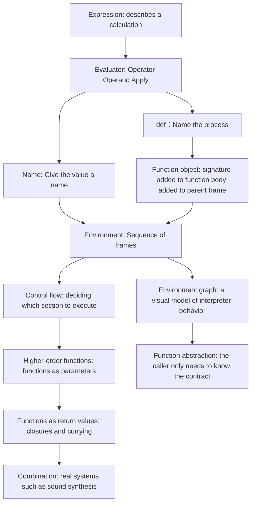
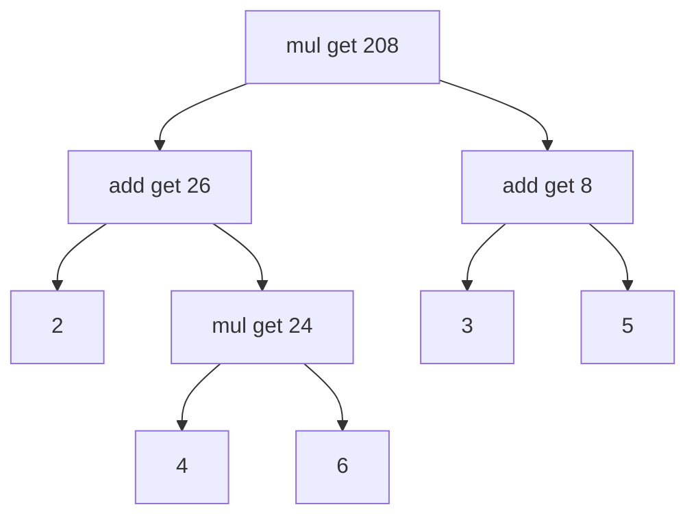
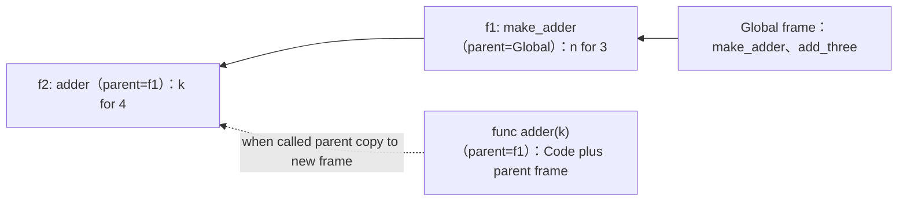
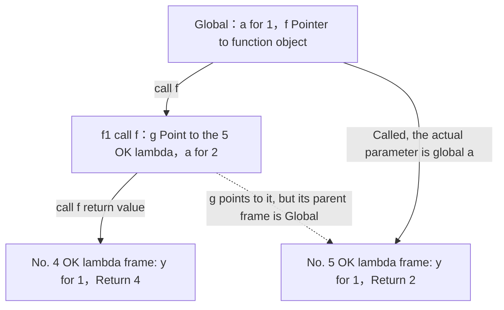
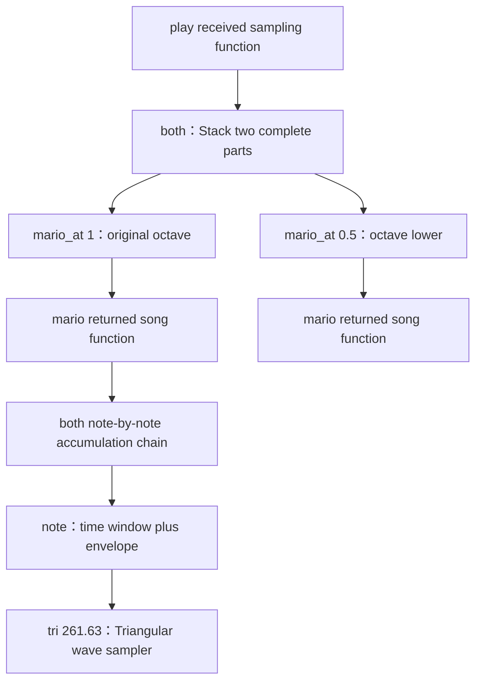
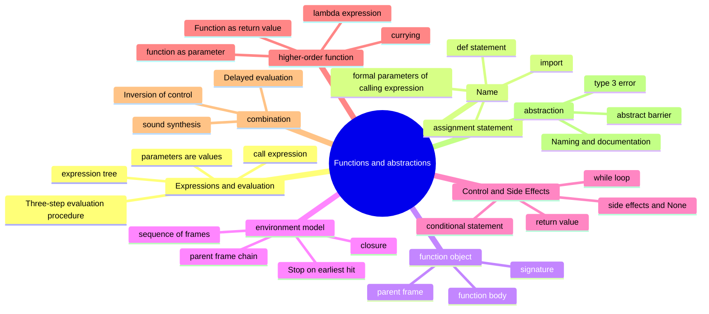

> **module**: M1 CS61A-functions, including Lecture 1–7 (Welcome, Functions, Control, Higher-Order Functions, Environments, Sound, Functional Abstraction)
> **total duration**:03:30:26 (7 lectures, of which Lecture 6 is an elective topic without courseware)
> **Collection**: [CS61A Fall 2024 Chinese subtitles collection](https://www.bilibili.com/video/BV1sy411z7nA), this module corresponds to points P 1–7
> **courseware**: `01-Welcome`, `02-Functions`, `03-Control`, `04-Higher-Order_Functions`, `05-Environments`, `06-Functional_Abstraction`  A total of 6 official PDFs, 92 pages, all rendered as text illustrations page by page according to the official PDF (Lecture 6 has no courseware)
> **Copyright**: The copyright of the course and courseware belongs to the UC Berkeley CS61A teaching team (Fall 2024); this article is a secondary compilation of Chinese for learning purposes, not a sentence-by-sentence translation

## 0. Module Navigation

*(Reference time: 00:00:12 – 00:02:02｜Lecture 1)*

Lecture 1 to Lecture 7 answer two sides of the same question: **How to name a calculation process into a reusable whole, and how to let the machine know what each name refers to at the time of evaluation.**  The answer to the first half of the question is a function, and the answer to the second half is an environment graph. The dependence in Lecture 7 is one-way - if the environment diagram in Lecture 5 is separated from the one in Lecture 2  `def`  There is nothing to draw with the high-order function in Lecture 4; if the abstract barrier in Lecture 7 leaves the parent frame in Lecture 5, it cannot explain "why the caller does not need to change if the implementation is changed." The narrative order is basically the same as the lectures, with only one rearrangement: Lecture 7 on  `lambda`  The three pages of the parent frame are advanced to Chapter 6, which is related to Lecture 5.  `lambda`  The grammars are linked together because they test the same rule.


### 0.1 Lecture List

| speak | Topic | duration | Number of courseware pages | Station B points P |
| :--- | :--- | :--- | :--- | :--- |
| 1 | Welcome Course Introduction and Expression Notation | 13:29 | 22 | [P1](https://www.bilibili.com/video/BV1sy411z7nA?p=1) |
| 2 | Functions name, def and call in three steps | 40:20 | 18 | [P2](https://www.bilibili.com/video/BV1sy411z7nA?p=2) |
| 3 | Control return values, side effects and control flow | 32:21 | 13 | [P3](https://www.bilibili.com/video/BV1sy411z7nA?p=3) |
| 4 | Higher-Order Functions functions as parameters and return values | 42:53 | 12 | [P4](https://www.bilibili.com/video/BV1sy411z7nA?p=4) |
| 5 | Environments frames, parent frames, closures and currying | 36:42 | 11 | [P5](https://www.bilibili.com/video/BV1sy411z7nA?p=5) |
| 6 | Sound sound synthesis (elective, no courseware) | 14:36 | 0 | [P6](https://www.bilibili.com/video/BV1sy411z7nA?p=6) |
| 7 | Functional Abstraction Abstraction, naming and errors | 30:05 | 16 | [P7](https://www.bilibili.com/video/BV1sy411z7nA?p=7) |

The most underestimated of the seven lectures are Lectures 1 and 6. Lecture 1 only lasts 13 minutes, half of which is about the course schedule, but the "evaluation program" it gives is the engine for all the reasoning in the next six lectures; Lecture 6 is optional and has no courseware, but it is the only time that the parts of the first five lectures are assembled into a complete machine - if you only want to watch one more lecture, choose Lecture 6.

### 0.2 Main line diagram



This picture is "walking on two legs": the left branch is **person who writes programs** perspective (how to name it, how to reuse it), the right branch is **interpreter** perspective (how to look up names, how to frame). The two branches converge at "environment", because the meaning of the name can only be given by the environment; the whole picture converges to "abstraction", because the whole reason for the existence of environment and closure is to hide an entire implementation behind a name.

### 0.3 Course organization and team


The technical form of this course is itself a design decision: all core content is recorded on video, and only the most important parts are reviewed in the live class. The videos cover all content and must be watched before class. Each video is 5-10 minutes long and can be paused and re-watched; the textbook and the video are highly overlapped, providing another more precise expression, which can be skipped and reviewed; the live classes are held every Monday, Wednesday and Friday, and only example questions and problem-solving strategies are taught. **Deliberately not covering everything**. The "intentional" sentence in the third column is the key: on-site time is limited, and should be spent on things that video cannot do - stuck points, strategies, and on-the-spot error correction.


Among the division of labor among the three lecturers, the ones directly related to reading this course are **Q&A time is a publicly committed fixed resource**: One person will be at the designated location each on Tuesday 13:00–15:00, Monday 15:00–16:00, and Thursday 13:00–15:00, no reservation is required. Page 3 introduces the guest lecturer's research direction - computing ethics education, that is, "how technology affects society, and how social values ​​prioritize the development of certain technologies."

> **Editor's note**: The subtitle mentions that "not all of the video was recorded this year" and only part of it was re-recorded when the content was updated. This reminds readers that the earlier the video is, the more likely it is that it will be equipped with an old version of the courseware. Page 3 does not have a corresponding explanation in the video, and the content is organized according to the original text of the courseware.

### 0.4 Practice closed loops and questioning channels


On page 6 is a pedagogical statement: **Problem solving is an effective way to learn to solve problems**. It determines how class hours are allocated: Lab Monday/Tuesday and Discussion Wednesday to Friday are mandatory requirements (except for large classes), and they jointly prepare for weekly homework and 4 programming projects; office hours are one-on-one Q&A sessions at any time. The reason why the exercises take up so many class hours is because "understanding a piece of code" and "writing this code" call for two abilities - the former only needs to be recognized, while the latter requires retrieval, combination, and debugging.


The organization of the discussion class: 6–7 people per group, usually 2–5 groups in a classroom; most have teaching assistants present, and the rest access through Zoom; the material is a worksheet filled with example questions; **No points are scored, and you don’t have to finish them all.**. "No points + no need to finish" is the real design: once points are scored, the discussion will degenerate into copying answers, and the goal of the discussion class is to learn to solve the problems. **Similar** question.


Questions are sorted according to "Who can see": Ed's private posts are sent to all teaching assistants and lecturers (suitable for questions involving his own code and grades), public posts are visible to all students (conceptual questions, question ideas, others can also benefit), the lecturer's mailbox only handles things that only he can handle, and the course mailbox is distributed to several teaching assistants.

### 0.5 What is this course about?


The courseware summarizes the course into three items: **Manage complexity** (Master the organizational skills of abstract and complex programs), **Introduction to programming** (Complete understanding of Python basics, how large projects demonstrate how to manage complexity, and how computers interpret programming languages), **different kinds of languages** (Python, Scheme, SQL). The first is the theme of this module, and the third is the perspective throughout the course. The mental model that really needs to be established in advance is: abstraction is the means, the project is the test, the interpreter is the principle, and multilingualism is the perspective.

### 0.6 Course selection suggestions and course rules


The original words of the course syllabus are: There are no formal prerequisites for programming, but it is usually quite difficult to take this course without any programming experience; most students already have considerable programming experience; students with zero foundation often need to spend more time, and their final grades tend to be lower. The wording is noteworthy: it does not set a threshold, it only makes the price clear. "No prerequisites" does not mean "zero-based friendly". The difference is the few extra hours per week.


There are two alternative courses for students with zero foundation or different goals: CS 10 is for people with no experience at all, using a graphical building block environment to get started, without large projects, laying the foundation for 61A and C88C; Data C88C is based on 61A but only covers 3 of the 4 units, 2 projects instead of 4, omitting the unit "How Programs Run Programs" and some advanced Python topics, which is still enough to take CS 61B.


The policy was reduced to two words: **Learning** (Rules for assignments, collaboration, grading, and deadlines) and  **Community** (Respect and Report). The courseware only expands on the two areas where problems are most likely to arise.


Collaboration is highly encouraged, but boundaries are drawn by a unified criterion: **Have you thought about the code yourself?**. It is allowed to discuss ideas, read the code of project partners, and read other people's writing methods after solving it yourself; it is not allowed to send the code to classmates or let AI directly generate the code for submission. Therefore, it is allowed to "read it after solving it" - what you are looking at at that time is other people's writing, not the answer.


The last page changes to the Community line: Derogatory remarks targeting a specific gender, race, or ethnicity are unacceptable; Berkeley Community Principles state "affirm the dignity of every person"; reporting channels include the instructor's anonymous feedback page and the EECS department's reporting form. This page has nothing to do with functions, but it explains why the course writes collaboration boundaries so thinly - the programmer's output is text, and text is most easily copied inadvertently.

## 1. Expressions and evaluation procedures

*(Reference time: 00:02:04 – 00:13:25｜Lecture 1)*

After the course administration is over, there are only ten minutes of technical content left in Lecture 1, but these ten minutes give the most important rule of the entire course. The question it answers is simple: `mul(add(2, mul(4, 6)), add(3, 5))`  Why is it equal to 208? If you can only memorize "calculate in parentheses first", it will fail immediately when encountering functions, side effects, and recursion; what is needed is a set of methods that can be executed mechanically and can be applied repeatedly to any depth. **program**.

### 1.1 One token covers all tokens


Mathematics invented different symbols for different operations: addition is a horizontal plus sign, division is stacked on top of one another, square root is a "little house", trigonometric functions are  `sin`  is the prefix. Human beings can understand it because they have memorized every set of conventions. The courseware draws these marks side by side. The one in the middle  `f(x)`  Encircled by a light gray box - that's the turning point: `6/23`  can be written as  `truediv(6, 23)`, `sin π`  is  `sin(pi)`, `2¹⁰⁰`  is  `pow(2, 100)`, `7 mod 2`  is  `mod(7, 2)`, `√3493161`  is  `sqrt(3493161)`, `C(69,18)`  is  `comb(69, 18)`, `|−1869|`  is  `abs(-1869)`.

> **Editor's note**: The above function names are added by the editor to demonstrate what they will look like after being "unified into calls"; the courseware only draws mathematical symbols and marks them with gray boxes  `f(x)`. like  `lim`  There is no corresponding function for such a notation because it is not an operation that can be calculated in one go.

There are three benefits, and they are not just "good-looking": the rule set becomes smaller (the interpreter only needs to implement the evaluation of one expression), the priority disappears (the nested structure of brackets itself is the evaluation order), and the arity is variable (the same name can be followed by two parameters or five parameters).

### 1.2 Interpreter: three-step evaluation procedure


The courseware writes this matter as an assertion: **All expressions can use function call notation**, followed by a  `(Demo)`——Assertions cannot be made by words alone.

```python
>>> 2000 + 15
2015
>>> max(1, 2, 3, 4, 5)
5
>>> from operator import add, mul
>>> add(2, mul(4, 6))
26
```

The third paragraph is the most important: `add`  Not syntactic sugar, but a **function value**, must first  `import`  Just exist. This proves that "addition" is not an irreplaceable thing in the grammar - it can just be a value. The reason why infix writing is not popular is because  `2 + 3 * 4`  The evaluation order of depends on a precedence convention in mind, and the expression itself does not carry this information; calling the expression does not have this problem, the nested structure of brackets writes the order directly on the paper.

The evaluation of the calling expression is always the same. This set of rules is called **Evaluator** (evaluation procedure): Evaluate the operator subexpression to obtain a function; evaluate each operand subexpression from left to right to obtain each parameter; apply the function to these parameters. Taking these three steps just to add up 2 and 3 seems like overkill, and the reason is **it can be applied over and over again**: "Procedure" means that no on-the-spot judgment is required, and "repeated" means that it can be applied to itself - this is the expression tree and the starting point of the subsequent recursion.



Drawing a nested expression as a tree, evaluation means replacing each subtree with its value from the bottom up. Two observations are worth remembering: **Order is information dependence, not style preference**——The parent node must wait for the child nodes to be calculated; **Parameters are always values**——The last multiplication involved the values 26 and 8, not  `add(2, mul(4, 6))`  this string of characters. The second one will have dramatic consequences in Chapter 3: `if_`  The function fails because it cannot prevent the formula from being evaluated early.

> **Editor's note**: The expression tree was drawn by the lecturer on the spot, not a page of the courseware. The above structure was redrawn according to the subtitle description. The depth of the tree determines how many levels of recursion the interpreter needs to recurse. The default upper limit of CPython is about a thousand levels. Super deep nesting will throw  `RecursionError`. The above interaction is reproduced in subtitles, and the output not provided by subtitles will not be included here.

## 2. Name, def and function object

*(Reference time: 00:01:13 – 00:32:46｜Lecture 2; 00:00:33 – 00:10:13｜Lecture 3)*

The rules of Lecture 1 evaluate any expression, but only **once**. To make it reusable, two things are needed: naming the value (assignment) and naming the process (`def`). This chapter establishes the first version of the environment model - a simplified version with only two layers of "local frame + global frame"; the second version (function object carries parent frame) is left to Chapter 5, because only high-order functions really need it.


### 2.1 The name does not exist out of thin air, the assignment saves the value


Type in the interpreter  `pi`, what you get is a sentence  `NameError`: It's not that Python doesn't know π, but that it doesn't know the name - most names are invisible by default and must be  `from math import pi`. Assignment statements are handled in the same fixed way: first the expression on the right is evaluated, and then the value is bound to the name on the left.

```python
>>> radius = 10
>>> area = pi * radius * radius
>>> radius = 20
>>> area
314.1592653589793
```

`radius`  has become 20, `area`  Still 314 - the two are "out of sync". The reason is that the assignment saves **value**: Evaluate  `pi * radius * radius`  Compressed into a number, only this number is bound;"`area`  used to be  `radius`  Definition of "This thing is not recorded anywhere. For courseware  `x = 2; y = x + 1; x = 5`  gives the minimal version (`y`  Still 3) and cross it out  `1 + 2 = x`, `x - 1 = 2`  Two lines emphasizing that the equal sign of the assignment statement is not a mathematical equal sign: it has no symmetry and cannot be inversely solved. This failure mode has a more sinister version in the project: the configuration, connection, and cache are calculated and stored in variables, and then the source is modified but the calculation is forgotten.

### 2.2 def only creates functions and does not run the function body

```text
def <name>(<formal parameters>):
    <body>
```

`def`  The part between the colon and the colon is called **function signature** (function signature), its most important responsibility is to indicate how many parameters this function requires; the indented part after the colon is the function body, which specifies what the function does and **Re-evaluated on each call**. So the problem of "losing synchronization" has a fix - write the algorithm as a function instead of tying the calculated number to the name, for example  `def area(): return pi * radius * radius`: every time  `radius`  change, `area()`  The current value will be read again. This is the first important difference in this module: **The return expression of a function is re-evaluated each time it is called**;The cost is that the calculation must be redone every time it is called, and the benefit will never expire. `def`  The execution process of **The function body is set to** All indented code after the first line (but not "executing" this code); binds the name to this new function in the current frame. So execute  `def square(x): return mul(x, x)`  When , not a single multiplication occurs. The function body is **save** code, not by **run** The code for - the metaphor used by the lecturer is squirreled away (hidden in a safe place).

### 2.3 The life of a function and the three steps of calling it

Lecture 3 uses one page of courseware to compress all the vocabulary from the previous section into a life cycle diagram. It is the best review page for this module.


| action | trigger | what happened | cost |
| :--- | :--- | :--- | :--- |
| `def`  statement | Execute to this line only once | Create a new function object (name, formal parameters, function body, parent frame) and bind the name to the current frame | The function body is not executed and no calculations are performed. |
| call expression | Each evaluation goes to this point | Evaluate operators and operands to obtain functions and actual parameters | possible side effects |
| apply | Call expression evaluation to the third step | Create a new local frame, bind formal parameters, and execute the function body in the new environment | Time and space increase with the number of calls |

"Inside and outside"`def`  Only once, call every time" This line is the foundation of all subsequent performance discussions: a  `def`  Whether written outside the loop or inside the loop determines whether the function object is created once or N times.


The demo code is only four lines: `from operator import mul`, `def square(x): return mul(x, x)`, `square(-2)`. The first line  `mul`  Binds to the built-in multiplication function; defined on line 2  `square`——Create the function, include the function body, and bind the name to the global frame. At this time, no multiplication occurs. Calling (applying) a user-defined function also involves three fixed steps: adding a local frame to form a new environment; binding formal parameters to actual parameters in this frame; and executing the function body in this new environment.


The annotations for this screenshot are worth reading one by one: **built-in functions** with **user defined function** The drawing method is almost the same, the only difference is that the custom function will write out the formal parameters - because it will be used immediately; **partial frame** It is the product of the first step of the three-step method. The frame title uses the original name of the function just as a label to facilitate tracking; what is really important is the binding (formal parameter) in the frame  `x`  with actual parameter value -2); within the frame  `Return value 4` **Not binding**, but record the annotation "what was returned by this evaluation".


The shape of the local frame is completely determined by the signature: `square`  This name gives the frame a title, `x`  It's the binding in the frame. So the courseware says "the function signature contains all the information needed to construct the local frame" - this also explains the specification problem: why each call  `square`, there is exactly one in each frame  `x`.

> **Editor's note**: The courseware marks this rule as "version 1" because subsequent conditional expressions, higher-order functions, and nested definitions will expand it. For the purposes of Lecture 2, the three-step approach is sufficient to explain the entire demonstration.

### 2.4 Name lookup: environment is a sequence of frames


The courseware marked this section as "the two most important things to talk about today": **The environment is a sequence of frames** (a sequence of frames), a frame is a binding between names and values; **The result of a name evaluation is the value bound to the earliest frame containing that name in the current environment.**——Operation is to search frame by frame from the head of the sequence, and stop when it is found the first time. A sequence consists of the "first frame" and the "remaining part of the sequence", and the global frame is always the last stop of the search. There are three layers of frames drawn on the picture, and a line of text next to it highlights the most common mistakes: **Although the three frames are drawn in the same picture, they are not necessarily in the same environment**. The environment is "the sequence of frames during a certain evaluation", and the graph is "all the frames that have occurred in the entire program life cycle".

The rule sounds abstract, but the instructor nailed it with a "deliberately messy" demonstration: naming the formal parameters after the function itself.

```python
def square(square):
    return mul(square, square)

square(-2)     # 4
```

`square`  It is both a function name and a formal parameter name, and the result is still 4. The reason lies in the calling environment: in the global frame  `square`  Bound to the function object; when calling, a new local frame is created, and the frame title is still called  `square` (just label), bound in frame  `square = -2`. execute  `mul(square, square)`  when, `square`  in **It has been found in the local frame**, the search stops, and the function object in the global frame is "invisible" at the moment. This is not a bug, but a direct corollary of "stop as soon as it is found": it is not that the function name is destroyed, but that the closer layer of binding obscures the farther layer.

> **Editor's note**: The real Python built-in name is stored in  `builtins`  In the namespace of the module, it is used as the layer after the global frame (that is, the B in LEGB) when searching. The courseware simplifies drawing by incorporating it into the global frame. This simplification is followed in this chapter.

### 2.5 Multiple assignment


```python
a = 1
b = 2
b, a = a + b, b
```

There are two execution rules for the third line: Find the right side of the equal sign from left to right **all** Expression; binds all names to the left of the equal sign to these resulting values (in the current frame). Seek first  `a + b`  Got 3, ask again  `b`  Get 2, then do the binding: `b`  Tied to 3. `a`  Tied to 2. The binding order in the second step does not affect the result, because the values on the right are all calculated in the first step - this is exactly  `b, a = a + b, b`  The reason why it can be written correctly at one time: all the old values used on the right are old values. This rule is the second occurrence of "evaluation before binding" (the first being the parameters in Chapter 1), and it applies when exchanging variables, updating state machines, and later in recursion.  `pred, cur = cur, pred + cur`  Repeatedly save lives.

### 2.6 Case: Treat the expression itself as an object

The last 6 pages of the courseware of Lecture 2 talk about "Small Expressions", which is not covered in the video (this lecture is in  `print`  with  `None`  end). It's a fitting ending here because it turns "expression" from an evaluation action into a **Data structures that can be enumerated, calculated, and printed**——The entrance to the main line of data abstraction.


The rules are short: only three functions are allowed -`f(x)`  minus one, `g(x)`  Double, `h(x, y)`  Put together two decimal numbers that are positive integers (`h(789, 12)`  Got 78912). Starting from 5, how to use the shortest expression to get to 2024? "Shortest" can be read in two ways: the fewest calls, or the fewest characters, and the two metrics don't always sync.


The strategy is **Search**: First enumerate all small expressions containing 3 calls, then 4 times, 5 times, and so on. The results on this page must be generated programmatically, because with each additional layer of calls, the number of candidates increases exponentially.


Among the first batch of expressions that hit 2024, the shortest one is  `g(h(g(5),g(g(f(f(5))))))`: 7 calls, 24 characters. Take it apart and see if  `f(5)=4`, again  `f`  Got 3, `g`  Get 12 twice, `g(5)=10`, `h(10,12)=1012`, again  `g`  Got 2024.


The last page writes the entire set of searches as a program and marks the course topics it uses: Functions, Control, Higher-Order Functions, Objects, Representation, Sequences, Mutability, Iterators, Generators, Recursion, Tree Recursion, and Containers. The footer sentence  **By Midterm 2, you can do this**  This is a roadmap for the entire semester. The code uses two classes to represent expressions: `Number`  Save the value, `calls()`  return 0; `Call`  Save operators and operands, `calls()`  Return  `1 + sum(o.calls() for o in self.operands)`.`smalls(n)`  is a recursive enumeration of "how many calls are allowed": the base case only produces the number 5, otherwise for each  `n-1`  Layer subexpressions are applied once  `f`  or  `g`, and then use two layers of loops to divide the remaining times into  `h`  of two operands, and only concatenates two positive numbers.

> **Editor's note**: This page only displays the code, not the running output, nor does it explain how the "number of calls and number of characters" are counted; the above interpretation is an analysis of the code itself, not a classroom lecture. The classes, generators, and recursion used in this code belong to the topics of the following modules respectively. Here you only need to understand the point that "expressions can be represented as objects".

## 3. Return values, side effects and control flow

*(Reference time: 00:32:49 – 00:40:18｜Lecture 2; 00:00:17 – 00:32:19｜Lecture 3; 00:09:08 – 00:21:07｜Lecture 4)*

Chapter 2 solves "how to name", but does not solve "after naming, what is left after a call". The same action actually leaves two things: one that can continue to participate in calculations **value**, and something that really happened **thing**. Only by separating these two channels can we understand  `print`  Why can't we participate in arithmetic? Only by handing over "which section to execute" `if`  with  `while`. This chapter will finally use a failed experiment from Lecture 4 to prove that control statements cannot be replaced by functions.


### 3.1 Two channels: return value and side effects


Type an expression in the interpreter and it will display the value; type  `print(-2)`, will also appear on the screen  `-2`. It looks the same, but two different things happened. direct evaluation  `None`  Nothing is displayed, `print(None)`  but will type  `None`——Because the interpreter automatically displays the value of the input expression, and  `None`  It's a special case. This rule distinguishes "function has no output" from "function returns  `None`"Looking exactly the same on the screen is the most common misjudgment in the beginner stage.

```python
>>> print(print(1), print(2))
1
2
None None
```

Unpack in order of evaluation: find operators  `print`; Find the first operand  `print(1)`——A side effect occurs when applied (shown as 1), the value of this subexpression is  `None`;Find the second operand  `print(2)`——Similarly; finally the outer layer becomes  `print(None, None)`, display  `None None`, the return value is still  `None`, and the interpreter does not display it.


The courseware uses "closed tubes" to draw pure functions: a value goes in, a value comes out, and nothing else happens in between; `print`  It is not a closed system. **Side effect is not a value**, but "anything that happens as a consequence of calling the function".

| criterion | Pure function (Pure) | Non-pure function |
| :--- | :--- | :--- |
| return value | a value determined by the actual parameter | often  `None` (may also have value) |
| side effects | No | There are: printing, changing external state, reading and writing files |
| Can larger expressions be embedded? | Can, `abs(-2) + 1`  legal | Formally, it can, but the combination is the order of evaluation, not the combination of values. |
| Calling the same argument repeatedly | The result remains unchanged | Every time it is repeated, the side effects come again |
| Can it be safely rearranged? | You can nest and exchange the order at will | Changing the order will change the output |

The last line is the real purpose of this table: pure functions can be rearranged at will, but impure functions cannot. Chapter 7: When doing sound synthesis, the reason why "combinators can be nested arbitrarily" is true is that the sampling functions participating in the combination are pure.

### 3.2 Three types of h(x): Separate "print" and "return"


```python
def h(x):
    return print(f(x))        # (A)

def h(x):
    print(f(x))               # (B)
    return f(x)

def h(x):
    y = f(x)                  # (C)
    print(y)
    return y
```

**(A)**  put  `f(x)`  hand over  `print`, `print`  print it and return  `None`, so  `h`  Return  `None`——On the screen, the value is right, the value is wrong, the most typical "it looks okay". **(B)**  Print first  `f(x)`, again **Re-evaluate** `f(x)`  and returns - screen pair, value pair, but  `f`  is called twice. **(C)**  Only evaluated once  `f(x)`, deposit  `y`, print  `y`, return  `y`. The courseware then asked: What kind of  `f`  Would it make (B) behave differently than (C)? if  `f`  It is a pure function. The return value of the two is the same and the printed content is the same. There is only one extra calculation, which is invisible to the naked eye.

> **Editor's note**: The easiest counterexample is to  `f`  Take a commission  `print`  itself. At this time (B) will be executed first  `print(print(2))` (Inner layer prints 2, outer layer prints None), then execute  `return f(2)` (print 2 again), there are three lines on the screen; while (C) has only  `2`  with  `None`  Two lines. This shows that the value of (C) is not just "saving one calculation", but "the side effect only occurs once".

### 3.3 Statements, suites and conditional statements


The fundamental difference between statements and expressions is: **Expressions are evaluated to obtain values, and statements are executed to produce actions.**. Statements that span multiple lines are called **compound statement** (compound statement), with a fixed structure: a header, followed by a set of indented statements. **clause **It is a header plus the set of indented statements following it; **suite (statement group) **is the entire set of indented statements in that clause; and header  **control** The suite behind it - this sentence means understanding  `if`  with  `while`  all keys. The rules for executing a suite are: **Execute the first statement first, then continue with the rest unless asked to do otherwise.**. But real programs are rarely so obedient: some functions will** end early**, some will** Not executed in order**, the former corresponds to conditional statements, and the latter corresponds to loop statements.


A function that finds the absolute value has only one statement in the body, and this statement contains three clauses (`if`, `elif`, `else`) with three suites. There is only one execution rule: consider each clause in order and evaluate its header; if a true value is obtained, execute the suite of the clause and skip all remaining clauses. From this we get the most essential properties: **Only one suite will be executed**.

| Writing method | `x = 10` | `x = 1` | `x = -1` |
| :--- | :--- | :--- | :--- |
| two independent  `if` | Print  `big`  and  `positive`  two lines | `positive` | print nothing |
| One statement has two clauses: `if` + `elif` | `big` | `less big` | print nothing |
| One statement has three clauses: `if` + `elif` + `else` | `big` | `less big` | `not pos` |

The first line is the most telling: `x = 10`  If two conditions are met at the same time, the two independent statements are executed once each, so two lines are printed. Replace with  `if` + `elif`  Finally, the second condition will not be tested at all. This is not an optimization, but a semantic difference: **`if/elif`  Expressing "several mutually exclusive situations", two  `if`  Express "several conditions that are independent of each other"**. The price is  `if/elif`  Subsequent conditions are never tested after the first truth value occurs, so placing a small-scope condition after a large-scope condition makes the latter clause dead code.

### 3.4 Boolean context and while

There is a concept hidden in the sentence "if you get a true value": **boolean context** (Boolean context). It is a location in the code where any expression can be placed, but this location only cares about "true or false". False values in Python include  `False`, `0`, empty string  `''`, `None`, everything else is true.


The courseware lists three things you must think clearly: **I need a few names, what do they mean?**; **The condition must eventually become false**, the statement will end (unless there is a  `return`); **Once the condition is evaluated, the entire body will be executed**——The condition may no longer be true halfway through execution, but the loop will not check back midway.

```python
i, total = 0, 0
while i < 3:
    i = i + 1
    total = total + i
```

| rounds | Evaluate  `i < 3` | `i = i + 1`  after | `total = total + i`  after |
| :--- | :--- | :--- | :--- |
| 1 | true | `i = 1` | `total = 1` |
| 2 | true | `i = 2` | `total = 3` |
| 3 | true | `i = 3` | `total = 6` |
| 4 | false | Not executed | Not executed |

Two details are worth mentioning separately: **The right side of the assignment statement uses the "before execution" value.** (First round  `i = i + 1`  reads 0), so the order of the two statements is crucial; **In the third round  `i`  Has been changed to 3, but body is not broken**, `total`  Still add 3 to get 6. This is why after the loop ends  `i`  It's 3 instead of 2.

> **Editor's note**: put "at the end of each round  `total`  equals 1 added to  `i`"Written **loop invariant**, is a standard template for verifying the correctness of a loop: it is true after initialization; it is true at the beginning of each round, and it is still true after body is executed; when the matching condition is false at the end of the cycle, the conclusion is given. Neither the courseware nor the subtitles use this word.

### 3.5 Example: Prime Factorization


Loops are best suited for problems whose size is unknown but shrinks with each round. Every positive integer has a set **prime factors**: Those prime numbers whose product is equal to it (the prime factor of a prime number is itself). The ideas given by the courseware are: **find out  `n`  The smallest prime factor of , divide once by it, and repeat the same action for the quotient**.

| rounds | current  `n` | smallest prime factor  `k` | next round  `n` | Factors for this round |
| :--- | :--- | :--- | :--- | :--- |
| 1 | 858 | 2 | 429 | 2 |
| 2 | 429 | 3 | 143 | 3 |
| 3 | 143 | 11 | 13 | 11 |
| 4 | 13 | 13 | 1 | 13 |

after four rounds  `n`  becomes 1, `while n > 1`  If not, the cycle ends. The loop variable is getting smaller every round, which is a structural guarantee that "the condition will eventually become false" - the criterion is not "I counted four rounds", but "the quotient strictly gets smaller at each step, and the lower bound is 1".

> **Editor's note**: subtitles in  `while`  The tracking was terminated after the end, and (Demo) on page 13 of the courseware did not appear in the subtitles. If a supplementary version is implemented, there will be two  `while`  Fit: inner layer  `smallest_prime_factor`  Find the first divisible number from 2 upwards  `n`  of  `k`, outer layer  `print_prime_factors`  in  `n > 1`  When taking factors repeatedly, `n = n // k`  and print; `print_prime_factors(858)`  2, 3, 11, 13 will be printed in sequence. here  `print`  The side effect of is the output itself, the function does not need to return a value - again back to the two channels of Section 3.1.

### 3.6 Failed Experiment: Why if can’t be a function

Lecture 4 uses a counterexample to answer "Why not just use functions to implement branches". Following the rules, you can imagine an "if function": it takes three parameters - a condition, a value when the condition is true, and a value when the condition is false.

```python
def if_(c, t, f):
    if c:
        return t
    else:
        return f
```

To expose the difference, a "square root of the real part" function is needed: it returns the square root for positive numbers and 0 for negative numbers (because  $\sqrt{-4}$  the real part of is 0), and the negative **Can't** hand over  `sqrt`.

```python
def real_sqrt(x):
    """Return the real part of the square root of x."""
    if x >= 0:
        return sqrt(x)
    else:
        return 0
```

This version works fine: `real_sqrt(-16)`  gets 0, and  `sqrt(x)`  is not evaluated at all. Change to  `return if_(x >= 0, sqrt(x), 0)`  After, `real_sqrt(-16)`  Throw  `ValueError: math domain error`. The reason is not there  `if_`  The definition of , and in the evaluation order: the interpreter first evaluates the operator to get the function, and then **Evaluate all three operands**, and then tie the three values ​​to  `c`, `t`, `f`;when  `x`  When it is −16, the second step of evaluation  `sqrt(x)`  An error has been thrown, and not a single line of the function body has been executed.

The conclusion is drawn from this: **The calling expression cannot skip the evaluation of any part of it**, all parts are always completed before the function is called; and control statements are inherently capable of "executing one part and skipping another part". This is why programming languages ​​must have control statements.

| criterion | `if`  statement | `if_`  call expression |
| :--- | :--- | :--- |
| Branch selection timing | After evaluating the header, only the selected suite is executed. | function body press  `c`  The value of is returned, but all actual parameters have been evaluated first |
| unselected branch | Not evaluated at all, safe to include  `sqrt(x)` | The value must be evaluated first, and an error will be reported on the spot if the input is illegal. |
| Evaluation order | Lazy: execute on demand | Strict: Operators and all operands are evaluated first |
| failure mode | Can only fail in the branch being executed | If any operand fails, the entire operation fails. |

The value of this experiment goes beyond the "branch" itself: it proves **The order of evaluation cannot be encapsulated by functions**. Any need to "skip a certain calculation" must be provided by the syntax layer of the language, and functions cannot do it.

### 3.7 Short-circuit evaluation: controls written in expressions

Python also has expressions that allow the interpreter to skip subexpressions: `and`  with  `or`, the behavior is called **short-circuit evaluation**(short-circuiting).`left and right`  The left side is evaluated first; if it is false, the entire expression takes on that false value and the right subexpression is not evaluated at all; otherwise the right side is evaluated and the rvalue is taken. `left or right`  Find the left first; if it is a true value, just take the lvalue and call it a day; otherwise, find the right and take the rvalue.

| expression | left operand | the value of the entire expression | Whether the right operand is evaluated |
| :--- | :--- | :--- | :--- |
| `a and b` | false value | `a`  itself | No |
| `a and b` | truth value | `b` | is |
| `a or b` | truth value | `a`  itself | No |
| `a or b` | false value | `b` | is |

Note that the value does not have to be  `True`/`False`: `2 and 3`  Got 3, `0 and 3`  Got 0. What is returned is always **an operand itself**. The first use is to block dangerous subexpressions: `return x > 0 and sqrt(x) > 10`  in  `x = -1000`  returns false when **no crash**, because  `x > 0`  is already a false value, `and`  Immediately sentenced to leave, `sqrt(-1000)`  is never evaluated - this is exactly  `if_`  Something that cannot be done. The second use is to provide default values: `return n == 0 or 1 / n != 0`  in  `n = 0`  returns true because  `n == 0`  is already true value, `or`  Then call it a day; otherwise 0 will divide by zero, and 0 is obviously a reasonable number, but not suitable for the "reciprocal" test.

> **Editor's note**: The lecturer's original words were "The numbers that can be expressed are only so small." In implementation, this is an underflow of floating point numbers: the absolute value is smaller than the smallest normal number (approximately  $10^{-308}$) falls into the non-normal number range, and if it is smaller, it will be rounded to 0, which is determined by the IEEE 754 double precision format.

### 3.8 Division of labor among three types of "selective execution"

| criterion | control statement  `if`/`while` | short circuit operator  `and`/`or` | higher-order function |
| :--- | :--- | :--- | :--- |
| decide what | Which section of the suite is executed and how many times it is executed? | Whether the right-hand subexpression is evaluated | Which calculation is passed in and when it is called |
| grammatical layer | statement | expression | expression |
| Can it cross statement boundaries? | can | Can't | Can't |
| Typical uses | branch, loop | Guard dangerous subexpressions and provide default values | Parameterize the variable part |

The relationship between the three can be recorded as follows: `if`  Regardless of "which section to execute", `and`/`or`  It controls "whether it counts on the right side", and the higher-order function controls "who should give this code to." Lecture 4 starts from the third point.

## 4. Higher-order functions: turn differences into parameters

*(Reference time: 00:00:00 – 00:42:11｜Lecture 4)*

Chapter 3 left the question of which section to execute to statements, but one type of duplication was not eliminated: two functions that are identical except for the middle line. `if`  Can't help, because it can only decide "which way to go", it can't stuff a calculation process into another function. The answer to Lecture 4 is **The function itself becomes a parameter**——The abstract object is upgraded from a number to a calculation.


### 4.1 Iteration template: first list the status

Before entering higher-order functions, Lecture 4 provides an iterative design demonstration using the Fibonacci sequence. There is only one sentence in methodology, but it is the foundation for all subsequent reasoning: **When designing an iterative function, the most important question is what information must be kept track of in order to complete the iteration.**  Each of the three names for the solution has a clear meaning: `pred`  It is the previous item, `cur`  is the current item, `k`  record "this moment" `cur`  What Fibonacci number is contained in it?"; in the loop body  `pred, cur = cur, pred + cur`  Being able to write one line correctly depends on the "evaluate all first, then bind them uniformly" section 2.5.

| stage (`n = 5`) | `k` | `pred` | `cur` | `k < n` |
| :--- | :--- | :--- | :--- | :--- |
| Enter function | 1 | 0 | 1 | true |
| End of round 1 | 2 | 1 | 1 | true |
| End of round 2 | 3 | 1 | 2 | true |
| End of round 3 | 4 | 2 | 3 | true |
| End of round 4 | 5 | 3 | 5 | false |

Class Discussion Question: Change the first three lines to  `pred, cur = 1, 0`  with  `k = 0`, is the new definition "the same" as the old one? it **still correct**, and better - because  `n = 0`  It returns 0, while older versions return 1; the cost is  `n = 5`  Execute one more round at a time. The lesson of this question is not "which is faster", but **Semantic choice of initial values changes boundary behavior**: To determine whether two definitions are the same, you must enter them one by one.

### 4.2 Describe a function: domain, range, behavior


For courseware  `square`  Let’s talk about the three levels of describing functions: **domain** (domain) is all the input that may be accepted - "x is a number"; **range** (range) is the total output that may be returned - "returns a non-negative real number"; while the pure function **behavior** (behavior) is the relationship it establishes between input and output - "return x squared". Using relationship description instead of process description is the prerequisite for the implementation to be replaced with confidence later: as long as the relationship remains unchanged, no matter how the implementation is written, it will not affect the caller.


There are only two design guidelines: **Give each function exactly one responsibility while making it applicable to many related situations**; **DRY (Don't Repeat Yourself) - a process is only implemented once, but can be executed many times**. Courseware uses built-in  `round`  Demonstrate "one responsibility, multiple situations": `round(1.23)`, `round(1.23, 1)`, `round(1.23, 5)`  It's all the same rounding responsibility, with an optional parameter covering different precisions.

> **Editor's note**: On the courseware  `round(1.23, 0)`  displayed as  `1`, that was the output in the Python 2 era; Python 3 returns floating point  `1.0`.

### 4.3 The first generalization: turning constants into parameters


The area formula is the simplest example: a square  $r^2$, circle  $\pi r^2$, regular hexagon  $\dfrac{3\sqrt{3}}{2} r^2$. The common skeleton is  $r \times r$, the rest is just about the shape. The most straightforward implementation is to write the same assertion three times, and "pasting the same line in three places" just violates DRY. Extract the common skeleton and make the differences into parameters:

```python
def area(r, shape_constant):
    assert r > 0, 'A length must be positive'
    return r * r * shape_constant

def area_hexagon(r):
    return area(r, 3 * sqrt(3) / 2)
```

`area_hexagon(-10)`  Will throw now  `AssertionError`, because the assertion is only written once but takes effect for three functions at the same time. The price should also be stated clearly: `area(r, shape_constant)`  This kind of signature is not intuitive, and you must rely on documentation to explain what the second parameter is——**Reuse in exchange for decreased readability**. The limitation of this version is decisive: what is parameterized is the "number", but the next difference lies in the expression.

### 4.4 The second generalization: turning the process into parameters

Three summation formulas: the sum of natural numbers, the sum of cubes, and the more terms a term has, the closer it is.  $\pi$  of series. They are both "adding items from 1 to n", and there is only one difference: how to calculate each item. Let me write it honestly twice first——`sum_naturals`  with  `sum_cubes`  Except  `total + k`  with  `total + pow(k, 3)`  Repeat verbatim. Since the difference is a calculation of "calculate this term from k", write it as a function and pass it in:

```python
def summation(n, term):
    """Sum the first n terms of a sequence.

    >>> summation(5, cube)
    225
    """
    total, k = 0, 1
    while k <= n:
        total, k = total + term(k), k + 1
    return total
```


The four annotations in the courseware constitute the minimum closed loop for understanding higher-order functions: `cube`  is a "function with only one parameter" and its name is **Don't bark** `term`——`term`  is a formal parameter, `cube`  is the function passed in; `term`  This formal parameter will be bound to a **function** on; call  `summation(5, cube)`  time  `cube`  as **Parameter value** passed in; in the loop body  `term(k)`  What is actually called is  `term`  The function that is bound at this moment. So the two repeated functions are each reduced to one line: `return summation(n, identity)`  with  `return summation(n, cube)`.

The third formula is used for acceptance, it requires a term function  `pi_term(k) = 8 / mul(4 * k - 3, 4 * k - 1)`;Summing a million terms gives 3.141592, which is not exact  $\pi$  Rather it is an approximation.

| Sum | every item  $f(k)$ | pass to  `summation`  of  `term` | result |
| :--- | :--- | :--- | :--- |
| sum of natural numbers | $k$ | `identity` | 15(n = 5) |
| sum of cubes | $k^3$ | `cube` | 225(n = 5) |
| approaching  $\pi$  series of | $\dfrac{8}{(4k-3)(4k-1)}$ | `pi_term` | 3.141592(n = 10⁶) |

It's worth pausing here to see what exactly "increasing level of abstraction" means: **What is extracted is no longer a number, but an entire calculation**.`summation`  It only promises "item-by-item accumulation" and leaves "what each item is" completely to the outside, so it is open to items of any shape.

### 4.5 Three words and two cases of programming


The next page gives three words: **Modular** (Independently replaceable unit——`summation`  skeleton and  `term`  The implementation is two pieces), **abstraction** (Only expose necessary interfaces——`term`  is the only boundary exposed to the outside world), **separation of concerns** ("How to accumulate" and "What to accumulate" are completely separated into two sides). They are the names given to all previous work.


The case is blackjack: two players take turns adding 1, 2 or 3 to the total; the total starts at 0; it ends immediately when it reaches or exceeds 21; **The last person to add the number loses**. The diagram on this page will be fully explained in Chapter 8. Here you only need to pay attention to its correspondence with the function: **Strategy is a function**——Accept the current total and return how much to add. As long as the signatures match, `play`  It doesn't matter if the policy is a human, a random number, or a wrapper that prints logs.

> **Editor's note**: Page 9 of the courseware does not have a corresponding independent explanation paragraph in the video. The lecturer goes directly to "function as return value" after the summation demonstration; the placement of the three words is borne by the content of this chapter, not the original words of the class.

### 4.6 Function as return value: make\_adder


```python
def make_adder(n):
    """Return a function that takes one argument k and returns k + n.

    >>> add_three = make_adder(3)
    >>> add_three(4)
    7
    """
    def adder(k):
        return k + n
    return adder
```

Four annotations on the courseware: `make_adder`  is "a function that returns a function"; `add_three = make_adder(3)`  Let the name be bound to **a function**; `def adder(k)`  is "appears in another  `def`  internal  `def`", therefore  `adder`  fall on  `make_adder`  called **partial frame** Li; `return k + n`  inside  `n`  No  `adder`  The formal parameter is the formal parameter of the outer function, which can be referenced by the inner layer. Two structural points must be distinguished  `return`: `return k + n`  Belong to  `adder`, returns a number; `return adder`  Belong to  `make_adder`, returns a **function object**--note there are no parentheses, so it's not "call  `adder`", but "put  `adder`  Hand it over yourself". So this lecture leaves a suspense: calling  `add_three(4)`  when, `make_adder`  It has returned a long time ago, and its frame should have disappeared, but  `k + n`  inside  `n`  Why is it still 3? `adder`  What exactly is stored in the function object? The first version of the environment model from Chapter 2 cannot answer this question because it only has two layers, whereas the frame chain here has three layers. Chapter 5 is here to answer it.

## 5. Environment model: frame, parent frame and closure

*(Reference time: 00:00:00 – 00:19:13｜Lecture 5)*

The general outline of Lecture 5 is only one sentence: **The whole reason environment graphs exist is to describe how higher-order functions work.**. The good news is that none of the existing rules need to be changed - higher-order functions don't need patches, they're just a natural corollary of "functions are values ​​too". There is only one thing to do in this chapter: fill in the field that the function object has been missing.


### 5.1 Review: Environment graphs track values and bindings


The courseware uses one page of review to pin down the "value" again: `print`  It only produces side effects and does not return useful values. What is returned is  `None`. This is especially important in environment diagrams because **Environment graphs track the flow of values and bindings, not characters on the screen**. Immediately afterwards, a mid-term real question compresses the rules of Chapters 2 and 3 into one tracking:

```python
s = "Knock"
print(print(print(s, s) or print("Who's There?")), "Who?")
```

Split the expression tree from the inside out: `print(s, s)`  Print  `Knock Knock`, return  `None`; `or`  The left side is a false value, find the right side  `print("Who's There?")`, print the line and return  `None`, the whole  `or`  The value is the one on the right  `None`;middle layer  `print(...)`  receive it and print the third line  `None` (Courseware annotation: This None is passed to print!); The outermost layer receives  `None`  with  `"Who?"`, print the last line  `None Who?`——Four lines of output, while the value of the entire expression is still  `None`.

> **Editor's note**: The value of this expression itself is still  `None`. If you evaluate it directly in the interactive interpreter, an additional  `None`; running as a script will not - this is where "printed things" and "expression values" are most easily confused.

### 5.2 apply\_twice: The formal parameter contains a function


```python
def apply_twice(f, x):
    return f(f(x))

def square(x):
    return x * x

result = apply_twice(square, 2)
```

`apply_twice`  The reason why it is a higher-order function is very simple - one of the actual parameters is itself a function. The call writing method is worth taking a second look at: `apply_twice(square, 2)`  What is evaluated here are two **value**——`square`  The function object pointed to by this name, as well as the number 2; is not a "function name", nor a "function call".

- **Global frame**: `apply_twice`, `square`  Each points to a function object
- **f1: apply_twice [parent=Global]**: `f` → `func square(x) [parent=Global]` (a function **value**, not a single call), `x` → `2`
- **f2: square [parent=Global]**: `x` → `2`, returns 4
- **f3: square [parent=Global]**: `x` → `4`, returns 16

The order of evaluation is made clear here for the first time: to calculate  `f(f(x))`, we must first sort out the settlement  `f`  What is it? Operand  `f(x)`  What is it again. inner layer  `f(x)`  in  `f1`  hit  `f`, what actually happens is  `square(2)`  Returns 4; this 4 becomes the outer layer  `f`  actual parameters, `square(4)`  Return 16. Note  `f2`  with  `f3`  The parent frames of are all Global, **No  `f1`**- At this point it happens to be the same as the "caller's frame", so you can't see the difference, which is exactly what you need to nest  `def`  reason.

### 5.3 Nested def and parent frame


```python
def make_adder(n):
    def adder(k):
        return k + n
    return adder

add_three = make_adder(3)
add_three(4)
```

Frame-by-frame tracking: call  `make_adder(3)`  New  `f1: make_adder [parent=Global]`, `n`  tied to 3; `def adder(k)`  in **current frame  `f1`** (not a global frame) Create  `func adder(k) [parent=f1]`, the name is tied to  `f1`; at this moment  `f1`  There's something in it  `adder`, but no path from the global frame can reference it; `return adder`  This function object is brought back to the calling site and is then bound to the global name by the assignment statement.  `add_three`, the same function object therefore has two names. call  `add_three(4)`  When new  `f2: adder [parent=f1]`, `k`  Tied to 4——**its parent frame is not a global frame**, but  `f1`. Ask for  `k + n`  When the current environment is  `f2 → f1 → Global`: `k = 4`  in  `f2`  hit, `n = 3`  in  `f1`  Hit, score 7.

The key is in the last step: `make_adder`  I have returned a long time ago, but  `f1`  does not disappear because calling  `add_three`  created when  `f2`  put  `f1`  as the parent frame, and  `f1`  stored in  `n`.



> **Editor's note**: This phenomenon of "the function object carries the environment when it was defined, thus remembering the outer name" is called this in the textbook and subsequent courses. **closure**. This word was not used in the oral broadcast of this lecture, and the lecturer only described the mechanism.

### 5.4 Four parent frame rules and five steps of drawing

The courseware compresses the above reasoning into four items: Each user-defined function has a parent frame, usually the global frame; the parent frame of the function is **The frame in which it was defined (created)**; Each local frame has a parent frame; the parent frame of the frame = the parent frame of the called function. The last one is the most common mistake in drawing: **frame  `parent`  It's not "who called me", but "where was the function I belonged to born?"**. The lecturer's self-question and answer is: Only by writing down the "place of birth" and calling it can the correct frame be written.  `parent`;The frame chain determines where the "current environment" goes. Looking at it the other way around, everything needed to draw a call frame - function name, parent frame annotation, formal parameters -**It's all written down on the function value**.


Organize the list into five steps:

1. **Create only value but no execution body**: Every time you encounter  `def` (or  `lambda`) is executed when the function value, function body, etc. are called.
2. **Write the function value in three paragraphs**: `func <name>(<形参>) [parent=<标签>]`, `parent`  fill in **The current frame at the time of definition**.
3. **Bind name to current frame**: `def`  autocomplete; `lambda`  Only the value is created, and the name is given by the assignment sentence outside.
4. **Frames are built in a fixed order when called**: Create a new local frame and put the function value on  `parent`  Copy it and tie the formal parameters to the actual parameters one by one.
5. **Evaluate the function body in an environment starting with a new frame**: Check the name from the current frame  `parent`  Up, the first hit's binding is the answer.

| scene | function-valued  `[parent=…]` | calling frame  `[parent=…]` | Can I read outer local names? |
| :--- | :--- | :--- | :--- |
| top layer  `def` | Global | Global | Only global names can be read |
| Nested  `def` (in  `f1`  (definition) | `f1` | `f1` | Can, `f1`  The bindings are visible |
| The return value of the nested function is called again | `f1` (copied from function value) | `f1` | Can, `n`  still valid |
| Two parallel top-level functions call each other | Global | Global | No, the caller's local frame cannot be seen |

### 5.5 Counterexample: y is obviously there, why can’t it be found?

```python
def f(x, y):
    return g(x)

def g(a):
    return a + y

f(1, 2)        # NameError: name 'y' is not defined
```

The absurdity can be seen at a glance: `x`  tied to 1. `y`  Tied to 2, all in  `f`  placed in the frame; call  `g`  Exactly  `f`  function body; enter  `g`  after  `a`  Tied to 1. All the values are in, `y`  It's in the frame "next to", but the program just says it doesn't exist. There is only one answer: **That frame is not in the current environment**. The current environment consists of  `g`  It consists of two parts: the local frame and the global frame; check  `y`  Look first  `g`  The frame - there is none; looking at the global frame - there is none either; so an error is reported. combine it with  `make_adder`  By comparison, the difference between the two lectures is only one word: **Nested**.

> **Editor's note**: This phenomenon is called in language design **Lexical scoping**- Name resolution only depends on where the function is defined. Another possible design is dynamic scope: if the parent frame is determined by "Who calls me", `g`  you can see the caller  `f`  frame, `y`  It will be 2. Python, Scheme, and modern mainstream languages ​​all choose lexical scoping because it is the only way that code behavior can be determined at the time of reading.

### 5.6 Two versions of the environment model and a language comparison

| criterion | Lecture 2 | Lecture 5 |
| :--- | :--- | :--- |
| what is the environment | Local frame + global frame two segments | A sequence of frames, of any length |
| What's in the function object | signature + function body + name | signature + function body + name + **parent frame** |
| Where does the parent frame of the frame come from? | Always a global frame | Copied from the called function value  `parent` |
| can explain  `make_adder` ? | Can't | can |
| sufficient range | No nesting  `def`, no return function | All first-order and higher-order functions |

This table also explains why Lecture 5 must come after Lecture 4: if you teach the parent frame first, no examples will require it; look first  `make_adder`  Fail once and the parent frame becomes a necessity rather than a requirement.

The same set of evaluation ideas will appear in a purer form in Scheme (starting in Lecture 28). By comparing it in advance, you can avoid mistaking Python's syntax habits for the nature of the calculation itself:

| criterion | Python | Scheme |
| :--- | :--- | :--- |
| Call writing method | `f(x, y)`, the operator comes first and the parentheses come after | `(f x y)`, a pair of brackets as a whole, with the operator at the front |
| infix operator | Yes  `+ - * /`, with priority | No infix, `(+ 1 2)`  Just call |
| define function | `def f(x): return ...`  is a statement | `(define (f x) ...)`, itself is also an evaluation |
| Expressions and statements | Divided into two sets, the statement does not produce a value | No distinction, everything is valuable |
| Evaluator | Operator first, then operands from left to right, and then applied | It’s the same rule, but it’s more eye-catching after the writing is unified. |
| Can I skip subexpressions? | Damn  `if`, `while`, `and`/`or` | by special form  `if`, `cond`, `and`/`or` |

The most memorable one is the "evaluator" line: **The skeleton of the rules is exactly the same**, the only difference lies in where the operators are placed in the syntax. `mul(add(2, 3), 5)`  Translated into Scheme is  `(* (+ 2 3) 5)`, the position of the brackets has changed, but the order of evaluation has not changed at all.

> **Editor's note**: Scheme-related content is not in the subtitles of the seventh lecture of this module, and is a preview of subsequent lectures; the above table only retains control items directly related to this module, and the details are subject to the official explanations of lectures 28-34.

## 6. Lambda, closure and currying

*(Reference time: 00:24:28 – 00:36:40｜Lecture 5; 00:02:21 – 00:07:32｜Lecture 7)*

Once the parent frame rule is established, the rest is its corollary: why the anonymous function can remember the outer variables, why the three-layer call of the "return function" can read the name correctly, and why the intermediate product can be reused after splitting the two-parameter function into two layers of single-parameter functions. This chapter will  `lambda`  Treat it as an "expression of a constructor" and use two midterm questions to accept the parent frame rule.

### 6.1 Lambda expressions and three restrictions


The previous functions are all  `def`  Everything that comes out has a name. Can it be used? **assignment statement** Tie function to name? `square = x * x`  No - assignment requires finding the right side first. `x * x`  Find it as a number. Just let the right hand side become "an expression that evaluates to a function":

```python
square = lambda x: x * x
square(4)                    # 16
(lambda x: x * x)(4)         # 16
```

`lambda x: x * x`  The whole is one **expression**, pronounced as "one with  `x`  For formal parameters, return  `x * x`  function of the value". Three restrictions: **No  `return`  Keywords**, write the return value expression directly after the colon; **The function body can only be a single expression**; **cannot contain statements**——Want to write  `while`, multi-line logic, must be returned  `def`. Article 3 directly determines the status of "Conditional Expressions" in Chapter 8: Since  `lambda`  Can't write inside the body  `if`  Statement, if you want to make a judgment in an anonymous function, you can only use "if" of expression.

### 6.2 Exercise: Five Frames


The midterm question at the end of the courseware asks you to find out how to use  `f(y)(lambda z: z - y + 10)`  The largest positive integer that is not 0  `y` (less than 10). The code itself is not difficult, the difficulty is that it has five frames:

```python
def f(x):
    y = max(x * x, 3 * x)
    def zero(t):
        if t(x) > 0:
            return y
        return 0
    return zero

y = 1
while y < 10:
    if f(y)(lambda z: z - y + 10):
        max = y
    y = y + 1
```

First round (`y = 1`): `f(y)`  New  `f1: f [parent=G]`, `x → 1`;in vivo  `y = max(x * x, 3 * x)`  let  `f1`  of  `y → 3`, which is related to the global  `y = 1`  are two unrelated bindings; `def zero(t)`  in  `f1`  Created in  `func zero(t) (parent=f1)`; `return zero`  Hand it back to the global and enter the second call. that  `lambda`  Written at the module level, the parent frame is  `G`. So  `f2: zero (parent=f1)`  inside  `t → λ`, `x`  along  `f2 → f1`  Find 1, call  `λ(1)`  Got  `1 - 1 + 10 = 10`;10 \> 0 is established, `return y`  along  `f2 → f1`  get  `f1`  of 3; if the condition is true, execute  `max = y`——This line is at the module level, in **global frame** inner handle  `max`  Tied to 1, obscuring built-in functions. second round  `f(2)`  of  `max(x * x, 3 * x)`  So trigger  `TypeError`.

| frame | when created | key binding | what does it prove |
| :--- | :--- | :--- | :--- |
| `f1: f` | first time  `f(1)` | `x → 1`, `y → 3` | `zero`  The parent frame is here, not the global frame |
| `f2: zero` | `zero(λ)` | `t → λ` | What is returned is  `f1`  inside  `y = 3` |
| `f3: λ` | `t(1)`  trigger | `z → 1`, return 10 | `λ`  The parent frame is  `G`, read global 1 |
| `f4: f` | second time  `f(2)` | `x → 2` | overall situation  `max`  Has been rewritten, the function body collapses here |

This question tests the key points of this chapter at once: different frames with the same name, parent frames of local frames copied from function values, `lambda`  The parent frame depends on where it is written, and the knock-on consequences of rebinding the global name. The last one is particularly noteworthy - "masking" works in both directions: the inner layer can mask the outer layer, and the assignment at the module level can also mask the built-in name.

### 6.3 The parent frame of lambda: a derivation of 4


```python
a = 1
def f(g):
    a = 2
    return lambda y: a * g(y)

f(lambda y: a + y)(a)      # 4
```

The answer is 4, and  `a`  It appears five times in these five lines: lines 1 and 3 are written once each, line 4 is read once, and line 5 is read twice. There is only one rule: **The parent frame of the lambda function is the frame in which the lambda expression is evaluated.**——It doesn’t look at who calls it or who it is passed to, only its location in the source code.



The lambda in line 5 is evaluated in the global frame. The parent frame is Global. At this time, the global  `a`  Or 1; call  `f`  New  `f1`, `a = 2`  Only the overall situation is obscured; `return lambda y: a * g(y)`  This lambda is in  `f1`  is evaluated, the parent frame is  `f1`;The actual parameter of the outer call is global  `a` (value is 1), call the returned lambda to create a new frame and parent frame  `f1`, `y = 1`;ask for  `a * g(y)`  time  `a`  Take along parent frame  `f1`  of 2, `g`  also take  `f1`  The lambda inside; calls  `g(1)`  Create a new frame and parent frame Global (because that function object is marked Global), `a + y`  Got 2; last  `2 * 2`  Got 4.

Two conclusions are worth memorizing: **Parameter passing does not change the parent frame**——The lambda in line 5 is obviously  `f1`  If it is connected as an actual parameter, the parent frame is still the Global that created it; **The frame does not disappear after returning**——`f`  has returned, `f1`  There is no code running, but the lambda in line 4 keeps grabbing  `f1`. The two combined are the complete definition of a closure: function value = code + the frame in which it was created.

### 6.4 lambda and def are two ways of writing the same thing


The proposition given in the courseware is very hard: anything containing  `lambda`  Expression programs can be rewritten to use only  `def`  program. `(lambda f: lambda x: f(f(x)))(lambda y: y * y)(3)`  with  `twice(square)(3)`  Both get 81. The frame structure and evaluation order of the two programs are completely isomorphic.

| criterion | `lambda`  expression | `def`  statement |
| :--- | :--- | :--- |
| identity | Expression, which can appear anywhere a value is required | Statements can only be on separate lines |
| function body | Can only be an expression | There can be multiple statements, loops, `return` |
| name | Do not bind names unless assigned to variables | Bind name in current frame |
| inner name | echoed as  `<lambda>` | echoed as function name |
| parent frame | The current frame at which definition | The current frame at the definition, exactly the same |
| Suitable for the occasion | One-time, inline, as parameter or return value | Reuse, documentation, and recursive self-reference are required. |

"Can be rewritten" does not mean "should be rewritten". `twice`  This kind of thing that needs to be called repeatedly is written as  `def`  It is easier to read; and a judgment that will never be mentioned separately again when passed in is written as  `lambda`  Instead, the focus is on the parameter position.

> **Editor's note**: The role of the intrinsic name in the environment graph is to give the frame a title: `lambda`  The function value of the version is written as  `func λ(x) [parent=G]`, the calling frame title is also written  `λ`; and the name left by the assignment statement still appears in the frame.

### 6.5 Two midterm questions: funsquare and snap


`funsquare`  accepts a single argument function  `f`, returns a single parameter function  `f2`, make  `f2(x)`  with  `f(f(x))`  Behavior is the same. The six candidates can be filtered by two rulers: "signature" and "in which frame to evaluate": Return  `f(f)`  The value of the function is passed as a parameter.  `f`; Returns zero parameters. The number of parameters of lambda is wrong; there is one more signature.  `x`  An error is reported in the first step. The answer lies in  `lambda x: f(f(x))`  Instead of  `def`  version - both and  `twice`  isomorphism. This question actually tests something other than  `lambda`, but "the return value should be a function that has not been called": with a pair of parentheses, the function becomes a value.


```python
>>> snap = lambda chat: lambda: snap(chat)
>>> snap, chat = print, snap(2020)
```

The second line is multiple assignment. After all evaluations on the right side are completed, they are bound together. right  `snap(2020)`  To call the lambda in the first line: create a new frame, `chat = 2020`, parent frame Global; function body  `lambda: snap(chat)`  is evaluated in this frame, so the parent frame of the inner lambda is this frame, and it remembers  `chat = 2020`. After the binding is completed, the global  `snap`  become  `print`, global  `chat`  Become that inner lambda. call  `chat()`  When, the function body  `snap(chat)`  The binding timing of the two names here is completely different: `chat`  It is a formal parameter, and the closure remembers 2020 when it is created; `snap`  It is the global name. It was not checked until the moment it was called. What was found was the rewritten one.  `print`. So execute  `print(2020)`, the screen is  `2020`.

> **Editor's note**: This page only says "What is displayed here?" without giving an answer; the above derivation and conclusion  `2020`  It is made up according to the rules of the environment map and can be reviewed during actual running. Two easy-to-step-down points: evaluate the right side of the assignment first and bind it later; `chat`  Occluded by the parent frame of the inner lambda, rather than taken from the global.

### 6.6 Currying: splitting multi-parameter functions into pipes

The end of Lecture 5 is "Old Tradition": the first two lectures have been implemented  `make_adder`, this time use  `lambda`.

```python
def make_adder(n):
    return lambda k: n + k

make_adder(2)(3)      # 5
```

Notice its shape -**The operator itself is a calling expression**: `make_adder(2)`  First return a function that "will add 2", followed by  `(3)`  Apply it to 3 immediately. To actually get a number, it must be called twice. control  `add(2, 3)`, the two are generally corresponding ends of a line: one side "takes only one parameter and returns the function", and the other side "takes multiple parameters at once and gives the answer directly". This relationship can be written as code: `curry2(f)`  definition  `g(x)`, `g`  redefine  `h(y)`, `h`  before actually calling  `f(x, y)`——Three-layer function values and three-layer frames. Just write it in one line  `curry2 = lambda f: lambda x: lambda y: f(x, y)`.

| criterion | `add(x, y)`  Two parameter function | Curried  `curry2(add)(3)(4)` |
| :--- | :--- | :--- |
| Receive several parameters at a time | two | One, given in two installments |
| intermediate product | None | one still carries  `x`  function object |
| How many calls does it take to get the answer? | once | twice |
| Can it be partially applied | Can't | Can, `curry2(add)(3)`  Just some applications |
| Which outer frame depends on | Just global frame | Depend on  `x`  The floor where it is |

The definitions of terms given by the instructor can be quoted directly: **Currying is the process of transforming a multi-parameter function into a single-parameter higher-order function that returns a function that continues to receive the remaining parameters.**  There is a twist in the origin of the name: it was not discovered by Haskell Curry, but by Moses Schönfinkel.

Putting the two directions of this module side by side, it is a complete comparison:

| criterion | function as parameter | function as return value |
| :--- | :--- | :--- |
| Typical example | `summation(n, cube)`, `apply_twice(square, 2)` | `make_adder(3)`, `curry2(add)` |
| abstract dimension | Turn "which item counts/what is applied" into a parameter | Turn "which parameter to bind first" into an intermediate product |
| which rule to rely on | Parameters are always values | The function value carries the parent frame |
| Required environment model | Version 2 (local + global) is enough | Must have a version 5 parent frame |
| failure mode | The wrong function signature is passed and it explodes at runtime. | Forgot to return a function, or forget to call the returned function |

One sentence summarizes this chapter: `lambda`  It's just syntactic sugar, "function value = code + parent frame" is the new content; currying just uses this rule twice.

## 7. Engineering example of function space: sound synthesis

*(Reference time: 00:00:13 – 00:14:07｜Lecture 6)*

Lecture 6 is an elective topic, there is no official courseware, and the duration is 14:36. Its position in the module is not in order, but **Whole machine demonstration**: Put the components of the first five lectures - higher-order functions, closures, combinations, delayed evaluation - into a real system at once. Therefore this chapter does not reference any slides.

### 7.1 Where the problem comes from

The most common question asked by students is: What are the uses of higher-order functions? `make_adder`  Very cute, but since we still have to figure it out in the end  `x + y`, why not add them directly? The lecturer did not debate head-on, but constructed a slightly longer program so that the entire program **Always stay in function space**, it is not until the last step that the function is turned into a specific value. There is something special about choosing sound instead of addition: in addition, the "function" seems to be a redundant middle layer, because it can be calculated in one step; in contrast to sound synthesis, any piece of music cannot be calculated in one step - it requires waveforms, multiple parts, rhythm, and transposition, and each item is naturally a "numeric to numerical" transformation.

| criterion | Evaluate immediately: calculate directly  `x + y` | Function space: `add(x)`  Return  `lambda y: x + y` |
| :--- | :--- | :--- |
| When results are produced | The moment of calling | is not evaluated until the last moment |
| Participating combinations | Can only deal with numerical values | Can be combined with any other function |
| Can the parameter structure be reused? | No, rewrite every time | Yes, the closure remembers the previously bound name |
| Ability to express complex structures | Scaling linearly with scale | Isomorphic to the musical structure, almost no growth |

### 7.2 Waveforms are functions

The physical form of sound is a **waveform** (waveform): The air pressure continuously fluctuates with time. The height at any time is called **Amplitude** (amplitude). The computer cannot store continuous things, so there is **sampling** (sampling): Only record the height at a specific moment, turning the continuous curve into a series of points. The crucial step is to translate the physical image into code: **A sound is a function of "time → amplitude"**. So "synthetic sound" is translated into "constructor": simultaneous sound = the addition of two functions at each point; note = adding a time window to the function; transposition = multiplying the frequency by a magnification; the entire song = a function packed in layers.

Sampling rate  `frame_rate = 11025`  Cut continuous time into frames: frame number  `t`  is a discrete integer, the number of seconds  `t / frame_rate`  is continuous time. one  `tri(frequency, amplitude)`  Just do three things: press  `period = frame_rate / frequency`  Calculate how many frames a cycle occupies, and fold the frame number into a sawtooth phase  `t / period - floor(t / period + 0.5)`, then use  `2 * abs(2 * saw_wave) - 1`  Triangulate the saw teeth and multiply by the amplitude. It returns a sampling function instead of data, so  `tri`  became one **waveform factory**: Frequency and amplitude are remembered by the closure. This is related to  `make_adder`  It's the same ability, but the scale is different - the former records a number, and the latter records all the parameters of a piece of music.

### 7.3 Three combinators

| criterion | `both(f, g)` | `note(f, start, end)` | `mario_at(octave)` |
| :--- | :--- | :--- | :--- |
| input | Two sampling functions | Sampling function plus time interval | a multiplying number |
| output | New sampling function | New sampling function | A whole song (sampling function) |
| music concept | Chords, voice overlays | Note duration and envelope | Transpose, octave |
| variable dimension | voice | time | Frequency |

`both`  Only one line: `return lambda t: f(t) + g(t)`. There is little need to defend the physics - two sound sources push on the same piece of air at the same time, and the total pressure is the sum of the two. There is a specific error pattern worth remembering here: conveniently written as  `return f(t) + g(t)`  will fail immediately because  `both`  The formal parameter is  `f`  with  `g`, not at all  `t`; `t`  It must be introduced when the new function is called when it is returned.

`note`  Open a time window for the waveform and add fade-in and fade-out: if it falls outside the interval, it returns to 0 and if it falls on the starting point  `fade`  times in seconds  `(seconds - start) / fade`, falls at the end  `fade`  times in seconds  `(end - seconds) / fade`, the rest are returned unchanged. This multiplier sequence is called **envelope** (envelope) - It is not the waveform itself, but the amplitude control wrapped outside the waveform. Why is it needed? Because the output of the frame at the beginning of the note jumped from 0 to non-zero value instantly, and then jumped back to 0 at the end of the frame. This step contains a lot of high-frequency components, and the speaker cannot keep up, so it makes a "click" sound; the slope smoothes the jump and the popping sound disappears.

> **Editor's note**: `fade=0.01`  The origin of this default value is auditory rather than mathematical - the instructor first  `fade`  Adjust it to 0.1 seconds to hear a clear crescendo, then change it back to very short. In addition, this writing method has an implicit restriction: if the note duration is longer than  `2 * fade`  It's still short, the fade-in branch will hit first, the fade-out branch will never get its turn, and the note will be hard cut off at full amplitude.

`mario_at(octave)`  Then parameterize the "variable part": scale the frequencies of the four notes according to the input magnification, and then give it to  `mario`  Generate the entire song. `octave`  is **magnification** Instead of the note name: write one octave higher  `2`, write down one octave  `1/2`. So the transposition becomes a line of call, and the melody, rhythm, and envelope remain completely unchanged, because they are written in  `mario` , regardless of frequency.

### 7.4 The whole song is a tree

The final step in the arrangement is to play both octave versions simultaneously: `play(both(mario_at(1), mario_at(1/2)))`. At this time  `both`  Its role has been upgraded from "chord" to "part" - it no longer stacks two notes, but two entire pieces of music.



Each level of the tree just "returns a function", no level produces audio data. **The data is only at the bottom  `play`  of  `while`  appear in loop**, was asked frame by frame. `play`  The most noteworthy thing is that it **Don't know** thing: it doesn’t know  `sampler`  Is it a triangle wave or a chord? I don’t know whether it is a one-level closure or five-level nesting. I don’t know if this function is written correctly. It relies on only two conventions: the argument is a function and the return value falls within  `[-1, 1]`. This is a textbook example of inversion of control.

| criterion | frame array  `[y(0), y(1), …]` | sampling function  `lambda t: …` |
| :--- | :--- | :--- |
| Calculate timing | All calculated during construction | Counted when called every frame |
| combination of unknown length | You must know the length before you can create a table | Any combination, the length is  `play`  decide |
| Overlay two voices | Add element by element, need to be of equal length | direct  `f(t) + g(t)`, no need to align |
| intercept a note | Slicing, special handling is required when crossing boundaries | Determine the number of seconds in the function and return 0 |

The array is "the sounds that have been calculated", and the function is "the sounds that know how to calculate". The former loses structural information, the latter keeps it - so  `note`  Can be found in **any** Open a time window on the waveform. The cost is equally real: function versions cannot be accessed randomly, and debugging can only rely on sample evaluation. The trade-off is: in the program in this lecture, the number of combinations is much more than the number of evaluations, so delayed evaluation is cost-effective.

### 7.5 Does this lecture answer the question at the beginning?

What the lecturer said at the end is actually the answer to "What are the uses of higher-order functions?": To define a function, use a  `both`  with  `tri`  The ingenious function is built to combine various things, and finally the function is given to  `play`; `play`  in every  `t`  Call it on, write the result to the file, and then there is a song. return to  `make_adder`  Questions: `add(x)`  with  `both(f, g)`  They are two scales of the same ability. This also explains why Lecture 6 is ranked before Lecture 7: it is the ultimate demonstration of "composition", and Lecture 7 ends with "when to combine and what the caller needs to know after combining".

## 8. Function abstraction, naming and diagnosis

*(Reference time: 00:00:00 – 00:30:03｜Lecture 7)*

The last lecture summarizes all the previous tools into three engineering disciplines: **abstract barrier** (The caller only needs to know the contract), **Name** (Names are written for people to see), **Diagnosis** (Reading traceback is reading from the inside out). It also provides this module's only set of criteria for "how to judge whether a layer of functions should be extracted."


### 8.1 Pre-exam review page: four small tools

The first half of the courseware is review and practice pages. The video only lasts two minutes and then switches to the announcement.  `lambda`. These four pages review several edge forms of "a function is a value".


A zero-argument function does not have any formal parameters and is called with just a pair of empty parentheses: `six_sided`  The value of is a function object, `six_sided()`  The value is a point. This pair of brackets is not decoration - without them, what you get is the "dice" tool itself. It is written as a function rather than a constant because it should be re-thrown every time it is called.


`repeats(n, dice)`  In the frame, `dice`  One column has arrows pointing to function objects, so  `dice()`  It’s just rolling the dice; `previous`  It will be rewritten in place, and the value of the same cell in the environment map changes over time. Three design details are worth looking at: `previous = 0`  is **Sentinel value** (sentinel), the die only comes out 1–6, never equal to 0, so the first comparison must be false; `previous = outcome`  in  `if`  It is executed unconditionally outside, and what is recorded is "the last dice" instead of "the last repetition"; `while n:`  rely on truth values instead of  `n > 0`. The so-called "higher-order loop" means that the boundary of the loop is determined by the parameters of the outer call, and the loop body is written in the returned function——`reprint(2)`  Return  `a`, at this time  `n`  is no longer in any active frame, but  `a`  Still remember it.


The form of the conditional expression is  `<consequent> if <predicate> else <alternative>`, for example  `x if x >= 0 else -x`  with  `abs(x)`  Equivalent. it is related to  `if`  The statements differ in identity: `if`  is a statement, which does not produce a value when executed; a conditional expression is an expression, which must produce a value, so it can appear on the right side of assignment, function arguments, and  `lambda`  in the function body. Two hard rules: `else`  Branches cannot be omitted, only one of the two branches will be evaluated.


`(3 and 4) - 5`  The value is  `-1`.`and`  It's not "turn both sides into booleans and AND": it evaluates from left to right, returning the first false value unchanged, and returning all true operands. 3 is a true value, so continue to find 4 and return 4.


| criterion | expression | `bool(x)` | Description |
| :--- | :--- | :--- | :--- |
| zero | `bool(0)` | `False` | The integer zero is false |
| non-zero | `bool(-1)` | `True` | A negative number is true as long as it is not zero |
| floating point zero | `bool(0.0)` | `False` | Same as integer zero |
| space string | `bool(' ')` | `True` | The length is one, and it is either empty or true. |
| empty string | `bool('')` | `False` | Empty sequence is false |
| No return value | `bool(print('fool'))` | `False` | Print first  `fool`, and then judge the returned  `None` |

The last line is most memorable: `print`  Side effects occur first (more on the screen  `fool`), its return value is  `None`, `bool`  The verdict is  `None`. Side effects and return values are two different things. This has already appeared once in Chapter 3. Here it is ended with "being  `bool`  The "Check" form appears again.

### 8.2 Calling expressions, return and three naming paths


There are four steps to evaluate a call expression: evaluate the operator to get the function object; evaluate each operand to get the actual parameters; call - create a new frame, **The parent frame is the parent frame remembered by the function object.**, bind formal parameters to actual parameters; execute the function body in the new environment until encountering  `return`  Or the function body ends. The third step is all the key: the parent frame of the new frame is not "the frame where the call occurs", but "the parent frame remembered by the function object itself". `return`  There is only one responsibility: **Give the calling expression a value and end the call**. Four corollaries: A call will only execute one  `return`;The function body has not been encountered until the end  `return`, the value is  `None`; `return None`  with  `return`  equivalent; equivalent `return`  What ends is the entire function, `break`  Only exit the current loop.


This page divides "Binding Names" into three paths, plus Chapter 2's  `import`, which is all the naming methods of this module:

| criterion | `import`  statement | assignment statement | `def`  statement | call expression |
| :--- | :--- | :--- | :--- | :--- |
| In which frame is it bound? | current frame | current frame | current frame | New local frame |
| What is bound | Existing values or functions in the module | the value of the expression on the right | New function object | formal parameters versus actual parameters |
| when does it happen | Execute to this statement | Execute to this statement | Execute to this statement | every call |
| life cycle | to the end of the program | to rebind | to rebind | By the end of this call |

The example on the same page uses all three: `h = lambda f: lambda x: f(f(x))`  is an assignment statement, `h`  tied to Global; `h(abs)(-3)`  It is a nested call - the first call to create a new frame, `f = abs`, create a new frame for the second time, `x = -3`, `f`  found along parent frame  `abs`, the result is 3.

### 8.3 search and inverse functions: write "try" as a function

`search(f)`  There are only four lines: `x = 0`, `while not f(x): x += 1`, out of the loop  `return x`. It tries each integer one by one starting from 0 and the first one lets  `f(x)`  for truth value  `x`  That's the answer; the loop itself doesn't know how long it will take to find, and the exit condition is hidden in the loop body. The criterion is changed from "whether it is equal to 3" to "the square minus 100 is then taken to be non-negative", the same paragraph  `search`  From a toy to a tool for "finding the square root of a number": `search(positive)`  returns 11 because  `square(10) - 100 = 0`  is false, 10 is skipped. Changing to the criterion of "function value equals target value", we get the inverse function:

```python
def inverse(f):
    def g(y):
        return search(lambda x: f(x) == y)
    return g

sqrt = inverse(square)      # sqrt(256) 得 16
```

The square can take the square root, the cube can also take the square root, any function that "maps integers to integers" can get the inverse function for free, and  `search`  Only written once. This is brought about by abstraction **Isomorphism problem normalization**: seemingly different problems (finding square roots, finding cube roots, solving  $f(x) = y$) are reduced to the same shape. The cost must also be made clear: this  `sqrt`  Only valid for perfect square numbers (`sqrt(2)`  Will keep trying), or linear scan. A shorter version is  `while not f(x): x += 1`, exit the loop and then return - shorter writing often exposes "what is really being repeated" more clearly.

### 8.4 Function abstraction: what the caller needs to know

The definition given by the lecturer is very simple: **Function abstraction is to give a name to a calculation process, and then refer to this process as a whole, without caring about its internal implementation.** `some_squares(x)`  is called in the body of  `square`, the question is not "can it run?" but "what does it need to know?" `square`  of what": **need** Know how many parameters it accepts and whether it calculates squares; **No need** Knowing its intrinsic name, you don’t need to know what it is used for  `mul(x, x)`  Still  `pow(x, 2)`  Forget it. The lecturer talks about the last two in opposition because beginners are most likely to confuse the two: **You need to know "what it does", you don't need to know "how it does it"**.

The meaning of barrier is **Allow both sides to evolve independently**, the test to determine whether the barrier has been crossed is: **If the entire implementation is replaced, does the caller need to change it?**  If you want to change it, it means the dependency is leaked. This test can be applied directly to the previous example: `summation`  with  `cube`  There is a barrier between them, so change  `pi_term`  No need to change  `summation`; `play`  There is also a barrier between it and the sampling function, so you don’t need to change it if you change the entire song.  `play`.

### 8.5 Names are written for people to read.

No matter what name you choose, the result of the program will not change; but the name determines whether others can read it and whether it can be combined into a larger program. Three rules: the name should convey the meaning of the bound value **meaning or use**;The details of the value (type, unit) are written into the docstring rather than squeezed into the name; the function name usually conveys **Effect**(`print`), **behavior**(`triple`) or **return value**(`abs`).

| criterion | Don't write like this | Write like this | Reason |
| :--- | :--- | :--- | :--- |
| Boolean value | `true_false` | `rolled_one` | The name should say "which fact it represents" rather than "the value is a Boolean" |
| Abbreviation | `d` | `dice` | Single letters are nowhere to be found in large programs |
| Calling relationship | `play_helper` | `take_turn` | Named by "what it does" rather than "who it is called by" |
| Type | `my_int` | `num_roles` | The type can be seen from the value, and the purpose must be written in the name. |

Which ones are worth naming? Two types: **The same compound expression appears repeatedly** When the algorithm is changed in the future, only one change will be made; **The expression is too long for humans to read** when, put the discriminant  `b*b - 4*a*c`  Take a commission  `discriminant`, both roots are readable at once. Conversely, a single letter will also work, provided it represents **Generic quantity**——`abs(x)`  inside  `x`  Can be any real number, at this position  `x`  Than  `the_input_value`  More clearly.

### 8.6 Three types of errors and how to read traceback

| criterion | when was discovered | Typical example | who discovered |
| :--- | :--- | :--- | :--- |
| syntax error | before program execution | Unmatched brackets, `1 / * y`, `def`  Missing colon | interpreter |
| runtime error | When executing to the line with the error | `None - None`, divide by zero, type mismatch | Interpreter, with traceback |
| logic error | never discovered automatically | Write one less step, write the opposite condition, and return the wrong value | only test |

It is best to fix grammatical errors because they are in the correct position. The trouble is another way: assuming a right bracket is missing from a line, Python may report: **next line**——The line reported is just the interpreter **be the first to discover** Where the problem lies, the real cause lies above. The reading of runtime errors is fixed: **Start with the innermost layer (last piece)**.

```text
Traceback (most recent call last):
  File "ex.py", line 10, in <module>
    print(f(12))
  File "ex.py", line 5, in g
    return abs(h(y) - h(1 / y))
TypeError: unsupported operand type(s) for -: 'NoneType' and 'NoneType'
```

The last piece says "Line 5, `g` "in", there  `h(y) - h(1 / y)`  Got two  `None`. But the real problem is  `h`  Write less  `return`. Traceback gives "the location where the problem was found", not "the location where the problem was caused", and the two are often not in the same place. The same error line can also correspond to completely different causes: replace  `print(f(1))`  It's still line 5, but the error becomes  `ZeroDivisionError`——`f(1)`  let  `x = 1`, `g`  received  `y = 0`, what should be changed is the actual parameter at the call site. Three lessons: first look at the last line to determine the error type; then look at the last block to determine the "find location", and then look up the entire chain to determine "where the value comes from"; for syntax errors, look up a few lines to find parentheses; for runtime errors, first ask "Is the value received in this line correct?"

> **Editor's note**: Newer CPython (from 3.10) will directly give unclosed parentheses  `SyntaxError: '(' was never closed`  And points to the line where the opening bracket is located; the error reporting position changes with the version, but the experience of "the reported line is not necessarily the line that really needs to be changed" remains unchanged.

### 8.7 Case: Twenty-One’s environment graph


Four sentences of rules: Two players take turns to act; each time you can add 1, 2 or 3 to the current total; the total starts from 0; it ends when it reaches or exceeds 21, **Whoever pushes the total past 21 loses**. The arrow diagram in the lower half is an upside-down state tree: `20`  one step to  `21+`; `19`, `18`, `17`  Everyone can reach it in one step  `20`; `16`  No matter how many additions were made, it would only end up at 17–19; `15`, `14`, `13`  Can walk again  `16`;further to the left is  `12`. Red and green alternate, because "whose turn is going" is alternating.

> **Editor's note**: This page only draws pictures and does not explain the colors. Push according to the rules: If the person standing at 20 adds any number, the total will reach or exceed 21, and the person who pushes past 21 loses, so 20 is a bad state of "lose in your turn"; when the person standing at 19 adds 1, the opponent can be sent to 20, so 19 is a good state. So red = whoever takes the turn loses, green = one step to get to red. `12`, `16`, `20`  The same color indicates that this game has a rhythm of period 4.

The program for drawing environment diagrams is in the link at the bottom of the page: `play(strategy0, strategy1, goal=21)`  use  `while n < goal`  Let the two players take turns to call their own strategies, and finally return the winner; `noisy_strat(who, s)`  is a **wrapper** (wrapper) - accept any strategy  `s`, returns a new policy that does the same thing, but prints a line along the way. `play`  There are only two requirements for the strategy: accept the current total and return a number to be added to the total. It doesn’t know whether the policy always adds 2 or a random number, and it doesn’t know whether it will print—the answers to the four questions in Section 8.4.

There are six types of frames in the environment map: Global; twice  `noisy_strat`  the frame called (`who`  They are 0 and 1 respectively, each returns one  `strat`); `play(...)`  frame; `strat(n)`  frame (the parent frame is the corresponding  `noisy_strat`  frame); `two_strat(n)`  frame. two  `strat`  have different parent frames, which is the most interesting thing about this picture: they are created by two different calls, so one remembers  `who = 0`, another remembers  `who = 1`, what is printed out is "Player 0" and "Player 1". Same code, two closures, two copies of state – the rules from Chapter 5 become visible output here.

> **Editor's note**: The code of this page is not in the body of the slide, but in the query string of the pythontutor link at the bottom of the page; the above description is restored according to the link content. The subtitles of this video do not mention Twenty-One, and this section is a complete case based on courseware.

## Engineering Laws and Design Checklists

*(Reference time: 00:21:07 – 00:27:12｜Lecture 4; 00:15:28 – 00:17:32｜Lecture 7)*

The following ten items cover all the criteria that can be memorized in this module. Each clause can be used independently: when you encounter a piece of code that you don't understand, first find out which clause it violates.

| # | criterion | Reason |
| :--- | :--- | :--- |
| 1 | Calling an expression first evaluates the operator, then evaluates the operands from right to left, and finally applies | Because the order of evaluation determines the order in which side effects occur, and side effects cannot be undone once they occur. |
| 2 | Parameters are always values, not expressions | Because the evaluation occurs before the call, the function gets the result instead of the formula. |
| 3 | `def`  Only create function objects and never execute the function body | Otherwise, each definition will perform a side effect, and the function cannot be defined repeatedly. |
| 4 | Called one frame at a time, the frame's parent is copied from the function value | Because the parent frame records "birthplace" rather than "who called me", this is how lexical scope is implemented. |
| 5 | Name search traces back from the current frame along the parent frame and stops on hit | Because it allows the inner layer to cover the outer layer, it also explains why no error is reported for "same name but different synonyms" |
| 6 | If the difference is a number, use it as a parameter; if the difference is a process, use it as a function parameter. | This is the only criterion for the level of abstraction: the larger the thing removed, the more general the function. |
| 7 | To delay evaluation, return a function | Because the function body is only expanded when called, this is the only way to turn "when" into a parameter |
| 8 | Calculations with side effects are only evaluated once, and are stored in the name first. | Because repeated evaluation will repeatedly produce observable effects, the difference between (B) and (C) is here |
| 9 | Control statements cannot be replaced by functions | Because the calling expression cannot skip the evaluation of any operands, `sqrt(-16)`  Must be fried first |
| 10 | Abstract contract = number of parameters + behavior; if the implementation is replaced, the caller will not change | This is the only test to determine if the abstract barrier is leaking |

Three of the ten items (items 1, 2, and 9) are actually the same item: **Evaluation occurs before the call and no part can be skipped**. Keep it in mind, and you won't have to repeat the failed experiment in Chapter 3; the other seven items can also be deduced from it and the two sentences "the function value is the code plus the parent frame". There are also three supporting operating habits: **If you can’t figure it out, just draw a picture** (Only create a value, write all three paragraphs, bind the name to the current frame, build frames in a fixed order, and evaluate in a new environment); **Delayed evaluation is sampling evaluation**; **Read traceback from the inside out**.

## Module knowledge overview (Mermaid mindmap)

*(Reference time: 00:02:04 – 00:13:25｜Lecture 1; 00:32:44 – 00:36:40｜Lecture 5)*



The skeleton of this picture has only three layers: **expression** (How to calculate), **environment** (who the name refers to), **abstraction** (What the caller needs to know). Control, high-order functions, and combination are all technical means sandwiched in the middle, each solving the three types of problems of "sequence", "reuse", and "scale".

## Attached: Slide index for this module

*(Reference time: 00:00:12 – 00:13:25｜Lecture 1; 00:00:00 – 00:30:03｜Lecture 7)*

The 92 slides are listed by lecture, with each page appearing only once at the actual insertion point in the text. Lecture 6 is an elective topic and there is no official courseware (`pdf_pages = 0`), so there is no  `slide_*.png`.

| speak | page | content | Chapter |
| :--- | :--- | :--- | :--- |
| 1 | 1 | Welcome title page | §0 |
| 1 | 2 | Lecturer team and Q&A time | §0.3 |
| 1 | 3 | Guest Lecturer's Research: Computing Ethics Education | §0.3 |
| 1 | 4 | About the Course section page | §0.3 |
| 1 | 5 | Division of labor between videos, textbooks and live classes | §0.3 |
| 1 | 6 | Practice session: Lab, discussion and project | §0.4 |
| 1 | 7 | Discussion Class Expectations and Reality | §0.4 |
| 1 | 8 | How the discussion class is organized | §0.4 |
| 1 | 9 | Question channel | §0.4 |
| 1 | 10 | Three main lines of the course | §0.5 |
| 1 | 11 | Should you take CS 61A Section Page | §0.6 |
| 1 | 12 | Course selection reminders in the syllabus | §0.6 |
| 1 | 13 | CS 10: Zero Basics | §0.6 |
| 1 | 14 | Data C88C: A streamlined version of the CS61A | §0.6 |
| 1 | 15 | Course Policies Section Page | §0.6 |
| 1 | 16 | Two main lines of policy | §0.6 |
| 1 | 17 | Collaboration and academic misconduct | §0.6 |
| 1 | 18 | Fight Harassment and Discrimination | §0.6 |
| 1 | 19 | Expressions section page | §1.1 |
| 1 | 20 | various expression tokens, `f(x)`  framed | §1.1 |
| 1 | 21 | All expressions can be written as function calls | §1.2 |
| 1 | 22 | Demo: Verify in the interpreter | §1.2 |
| 2 | 1 | Title Page Functions | §2 |
| 2 | 2 | Announcements section page | §2 |
| 2 | 3 | Assignment Statements section page | §2.1 |
| 2 | 4 | Assignment semantics: find the right side first and then bind | §2.1 |
| 2 | 5 | Environment Diagrams section page | §2.3 |
| 2 | 6 | Global frames and local frames that call custom functions | §2.3 |
| 2 | 7 | The function signature determines the shape of the local frame | §2.3 |
| 2 | 8 | Name lookup rules | §2.4 |
| 2 | 9 | The relationship between the three-layer frame sequence and the environment | §2.4 |
| 2 | 10 | Multiple Assignment section page | §2.5 |
| 2 | 11 | Execution rules for multiple assignments | §2.5 |
| 2 | 12 | Print and None sectioned pages | §3.1 |
| 2 | 13 | Small Expressions section page | §2.6 |
| 2 | 14 | Small expression definition and 2024 problem | §2.6 |
| 2 | 15 | Search: chessboard and route analogy | §2.6 |
| 2 | 16 | Enumerate the results of 3 and 4 calls | §2.6 |
| 2 | 17 | The expression that hits 2024 first | §2.6 |
| 2 | 18 | Complete code for enumerating small expressions | §2.6 |
| 3 | 1 | Title page Control | §3 |
| 3 | 2 | Announcements | §3 |
| 3 | 3 | Print and None sectioned pages | §3.1 |
| 3 | 4 | Comparison between pure functions and impure functions | §3.1 |
| 3 | 5 | Three implementations of Print Then Return | §3.2 |
| 3 | 6 | Multiple Environments section page | §2.3 |
| 3 | 7 | Life cycle of user-defined functions | §2.3 |
| 3 | 8 | Control section page | §3.3 |
| 3 | 9 | What is Control: Early return and out-of-order execution | §3.3 |
| 3 | 10 | Three ways to write conditional statements | §3.3 |
| 3 | 11 | While Statement and Three Notes | §3.4 |
| 3 | 12 | Prime factorization section page | §3.5 |
| 3 | 13 | Prime factor decomposition example and decomposition chain of 858 | §3.5 |
| 4 | 1 | Title page Higher-Order Functions | §4 |
| 4 | 2 | Announcements: Assignments, Projects and Midterms | §4 |
| 4 | 3 | Office Hours: You Should Go! | §4 |
| 4 | 4 | Designing Functions section page | §4.2 |
| 4 | 5 | Describing Functions: domain, range, behavior | §4.2 |
| 4 | 6 | A Guide to Designing Function: Responsibilities and DRY | §4.2 |
| 4 | 7 | Higher-Order Functions section page | §4.3 |
| 4 | 8 | Summation Example: `term`  Shape participation annotation | §4.4 |
| 4 | 9 | Program Design: Modularization, abstraction, separation | §4.5 |
| 4 | 10 | Twenty-One Rules: Rules and Good and Bad Status | §4.5 |
| 4 | 11 | Functions as Return Values section page | §4.6 |
| 4 | 12 | Locally Defined Functions: `make_adder` | §4.6 |
| 5 | 1 | Title page Environments | §5 |
| 5 | 2 | Announcements transition page | §5 |
| 5 | 3 | Print and None Review transition page | §5.1 |
| 5 | 4 | Midterm questions Q1: `or`  with  `None`  spread | §5.1 |
| 5 | 5 | Environment graph section page for higher-order functions | §5.2 |
| 5 | 6 | `apply_twice`  environment map | §5.2 |
| 5 | 7 | Nested  `def`  Environment graph and parent frame rules | §5.3 |
| 5 | 8 | How to Draw an Environment Diagram: A Checklist of Rules | §5.4 |
| 5 | 9 | Lambda Expressions demo section page | §6.1 |
| 5 | 10 | Environment Diagram Practice Section Page | §6.2 |
| 5 | 11 | Five frames from the midterm question Q2 | §6.2 |
| 7 | 1 | Title Page Functional Abstraction | §8 |
| 7 | 2 | Announcements: Homework and Midterm | §8 |
| 7 | 3 | Zero-Argument Functions section page | §8.1 |
| 7 | 4 | Dice Functions: `repeats`  frame with environment | §8.1 |
| 7 | 5 | Higher-Order Loops section page | §8.1 |
| 7 | 6 | Conditional Expressions Practice | §8.1 |
| 7 | 7 | Midterm questions: `(3 and 4) - 5` | §8.1 |
| 7 | 8 | True and False Values: `bool(x)` | §8.1 |
| 7 | 9 | Lambda Expressions Practice | §6.3 |
| 7 | 10 | Lambda and Def: Two ways of writing are equivalent | §6.4 |
| 7 | 11 | Midterm questions: `funsquare`  six candidates | §6.5 |
| 7 | 12 | Midterm questions: `snap`  with  `chat` | §6.5 |
| 7 | 13 | Call Expressions section page | §8.2 |
| 7 | 14 | Assigning Names to Values | §8.2 |
| 7 | 15 | Twenty-One Environment Map Section Page | §8.7 |
| 7 | 16 | Twenty-One Rules: Rules and State Trees | §8.7 |

**Provenance and permission**: The copyright of the course and courseware belongs to the UC Berkeley CS61A teaching team (Fall 2024). The course homepage is  [cs61a.org](https://cs61a.org), the textbook is  [composingprograms.com](https://www.composingprograms.com). All slide illustrations in this module are from the official PDF (`01-Welcome_1pp.pdf`  to  `06-Functional_Abstraction_1pp.pdf`) is obtained by rendering page by page; the text code is based on the courseware screen and classroom demonstration. Explanations beyond the scope of the seven lectures will be marked with "Editor's Note". The text part is a secondary compilation of Chinese for learning purposes, not a sentence-by-sentence translation. Please indicate the source of the course when reprinting or quoting.
