> **module**: M6 CS61A-interpreters, including Lecture 28–34 (Scheme, Scheme Lists, Calculator, Interpreters, Tail Calls, Programs as Data, Macros)
> **total duration**:03:33:29 (31:14 + 24:44 + 47:54 + 29:48 + 32:50 + 18:06 + 28:53), corresponding to station B score P 26–32
> **Collection**: [CS61A Fall 2024 Chinese subtitles collection](https://www.bilibili.com/video/BV1sy411z7nA), this module starts from P 26
> **courseware**: `27-Scheme_1pp.pdf` (15 pages), `28-Scheme_Lists_1pp.pdf` (13 pages), `29-Calculator_1pp.pdf` (15 pages), `30-Interpreters_1pp.pdf` (14 pages), `31-Programs_as_Data_1pp.pdf` (9 pages), `32-Macros_1pp.pdf` (11 pages), six official PDFs totaling 77 pages, all rendered as text illustrations page by page; Lecture 32 is an elective topic, and there is no official courseware
> **subtitles**: Original English subtitles at Station B; the Seven Lectures video source is complete, but there are some pages in the courseware (two pages of turtle drawing, `split`  Two editions, `cons-count`, Lab 10 review page, six discussion questions) are not taught, this article is included in logical locations and marked in the text
> **Copyright**: The copyright of the course and courseware belongs to the UC Berkeley CS61A teaching team (Fall 2024); this article is a secondary compilation of Chinese for learning purposes, not a sentence-by-sentence translation

## 0. Module Navigation

*(Reference time: 00:00:02 – 00:00:23｜Lecture 28; 00:00:00 – 00:00:09｜Lecture 29; 00:00:01 – 00:00:10｜Lecture 30; 00:00:02 – 00:00:12｜Lecture 31;00:00:00 – 00:00:17｜Lecture 32;00:00:00 – 00:00:30｜Lecture 33;00:00:01 – 00:00:11｜Lecture 34)*

The previous modules are all answering "how to write programs in a language". This module rotates the lens 180 degrees and asks: **How language itself works**: Why an expression evaluates to a value, what is contained in the function object, whether the stack eaten by recursion can be saved, and whether one program can generate another program.

### 0.1 List of seven lectures

The division of labor, duration and location of the film sources of the seven lectures are as follows. The last column indicates which section of the entire assembly line it is responsible for.

| speak | Topic | duration | courseware | points P | What are you responsible for in this module? |
| :--- | :--- | :--- | :--- | :--- | :--- |
| 28 | Scheme | 31:14 | 15 pages | [P26](https://www.bilibili.com/video/BV1sy411z7nA?p=26) | Change the syntax and learn evaluation again: prefix expressions, special forms, `lambda`, recursion |
| 29 | Scheme Lists | 24:44 | 13 pages | [P27](https://www.bilibili.com/video/BV1sy411z7nA?p=27) | Find the data structure for "code": `cons`, `car`, `cdr`, `quote` |
| 30 | Calculator | 47:54 | 15 pages | [P28](https://www.bilibili.com/video/BV1sy411z7nA?p=28) | The first interpreter: parsing, `calc_eval`, `calc_apply`, REPL and error handling |
| 31 | Interpreters | 29:48 | 14 pages | [P29](https://www.bilibili.com/video/BV1sy411z7nA?p=29) | Write the interpreter to explain Scheme: dispatch, special forms, frames and environments |
| 32 | Tail Calls | 32:50 | None | [P30](https://www.bilibili.com/video/BV1sy411z7nA?p=30) | Elective topics: tail position, frame multiplexing and recursion in constant space |
| 33 | Programs as Data | 18:06 | 9 pages | [P31](https://www.bilibili.com/video/BV1sy411z7nA?p=31) | Code is data: `quote`  with  `eval`  Two-way channel, quasi-reference |
| 34 | Macros | 28:53 | 11 pages | [P32](https://www.bilibili.com/video/BV1sy411z7nA?p=32) | Rewrite the source code before evaluation: `define-macro`, macro expansion, hygiene |

The cover pages of the six courseware are as follows. Lecture 32 is an elective topic (`pdf_pages = 0`), there is no official supporting courseware, so the cover is absent. Its content is entirely composed of code blocks, frame lists and judgment flow charts.


### 0.2 Main line diagram

If you connect the seven lectures in the order of "who gives tutoring lessons to whom", you will get the following chain.

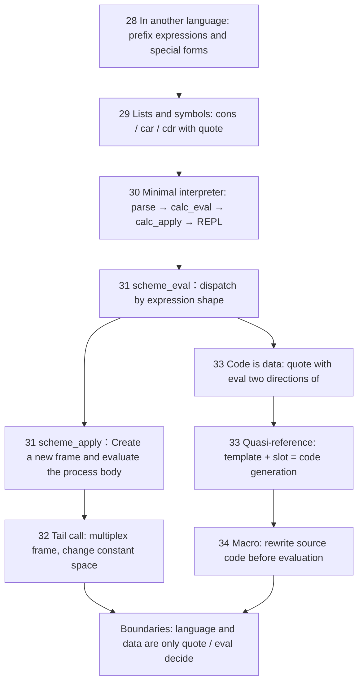

### 0.3 How to string seven lectures into a line

The questions left in each lecture are the topics of the next lecture. This causal chain can be tabulated.

| speak | the tools it gives | the questions it leaves behind | Who caught it |
| :--- | :--- | :--- | :--- |
| 28 | prefix expressions, special forms, `lambda`, recursion instead of loop | What shape do these parentheses-dense expressions take in the machine? | 29 |
| 29 | `cons`  chain, `quote`, `map` / `filter` / `apply` | With the "shape of code", can you write a program to execute it? | 30 |
| 30 | `Pair`  tree, `calc_eval` / `calc_apply`, REPL | This language has no name, no process, and no conditions. How can we make up for it? | 31 |
| 31 | allocate, `LambdaProcedure`, frame chain, eval/apply mutual recursion | No matter how correctly the recursion is written, the stack will explode if it goes deeper one level. Is this not equivalent to "slowness"? | 32 |
| 32 | Tail position determination, cumulative parameters, constant space | Since the code is a list, can the program write the program? | 33 |
| 33 | `eval`, quasi-reference, templated code generation | Write every time  `eval`  With backticks, can the language do it automatically? | 34 |
| 34 | `define-macro`, macro expansion, three-level evaluation timing | What should I do if the name introduced by the macro pollutes the caller? | §7.7 |

The six PDFs are not synchronized with the classroom lectures, and must be explained clearly first: the announcement page, section page and multi-pass practice page of Lecture 28 only have pictures and no spoken words; the two pages of turtle drawing in Lecture 29 are the same as those of Lecture 29.  `split`  The two pages do not have corresponding paragraphs in the subtitles; pages 3–5 of Lecture 30 continue the list processing of the previous lecture and are the ending content; the final length of Lecture 31 is only 29:48, pages 1–3 fall before the start of the recording, and pages 10–11 are the pages corresponding to the narrative at the beginning of the video, so **The order of the illustrations in the text is not equal to the order of the courseware pages**; Lecture 32 has no courseware; Lecture 33 and 34 each have several pages of discussion questions, which are not developed in class.

This leads to the organizing principle: **Pages follow the content, not the lectures**. A slide only appears once in the section where it best illustrates the problem; the pages mentioned in class are inserted according to the narration position, and the pages not mentioned are included in the logical position and used  `编者说明`  Indicate "The pictures are taken from the courseware, and the comments are added by the editor."

### 0.4 Six-page announcement: non-lecture page in the courseware

Page 2 of the six coursewares is an announcement page. There is only one title on the entire page, and there is no corresponding oral content in the video and subtitles. Class announcements (assignment deadlines, exam arrangements, lecture notices) do not belong to technical content, but they are indeed part of the course sequence, so they are included here by lecture number and only appear once per page. The Lab 10 review section page on page 3 of Lecture 31 is the same as the section page and is placed at the beginning of Chapter 4.


## 1. Change a language: Scheme’s expressions, special forms and procedures are values

*(Reference time: 00:00:24 – 00:31:11｜Lecture 28; 00:00:00 – 00:00:40｜Lecture 29)*

### 1.1 A dialect older than Python

Scheme is a dialect of Lisp. Lisp is one of the two oldest programming languages ​​still in use today, and the only one that is still growing rapidly. The lecturer quoted three comments as footnotes: Alan Kay called it "the greatest single programming language ever designed"; a science fiction writer said it is "the only computer language that can be called beautiful"; Brian Harvey said it even more bluntly - "the language God used to write programs".

> **Editor's note**: Lisp was designed by John McCarthy around 1958, and is often called "the oldest language still in use" along with Fortran in 1957. Scheme was born in the 1970s as a minimalist dialect of Lisp.

The beauty of Lisp is its simplicity: the entire language can be learned in a day, yet it can produce programs that are as complex as anything seen in the course. This is not a sales pitch, but a design goal——**Compress the syntax to almost non-existence, leaving all the complexity to the problem itself**. The consequences are: none  `for`, no  `while`, no  `return`, there is no boundary between statements and expressions, and the remaining things are small enough to be written on one page.


### 1.2 Four grids of expressions

Scheme programs are composed of expressions. An expression is evaluated in an environment to obtain a value; the role of the environment is to give meaning to symbols. This model is exactly the same as that of Python: in the local frame, the "instructor of this course" has a specific reference, in the global frame, "multiplication" is an operation that everyone understands, and when searching, it is local first and then global.

Expressions are divided into two major categories and four subcategories:

- **primitive expressions**: Self-evaluating expression (self-evaluating), for example  `2`, `3.3`, `true`; and symbols, such as  `+`, `quotient`, they are names, and the values must be checked in the environment.
- **combinations**: call expressions, for example  `(quotient 10 2)`; and special forms, such as  `(if a b c)`, `(let ((x 2)) (+ x 1))`.

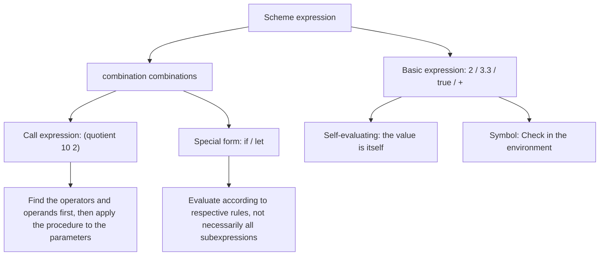


### 1.3 Prefix notation: brackets are the syntax tree

The way to write call expressions is the first habit that must be broken in this module: **The parentheses are outside, and the operator is first in the parentheses.**. Python written  `quotient(10, 2)`, the operator is outside the brackets; Scheme writes  `(quotient 10 2)`, the operator is also in parentheses, just ranked first. `quotient`  It is a built-in integer division process - it is called a function in Python and a procedure in Scheme. It is essentially the same thing.

thus  `(quotient 10 2)`  Evaluates as  `5`, `(not true)`  Evaluates to false. Numbers evaluate themselves and symbols are bound to values ​​- these two sentences are the entire basis of Scheme's evaluation rules.

The demo starts with the simplest: `2`  Evaluates as  `2`; `(+ 1 2 3 4)`  Evaluates as  `10`. Then the lecturer asked a question: Add up nothing, what is the result? The answer is  `0`;Multiplying nothing, the result is  `1`. This is **unit yuan** (identity element) is a direct reflection: the identity element of addition is 0, the identity element of multiplication is 1, and the empty combination just writes "do nothing". This property is written  `calc_apply`  will become a specific initial value selection (§3.6).

```scheme
scm> (- (* 2 2 2 2 2 3 3 3) 1)
863
```

Put it in the same position  `+`, `/`, `*`  Either way. This is where prefix notation is most troublesome: **New combinations always only add a symbol at the front and a parenthesis at the end. There is no need to remember the priority, and there is no need to add additional parentheses to override the priority.**. In the infix notation, "first multiply and divide, then add and subtract" is an implicit rule that must be memorized; in the prefix notation, this rule does not exist.

The combination can span any number of lines, and the interpreter doesn't care at all about how to break lines or indent; it only cares about closing any open parentheses.

```scheme
(+ (* 3
      (+ (* 2 4)
         (+ 3 5)))
   (+ (- 10 7)
      6))
```

The way to read it is to look at the operators from top to bottom: the outermost level is addition, and two things need to be added. The first item is  `3`  multiply by  `8 + 8 = 16`, got  `48`;The second item is  `3 + 6 = 9`;Add the two items to get  `57`. The reason why the two operands of the second item are indented to the same level is because they have the same status and are both addends of this addition——**Indentation is to mark the height of the syntax tree for the reader, not for the interpreter to see.**.

This also answers the question "Are Scheme's parentheses noise?": parentheses are not decoration, they are direct encoding of the syntax tree. Python uses indentation to express block structure, priority to express combination order, and commas and parentheses to express calls; Scheme puts all these into a pair of parentheses, which looks dense, but **no hidden information**——The nesting depth read is the nesting depth of the evaluation.

> **Editor's note**: The subtitles for this indented example only dictate the order in which each subexpression is evaluated, but do not read out the complete expression. The code is restored according to the verbal numerical relationship and the typesetting rules of "same-layer indentation alignment".

### 1.4 Predicate: Question mark is part of the name

In addition to arithmetic procedures, Scheme also comes with a number of procedures for judgment. `(number? 3)`  is true, `(number? +)`  is false - the latter means that "it is a number" has nothing to do with "it is a name". `+`  Is a procedure object. `(zero? (- 2 2))`  is true because  `(- 2 2)`  Evaluate to 0 first and then judge.

```scheme
scm> (number? 3)
#t
scm> (integer? 2.2)
#f
```

> **Editor's note**: The Scheme community also has a common origin convention - names ending with an exclamation mark (e.g.  `set!`) represents a process that modifies the state. The distributed version of Scheme for this course does not emphasize this distinction, and it does not appear in Lecture 28.

### 1.5 Where the interpreter comes from: Project 4

The Scheme used for classroom demonstrations is not downloaded; **Implementation of Project 4 of this course**. Project 4 requires writing a program in Python that implements a Scheme interpreter; once written, Scheme expressions can be evaluated on it. The way to do this is to hand-write the code required to perform various processes - code to read in expressions, code to determine which category an expression belongs to, code to evaluate according to rules. Such a program has a special name called **evaluator**.

### 1.6 define and "no return"

Bind new value by  `define`. The simplest form is "define a symbol as the value of an expression": first evaluate that expression, and then bind the result to the symbol; the binding position is **The first frame of the current environment**, execution in the global environment falls in the global frame. The lecturer specifically emphasized: **Scheme uses the same environment model**, no different from what I talked about in Python.

```scheme
(define (abs x)
  (if (< x 0)
      (- x)
      x))
```


```python
def fib(n):
    if n == 0 or n == 1:
        return n
    else:
        return fib(n - 2) + fib(n - 1)
```

```scheme
(define (fib n)
  (if (or (= n 0) (= n 1))
      n
      (+ (fib (- n 2)) (fib (- n 1)))))
```

> **Editor's note**: This page does not have a corresponding oral paragraph in the subtitles. The lecturer directly entered the interactive demonstration in class; the code is transcribed verbatim according to the original text of the courseware.

### 1.7 Calling expressions and short-circuiting

Write the same piece of logic in both languages, and the difference is immediately apparent:

```python
f(3) and f(4)      # 只打印 3，返回 False
```

```scheme
(define (f x) (print x) False)
(and (f 3) (f 4))  ; 只打印 3，返回 #f
```


The definition can be pinned down: **A special form is any combination that is not a call expression**. The judgment method is very mechanical: **Look at the first element of the list**. Yes  `if`  It is an if expression; combinations whose first element is not among the known special forms are ordinary calls.

`if`  The order of evaluation is: first evaluate the predicate (predicate), and then evaluate the **Just want one branch**. Each of the three parts has its counterpart in Python:

| `if`  components of | location | Corresponding Python structure |
| :--- | :--- | :--- |
| predicate | second subexpression | `if`  conditional expression of statement |
| result consequent | third subexpression | `if`  Branched statement block (suite) |
| alternative alternative | The fourth subexpression | `else`  branch statement block |

### 1.8 No for/while: recursion is iteration

In class, we used "finding the square root" to connect all the previous parts. The idea is to continuously improve the guess value, and the method used is called **Babylonian method** (Babylonian method): If the current guess value has been satisfied  `guess² = x`, then don't change it; otherwise, use "the current guess value and  `x / guess` "average" as a better guess.

```scheme
(define (sqrt x)
  (define (update guess)
    (if (= (square guess) x)
        guess
        (update (average guess (/ x guess)))))
  (update 1))
```

The lecturer asked the audience to pay attention to a detail: `update`  used in the process body of  `x`, while  `x`  is an outer process  `sqrt`  formal parameters. This is no coincidence: **Scheme, like Python, is lexically scoped**, the inner procedure can reference the formal parameters of the outer procedure, depending on the environment in which it is defined. This rule becomes a very specific implementation detail in Lecture 31: procedural objects must remember the environment in which they were created (§4.5).

Scheme no  `for`  and  `while`, so **Loops must also be written using recursion**. The courseware uses a comparison of three Python writing methods against a Scheme writing method to explain this matter thoroughly:


```python
def sum_first_n(n):
    total = 0
    for k in range(1, n + 1):
        total += k
    return total
```

```scheme
(define (sum-first-n n)
  (define (f k total)
    (if (> k n)
        total
        (f (+ k 1) (+ total k))))
  (f 1 0))
```

> **Editor's note**: `(f (+ k 1) (+ total k))`  located in  `if`  The branch position is the tail call. Standard Scheme requires that tail calls do not increase the call stack, so this writing method is a constant space in real Scheme; CS61A's evaluator will not introduce tail call optimization until Lecture 32.

### 1.9 Anything can be placed in the operator position

The courseware enters the "Writing Scheme" section; the core is only one page and has a fill-in-the-blank question: `a-plus-abs-b`  accept two numbers  `a`  and  `b`, return  `a + |b|`, but **Not allowed to call  `abs`**.


The Python version of the answer is to let  `f`  becomes the function name and then calls  `f(a, b)`;The Scheme version's fill-in-the-blank position is at the operator position, and the answer is a whole  `if`:


```scheme
(define (a-plus-abs-b a b)
  ((if (< b 0) - +) a b))
```

In the outermost combination, the thing at the operator position is  `(if (< b 0) - +)`, it first evaluates and obtains either a subtraction process or an addition process; then this newly obtained process is applied to  `a`  with  `b`  on. **Any expression can be placed in operator position as long as it evaluates to a procedure**. Python can also be written  `(sub if b < 0 else add)(a, b)`, but it is rarely written like this.

> **Editor's note**: This page and the previous section page do not have corresponding oral paragraphs in the subtitles. They are classroom practice-level materials. The codes are transcribed according to the original text of the courseware.

### 1.10 lambda: process is a created value

`lambda`  An expression is used to create a new procedure: it evaluates to a **Anonymous process**. Grammar is the keyword  `lambda`, a pair of formal parameter lists in parentheses, and then the procedure body.


Got it  `lambda`, there are two ways of writing "defining process", and they are equivalent:

```scheme
(define (plus4 x) (+ x 4))
(define plus4 (lambda (x) (+ x 4)))
```


Since the operator position can contain any expression that evaluates to a procedure, place it as  `lambda`  It is logical:

```scheme
((lambda (x y z) (+ x y (square z))) 1 2 3)
; 12
```

The last page of the courseware is two questions "Guess what Scheme will do":


```scheme
((lambda (g y) (g (g y))) (lambda (x) (+ x 1)) 3)

(define (f g)
  (lambda (y) (g (g y))))
((f (lambda (x) (* x x))) 3)
```

> **Editor's note**: The answers to these two questions (`5`  with  `81`) is deduced by the editor based on lexical scope and evaluation rules, and only the title is given in the courseware. The value of the second question is that it tests two things at the same time: the process can be passed in as a parameter, and the process can be passed out as a return value.

The second question is actually a trailer for Lecture 31: the return process is closure. It must be carried in its own object  `g`  binding, and the carrier of this binding is  `LambdaProcedure`  of  `env`  field. **Without context, closure cannot be interpreted; without closure, `lambda`  It's just a piece of code that hasn't been executed.**

### 1.11 cond and begin: insert statements into expression positions

`cond`  is the abbreviation of condition, corresponding to Python's  `if`/`elif`/`else`, written as follows:

```scheme
(cond ((> x 10) (print 'big))
      ((> x 5) (print 'medium))
      (else (print 'small)))
```


The reading is: `x`  Print if it is greater than 10  `big`; Otherwise, if it is greater than 5, print  `medium`;otherwise print  `small`. No matter  `x`  How much is it? **Only one thing will be printed**:If  `x`  is 12, which is greater than both 10 and 5, but only prints  `big`, because the previous one hits first.

`cond`  expression **valuable in itself**, so you can also just let it calculate a value and then do other things with this value:

```scheme
(print (cond ((> x 10) 'big)
             ((> x 5) 'medium)
             (else 'small)))
```

`begin`  Combine multiple expressions into one expression, and its value is **the value of the last subexpression**. It is needed because many locations (e.g.  `if`  branch) can only hold one expression, and actual work often requires doing several things in sequence.


```scheme
(cond ((> x 10) (begin (print 'big)   (print 'guy)))
      (else     (begin (print 'small) (print 'fry))))
```

### 1.12 let: Only one expression binding exists

`let`  a bit like  `define`, the difference is that the symbol it binds is **temporary**: Only valid in one expression. After that expression is evaluated, the binding disappears.

There is no real equivalent in Python, so the best way is to write the same calculation in both languages:

```python
a = 3
b = 2 + 2
c = math.sqrt(a * a + b * b)
```

```scheme
(define c (let ((a 3)
                (b (+ 2 2)))
            (sqrt (+ (* a a) (* b b)))))
```


`let`  The structure has only two parts: **binding list** (Each binding is a pair, the first must be a symbol, the second can be any expression, evaluated first and then bound) with **value expression** (Evaluated after the binding takes effect, its value is the entire  `let`  value). The lecturer's statement is very vivid: It's like putting a bunch of small  `define`, but the binding disappears the moment the calculation is completed.

From the interpreter's perspective, `let`  Is the sugar for "making a temporary frame": `(let ((a 3)) body)`  Equivalent to  `((lambda (a) body) 3)`. Lecture 31 will not be  `let`  Write a separate branch because this equivalent equation is enough; and  `split`  Why the second version is necessary  `let`, and the reason is here - it requires a name and uses the result of one recursion twice (§2.4).

### 1.13 Python and Scheme: a comparison table

Now that the parts are together, it’s worth doing a side-by-side inventory at this point. The first column is the criterion. Using it to find corresponding relationships is less laborious than memorizing grammar.

| criterion | Python | Scheme |
| :--- | :--- | :--- |
| What is the function called? | function | procedure |
| How to write call | `f(3, 4)`, the operator is outside the brackets | `(f 3 4)`, the operator is first in the brackets |
| define function | `def f(x, y):`  add  `return` | `(define (f x y) <body>)`, none  `return` |
| Where does the return value come from? | `return`  Statement, can have multiple places | The value of the last expression in the procedure body |
| Multiple branch selection | `if` / `elif` / `else` | `if`  or  `cond` |
| Execute multiple items in sequence | Statement blocks are indented | `begin`  or process body |
| loop | `for`, `while` | No, use recursion to express |
| anonymous function | `lambda x: x + 1` | `(lambda (x) (+ x 1))` |
| temporary binding | There is no real equivalent, the assignment will remain in scope | `let`, only one expression exists |
| true and false | `True` / `False` | `#t` / `#f` (Writing is available  `true`) |
| Division | `/`  Really eliminated, `//`  Divisible | `/`  Really eliminated, `quotient`  Divisible |
| Equality comparison | `==` | `=` (used for numbers), `equal?` (for structure) |
| Prefix or infix? | infix  `x * x + y * y` | prefix  `(+ (* x x) (* y y))` |
| Is the process valuable? | Yes, but only by name or  `lambda`  Explicitly constructed | Yes, and the operator position can directly write expressions |

The most informative lines in the table are the lines "Where does the return value come from" and "Loop": they are not syntax differences; **What does a language regard as its basic building blocks?** difference. The basic building blocks of Python are statements, so you need  `return`  and  `while`; The basic component of Scheme is an expression, so "value" naturally comes from the last expression, and "repetition" naturally comes from recursive calls. Once you accept this premise, `cond`, `begin`, `let`  The existence of is no accident: they all solve the same problem——**How to fill a space that can only hold an expression into something that requires several more steps to calculate?**.

### 1.14 Case: Drawing Sierpinski Triangle with Turtle

Finally, use drawing to put together the parts of this lesson. The Scheme version distributed in the course comes with its own drawing facilities: after it is started, it can not only calculate addition, but also direct a small turtle to walk on the canvas.

> **Editor's note**: This section uses pages 3–4 of Lecture 29 courseware (Turtle Graphics and Drawing Stars). The subtitles of the video recording of Lecture 29 start from the Lists section. There is no dictation in these two pages. The codes are organized below according to the courseware screen, and the comments are added by the editor.


courseware  `star`  The procedure has two parameters: `n`  is the number of sides, `m`  It means how many vertices need to be jumped every time an edge is drawn. corner  `a`  by  `let`  Calculated, it is equal to  `360 * m / n`;call  `(star 5 2)`  time  `a = 144`  degrees, each of the five sides rotates 144 degrees, and the total is 720 degrees. It goes around exactly twice, and the figure is closed.

```scheme
(define (star n m)
  (let ((a (/ (* 360 m) n)))
    (define (side k)
      (if (< k n) (begin (fd 100) (rt a) (side (+ k 1)))))
    (side 0)))
```

put  `side`  Extracted, you will get a more general pattern - "do something k times":

```scheme
(define (repeat k f)
  (f)
  (if (> k 1)
      (repeat (- k 1) f)))
```

The Sierpinski triangle uses this level of abstraction again: each of its sides is itself a smaller Sierpinski triangle. So "drawing triangles" and "drawing edges" call each other, forming a set of mutually recursive processes.

```scheme
(define (line k) (forward k))

(define (sierpinski d k)
  (if (= d 1)
      (repeat 3 (lambda () (line k) (right 120)))
      (repeat 3 (lambda () (leg d k) (right 120)))))

(define (leg d k)
  (sierpinski (- d 1) (/ k 2))
  (penup)
  (forward (/ k 2))
  (pendown))
```

> **Editor's note**: This code in class is from the file  `load`  When executed by the interpreter, this page of code is not included in the lecture software of Lecture 29, and the subtitles only describe the structure verbally. The above is reconstructed according to the oral structure: `d = 1`  When drawing a line triangle, otherwise repeat "draw a leg and turn right 120 degrees" three times; `leg`  Draw a half-size sub-triangle with a depth minus one, then lift the pen, advance, and put the pen down to send the turtle to the end of the leg.

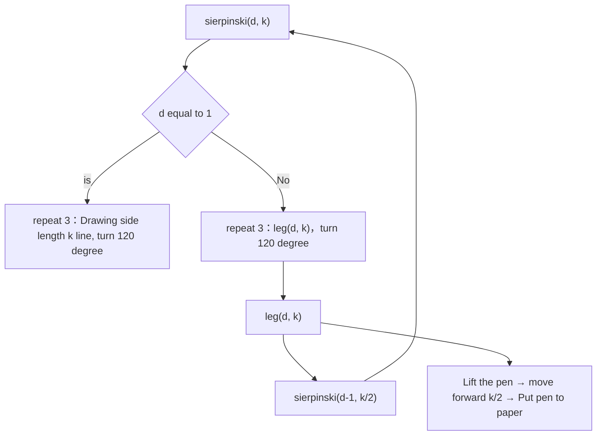

## 2. Lists and symbols: finding data structures for "code"

*(Reference time: 00:00:41 – 00:24:42｜Lecture 29; 00:00:01 – 00:00:29｜Lecture 30)*

Lecture 28 can only say "an expression is a syntax tree", but cannot tell how the tree is preserved. The answer to this chapter is: **Scheme code is just a linked list**, the linked list consists of  `cons`  Connect them one by one. Once you accept this, Lecture 30 you don't need to invent any new data structures when writing an interpreter -`Pair`  That’s it  `cons`, `first`  That’s it  `car`, `rest`  That’s it  `cdr`.

### 2.1 Minimum vocabulary for linked lists

Building a linked list only makes sense if "the first element can be obtained" and "the rest of the list can be obtained", so in addition to  `cons`, two access procedures must also be configured. One sentence for each of the four names:

- **`cons`**: Two-parameter process, create a linked list node (the first cell contains the value, the second cell contains the "rest of the list").
- **`car`**: Returns the first element of the list.
- **`cdr`**: Returns the remainder except the first element.
- **`nil`**: Empty list, the end of the chain.

> **Editor's note**: `car`  with  `cdr`  The name comes from two register fields on the IBM 704 machine of the 1950s - the address part and the decrement part. The lecturer only said in class that "people of that era liked confusing names."


```scheme
scm> (define x (cons 1 (cons 2 nil)))
scm> x
(1 2)
scm> (cdr x)
(2)
```

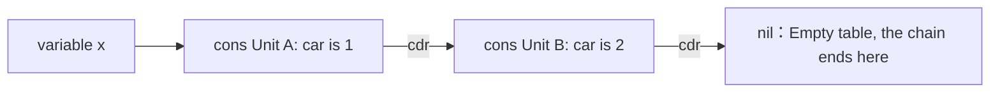

There are only three types of arrows in this picture. **All list operations can be translated as "take a few steps along the arrow"**: `car`  Read the left half of the current cell, `cdr`  Walk an arrow, `cons`  Create a new grid and make its right half point to an existing grid. Lecture 30  `Pair`  Class, Lecture 31  `scheme_eval`, Lecture 33  `eval`, all these three actions are done.

### 2.2 Four kinds of "mistakes" and their antidotes

Let’s first look at four examples that need to be reviewed by yourself. Each of them corresponds to a common misunderstanding:

```scheme
scm> (define s (cons 1 (cons 2 nil)))
scm> (cons 3 s)
(3 1 2)
scm> (cons (cons 4 (cons 3 nil)) s)
((4 3) 1 2)
scm> (cons s (cons s nil))
((1 2) (1 2))
```

| expression | Show results | structural reading |
| :--- | :--- | :--- |
| `(cons 3 s)` | `(3 1 2)` | A new layer of cons + the original table |
| `(cons 4 (cons 3 s))` | `(4 3 1 2)` | Two floors of new cons, both at the front |
| `(cons (cons 4 (cons 3 nil)) s)` | `((4 3) 1 2)` | The first element itself is a table |
| `(cons s (cons s nil))` | `((1 2) (1 2))` | The same table is referenced twice |

### 2.3 Three construction paths: cons, list, append

`cons`  Adding only one element at a time gets boring quickly. The division of labor among the three paths is worth remembering verbatim:

- **`cons`**  Always only accepts two parameters: a "value" and a "remaining table".
- **`list`**  Accept as many parameters as you like, and each parameter becomes an element in the new table.
- **`append`**  Receive as many as you want **table** Parameters, connect them end to end into a table.

Set  `s`  is  `(1 2)`:

| expression | result | pronunciation |
| :--- | :--- | :--- |
| `(cons 3 s)` | `(3 1 2)` | 3 as an element, connected to  `s`  in front of the element |
| `(list 3 s)` | `(3 (1 2))` | 3 and  `s`  Each counts as one element, so  `s`  The entire table becomes one element |
| `(append 3 s)` | Error | `append`  What I want is a watch. `3`  Not a watch |
| `(cons s s)` | `((1 2) 1 2)` | The first frame is the whole sheet  `s`, the remaining part is still  `s`  elements of |
| `(list s s)` | `((1 2) (1 2))` | Two elements, each a table |
| `(append s s)` | `(1 2 1 2)` | The two tables are connected end to end, and the elements are flattened. |


### 2.4 Recursive construction: two versions of split

> **Editor's note**: `split`  The two pages are the content of this lecture, but the subtitles of the video of this lecture do not mention it from beginning to end - the lecturer's oral clues are linked lists, `quote`, list processing and  `even-subsets`.


The first version split it into two internal processes: `prefix`  Before taking charge  `n`  one, `suffix`  Take care of the rest.

```scheme
(define (split s n)
  (define (prefix s n)
    (if (zero? n) nil (cons (car s) (prefix (cdr s) (- n 1)))))
  (define (suffix s n)
    (if (zero? n) s (suffix (cdr s) (- n 1))))
  (list (prefix s n) (suffix s n)))
```

`suffix`  That line is the most interesting thing about this page: it **Do not copy** any node, returned  `s`  It is a certain section of the original linked list. The box pin diagram on the right side of the courseware illustrates exactly this——`prefix`  Three new nodes are created, and  `suffix`  Just move the pointer to the 4th node. **"Returning a section of the original table" and "creating a new table" are indistinguishable in display, and the space cost is very different.**


The second version combines two recursions into one: the recursion gets back a table with two segments, and then uses  `cons`  Put the current element before the first paragraph.

```scheme
(define (split s n)
  (if (= n 0)
      (list nil s)
      (let ((split-rest (split (cdr s) (- n 1))))
        (cons (cons (car s) (car split-rest))
              (cdr split-rest)))))
```

| criterion | First version (prefix + suffix) | Second version (let + split-rest) |
| :--- | :--- | :--- |
| How many times does each layer call itself recursively? | twice | Once (get back two paragraphs at a time) |
| What to return | The two tables are made separately, and finally used  `list`  Put it on | Each layer returns the pair "prefix + suffix" |
| Do you need a middle name? | No need | need  `let`, because the result is used twice |
| Termination condition | Write each process once  `(zero? n)` | one  `(if (= n 0) ...)` |

### 2.5 quote: let the symbol itself become the value

Lisp to import **symbolic programming** Symbolic programming - the manipulation of "tables of symbols" that represent things in the world. And there is only one feature that makes all this possible: **Quote**(quotation).


`'`  is a special form  `(quote ...)`  abbreviation. The meaning of the special form is: **The referenced expression itself is the value**, no need to evaluate it again. References can also be used on combinations: `'(a b c)`  get a table containing three symbols; and **Each expression in the table is also referenced together**——The reference is recursive, it works all the way to the innermost level.

| criterion | symbol symbol | string string |
| :--- | :--- | :--- |
| literal writing | `'a`, `'apple` (a leading single quote) | `"a"`, `"apple"` (a pair of double quotes) |
| Evaluation result | When referenced, it is the symbol itself; when not referenced, its value is looked up by the environment. | The string itself (self-evaluated) |
| Does it have to be defined first? | Not necessary; it can appear first and be defined later | No, literals are values |
| Typical uses | Symbolic computation: formulas, algebraic expressions, the program itself | Text processing and output |

> **Editor's note**: This lecture does not specifically talk about strings. The "String" column in the above table was added by the editor for comparison.

There are three common mistakes in citation. **One, `'a`  and  `(quote a)`  Equivalent.** **Second, symbols can be quoted first and defined later.**  Write directly  `(list 1 a)`  And  `a`  An error will be reported if it has never been defined; but  `(list 1 'a)`  get  `(1 a)`- You can refer to it before you define it, because it is just a symbol. **Third, a single quote only refers to the expression that immediately follows it.** `(list 'a b)`  get  `(a 2)`  That's the evidence.

References can also be nested. The lecturer gave a question that required four levels:

```scheme
scm> (define x '(1 (2 3)))
scm> (car (cdr x))
(2 3)
scm> (car (cdr (car (cdr x))))
3
```

### 2.6 Four-piece list processing set

The tools are all there, and each of the four built-in processes is defined in one sentence:

- `(append s t)`: put  `s`  and  `t`  The elements are listed in a table in sequence; more than two tables can be connected.
- `(map f s)`: pair table  `s`  Called for each element of  `f`, collect the results into a table.
- `(filter f s)`: pair table  `s`  Called for each element of  `f`, put "`f`  Those elements that return a true value are collected into a list.
- `(apply f s)`: watch  `s`  elements as parameters to call  `f`, that is, only call it once  `f`.


| criterion | `map` | `filter` | `apply` | `append` |
| :--- | :--- | :--- | :--- | :--- |
| `f`  How many times has it been called | once per element | once per element | The entire table is only called once | Not involved  `f` |
| what is the result | a table with the same length as the input | A table, no longer than input | a value (usually not a table) | a table |
| The elements in the result come from | `f`  return value | Enter the original elements in the table | `f`  return value | Original elements of each table |
| Typical uses | Transform one by one | Select by condition | Spread the table into parameters | Combining tables and flattening nested tables |

```scheme
scm> (map (lambda (x) (* 2 x)) s)
(2 4)
scm> (filter list? '(5 (6 7) 8 (9)))
((6 7) (9))
scm> (apply + '(1 2 3 4))
10
```

For use at the bottom of the courseware  `map`  with  `apply`  Stringed together a more beautiful example:

```scheme
(define count (list 1 2 3 4))
(define beats (map (lambda (x) (list 'and 'a x)) count))
(define rhythm (apply append beats))
```

### 2.7 Replay of next lecture: Why does the interpreter need map and apply

This page is played again at the beginning of Lecture 30, and is followed by a new exercise. This is not a choreographic repetition; **Intentional lead time**: The two most important actions in the interpreter happen to be  `map`  with  `apply`.


> **Editor's note**: The video of Lecture 30 enters an unusual topic in the first second. There is no corresponding paragraph in the subtitles on pages 3-5, which is probably the ending content at the end of the previous lecture.

Why is it said that the interpreter is "`map`  with  `apply`  The alternation of "? `calc_eval`  Once you get a combination,  `exp.rest.map(calc_eval)`  Recursively evaluate each operand into a number, and then  `calc_apply(exp.first, arguments)`  Apply this operator to the argument list. The first step is  `map`, the second step is  `apply`; and  `calc_apply`  Inside again  `reduce(add, args, 0)`- Another list collapse. **The semantics of a language can be written entirely in list procedures.**

The second exercise turns "counting cons lattice" into a recursion:


```scheme
(define (cons-count s)
  (if (list? s)
      (+ (length s)
         (apply + (map cons-count s)))
      0))
```

## 3. Minimal interpreter Calculator: text, tree, two functions and a loop

*(Reference time: 00:00:01 – 00:47:51｜Lecture 30)*

With the premise that "code is a linked list", you can start with Lecture 30. What we are going to create in this chapter is called **calculator**: A minimal language with only numbers and four arithmetic operations. The syntax is borrowed from Scheme and the implementation is implemented in Python. It is small enough to be written in half an hour, but it already has all the parts of a language - text, parsing, evaluation, application, errors, and loops.

### 3.1 Exceptions: Give "error" a type

In Python and many languages, "notifying exceptions" and "handling exceptions" are collectively called **exception**: use  `raise`  To announce something that should not happen, use  `try`  Dispose of it. `raise`  Followed by an expression that must evaluate to an exception class or exception instance. Exception objects are constructed like ordinary objects: the so-called "making a  `TypeError`", just passes this class a string describing what happened.


The built-in exception classes have their own division of labor, and they will **automatic** Throws:

| Exception class | When is it automatically thrown? | Demonstration of this lecture |
| :--- | :--- | :--- |
| `TypeError` | The function received an incorrect number or type of parameters. | `abs('hello')` |
| `NameError` | No binding found for a name | undefined name |
| `KeyError` | This key does not exist in the dictionary | missing key |
| `RecursionError` | Too many recursive call levels | One that only calls itself  `f` |

`abs(3)`  Normally returns 3, whereas  `abs('hello')`  throw immediately  `TypeError`. But exceptions are not mysterious, you can throw them yourself:

```python
def double(x):
    if isinstance(x, str):
        raise TypeError('double takes only numbers')
    return 2 * x
```

Why write these three extra lines? because  `2 * 'hello'`  is legal in Python, the result is  `'hellohello'`. if  `double`  The semantics only allow numbers, so "silently spelling out the string" is the worst way to fail: the program continues to run, and the error is delayed until far away. Take the initiative  `raise`  Move the point of failure to the source of the error in advance. **Throwing an exception means writing "I refuse to handle this input" into the interface.**: The cost is that the caller must know what exceptions are possible, and the benefit is that failure is no longer disguised as success.

Why should exceptions be classified? First, types allow error messages to tell "what happened". Second, and more importantly: **Classification gives the language the ability to handle exceptions and continue running**. Only errors carry type tags, `try`  Only statements have something to match; without types, the program can only stop altogether.

### 3.2 try/except and reduce: Who should handle errors?

`try`  The statement consists of two parts: `try`  Followed by a code block (suite, suite), and one or more  `except`  OK.

```python
try:
    x = 1 / 0
except ZeroDivisionError as e:
    print('handling a zero division error:', e)
    x = 0
```

| situation | try suite | except suite | program |
| :--- | :--- | :--- | :--- |
| No exception | All executed | skip | continue |
| The thrown exception class matches | Execution is interrupted when an error occurs | execute | Continue without printing traceback |
| The thrown exception class does not match | interrupt | skip | Abort and print traceback |

Let’s first look at a function that can cause errors: `invert(x)`  Return  `1 / x`, `x`  When it is 0  `1 / x`  Throw  `ZeroDivisionError`, the function body is interrupted in place at that line. written as  `b = invert(0)`  when, `b`  is not bound to  `None`, but **Not bound at all**——The entire assignment statement is invalid. Many people encounter "name undefined" for the first time  `NameError`, the root cause is that the previous assignment statement was interrupted by an exception.

The safe version digests this error in-place into a normal return value:

```python
def invert_safe(x):
    try:
        return invert(x)
    except ZeroDivisionError as e:
        return str(e)
```

`invert_safe(0)`  get string  `'division by zero'`, there is no error message on the screen. same one  `try`  structure, `except`  What the suite returns is the function's "attitude" to failure.

Before entering the interpreter, there is another higher-order function that must be explained: `reduce`. Its duty is **Reduce a sequence to a value**——Use a two-parameter function to "eat" the sequence elements one by one, starting from the initial value:


```python
def reduce(f, s, initial):
    """Combine elements of s pairwise using f, starting with initial."""
    for x in s:
        initial = f(initial, x)
    return initial
```

> **Editor's note**: The lecturer mentioned that the standard library has built-in  `reduce`, the subtitle is recorded as "iter tools module"; this function is actually located in  `functools`.`itertools`  What is provided is an iterator tool and has nothing to do with this function.

`reduce`  The first application is a divider:

```python
def divide_all(n, ds):
    try:
        return reduce(truediv, ds, n)
    except ZeroDivisionError:
        return float('inf')
```

`divide_all(1024, [2, 0, 8])`  get  `inf`, while  `divide_all(1024, [2, 4, 8])`  Still got 16. The design value of this code is **Separation of concerns**: `reduce`  There is not a single line in the implementation related to division by zero, `divide_all`  Then you know that what you are doing is division, you know that dividing by zero is a possible failure, and you decide what failure means on the spot.

Put this into one sentence: **Errors should be handled at the level that "knows what this error means"**. This criterion will be used repeatedly when writing the interpreter later: lexical analysis knows what illegal numbers are, and syntax analysis knows what unmatched brackets are. `calc_apply`  Know which operator takes several arguments. The REPL layer (§3.8) is responsible for only one thing: **Turn the error into a sentence and continue waiting for the next sentence to be entered**.

### 3.3 Interpreter and language levels

**An interpreter is a program that takes as input code written in a language and executes the code to produce the behavior described by the program.**  There is no mystery in this sentence - the interpreter itself is also an ordinary program written in a certain language, but the data it processes happens to be "code".

Here is an easily overlooked fact: **No piece of hardware in your computer is designed for Scheme or Python**. The machine language code is responsible for performing all the actions; between this high-level language and the machine language, there must be an interpreter or compiler that implements all those abstractions. And this layering is the norm: machine language can be used to implement C's compiler, and C is a high-level language used to implement Python's interpreter.

| level | who is executing | How to extend | Examples mentioned in this lecture |
| :--- | :--- | :--- | :--- |
| machine language | CPU hardware | Change circuit | fixed instruction set |
| Compiled high-level language | The compiled product runs directly on the hardware | Change the compiler | C |
| interpreted high-level language | Another program is executed step by step | Change the interpreter | Python, Scheme |
| domain specific language | Specialized interpreter or compiler | Change language and interpreter | Erlang, MediaWiki markup |

The last two lines in the table are worth expanding on: Erlang is designed for concurrent programs, and multiple ATMs cannot defraud two money by accessing the same account at the same time; the MediaWiki markup language is designed for generating static web pages like Wikipedia. They also require an interpreter or compiler, but they serve a much narrower field. The other half of the reason why high-level languages are easy to write is that **portable**: The same program can run on hardware from different manufacturers because system details are abstracted away. The specific method of Python is to compile it into bytecode (bytecode) before running, and then execute this bytecode by an interpreter.

A programming language consists of two parts. **syntax**  Describe all legal statements and expressions in the language, and answer "how to write them formally to count"; **semantics**  Give the execution or evaluation rules for these statements and expressions, and answer "What does it mean to write them out?" There are only two ways to nail down a language: write a formal specification document; or implement an interpreter or compiler and use the implementation itself as a reference. The latter path is established because **Canonical implementation is the standard**. The historical order of the two paths can be reversed: Scheme has specifications first and implementation later; Python has implementation first, and the formal description is added later.

| criterion | explain | compilation |
| :--- | :--- | :--- |
| timing | Read and execute | Translate first, execute later |
| product | Behavior (value or side effect) | program in another language |
| When an error occurs | interrupt the current expression on the spot | An error may be reported during the translation stage |
| Typical scenario | interactive session | Generate machine code or bytecode |

### 3.4 Grammar: One language can be written in two lines

**Scheme-syntax calculator**  It is a Scheme interpreter that does not support most features of Scheme and only retains arithmetic operators.  `+`, `-`, `*`, `/`  and call expressions, calls can be nested arbitrarily.

```text
scm> (+ 1 2 3)
6
scm> (+ 2 (* 4 6))
26
```


Expressions are represented by Scheme lists in Python, that is  `Pair`  instance, which encodes a tree structure. to  `(* 3 (+ 4 5) (* 6 7 8))`  For example, three perspectives are the same thing:

| perspective | form |
| :--- | :--- |
| written expression | `(* 3 (+ 4 5) (* 6 7 8))` |
| expression tree | root is  `*`, the three children are  `3`, `(+ 4 5)`, `(* 6 7 8)` |
| Pair means | one piece  `first`  for  `*`  chain, the second element points to  `(+ 4 5)`  chain |

This explains a fact that seems strange at first glance: **Code is data in the eyes of the interpreter**. same one  `Pair`  A structure can be regarded as either a "program to be evaluated" or "a list". The only difference lies in what you use it for. Lecture 33 will turn this observation into an entire topic (§6.1).

You must write this step of syntax analysis yourself: `scheme_read`  The agreement is **Consumes exactly the tokens required by an expression and returns that tree**. It has only one base example and one recursion: when it encounters a symbol or number, it directly creates a leaf; when it encounters a left bracket, it calls each subexpression in the bracket recursively.  `scheme_read`, string the results into pairs in sequence. The termination condition is to read the right parenthesis that matches the opening left parenthesis.

Summarize in one sentence why it must be recursive: **The nesting depth of brackets is the depth of the tree, and the reading process must follow this depth.**. The first call reads  `(+ 1 (* 2 3))`  will not return immediately because it must first read  `(* 2 3)`; and the read subexpression will initiate another call. This is why the parser works across lines.

### 3.5 Semantics: three lines of recursive definition

The semantics are also short enough to be written: **A number evaluates to itself; a calling expression evaluates to the result of its argument values combined by operators**.


| operator | Semantics |
| :--- | :--- |
| `+` | The sum of all parameters |
| `*` | product of all parameters |
| `-` | Negative if there is only one parameter; subtract the rest from the first one if there is more than one |
| `/` | If there is only one parameter, the reciprocal is taken; if there is more than one parameter, the first one is divided by the rest in sequence. |

For courseware  `(+ 5 (* 2 3) (* 2 5 5))`  Run through the semantics: `(* 2 3)`  Got 6, `(* 2 5 5)`  Got 50, `+`  Adding 5, 6, and 50 together, the entire expression evaluates to 61. Corresponds to each internal node once  `calc_apply`, the leaves correspond to "number evaluates to itself":

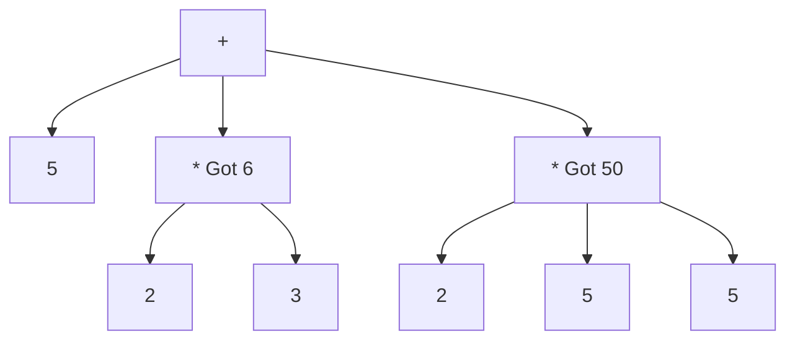

### 3.6 calc\_eval: dispatch by shape

The entire calculator has only two functions: one for evaluation and one for application. `calc_eval`  Calculate the value of an expression, and the value of the expression in the calculator **always a number**. it is a **generic function**: Dispatched by the type of expression.


```python
def calc_eval(exp):
    if isinstance(exp, (int, float)):
        return exp
    elif isinstance(exp, Pair):
        arguments = exp.rest.map(calc_eval)
        return calc_apply(exp.first, arguments)
    else:
        raise TypeError
```

`Pair`  Branching is where all the subtlety lies: `exp.rest`  is "everything except operators", for which  `map`  on  `calc_eval`, each subexpression is evaluated recursively once; the recursive call guarantees that "each operand is reduced to a number"; therefore  `arguments`  is a **Scheme list of numbers**; `exp.first`  is the operator symbol, give it to  `calc_apply`  to decide whether to add or multiply.

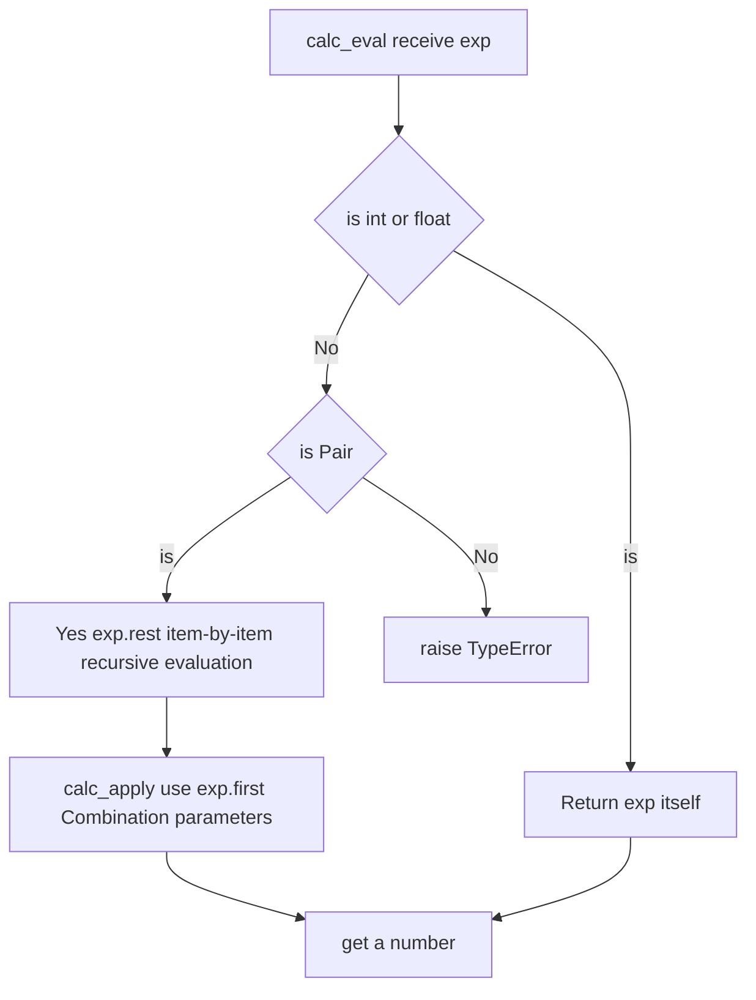

> **Editor's note**: `exp.rest.map(...)`  inside  `map`  Not built into Python  `map`, but the course project gives  `Pair` / `SchemeList`  A method of the same name defined that takes a function and returns the result as a Scheme list.

The version in the classroom is slightly different from the courseware: the real code will call  `simplify`, put  `8.0`  Return to one  `8`;Give at the same time  `TypeError`  Write a message string instead of throwing a naked class. Neither change changes the semantics, but they are both representative: `simplify`  It is a modification of the "presentation layer" (the value remains unchanged, the display becomes cleaner), and the message string is an enhancement of the "diagnostic layer" (the behavior remains unchanged, and the readability becomes better). **The two most easily overlooked types of work in the interpreter happen to be these two types.**

### 3.7 calc\_apply: Apply operators to numbers

`calc_apply`  Get a Scheme list of an operator and a number, and combine the parameters according to the meaning of the operator. All operations in the calculator are built-in, except for four.


```python
def calc_apply(operator, args):
    if not isinstance(operator, str):
        raise TypeError(str(operator) + ' is not a symbol')
    if operator == '+':
        return reduce(add, args, 0)
    elif operator == '-':
        if len(args) == 0:
            raise TypeError(operator + ' requires at least 1 argument')
        elif len(args) == 1:
            return -args.first
        else:
            return reduce(sub, args.rest, args.first)
    elif operator == '*':
        return reduce(mul, args, 1)
    elif operator == '/':
        if len(args) == 0:
            raise TypeError(operator + ' requires at least 1 argument')
        elif len(args) == 1:
            return 1 / args.first
        else:
            return reduce(truediv, args.rest, args.first)
    else:
        raise TypeError(operator + ' is an unknown operator')
```

> **Editor's note**: `calc_apply`  The complete source code does not appear in the courseware. The above version is reconstructed according to the demonstration and project structure during recording. The branch sequence and semantics are consistent with the class. The variable names and message text may be slightly different from the source code.

| operator | Implementation points | Class Demonstration |
| :--- | :--- | :--- |
| `+` | `reduce(add, args, 0)`, initial value 0 | `(+ 1 2 3)`  Got 6 |
| `-` | An error is reported for zero parameters; one parameter is negative; otherwise, the rest are subtracted from the first one. | `(- 10 1 2 3)`  Got 4 |
| `*` | `reduce(mul, args, 1)`, initial value 1 | Not demonstrated separately, only stated that it is a one-time  `reduce` |
| `/` | An error will be reported if there are zero parameters; if one parameter is used, the reciprocal will be taken; otherwise, the first one will be divided by the rest in sequence. | `(/ 1024 2 2 2 2 2)`  Got 32 |

The core of the language is here: `calc_eval`  Responsible for descending along the tree, `calc_apply`  Responsible for turning symbols into operations at the leaves. The two combined are less than twenty lines, but they already contain the semantics of a complete language. All Lecture 31 does is lengthen the branch tables for each of these two functions (§4.7).

### 3.8 REPL: Human-computer interface of the interpreter

Interpreters usually have a **Read-Eval-Print Loop (REPL)**: The user enters an expression, it is evaluated, the result is printed, and then the prompt appears again.


```python
@main
def read_eval_print_loop():
    """Run a read-eval-print loop for calculator."""
    while True:
        try:
            src = buffer_input()
            while src.more_on_line:
                expression = scheme_read(src)
                print(calc_eval(expression))
        except (SyntaxError, TypeError, ValueError, ZeroDivisionError) as err:
            print(type(err).__name__ + ':', err)
        except (KeyboardInterrupt, EOFError):
            print('Calculation complete.')
            return
```

> **Editor's note**: The source code of this loop also does not appear in the courseware. It is based on the lecturer’s explanation.  `while True` + `try` + `scheme_read` + `calc_eval` + `print`  A sentence-by-sentence description of the reconstruction; `buffer_input`, `more_on_line`  and other auxiliary interfaces from course projects.

There are two lines worth stopping to read. The first line is  `print(calc_eval(expression))`: **Printing will only be done on  `calc_eval`  Occurs on normal return**. If an exception is thrown during the evaluation process, this  `print`  The parameters of the call cannot be calculated at all, so nothing will be printed. The second line is  `except (KeyboardInterrupt, EOFError)`: `while True`  An exit is required, and the exit is end-of-file or keyboard interrupt; in which case it prints  `Calculation complete.`  And  `return`.

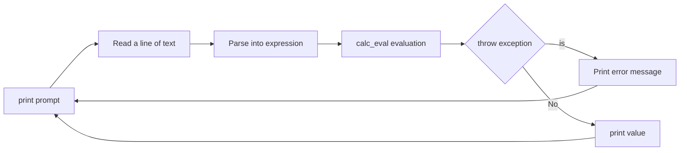

### 3.9 The complete chain of errors: throws scattered everywhere, catches concentrated in one place

to enter  `(? 2)`  For example, the complete chain is eight steps: read this line; lexical analysis is cut into four tokens; syntax analysis is assembled into a Pair tree; `calc_eval`  Determine whether it is a number or a pair, and enter the calling branch; first  `exp.rest`  Recursively evaluate item by item to get  `(2)`; `calc_apply`  get operator  `?`  with parameter list  `(2)`, none of the four branches match, and it falls to  `else`, throw  `TypeError('? is an unknown operator')`; Abnormal edge  `calc_apply → calc_eval → read_eval_print_loop`  Toss along the way, nothing in the middle  `try`  intercept, so  `print(calc_eval(...))`  inside  `print`  Never executed; top of loop  `except`  capture it, print the message, and then  `while True`  On to the next round - no program downtime.

The same chain also applies to failures at earlier levels. If the input is an orphan symbol or an empty combination, an exception is raised in step 4  `else`  The branch is thrown; if the position of the operator is a number, it will not be executed until step 6.  `calc_apply`  The first guard blocked it. That is to say, **The location of the error depends on which layer recognizes "this is not something I can handle" first, and the location of the echo is always the REPL one.  `except`**.

| Error class | thrown by who | Trigger mode | What you see in class |
| :--- | :--- | :--- | :--- |
| `ValueError` | Lexical analysis | Malformed numbers, such as  `2.3.4` | Value is illegal |
| `SyntaxError` | syntax analysis | Structural errors such as extra right brackets | The message contains  `unexpected token` |
| `TypeError` | `calc_eval` | empty combination  `()`, isolated symbol | Not a number or a call |
| `TypeError` | `calc_apply` | `(-)`  zero parameters, `(? 2)`  unknown operator | `? is an unknown operator` |
| `ZeroDivisionError` | Python built-in division | `(/ 1 0)` | by  `truediv`  Throw yourself |

The last line in the table deserves its own mention: `ZeroDivisionError`  It's not the calculator code that throws it, it's Python's division operator that throws it. **The error semantics of the interpreter are often "inherited" from the host language.**: Whatever you use to implement a language will inherit part of its behavior. When we discuss tail calls in Lecture 32, we will encounter the same phenomenon again - the upper limit of the recursion depth of Scheme is directly determined by the recursion depth of the host Python (§5.6).

This is also the design principle that the lecturer finally emphasized: **A well-designed interactive interpreter should never shut down**. It should stop evaluating the current expression, print an error message, and then give the programmer a chance to modify it before **current environment** Try again. The only ways to exit are end-of-file or keyboard abort.

## 4. Scheme interpreter: Write the interpreter so that it can explain itself

*(Reference time: 00:00:02 – 00:29:45｜Lecture 31)*

The calculator in Lecture 30 only knows two things: numbers, and  `+ - * /`  The calling expression at the beginning. This dichotomy works well in a calculator, because that language has no names, no procedures, no conditions. This is not the case with Scheme.

All the work done in this chapter is to lengthen the branch tables of the two functions of the calculator until they can explain the complete language of "defining procedures, calling procedures, and defining procedures in the procedure body". There are three steps to lengthening: first add **symbol** This basic situation (so the environment is needed), plus **special form** (So the order of evaluation is no longer uniform), and finally add **user defined process** (So  `apply`  It also needs to be recursive and able to frame).


The paragraph before the recording of Lecture 31 is a review of Lab 10 and is not retained in the final film; it was originally intended to explain that "reading an expression" and "evaluating it" are two different things in terms of implementation, and this chapter just starts from this matter.

### 4.1 First level dispatch: by shape, not by content

To determine how a Scheme expression is evaluated, the first step is not to look at what it says, but to ask "which category it belongs to" and then dispatch by category. Three categories can completely cover all legal expressions:

- **symbol**: The name that is bound to a value in the current environment. The action of evaluating is to check the environment.
- **self-evaluating expression**: The evaluation result is itself, with only two representatives - numbers and empty lists  `nil`.
- **combination**: All other legal expressions are represented as a Scheme list in Python. Calling it a combination just means that it is a well-formed Scheme list.

The combination is further divided into two categories, and the criterion is **first element of list**. The first element is  `if`, that is an if expression; yes  `lambda`, which is a lambda expression. Special forms are thus recognized by the first element. If the first element of a combination is not among the known special forms, it is an ordinary calling expression.


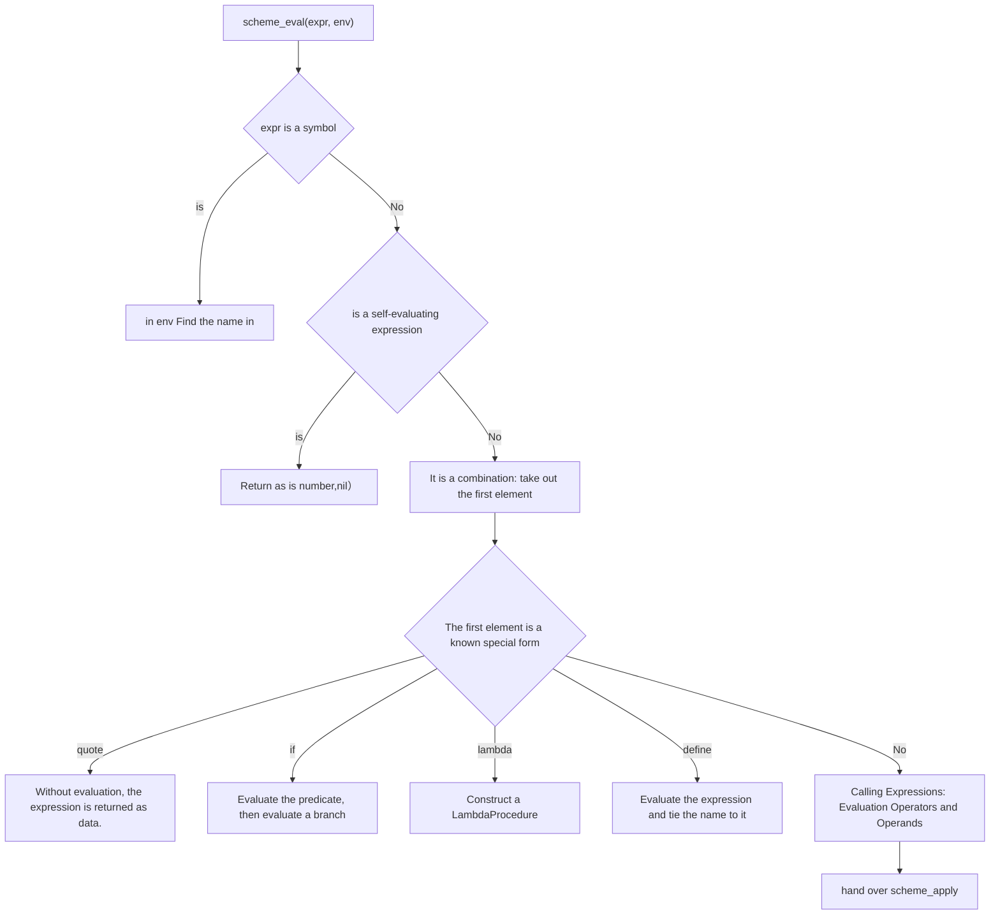

Compared with Lecture 30, the difference lies in this picture:

| criterion | calculator  `calc_eval` | Scheme of  `scheme_eval` |
| :--- | :--- | :--- |
| Number of branches | 2: Number, `Pair` | 4 major categories, of which "combination" is subdivided by the first element |
| symbol | No such expression exists | A basic situation: Check the environment |
| self-evaluation | numbers | Numbers and empty lists  `nil` |
| special form | No | `quote`, `if`, `lambda`, `define`  Each one has his own way |
| Reason for branching | There are two types of grammar | There are several types of grammar and several types of branches. |
| Do you need an environment? | No need | Required, you need to use it to look up names and create new frames. |

This table is worth remembering: **There are as many branches of evaluation functions as there are expressions in the language's grammar.**. Calculator has only two expressions, so its evaluation function is short enough to be memorized; Scheme has more symbols and special forms, and the dispatch table becomes longer - and each addition is just to implement a rule that has been written into the language specification.

### 4.2 Evaluation operands: from expression tree to parameter list

After dispatching to the "call expression", there are three things left: evaluate the operator, evaluate each operand, and pass both  `apply`.


This step is a one-time implementation  `map`: Recursively evaluate the operand list item by item and collect it into a new list. **Lecture 2 takes a whole chapter  `map`, and finally it falls here: it is the first gear of the interpreter.**

With operand evaluation, `demo`  Now you can appear:

```scheme
(define (demo s) (if (null? s) '(3) (cons (car s) (demo (cdr s))) ))
(demo (list 1 2))
```

> **Editor's note**: Why does it have to be recursive? Because the Pair chain can only hang things from the front——`cons`  The second parameter is the "remaining chain", which does not have the cheap operation of "appending to the end".

The lecturer then traces a call to demonstrate how the environment changes:


- input  `2`: `scheme_eval`  Evaluating it in the global frame, the result is 2 - self-evaluating expressions explain "doing nothing is an evaluation".
- input  `(- 2)`: evaluation operator  `-`  Get the negative process and evaluate the operands  `2`  Gets 2, which when applied to the argument gets -2.
- input  `demo`  Definition: Occurs after carriage return **rarely**——`scheme_eval`  There is no evaluation procedure body, it only creates a procedure. Evaluation of the procedure body is deferred to the procedure **be applied** that moment.
- input  `(demo (list 1 2))`: After the evaluation operator and operand, in a **new environment** In the evaluation procedure body, the new environment changes the formal parameters to  `s`  tied to  `(1 2)`, the parent frame is the global frame.

| track location | environment  `s`  binding | What is returned at this level? |
| :--- | :--- | :--- |
| first call | `(1 2)` | `(1 2 3)` |
| first recursion | `(2)` | `(2 3)` |
| Second recursion (base case) | `nil` | `(3)` |

### 4.3 quote and syntax sugar: destroy a shape during the reading phase

`'`  Just  `(quote ...)`  The abbreviation of , and this equivalence relationship is two-way. The side effects are: `'`  is a kind of **Syntactic sugar**, which belongs to the writing convenience in the reading stage and does not belong to the core semantics of the language. According to the lecturer, this is "a small piece of syntactic information" that is hopefully eliminated before the evaluator has to deal with quote. What killed it was the Scheme Reader file.

| How to write input | Structure produced by Reader | What the evaluator sees |
| :--- | :--- | :--- |
| `'(1 2)` | `(quote (1 2))` | only  `quote`  a shape |
| `(quote (1 2))` | `(quote (1 2))` | Same as above |

So when the Scheme evaluator actually deals with references, it never sees single quotes. This line of division is worth remembering: **Syntactic sugar is eliminated in the reading stage, and the core semantics only require knowing one shape**. The macro in Lecture 34 will be eliminated again, but this time the entire macro call subtree will be eliminated (§7.3).

### 4.4 Lazy: only evaluate that part of the evaluation

What logical special forms have in common are two things: they have to do with conditions; they **Evaluate only part of the subexpression**.`if`  Only evaluate predicates and one branch; `and`  with  `or`  Evaluate one by one from left to right until true or false can be determined; `cond`  With a string of conditions and clauses. The common consequences of the three are: **Some subexpressions are never evaluated**. This is not an implementation optimization, but the semantics itself.

```python
def do_if_form(exp, env):
    """两件事：求值谓词，挑出下一步要求值的那个子表达式。"""
    predicate = scheme_eval(exp.rest.first, env)
    if scheme_truep(predicate):
        return scheme_eval(exp.rest.rest.first, env)          # consequent
    return scheme_eval(exp.rest.rest.rest.first, env)         # alternative
```

> **Editor's note**: The lecturer verbally pronounces this function as "doIfForm". The writing method in the skeleton of Project 4 is  `do_if_form`. The above paragraph is a schematic version rewritten according to the lecturer’s dictation. **Not courseware content**.

Why can't both branches be evaluated? Because evaluation comes at a cost: `(/ 1 0)`  Exceptions will be thrown, calls with side effects will actually have side effects, and recursion will eat up stack space. If  `if`  Evaluate both branches, `demo`  That sentence  `(if (null? s) '(3) (cons ...))`  It will recurse deeper every time it is called, and it will never stop. **Lazy evaluation is not a performance trick here, but a prerequisite for terminability.**

### 4.5 lambda and procedure objects: code plus birth environment

A lambda expression evaluates to a **user-defined procedure**. An integer expression starting with lambda evaluates to a new procedure that did not exist before; it has formal parameters and a body.


How to express it in Python? The answer is to introduce a class  `LambdaProcedure`, it has three things: formal parameter list, procedure body and environment:


| Field | What are you pretending to be? | What is the application process used for? |
| :--- | :--- | :--- |
| `formals` | A string of symbols: the name of the parameter | Decide which names to bind to the new frame |
| `body` | A string of expressions: procedure body | It’s something that requires a value when applying |
| `env` | one  `Frame`  Example | Deciding where to find the name of freedom - it's the process **when first defined** the first frame of |

The third field is the hub of this chapter. A process is not just a piece of code; **A piece of code plus the environment in which it was born**. The formal parameter lists and procedure bodies of two lambdas can be exactly the same, but as long as  `env`  Different, the values found for variables with the same name are different. This also explains why the names at the definition can still be used after the procedure is defined: those names are not in the body of the procedure, but in the environment in which it is remembered.

### 4.6 Frame and environment: The parent frame determines where to find the name

A frame is created by having a **parent frame **to represent an environment. So a frame is always the first frame of an environment; it has a parent frame, a parent frame, and a parent frame, and continues until the global frame (global frame). This entire chain is the "environment". Frames are Python instances with two important methods: `lookup`  with  `define`. In Project 4, frames** Do not save return value**- It only holds name-value bindings for lookups.


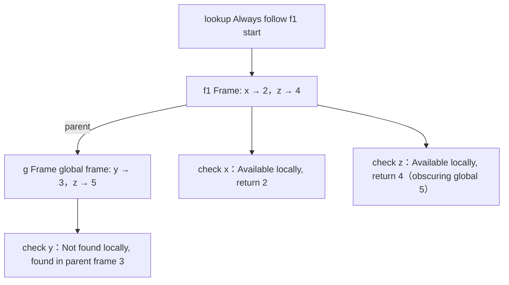

This is all the rules of lexical scope (also called static scope), summarized in one sentence: **The parent frame of a frame is the environment in which the process was defined.**. The implementation is very mechanical - when you create a new frame to apply a procedure, you look at the procedure object and treat the environment in which it was created as the parent frame of the new frame.

But making the environment look like an "extended definition of the environment" is not the only way to do it. Another option is called **dynamic scope**: **The parent frame of a frame is the environment in which the procedure is called.**. Let’s see the difference clearly with an example:

```scheme
(define (f x) (+ x y))
(define (g x y) (f (+ x x)))
(g 3 7)
```

| criterion | Lexical scope (lexical / static scope) | dynamic scope |
| :--- | :--- | :--- |
| Who is the parent frame of the new frame? | process **definition** environment at the time | process **call** environment at the time |
| one sentence notation | Wherever the name is written, look for it | Whoever calls you, look for him in his environment |
| `(g 3 7)`  in  `f`  inside  `y` | Unable to find, error reported | found  `g`  of 7, the result is 13 |
| who is using | Scheme, Python, Lisp | Early Lisp implementation, Emacs Lisp defaults |

**In dynamic scope, what matters is "who calls you", not "where you are defined".**

> **Editor's note**: Dynamic scope is not a paper solution. Both early Lisp and today's Emacs Lisp (the default) use dynamic binding; Common Lisp provides both bindings. Lexical scoping later became mainstream, and the reason is straightforward: just look at the source code to see what a name refers to.

### 4.7 Skeleton: Mutual recursion of eval and apply

Project 4 is to write an interpreter for the Scheme language, and this chapter talks about the structure of this interpreter - how to put those important parts together to get a program that can understand other programs.


This section unfolds the skeleton of Project 4: an evaluation function, an application function, two boxes, and two arcs.


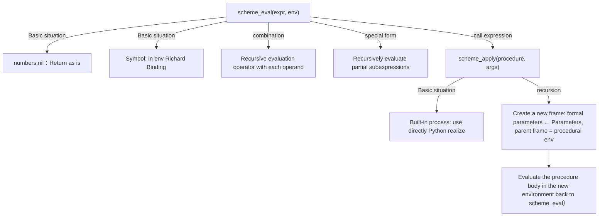

Overlay "today's extension" with "what's already in the calculator":

| criterion | Calculator Explainer (Lecture 30) | Scheme Interpreter (Lecture 31) |
| :--- | :--- | :--- |
| `eval`  basic situation | Number: returned as is | Numbers and  `nil`  Return as is; **Symbol: Check in the environment** |
| `eval`  recursive case | Combination: evaluation operands | Combination: evaluation operators and operands; **Special form: only evaluates some subexpressions** |
| `apply`  basic situation | `+ - * /`  Four built-in procedures | Built-in primitive process |
| `apply`  recursive case | No, it’s all basic information | **User-defined procedure: evaluates its procedure body** |
| Do you need an environment? | No need | **Must**: Use it to look up names and use it to create new frames. |
| mutual recursion | `calc_eval`  with  `calc_apply`  Intermodulation | `scheme_eval`  with  `scheme_apply`  intermodulation, and  `eval`  Also call yourself directly |

### 4.8 define: two ways of writing, one question

`define`  Bind a symbol to the current environment **first frame** inside. When looking up a name, it may be found in the parent frame; binding always falls on the current frame. The evaluation process is: first evaluate the expression, and then tie the name to the evaluated value. So  `(define x (+ 1 2))`  will first calculate 3, and then  `x`  Tied to the number 3 - it forgets about "the expression that makes 3".

The process definition is  `define`  with  `lambda`  The abbreviation relationship of:

```scheme
(define (f x) (+ x 3))            ; 简写
(define f (lambda (x) (+ x 3)))   ; 展开后的等价形式
```

The courseware arranges a discussion question at this location: How to remove the defined symbol from a define expression? The difficulty lies in two formats: `(define x (+ 2 3))`  The symbol is in the second cell, and  `(define (f x) (+ x 3))`  The second cell is itself a list, with the symbol in its first cell.


```python
def symbol(exp):
    """Given a define expression exp, return the symbol defined."""
    assert exp.first == 'define' and exp.rest is not nil and exp.rest.rest is not nil
    signature = exp.rest.first
    if scheme_symbolp(signature):
        return signature
    else:
        return signature.first
```

Although this code is short, it demonstrates one of the themes of this chapter very clearly: **Two syntaxes at the same level of semantics should be unified into a common shape first, and then a processing logic should be written.**. The two ways of writing define are unified into one  `define` + `lambda`, the two ways of writing quote are unified into one  `(quote ...)`, all the same craft.

### 4.9 apply: framing, binding, and evaluation process body

`apply`  The processing of the user-defined process can be described in one sentence: Create a new frame, bind the formal parameters to the parameter values, and the parent frame is **the environment of this process**;Then the procedure body is evaluated in the environment at the beginning of this new frame. The "process environment" here is  `LambdaProcedure`  of  `env`  properties.


The project page of Project 4 in the courseware explains exactly this sentence. It first explains the data representation: numbers are numbers, symbols are strings, and lists are  `Pair`  Instance of class. Then explain the evaluation: `scheme_eval(expr, env)`  Returns the value of an expression in an environment; `scheme_apply(procedure, args)`  Apply a procedure to its arguments; whereas  **Python functions  `scheme_apply`  Returns the return value of the procedure it is applied to**. The two layers of responsibilities are very cleanly divided: the frame does not remember the return value, and Python’s  `return`  Remember the return value. The reason why the tail call optimization in Lecture 32 can only change "whether to frame or not" without changing the semantics relies on this boundary (§5.6).

Rewatch with the eyes of the frame  `demo`: when defined it is tied to a  `LambdaProcedure`  Up, `env`  It is a global frame; when calling, create the parameter value first  `(1 2)`, create a new frame  `s`  tied; the parent frame of the new frame is the global frame - because  `LambdaProcedure`  of  `env`  It is the global frame. This step is not determined by the call point; the evaluation process body finds  `s`  No  `nil`, so in  `(cdr s)`  Adjust it up again; adjust it down again  `s`  tied to  `nil`, the process body returns directly  `(3)`;Come back layer by layer, `(2 3)`, `(1 2 3)`.

### 4.10 How old is this construct: eval and apply in Lisp 1.5

The lecturer showed a surprisingly old slide: Lisp 1.5 document  `apply`  with  `eval`  original definition of. Lisp 1.5 is the predecessor of Scheme, and that document is much older than this course, but this code already has most of the structures we see today, but the syntax is completely different.

That code depends on only a few things: `car`, `cdr`, `cons`; a check for "is it atomic"; a built-in equality check; and references and conditionals. Everything else has to be built from these few things - except for the famous  `lambda`. In other words, a complete language can be defined by only eight things: "heading, tailing, pairing, atomic judgment, equality, reference, conditional, lambda".

> **Editor's note**: That function in Lisp 1.5 documentation is often called a "universal function" or  `eval`. The craft is officially named in SICP Chapter 4 **metacircular evaluator**——"Metacycle" means: the language used to write the interpreter is exactly the language being interpreted (or a subset of it that is isomorphic to it). Lecture 31 does not use the term "meta-cycle", this term is a supplement by the editor; Project 4 happens to be a one-dimensional cycle practice.

### 4.11 From zero to scheme\_eval: an implementation path

The contents of the seven lectures can be strung together into one thread here. **Implementation path**. It is not a teaching sequence, but the eight steps one would actually go through when writing a Scheme interpreter from scratch.

1. **Can read text**:Write lexical analysis, cut the source code into tokens, and write  `scheme_read`  Make up tokens  `Pair`  tree. The product of this step has no semantics, only structure (§3.4).
2. **can express code**: put  `Pair`  The chain is used as a syntax tree. `first`  Take the operator, `rest`  Get the operand list; `nil`  is the end of the chain (§2.1).
3. **Find the simplest value**: `calc_eval`  The two branches of - the number returns itself, `Pair`  Recursively evaluate the operands and then  `calc_apply`. There is no environment yet (§3.6).
4. **Ability to assign values to names**: Join  `Frame`  class with  `define`, `scheme_eval`  There is an additional basic situation of "check the symbol in the environment". The environment becomes the second parameter of the evaluation function (§4.1, §4.8).
5. **Can be assigned by shape**: Connect the special forms one by one——`quote`  Return directly, `if`  go  `do_if_form`, `lambda`  make  `LambdaProcedure`, `define`  Evaluate first and then bind (§4.3–§4.5).
6. **can apply process**: `scheme_apply`  It is divided into two paths - the built-in process is directly implemented in Python, and the user-defined process creates a new frame, binds formal parameters, and evaluates the process body, thus returning to  `scheme_eval`(§4.9).
7. **Can support deep recursion**: Change "recursion to create frames" to "loop that reuses the current frame", and calls at the tail position will no longer increase the stack (§5.6).
8. **Able to rewrite source code**: In the reading phase, macro calls are expanded into ordinary expressions, and the expansion results are handed over to the previous seven steps (§7.3).

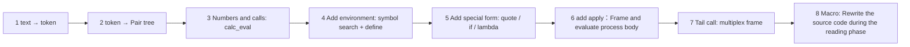

There are two "breaks" in this path that are particularly worth remembering:

| fault | before | after | What’s new at the fault line |
| :--- | :--- | :--- | :--- |
| Step 3 to Step 4 | The evaluation function has only one parameter: the expression | The evaluation function has two parameters: expression and environment | environment;symbol lookup; `define`  The landing point |
| Step 6 to Step 7 | Each application creates a frame, and the stack depth increases with recursion. | The application at the tail position multiplexes the current frame | Tail position determination; "Does the current frame still need to be determined?" |

## 5. Tail call: write recursion as iteration

*(Reference time: 00:00:00 – 00:32:48｜Lecture 32)*

Lecture 31 There is a hidden cost in creating an interpreter: each time a user-defined procedure is applied, a new frame is created. It's fine if you recurse to twenty levels, but if you recurse to one hundred thousand levels, the stack will explode. This turns "replace loops with recursion" from a beautiful saying into a practical limitation - pure functional languages ​​prohibit rebinding, iteration can only be written as recursion, and recursion consumes linear space according to naive semantics.

This lecture (elective topic) is about repaying this space debt. There is only one conclusion: **If the caller wants to return the value returned by the callee, the caller's frame no longer carries any information after the call is issued and can be reused.**.

### 5.1 The origin of the problem: After disabling rebinding, what does the cycle rely on?

The first benefit is that the value of an expression is related to its subexpressions **in what order** Evaluation is irrelevant. Since the order does not matter, you can choose any order, you can evaluate it in parallel, or you can always postpone it. These benefits come from referential transparency: replacing a subexpression with its value leaves the entire expression unchanged. It incidentally solves a very troublesome thing in imperative languages ​​- memoization: remember the calculated results and access them directly next time, without worrying that the "read cache" itself will change the program behavior.

So the question arises: No  `for`  Neither  `while`, and rebinding is not allowed, can iteration be efficient?

| criterion | Imperative: `while`  loop | Purely functional: recursive calls |
| :--- | :--- | :--- |
| means of changing status | Rebind the name to a new value | Only new values can be passed as arguments to the next call |
| How to write iteration | `while` / `for`  statement | recursive call |
| order of evaluation of subexpressions | Side effects can affect results | does not affect the results |
| Parallel evaluation | Need to manually prove no dependence | Guaranteed by referential transparency |
| memoization | May change program behavior | safe |
| The space overhead of one iteration | constant | Linearity under naive recursion (the point to be solved in this lecture) |

### 5.2 Recursive and iterative space accounts

The lecturer calculated the account on an example as small as possible: calculation  `k`  multiply by  `n`  of factorial. extra  `k`  Not a redundant parameter, but an accumulator - it takes "those terms that have been multiplied" with it.

```python
def factorial(n, k):
    if n == 0:
        return k
    else:
        return factorial(n - 1, k * n)
```

The iteration is written as  `while n > 0: n, k = n - 1, k * n`. The time difference between the two pieces of code is only a constant factor: the recursive version is linear time, but the linear time recursion still takes up **linear space**;The iterative version has the same linear time, but only takes up constant space.

| criterion | recursive version | Iterative version |
| :--- | :--- | :--- |
| time | linear, `n`  calls | linear, `n`  wheel cycle |
| space | linear, `n`  frames alive at the same time | constant, three names |
| Where does the state exist? | Scattered in local bindings of each layer of frames | focus on  `n`, `k`  in two variables |
| failure mode | If the recursion is too deep, the stack will overflow. | Only limited by numerical scale |
| distance from mathematical definition | Almost word for word correspondence | Need to think additionally about loop invariants |
| What does the language need to provide? | As long as it supports function calls | Rebinding must be allowed |

Please pay attention to a detail that is easily overlooked: **This Python recursive function is logically at the end position**——`return`  The subsequent call is directly recursive, and there is no operation to be done after getting its value. But CPython still opens a new frame for each layer, because the Python language itself does not promise tail call optimization. **logical tail call** with **Implementing frame multiplexing** It's two things.

### 5.3 Scheme’s promise: properly tail recursive

This gap is blocked by the explicit specification in Scheme:

> A system that implements Scheme **Must** is properly tail recursive. This allows an iterative calculation to be performed in constant space - even if the iterative calculation is performed by a **syntactically recursive** The process is described.

```scheme
(define (factorial n k)
  (if (= n 0)
      k
      (factorial (- n 1) (* k n))))
```

This code corresponds to the Python version line by line. The only difference lies in the evaluation rules - it follows the specification **should** Only takes up constant space.

| criterion | Recursive version in CPython | The recursive version in Scheme |
| :--- | :--- | :--- |
| Does the language commit to tail call optimization? | No | Yes, the norm is mandatory |
| `n`  Take 1000 | stack overflow | normal operation |
| Space follows  `n`  growth | Linear | constant |
| Is it "grammatical recursion" or "semantic iteration"? | Both are recursive | Syntactic recursion, semantic iteration |

Why does language dare to make this promise? Because without mutable state, the entire value of a call to the caller is "the return value". If the caller has nothing to do after getting the value, the boundary between it and the callee no longer carries any information, and the entire frame can be discarded.

> **Editor's note**: CPython does not perform tail call optimization, which is a trade-off in language design. There are two common explanations. One is debuggability: once a frame is reused, the intermediate layers are no longer visible in the call stack. The second is semantic coupling: `try` / `finally`, `with`  and tracing hooks all assume that the frame is alive for the duration of the call. This has nothing to do with "technically it can't be done" - you can get the same effect by writing the evaluator as an explicit loop rather than a recursive call.

### 5.4 Tail position: a grammatical rule that can be determined mechanically

once **Not returned yet** The procedure call is called **active**. Some active calls are **tail call**: The value handed over by the callee is the value to be handed over by the caller, without any processing in between.

Strictly speaking, there is only one sentence: **A tail call is a call expression in tail context**. Tail position is a recursive grammar rule. Only two of them are used in this lecture:

- one  `lambda`  expressions (including  `define`  The process of coming out, the two are equivalent) **The last body subexpression**;
- if a  `if`  The expression itself is at the tail position, then its **The 2nd and 3rd subexpressions** In the tail position, the 1st one is not there.

Why does Article 1 limit "the last one"? because  `lambda`  The body can have multiple expressions, only the last one determines the return value; the previous ones are only evaluated for side effects, their results will be discarded, and there is no "tail".

Take factorial to determine layer by layer: `define`  The body has only one expression, which is this  `if`, so this  `if`  at the tail position; so its second and third subexpressions are at the tail position, and the condition is not there; the third subexpression is a calling expression, and it is at the tail position, so it is **tail call**.

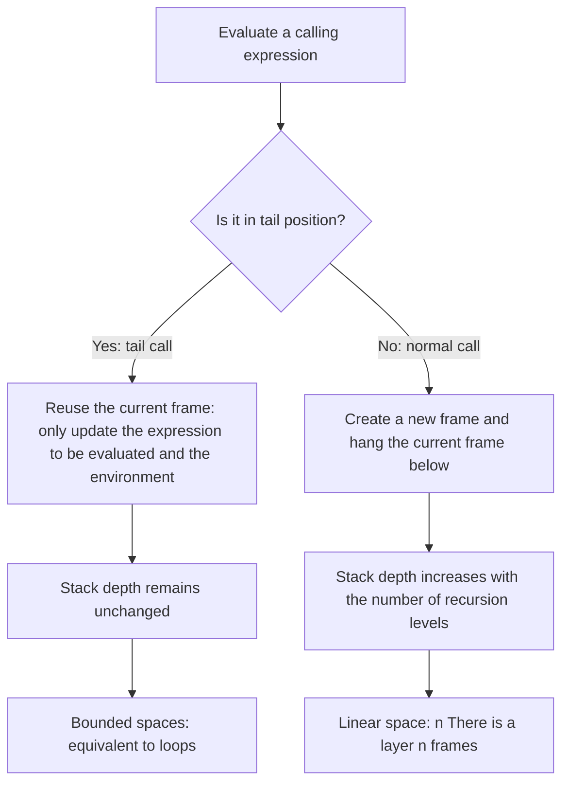

The specification also lists other tail positions:

| context | Which subexpressions are at the end position | Reason |
| :--- | :--- | :--- |
| `lambda` / `define`  body | last expression | It determines the return value |
| `if` | 2nd, 3rd | The condition only determines which path to take, its value is discarded |
| `cond` | the last expression of each clause (without conditions) | The condition only needs a boolean value |
| `and` / `or` | the last one | The first few results may be discarded by short circuit |
| `begin` | the last one | The first few are only evaluated for side effects. |

In turn, the other half of the criterion is: **If the caller continues to calculate after getting the return value, the call is not a tail call.**. The lecturer's statement is that "more computation is required in the calling procedure" - the recursive call calculates the value, but if this value is combined with other things, the tail position will be broken.

### 5.5 Example 1: length and cumulative parameters

most natural  `length`  Not tail recursive:

```scheme
(define (length s)
  (if (null? s)
      0
      (+ 1 (length (cdr s)))))
```

Remember this shape in one sentence: **The calling expression is a set of calling expressions. The one inside must not be at the end position.**. Because the outside one still needs the value of the inside one. This is where linear space comes from: the frames store  `s`, this layer will add 1 after the sub-call returns, so the frame must live until the addition is completed.

The rewritten method is to introduce a second process with an additional parameter indicating "how many have been counted so far":

```scheme
(define (length-tail s)
  (define (length-iter s n)
    (if (null? s)
        n
        (length-iter (cdr s) (+ n 1))))
  (length-iter s 0))
```

| criterion | simple  `length` | `length-tail` |
| :--- | :--- | :--- |
| Where is the recursive call? | `+`  in the parameters of | `if`  The 3rd subexpression of |
| Whether to tail call | No | is |
| Are additional parameters required? | No need | Required, accumulator  `n` |
| extra space | Linear | Constant (the linked list itself is still linear) |
| Where does the return value come from? | Add one layer at a time from the innermost layer and rise up. | The innermost layer is given directly and handed over layer by layer as it is. |

The last sentence cannot be omitted: **The space occupied by the table itself cannot be saved**. What is omitted by the tail call is "the extra stack of frames to calculate the length", not the data.

**accumulating parameter**  It is the standard handle of tail recursion: moving "unfinished things" from the stack into actual parameters. `length`  Add a count, `map`  Add a reverse accumulation table, `reverse`  Add a reversed table, they all have this in common.

### 5.6 Demonstration: the switch in scheme.py

The principle can be condensed into one sentence: **The return value of the tail call is the return value of the current call.**, so all the frames in the middle can be skipped. The interpreter used for demonstration is the one included in the course project  `scheme.py`, there is a line of comments in the bonus question section at the bottom of the file. Uncommenting it will enable tail call optimization. It is commented out by default.

| call | Tail call optimization is not enabled | After enabling |
| :--- | :--- | :--- |
| `(factorial 10 1)` | normal | normal |
| `(factorial 100 1)` | normal | normal |
| `(factorial 673 1)` | Push to 673 and reach the top, then give up. | normal |
| `(factorial 1000 1)` | `maximum recursion depth exceeded while calling a Python object` | normal |
| `(factorial 10000 1)` | Not reachable | Normal; obviously time-consuming, ultimately limited by the size of the number itself |

The error appears now  `1000`  That time, and the evaluator held on until "about 673 factorials" before giving up. The reason is very straightforward: it is called too many times and takes up too much memory. Python says "it has reached the limit". This "limit" is not the limit of Scheme, but the recursion depth of the host Python - the interpreter uses Python's recursion to implement Scheme's recursion, so the space overhead of Scheme is directly mapped to the depth of the Python call stack.

> **Editor's note**: Why 673 instead of around 1000? Each time a Scheme call is evaluated, several layers of frames must be pressed in the host Python (evaluating the expression, applying the process, and then evaluating the body), so CPython's default recursion limit of about 1,000 levels is hit early. This also shows that the "complexity of the interpreted object" in the meta-loop interpreter will inherit the resource limitations of the "host language".

> **Editor's note**: This lecture only talks about the level of "skipping unnecessary frames". Real implementation usually takes two paths. One is **frame multiplexing**: When the evaluation loop finds that the expression to be evaluated is at the tail position, it does not call itself recursively, but updates the "expression to be evaluated" and "current environment" to the body of the called process and its new environment, and then  `continue`  Same cycle. The second is  **trampoline**: When applying the process, a "to-do" is returned, which is repeatedly taken out and executed by the outermost driver loop. The extra-credit questions in the CS61A project take the first path.

### 5.7 Discrimination Exercise: Spatial Diagnosis of Four Processes

Question 2  `contains`: Judgment element  `x`  Is it on the table?  `s`  inside.

```scheme
(define (contains s x)
  (if (null? s)
      #f
      (if (equal? (car s) x)
          #t
          (contains (cdr s) x))))
```

Question 3  `has-repeat`: To determine whether there are duplicate elements in the table, the method is to ask each element "Does it exist in the following table?"

```scheme
(define (has-repeat s)
  (if (null? s)
      #f
      (if (contains (cdr s) (car s))
          #t
          (has-repeat (cdr s)))))
```

The fourth question is to use two mutually recursive processes to find the  `n`  Fibonacci numbers:

```scheme
(define (fib n)
  (if (= n 1)
      0
      (fib-iter n 2 1)))

(define (fib-iter n k current)
  (if (= n k)
      current
      (fib-iter n (+ k 1) (+ current (fib (- k 1))))))
```

The judgment result is **Not established**.`fib-iter`  The recursive call itself is indeed a tail call, but its third argument  `(+ current (fib (- k 1)))`  Contains a pair  `fib`  recursive call, and this call is  `+`  The parameter of - is not in the last position. So in each round, the smaller one must be moved first  `fib`  Figure it out, add it in, the frames can't be dropped.

| process | The location of the recursive call | Whether all are tail calls | extra space | Where is the break? |
| :--- | :--- | :--- | :--- | :--- |
| `length` | `+`  in the parameters of | No | Linear | The third body expression is  `+`  call, `length`  Make parameters in it |
| `contains` | inner layer  `if`  The 3rd | is | constant | None |
| `has-repeat` | inner layer  `if`  The 3rd | is | constant | None; `contains`  Call non-tail, but its own constant space |
| `fib` / `fib-iter` | `fib-iter`  in the actual parameters | No | Linear | `(+ current (fib (- k 1)))`  in  `fib`  is  `+`  Parameters |

### 5.8 Higher-order functions: space complexity becomes parameters

Higher-order functions will also turn "space occupation" into parameters. `reduce`  Collect three things: a process for combining  `f`, a table to be traversed  `s`, a starting value  `start`.

```scheme
(define (reduce f s start)
  (if (null? s)
      start
      (reduce f (cdr s) (f start (car s)))))
```

`map`  rule **No** Tail recursive: `(cons (f (car s)) (map f (cdr s)))`  inside, `cons`  is at the tail position, but its second argument is not. The idea of ​​the tail recursive version is not intuitive: **First, build the mapping result in reverse, and finally reverse it as a whole.**.

```scheme
(define (map-reverse f s m)
  (if (null? s)
      m
      (map-reverse f (cdr s) (cons (f (car s)) m))))

(define (map f s)
  (reverse (map-reverse f s nil)))

(define (reverse-iter s r)
  (if (null? s)
      r
      (reverse-iter (cdr s) (cons (car s) r))))
```

### 5.9 Closure: The interpreter is a universal machine

What exactly is happening in writing an interpreter? The answer is **a general computing machine**.

The interpreter is **Universal** The kind: it accepts any code and simulates any specific machine according to that code. The Scheme interpreter receives two things at once -`5`  Such data, and the source code of "How to calculate factorial" - combine the two and output  `120`. The Scheme interpreter being built in the project is a **universal machine**, what it counts depends on the source code it is entered into **parameterization** What will become.

But inside, don’t forget what it is—**A set of evaluation rules, just a program**. The last sentence of the lecturer is: "an interpreter is nothing more than a program." The evaluator is not magic, it is the same as factorial, sum  `map`  It is also an ordinary code that can clear the overhead by the number of frames.

## 6. Program is data: quote, eval and quasi-quote

*(Reference time: 00:00:00 – 00:18:04｜Lecture 33)*

The last question left in Lecture 31 is: Can the language interpreted by the interpreter be larger than the language in which it is written? The answer is yes, and the method is surprisingly simple——**Let the program treat the program as data**.

Lecture 29 has already said "a combination is a list", and Lecture 30 has used  `Pair`  Represents an overexpression tree. This chapter combines these two sentences to form two operations in opposite directions: `quote`  Freeze code into data, `eval`  Execute data as code.

### 6.1 Expressions are lists

There are only two types of Scheme expressions: **basic expression** (number  `2`, Boolean value  `true`, symbol  `+`) and **combination** (Forms that enclose operators and operands, e.g.  `(quotient 10 2)`).


The judgment given by the courseware title is: **A Scheme expression is a Scheme list**. This statement holds true for combinations and also for basic expressions - a single atom is also a trivial list structure. to  `(quotient 10 2)`  For example, if you look at it as a list, it has three elements: symbol  `quotient`, number  `10`, number  `2`. This structure was originally used for data, but now it also assumes the role of "program".


```scheme
scm> (list 'quotient 10 2)
(quotient 10 2)
scm> (eval (list 'quotient 10 2))
5
```

The first line prints out  `(quotient 10 2)`, exactly the same as handwritten code text, but it is a **list value**:Evaluation  `(list 'quotient 10 2)`  During the entire process, division did not occur once. The second line is actually executed: `eval`  Accepts an expression represented by a Scheme list and returns its value, so we get  `5`. When reading REPL output it is necessary to distinguish the respective roles of the two lines: `scm>`  This is followed by the expression to be evaluated, and its value on the next line.

### 6.2 eval and two edges

**If you want the program to generate Scheme code, you only need to construct a list; if you want to know what the generated code will calculate, just call  `eval`.**

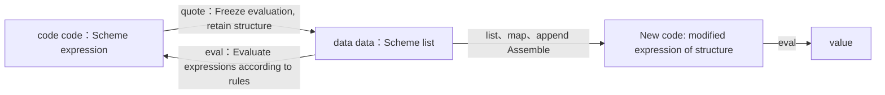

The downward side is  `quote`: Let a piece of code stop evaluating and become data as it is, so it can be disassembled, replaced, and spliced. The upward side is  `eval`: Run a piece of data according to Scheme's evaluation rules to get the value. The rest of the content is just to demonstrate what these two sides can combine: first manually spell the code, then use the template to spell the code in batches, and finally write the template itself as a process.

> **Editor's note**: `eval`  It is the entrance to the interpreter. The evaluator written in Python in the first few lectures of this module - reading in an expression, judging which category it belongs to, and recursively evaluating it according to the rules - essentially implements  `eval`  This process. In addition, Python’s  `eval`  It will execute arbitrary expressions in the current scope and is generally regarded as a dangerous interface in engineering.

### 6.3 Semi-finished product: quote controls the evaluation time

Let’s look at the most common situation first, and then “list” it out:

```scheme
scm> (+ 1 2)
3
scm> (list '+ 1 2)
(+ 1 2)
```

```scheme
scm> (list '+ 1 (+ 2 3))
(+ 1 5)
```

The term semi-finished product is worth remembering. use  `list`  When spelling code, **Which subexpressions are evaluated early, depending on whether they appear in a reference position or an ordinary position**. This rule is the basis for all subsequent code generation techniques, and it also exposes a trouble - manually adding quotes to each symbol is too verbose, and the template becomes unreadable once it is long. Quasi-references (§6.6) exist to solve this problem.

> **Editor's note**: The interactive demonstrations and program files in Sections 3, 4, 6, 7, and 8 of this lecture are from the classroom screen and are not included in the courseware; they are reconstructed here according to the expressions, structures and output dictated by the subtitles.

### 6.4 Procedures that return expressions: fact-exp and fib-exp

In class, we first load a small program and use factorial for comparison. `fact`  Is the standard recursive definition, returning a number:

```scheme
(define (fact n)
  (if (= n 0)
      1
      (* n (fact (- n 1)))))
```

```scheme
(define (fact-exp n)
  (if (= n 0)
      1
      (list '* n (fact-exp (- n 1)))))
```

`(fact-exp 5)`  Return  `(* 5 (* 4 (* 3 (* 2 (* 1 1)))))`. It's still a piece of code that can be evaluated, `(eval (fact-exp 5))`  We get 120; as data, it allows the reader to see how 5 multiplies all the way to 1.

| criterion | `fact` | `fact-exp` |
| :--- | :--- | :--- |
| What to return | a number | a Scheme list (expression) |
| baseline  `n = 0` | `1` | `1` (Numbers themselves are also expressions) |
| recursive step | `(* n (fact (- n 1)))` | `(list '* n (fact-exp (- n 1)))` |
| When does multiplication occur? | Occurs immediately during construction | hand over  `eval`  only happens when |
| Typical uses | get result | Generate code and observe the calculation process |

The same transformation can be applied to Fibonacci:

```scheme
(define (fib-exp n)
  (if (<= n 1)
      n
      (list '+ (fib-exp (- n 2)) (fib-exp (- n 1)))))
```

`(fib-exp 6)`  What you get is a tree made only of  `+`, `0`, `1`  An addition tree composed of. Evaluating this tree, we get 8. This expression tree is the same as  `fib`  The call tree is isomorphic, except that the nodes have changed identities: one is an "uncalculated call", and the other is an "already written expression".

### 6.5 Two discussion questions: rewriting the program and observing the evaluation order

The courseware is in  `(Demo)`  Two pages of discussion questions are inserted later, and the class video does not expand on them.


The motivation for the first question is very practical: machine-generated code often has redundant nested structures. Can you write a program to **No evaluation** Amortize nested multiplications under the premise of?

```scheme
(define (is-*-call expr)
  (and (list? expr) (equal? '* (car expr))))   ; E.g., (* 3 4)

(define (flatten-nested-* expr) ; Return an equivalent expression with no nested calls to *
  (if (not (list? expr))
      expr
      (let ((expr (map flatten-nested-* expr))) ; Now expr is (* 1 2 (* 3 4) (+ 5 (* 6 7 8)))
        (if (is-*-call expr)
            (apply append
                   (map (lambda (e)
                          (if (is-*-call e)
                              (cdr e)
                              (list e)))
                        expr))
            expr))))
```

The second question requires writing  `print-evals`: It accepts a number only, `+`, `*`, `>`, `if`  expressions with parentheses, each subexpression evaluated during the evaluation process and its value are **The order in which evaluation is completed** Print it out.


```scheme
(define (print-evals expr)
  (if (list? expr)
      (if (equal? (car expr) 'if)
          (begin
            (print-evals (car (cdr expr)))
            (if (eval (car (cdr expr)))
                (print-evals (car (cdr (cdr expr))))
                (print-evals (car (cdr (cdr (cdr expr)))))))
          (map print-evals expr)))
  (print expr '=> (eval expr)))
```

`(print expr '=> (eval expr))`  written in  `if` **outside**, is the last expression of the procedure body, so it will always execute: no matter  `expr`  Whether it is an atom or a combination, it will print itself after the subexpression is processed. inside  `if`  Only responsible for "going down": non-list atoms do nothing; used in ordinary combinations  `map`  Process all subexpressions once; `if`  Expressions are treated specially - the predicate is processed first, then the predicate is evaluated, then **only** Process the selected branch. due to  `if`  Only one branch is evaluated, the other is never printed, and the order of output is therefore exactly the order in which evaluation is completed.

> **Editor's note**: The codes on the above two pages are transcribed according to the original text of the courseware, and the green underlined areas are the answers left blank in the courseware; the explanation part is filled in according to the semantics of the code, and there is no corresponding dictation in the classroom video.

### 6.6 Quasi-quotes: slots in quotes

Before writing the code generator, you need to add a language feature -**quasiquotation**. it and  `quote`  It's very similar, the difference is that you can unquote certain parts of a quasi-reference expression.


```scheme
Quote:       '(a b)   =>   (a b)
Quasiquote:  `(a b)   =>   (a b)
(define b 4)
Quasiquote:  `(a ,(+ b 1))  =>   (a 5)
```


| mark | Name | Scope | `b`  The result when is 4 |
| :--- | :--- | :--- | :--- |
| single quote  `'`  or  `quote` | Quote | The entire expression freezes | `'(a ,(+ b 1))`  Got  `(a (unquote (+ b 1)))` |
| backtick or  `quasiquote` | quasi-citation | Frozen overall, but unfrozen at the comma | `` `(a ,(+ b 1)) ``  Got  `(a 5)` |
| comma  `,`  or  `unquote` | backquote | Only valid within quasi-references | write alone  `,(+ b 1)`  is a grammatical error |

The comma is not a stand-alone operator; it only makes sense in the context of quasi-references. For the same expression, reference and quasi-reference give two results:

```scheme
scm> '(a ,(+ b 1))
(a (unquote (+ b 1)))
scm> `(a ,(+ b 1))
(a 5)
```

why  `(+ b 1)`  evaluated  `a`  No? The answer is that comma. The reading is: **The quasi-reference first constructs the overall structure according to the method of "constructing a list"; when encountering a comma-marked subexpression, it calculates a value according to Scheme's ordinary evaluation rules, and then puts this value into the corresponding position.**. So what quasi-quotes do can be summarized in one sentence: **Mix "reference" and "evaluation" in the same template**.

The courseware gives the first practical example:

```scheme
(define (make-add-lambda n) `(lambda (d) (+ d ,n)))
(make-add-lambda 2)  => (lambda (d) (+ d 2))
```

### 6.7 Parameterization: Extract "which part will change"

**There is no while statement in Scheme**, but the while statement is really convenient. In order to illustrate how inconvenient "no loop" is, let's first look at a specific calculation: find the sum of the squares of all even numbers below 10, that is  $2^2 + 4^2 + 6^2 + 8^2$.

```python
x, total = 2, 0
while x < 10:
    total = total + x * x
    x = x + 2
```

at the end of the loop  `total`  Yes 120. In Scheme, there is no while available, only recursion. The idea is to turn loop variables into process parameters:

```scheme
(define (sum-while x total)
  (if (< x 10)
      (sum-while (+ x 2) (+ total (* x x)))
      total))
```

After defining this process, you still need to call it with the correct initial value, so you write two expressions instead of one. If you want to combine them into one expression, you need to use  `begin`:

```scheme
(begin
  (define (sum-while x total)
    (if (< x 10)
        (sum-while (+ x 2) (+ total (* x x)))
        total))
  (sum-while 2 0))
```

The lecturer’s proposal is: **Let Scheme write this code**.

```scheme
(sum-while-expr 1 '(< (* x x) 50) 'x '(+ x 1))
```

The four parameters are: initial value  `1`;continuation condition  `(< (* x x) 50)`; Accumulated item  `x`;updated  `(+ x 1)`. The last three are enclosed in quotation marks because they are **expression**, should be embedded in the template as it is, rather than evaluated now - without quotation marks, `(< (* x x) 50)`  will be evaluated immediately, and at this moment  `x`  Not worth it yet.

### 6.8 Generating code: closed loops of templates, slots, and eval

Write the skeleton of the previous section as a quasi-reference to get the generator:

```scheme
(define (sum-while-expr initial-x condition add-to-total update-x)
  `(begin
     (define (f x total)
       (if ,condition
           (f ,update-x (+ total ,add-to-total))
           total))
     (f 0 ,initial-x)))
```

Four commas correspond to four parameters. The lecturer explained step by step why it is necessary to backquote: If it is written as  `condition`  Without adding a comma, the generated result is **symbol** `condition`, rather than the expression passed in by the caller; `initial-x`  Without backquoting, `(f 0 initial-x)`  will find a value called  `initial-x`  variable, which does not exist.

```scheme
scm> (define result (sum-while-expr 1 '(< (* x x) 50) 'x '(+ x 1)))
scm> (eval result)
28
scm> (eval (sum-while-expr 2 '(< x 10) '(* x x) '(+ x 2)))
120
```

The first evaluation yields 28, the sum of 1 to 7; the second evaluation yields the sum of even squares, 120—exactly the handwritten question from the previous section.

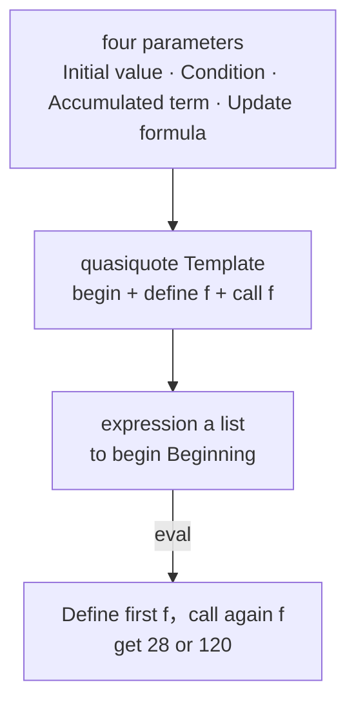

The last sentence of this lecture summarizes: **Being able to write the process of "writing code for other processes" is an additional expressive power of programming languages.**. The reason why this sentence is true depends on the three things saved in the previous sections: code is a list, `quote`  Ability to freeze structures, `eval`  Ability to execute structures.

> **Editor's note**: Code generation is not uncommon in engineering: the compiler translates the syntax tree into target code, the test framework generates use cases in batches based on data tables, and the web framework compiles templates into functions. The essence is to "construct a program and then hand it over to the evaluator." Lecture 33 demonstrates a minimal version of this mechanism.

The last page of the courseware  `fact-exp`  Changed the writing method, requiring the same process to be rewritten using quasi-reference:


```scheme
(define (fact-expr n)
  (if (= n 0) 1 `(* ,n ,(fact-expr (- n 1)))))
```

Two commas separate the current  `n`  Fill in the multiplication template with the expression obtained by recursion. Used with §6.4  `list`  Compared with the written version, this code hides all the details of "constructing the list" in backticks: `(* ,n ,(fact-expr (- n 1)))`  The shape of the resulting expression is written directly and reads almost like the code it generates.

> **Editor's note**: This page is not explained in the class video. It is an exercise left by the courseware for discussion or after class; the code is transcribed according to the fill-in-the-blank answers given in the courseware.

## 7. Macros: Rewrite the program at the source code level

*(Reference time: 00:00:01 – 00:28:51｜Lecture 34)*

The code generator we wrote in Lecture 33 can already do a remarkable thing: feed it four parameters, and it spits out an evaluable program. But every time it has to be written manually  `eval`, people have to manually add backticks every time. Lecture 34 Leave these two actions to the language itself - let a language have the ability to "rewrite the source code before evaluation", this is **macro**.

### 7.1 Quasi-citation review: leaving holes in code templates

Single quotes (quote) treat the following expression as data as it is, without evaluating any subexpressions; backticks (quasiquote) do almost the same thing, but they allow "holes" in the template.


```scheme
scm> '(a b)
(a b)
scm> (define b 4)
scm> `(a ,(+ b 1))
(a 5)
```

| symbol | Name | function | Example | Evaluation result |
| :--- | :--- | :--- | :--- | :--- |
| `'` | quote quote | Prevent evaluation entirely and treat expressions as data | `'(a b)` | `(a b)` |
| backtick | quasiquote quasi-quote | Also prevents evaluation, but allows internal commas to open holes. | backtick  `(a b)` | `(a b)` |
| `,` | unquote unquote | Only takes effect inside a quasi-reference: this subexpression must be evaluated first | backtick  `(a ,(+ b 1))`, `b`  for 4 | `(a 5)` |

**The number of levels referenced determines the depth of evaluation**. When there is no hole, the two references are interchangeable; once there is a hole, only backticks can express "here needs to be calculated".

The courseware then gives the most typical use of quasi-references - generating a piece of code to be executed later:

```scheme
(define (make-add-lambda n)
  `(lambda (d) (+ d ,n)))

scm> (make-add-lambda 2)
(lambda (d) (+ d 2))
```

`make-add-lambda`  What is returned is a **list**, not a process; to get a real process, the return value must be evaluated again. The division of labor in the template is clear at a glance: `lambda`, `d`, `+`  It is the skeleton and enters the result as it is; `n`  is a hole, replace it with the value given when calling. The whole set of macro writing is an enlarged version of this division of labor.

### 7.2 A fill-in-the-blank question and five incorrect answers

The instructor puts a fill-in-the-blank question on the screen, with very narrow rules: Each blank must either be left blank or filled with a backtick or a comma; when completed, the second expression should evaluate to "a squared plus b squared."

> **Editor's note**: The picture of this question is not in the official 11-page courseware (page 5 of the courseware is another  `fact-expr`  Fill in the blanks), the skeleton below is restored according to the answers read sentence by sentence in the subtitles.

```scheme
(define (square-expr term)
  `(* ,term ,term))

`(+ ,(square-expr 'a) ,(square-expr 'b))
```

| vacant seat | What to fill in | Reason |
| :--- | :--- | :--- |
| `define`  outside the entire sentence | Leave blank | This is the definition expression and is to be evaluated; referencing it simply creates a piece of data |
| `(* ...)`  before | backtick | The return value must be a list and cannot actually be multiplied. |
| two  `term`  before | comma | The value of the formal parameter must be replaced, otherwise what is left is the formal parameter name. |
| `(+ ...)`  before | backtick | The entire result is a paragraph  `+`  code at the beginning |
| `+`  before | Leave blank | Already in the quasi-reference, adding more references will change the list header. |
| two  `(square-expr ...)`  before | comma | The procedure is called here, not the tree is retained. |
| `a`, `b`  before | Quote (`'`  or backtick) | They are in the evaluation context and must block evaluation |

| Wrong entry | what do you see on the screen | Reason |
| :--- | :--- | :--- |
| `square-expr`  inside  `term`  Missing comma before | `(+ (* term term) (* term term))` | Both calls left the formal parameter names as they were, and the hole in the template was not opened. |
| `(* ...)`  Missing backtick mark | Error: symbol is not a number | This code is actually evaluated, and the symbols are used as operands for multiplication. |
| Outer layer  `(+ ...)`  There is an extra layer of references | List header is not a symbol  `+` | Added an extra layer, `+`  Together with the backticks, it becomes data |
| `(square-expr ...)`  Missing comma before | Keep it in the result  `(square-expr ...)`  this subtree | The location of the calling procedure is treated as data |
| `a`, `b`  There is no reference before | Error: Unknown identifier  `a` | That position is in the context of evaluation, and the symbol is nowhere to be found. |

### 7.3 Macros: adding new special forms to the language

Every language has a list of "expression types" - in Scheme it is  `define`, `lambda`, `if`, `cond`  And so on; combinations outside the list are handled as procedure calls. The function of macro is to make people **Add items to this list**: Invent new special forms.


```scheme
(define-macro (twice expr)
  (list 'begin expr expr))

scm> (twice (print 2))
2
2
```

The courseware writes the evaluation procedures for macro call expressions into three items, and the order cannot be changed:

- Evaluate operator subexpression - its value should be a  `define-macro`  defined macro;
- Apply this macro procedure to **operand expression** on, but without evaluating them first (the courseware emphasizes "without evaluating them first" in italics);
- Evaluates the expression returned by the macro procedure.

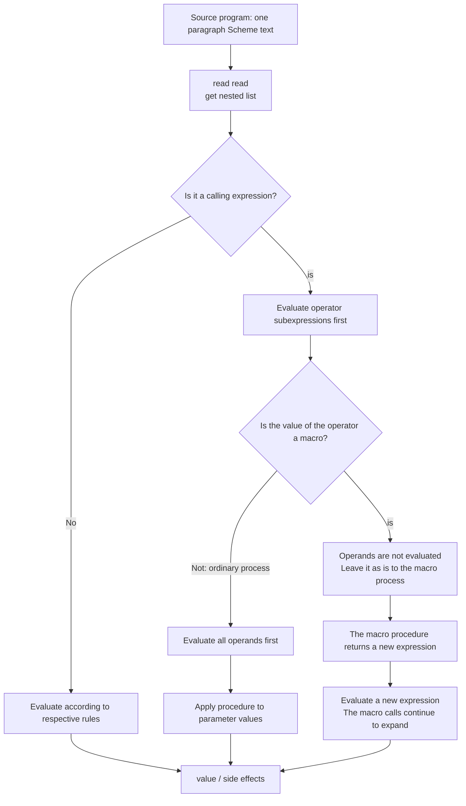

> **Editor's note**: The item "evaluation will not be expanded until the macro is called" in the figure corresponds to the evaluator implementation of 61A Scheme. A real Lisp compiler usually expands the entire program during compilation. Expansion and evaluation are two separate stages; the results of both are the same, but "when to expand" will affect the timing of side effects.

| criterion | process | Macro |
| :--- | :--- | :--- |
| what to receive | parametric **value** | of operands **expression** |
| When parameters are evaluated | Before calling, all requests must be completed | No automatic evaluation, the timing is determined by the macro body |
| What to return | a value | an expression, which is then processed by an evaluator |
| Does the caller need to write quotes? | Don't write | Don’t write (the benefit of macros); you need to write only when you are writing the process |
| when to execute | Executed once per call | Each occurrence is expanded first and then evaluated. |
| Can the language be changed? | No, it only affects the value | Can, which is equivalent to adding a special form |

`twice`  The harvest is split into two layers. A simple layer: it performs the "reference first, then evaluation" procedure for the caller. Deep layer: `twice`  is no longer a procedure, but a new special form - it does not evaluate the parameters first, which means **The function body of the macro has complete control over "when and how many times it is evaluated"**.`twice`  It can be evaluated twice, or not evaluated once, or the evaluation can be postponed until a certain condition is met.

### 7.4 check: Let the failed assertion speak for itself

The second example starts with a simple requirement: I want to add some self-tests to the program. Writing in procedure is straightforward, but it has a flaw: **It only knows that it failed, not why it failed**. one on the screen  `failed`, the reader has to go back and count the tests. The root cause is that the information has been lost: the parameters received by the process are  `#f`, that once wrote  `(> x 0)`  The expression has long since been evaluated and disappeared. To tell "which assertion failed", you must evaluate **before** Get that expression.

```scheme
(define (check value)
  (if value 'passed 'failed))

(define-macro (check expr)
  (list 'if expr ''passed ''failed))
```

Macro is putting together a new piece of code: `if`  The judgment part of the  `expr`, the two branches are two symbols that are "double referenced". Why two quotation marks? Because the generated code has to be evaluated again: `''passed`  Expand into reference form and get the symbol when evaluating  `passed`  itself, rather than looking up a name called  `passed`  variable.

```scheme
(define-macro (check expr)
  (list 'if expr ''passed (list 'quote (list 'failed expr))))

scm> (check (> x 0))
(failed (> x 0))
```

The instructor did a more direct manual shelling here: **put  `define-macro`  Replace with  `define`**, the same function body immediately changes back to an ordinary procedure. To actually run it, the caller has to write quotes to block the evaluation, and then write  `eval`  Evaluation result. The expanded code can be read verbatim:

```scheme
(if (> x 0) 'passed '(failed (> x 0)))
```

### 7.5 for macro: wrap map into new syntax

The third example is "making grammar". The lecturer's opening sentence consisted of only two sentences: "Scheme does not  `for`  statement. Now it has. "


```scheme
scm> (for x '(2 3 4 5) (* x x))
(4 9 16 25)
scm> (map (lambda (x) (* x x)) '(2 3 4 5))
(4 9 16 25)
```

For the first edition  `list`  Layer by layer:

```scheme
(define-macro (for sym vals expr)
  (list 'map (list 'lambda (list sym) expr) vals))
```

```scheme
(define-macro (for sym vals expr)
  `(map (lambda (,sym) ,expr) ,vals))
```

The expressions expanded by the two pieces of code are exactly the same. The difference lies in readability: in the quasi-quoted version, the number of parentheses and the nested shape of the generated results **Write directly in the source code**.

What's really worth noting is that the "evaluation timing" of the three holes in the same template is completely different:

| hole | What is filled in? | Who will handle it after expansion? | Number of evaluations |
| :--- | :--- | :--- | :--- |
| `,sym` | placeholder symbol written by the caller  `x` | fall on  `lambda`  The parameter bits only accept symbols and will not be evaluated. | 0 |
| `,expr` | expression  `(* x x)` | fall on  `lambda`  The function body of , each element is evaluated once | List length times |
| `,vals` | expression  `'(2 3 4 5)` | fall on  `map`  The second parameter, evaluates once to get the list | 1 |

Macro can be mixed with three ingredients——**Will evaluate**, **is never evaluated and is just a placeholder symbol**, and **Evaluates each element once**. This third is the latest thing: when writing procedures, "when the parameters are evaluated" was not a debatable issue at all, now it has become a design choice of the macro author.

The courseware leaves a question at the end: Why not define it as a version in which "values do not need to be quoted"? The lecturer did not expand on the class.

> **Editor's note**: The answer is "Yes, but the cost is high". Change the values position in the generated code to quoted literals. `(for x (2 3 4 5) (* x x))`  It can really run, but in this case values can only be "literal values that can be written directly as list data": `(for x lst (* x x))`  with  `(for x (list 1 2) (* x x))`  All will fail. The standard writing method requires the caller to write quotation marks precisely because the quotation marks are in **call point** Just mark "this is data" clearly.

### 7.6 trace: tracing of a call

The fourth example changes the question: I want to see what each layer calls when a recursive process is executed. This problem was solved in Python earlier in the course, and the tool was a decorator.

```python
def trace(fn):
    def traced(n):
        print(f'{fn.__name__}({n})')
        return fn(n)
    return traced

@trace
def fact(n):
    if n == 0:
        return 1
    return n * fact(n - 1)
```

> **Editor's note**: The subtitles only describe how this decorator works ("define a new version with the same return value, print the function name and parameters, and then call the original function"). The courseware does not have this page.

The output is almost the same as the Python version, but **Separation of concerns is gone**. In Python, `fact`  The definition of does not mention tracking at all. `trace`  The definition of does not mention factorial a word. Here, the "tracked fact" is handwritten, and the person who wrote it must know that the recursion falls back  `fact`  the name.

To make it universal, the first thing is to do the four things of "save name, redefine, call, restore"**pack into an expression**. Scheme's container is  `begin`:

```scheme
(begin
  (define original fact)
  (define (fact n)
    (print (list 'fact n))
    (original n))
  (define result (fact 5))
  (define fact original)
  result)
```

Why does this have to be done by a macro? Because the whole process needs to be  `(fact 5)`  evaluated **before** Hands-on: Install the print layer, load it, and remove it. If written as a procedure, the parameters  `(fact 5)`  The evaluation has been completed before entering the process body, and the printing layer has no chance to exist at all.

```scheme
(define-macro (trace expr)
  (define operator (car expr))
  `(begin
     (define original ,operator)
     (define ,operator (lambda (n)
                         (print (list ',operator n))
                         (original n)))
     (define result ,expr)
     (define ,operator original)
     result))
```

The lecturer inserted a demonstration of "run the wrong one first" here. The first time I run it, printing does happen, but what appears on the screen is not  `(fact 5)`, but  `fact`  this **process object**. Where is the lesion?  `'`: If written as  `(list ,operator n)`, the expansion result is  `(list fact 5)`, location  `fact`  will be evaluated into a procedure, so the procedure object is printed. After adding quotation marks, the expansion result becomes  `(list 'fact 5)`, printed out is the symbol itself. What to print is  `fact`  this **symbol**, instead of  `fact`  this **process object**.

The difference between Scheme version and Python version is that **Tracked objects**: Python's decorator determines "whether this function will be tracked from now on". The answer is  `def`  It was fixed at that moment; Scheme's  `trace`  The macro determines "whether this call is tracked." In the same program, it can be tracked this time and not tracked next time, and it can also be automatically restored after tracking.

| criterion | Python decorators | Scheme’s trace macro |
| :--- | :--- | :--- |
| Object of action | function object | Source code for a calling expression |
| Effective scope | The entire function, forever | This time the call |
| when to decide | `def`  time (when writing code) | every time it is called |
| Can I switch midway? | No, unless the function is rewritten | Yes, you can switch back to untracked at any time |
| new names introduced | local function  `traced`, not leaked | overall situation  `original`, `result`, will stay in the global frame |
| Where to point when an error occurs | original function body | expanded code |

### 7.7 Cost: Macros work at the source level

> **Editor's note**: This kind of problem of "the name introduced by the macro interferes with the name of the caller" is called hygiene. A true Lisp implementation provides macros with  `gensym`  A class of tools that: each expansion generates a new symbol that will never conflict with the user's name. Scheme 61A does not have  `gensym`, so this in class  `trace`  Macros are strictly speaking unsanitary - they only happen to be used in a  `fact`  work in an environment.

In the final analysis, there is only one profit from macros: **Grammar**.`for`, `check`, `trace`  Neither allows the program to calculate values that could not be calculated before. They make the intention more straightforward. To determine whether macros should be used, the question is "Is what is missing here a syntax or a function?"

### 7.8 Exercise: Two-version expansion of fact-expr and repeat

There are three exercises left in the courseware, but they are not carried out in class.


The first requires rewriting the procedure "returning the factorial expression of n" using a quasi-reference:

```scheme
(define (fact-expr n)
  (if (<= n 1) 1 `(* ,n ,(fact-expr (- n 1)))))
```

Fill in the two blanks respectively  `,n`  with  `,(fact-expr (- n 1))`. The first hole uses a comma because  `n`  is a formal parameter, it should be replaced with the number when calling; a comma is used in the second hole because it needs **recursive call** `fact-expr`  Get the next level expression instead of  `(fact-expr (- n 1))`  The tree remains intact in the fruit. The base case returns the number  `1`, when filled in the hole, it naturally becomes  `(* 2 1)`.


```scheme
(define (repeated-expr n expr)
  (if (zero? n) nil (cons expr (repeated-expr (- n 1) expr))))

(define-macro (repeat n expr)
  (cons 'begin (repeated-expr (eval n) expr)))
```


The third requirement is to change the way of expansion: no longer put  `expr`  Copy  `n`  parts, but generates a recursive process.

```scheme
(define (repeated-expr n expr)
  `((define (repeater k)
      (if (= k 1) ,expr (begin ,expr (repeater (- k 1)))))
    (repeater ,n)))

(define-macro (repeat n expr)
  (cons 'begin (repeated-expr (eval n) expr)))
```

Review §1.14 The one written using procedures  `repeat`: It accepts a k and a process, and relies on recursive calls to complete the repetition. two  `repeat`  The names are the same and the effects are similar, but the difference is essential - what you get in the process version is **process**, so it can only be called over and over again at runtime; what the macro version gets is **expression**, so it can copy this code n times or generate a loop. **This is the distinction between "using procedural abstraction" and "using syntactic abstraction": the former changes how values flow, and the latter changes what the code looks like.**

## Engineering Laws and Design Checklists

*(Reference time: 00:17:39 – 00:21:19｜Lecture 28; 00:22:57 – 00:24:42｜Lecture 29; 00:42:06 – 00:47:51｜Lecture 30; 00:26:05 – 00:29:45｜Lecture 31;00:30:43 – 00:32:48｜Lecture 32;00:14:57 – 00:18:04｜Lecture 33;00:25:13 – 00:28:51｜Lecture 34)*

The following nine criteria are criteria that can be memorized and used directly in the examination room and design discussions. The sentence after each item is the reason, and the reason is more important than the conclusion.

- **The grammar has several expressions, and the evaluation function has several branches.**  The dispatch table is not an implementation detail, but a mirror of the language definition; missing a branch is missing a syntax.
- **The "specialness" of a special form is reflected in the order of evaluation, not in the way it is written.** `quote`  No evaluation at all, `if`  Only seek one branch; implement them as a "find all subexpressions first" interpreter, and continue  `(if #t 1 (/ 1 0))`  Can't get through it.
- **Process = code + birth environment.** `LambdaProcedure`  In the three fields of `env`  It is the only field that is invisible but determines everything; lexical scope is not a convention, but the line of code "the parent frame of the new frame is taken from the procedure object".
- **The binding falls on the current frame and looks up along the parent frame.**  These two items together explain the status of occlusion and global frames; `define`  Never write to the parent frame, `lookup`  Always look local first.
- **The two skeletons of the interpreter are the mutual recursion of eval and apply.**  The recursion terminates only when both sides have basic conditions; when writing the interpreter, first draw these two sides, and then fill in the branches in the box.
- **The syntax that can be omitted is omitted in the reading stage.** `'x`  expand into  `(quote x)`, `(define (f x) ...)`  expand into  `(define f (lambda (x) ...))`, the macro call expands into a normal expression. The fewer shapes the core evaluator knows, the smaller and easier it is to verify.
- **Errors are handled at the layer that understands them, and echoes are concentrated at the outermost layer.** `calc_apply`  Knowing "how many parameters this operator requires", REPL only knows "this sentence cannot be calculated"; put  `raise`  Sprinkle it on the implementation layer and put  `except`  If it is collected in the loop layer, the errors seen by users will be consistent.
- **The criterion for tail calling is "whether there is anything left to say after the call."**  Calculating the actual parameters requires a frame, and collecting the return value also requires a frame; the tail call happens to be the call in which the latter is empty. The space account must be calculated separately: the overhead of the data structure itself and the overhead of control flow.
- **Macros change how code is generated, not how values are calculated.**  The criterion is "What is missing here is a syntax or a function"; the cost of macros is hygiene and wrong positioning, and the gain is that the intention is written directly into the source code.

## Module knowledge overview (Mermaid mindmap)

*(Reference time: 00:00:02 – 00:00:23｜Lecture 28; 00:00:41 – 00:02:11｜Lecture 29; 00:14:31 – 00:20:33｜Lecture 30; 00:20:07 – 00:24:10｜Lecture 31;00:06:48 – 00:11:01｜Lecture 32;00:01:11 – 00:02:25｜Lecture 33;00:05:26 – 00:07:09｜Lecture 34)*

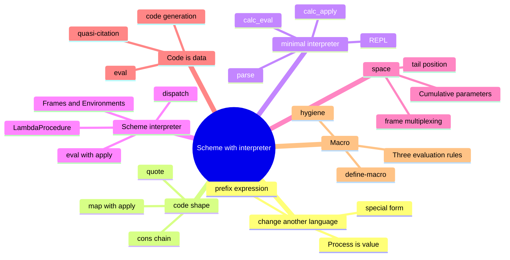

If you only have twenty minutes, it is recommended to read it like this: first look at the prefix notation in §1.3, and the prefix notation in §3.6  `calc_eval`, the eight-step path in §4.11, and then look at the tail position in §5.4 and the three macro rules in §7.3. The five parts combined are less than twenty pages, but they cover the two must-answer questions of "how is language implemented" and "how is language extended".

## Provenance and permission

*(Reference time: 00:00:02 – 00:00:23｜Lecture 28; 00:00:01 – 00:00:11｜Lecture 34)*

This module is organized based on the following materials: UC Berkeley CS61A (Structure and Interpretation of Computer Programs, Fall 2024) Lectures 28–34 classroom video and original English subtitles from Station B; six official courseware  `27-Scheme_1pp.pdf` (15 pages), `28-Scheme_Lists_1pp.pdf` (13 pages), `29-Calculator_1pp.pdf` (15 pages), `30-Interpreters_1pp.pdf` (14 pages), `31-Programs_as_Data_1pp.pdf` (9 pages), `32-Macros_1pp.pdf` (11 pages), and the 77 illustrations in the text are all page-by-page renderings (Lecture 32 is an elective topic and there is no official courseware, so there are no illustrations). The course homepage is  `cs61a.org`, textbook written by John DeNero  *Composing Programs*, Project 4  `scheme.py`  Skeleton and  `ucb`  Modules are distributed with the course.

The copyright of the course and courseware belongs to the UC Berkeley CS61A teaching team; this article is a secondary compilation for Chinese readers, used for learning and teaching discussions, and does not replace the original course. Any content that is not shown in the lecturer's dictation or in the courseware screen will be replaced by  `编者说明`  Highlights include: historical background of Lisp and Scheme, `car`/`cdr`  The etymology of , modern use cases for dynamic scoping, the term meta-loop evaluator, `do_if_form`  The schematic realization of `calc_apply`/`read_eval_print_loop`  The reconstructed version, the implementation method of tail call (frame multiplexing and trampoline), `gensym`  and hygiene, and answers to six discussion questions. If these supplements conflict with official materials, the official materials shall prevail.

In terms of layout, the time anchor point at the beginning of each chapter is taken from the real start and end time of the corresponding paragraph in the subtitles, and the chapters across chapters are divided into sections according to the lecture time; `mermaid`  Figures and tables are self-made for this article and are used to replace hand-drawn environment diagrams, box-pin diagrams and interactive demonstrations in the classroom. The codes in the article are transcribed verbatim according to the courseware screen (including the original indentation and comments of the courseware). The codes typed out on the spot in the video are restored according to the subtitles and dictation. The differences have been marked in the text.

## Attached: Slide index for this module

*(Reference time: 00:00:02 – 00:31:11｜Lecture 28; 00:00:00 – 00:24:42｜Lecture 29; 00:00:01 – 00:47:51｜Lecture 30; 00:00:02 – 00:29:45｜Lecture 31;00:00:00 – 00:32:48｜Lecture 32;00:00:00 – 00:18:04｜Lecture 33;00:00:01 – 00:28:51｜Lecture 34)*

| page | Lecture times | content | Appear location |
| :--- | :--- | :--- | :--- |
| 1 | lec28 | Title page: Scheme | §0.1 |
| 2 | lec28 | Announcements page: Announcements | §0.4 |
| 3 | lec28 | Section page: The Scheme Programming Language | §1.1 |
| 4 | lec28 | Four forms of expressions: basic expressions and combinations | §1.2 |
| 5 | lec28 | Definition process: none  `return`, the value is the last expression | §1.6 |
| 6 | lec28 | Python and Scheme calling expressions, `and`  short circuit | §1.7 |
| 7 | lec28 | No  `for`/`while`: Use recursion to implement iteration | §1.8 |
| 8 | lec28 | Section page: Writing Scheme | §1.9 |
| 9 | lec28 | Exercise: `a-plus-abs-b`  Fill in the blanks at the operator position | §1.9 |
| 10 | lec28 | Sectioned pages: Lambda Expressions | §1.10 |
| 11 | lec28 | `lambda`  Syntax, two equivalent definitions, operators can be combined | §1.10 |
| 12 | lec28 | What Would Scheme Do: Two ways  `lambda`  Application questions | §1.10 |
| 13 | lec28 | Section page: More Special Forms | §1.11 |
| 14 | lec28 | `cond`  with  `begin`: `if-elif-else`  Two ways of writing | §1.11 |
| 15 | lec28 | `let`: Behavioral differences between temporary binding and Python assignment | §1.12 |
| 1 | lec29 | Title page: Scheme Lists | §0.1 |
| 2 | lec29 | Announcements page: Announcements | §0.4 |
| 3 | lec29 | Sectioned pages: Turtle Graphics | §1.14 |
| 4 | lec29 | Drawing Stars: `star`  Process and Pentagram | §1.14 |
| 5 | lec29 | Section page: Lists | §2.1 |
| 6 | lec29 | `cons`/`car`/`cdr`/`nil`  Diagram with box stitch | §2.1 |
| 7 | lec29 | List Construction: Six sets of examples of three construction paths | §2.3 |
| 8 | lec29 | Recursive construction: `split`  first edition | §2.4 |
| 9 | lec29 | Recursive construction version 2: use  `let`  Return two paragraphs at a time | §2.4 |
| 10 | lec29 | Section page: Symbolic Programming | §2.5 |
| 11 | lec29 | Quote: `quote`, symbols and combinations of references | §2.5 |
| 12 | lec29 | Section page: List Processing | §2.6 |
| 13 | lec29 | Four built-in list processing procedures and  `beats`/`rhythm` | §2.6 |
| 1 | lec30 | Title page: Calculator | §0.1 |
| 2 | lec30 | Announcements page: Announcements | §0.4 |
| 3 | lec30 | Section page: List Processing | §2.7 |
| 4 | lec30 | Four built-in list procedures (replay next lecture) | §2.7 |
| 5 | lec30 | `cons-count`  Exercises with Box Stitch Charts | §2.7 |
| 6 | lec30 | Section page: Exceptions | §3.1 |
| 7 | lec30 | `reduce`: Combining pairs of sequences into one value | §3.2 |
| 8 | lec30 | Sectioned Page: Scheme-Syntax Calculator | §3.4 |
| 9 | lec30 | Calculator syntax: numbers, calling expressions, and pair representation | §3.4 |
| 10 | lec30 | Calculator semantics: evaluation tree of four operators and 61 | §3.5 |
| 11 | lec30 | Section page: Evaluation | §3.6 |
| 12 | lec30 | `calc_eval`  Line-by-line comparison of implementation and language semantics | §3.6 |
| 13 | lec30 | `calc_apply`: Four operators and four combination methods | §3.7 |
| 14 | lec30 | Sectioned pages: Interactive Interpreters | §3.8 |
| 15 | lec30 | Six Steps to the Read-Eval-Print Loop | §3.8 |
| 1 | lec31 | Title Page: Interpreters | §0.1 |
| 2 | lec31 | Announcements page: Announcements | §0.4 |
| 3 | lec31 | Section page: Lab 10 Review (before recording) | §4 |
| 4 | lec31 | Operand evaluation and pair representation | §4.2 |
| 5 | lec31 | Section page: Interpreting Scheme | §4.2 |
| 6 | lec31 | Interpreter Structure: Basic Cases and Recursion of Eval and Apply | §4.7 |
| 7 | lec31 | Section page: Project 4 | §4.7 |
| 8 | lec31 | Project 4’s Pair representation and two evaluation functions | §4.9 |
| 9 | lec31 | Discussion question: Symbols of define expressions, two formats | §4.8 |
| 10 | lec31 | Section pages: Special Forms | §4.1 |
| 11 | lec31 | Scheme evaluation: three types of expressions, four combination templates | §4.1 |
| 12 | lec31 | Sectioned pages: Lambda Expressions | §4.5 |
| 13 | lec31 | lambda evaluation as user-defined procedure with three fields | §4.5 |
| 14 | lec31 | Frame and environment: parent frame, `lookup`/`define`, g and f1 | §4.6 |
| 1 | lec33 | Title page: Programs as Data | §0.1 |
| 2 | lec33 | Announcements page: Announcements | §0.4 |
| 3 | lec33 | Section page: Programs as Data | §6.1 |
| 4 | lec33 | Expressions are lists: `list`  structure, `eval`  Evaluate | §6.1 |
| 5 | lec33 | Discussion question: Automation is simply nested  `*` | §6.5 |
| 6 | lec33 | Discussion question: Print subexpressions in the order they are evaluated | §6.5 |
| 7 | lec33 | Sectioned pages: Quasiquotation | §6.6 |
| 8 | lec33 | `quote`/`quasiquote`/`unquote`  with  `make-add-lambda` | §6.6 |
| 9 | lec33 | Discussion question: Write using quasi-citations  `fact-expr` | §6.8 |
| 1 | lec34 | Title page: Macros | §0.1 |
| 2 | lec34 | Announcements page: Announcements | §0.4 |
| 3 | lec34 | Sectioned pages: Quasiquotation | §7.1 |
| 4 | lec34 | Quasi-reference definitions, hole opening examples and  `make-add-lambda` | §7.1 |
| 5 | lec34 | Discussion question: Generating factorial expressions using quasi-references | §7.8 |
| 6 | lec34 | Section page: Macros | §7.3 |
| 7 | lec34 | `twice`  Macros, three evaluation rules | §7.3 |
| 8 | lec34 | Discussion questions: `repeat`  with  `repeated-expr`  fill in the blanks | §7.8 |
| 9 | lec34 | Discussion questions: `repeat`  recursive writing | §7.8 |
| 10 | lec34 | Section page: For Macro | §7.5 |
| 11 | lec34 | `for`  Macro  `list`  Questions about edition, quasi-quotation, rewriting and quotation marks | §7.5 |

The six coursewares total 77 pages, and each page appears exactly once in the text; the page numbers are independently numbered according to the time of each lecture, so there are six sets of page numbers starting from 1 in the table. Lecture 32 is an elective topic and there is no official supporting courseware, so it is not included in this list.
