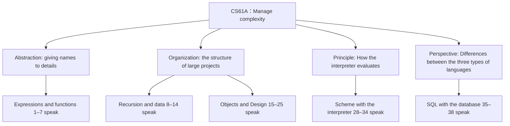
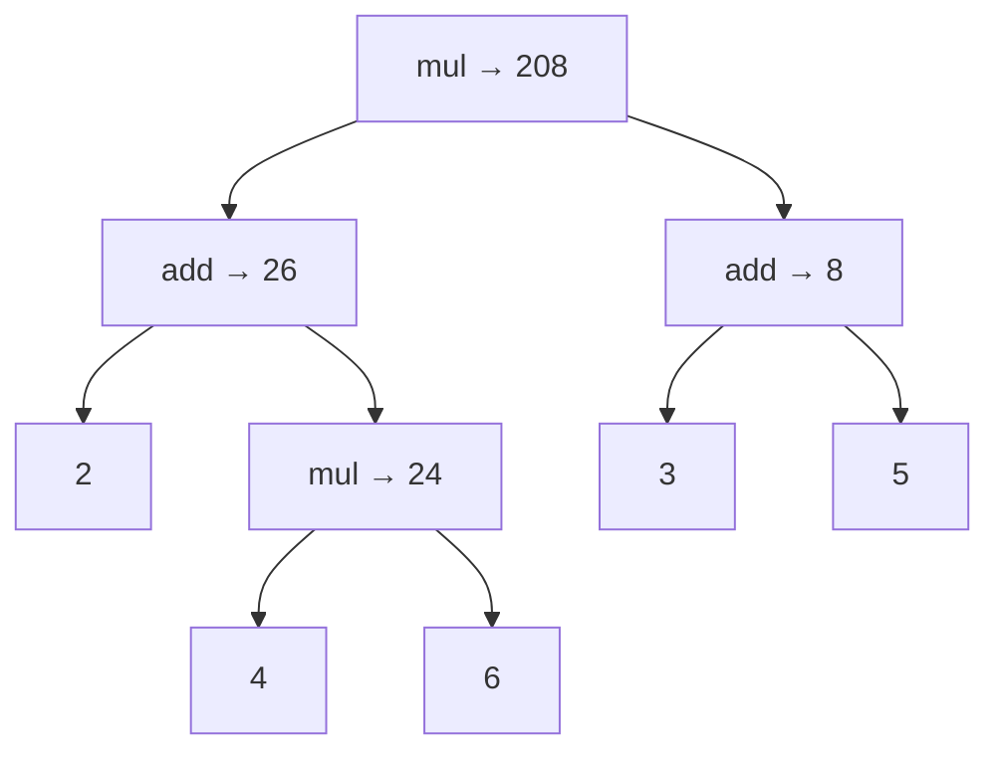

> **courses**: UC Berkeley CS61A · Structure and Interpretation of Computer Programs(Fall 2024)
> **This lecture**: Lecture 1 ｜ 13:29 ｜ Station B P 1 ｜ [Original video](https://www.bilibili.com/video/BV1sy411z7nA?p=1)
> **courseware**: `01-Welcome_1pp.pdf` (22 pages, official PDF, page-by-page renderings see text illustrations)
> **subtitles**: Original English subtitles from Station B; this note is a reconstruction of Chinese writing, not a sentence-by-sentence translation.
> **Copyright**: The copyright of the course and courseware belongs to the UC Berkeley CS61A teaching team; this article is a secondary arrangement for learning purposes

## Quick overview of this lecture

- **Mastered**: Can write a line of code that can run in a certain language, know  `+`  And parentheses are operators in mathematics.
- **Main line of this lecture**:
    - Why two sets of parallel classes must be aligned by video, and the division of labor among video, textbooks, and on-site classes;
    - Mathematics has invented its own notation for each operation over the centuries, and the function call notation  `f(x)`  is their unified form;
    - How does the interpreter calculate the value of a nested expression by repeatedly executing only the three steps of "evaluating the operator, evaluating the operand, and applying the function";
    - The expression tree draws "how did 208 come from" into a picture and explains the iron law that "parameters are always values".
- **Key conclusions**: Calling expressions does not require priority. The bracket structure itself is the evaluation order; the same set of evaluation procedures can be applied to more complex nesting unlimited times.

*(Reference time: 00:00:00 – 00:00:12｜Lecture 1)*

## 1. Two sets of classes, one common teaching content

*(Reference time: 00:00:12 – 00:00:28｜Lecture 1)*


CS61A in Fall 2024 has two sets of classes at the same time: Professor John DeNero and Professor Rao each teach one. The two sets of classes share the same batch of assignments and the same test papers—since the assignments are exactly the same as the exams, there can be no difference in caliber of teaching content. The technical form of the entire course is determined by this: **Record the most standardized parts into videos and share them with both classes; the live classes can be carried out separately**.

DeNero’s statement is very straightforward: the method is to publish lecture videos (like this one) and share them between the two sets of classes; in the on-site class, the two lecturers each do some examples in more depth and discuss what to think when doing the questions, but the core content of the course is conveyed through these videos.

### 1.1 Why "alignment" depends on video recording

The same assignment and the same test paper means that the differences can only appear in the teaching process. There are two ways to suppress this difference: one is for the two lecturers to prepare the lesson verbatim together, and the other is for everyone to watch the same video. The cost of the former increases linearly with the number of lecturers, and it is difficult to verify the consistency; the latter is recorded once, can be played back repeatedly, and can be revised year by year. The price is that the immediacy of live classes is partially transferred - students must manage their own viewing progress, and questions can only be asked in class or on the forum. This course chose the latter and used "on-site classes to review only the most important parts" to recover part of the on-site value.

The lecturer also conveniently described this as a benefit: two sets of classes are not a burden, but "twice as many faculty involved", which is a better experience for the entire semester.

### 1.2 Lecturer Team

Page 2 of the courseware is the teaching team shared with Data C88C this semester, and on the right is the cartoon logo of CS61A / Data C88C. The division of labor and Q&A time of the three lecturers are as follows.


| name | Division of labor and research | Q&A time and place |
|---|---|---|
| John DeNero | Taught CS61A at least once a year since 2011; studies language models and how people use them | Tuesday 13:00–15:00, Warren 101B |
| Shm Almeda | PhD student in the Department of Computer Science, studying human-computer interaction; Art/Tech | Monday 15:00–16:00, location to be determined |
| Jedi Tsang | Data C88C Co-lecturer (with DeNero), giving several guest lectures in 61A this semester; Political Science + Computing Class of 2023, EECS Master | Thursday 13:00–15:00, location to be determined |

What is worth remembering about this table is not the names; **Q&A time is a publicly committed fixed resource**: For a few hours each week, anyone can go directly to the instructor and ask questions, no appointment required.

### 1.3 Guest Lecturer’s Research: Computing Ethics Education

Page 3 is the research introduction of Jedi Tsang, which is placed after "Lecturer Team" to explain what a guest lecturer cares about.


The definition given on the page is: Computing ethics refers to understanding how the technologies we create impact society and—more crucially—how social values prioritize the development of certain technologies. Recent research has centered on the course CS195 (Social Impact of Computer Technology). The core question is "Do students care? How can we make them care?". The line chart on the right counts the frequency of two types of codes (cultural competency codes and cultural stance codes) appearing in course materials on a weekly basis.

> **Editor's note**: This page does not have a corresponding explanation in the video at 13:29 of this lecture, and the content is organized according to the original text of the courseware. The broken line reading in the figure is the frequency calculated by week. The unit and statistical caliber are not marked in the courseware, so no further explanation will be given here.

## 2. Video first: the core content is all in the video

*(Reference time: 00:00:28 – 00:00:55｜Lecture 1)*


"You are expected to watch these videos before watching the live class." The first class in the first week is an exception - in the beginning, there is no need to preview anything; but from next time on, the regular rhythm is: watch the video first, then enter the class, so that you can keep up.

### 2.1 Division of labor among three levels of content

Page 5 of the courseware breaks down the course materials into three layers and clarifies their respective weights.


| criterion | video | textbook | Live class |
|---|---|---|---|
| Coverage | All course content | Highly overlapped with video content | Review only the most important parts, not everything |
| Positioning | A must read before class | Concise and useful, can be read carefully and consulted | Practice examples and discussion of problem-solving strategies |
| Rhythm | 5–10 minutes each, can be paused and rewatched | self-paced | Every Monday, Wednesday and Friday |
| cost of absence | Can't keep up with class | lack of another more precise expression | Lack of immediate feedback and example demonstrations |

The division of labor at the three levels has an easily overlooked meaning: **Live classes intentionally do not cover all content**. The original text of the courseware says "Review the most important content in the video (but not all)". This is not an omission, but a design - on-site time is limited and should be spent on things that the video cannot do: examples, stuck points, and strategies.

### 2.2 The relationship between textbooks and videos

textbook  `composingprograms.com`  Described as "concisely written and useful", the content is very similar to the video. Similarity is not redundancy: the video is played linearly and passes after the lecture; the textbook can be skipped and the precise expression of a term can be checked back. The way the two work together is "video builds intuition and teaching materials calibrate the wording."

## 3. Short videos, song lists and practice loops

*(Reference time: 00:00:55 – 00:01:49｜Lecture 1)*


The videos for each lecture are a playlist on YouTube, with the first video usually being the announcement (like this one), and the remaining videos leading into the course content. The length of a single video is usually between 5 and 10 minutes, but there are sometimes several videos during a day's main class; today is a special case. After this lecture, there is only one content video, and the norm in the future is four or five videos.

There is another thing that the lecturer specifically stated in advance: not all of these videos were recorded this year. Every time the course content is updated, only part of it will be re-recorded, so "if you find that I am younger than I am now in some videos, this is the reason." This sentence may seem like idle writing, but it actually tells students: **There are versions of the video**, don’t be surprised to see style changes.

> **Editor's note**: The video of this lecture is only 13:29 long. It is an announcement video at the beginning of the semester. It only talks about the organization method in the first two minutes and the Expressions in the second half. The official courseware has a total of 22 pages. The exercise arrangement, discussion process, course selection suggestions and course policies on pages 6-18 are not expanded page by page in this short video. The following sections are organized according to the original text of the courseware. The time annotation of this chapter is based on the actual video paragraphs corresponding to the topic in this lecture.

### 3.1 Practice closed loop: problem solving is the way to learn to solve problems

The first sentence on page 6 is the pedagogical statement for the entire course: **Problem solving is an effective way to learn to solve problems** (Solving problems is an effective way to learn how to solve problems). This sentence talks about methods, not slogans - it directly determines what the curriculum will look like.

- **Lab**: Monday/Tuesday, attendance is mandatory (except mega section).
- **Discussion**: Wednesday/Thursday/Friday, attendance also required.
- **The common function of both**: Prepare for weekly homework and 4 larger programming projects.
- **Office hours**: One-to-one on-site homework Q&A, starting next week; "office hours" is the customary name for Q&A periods in California.

Why does the practice session take up so much class time? Because "understanding a piece of code" and "writing this code" call for two different abilities. The former only requires identification, while the latter requires retrieval, combination, and debugging. The curriculum fixes the latter to a fixed period of time each week. The cost is that students' time is tied up in the curriculum, and the benefit is that there is someone to accompany them on the road between "understanding" and "being able to write" that is easiest to give up.

### 3.2 What does the discussion class look like?

Page 7 is a self-deprecating comparison of photos: "Expectation" on the left (a circle of students discussing around a small table, a lecturer standing next to a whiteboard), and "Reality" (a large classroom full of people) on the right.


The goal below the photo is very restrained: provide a good environment where people can learn to solve problems through practice and discussion. "I've seen groups of California students do amazing things" - this is what instructors expect from seminars and the reason for their existence.

The detailed organization of the seminar is given on page 8.


- Grouping: Each group has 6-7 people, with a group number, classroom and time; there are usually 2-5 groups in a classroom, so be sure to identify which group you belong to.
- Facilitator: Most discussion sessions have a teaching assistant present, and others access the teaching assistant via a Zoom room.
- Materials: A worksheet filled with examples and instructions for groups to work on together.
- The point: not to finish these questions, but to learn how to solve them **Similar** question.
- Scoring: Discussion questions are not scored and you do not have to complete them all.
- Equipment: Bring your own laptop or tablet.

The most critical of these items is the combination of the fourth and fifth items: no scoring + no need to finish, so that the focus can be shifted from "finishing" to "learning". Once scored, the discussion degenerates into copying answers.

### 3.3 Question channels

Page 9 only has a big question mark in the middle of the page, and three channels are listed below (Ed is divided into private posts and public posts).


| channel | suitable question | Note |
|---|---|---|
| Ed private message | Issues involving privacy such as your own code and grades | Access to all teaching assistants and lecturers |
| Ed public post | Concept questions, question ideas | Visible to all students, others can benefit too |
| `denero@berkeley.edu` | Things that only the lecturer can handle | Don't be surprised if the lecturer asks you to post your question to Ed. |
| `cs61a@berkeley.edu` | Curriculum Affairs | Will be distributed to several teaching assistants |

> **Editor's note**: The courseware only says "Don't be surprised I'll ask you to ask questions on Ed" without explaining the reason. A reasonable explanation is that an open question can allow one answer to serve the whole class, but this is the editor's speculation and not the actual words of the class.

## 4. What is this course about? Should you take it? What are the rules?

*(Reference time: 00:01:51 – 00:02:02｜Lecture 1)*

Curriculum policies and course selection suggestions are the largest part of this courseware, but the teaching value is most easily underestimated. They answer the same question: What kind of person does this course want to train you to be?

### 4.1 Three main lines

Page 10 summarizes the course content into three items, with the first two items each expanded into sub-items.


- **About managing complexity**: Mastering abstraction; organizational techniques for complex programs.
- **About getting started with programming**: A complete understanding of Python basics; using large projects to demonstrate how to manage complexity; how computers interpret programming languages.
- **About different kinds of languages**: Python, Scheme and SQL.

The first two are the two major themes of the course: one talks about "how to write a program so that it does not get out of control", and the other talks about "how to write a program and let the machine execute it". The third point is the perspective that runs through the whole course - the different appearances of the same set of computational ideas in three languages. Abstractions are means, projects are tests, interpreters are principles, and multilingualism is a perspective.



> **Editor's note**: The branches and lecture intervals in the above picture are the course map organized by the editor according to the chapter structure published on the course website. Page 10 of the courseware itself only has three lines of text (the first two lines each have sub-entries), and there is no such picture.

### 4.2 Should I take this course?

Page 11 is a section page, and page 12 gives the original words from the syllabus.


- CS61A **There are no formal prerequisites for programming classes**, but...
- Taking this class without any programming experience is usually quite difficult;
- Most 61A students already have considerable programming experience;
- Students with no programming experience generally take longer to complete assignments and tend to receive lower final grades.

The syllabus also provides a suggestion page  `cs61a.org/articles/advice/`. The wording of this passage is noteworthy: it does not set a threshold, it just makes the price clear - "no prerequisites" does not mean "zero-based friendly", the difference is the few extra hours per week.

### 4.3 Two alternative paths

For students with zero knowledge or different goals, the courseware provides two alternative courses.


| criterion | CS 61A | Data C88C | CS 10 |
|---|---|---|---|
| Suitable for whom | Already have some programming experience | I want to aim for CS and take Data 8 at the same time. | No programming experience at all |
| Content coverage | All 4 units | 3 of 4 units | Introduction to Programming + Python Basics |
| Number of items | 4 | 2 | No big projects |
| Does it contain "program running program"? | Contains | Omitted, also omitting some advanced Python topics | Does not contain |
| Is it enough to connect to CS 61B? | is | is | Preparing for 61A/C88C |

CS10 is positioned as the "first course from scratch": a graphical building block programming environment developed by Berkeley (you can see the building block script editor on the right side of the page), now used by courses and online learners around the world; the course lays the foundation for 61A and Data C88C. More information is at  `cs10.org`.

Data C88C (formerly known as CS 88) stands for Computational Structures in Data Science: based on 61A, but covering only 3 of the 4 units - 2 projects instead of 4, enough to continue on to 61B, omitting the unit "How Programs Run Other Programs" and some advanced Python topics. Originally designed for students taking Data 8 at the same time, it is now offered as a stand-alone course; the space is full, but expansion will be considered if demand is sufficient.

When comparing these three courses, the real criterion is not "which one is easier", but "what you lack is experience or time": if you lack experience, choose CS 10, if you lack time, choose C88C, and if you don't lack both, you can go directly to 61A.

### 4.4 Two main lines of curriculum policy

Page 15 is a section page, and page 16 condenses the policy into two words.


- **Learning**: How to learn, including rules for assignments, collaboration, grading, and deadlines.
- **Community**: How to get along, including respect and reporting harassment.

The details are all there  `cs61a.org/articles/about/`. The following two pages expand on the most problematic areas in these two main lines.

### 4.5 Collaboration Boundaries: What counts as academic misconduct

Page 17 is about collaboration and the attitude is clear: **Collaboration is highly encouraged**, but the boundaries must be clear.


Encouraged parts:

- You can discuss anything with your classmates and learn from them;
- Some projects allow pairs to be completed.

Behavior constituting academic misconduct:

- Don't look at other people's code. There are only three exceptions: during lab class, between project partners, and after you have solved the problem independently.
- Don't tell others the answer. You can point out what is wrong, explain how to correct it, or give a relevant example.
- Don’t ask a tool like ChatGPT to write the code for you.
- Plagiarizing project answers will cause someone to fail the class.

| behavior | Is it allowed? | criterion |
|---|---|---|
| Discuss ideas with others and draw sketches together | allow | The code is still written by myself |
| Look at your partner’s code (project pairing) | allow | Both parties are authors of the same submission |
| After solving it yourself, look at other people’s writing methods | allow | Complete independently first |
| Send your own (or someone else’s) code to your classmates | not allowed | The other party skipped thinking |
| Let AI directly generate code for submission | not allowed | The output is not your own |

This set of boundaries has a unified criterion: **Have you thought about the code yourself?**. So "read it after you have solved it" is allowed - at that time you are looking at other people's writing, not the answer.

### 4.6 Opposition to harassment and discrimination

Page 18 changes the topic, but remains on the main thread of Community.


- Derogatory comments targeting a specific gender, race or ethnicity are not acceptable.
- The Berkeley Principles of Community writes: Reaffirm the dignity of every person and strive to maintain a just community that does not tolerate discrimination and hatred.
- The EECS Department Mission states: Diversity, equity, and inclusion are core values of the Department of Electrical Engineering and Computer Science, and departmental excellence can only be achieved by faculty, students, and staff who share these values.
- Reporting channel: If you want to remain anonymous but want the lecturer to know, use  `denero.org/feedback.html`; To notify the department, use the EECS Student Climate & Incident Reporting Form or contact Susanne Kauer directly.

## 5. Expression: Write down a calculation

*(Reference time: 00:02:04 – 00:03:10｜Lecture 1)*


After finishing the course administration, let’s get to the main topic. "Okay, on to course content. We're going to talk about expressions."

A definition is given on page 20 that will be referenced again and again throughout this course:

> An expression describes a calculation and evaluates to a value. (An expression describes a computation and evaluates to a value.)

### 5.1 Expressions are not an invention of computer science

The instructor deliberately took a step back: Expressions are not something exclusive to computer science. Mathematicians have been describing how to combine different numbers for a long time, and have invented a whole set of notations for this purpose:

- Add two numbers: write a plus sign between the two numbers;
- Division: another thing entirely - writing one number on top of another;
- Square root: put the number into "a little house";
- Take the sine of an angle: write  `sin`. No  `sign`, `sign`  It’s too long to write, so  `sin`.

These statements are made in jest, but point to a serious fact: **Each operation takes on its own convenient form**. The plus sign is horizontal, division is vertical, square roots are bracketed, and trigonometric functions are prefixed. Humans can read it because humans have memorized every set of conventions.

### 5.2 A page full of marks

Page 20 draws these marks side by side, with the middle one  `f(x)`  Encircled by a light gray box - this is the turning point of this lecture.


The symbols that appear on the page are: `6/23`, `sin π`, `log₂ 1024`, `2¹⁰⁰`, `7 mod 2`, `Σ`  Sum, `√3493161`, `C(69,18)`, `|−1869|`, `lim`. They describe different calculations and are written in different ways.

| mark | Describe the calculation | Written uniformly as function calls |
|---|---|---|
| `6/23` | divide two numbers | `truediv(6, 23)` |
| `sin π` | Sine of angle | `sin(pi)` |
| `log₂ 1024` | base 2 logarithm | `log2(1024)` |
| `2¹⁰⁰` | Exponentiation | `pow(2, 100)` |
| `7 mod 2` | Take the remainder | `mod(7, 2)` |
| `Σ`  Add from 1 to 100 | Sum | `sum(range(1, 101))` |
| `√3493161` | square root | `sqrt(3493161)` |
| `C(69,18)` | number of combinations | `comb(69, 18)` |
| `｜−1869｜` | absolute value | `abs(-1869)` |
| `lim` | limit | There is no corresponding function |

> **Editor's note**: The function names and writing methods in the third column of the table are added by the editor to demonstrate what they will look like after being "unified into function calls"; on page 20 of the courseware, only the mathematical symbols on the left are drawn and marked with gray boxes  `f(x)`. Limit is not an operation that can be calculated in one go, so there is no directly corresponding function - this is also the editor's explanation.

## 6. Function call notation: one form covers all forms

*(Reference time: 00:03:20 – 00:03:52｜Lecture 1)*

frame  `f(x)`  The purpose of is immediately clarified: the function call token is for all the above tokens **generalize** (a generalization over all of the others), and it is the only form required.

So computer scientists stopped using superscripts and subscripts, no longer used vertical bars, no longer used "little houses", but wrote everything as function calls:

- `f(x)`: A function, a parameter;
- `f(x, y)`: One function, two parameters, and so on.

The benefits of this change go beyond "good looks":

- **Rule set becomes smaller**: The interpreter only needs to implement the evaluation of one expression, and does not have to write a set of rules for addition, division, and square root;
- **Priority disappears**: The nested structure of brackets itself shows who calculates first, and there is no need to memorize "multiplication and division first, then addition and subtraction";
- **variable number**: The same function name can be followed by two parameters or five parameters.


Page 21 puts this into an assertion: **All expressions can use function call notation**. Assertions cannot be made just by mouth, so the bottom of the page says (Demo) - then open the interpreter to verify it.

## 7. Interpreter: expression goes in, value comes out

*(Reference time: 00:03:56 – 00:07:52｜Lecture 1)*


The startup method is to enter in the terminal  `python3`, get a "very recent version" of the language interpreter. The interpreter provides a prompt: it waits for you to enter an expression and then displays the value.

```python
>>> 2000 + 15
2015
```

This is the simplest pair: an expression, a value. There are two values in the input expression (`2000`  with  `15`), combined by addition; displayed  `2015`  It is the result of the combination. The lecturer conveniently called Python "a very powerful calculator": it can multiply multiple numbers, nest parentheses, perform divisions, and has special exponentiation symbols (reducing the upper notation "cubic power" to  `**`), and you can add more at the end.

### 7.1 Forms of calling expressions

```python
>>> max(2, 4)
4
>>> max(1, 2, 3, 4, 5)
5
```

The form of the calling expression is: first write the name of the function to be called (here it is  `max`), and then write "those expressions that give parameters" in parentheses, separated by commas. When you see "a function + parentheses + other expressions separated by commas", you know that this is a calling expression.

The first line says it takes two arguments, the second line says it takes five—the number of arguments is not fixed, which is one of the benefits of token generalization.

### 7.2 Operators themselves are also functions

```python
>>> from operator import add, mul
>>> add(2, 3)
5
>>> mul(2, 3)
6
```

`+`  The number is written between the two expressions, and  `add`  is a **function**. It is not always available, you have to write a line first  `import`  statement to take it over; the instructor calls this step "just a minor inconvenience" because writing it once is enough. After getting it, `add(2, 3)`  It's just an ordinary calling expression. `mul(2, 3)`  Yes.

This short paragraph is more important than it seems: it proves that "addition" is not an irreplaceable thing in the grammar, it is just a function value.

### 7.3 Calling expressions can be nested

```python
>>> add(2, mul(4, 6))
26
>>> mul(add(2, mul(4, 6)), add(3, 5))
208
```

The second line is constructed like this: First "add 2 to the result of 4 times 6". I was going to stop there, but I said that I wanted to multiply something more - so I multiplied by "the result of 3 plus 5", and got 208.

### 7.4 Why don’t you welcome infix writing?

Infix notation puts the operator between two expressions. `2 + 3 * 4`  Just typical. With infixes, "life is not that simple": you have to know that multiplication comes before addition in order to understand how this expression will be evaluated. And the priority rule is **The promise in mind**, not the information carried by the expression itself.

Calling expressions doesn't have this problem: the nested structure itself tells you which to multiply first and which to add last.

So the lecturer stated: This course is very biased towards call expressions (we're very pro-call expression), and we want to understand how it works. This sentence is the introduction to the second half of this lecture - from "can write" to "how to calculate".

> **Editor's note**: in the above code block  `>>>`  The prompts and output are compiled by the editor according to the subtitles; the values clearly given by the subtitles are only  `2015`, `max(2, 4)`  Got  `4`, `max(1, 2, 3, 4, 5)`  Got  `5`, `add`/`mul`  Got  `5`/`6`, nested  `208` (its middle value  `26`  Also appears in subtitles). `**`, `/`, parentheses and other writing methods are the forms of operations in Python demonstrated by the instructor. Specific values ​​that do not appear in the subtitles will not be filled in.

## 8. Anatomy and evaluation procedures of calling expressions

*(Reference time: 00:07:59 – 00:09:47｜Lecture 1)*

First use an "anatomy" to name each part clearly.

- There must be parentheses in the calling expression;
- The entire calling expression also contains other expressions;
- Everything before the opening bracket is called **operator expression**(operator sub-expression);
- Those expressions separated by commas inside parentheses are called **operand**(operands);
- The so-called "subexpression" means just "an expression within an expression";
- Operators and operands themselves are expressions—just very simple expressions: `3`  Evaluate to get 3; `add`  Evaluate to find the function that adds two numbers.

| Terminology | meaning | in  `mul(add(2, mul(4, 6)), add(3, 5))`  in |
|---|---|---|
| expression expression | How to write a calculation | The entire line is an expression |
| sub-expression sub-expression | expression inside expression | `add(2, mul(4, 6))` |
| operator subexpression operator | The part before the opening brackets is evaluated to get the function | `mul` |
| operand subexpression operand | Comma-separated expressions in parentheses | two  `add(...)` |
| parameter argument | The value obtained by evaluating the operands | `26`  with  `8` |
| value value | The result of expression evaluation | `208` |

### 8.1 Three-step evaluation procedure

The calling expression is always evaluated in the same way, it is a set of **Evaluator**(evaluation procedure):

1. Evaluate operator subexpressions to obtain a function;
2. Evaluate each operand subexpression in order to obtain each parameter;
3. Apply this function to these parameters to get the value of the entire expression.

To paraphrase the lecturer's original words: first evaluate the operator and each operand subexpression (in this order), then get the function from the operator, get the parameters from the operands, and then apply the function to the parameters. Anyway——**Evaluate all subexpressions first, then apply the function**.

### 8.2 Why this matter deserves elaboration

Taking these three steps just to add up 2 and 3 seems like overkill. The reasons given by the lecturer are: **The same set of evaluation procedures can be reused many times**, used to evaluate much more complex nested expressions. A programming language works precisely because it applies these evaluators "programmatically, over and over again."

There are two words to note in this sentence. "Procedure" means that it is a rule that can be executed mechanically and does not require on-the-spot judgment; "repeated" means that it can be applied to itself - this is the starting point of the expression tree and the recursion later.

## 9. Expression Trees: A Complete Anatomy of 208

*(Reference time: 00:09:52 – 00:13:25｜Lecture 1)*

Back to that nesting. Python just says 208 "like magic". Magic needs to be taken apart.

### 9.1 Step by step

1. The outermost layer is  `mul(...)`, is the calling expression. Evaluate the operator first: get the multiplication function.
2. The first operand is  `add(2, mul(4, 6))`, which is also a calling expression. It doesn’t matter, there are ready-made procedures – try it again.
3. This layer first evaluates the operator  `add`, get the addition function; then evaluate the operands  `2`, get 2.
4. The other operand is  `mul(4, 6)`, or call expression. Let’s do it again: evaluation  `mul`  Get the multiplication function, `4`  with  `6`  We get 4 and 6; this time all operands are evaluated and multiplication is applied: `24`.
5. now  `add(2, mul(4, 6))`  All operands of have a value (2 and 24), and addition is applied: `26`. This is the value of the first operand.
6. The second operand remains  `add(3, 5)`: Evaluate to get the additive functions, 3 and 5, apply addition: `8`.
7. Both operands become values (26 and 8), and the outermost multiplication is applied: `208`.

### 9.2 Tree diagram

Draw these seven steps, that is **expression tree** (expression tree) - It is a diagram of "everything that happens inside the computer when it evaluates this nested expression."



Each node on the tree is a (sub)expression, and replacing a subtree with its value is one step in evaluation: `mul(4, 6)`  This subtree first becomes  `24`, `add(2, 24)`  become again  `26`.

> **Editor's note**: The expression tree was drawn live by the lecturer during the demonstration, not a page of the courseware; the tree above and the intermediate values on the arrows were redrawn by the editor in the order of evaluation described in the subtitles, and the structure is consistent with the lecturer's description.

### 9.3 Two observations to remember

**First, the order of evaluation ensures "getting the right information at the right time."**  You must first know that the left side is 26 and the right side is 8, so that there is something to multiply in the last step of multiplication. The order is not a matter of style, but an issue of information dependency: the parent node has to wait for the child nodes to be calculated.

**Second, parameters are always values.**  The lecturer specifically emphasized this point at the end: what is passed to the function is a value, not an expression. The last multiplication involved the values 26 and 8, not  `add(2, mul(4, 6))`  This string of characters; 26 multiplied by 8 gives us 208, which is the value of the entire expression.

Together, these two observations can be seen as one sentence: evaluation is the process of shrinking an expression tree into a value, and the order of shrinkage is uniquely determined by the structure of the tree.

> **Editor's note**: The depth of the expression tree determines how many levels of recursion the interpreter needs to have. CPython's default upper limit of recursion levels is about a thousand levels, so extremely deeply nested expressions will throw  `RecursionError`; This point is not covered in this lecture and is supplementary knowledge in subsequent courses and engineering practice.

## Summary

*(Reference time: 00:12:10 – 00:13:25｜Lecture 1)*

- **Unified notation is to reduce the number of rules**: Function call notation is not an aesthetic preference. It compresses "addition, division, and square root each have their own writing methods" into one writing method, so the interpreter only needs a set of evaluation rules, and the user does not need to memorize priorities.
- **The evaluation procedure has only three steps**: Evaluate the operator to get the function, evaluate the operand to get the parameters, and apply the function to the parameters. Complex expressions are not a special case, it's just that this procedure is used over and over again.
- **The bracket structure is the order of evaluation.**: To determine who counts first, look at the nesting depth rather than the operator table; the parent node depends on the value of the child node, so the child is calculated first and the parent is calculated later.
- **Parameters are values, not expressions**: When a call occurs, the result passed in must be the evaluated result; this rule will appear repeatedly in the subsequent high-order functions and environment models.
- **Expression trees are a universal language**: Any nested evaluation can be drawn as a tree, and the shape of the tree gives the evaluation dependencies; replacing the subtree with its value is a step in evaluation.
- **The curriculum itself is the teaching method**: The video is responsible for definition and demonstration, the live class is responsible for examples and strategies, and the lab and discussion classes are responsible for turning "understanding" into "writing" - the three layers each perform their own duties, and replacing any one layer will cause the content to be lost.

## Attached: Slide index for this lecture

*(Reference time: 00:00:00 – 00:13:25｜Lecture 1)*

| page | content | Appear location |
|---|---|---|
| 1 | Welcome to CS 61A Title Page | §1 |
| 2 | Lecturer team and Q&A time | §1.2 |
| 3 | Guest Lecturer's Research: Computing Ethics Education | §1.3 |
| 4 | About the Course section page | §2 |
| 5 | Division of labor between videos, textbooks and live classes | §2.1 |
| 6 | Practice session: Lab, discussion, assignments and projects | §3 |
| 7 | Discussion Class Expectations and Reality | §3.2 |
| 8 | How the discussion class is organized | §3.2 |
| 9 | Question channel | §3.3 |
| 10 | Three main lines of the course | §4.1 |
| 11 | Should you take CS 61A Section Page | §4.2 |
| 12 | Course selection reminders in the syllabus | §4.2 |
| 13 | CS 10: Zero Basics | §4.3 |
| 14 | Data C88C: A streamlined version of the CS61A | §4.3 |
| 15 | Course Policies Section Page | §4.4 |
| 16 | Two main lines of policy | §4.4 |
| 17 | Collaboration and academic misconduct | §4.5 |
| 18 | Fight Harassment and Discrimination | §4.6 |
| 19 | Expressions section page | §5 |
| 20 | various expression tokens, `f(x)`  framed | §5.2 |
| 21 | Assertion: All expressions can be written as function calls | §6 |
| 22 | Demo: Verify in the interpreter | §7 |
