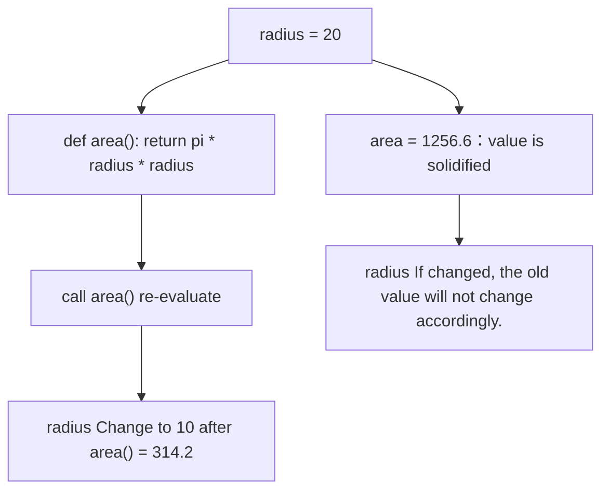
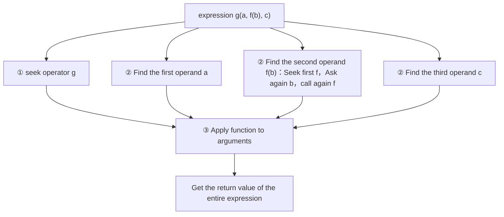
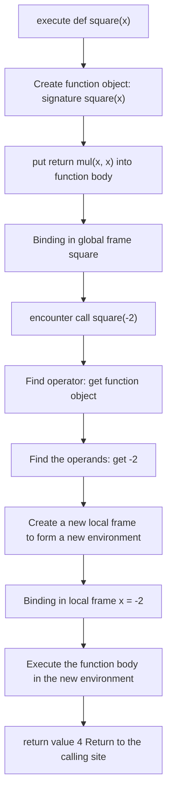
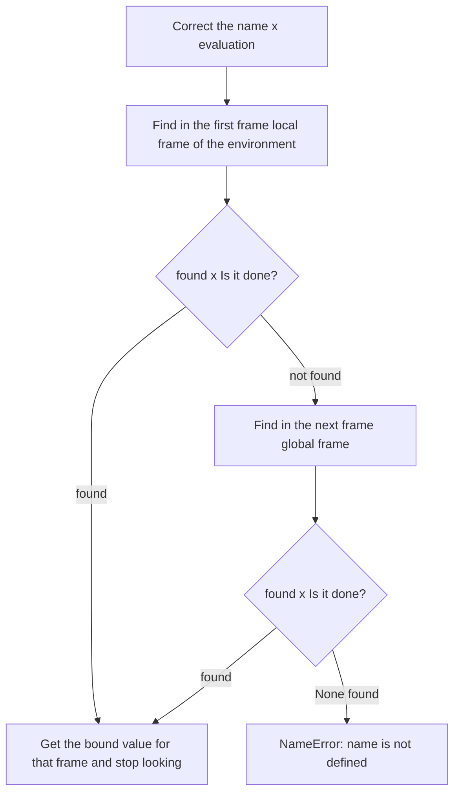
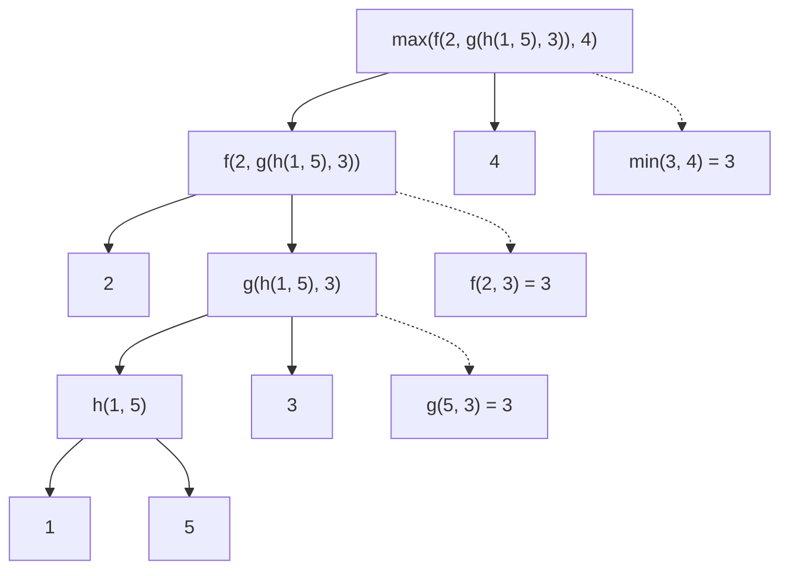
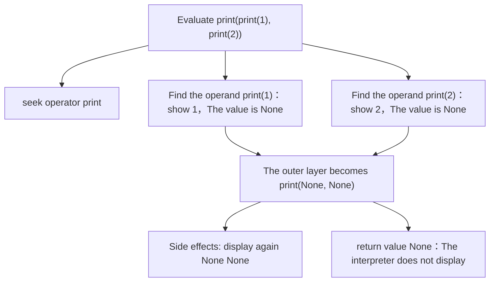
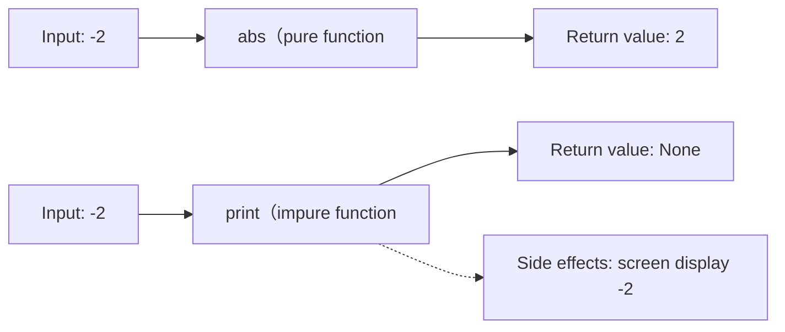

> **courses**: UC Berkeley CS61A · Structure and Interpretation of Computer Programs(Fall 2024)
> **This lecture**: Lecture 2 ｜ 40:20 ｜ Station B P 2 ｜ [Original video](https://www.bilibili.com/video/BV1sy411z7nA?p=2)
> **courseware**: `02-Functions_1pp.pdf` (18 pages, official PDF, page-by-page renderings see text illustrations)
> **subtitles**: Original English subtitles from Station B; this note is a reconstruction of Chinese writing, not a sentence-by-sentence translation.
> **Copyright**: The copyright of the course and courseware belongs to the UC Berkeley CS61A teaching team; this article is a secondary arrangement for learning purposes

## Quick overview of this lecture

*(Reference time: 00:00:00 – 00:00:13｜Lecture 2)*

- **Mastered**: Python can be used as a calculator; `>>>`  Type an expression later and its value will be displayed; `max`, `abs`, `pow`  It is a built-in function; `from math import pi`  Constants can be taken in.
- **Main line of this lecture**:
    - There are only three sources of the name——`import`, assignment statement, `def`  Statement; assignment only saves "value", not "expression".
    - `def`  During execution, only one function object (signature + packed function body) is created, and not a single line of the function body is executed.
    - Calling a user-defined function = opening a new local frame + binding formal parameters in the frame + executing the function body in the new environment.
    - Name evaluation = Search from near to far in the current environment (a series of frames), and stop when found.
    - What appears on the screen may just be a side effect; `print`  The return value is  `None`, `None`  will not be displayed automatically.
- **Key conclusions**: The key to understanding all nested calls is the order of evaluation - first find the operator, then find the operands from left to right, and finally "apply"; the function body is re-evaluated every time it is called, which is why it can replace "expired variables".

## 1. Before class starts: Homework arrangements and reasons to “get started as early as possible”

*(Reference time: 00:00:14 – 00:01:10｜Lecture 2)*

The video of this lecture is a pre-class material prepared for Lecture 2. According to the course schedule, students should first watch these videos and then learn these topics in more detail in class. So before entering the function, deal with the course affairs first.

**work rhythm**. Homework 1 will be released this Friday (August 25) and will be due next Thursday. The reason why homework is given so early is very straightforward: "Using the knowledge learned in class to solve problems" itself is the core of this course, and the earlier you practice it, the better. The advice given by the lecturer is: take a look at the assignment as soon as it is posted, and do what you can do first; don’t panic if you get stuck, this is normal - you can go to the office hours next week to find someone for help, you can also post in the Ed discussion area, or meet up with a few classmates to discuss in a study group. These pathways all take time, so the earlier you start, the more time you have available before deadlines and the better your chances of keeping up with the course.


This arrangement means the division of labor between the video and the classroom: the video is responsible for explaining the concepts clearly, and the classroom is responsible for using them. The following content will repeatedly return to the criterion of "use" - each rule must be able to explain a real interaction record, not just memorize it.


## 2. Names and assignments: Where does Python’s memory come from?

*(Reference time: 00:01:13 – 00:05:48｜Lecture 2)*

### 2.1 Names do not exist in a vacuum

Is π readily available? In the interactive interpreter type  `pi`, what you get is an error message:

```python
>>> pi
NameError: name 'pi' is not defined
```

It’s not that Python doesn’t know π;  `pi`  the name. Most names are not visible by default and must be imported first. `from math import pi`  is a sentence, meaning "put  `pi`  This name becomes available":

```python
>>> from math import pi
>>> pi
3.141592653589793
```

After importing, `pi`  It can be combined with any other value. The same import statement can also bring in functions, such as the sine function  `sin`:

```python
>>> from math import sin
>>> sin(pi / 2)
1.0
```

Here is an easily overlooked fact: the instructor did not tell Python "π is equal to three point one four", `pi`  The value is found by itself. Built-in functions and built-in names follow this rule - they exist in the interpreter, but are referenced by name.

> **Editor's note**: The above interaction record is repeated according to the lecturer's demonstration, and the output value is the actual result of Python 3; the lecturer only said "I got 1" orally, and did not read out the floating point number bit by bit.

### 2.2 Assignment statement: evaluate first, then bind


When the built-in names are not enough, you have to create your own names. The shape of an assignment statement is a name on the left and an expression on the right:

```python
radius = 10
```

The name on the left can be invented arbitrarily, and the expression on the right can be anything. The way Python handles it is: first find the value of the expression on the right, and then bind that value to the name on the left. So at this moment  `radius`  The bound value is  `10`, `2 * radius`  That’s it  `20`.

Already bound names can be used to bind other names. It is also legal to bind multiple names in one statement:

```python
>>> radius = 10
>>> area, circumference = pi * radius * radius, 2 * pi * radius
>>> area
314.1592653589793
>>> circumference
62.83185307179586
```

to here, `area`  with  `circumference`  The area and circumference of the circle with radius 10 are bound respectively. The key lies in what happens next: putting  `radius`  Change to 20, `area`  Will it change accordingly?

```python
>>> radius = 20
>>> area
314.1592653589793
```

No. `area`  is still 314, which is 10 × 10 × π, and  `radius`  Already 20 - the two are "out of sync". The reason is that the assignment saves **value**, no **expression**: The evaluation process  `pi * radius * radius`  Compressed into a number 314.159..., only this number is bound to  `area`; "`area`  used to be  `radius`  Definition of "This thing is not recorded anywhere.

A minimal version of the same phenomenon is given on page 4 of the courseware:


```python
>>> x = 2
>>> y = x + 1
>>> y
3
>>> x = 5
>>> y
3
```

`y`  is 3 instead of 6 because  `y`  Remember "3", not "x plus one". This slide uses both crossed out lines  `1 + 2 = x`, `x - 1 = 2`  Emphasis: The equal sign of the assignment statement is not a mathematical equal sign. It has no symmetry and cannot be reversed.

### 2.3 Names can also point to functions

The right-hand side of an assignment statement is not limited to numbers. built-in functions  `max`  It is also a value in itself and can be assigned:

```python
>>> f = max
>>> f(1, 2, 3)
3
```

There are three layers of things that need to be distinguished here: `f`  is a name, `max`  It's also the same name, and they point to the same "function" - the thing that really does the work, it accepts a number of actual parameters and gives the maximum value. A function object can have two names at the same time, `f(1, 2, 3)`  with  `max(1, 2, 3)`  Completely equivalent.

Names can also be rebound, at the cost of the old binding disappearing completely:

```python
>>> max = 7
>>> f(1, 2, max)
7
```

`f`  still points to the original  `max`  function, so  `f(1, 2, 7)`  Get 7 (this is exactly what the lecturer said "I did not destroy the original function, just let  `max`  to mean something else"). But if you want to recover at this moment  `max`  The original meaning of , there happens to be a name on the hand  `f`:

```python
>>> max = f
>>> max(1, 2, 3)
3
```

Finally, the "function version" of the operator is introduced. Common binary operators are  `operator`  There are corresponding function names in the module:

```python
>>> from operator import add, mul
>>> add(3, 4)
7
>>> mul(3, 4)
12
```

`add`  with  `+`, `mul`  with  `*`  It does the same thing, except that the former can be passed and assigned like an ordinary function - this property will really come into play when we talk about higher-order functions later.

At this point, the three ways to bind names are complete, and their differences are worth organizing into a table:

| criterion | `import`  statement | assignment statement | `def`  statement |
|---|---|---|---|
| where does the name come from | A name already in the module or interpreter | self-invented name | self-invented name |
| What is bound | existing value or function object | The value evaluated by the expression on the right-hand side | New function object |
| Can old bindings be overwritten? | can | can | can |
| Typical example | `from math import pi` | `radius = 10`, `f = max` | `def square(x): ...` |

> **Editor's note**: `add(3, 4)`  with  `mul(3, 4)`  The output of is the confirmed behavior of Python 3, the instructor only said in the demonstration "Now I can use  `add`  and  `mul`  These are the two names." The result was not read out.

## 3. Define functions: turn a calculation into a name

*(Reference time: 00:05:54 – 00:08:30｜Lecture 2)*

### 3.1 Why it’s worth stopping and taking a look

Before getting into the grammatical details, the instructor specifically asked the class to "appreciate this moment." As mentioned on the first day, the theme of this course is abstraction; and defining functions is the most powerful abstract tool.

The definition of abstraction is: giving a name to a complex thing and using it as a whole without caring about all its details. The assignment statement is the first form of abstraction - it names a value. But it can only name an "already calculated result". Once the dependent things change, the result will expire, as in the previous section  `area`  with  `radius`  out of sync.

A function definition is a stronger abstraction: it binds not a simple value, but an entire expression (or sequence of statements). Behind the name is no longer "number", but "the process of counting this number", so every time this name is used, the details really unfold.

### 3.2 `def`  Anatomy of a Statement

The general shape for defining functions is:

```text
def <name>(<formal parameters>):
    <body>
```

`def`  is a Python keyword; followed by the function name; listed in parentheses **parameter** (formal parameters), they are the names that will receive actual parameter values in the future; after the colon, a new line is indented, and the indented part is **function body**. In the most common case, the function body has only one sentence  `return`  Add a return expression.

in the first line  `def`  The part between the colon and the colon is called **function signature** (function signature). Its most important responsibility is to specify how many actual parameters this function requires: each formal parameter will be paired with an actual parameter value. The function body is all the indented code after the first line. It specifies what the function does; in its simplest form, it describes a calculation process, and this process will be **Re-evaluated on each call**.

### 3.3 The first function: square

```python
def square(x):
    return x * x
```

Got it  `square`, you can use it like a built-in function:

```python
>>> square(3 + 4)
49
>>> square(square(3))
81
```

`square(3 + 4)`  Find 7 first and then square it; `square(square(3))`  It's "square 3 squared." There is no difference in usage between custom functions and built-in functions - this is the purpose of abstraction: the caller only sees the signature and return value.

Functions can call the functions just defined, forming a thin layer of reuse:

```python
def sum_squares(x, y):
    return square(x) + square(y)
```

```python
>>> sum_squares(3, 4)
25
```

Returns the expression  `square(x) + square(y)`  It can also be written as  `add(square(x), square(y))`, both are equivalent. `sum_squares(3, 4)`  You'll get 9 and 16 first, and then add them together to get 25.

### 3.4 Use functions to solve the problem of "losing synchronization"

return to  `radius`  with  `area`  The old question: How can we make the area always follow the radius? The solution is to write the "algorithm" as a function instead of tying the "calculated number" to the name:

```python
def area():
    return pi * radius * radius
```

`area`  Now that we have a function, we use it via a call expression - this call expression just has no operands:

```python
>>> radius = 20
>>> area()
1256.6370614359173
>>> radius = 10
>>> area()
314.1592653589793
>>> radius = 1
>>> area()
3.141592653589793
```

whenever  `radius`  change, `area()`  Will read it again  `radius`  The current value is then calculated. The instructor summarizes this as the first important difference of this lecture: **The difference between a function and an ordinary name is that its return expression is re-evaluated each time it is called**--that is, every time it appears in a calling expression.



This picture compares two kinds of "naming" together: on the left is a one-time snapshot obtained by assignment, and on the right is the delayed calculation obtained by a function. The cost of the latter is that the calculation must be redone every time it is called, and the benefit never expires.

## 4. Expression evaluation model: operators, operands and nested calls

*(Reference time: 00:08:31 – 00:09:56｜Lecture 2)*

### 4.1 Four types of expressions

The video switches back to the courseware here and makes a summary: this course is concerned with "how expressions are evaluated into values."

There are currently only four types of expressions. The first three categories are **primitive expression**: Numbers (more precisely, number literals), names, strings. Strings represent text. This is only mentioned in passing in this lecture and will be discussed specifically later. The fourth category is **call expression**, the shape is: an operator, a pair of parentheses, the parentheses are the operands separated by commas:

```text
square(3 + 4)
```

Three facts make call expressions more flexible than they appear: there can be no operands (`area()`  is a legal call); the operand can be another calling expression (`square(square(3))`); the operator itself can also be an expression (`f`  Just the name, it evaluates to a function object).

| criterion | form | Example | Get the value |
|---|---|---|---|
| numeric literal | numbers written directly | `42` | The number itself |
| name | an identifier | `radius` | The binding value of this name in the current environment |
| string | Text surrounded by quotes | `"Go Bears"` | this string |
| call expression | Operators plus parentheses and operands | `square(3 + 4)` | the value returned by the function |

### 4.2 Evaluation order

There are only three steps to evaluate a call expression, but the order cannot be messed up:

1. Find the operator and get a function object.
2. Evaluate each operand from left to right to get the actual parameter value.
3. Apply this function to these argument values to get the return value.



The "left to right" rule will have dramatic consequences later in this lecture: when the operand itself has side effects (e.g.  `print`), the order of evaluation directly determines what appears first on the screen. As you will see in verse 8, `print(print(1), print(2))`  The output order of is entirely determined by this rule.

### 4.3 A question used to trap people

After explaining the rules, the lecturer gave a question, using the binding rules from the previous section, except that the names overlapped each other:

```python
f = min
f = max
g, h = min, max
max = g
max(f(2, g(h(1, 5), 3)), 4)
```

The question leader said that the answer was one of 1, 2, 3, 4, or 5, and asked to pause the video and do the math by himself. Don’t scroll down in a hurry – the difficulty of this question is not the function call, but who is tied to each name at the moment: `max`  has been re-bound, `f`  It was also covered once, `g`  with  `h`  It is bound at the same time in the third statement.

> **Editor's note**: The courseware does not have a separate page for this question, and it is given orally in the video. The above code is restored to an equivalent expression according to the binding order and step-by-step evaluation process read by the instructor. The result of running in Python 3 is 3, which is consistent with the answer published by the instructor.

## 5. `def`  The execution process and the three-step method of function calling

*(Reference time: 00:10:00 – 00:19:29｜Lecture 2)*

### 5.1 What exactly happens when you define a function

`def`  is a two-line statement that defines a new function. The execution process of this statement is fixed to three steps:

1. Create a new function whose signature is the signature written in the first line.
2. Set the function body of this function to all indented code after the first line.
3. In the current frame, put  `def`  The name given by the statement is bound to this new function.

The wording of step 2 is one of the most critical aspects of this lesson: it says "Set the function body to..." and **No**"Execute function body". So execute  `def square(x): return mul(x, x)`  When , not a single multiplication occurs. The function body is just "squirreled away" (the lecturer's word is "squirreled away", which means hiding in a safe place) and will not be expanded until the function is called.

The lecturer made a digression here: squirreled is the longest monosyllabic word in English, and also said "I like squirrels." This metaphor is worth retaining because it accurately expresses  `def`  The behavior of - the function body is **be stored** code, not **be run** code.

### 5.2 Calling user-defined functions

Functions are useful because they can be called. Calling (apply) a user-defined function is also a fixed three-step process:

1. Add a local frame to form a new environment.
2. In this frame, bind the formal parameters of the function to the actual parameters.
3. The function body is executed in this new environment.

Comparing the previous section, we can see  `def`  and call each do half of the work: `def`  It is only responsible for "making", and calling is responsible for "running".

| stage | Trigger time | three things | side effects |
|---|---|---|---|
| execute  `def` | encounter  `def`  statement that time | Create a function object, load the function body, and bind the function name | The function body is not executed and no calculations are performed. |
| call function | evaluates to the calling expression each time | Create local frames, bind formal parameters, and execute function bodies | The function body actually runs and may produce a return value |

### 5.3 View a complete call in the environment diagram

Page 5 of the courseware is the section page of the "Environmental Map" section. The following two pages put the three-step method just now onto a specific picture:


The code used for demonstration is only four lines:

```python
from operator import mul
def square(x):
    return mul(x, x)
square(-2)
```

The instructor explained the evaluation process line by line. The first line  `mul`  Binds to the built-in multiplication function. The second line defines  `square`:Create function (signature is  `square(x)`), handle  `return mul(x, x)`  Collect it into the function body and put the name  `square`  Bind to the global frame - note that there is still no multiplication happening because the function body has not been touched yet. The third line and the second line belong to the same line  `def`  Statements are not executed individually. The fourth line is the calling expression, which actually starts the three-step method: find  `square`  Get the function object and find  `-2`  Get -2, then apply the function to -2 - open a new local frame,  `x`  Bind to -2, execute in new environment  `return mul(x, x)`, so  `mul(-2, -2)`  Get 4, return value 4 back to the calling site.


The annotations on this screenshot are worth reading one by one:

- **built-in functions** (built-in function) and **user defined function** (user-defined function) is almost the same. The only difference is that the custom function will change the formal parameters  `x`  Write it out - because it will be used soon.
- **partial frame** It is the product of step 1 of the three-step process. The title of the frame uses the original name of the function.  `square`, this is just a label for easy tracking, and the instructor clearly stated that it is "not that important".
- What really matters is the binding within the frame: the formal parameter  `x`  with the argument value -2.
- Also painted within the frame  **Return value 4**. This is not a binding of name and value, but an annotation in the environment graph to record "what was returned during this evaluation process."



### 5.4 Why signatures are important


The partial frame of the previous article was not drawn randomly, its shape is completely determined by the signature: `square`  This name is used to title the frame, `x`  It is the name of the binding in the frame. In other words, **The function signature contains all the information needed to construct the local frame**. This also explains the specification issue - why every time  `square`, there is exactly one in each frame  `x`: Because there is only one formal parameter in the signature.

> **Editor's note**: The courseware marks this rule as "version 1" because subsequent courses (conditional expressions, higher-order functions, nested definitions, etc.) will expand on it. For the purposes of this lecture, the three-step approach is sufficient to explain the entire demonstration.

## 6. Name lookup: environment is a sequence of frames

*(Reference time: 00:19:33 – 00:23:42｜Lecture 2)*

### 6.1 Why is environment needed?

The above three-step method has an implicit premise: Where should I find the names in the function body? Step 3 says "execute the function body in the new environment". This new environment refers to the sequence of "local frame + global frame".

The rule is: every evaluated expression is evaluated within the context of some environment. The reason is that the environment is the memory of the interpreter, which maintains the correspondence between names and values ​​- the environment knows what each name means. So far, there are only two possibilities in the current environment:

- There is only one global frame;
- A local frame followed by a global frame.

Note that the statement "followed by" itself contains sequence information.

### 6.2 Two sentences

The lecturer said these were "the two most important things to talk about today":

1. **The environment is a sequence of frames.**  Frames are bindings between names and values, which are the boxes in the environment graph; environments are sequences of those boxes.
2. **The result of a name evaluation is the value bound in the earliest "frame containing the name" in the current environment.**  Translated into operating steps: search frame by frame starting from the head of the sequence, and stop when found the first time.

in  `square`  To search for a name in the function body, first look at the local frame; if not found, look at the global frame. Built-in names (e.g.  `max`) is also in the global frame - just to keep the diagram simple, it is not drawn in the environment diagram.




### 6.3 Multi-layer frames: The same picture does not equal the same environment


Page 9 of the courseware explains "sequence" in more detail: a sequence consists of the "first frame" and the "remaining part of the sequence"; the global frame is always the last stop of the search. Drawn in the picture  `f1`, `f2`, global frame three layers, the line next to it points out the most common mistakes: **Although the three frames are drawn in the same picture, they are not necessarily in the same environment**. The environment is "the sequence of frames during a certain evaluation", and the graph is "all the frames that have occurred in the entire program life cycle" - the two are not the same thing.

### 6.4 Use formal parameters with the same name to verify search rules

The rules sounded abstract, and the instructor nailed it with an "intentionally messy" demonstration. The last time I used it was  `x`  As a formal parameter, this time use a name that no one else uses, but use the function’s own name:

```python
from operator import mul

def square(square):
    return mul(square, square)

square(-2)
```

`square`  It is both a function name and a formal parameter name. Will this still work? Yes, the result is 4. The reason depends on the environment when calling: execution  `def`  After that, in the global frame  `square`  Bound to the function object; when calling, a new local frame is created, and the frame title is still called  `square` (That's just a label), what's bound in the frame is  `square = -2` (formal parameter). Execute function body  `mul(square, square)`  when, `mul`  Finally found in the global frame; and  `square`  in **It has been found in the local frame**, so the search stops and will not reach the global frame at all - the function object in the global frame is "invisible" at this time.

The same identifier points to completely different things in two frames. This is not a bug, but a direct corollary of the "first found, stop" rule. It also shows that: it is not the function name that is destroyed, but the closer layer of binding covering the farther layer.

| Find location | order | what's inside | Processing of this lecture |
|---|---|---|---|
| partial frame | Stop 1 | Formal parameters, new binding names in the function body | Stop when found |
| global frame | Stop 2 | Module level assignment, `def`  The function name that comes out | Stop when found |
| built-in name | Not shown in the picture | `max`, `abs`, `print`  Wait | Courseware simplifies drawing into global frame |

> **Editor's note**: The real Python built-in name is stored in  `builtins`  In the namespace of the module, it is used as the layer after the global frame when searching (that is, the B in LEGB is often said). In order to simplify the drawing, the courseware incorporates it into the global frame. This simplification will be used in the remainder of this lecture.

## 7. Environment diagram: Draw the evaluation process of the interpreter

*(Reference time: 00:23:48 – 00:32:46｜Lecture 2)*

### 7.1 Why draw pictures?

The environment graph is a tool for tracking "what the Python interpreter is doing when executing a program." The lecturer emphasized a sentence that could easily be regarded as a metaphor: **The environment is a real thing**——It is the way the interpreter records "what the name means" and saves the memory of the binding between the name and the value; drawing just makes this real structure explicit.

Then there is a comment about the temperament of the discipline: A lot of the work of computer scientists is to draw some pictures of "boxes and arrows pointing to other boxes". This is a large part of this subject, so you might as well start practicing now.

### 7.2 How to read pictures

An environment graph is divided into two halves: code on the left and frames on the right. The code is ordinary Python code, with arrows indicating where execution is; frames record bindings between names and values.

- The gray arrow indicates "just executed";
- The red arrow indicates "the next step is to be executed", which means it has not happened yet.

The code part consists of statements and expressions: in the demonstration in Section 7.3, the first step was  `import`  statement, the second step is the assignment statement; in the frame, the name and value appear in pairs.

Then there is the most important constraint in this section: **In the same frame, names cannot be repeated, and a name can be bound to at most one value.**  front handle  `max`  When rebinding to 7, the old binding is thus permanently lost - this constraint is not a style suggestion but a direct consequence of the interpreter's data structure.

Instructor's Preview: These diagrams will become increasingly complex, but also increasingly necessary, because when many names are repeated in various ways, it is necessary to be able to keep track of what they refer to.

### 7.3 Let the tools do the drawing for you

Environment diagrams do not need to be drawn by hand. The instructor demonstrated the web interface of Online Python Tutor: paste the code in, click Visualize execution, the code will appear on the left and the frame will appear on the right; press the forward button to execute line by line, and you can see the consequences of each step.

The demo code is two lines:

```python
from math import pi
tau = 2 * pi
```

The first step is  `import`  statement, put  `pi`  Bind to its value; the second step is the assignment statement, putting  `tau`  bind to  `2 * pi`  result. The advice given by the lecturer is very practical: **When a program's behavior is confusing, stick it into Python Tutor**, which shows what exactly happens during execution.

### 7.4 Execution rules for assignment statements

Now that the environment picture is clear, we can say exactly what the assignment statement does: it changes the binding between the name and value in the frame.


Page 11 of the courseware explains the rules with three lines of code:

```python
a = 1
b = 2
b, a = a + b, b
```

After executing the first two lines, in the global frame  `a`  Yes 1. `b`  It's 2, and the red arrow stops on the third line. There are two execution rules for assignment statements:

1. Find the right side of the equal sign from left to right **all** expression.
2. Bind all names to the left of the equal sign to these resulting values (in the current frame).

According to this rule, first seek  `a + b`  Got 3, ask again  `b`  Get 2; then do the binding: `b`  Tied to 3. `a`  Tied to 2. The binding order in the second step does not affect the result, because the values on the right are all calculated in the first step - this is exactly  `b, a = a + b, b`  The reason why it can be written correctly at one time: all the old values used on the right side do not exist "change them first" `b`, then calculate  `a + b`"trap.


| criterion | Common misunderstandings | actual rules |
|---|---|---|
| Evaluation time | Calculate and bind at the same time, assign values one by one | First calculate all the values on the right side, and then bind them uniformly. |
| Evaluation order | Right to left or whatever | strictly from left to right |
| bind target | Overwrite the old value of the variable with the same name on the right | The old value is used on the right, the binding occurs later |
| variable exchange | Temporary variable required | `a, b = b, a`  Completed in one step |

### 7.5 Back to the question

Now that the rules are in place, it’s time to tackle the issues left by Section 4 head-on. The instructor put the entire thing into Python Tutor and observed it frame by frame.

Article 1  `f = min`: `f`  Points to the built-in  `min`. Article 2  `f = max`: `f`  Point to  `max`, since a name has at most one value, `f`  with  `min`  The old binding is "just gone". Article 3  `g, h = min, max`: `g`  point to  `min`, `h`  point to  `max`. The lecturer reminded here of an easily overlooked fact: `min`  There is only one function, `max`  There is only one function, just  `max`  This function object now has two names (`f`  and  `h`), `min`  has a name (`g`). Article 4  `max = g`: ask first  `g`  get  `min`  function, then name it  `max`  Tie to it - so"`max`"The name now refers to the function that takes the minimum value.

built-in name  `min`, `max`  Environment graphs are not drawn normally (otherwise the graph would be full), they are only drawn when they are rebound, which is exactly what happened.

The last big expression:

```python
max(f(2, g(h(1, 5), 3)), 4)
```

According to the rules of Section 4, first find the operator  `max`——At this moment it refers to the function that takes the minimum value; then find the two operands from left to right.

The first operand is  `f(2, g(h(1, 5), 3))`, which itself is a calling expression, so it recursively "find the operator first, then the operand":

- Operator  `f`  point to  `max`;
- The first operand is 2;
- second operand  `g(h(1, 5), 3)`: ask first  `h(1, 5)`, `h`  point to  `max`, get 5; call again  `g` (Point to  `min`), `min(5, 3)`  Got 3;
- call now  `max(2, 3)`, gets 3.

The second operand is 4. Finally call the "call  `max`  But the reality is  `min`"Function: `min(3, 4)`  Get 3 - the value of the entire expression.



| steps | subexpression | Evaluation result | Basis |
|---|---|---|---|
| 1 | `h(1, 5)` | 5 | `h`  still pointing to  `max` |
| 2 | `g(5, 3)` | 3 | `g`  point to  `min` |
| 3 | `f(2, 3)` | 3 | `f`  point to  `max` |
| 4 | `max(3, 4)` | 3 | name  `max`  has been tied to  `min` |

Answer 3. The value of this question is not in the arithmetic, but in the fact that it compresses three things into five lines of code: names can be rebinded, rebinding will lose the old binding, and the order of evaluation determines which binding is seen at each step.

## 8. `print`  with  `None`: The difference between return values and side effects

*(Reference time: 00:32:49 – 00:40:18｜Lecture 2)*


### 8.1 Looks the same, but is actually different

Type an expression in the interactive interpreter and it will display the value of the expression. knock  `print(-2)`, will also appear on the screen  `-2`. It looks the same, but what's happening is actually two different things.

Let’s look at the string first:

```python
>>> "Go Bears"
'Go Bears'
>>> print("Go Bears")
Go Bears
```

When evaluated directly, what you see is the quoted string value - it is the representation of the literal itself; `print`  After that the quotes disappear because  `print`  Content is shown rather than representation. The difference is  `None`  It’s more obvious:

```python
>>> None
>>> print(None)
None
```

direct evaluation  `None`, nothing appears on the screen; `print(None)`  but will type  `None`. The reason is that the interactive interpreter has a rule: it automatically displays the value of the input expression, whereas  `None`  is a special case - as the value of an expression, it is not displayed.

`print`  It can also display multiple values at once, separated by spaces, or print them directly.  `None`:

```python
>>> print(1, 2)
1 2
>>> print(None, None)
None None
```

### 8.2 Nesting  `print`

put  `print`  arbitrage  `print`  Here, the result will make many people guess wrong:

```python
>>> print(print(1), print(2))
1
2
None None
```

Did you guess it right? The lecturer asked the audience to think for three seconds before announcing the answer. To understand this output, use the evaluation order of Section 4, plus a line about  `print`  fact: it always returns  `None`.

1. seek operator  `print`, get the function.
2. Find the first operand  `print(1)`: It itself is a calling expression-seeking operator  `print`, find the operands 1. Application. generated when applying **side effects**: The screen displays 1; the value of this subexpression **value** is  `None`(`print`  always returns  `None`).
3. Find the second operand  `print(2)`:Similarly, the screen displays 2, value  `None`.
4. Now the outer call becomes  `print(None, None)`: Displayed when applying  `None None`, the return value is still  `None`.
5. The value of the entire expression is  `None`, while the interactive interpreter does not automatically display  `None`, so there is no additional output at the end.

appeared first on the screen  `1`  and  `2`  is produced in the process of finding the operands - what the lecturer means is: it appears there not because of which expression it serves as the value of, but because  `print`  What you do is make things appear. this is **side effects**: Not a value, just the behavior brought about by the call.



### 8.3 `None`  what is

`None`  Means "nothing": it marks that a function does not return anything. In Python it is called  `None`, there are other names in other languages. The rules are: **no explicit  `return`  function, the return value is  `None`**.

```python
def does_not_square(x):
    x * x
```

There is only one sentence in this function body  `x * x`, no  `return`. call  `does_not_square(4)`  won't get 16:

```python
>>> does_not_square(4)
>>> sixteen = does_not_square(4)
>>> sixteen
>>> sixteen + 4
TypeError: unsupported operand type(s) for +: 'NoneType' and 'int'
```

The call does work - 4 is multiplied by 4 - but the multiplied value is not returned. The function returns  `None`. And  `None`  The value of the expression is not displayed, so nothing can be seen after the first three prompts; the last line reports an error because that  `+`  trying to put  `None`  Adding the integer 4: Adding "nothing" to an integer, Python can't do it. in the error message  `NoneType`  That’s it  `None`  type, `int`  is an integer type.

> **Editor's note**: `does_not_square`  The courseware and subtitles are the lecturer's live demonstration and do not appear on the slides; the error text above is taken from the actual output of Python 3.

### 8.4 Pure functions and impure functions

At this point you can classify functions. **pure function** (pure function) only returns a value; **impure function** (non-pure function) In addition to the return value, there are side effects.

`abs`  is a pure function: it computes the absolute value of its argument, `abs(-2)`  gets 2, and it does **only** One thing is to return 2. The lecture demonstration uses "a closed pipe" to draw it: a value goes in, a value comes out, and nothing else happens in between. `pow`  It is also a pure function, except that the pipe has two entrances and one exit.

`print`  Completely different. It receives input and also returns a value (`None`), but it is not a closed system: in addition to returning a value, it has a side effect of displaying what is passed in. Pass in -2, the screen displays -2, and the return value is  `None`. A side effect is not a value at all, it's just "what happens after the call".



`print`  with  `abs`, `pow`  The difference is here, while nested  `print`  What makes it interesting is that the outer call will see the inner sequence of side effects.

| criterion | pure function | impure function |
|---|---|---|
| Is there a return value? | Yes, and it is the only product | Yes (often  `None`), but not all |
| Whether to change the external world | Do not change | will produce observable changes |
| Typical example | `abs`, `pow`, `square` | `print` |
| Calling the same argument repeatedly | getting the same value every time | The return value is the same and the side effect happens every time |
| Can it be safely reorganized? | You can nest and exchange the order at will | Changing the order will change the output |

| criterion | interactive display | `print` |
|---|---|---|
| Trigger | The interpreter automatically displays the value of the expression | Side effects when a function is called |
| String behavior | with quotes, for example  `'Go Bears'` | Without quotes, e.g.  `Go Bears` |
| `None`  performance | Don't show | displayed as  `None` |
| Is the value of the expression affected? | not affected | not affected |

## Summary

- When reading an assignment statement, first mentally read the right side of the equal sign. **All** Find the result value, and then talk about binding; `b, a = a + b, b`  The reason why I can write correctly at the first time depends on the separation of these two steps.
- see  `def`, only admit "creating a function object", and never execute the function body in your mind. The function body is the code that is closed and is expanded when it is called.
- Remember three things for each call: open a new local frame, bind formal parameters in the frame, and execute the function body in the new environment. The return value is not a binding, just the product of this evaluation.
- Name evaluation starts with the most recent frame and stops as soon as it is found; therefore, there will be no errors when a shape participates in a function with the same name, but rebinding will permanently discard the old binding.
- What's on the screen can be a side effect. Distinguish between "value" and "display", and then determine what a piece of code returns; `None`  Stands for "no return value", and it will not be automatically displayed.
- When you get stuck, paste the code into Python Tutor and walk through it frame by frame; environment graphs are one of the most commonly used reasoning tools in this discipline.

## Appendix: Slides not shown in class

`02-Functions_1pp.pdf`  The last 6 pages of belong to the topic Small Expressions. The video of this lecture is at  `print`  with  `None`  It ends at (00:40:18). These 6 pages have not been explained, so they are organized as follows according to the courseware screen.

> **Editor's note**: This appendix is not a transcription of the lecture content, but a compilation and explanation of the images on pages 13-18 of the courseware; all inferred parts are marked separately. If there is a continuation of the video, the instructions in the continuation shall prevail.

### Appendix.1 Question settings


The courseware starts with a question from Discussion 0: Assume that only three functions can be called——`f(x)`  Decrease an integer by one, `g(x)`  Double the whole number, `h(x, y)`  Put together two decimal numbers that are positive integers (`h(789, 12)`  Got 78912, `h(12, 789)`  Got 12789).


**definition**: A small expression is defined only by  `f`, `g`, `h`, numbers  `5`  and parentheses, these components can be used repeatedly. For example  `h(g(5), f(f(5)))`  Evaluates to 103——`g(5)`  is 10, `f(f(5))`  It's 3, which adds up to 103.

Question: Find the shortest small expression whose value is equal to 2024. There are two ways to read "the shortest", and the courseware displays them side by side: **Minimum number of calls**, or **Write the minimum number of characters**? The two measurements are not always synchronized, so the courseware counts the number of calls and the number of characters for each solution (see Appendix 3).

There is a more colloquial version on the right: I only have 5 in my hand. I can subtract one, double it, or glue the two numbers together. How do I get to 2024? The courseware conveniently gives three baseline attempts: `5 → 10 → 20` (double twice), `5 → 4 → 3 → 2` (minus one or three times), `5 → 4` (minus one once). These three lines are not a solution, but a path to "find out the effect of the action first".

Listed in the lower right corner of the same page are three steps for effective problem solving: **Understand problems, come up with ideas, and turn ideas into solutions**. This sentence is the methodological theme of the entire section.

| function | Semantics | Example | Note |
|---|---|---|---|
| `f(x)` | minus one | `f(5)` = 4 | It can be lower than 1. At this time, it can no longer participate in splicing. |
| `g(x)` | Double | `g(5)` = 10 | Grows fast and easily misses targets |
| `h(x, y)` | Concatenate decimal numbers | `h(10, 12)` = 1012 | The order is meaningful and both numbers are required to be positive. |

### Appendix.2 Search: Turn "try it" into an algorithm


The courseware uses two pictures to illustrate the "search" strategy: the left is the initial chess position, and the right is a driving route from San Francisco to Berkeley (18 minutes, 13.9 miles).

> **Editor's note**: The courseware only gave two conclusions and did not explain the two pictures picture by picture. According to common collocations, the left picture represents "picking the best among a large number of moves", and the right picture represents "picking the shortest among a large number of routes", which are two daily search scenarios.

The page concludes with just two sentences: A common strategy is to "try a bunch of options to see which one works best"; a computer program can evaluate a large number of alternatives by repeating simple operations. These two sentences transform a problem that seems to require inspiration into an enumeration that can be handed over to a machine for execution.


So there is a "calculation method": first enumerate all small expressions containing 3 function calls, then enumerate 4 times, then enumerate 5 times, and so on. On page 16 of the courseware, the results of 3 and 4 calls are spread out on a whole page, and each line is "Expression → Value". A few can be verified by hand calculation:

- `f(f(f(5)))` → 2: Three consecutive reductions;
- `g(f(f(5)))` → 6: First subtract twice to get 3, then double;
- `f(g(f(5)))` → 7: First subtract one to get 4, double it to get 8, then subtract one;
- `g(g(g(5)))` → 40: Turn over three times in a row;
- `h(5, g(5))` → 510: `g(5)`  It is 10, which is spelled with 5 to make 510.

Note that there is a lot of duplication of effort in these enumerations: with each additional level of calls, the number of candidates increases exponentially. This also explains why the results on this page are generated programmatically rather than handwritten.

### Appendix.3 The solution that hits first


The first expressions that hit 2024 are given on page 17, 15 in total: 1 solution with 7 calls, plus 14 solutions with 8 calls.

| expression | value | Number of calls | Number of characters |
|---|---|---|---|
| `g(h(g(5),g(g(f(f(5))))))` | 2024 | 7 | 24 |
| `g(g(f(f(f(f(h(5,g(5))))))))` | 2024 | 8 | 27 |
| `g(h(g(5),g(f(f(g(f(5)))))))` | 2024 | 8 | 27 |
| `f(h(g(g(5)),h(f(f(f(5))),5)))` | 2024 | 8 | 29 |

The first one is worth taking apart and reading: `f(5)`  is 4, again  `f`  Once is 3, `g(3)`  is 6, `g(6)`  is 12, so  `h(10, 12)`  Get 1012(`g(5)`  is 10), finally  `g(1012)`  Got 2024. The entire path takes only 7 calls and 24 characters.

Articles 2 and 3 both require 8 calls and 27 characters. Although Article 4 also has 8 calls, it requires 29 characters. The same number of calls does not mean that the writing methods are the same length. This is why the question juxtaposes the two measurements of "number of calls" and "number of characters".

### Appendix.4 The code that supports all this


On the last page, the entire set of searches above is written as a program, and the course topics used in it are marked next to the code: Functions, Control, Higher-Order Functions, Objects, Representation, Sequences, Mutability, Iterators, Generators, Recursion, Tree Recursion, and Containers. The footer sentence  **By Midterm 2, you can do this**  is a semester-long roadmap—the tools should be in hand by the second midterm.

The code is divided into three parts. The first block is three objective functions:

```python
def f(x):
    return x - 1

def g(x):
    return 2 * x

def h(x, y):
    return int(str(x) + str(y))
```

`h`  The implementation is worth noting: first convert the two integers into strings, concatenate them, and then use  `int`  Turning back, the matter of "splicing numbers" was split into two representation conversions.

The second block uses a class to represent the "expression" data structure - a number node and a call node:

```python
class Number:
    def __init__(self, value):
        self.value = value

    def __str__(self):
        return str(self.value)

    def calls(self):
        return 0

class Call:
    """A call expression."""
    def __init__(self, f, operands):
        self.f = f
        self.operands = operands
        self.value = f(*[e.value for e in operands])

    def __str__(self):
        return f'{self.f.__name__}({",".join(map(str, self.operands))})'

    def calls(self):
        return 1 + sum(o.calls() for o in self.operands)
```

`Number`  with  `Call`  All  `value`, `__str__`, `calls`  Three members: `value`  is the evaluation result, `__str__`  write the expression back as  `g(h(5,5))`  Such a string, `calls`  Count calls recursively. `Call.__init__`  In that line  `f(*[e.value for e in operands])`  The target function is directly called to calculate the value, so the value is calculated when the node is created.

The third block is the enumeration, written recursively using a generator:

```python
def smalls(n):
    if n == 0:
        yield Number(5)
    else:
        for operand in smalls(n - 1):
            yield Call(f, [operand])
            yield Call(g, [operand])
        for k in range(n):
            for first in smalls(k):
                for second in smalls(n - k - 1):
                    if first.value > 0 and second.value > 0:
                        yield Call(h, [first, second])
```

`n`  is "Allow several calls to be used". base case  `n == 0`  Only produce the number 5; otherwise for each  `n-1`  Layer subexpressions are applied once  `f`  or  `g`, and then use two layers of loops to divide the remaining number of calls into  `h`  The two operands of (`k`  with  `n-k-1`), and only concatenate two positive numbers. This is exactly the large-scale application of this lecture "Function call = new frame + bound formal parameters + execution body": each  `yield`  The nodes that come out are all correct  `f`, `g`, `h`  a real call.

Finally, the main driver:

```python
result = []
for i in range(9):
    result.extend([e for e in smalls(i) if e.value == 2024])
```

Call the enumeration from 0 to 8 times and collect all expressions whose value is equal to 2024 - press  `i`  Collecting in increasing order will naturally lead to a list of "number of calls from least to most".

> **Editor's note**: This page of the courseware only displays the code, not the running output, nor how the "number of calls and number of characters" is counted. above about  `smalls`  The explanation of the recursive structure is a line-by-line interpretation of the code itself, not the content of the class; `range(9)`  Consistency with the list on page 17 (maximum of 8 calls) can be seen as supporting evidence for this interpretation.

## Attached: Slide index for this lecture

| page | content | Appear location |
|---|---|---|
| 1 | Title Page Functions | §1 |
| 2 | Announcements section page | §1 |
| 3 | Assignment Statements section page | §2 |
| 4 | Assignment statement semantics are the same as  `x`, `y`  Demo | §2 |
| 5 | Environment Diagrams section page | §5 |
| 6 | Global frames and local frames that call custom functions | §5 |
| 7 | The function signature determines the shape of the local frame | §5 |
| 8 | Name lookup rules | §6 |
| 9 | The relationship between the three-layer frame sequence and the environment | §6 |
| 10 | Multiple Assignment section page | §7 |
| 11 | Execution rules for multiple assignments | §7 |
| 12 | Print and None sectioned pages | §8 |
| 13 | Small Expressions section page | Appendix |
| 14 | Small expression definition and 2024 problem | Appendix |
| 15 | Search: chessboard and route analogy | Appendix |
| 16 | Enumerate the results of 3 and 4 calls | Appendix |
| 17 | The expression that hits 2024 first | Appendix |
| 18 | Complete code for enumerating small expressions | Appendix |
