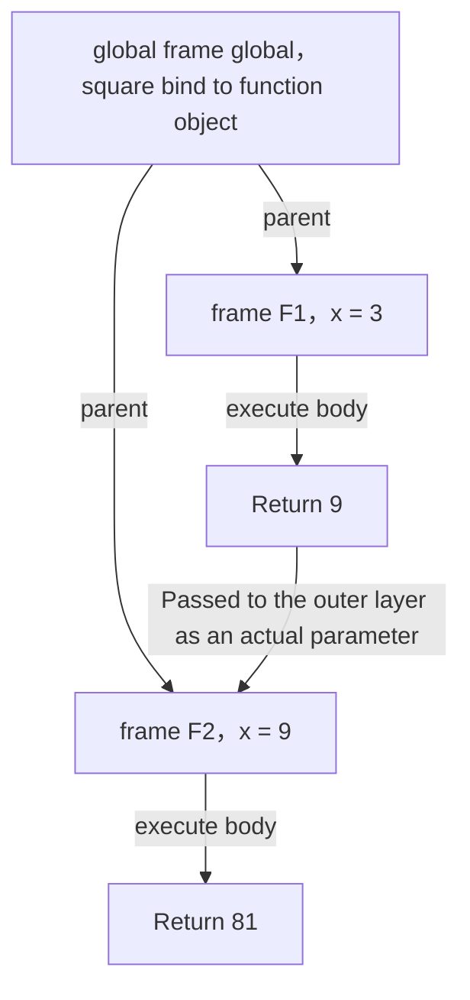
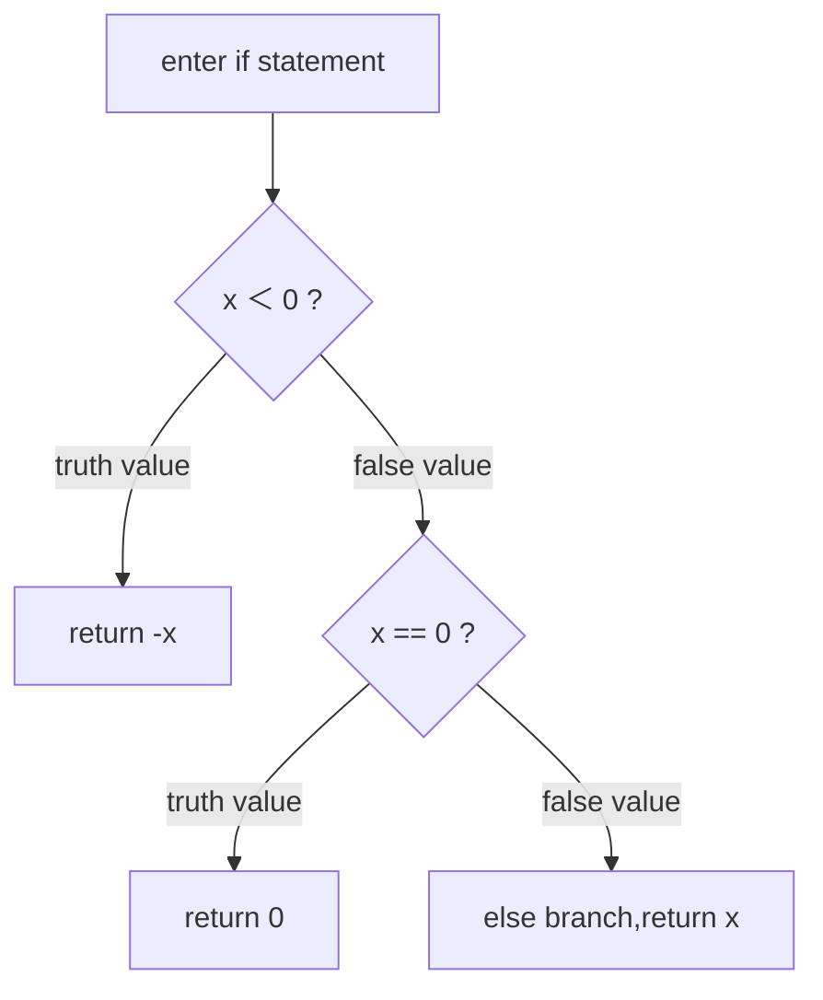
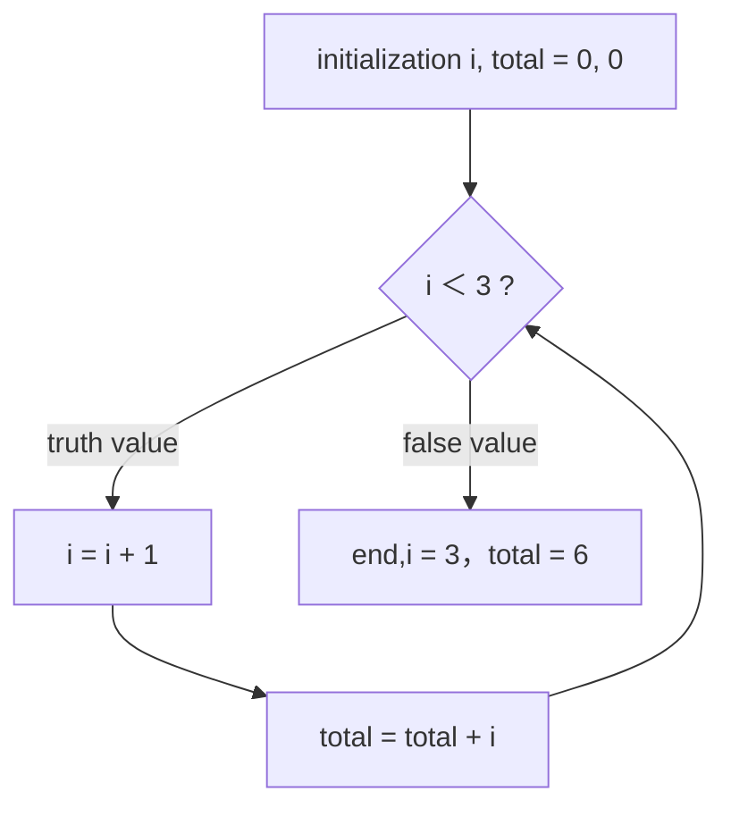

> **courses**: UC Berkeley CS61A · Structure and Interpretation of Computer Programs(Fall 2024)
> **This lecture**: Lecture 3 ｜ 32:21 ｜ Station B P 3 ｜ [Original video](https://www.bilibili.com/video/BV1sy411z7nA?p=3)
> **courseware**: `03-Control_1pp.pdf` (13 pages, official PDF, page-by-page renderings see text illustrations)
> **subtitles**: Original English subtitles from Station B; this note is a reconstruction of Chinese writing, not a sentence-by-sentence translation.
> **Copyright**: The copyright of the course and courseware belongs to the UC Berkeley CS61A teaching team; this article is a secondary arrangement for learning purposes

## Quick overview of this lecture

- **Mastered**: `def`  The four components of a statement (function name, formal parameters, body, return expression), the order of evaluation of the calling expression, the correspondence between formal and actual parameters, and the basic assumption that "expressions are evaluated in the environment".
- **Main line of this lecture**:
    - A call leaves two things behind: **return value** (a value that can continue to participate in calculations) and **side effects** (what really happened), and  `print`  The return value is  `None`.
    - Use environment diagrams to review the life of functions: `def`  Create a function object, call the frame, and string the frame into the environment along the parent pointer.
    - Operators are just shorthand for built-in functions; `//`  with  `%`  Give the exact quotient and remainder.
    - A compound statement consists of header and suite; `if/elif/else`  Only execute one of the suites, `while`  Execute the same suite repeatedly.
    - The essence of control flow: **The default is top-down, `if`  with  `while`  There are two types of reasons for "not following the default"**.
- **Key conclusions**: **Expressions have values, statements do things**. Before judging the "result" of a call, first see if it has  `return`, and let’s see what it did.

*(Reference time: 00:00:02 – 00:00:16｜Lecture 3)*


## 1. Return value and side effects: two things left behind by a call

*(Reference time: 00:00:17 – 00:00:32｜Lecture 3)*


The evaluation order and environment of calling expressions have been explained clearly in the previous lecture. What this lecture wants to add is the other side of the same action: a function call does not only give a **value**, it's possible **Leave other traces here**. Both of these things are easily called "results" in Chinese, but in Python they are two completely independent channels, and confusing them will produce one of the most common types of errors early in the course.

Let’s look at the “value” channel first. `abs(-2)`  The value is 2: This 2 is not a number that can only be seen but not used. It can be put into any position that requires a value, such as  `abs(-2) + 1`  Got 3, `abs(-2) * 10`  Got 20. `pow(2, 100)`  Likewise, its value is 2 to the power of 100. Python's large integers do not have a fixed bit width, so what you get here is a string of exact 31-digit numbers: 1267650600228229401496703205376. like  `abs`, `pow`  Such a function **only return value**, do nothing else, they are called **Pure Functions**.

Let’s look at the “side effects” channel again. `print(-2)`  When executed, a did appear on the screen  `-2`, but that  `-2`  is not the value of this call: it is **side effects**. According to the definition in the courseware, a side effect is not a value, but "anything that happens as a consequence of calling a function." The direct consequence of this sentence is: the one on the screen  `-2`  You can't get it, you can't pass it, and you can't multiply it by 2. if you write  `print(-2) + 1`, Python will report an error because  `print(-2)`  The value is  `None`, `None + 1`  Meaningless.


`None`  is the value that means "nothing" in Python, `print`  The return value is it. So the relationship between "print" and "return" can be summarized in one sentence: **What is printed is the side effect, and what is returned is the value. `print`  Only do the former**. Functions with side effects are called **Non-Pure Functions**.

| criterion | Pure function (Pure) | Non-pure function |
| :--- | :--- | :--- |
| return value | a value determined by the actual parameter | often  `None` (may also have value) |
| side effects | No | There are: printing, changing external status, reading and writing files, etc. |
| Can larger expressions be embedded? | Can, `abs(-2) + 1`  legal | Formally, it can, but the combination is "evaluation order", not "combination of values" |
| The cost of repeated calls | Can be repeated at will, the result remains unchanged | Every time it is repeated, the side effects come again |
| Examples of this lecture | `abs`, `pow` | `print` |

> **Editor's note**: `None`  There is a display rule in the interactive interpreter that is particularly easy to ignore - the interpreter only responds "No  `None`" expression value. Therefore  `>>> print(1)`  Show only one line  `1`, while  `>>> None`  Nothing is displayed. This rule makes "function has no output" and "function returns  `None`” looks the same on the screen and should be used when debugging  `print(f(...))`  There are other ways to distinguish between the two (such as binding to the name first and then viewing it). `print(print(1))`  Will print first  `1`, and then call the inner layer  `None`  Print as  `None`, is a direct experiment to observe this rule.

### 1.1 Three types  `h(x)`: Separate "Print" and "Return" to see

The courseware gives a short but informative exercise: Implementing a function  `h(x)`, it first prints and then returns  `f(x)`  value. All three ways of writing "look right" but actually behave differently.


```python
def h(x):
    return print(f(x))        # (A)


def h(x):
    print(f(x))               # (B)
    return f(x)


def h(x):
    y = f(x)                  # (C)
    print(y)
    return y
```

The differences between the three can be listed one by one:

- **(A)**  First  `f(x)`  Calculate it and hand it over  `print`, `print`  print it and return  `None`, so  `h`  directly  `None`  Go back out. It's right on the screen, but the value is wrong - the classic "it looks fine" error.
- **(B)**  Print first  `f(x)`, again **Re-evaluate** `f(x)`  and return. It's right on the screen and the value is right, but  `f`  was called twice.
- **(C)**  Only evaluated once  `f(x)`, save the result into  `y`, print  `y`, return  `y`. It's right on the screen and the value is right, `f`  Only called once.

The courseware then asked a more pointed question: **what kind  `f`  Would it make (B) behave differently than (C)?**  if  `f`  It is a pure function. The return value of the two is the same and the printed content is the same. The difference is only one extra calculation, which is invisible to the naked eye; the only difference is  `f`  impure, or  `f`  The return value is exposed depending on the number of calls. The courseware is marked (Demo) on this page, but the subtitles of this lecture did not record this demonstration. I will use one below that can be run through by myself.  `f`  Make up.

> **Editor's note**: The easiest counterexample is to  `f`  Take a commission  `print`  itself. At this time (B) will be executed first  `print(print(2))` (Inner layer printing  `2`, outer layer printing  `None`), then execute  `return f(2)` (Print again  `2`), there are three lines on the screen; while (C) has only  `2`  with  `None`  Two lines. This example shows that the value of (C) is not just "save one calculation", but "the side effect only occurs once" - in the world of side effects, repeated evaluation itself is an observable behavioral difference.

> **Editor's note**: The conclusion of this section is based on the original text on pages 3-5 of the courseware. The subtitles of this lecture begin with a review of "Multiple Environments". The oral content of these three pages is not in the subtitles ((Demo) on page 5 also does not have a corresponding recording), so  `None`  display rules, `print(print(1))`  with  `f = print`  Both examples were written by the editor to supplement the reasoning.

## 2. The life of a function: def, calling and multiple environments

*(Reference time: 00:00:33 – 00:10:13｜Lecture 3)*


To understand "when the side effect occurs", you must first know exactly "when the function is created and when the body is executed." The lecturer used one page of courseware to compress all the vocabulary from the previous lecture into one picture: `def`  What are the three actions of statement, call expression, and call (application)?


### 2.1 one  `def`  Anatomy of a Statement

```python
def square(x):
    return mul(x, x)
```

`def`  A statement is a whole that spans multiple lines. it has function name  `square`, there is **formal parameter** `x`——The formal parameter is the "placeholder name of the parameter". If there is more than one, separate it with commas; `def`  All indented parts after the line are the body, and there is only one here  `return`  statement, but body can have multiple lines; `return`  behind  `mul(x, x)`  is **return expression**.

The key points are: **`def`  When the statement is executed, a new function is simply created and the name is bound to the current frame.**. The lecturer specifically emphasized that the definition is complete  `square`  After that, he "hasn't multiplied anything yet" because the function hasn't been called yet. The function object is a description of "how to calculate", not the calculated result.

### 2.2 Calling expressions and "three steps of application"

The call occurs on the calling expression: `square(2 + 2)`. operator here is the name  `square`, its value is the function object just created; the parentheses are operand, which itself is an expression.  `2 + 2`, evaluate to get 4, this 4 is **Argument**.

The evaluation rules are fixed: first find the operator and operand to get the function and actual parameter values, and then convert the function **apply to** on these actual parameters. The lecturer used a "pipe diagram" to describe the action of "application": the function signature is installed in a tube, the actual parameters go in from the left, the return value comes out from the right, and what happens in the middle is blocked by the tube. To open the tube, there are three steps:

1. Create a new frame (new frame);
2. Bind formal parameters to actual parameters - here  `x`  bound to 4;
3. Execute body in the new environment and multiply 4 by 4 to get 16, which is the value of the calling expression.

Nested calls just go through these three steps again. Yes  `square(square(3))`, operator is  `square`  Function, operand itself is a calling expression, so first find the inner layer: create a new frame, bind  `x = 3`, execute body to get 9; then use this 9 as the actual parameter of the outer call, create a new frame, and bind  `x = 9`, execute body and get 81. **One function, two calls, two frames**——This is the simplest evidence that "the same function can be called many times, and each call has its own local frame".

### 2.3 Environment is a sequence of frames

**environment is a sequence of frames**. Not yet  `def`, when there is no user-defined function, the environment only has the global frame; once the user-defined function starts to be called, a multi-frame environment of "local frame + global frame" appears. Each frame remembers its own parent frame (parent), and the global frame has no parent frame. It is always the last frame of an environment.

So "starting from a certain frame and going up along the parent pointer" can uniquely determine an environment. `square(square(3))`  There are three environments in the environment graph: only the global environment; `F1`  followed by the global environment; `F2`  followed by the global environment. **No environment contains three frames at the same time**, but each frame can determine an environment.



The lecturer said something very important here: **Without context, names have no meaning.**.`mul`, `x`, `square`  These strings themselves are nothing, it is the environment that gives them their values. This gives us the complete rules for name evaluation: **The value of a name is the value bound in "the earliest frame in which the name appears in the current environment"**. Pay attention to the four words "current environment" - the same name can have different meanings in different environments, because each frame can give different bindings.

in  `F2`  evaluate in  `mul(x, x)`  When searching, there are two names to look up. check  `x`: First look at the first frame of the current environment  `F2`, found, so  `x`  Yes 9. check  `mul`:Watch first  `F2`, no; then look at global along the parent pointer and find the multiplication function. The lecturer specifically added: This ultimately falls on global, but  `F2` **indeed** Checked first - "Earliest frame" refers to the search order, not the result placement point.

### 2.4 Same name but different synonyms: indentation determines the evaluation environment

```python
def square(square):
    return mul(square, square)
```

In this definition, the function name and formal parameter name are both called  `square`. The lecturer clearly said "I don't recommend you write this", but it can clearly prove one thing: `square(4)`  Really got 16. The reason lies in two places  `square`  in **different environments** evaluate here.

Calling expression written in top-case  `square(4)`  When evaluated in global, its operator finds the square function in the global frame; and  `return`  That line is indented and belongs to the function body, in "With new local frame  `F1`  Begin with "global" and evaluate in the environment. So in body  `square`  first  `F1`  Search inside and find the formal parameter tied to 4, so  `mul(square, square)`  That’s it  `mul(4, 4)`. The binding with the same name in global is not used from beginning to end - the search only recognizes the "earliest frame".

| event | In which environment does it occur? | produce what |
| :--- | :--- | :--- |
| execute  `def square(x): ...` | The frame in which the statement is located (here global) | new function object, name  `square`  bind to it |
| Evaluate  `square(2 + 2)`  operator and operand | The frame in which the expression is called (global) | Function object, and argument value 4 |
| application function | New local frame  `F1`, the parent frame is global | Parameter binding  `x = 4`, body evaluation, return value 16 |
| Search in body  `mul` | from  `F1`  Start to find global along the parent chain | Built-in multiplication function |

Indentation here is more than just typography: **Indentation marks the environment in which the code is run.**, and the environment determines which value is found for the name. This connection will be discussed later in this lecture.  `if`  It will be used again when clause -`elif`  the header and  `if`  The suites belong to the same statement, and their indentation level determines where they are evaluated.

## 3. Operator is the abbreviation of built-in function

*(Reference time: 00:10:17 – 00:13:43｜Lecture 3)*

After talking about so many function calls, the lecturer went back to add something that has never been explained in formal language: `+`  and  `*`  How exactly does such an operator work? The answer is "not yet": the precise mechanism is quite complex and will be revealed later in the course. Currently we only need to put them **Think of it as shorthand for built-in functions**——`2 + 3`  That’s it  `add(2, 3)`, `3 * 4`  That’s it  `mul(3, 4)`, so  `from operator import add, mul`  You can then directly write the function call form.

Infix writing is not without cost: it comes with priority rules, `*`  before  `+`. to make  `2 + 3 * 4 + 5`  Translated into a calling expression, you must "calculate" the priority yourself, and you get  `add(add(2, mul(3, 4)), 5)`. Parentheses can override precedence: `(2 + 3) * (4 + 5)`  First remove the two additions, and then multiply 5 and 9. The corresponding calling form is  `mul(add(2, 3), add(4, 5))`.

The lecturer then changed the topic: "Let's stop talking about addition and multiplication here, let's talk about something serious: division." Behind this joke is a real design problem-there are two kinds of division in Python.

| expression | equivalent function call | value | Description |
| :--- | :--- | :--- | :--- |
| `2 + 3` | `add(2, 3)` | `5` | Infix operator is function call |
| `3 * 4` | `mul(3, 4)` | `12` | `*`  has a higher priority than  `+` |
| `5 / 3` | `truediv(5, 3)` | `1.6666666666666667` | True division, the result is a floating point approximation |
| `5 // 3` | `floordiv(5, 3)` | `1` | For integer division, only "how many times can the division be made" |
| `5 % 3` | `mod(5, 3)` | `2` | Take remainder, how much is left |
| `2013 // 10` | `floordiv(2013, 10)` | `201` | Erase one digit |
| `2013 % 10` | `mod(2013, 10)` | `3` | Take out the ones digit |

Why are there special divisions and remainders? because **they are precise**.`5 / 3`  What is obtained is an approximation. There should be an infinite number of 6s, and floating point numbers can only give limited bits; and the description "3 can advance to 5 at most once, leaving 2" is accurate: `5 // 3`  is 1, `5 % 3`  Yes 2. Later in the course, we will repeatedly "split numbers" (taking ones digits, tens digits, and judging divisibility). Precise quotients and remainders are standard tools, so these two operators are worth remembering separately.

## 4. Return two values at once

*(Reference time: 00:13:44 – 00:14:41｜Lecture 3)*

Python allows one assignment statement to assign values ​​to multiple names at the same time, and functions can also **Return multiple values at the same time**. The motivation given by the lecturer is very specific: when doing division, both the quotient and the remainder are often required. It is better to get two things back at once than to calculate them twice.

```python
from operator import floordiv, mod


def divide_exact(n, d):
    return floordiv(n, d), mod(n, d)
```

`return`  After that, the two expressions are combined with a comma, and the caller also uses a comma to combine the two names to receive:

```text
>>> q, r = divide_exact(2013, 10)
>>> q
201
>>> r
3
```

thus  `q`  Binding 201, `r`  Binding 3. The lecturer mentioned that this technique "will be used once in the project", indicating that it is not a grammatical sugar show-off technique, but a standard way of writing paired results such as "quotient and remainder" in subsequent assignments.

> **Editor's note**: `return a, b`  What is actually returned in Python is a **tuple**, `q, r = ...`  is to unpack this tuple into two names. The tuple is the following content. Here you only need to know that there is still only one behind "multiple return values"**one** Returns a value, but that value is a container.

## 5. From interactive to source file: execution does not mean output

*(Reference time: 00:14:45 – 00:17:36｜Lecture 3)*

All previous experiments were performed in the interactive interpreter. Interactive is suitable for trying out ideas, but if you want to write "something that can stay", you have to write it into a file. The instructor used Vim on site and reminded the editor that there are many options. There is an overview in Lab 1.

After typing the code into the file, the most counter-intuitive point is: **The code in the file will not execute itself**. written down  `def`  It does not take effect immediately. The written expression will not be evaluated immediately. This will only happen if Python is explicitly asked to execute the file. lecturer's  `ex.py`  It started like this:

```python
"""Our first Python source file."""

from operator import floordiv, mod


def divide_exact(n, d):
    return floordiv(n, d), mod(n, d)
```

During the writing process, the lecturer discovered that something had been omitted  `import`, so I went back and added it - this episode itself is evidence that "the source code will not be checked before running": wrongly written and omitted code lies quietly in the file, and no error may be reported until it is executed.

and then execute  `python3 ex.py`. There was silence on the screen. Why? Because there is only one in the file  `def`  statement, all it does is create the function and put the name  `divide_exact`  Tie it up and otherwise produce no output.

add one more line  `q, r = divide_exact(2013, 10)`  And re-executed, there is still no output - the assignment statement is bound to the name, and it is also not printed. until added  `print('quotient is', q, 'the remainder is', r)`, and finally saw the results.

This demonstration arranges the two channels in Section 1 again: **The file is executed, which does not mean that something appears on the screen.**; Something that appears on the screen can only come from a side effect of a function (here it is  `print`). This also explains why beginners' programs "run unresponsive" - ​​not that they don't run, but that they have no side effects.

The more common usage is not to put  `print`  If the file is full, execute the file first and then enter interactively:

```text
$ python3 -i ex.py
>>> q
201
>>> r
3
>>> divide_exact(2013, 10)
(201, 3)
```

`-i`  Let Python execute the entire file first and then stop at the prompt. At this time, all the names defined in the file live in the global frame: `q`, `r`, `divide_exact`  can be viewed and called directly. This division of labor in which "files are responsible for definition and interactions are responsible for exploration" is the default working method for all subsequent jobs.

## 6. docstring, doctest and default values

*(Reference time: 00:17:43 – 00:21:08｜Lecture 3)*

The function written to the file should not just have the name and  `return`. The practice is in  `def`  Put a string in the position of the first statement below the line to explain what this function does. This string is called  **docstring**. It serves two kinds of readers at the same time: human readers, and the tools that can read it.

```python
def divide_exact(n, d):
    """Return the quotient and remainder of dividing n by d.

    >>> q, r = divide_exact(2013, 10)
    >>> q
    201
    >>> r
    3
    """
    return floordiv(n, d), mod(n, d)
```

There is a convention in the docstring: use all uppercase letters (`N`, `D`) refers to formal parameters. The lecturer said that this is not a hard requirement, but it is written this way in the course project, because it allows "N in the document" and "N in the code" to be aligned at a glance.

What’s more interesting is the paragraph in the docstring  `>>>`  Beginning text. **It's just a string, not Python code**: When the function is executed it does nothing. But it records an "interactive session as it should have occurred", whereas  `doctest`  The module can actually run it according to this record:

```text
$ python3 -m doctest ex.py
```

There is no output when all passes. If you want to see the details, add it  `-v`, it will report item by item: try putting  `q, r`  Assigned to  `divide_exact(2013, 10)`  As a result, it is expected that there will be no output after this line (there is indeed no output); then evaluate  `q`  Get 201, evaluate  `r`  Got 3. The instructor read this output sentence by sentence to emphasize that "the test is **copy** The conversation in the document is not another one."

The output will be very eye-catching when written incorrectly on purpose:

```text
**********************************************************************
Failed example:
    r
Expected:
    2
Got:
    3
```

A long string of asterisks plus the sentence "Failed example" is enough for people to immediately know what is wrong. The lecturer suggested running doctest when writing homework - it turns "examples in documents" into executable checks at almost zero cost.

finally **default value**:

```python
def divide_exact(n, d=10):
    ...
```

The lecturer made a special statement, `d=10` **Not an assignment statement**: It is the "default value placeholder" written after the formal parameter. The meaning is - if there are no actual parameters bound to the  `d`, just tie 10 up. So  `q, r = divide_exact(2013)`  The divisor 10 is automatically added, giving 201 and 3.

> **Editor's note**:Default value only in  `def`  It is evaluated once at the moment of execution, and the same object is reused for each subsequent call; therefore, writing mutable objects (such as lists) as default values will share state between multiple calls, causing difficult-to-detect bugs. This lecture only uses integer default values ​​and will not encounter this problem, but this "only evaluate once" opportunity is worth remembering.

## 7. What is Control: statement, compound statement and suite

*(Reference time: 00:21:16 – 00:23:06｜Lecture 3)*


So far, \*\*statement\*\* has only appeared in two types: assignment statement and  `def`  statement. Generally speaking, a statement is an action performed by the interpreter—binding a name to a value, defining a function, and so on. The most fundamental difference between statements and expressions is that expressions evaluate to obtain values, and statement execution produces actions.

Statements can occupy just one line or span many lines. The kind that spans multiple lines is called **compound statement**, the structure is fixed: a header, followed by a set of indented statements; there can also be a header for continuation in the middle, each followed by a set of indented statements. The terminology is to be precise here:

- **clause**: A header plus the set of indented statements following it;
- **suite (statement group)**: The entire set of indented statements in that clause;
- The first header determines the statement **Type**, so you will know what statement you are reading when you see the beginning;
- header **control** The suite behind it - this sentence means understanding  `if`  with  `while`  all keys.

`def`  It is a compound statement: its header is  `def square(x):`, its suite is the function body, and it is customary to call it body in the course.

The rules for executing a suite are simple: **Execute the first statement first, then continue with the rest unless asked to do otherwise.**. When the instructor reads this rule, the emphasis is “unless asked to do otherwise.” Up to this point, all codes follow this default: when calling a function, go down from the first line of the body to the end or hit  `return`  So far.


But real programs are rarely so obedient. The courseware stopped at two questions: Which functions will **end early**? Which functions will **Not executed in order**? The former is "Decide which row to return depends on the situation", and the latter is "the same piece of code needs to be executed many times." These two types of requirements correspond to the remaining two compound statements in this lecture: conditional statements and loop statements.

## 8. Conditional statement: only one suite will be executed

*(Reference time: 00:23:09 – 00:25:54｜Lecture 3)*

First write a function that needs to "depend on the situation": find the absolute value. The way to do it is to look at  `x`  Relationship to 0 - the absolute value when less than 0 is  `-x`, when it is equal to 0, it is 0, when it is greater than 0, it is  `x`  itself.

```python
def abs_value(x):
    """Return the absolute value of x."""
    if x < 0:
        return -x
    elif x == 0:
        return 0
    else:
        return x
```

`elif`  is  `else if`  Abbreviation for, pronounced "else, if". The third clause uses  `else`  Cover all the remaining situations - since the first two are not true, then  `x`  Can only be greater than 0, return directly  `x`. Test after loading the file: `abs_value(-2)`  Got 2, `abs_value(0)`  Got 0, `abs_value(3)`  Got 3. The lecturer added: Built-in  `abs`  It’s always been there, I’m just writing this as an example.

The body of this function only has **one piece** statement, and this statement contains **three clauses**: Three headers (`if`, `elif`, `else`  One line each), three suites (each suite has only one  `return`).


There is also only one execution rule for conditional statements: **Consider each clause in order and evaluate its header expression; if a true value is obtained, execute the suite of that clause and skip all remaining clauses**. From this we get the most essential properties of conditional statements: **Only one suite will be executed**. This is consistent with "two parallel  `if`” are completely different - the latter are two independent statements, both conditions will be tested, and both suites may be executed.

Grammatically: `if`  clause must exist, `elif`  There can be zero or more, `else`  There can be zero or one, and must be last. The simplest form is just  `if`;The common third gear is  `if` + `elif` + `else`.

### 8.1 Differences between the three writing methods

The courseware puts the three writing methods side by side, using  `x = 10`, `x = 1`, `x = -1`  Run each of the three inputs once:

| Writing method | `x = 10`  The output of | `x = 1`  The output of | `x = -1`  The output of |
| :--- | :--- | :--- | :--- |
| two independent  `if`: `if x > 2`  with  `if x > 0` | `big`  and  `positive`  two lines | `positive` | print nothing |
| One statement has two clauses: `if` + `elif` | `big` | `less big` | print nothing |
| One statement has three clauses: `if` + `elif` + `else` | `big` | `less big` | `not pos` |

The first line is the most telling: `x = 10`  Satisfy at the same time  `x > 2`  and  `x > 0`, two independent statements are executed once each, so two lines are printed. Replace with  `if` + `elif`  After that, the second condition will not be tested at all - the entire statement will jump out after the first suite is executed. This is not an "optimization" but a semantic difference: **`if/elif`  Expressing "several mutually exclusive situations", two  `if`  It expresses "several conditions that are independent of each other"**.



The price should also be stated clearly: `if/elif`  The subsequent conditions will never be tested after the first true value appears, so if there is overlap between the conditions and you really want to execute them, you must write them as multiple independent statements; conversely, if you write  `if/elif`  But if you get the order wrong (for example, put the small-scope condition after the large-scope condition), the subsequent clause will become dead code.

## 9. Boolean context: George Boole only cares about true and false

*(Reference time: 00:25:57 – 00:27:40｜Lecture 3)*

There is a concept hidden in the sentence "if you get a true value": **Boolean context**. It is a place in the code where you can put any expression, but this place only cares about "is this value true or false", not what the value itself is. The lecturer brought out George Boole to be the caretaker of the concept: Boole was a logician and one of the early founders of computer science, and to show respect, "bigger him up a bit."

Count again according to this concept  `abs_value`  header: `if x < 0`  and  `elif x == 0`  Each is a Boolean context, `else`  That header is not - it has no conditions to ask for. `while`  The header of the statement is also a boolean context. Whenever the execution flow reaches one of these locations, Boole checks: Is this expression true or false?

in Python **false value** Includes: `False`, `0`, empty string  `''`, and  `None`. All other values are **truth value**——Including non-zero numbers, non-empty strings, function objects, etc. The instructor explained that there are more details here, and the courseware provides links to reading materials, which will not be expanded upon in this lecture.

The advantage of this set of conventions is that it decouples "judgment" and "comparison": there is no need to write in the header  `(x < 0) == True`  In this redundant form, any expression can be placed directly in a Boolean context, and its direction is determined by whether it is true or false.

> **Editor's note**: The three most commonly used connectives in Boolean context are  `and`, `or`, `not`.`and`  with  `or`  adopt **short-circuit evaluation**: `A and B`  Seek first  `A`, if  `A`  If it is a false value, we will not search again.  `B`, return directly  `A`; `A or B`  If  `A`  If it’s true value, don’t ask for it anymore  `B`, return directly  `A`; `not A`  Change a true value to a false value. Short-circuiting not only saves computation, it also changes the number of side effects, so  `x != 0 and 1 / x > 2`  in  `x = 0`  will not divide by zero. Neither the courseware nor the subtitles expand these three connectives in this lecture. They are listed here as a supplement for the editor for reference when writing conditional expressions.

## 10. while and prime factorization: execute suite repeatedly

*(Reference time: 00:27:38 – 00:32:19｜Lecture 3)*

\*\*Iteration\*\* means repetition. The most direct tool to make the same statement repeat many times is  **`while`  statement**: It is also a compound statement. The body contains "things to be executed repeatedly", and the repeated conditions are written in the header.


The courseware lists three things you must think clearly:

- **Need a few names, what do they mean?**  Loops almost always revolve around several variable quantities. Only by clarifying their meanings can the code be written correctly.
- **`while`  The condition must eventually become false**, the statement will end - unless there is a  `return`  Exit early. This is the introductory version of "can it stop": the condition will always be true and the loop will go on forever.
- **Once the condition is evaluated, the entire body will be executed**. The condition may "no longer hold" when body is executed halfway through, but the loop will not check back midway, it will complete this round first.

### 10.1 Step-by-step tracking

The instructor's demonstration is to add 1, 2, and 3:

```python
i, total = 0, 0
while i < 3:
    i = i + 1
    total = total + i
```

The execution rules are: evaluate the expression of header; if it is true, execute the entire suite; then return to the first step. Expanding this rule layer by layer is the following table:

| rounds | Evaluate  `i < 3` | execute  `i = i + 1`  after | execute  `total = total + i`  after |
| :--- | :--- | :--- | :--- |
| 1 | `0 < 3`  is true | `i = 1` | `total = 0 + 1 = 1` |
| 2 | `1 < 3`  is true | `i = 2` | `total = 1 + 2 = 3` |
| 3 | `2 < 3`  is true | `i = 3` | `total = 3 + 3 = 6` |
| 4 | `3 < 3`  is false | Not executed | Not executed |

After executing these three rounds, `i`  Yes 3. `total`  is 6, which is exactly 1 + 2 + 3. The lecturer's original words were, "In a flash, we have actually calculated a lot of things."

Two details are worth mentioning separately:

- **The right side of the assignment statement uses the "before execution" value.**. In the first round  `i = i + 1`  The right side of reads 0, so  `i`  becomes 1; followed by  `total = total + i`  read  `total`  Yes 0, `i`  is already 1, so  `total`  becomes 1. The order of the two statements is therefore crucial, swapping them will give different results.
- **In the third round  `i`  has been changed to 3, but body is not broken**. The annotations on the courseware are very straightforward: “Even if  `i`  is set to 3, this line will still be executed" -`total = total + i`  Using 3, we get 6. The lecturer emphasized that the program will not go back and check the header in the middle of execution because "the entire suite has not been executed yet." This is why after the loop ends  `i`  It's 3 instead of stopping at 2.



> **Editor's note**: Put "at the end of each round  `total`  equals 1 added to  `i`"As **loop invariant** To state, it can be used as a template to verify the correctness of the loop: it holds after initialization; it holds at the beginning of each round, and it still holds after body is executed; at the end of the loop, its matching condition is false, which gives the conclusion  `total = 1 + 2 + 3`. Neither the courseware nor the subtitles use the term "loop invariant". This is provided here as a supplementary learning method by the editor.

### 10.2 Example: Prime Factorization


Loops are best suited for problems whose size is unknown but shrinks with each round. Prime factorization is a standard example. every positive integer  `n`  There is a group **prime factors**: The product is equal to  `n`  of those prime numbers. The examples given in the courseware are 8 = 2 × 2 × 2, 9 = 3 × 3, 10 = 2 × 5, 11 = 11, and 12 = 2 × 2 × 3. Note the term 11 - the prime factor of a prime number is itself.

The problem then becomes two: how to determine whether a number is divisible by another number (`%`  Give the answer) and in what order. The ideas given by the courseware are: **find out  `n`  The smallest prime factor of , divide once by it, and repeat the same action for the quotient**. The decomposition chain of 858 is written on the courseware:

```text
858 = 2 * 429 = 2 * 3 * 143 = 2 * 3 * 11 * 13
```

Breaking this chain into each round of the cycle is a table that terminates:

| rounds | current  `n` | smallest prime factor  `k` | next round  `n` | The factors obtained in this round |
| :--- | :--- | :--- | :--- | :--- |
| 1 | 858 | 2 | 429 | 2 |
| 2 | 429 | 3 | 143 | 3 |
| 3 | 143 | 11 | 13 | 11 |
| 4 | 13 | 13 | 1 | 13 |

after four rounds  `n`  becomes 1, `while n > 1`  If the condition is not met, the loop ends. loop variable  `n`  Each round gets smaller, which is a structural guarantee that the condition will eventually become false.

> **Editor's note**: This subtitle is in  `while`  The tracking explanation was terminated after the end, and (Demo) marked on page 13 of the courseware did not appear in the subtitles. The following version of the implementation was added by the editor and is only used to demonstrate two  `while`  How to cooperate - a shrinking  `n`, one finds out the current  `n`  The smallest prime factor of is not the original text of the class:

```python
def smallest_prime_factor(n):
    """Return the smallest prime factor of n (n > 1)."""
    k = 2
    while n % k != 0:
        k = k + 1
    return k


def print_prime_factors(n):
    """Print the prime factors of n in non-decreasing order."""
    while n > 1:
        k = smallest_prime_factor(n)
        n = n // k
        print(k)
```

Substitute round by round according to the table above. `print_prime_factors(858)`  2, 3, 11, 13 will be printed in sequence. here  `print`  The side effect of is exactly the output itself, and the function itself does not need to return a value - again, back to the two channels of Section 1.

## Summary

- **Separate "value" and "thing"**: When reading any call, first ask "what is its value" and then "what did it do?"`print`  The value is  `None`, it does printing; `return print(...)`  Leave the side effects on the screen, keep  `None`  Hand it back.
- **Repeated evaluation is observable behavior**: As long as the function has side effects, put  `f(x)`  Writing it twice and counting it once, saving it in the name and using it again are not "equivalent writing methods". Saving the value and reusing it is the cheapest way to make side effects happen only once.
- **The environment determines the meaning of the name, and the indentation determines the environment.**: `def`  Create a function and bind the name, call it to create a frame, and the frame is strung together into the environment along the parent pointer; the name takes the value of "the earliest frame in which it appears in the current environment". Examples of different names and different synonyms illustrate that when reading code, you must first determine in which environment this line is evaluated.
- **Defaults to top-down, "unless asked to do otherwise"**: Compound statement = header + suite, header controls suite. `if/elif/else`  The whole content is "test the headers in order, and skip the rest after the first true value suite is executed"; `while`  The entire content is "If the header is true, repeat the entire suite again."
- **The loop must be able to stop and must be executed in its entirety.**: The condition must eventually become false (unless there is  `return`); once the condition evaluates to true, the body will definitely finish walking and will not go back and check again in the middle - this is exactly  `i`  After being changed to 3  `total`  Reasons to add 3 anyway.
- **Use accurate tools**: `//`  with  `%`  gives the exact quotient and remainder, `/`  Gives a floating point approximation; the first two are preferred for splitting numbers and judging integers.

*(Reference time: 00:32:15 – 00:32:19｜Lecture 3)*

## Attached: Slide index for this lecture

*(Reference time: 00:00:02 – 00:32:19｜Lecture 3)*

| page | content | Appear location |
| :--- | :--- | :--- |
| 1 | Title page Control | Quick overview of this lecture |
| 2 | Announcements | Quick overview of this lecture |
| 3 | Print and None sectioned pages | §1 |
| 4 | Comparison between pure functions and impure functions | §1 |
| 5 | Three implementations of Print Then Return | §1 |
| 6 | Multiple Environments section page | §2 |
| 7 | Life cycle of user-defined functions | §2 |
| 8 | Control section page | §7 |
| 9 | What is Control: Early return and out-of-order execution | §7 |
| 10 | Three ways to write conditional statements | §8 |
| 11 | While Statement and Three Notes | §10 |
| 12 | Prime factorization section page | §10 |
| 13 | Prime factor decomposition example and decomposition chain of 858 | §10 |
