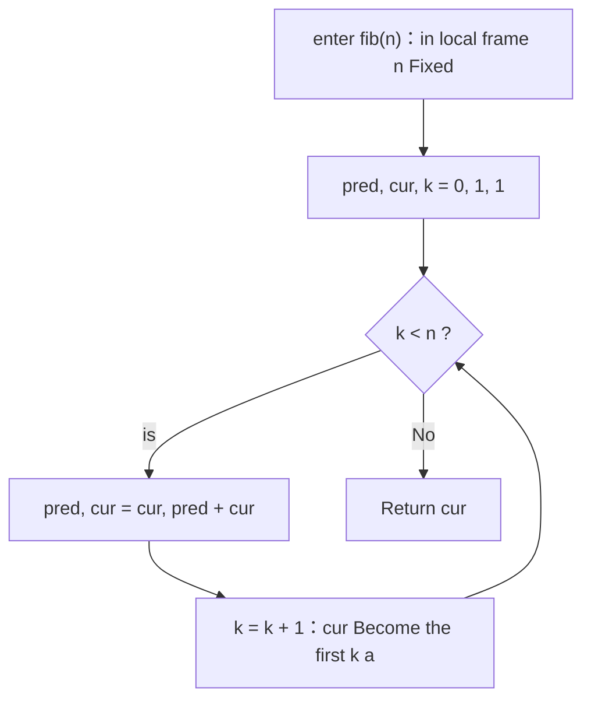
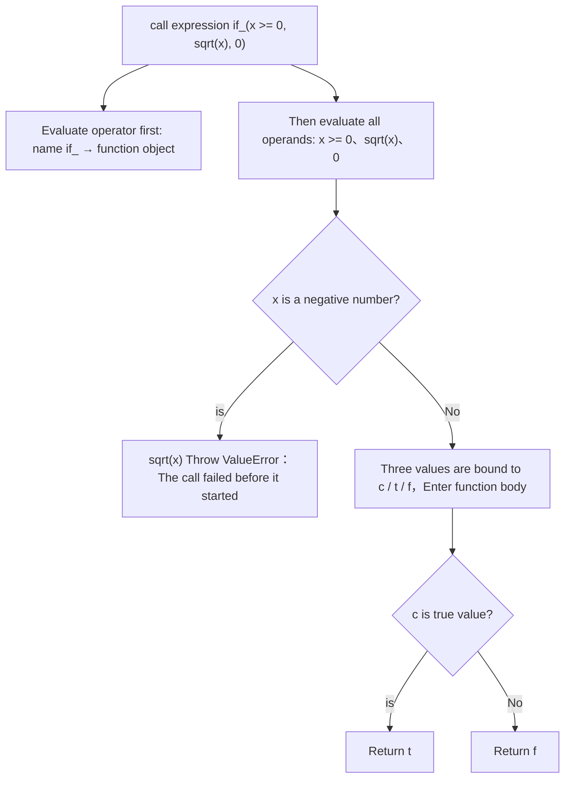
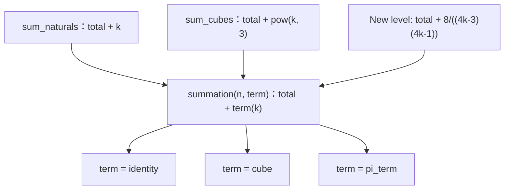
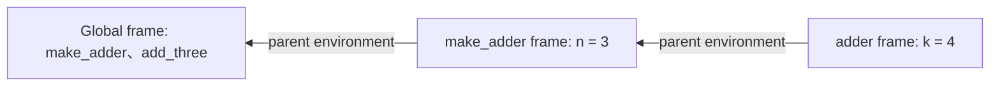

> **courses**: UC Berkeley CS61A · Structure and Interpretation of Computer Programs(Fall 2024)
> **This lecture**: Lecture 4 ｜ 42:53 ｜ Station B P 4 ｜ [Original video](https://www.bilibili.com/video/BV1sy411z7nA?p=4)
> **courseware**: `04-Higher-Order_Functions_1pp.pdf` (12 pages, official PDF, page-by-page renderings see text illustrations)
> **subtitles**: Original English subtitles from Station B; this note is a reconstruction of Chinese writing, not a sentence-by-sentence translation.
> **Copyright**: The copyright of the course and courseware belongs to the UC Berkeley CS61A teaching team; this article is a secondary arrangement for learning purposes

## Quick overview of this lecture

*(Reference time: 00:00:00 – 00:42:51｜Lecture 4)*

- **Mastered**: Expression evaluation rules, `def`  Statement and function objects, call expression evaluation order, environment graph (frame and parent environment), `while`  Loops, pure functions and side effects.
- **Main line of this lecture**:
    - Iterative template: Fibonacci uses  `pred`, `cur`, `k`  Three quantities describe the loop state, and the first step in design is to ask "what information must be continuously tracked?"
    - Why control statements cannot be replaced by functions: `if_`  The function requires all actual parameters to be evaluated first, so no branch can be skipped.
    - Short circuit evaluation: `and` / `or`  Bring "selective execution" to the expression level.
    - Treat functions as parameters: `area(r, shape_constant)`  It only generalizes "number", `summation(n, term)`  This is the generalization of "process".
    - Treat functions as return values: `make_adder`  inner layer  `adder`  Remember outer parameters from parent environment  `n`.
    - Conclusion: Functions are first-class citizens (first-class value), so there are higher-order functions (Higher-Order Function) one level higher than "functions".
- **Key conclusions**: The essence of abstraction is to leave the "skeleton" in the function body and turn the "difference" into parameters; the difference can be either a numerical value or another function.

## 1. Opening: Assignments, Projects and Midterms

*(Reference time: 00:00:00 – 00:01:41｜Lecture 4)*

This lecture begins with an explanation of the course rhythm, three of which will directly affect the study schedule for the next two weeks.


The first due item is this Thursday's assignment; Project 1 has been released at the same time. Although the project is not due until after the first midterm, the lecturer repeatedly emphasized "start early" because the phased design (checkpoint) of the project is to prevent everyone from piling up work until the last week.


Checkpoint is on September 5th, which is next Tuesday. It only accounts for one point in the entire project score, so missing it will not significantly affect the score; but it requires "the first stage has been passed", and this point buys progress safety, not correctness. According to the lecturer, this point is just to complete the first phase on time so that the entire project can be successfully concluded after the midterm.

The midterm exam will be held on the evening of September 11th. There are two reasons for scheduling it in the evening: first, the two teaching classes (two offerings) share the same paper, which requires everyone to be dispersed to multiple examination rooms on campus; second, there are no classes scheduled on the midterm day, so students get back a period of time that can be used for review. The test format is paper and pencil. Seats are assigned by the system. Candidates can just follow the notification and go to the designated classroom.

| matters | time | Main points |
|---|---|---|
| This assignment | Ends this Thursday | Bound to the rhythm of midterm review, try not to procrastinate |
| Project 1 Release | this week | Due after midterm, but required to start immediately |
| Project 1 Checkpoint | September 5 (next Tuesday) | Only worth 1 point; it locks "Phase 1 Completed" |
| first midterm | the evening of september 11 | There will be no classes scheduled on that day; both classes will have the same papers, separate examination rooms, designated seats, paper and pen |

The last announcement is for students who are stuck: there are drop-in office hours, and core teaching assistants will be on hand to answer questions. The phrase "You are not alone" is the entire copy of this slide.


## 2. Iteration template: use while to calculate Fibonacci

*(Reference time: 00:01:43 – 00:09:07｜Lecture 4)*

### 2.1 A sequence that "everyone has seen"

The Fibonacci sequence starts with 0 and 1, and each term thereafter is the sum of the two preceding ones: 0 plus 1 is 1, 1 plus 1 is 2, 1 plus 2 is 3, and so on, quickly growing very large. The lecturer deliberately clarified a piece of history: Fibonacci did not invent this sequence. Someone had discussed and described it long before him, but he just popularized it in the Western world, so the name stayed.

Each number in the sequence is bound to its subscript, and the subscript uses the convention of starting from 0: $F_0 = 0$, $F_1 = 1$, $F_2 = 1$, $F_3 = 2$, $F_4 = 3$, $F_5 = 5$. So the "fifth Fibonacci number" is 5, even though it is the sixth number in the sequence - this is just a subscripting convention, not an error.

The reason why this sequence is cited repeatedly is that it has a visually "particularly balanced" geometric property: put together squares with side lengths of Fibonacci numbers 2, 3, 5, 8, 13, 21, 34... and then draw a spiral along the intersection of these squares, and you will get an ever-expanding golden spiral, which looks quite harmonious to the human eye. This type of spiral is often "searched" by people in nature. The photo of cabbage shown in class is evidence that someone thinks they have discovered a golden spiral.

### 2.2 Design iteration function: first ask which quantities to track

From sequence to code, the lecturer only gave one sentence of methodology, but it is the foundation for all reasoning in the second half of this lecture: **When designing an iterative function, the most important question is what information must be kept track of in order to complete the iteration.**

For Fibonacci, the next item is obtained by adding the "previous item" and the "current item", so at least these two numbers must be tracked; at the same time, you must also know "which Fibonacci number the current item is", otherwise you cannot judge when to stop. These three quantities fall respectively into  `pred`, `cur`, `k`  on three names, among which  `k`  The semantics of are very clear: **`k`  recorded this moment  `cur`  It contains the Fibonacci number.**  As the cycle progresses, `k`  with  `cur`  Change together, `k`  always giving  `cur`  Make annotations.

> **Editor's note**:The following paragraph  `fib`  In class, the lecturer typed it into the editor on the spot to demonstrate (there is no corresponding page in the courseware). Here, the initial value, loop condition and update sequence given in the explanation are restored, and the variable names are consistent with the description.

```python
def fib(n):
    """Compute the nth Fibonacci number, for n >= 1."""
    pred, cur = 0, 1
    k = 1
    while k < n:
        pred, cur = cur, pred + cur
        k = k + 1
    return cur
```

There are only two things to do in the loop body, and the order of these two things cannot be reversed: first  `pred`  Update to old  `cur`, put  `cur`  Updated to "Old  `pred`  add old  `cur`" (Python's tuple assignment will also use the old value to calculate the right side, so this line will not contaminate each other), and then  `k`  plus one. The loop condition is  `k < n`, because each round  `k`  Exactly plus one, there must be at the end of the cycle  `k == n`, at this time  `cur`  It contains the nth Fibonacci number.

to  `fib(5)`  For example, in  `fib`  In the local frame of `n`  It is 5 from the beginning and never changes; `pred`, `cur`, `k`  It will be re-bound after each round. The instructor’s approach is to complete each execution  `k = k + 1`  The following values are listed:

| stage | `k` | `pred` | `cur` | `k < n` |
|---|---|---|---|---|
| Enter function | 1 | 0 | 1 | true |
| End of round 1 | 2 | 1 | 1 | true |
| End of round 2 | 3 | 1 | 2 | true |
| End of round 3 | 4 | 2 | 3 | true |
| End of round 4 | 5 | 3 | 5 | false (exit) |

after four rounds  `k`  equal to  `n`, the loop condition is false, the statement body is no longer executed, and the function returns  `cur`, which is 5, the fifth Fibonacci number. This tracking table also explains the "most important question": there are only three names that are actually changing in the environment graph, and their existence is entirely determined by the recursive relationship of "the next item depends on the previous two items".



### 2.3 One change, two boundary behaviors

At this point, the lecturer gave a class discussion question: If the three lines at the beginning of the function body are changed to  `pred, cur = 1, 0`  and  `k = 0`, is this new definition "the same" or "different" from the original definition?

The answer is: it **still correct**, for all  $n \ge 1$  gives the same results as the old version, and it is better than the old version **better**--because it also correctly calculates the 0th Fibonacci number.

```python
def fib(n):
    pred, cur = 1, 0
    k = 0
    while k < n:
        pred, cur = cur, pred + cur
        k = k + 1
    return cur
```

when  `n`  When it is 0, the program goes to  `while`  time  `k`  with  `n`  are all 0, the loop body is not executed once and returns directly  `cur`  The initial value of 0 is exactly the 0th Fibonacci number. Older versions would go wrong here: it starts with  `pred, cur = 0, 1`  start, `n = 0`  It also does not enter the loop, but returns 1.

The price is on the other side. `n = 5`  When, the new version starts from  `k = 0`  To start, the loop body needs to be executed  **5**  times instead of 4 times, `cur`  Taking 0, 1, 1, 2, 3, 5 in sequence, the final result is still 5. In other words, this change replaces "more correct on the boundary" with "do one more loop":

| Check items | Old version: `pred, cur = 0, 1`, `k = 1` | New version: `pred, cur = 1, 0`, `k = 0` |
|---|---|---|
| `n = 0`  the result | 1 (wrong, should be 0) | 0 (correct) |
| `n ≥ 1`  the result | Correct | Correct |
| `n = 5`  number of cycles | 4 | 5 |
| initial value semantics | Starts with "Item 0 and 1" but omits item 0 | Give "Item 0" to  `cur`  The initial value of |

The lesson of this discussion question is not "which way of writing is faster", but **Semantic choice of initial values changes boundary behavior**; To determine whether two definitions are "the same", you must enter them one by one, rather than just looking at the intermediate results.

## 3. Why control statements cannot be replaced by functions

*(Reference time: 00:09:08 – 00:15:57｜Lecture 4)*

### 3.1 What exactly does the if statement do?

`if`  with  `while`  The fundamental difference between this type of control statement and functions is that they determine **Which parts of the code are executed and how many times**, and the function is only responsible for calculating a value. Since functions are already so powerful, can we simply use functions to achieve the same control? The instructor first assumes yes and then lets the assumption fail.

Review first  `if`  Statement execution rules: Multiple clauses are examined one by one in order; when examining a clause, the expression in its header is evaluated first; if the value is true, or  `else`  clause, its statement body is executed and all remaining clauses are skipped. So  `if`  The header expression only determines "execute the if suite or else suite". Only one of the two will always be selected, never both.

### 3.2 Suppose there is an if\_ function

Following this rule, you can imagine an "if function": it takes three parameters - a condition, a value when the condition is true, a value when the condition is false, and returns one of them. There is no such function in Python, but it can be written yourself:

```python
def if_(c, t, f):
    if c:
        return t
    else:
        return f
```

With it, theoretically there is no need to write  `if`, colon and indentation, just call it where you need to branch  `if_`  That’s it. But the lecturer immediately pointed out the problem: **The evaluation rules for call expressions are completely different from those for conditional statements.**

### 3.3 Failure scene: real\_sqrt

In order to expose the difference, the class wrote a function that calculates the "square root of the real number part": the input can be a positive number or a negative number. For positive numbers, `x`  The real part of is its square root, you can directly use the built-in  `sqrt`;For negative numbers, such as  $\sqrt{-4} = 2i$, the entire result is imaginary and the real part is 0. At this time **Can't** Give the negative number to  `sqrt`, because there are no imaginary numbers in its range.

```python
from math import sqrt

def real_sqrt(x):
    """Return the real part of the square root of x."""
    if x >= 0:
        return sqrt(x)
    else:
        return 0
```

This version works fine: `real_sqrt(16)`  Got 4.0, `real_sqrt(-16)`  Got 0. In the latter case, `sqrt(x)`  This expression is not evaluated at all because the statement skips it entirely.

Then rewrite it to call  `if_`  A one line version of:

```python
def real_sqrt(x):
    return if_(x >= 0, sqrt(x), 0)
```

The result is a crash. The reason is not there  `if_`  The definition of is wrong, and in the order of evaluation: evaluation  `if_(x >= 0, sqrt(x), 0)` , the interpreter first evaluates the operator  `if_`  get the function object, then **Evaluate all three operands**, and then bind the three values ​​to  `c`, `t`, `f`. when  `x`  When it is −16, the second step of evaluation  `sqrt(x)`  has been thrown  `ValueError`(`math domain error`), not a single line of the function body has been executed yet.

```text
>>> real_sqrt(16)
4.0
>>> real_sqrt(-16)
ValueError: math domain error
```

### 3.4 Root cause: calling expression does not allow skipping

The conclusion is drawn from this: **The calling expression cannot skip the evaluation of any part of it**, all parts are always completed before the function is called; and control statements have the inherent ability to "execute one part and skip another part". This is why there must be control statements in programming languages ​​and not just functions.

| criterion | `if`  statement | `if_`  call expression |
|---|---|---|
| Branch selection timing | After evaluating the header, only the selected suite is executed | function body press  `c`  The value of is returned, but all actual parameters have been evaluated first |
| unselected branch | Not evaluated at all (safe to include  `sqrt(x)`  Such dangerous expressions) | The value must be evaluated first. Illegal input will result in an error on the spot. |
| Evaluation order | Lazy: execute on demand | Strict: Operators and all operands are evaluated first |
| failure mode | Can only fail in the branch being executed | If any operand fails, the entire operation fails. |



## 4. Short-circuit evaluation: controls written in expressions

*(Reference time: 00:15:59 – 00:21:07｜Lecture 4)*

### 4.1 Evaluation rules for and and or

There are also expressions in Python that "allow the interpreter to skip certain subexpressions", the most typical of which are logical operators  `and`  with  `or`, their behavior is called short-circuiting.

Yes  `left and right`: The left subexpression is evaluated first; if it is a false value, the entire expression takes this false value. **The right subexpression is not evaluated at all**; Otherwise, the right subexpression is evaluated, and the value of the entire expression is the rvalue.

Yes  `left or right`: Evaluate the left subexpression first; if it is a true value, the entire disjunction is already true, and you can directly take the lvalue and call it a day; otherwise, evaluate the right subexpression and take the rvalue.

Note that the value here does not have to be  `True` / `False`: Every value in Python is either true or false, so  `2 and 3`  The result is 3 (the lvalue is true, so the rvalue is returned), `0 and 3`  The result of is 0 (lvalue is false, rvalue is not evaluated), `2 or 3`  is 2, `0 or 3`  Yes 3.

| expression | left operand | the value of the entire expression | Whether the right operand is evaluated |
|---|---|---|---|
| `a and b` | false value | `a`  itself | No |
| `a and b` | truth value | `b` | is |
| `a or b` | truth value | `a`  itself | No |
| `a or b` | false value | `b` | is |

### 4.2 Use short circuits to block collapsing subexpressions

The first example comes from the remaining problem in the previous section: how to judge a certain  `x`  The square root of is "very large", and at the same time, we don't want negative numbers to crash the program. The answer is to let  `x > 0`  Get tested first:

```python
from math import sqrt

def has_big_sqrt(x):
    """Return whether x has a big square root."""
    return x > 0 and sqrt(x) > 10
```

`has_big_sqrt(1)`  Returns false (square root is 1, nothing exceeds 10), `has_big_sqrt(1000)`  Return true, `has_big_sqrt(-1000)`  Returns false - and here's the key **no crash**: When −1000 is passed in, `x > 0`  It is already a false value, `and`  Immediately evaluate the entire expression to false, `sqrt(-1000)`  The throwing subexpression is never evaluated. This is exactly  `if_`  What the function couldn't do, it's now done by the expression itself.

### 4.3 Lower bounds of floating point numbers and "reasonable numbers"

The second example is more convoluted, but better illustrates the practical value of short circuiting. In Python, `1`  Dividing by a large enough number will give you 0.0, because floating point numbers have a minimum non-zero size that can be represented, and results smaller than this can only be rounded to 0. For example  $10^{100}$  Still young enough, $10^{1000}$  It’s too big: `1 / 10**1000`  get directly  `0.0`, all accuracy is lost.

> **Editor's note**: The lecturer's statement is "the numbers that can be expressed are only so small." From an implementation perspective, this is an underflow of floating point numbers: the absolute value is smaller than the smallest normal number (approximately  $10^{-308}$) will fall into the non-normal number range, and will be rounded to 0 if it is smaller. The specific behavior is determined by the IEEE 754 double precision format. This level of terminology was not expanded upon in the course, so it is added here for comparison.

So we can define a "reasonable number": it is not so large that  `1 / n`  will become 0. The most intuitive way to write it is  `1 / n != 0`, but as long as you pass in  `n = 0`  It will crash (divide by zero), and 0 is obviously a very reasonable number, but it is not suitable for the "reciprocal" test. use  `or`  This can be fixed by combining two acceptable situations:

```python
def is_reasonable(n):
    """Return whether 1/n is non-zero."""
    return n == 0 or 1 / n != 0
```

`is_reasonable(0)`  return true; `is_reasonable(10)`  return true; `is_reasonable(10**100)`  still returns true because its reciprocal  `1e-100`  It hasn't been rounded off yet. Only by pushing the exponent to ridiculous magnitudes (e.g.  $10^{10000}$), the reciprocal will collapse to 0, and the function returns false. All tests did not crash, including  `n = 0`  That time: `n == 0`  Already a true value, `or`  Then call it a day, `1 / n`  Never evaluated.

### 4.4 Why is this considered "control"?

The instructor calls it "a form of control" because it does exactly what a control statement does: determine which subexpressions are evaluated and which are skipped. And this is not a trick unique to Python, many languages ​​provide the same short-circuiting semantics. So far, this lecture has accumulated three means of "selective execution" - control statements, short-circuit operators, and the protagonist that will appear next: passing the function itself as a value.

## 5. Eliminate duplication: generalization of design criteria and area formula

*(Reference time: 00:21:07 – 00:27:12｜Lecture 4)*

### 5.1 Three pages on the courseware: describing functions and design criteria

Before entering high-order functions, the courseware inserts three pages of "How to Design Functions": one page of sections, one page of terminology describing functions, and one page of design guidelines.

> **Editor's note**: The video of this lecture jumps directly from the course opening announcement to Fibonacci  `while`  The demonstration does not go through these three pages step by step; but the two maxims cited repeatedly in the chapter and at the end - "One function has one responsibility" and "Don't repeat yourself" - are exactly what these two pages are about (quoted twice in the subtitles at 00:25:18 and 00:42:37). Here we follow the order of the official courseware and the original text, and return to the narrative of the video in the next section.


There are three levels to describe a function, and the courseware uses  `square`  As an example: the domain of a function is the set of all inputs it may accept, corresponding to  `x is a number`;The value range (range) is the set of all outputs it may return, corresponding to "`square`  Returns a non-negative real number"; and the behavior of a pure function is the relationship it establishes between input and output, corresponding to"`square`  Returns x squared". Using relationship description instead of process description is the prerequisite for reliable replacement implementation later.


```python
def square(x):
    """Return X * X."""
    return x * x
```

There are only two sentences in the design guidelines, but they are enough to support the entire CS61A function design: **Give each function exactly one responsibility while making it applicable to many related situations**; and  **DRY (Don't Repeat Yourself) - a process is only implemented once, but can be executed many times**. Courseware uses built-in  `round`  Demonstrate "one responsibility, multiple situations": `round(1.23)`  Got 1, `round(1.23, 1)`  Got 1.2, `round(1.23, 0)`  Got 1, `round(1.23, 5)`  Gets 1.23 - the same "rounding" responsibility, covering different precision requirements via an optional parameter.

> **Editor's note**: on the courseware  `round(1.23, 0)`  displayed as  `1`, this is the output in the Python 2 era; in Python 3 the expression returns a floating point  `1.0`.`round(1.23)`  with  `round(1.23, 1)`  The output of is consistent in both versions.


### 5.2 The first form of higher-order functions: turning differences into parameters

The next page of the courseware is the official section page for this lecture. The lecturer's positioning of higher-order functions is that they are a feature of the language that allows us to design functions "the way they should be" - expressing very general calculation methods.


The specific steps are: **Find the pattern first, then define the function so that its parameters fill the positions that make the pattern concrete.**  The most naive example is the area of a geometric figure. The "relevant lengths" of squares, circles, and regular hexagons are side length, radius, and side length respectively, and the three area formulas are:

- Square: $r^2$
- Circle: $\pi r^2$
- Regular hexagon: $\dfrac{3\sqrt{3}}{2} r^2$

Looking at the three formulas side by side, the common structure is  $r \times r$, the remaining ones are 1, $\pi$, $\dfrac{3\sqrt{3}}{2}$——A constant related only to shape. Let’s implement it in the most straightforward way first:

```python
from math import pi, sqrt

def area_square(r):
    return r * r

def area_circle(r):
    return r * r * pi

def area_hexagon(r):
    return r * r * 3 * sqrt(3) / 2
```

`area_hexagon(10)`  Got about 259.8 (slightly less than 260, as expected). But the same function also accepts  `-10`, and returns the same positive number, which is obviously wrong: the length cannot be negative.

The fix is an assert statement: followed by an expression that evaluates in a Boolean context, and if it evaluates to false, an error message is printed to the person running the program. `assert 3 > 2`  If it is always true, nothing will happen; `assert 3 > 4`  then throw  `AssertionError`  And bring the message.

```python
from math import pi, sqrt

def area_square(r):
    assert r > 0, 'A length must be positive'
    return r * r

def area_circle(r):
    return r * r * pi

def area_hexagon(r):
    return r * r * 3 * sqrt(3) / 2
```

The lecturer's decision was very expressive: first only give  `area_square`  Add the assertion, and then laugh to yourself that you could have copied and pasted this line into the other two functions, but that would have been "repeating yourself" - "I shouldn't repeat myself, John said."

> **Editor's note**: The John here refers to John DeNero, the author of the CS61A textbook "Composing Programs" and the lecturer of this course in the early years; this background class was not developed.

The problem is that the same check needs to be written once in each of the three functions, and "pasting the same line in the three functions" just violates DRY. So the common parts are extracted: the common skeleton is "the square of the side length times the shape constant", and the difference is that constant, then make it a parameter.

```python
def area(r, shape_constant):
    assert r > 0, 'A length must be positive'
    return r * r * shape_constant

def area_square(r):
    return area(r, 1)

def area_circle(r):
    return area(r, pi)

def area_hexagon(r):
    return area(r, 3 * sqrt(3) / 2)
```

`area_hexagon(10)`  The result is exactly the same as before rewriting; and  `area_hexagon(-10)`  will now throw  `AssertionError: A length must be positive`, because the assertion is only written once, but it takes effect on three functions at the same time. The lecturer himself admitted that `area(r, shape_constant)`  This signature is not intuitive and requires documentation to explain what the second parameter is - this is the first price of abstraction: **Reuse results in a decrease in readability**, need to be filled in with naming and documentation.

The limitations of this version are also clear: what is parameterized is "number". The difference between the three summation formulas does not lie in the number, but in the expression, which requires upgrading the parameter from "value" to "process".

| criterion | Before change: three independent functions | After modification: `area(r, shape_constant)` |
|---|---|---|
| common skeleton | Write each one once  `r * r` | only write in  `area`  once |
| The difference | Three constants scattered in three places | a constant parameter |
| Parameter verification | Three places  `assert`  Repeat | one place  `assert`  Cover all |
| Add a new shape | Copy the entire function | Just write one line to call |
| cost | Repeated and easy to miss changes | Function signatures are no longer self-explanatory and require documentation |

## 6. From sum\_naturals to summation: turn "which item is counted" into a parameter

*(Reference time: 00:27:14 – 00:37:10｜Lecture 4)*

### 6.1 Three sums, one skeleton

Next change to three mathematical formulas. The first formula is the sum of natural numbers: $\sum_{k=1}^{5} k$  It is shorthand for 1 plus 2 plus 3 plus 4 plus 5, which results in 15. The second formula is the sum of cubes: $\sum_{k=1}^{5} k^3$, result 225. The third formula looks much weirder. It is the continuous addition of several terms. When counting fewer terms, the sum is 3.04; the more terms there are, the closer it is to pi.  $\pi$.

There is only one difference between the three formulas: how to calculate each term. Each term of the first formula is  $k$, the second formula is  $k^3$, the third formula is a more complex fraction; otherwise, they are all "adding from 1 to 5 term by term". In other words, there are both general calculation processes and components specific to a certain formula, and this component **It's not a number, it's an expression**.

Let’s write it honestly twice:

```python
def sum_naturals(n):
    """Return the sum of the first n natural numbers.

    >>> sum_naturals(5)
    15
    """
    total, k = 0, 1
    while k <= n:
        total, k = total + k, k + 1
    return total


def sum_cubes(n):
    """Return the sum of the first n cubes of natural numbers.

    >>> sum_cubes(5)
    225
    """
    total, k = 0, 1
    while k <= n:
        total, k = total + pow(k, 3), k + 1
    return total
```

The loop skeletons of the two functions are exactly the same: `total`  Save the cumulative sum, `k`  Save the next subscript to be added, loop condition  `k <= n`, each round advances the cumulative sum and subscript at the same time, and finally returns  `total`. The only difference is  `total + k`  with  `total + pow(k, 3)`. Both tests pass, but they are repeated almost verbatim, which is exactly what DRY is trying to eliminate.

### 6.2 Use functions to fill that gap

Since the difference is a calculation of "find this term from k", write it as a function and pass the function as a parameter. First prepare two specific items for calculation:

```python
def identity(k):
    return k


def cube(k):
    return pow(k, 3)
```

Then write the general version, its second formal parameter  `term`  Used to receive "how to calculate each item":


```python
def summation(n, term):
    """Sum the first n terms of a sequence.

    >>> summation(5, cube)
    225
    """
    total, k = 0, 1
    while k <= n:
        total, k = total + term(k), k + 1
    return total
```

The courseware has four annotations on this page, which constitute the minimum closed loop for understanding higher-order functions:

- `cube`  is a "function with only one parameter" and its name is **Don't bark** `term`——`term`  is a formal parameter, `cube`  It is the function whose actual parameters are passed in.
- `def summation(n, term)`  inside  `term`  is a formal parameter that will be bound to a **function** on.
- call  `summation(5, cube)`  when, `cube`  This function object is given as **Parameter value** passed in.
- in the loop  `term(k)`  What is actually called is  `term`  The function that is bound at this moment.

execute  `summation(5, cube)`  when, `total`  What is accumulated in sequence is  `cube(1)`  Arrive  `cube(5)`, that is, 1, 8, 27, 64, 125, and the sum is 225 - and the annotation of the courseware  `0 + 1 + 8 + 27 + 64 + 125`  That's right. within the function body  `term(k)`  is a standard calling expression: the operator is evaluated first  `term` (Find the function object it is bound to in the current frame), and then evaluate the operands  `k`, and then call. The only difference is that "bind to  `term` "something" is determined by the caller, `summation`  I don't know what it is.

So the two repeated functions can be reduced to one line each, and the tests still pass:

```python
def sum_naturals(n):
    """Return the sum of the first n natural numbers.

    >>> sum_naturals(5)
    15
    """
    return summation(n, identity)


def sum_cubes(n):
    """Return the sum of the first n cubes of natural numbers.

    >>> sum_cubes(5)
    225
    """
    return summation(n, cube)
```

The lecturer’s summary of this is: `summation`  It is an example of "a function takes another function as a parameter", so it itself is a higher-order function. It's worth pausing here to see what exactly "increasing the level of abstraction" means -**What is extracted is no longer a number, but an entire calculation**; `summation`  It only commits to the "accumulation of items" thing, leaving "what each item is" completely to the outside, so it is open to future items of any shape.

### 6.3 Then add the third kind of summation

The third formula is just for acceptance. It requires a term function, and the writing method of the courseware is borrowed  `operator`  in module  `mul`:

```python
from operator import mul

def pi_term(k):
    return 8 / mul(4 * k - 3, 4 * k - 1)

print(summation(1000000, pi_term))
```

> **Editor's note**: `operator`  Modules wrap Python operators into ordinary functions. `mul(a, b)`  Equivalent to  `a * b`;Use it to pass "multiplication" as a value and eliminate the need for handwritten parentheses. This module only starts with  `from operator import mul`  A sentence appeared, but it was not developed in class.

Summing one million terms gives us 3.141592. this is not precise  $\pi$, but an approximate value - the lecturer specifically added this sentence, because the number of digits given by the program looks too much like the answer itself, making it easy for people to mistakenly think that the exact value has been calculated. In any case, the third "item" is not modified in  `summation`  With just one line of code, it is connected to the same skeleton. This is the benefit brought by parameterizing the process.

| Sum | every item  $f(k)$ | pass to  `summation`  of  `term` | result |
|---|---|---|---|
| sum of natural numbers  $\sum_{k=1}^{n} k$ | $k$ | `identity` | 15(n = 5) |
| sum of cubes  $\sum_{k=1}^{n} k^3$ | $k^3$ | `cube` | 225(n = 5) |
| approaching  $\pi$  series of | $\dfrac{8}{(4k-3)(4k-1)}$ | `pi_term` | 3.141592(n = 10⁶) |



### 6.4 Courseware page: Three words of Program Design

The courseware on the next page gives three words: Modularity, Abstraction, and Separation of Concerns. They are the names for all the previous work——`summation`  It is an independently replaceable module. `term`  It is the only abstract boundary exposed to the outside world, and "how to accumulate" and "what to accumulate" are completely divided into two sides.


> **Editor's note**: This page does not have a corresponding independent explanation paragraph in the video, and the live demonstration of "Blackjack Game" on the page following it (see appendix) did not occur; the lecturer went directly to "Function as Return Value" after the summation demonstration. The placement of the three words is therefore borne by the content of this chapter, rather than the original words of the class.

## 7. Function as return value: make\_adder and parent environment

*(Reference time: 00:37:12 – 00:41:56｜Lecture 4)*

### 7.1 Let functions produce functions

The last example of this lecture changes direction: instead of passing the function in, the function **return out**.


Suppose you need a function that "adds 3" and a function that "adds 2000". Writing them by hand one by one is repetitive work. A better way is to write a function that "builds an adder": it receives a number  `n`, returns a new function that receives  `k`  and return  `k + n`.


```python
def make_adder(n):
    """Return a function that takes one argument k and returns k + n.

    >>> add_three = make_adder(3)
    >>> add_three(4)
    7
    """
    def adder(k):
        return k + n
    return adder
```

The courseware has four markings on this page: `make_adder`  is "a function that returns a function"; `>>> add_three = make_adder(3)`  This line makes the name  `add_three`  is bound to **a function**; `def adder(k)`  is "appears in another  `def`  inside the statement  `def`  statement", therefore  `adder`  This name falls on  `make_adder`  called **partial frame** inside, rather than the global frame; `return k + n`  inside  `n`  No  `adder`  formal parameters, but peripheral functions  `make_adder`  formal parameter, inner functions can refer to it.

Two structural points must be distinguished  `return`: `return k + n`  Belong to  `adder`  The function body returns a number; `return adder`  Belong to  `make_adder`  The function body returns a **function object**--note there are no parentheses, so it's not "call  `adder`", but "put  `adder`  Hand over the function itself".

### 7.2 Frames and parent environments: why new functions are "remembered" 3

`add_three = make_adder(3)`  This line does three steps: calling  `make_adder`, producing a  `n = 3`  Frame for local variables; execute in this frame  `def adder`, creates a function object whose **parent environment** It is this frame; then return this function object and let the global frame  `add_three`  Point to it.

thereafter  `add_three(4)`  A new frame is created with  `k = 4`, and the parent environment of this frame **Not a global frame, but created in the current year  `adder`  The one where the time is  `make_adder`  frame**. Therefore  `k + n`  The two names here have their own reasons: `k`  Found in the local frame, `n`  Go up one level along the parent environment chain to find 3. Draw this chain (the direction of the arrow is "parent environment"):



| name | Appear in | Find path | result |
|---|---|---|---|
| `k` | `adder`  function body | local frame → previous layer | 4 |
| `n` | `adder`  function body | localframe(none) → parent environment | 3 |
| `make_adder` | Module top-level call site | global frame | function object |
| `adder` | return statement | `make_adder`  frame | function object |

The lecturer summed it up with an intuitive description: the function was created "remembering that 3 is the number it is adding". The so-called "remember" in the environment model is the pointer to the parent environment chain - the function object carries not only the code, but also the environment in which it was defined.

> **Editor's note**: This lecture does not give a formal box needle diagram (environment diagram). The flow chart above only draws the pointer relationship of "frame-parent environment", and other names in the frame are omitted. In addition, the mechanism of "function objects carry their definition environment" is called closure in the textbook. In the class, only the intuitive term "remember" is used, and this term is not used.

### 7.3 The operator itself can also be a calling expression

A detail that is often overlooked is: `make_adder(1)(2)`  Why was it established. Syntactically this is "the operator of a calling expression is also a calling expression" - the operator of the outer calling expression is  `make_adder(1)`, the operand is  `2`.

The order of evaluation is exactly the same as for ordinary call expressions: operators are evaluated first  `make_adder(1)`, get  `n = 1`  function object; then evaluate the operands  `2`; then apply the former to the latter to get 3. For live demonstration in class  `make_adder(2000)(13)`  After doing the same thing, the result is 2013; it can also be split into two steps, using first  `make_adder(2000)`  Get a function and bind it to the name, and then use it to call 13. The value of the two writing methods is the same. The only difference is whether the function in the middle needs a name.

The judgment criteria given by the lecturer are actually very broad: **An operator can be any expression that evaluates to a function, and an operand can be any expression that evaluates to any value.**——This is the direct corollary of "functions are ordinary values".

> **Editor's note**: This style of "only taking one parameter at a time and returning a new function that continues to take parameters" is called currying in the textbook. `make_adder`  is its smallest example; the general version will be given later in the textbook  `curry`  function with  `compose`  Combination functions are not covered in this lecture video. In addition, Python’s anonymous functions  `lambda`  The above definition can be equivalently rewritten (`add_three = lambda k: k + 3`, or  `make_adder = lambda n: lambda k: k + n`), which is also not mentioned in the class. It is only used for comparison. The text code is still subject to the courseware.

## 8. Definition of first-class citizens and higher-order functions

*(Reference time: 00:41:57 – 00:42:11｜Lecture 4)*

Putting the examples from the two directions together, the conclusion emerges: In the language of this lecture, **Functions are first-class citizens (first-class value)**- They can be passed in as parameters like any other value (`summation`  of  `cube`), can also be handed over as a return value (`make_adder`  of  `adder`). And **A higher-order function is a function that does one of two things: accepts another function as a parameter, or returns a function**.

> **Editor's note**: In class, I only clicked on two items: "Making parameters" and "Making return values". Strictly speaking, first-class citizenship also means that a function can be assigned to a name, can be stored in a data structure, and can be used as a local value of another function; these properties will naturally appear later (especially when the function is stored in a list or dictionary).

| criterion | Ordinary function | higher-order function |
|---|---|---|
| What are the parameters | Data such as numerical values and strings | data, or another function |
| What is the return value | data | data, or a function |
| expressive ability | a specific calculation | Template for a class of calculation methods |
| Reuse mode | Copy the code and change it | Passing in different functions will result in different behaviors |
| Examples of this lecture | `area_square`, `identity` | `summation`, `make_adder` |

## Summary

*(Reference time: 00:42:14 – 00:42:51｜Lecture 4)*

- **iterative predetermined state**: Before writing a loop, ask "What quantities must be continuously tracked in order to complete this iteration?"`fib`  The three names are not randomly chosen, but are direct projections of the recursive relationship.
- **Boundary behavior is determined by the semantics of the initial value**: put  `fib`  The starting point is from  `(0, 1, k=1)`  Change to  `(1, 0, k=0)`, the intermediate result remains unchanged but it is fixed.  `n = 0`, the price is one more loop - to compare whether the two definitions are the same, you must enter them one by one.
- **The reason for the existence of control statements is that they cannot be skipped**: The calling expression requires all actual parameters to be evaluated first, so  `if_`  Function can't stop it  `sqrt(-16)`;Any "half that should not be evaluated" can only be given to statements or short-circuit operators.
- **Short-circuit evaluation is an expression-level control**: `and` / `or`  The operand itself is returned instead of a Boolean value, which can be used to guard dangerous subexpressions (`x > 0 and sqrt(x) > 10`, `n == 0 or 1 / n != 0`).
- **The approach to abstraction is to leave skeletons and parametric differences**: Obtained when the difference is a number  `area(r, shape_constant)`, the difference is obtained when the process  `summation(n, term)`——The latter is the higher-order function.
- **When the return value is a function, the behavior is determined by the parent environment**: `make_adder`  of  `adder`  can calculate  `k + n`, relying on the fact that its parent environment is still that  `n = 3`  frame.
- **One function, one responsibility, don’t repeat yourself**: These two criteria are quoted twice in this lecture. They are also practical rulers for judging "whether higher-order functions should be introduced" - the recurring parts should be removed, and the changing dimensions should be converted into parameters.

## Appendix: Pages not shown in class and slide index

*(Reference time: 00:00:00 – 00:42:51｜Lecture 4)*

There is also a page of "Blackjack Game" in the courseware, but there is no corresponding explanation or demonstration in this lecture video.


The page lists the rules: Two players take turns adding 1, 2 or 3 to the current total; the total starts at 0; the game ends as soon as the total reaches or exceeds 21; **The last person to add the number loses**. Below is a schematic diagram of "some states are good, some states are bad": the arrows point from 19, 18, 17 to 20, and then from 20 to 21, with an ellipsis on the right.

> **Editor's note**: This page is not mentioned in the video. It is a demonstration page reserved for "Programming and Strategy" in the courseware. The general idea that can be read from the picture is: when the total stops at 20, whoever's turn it is can only push the total past 21 and lose. Therefore, 20 is a state that the opponent must avoid; and 19, 18, and 17 can all bring the total to 20 in one step, so pushing the opponent into a bad state becomes the goal. This is an objective interpretation of the graphics, not the actual words from the class; neither the text nor the summary of this lecture rely on the content on this page.

| page | Screen content | Appear location |
|---|---|---|
| 1 | Title page Higher-Order Functions | §1 |
| 2 | Announcements: Assignments, Projects and Midterms | §1 |
| 3 | Office Hours: You Should Go! | §1 |
| 4 | Designing Functions section page | §5.1 |
| 5 | Describing Functions: Domain/Value Range/Behavior | §5.1 |
| 6 | A Guide to Designing Function: A Responsibility and DRY | §5.1 |
| 7 | Higher-Order Functions section page (transfer functions as parameters) | §5.2 |
| 8 | Summation Example: `term`  Shape participation everywhere annotation | §6.2 |
| 9 | Program Design: Modularity/Abstraction/Separation of Concerns | §6.4 |
| 10 | Twenty-One Rules: Rules and good and bad states (not demonstrated in this lecture) | Appendix |
| 11 | Functions as Return Values section page (live demo) | §7.1 |
| 12 | Locally Defined Functions: `make_adder`  Line by line annotation | §7.1 |
