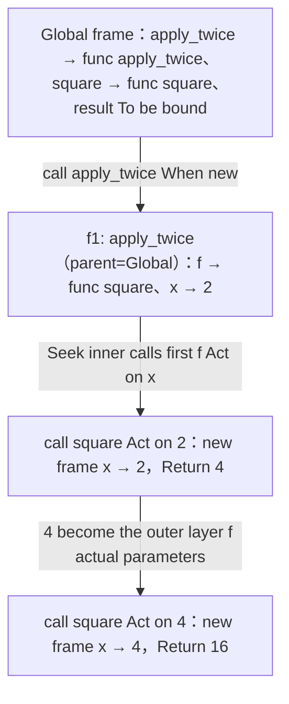
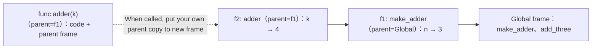
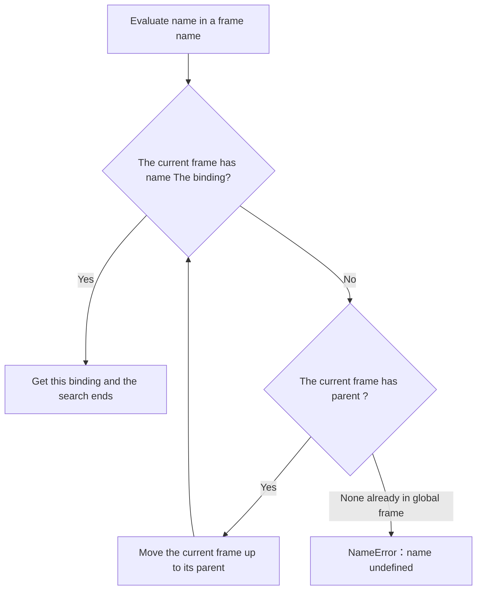
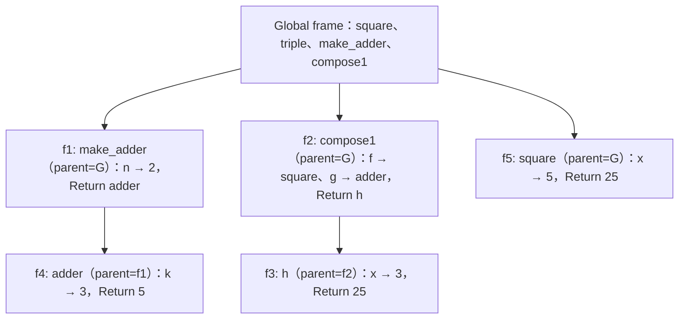

> **courses**: UC Berkeley CS61A · Structure and Interpretation of Computer Programs(Fall 2024)
> **This lecture**: Lecture 5 ｜ 36:42 ｜ Station B P 5 ｜ [Original video](https://www.bilibili.com/video/BV1sy411z7nA?p=5)
> **courseware**: `05-Environments_1pp.pdf` (11 pages, official PDF, page-by-page renderings see text illustrations)
> **subtitles**: Original English subtitles from Station B; this note is a reconstruction of Chinese writing, not a sentence-by-sentence translation.
> **Copyright**: The copyright of the course and courseware belongs to the UC Berkeley CS61A teaching team; this article is a secondary arrangement for learning purposes

## Quick overview of this lecture

- **Mastered**: The evaluation order of expressions and calling expressions, `def`  Statements, higher-order functions can receive or return functions (Lecture 4), and the starting method of drawing an environment diagram - a global frame, a local frame, and several name bindings.
- **Main line of this lecture**:
    - Use environment diagrams to explain higher-order functions: functions themselves are values, which can be bound to names or passed as arguments to another function.
    - Nested  `def`  Bring a new fact——**Function has parent frame**, and the parent frame is not necessarily a global frame.
    - Four parent frame rules and a set of five steps for drawing are summarized, turning "copying drawings according to Python Tutor" into "doing it by hand".
    - Drawing Scope Boundaries with Counterexamples: Why  `y`  It's obviously in the next frame, `g`  But can't see it.
    - Comprehensive case  `compose1`, `lambda`  Expression with  `def`  Similarities and differences, and Currying.
- **Key conclusions**: A function value = code + the current frame when it is created; a call = new frame + copied parent frame + bound formal parameters; name search = from the current frame  `parent`  As the chain goes up, the first binding that hits wins. If you go through the entire chain and still have nothing, then  `NameError`.

*(Reference time: 00:00:00 – 00:36:40｜Lecture 5)*

## 1. Class opening notice and warm-up: `print`, `None`  with  `or`  Evaluation of

*(Reference time: 00:00:00 – 00:01:44｜Lecture 5)*


Several things explained at the beginning of this lecture determine the rhythm of the next two weeks.


**The Hog project has been released**, each checkpoint is due next Tuesday; **Homework 2**  It has also been released and will end next Thursday. These two assignments are just for practicing the higher-order functions we just talked about in the previous lecture - writing them by hand is much more useful than watching videos.

On holiday on Monday, the lecturer will release an additional optional content: a longer example to illustrate "why people really need higher-order functions in a real, longer program." If you don't watch this video, it won't affect your subsequent study. It's not aimed at exams, it's just fun. Next Wednesday and Friday are two review classes, which are used to help sort out what has been learned; as for **The scope of the midterm exam is all the videos you have watched so far (including this lecture)**, after reading this lecture, you will have all the knowledge required for the exam.

The exam is on the 11th, and the teaching team will try to grade the papers and send them back on the 12th: because the 13th is the deadline for course selection and withdrawal, many students hope to know how well they have learned in class before then, so the goal is to return the midterm papers on Tuesday, the 12th. The lecturer’s reminder is very direct - the best way to prepare for the exam right now is to carefully complete the pile of homework at hand.

### 1.1 Review one page: `print`  The return value is  `None`


Before switching to the environment diagram, the courseware uses a one-page review to pin down the matter of "value" again. `print`  is a function that only produces side effects and does not return useful values: it displays the actual parameters on the screen, and then returns  `None`. This is especially important in environment graphs, because environment graphs track the flow of "values ​​and bindings" rather than characters on the screen; each line that appears on the screen is a side effect of a certain call and has nothing to do with the return value of that call.

Accompanying this is Python's false value list: `False`, `0`, empty string  `''`, and  `None`. The courseware writes "more to come" after this list to remind students that the set of false values ​​will expand and should not be regarded as a fixed four items.

> **Editor's note**: The content in §1.2 below corresponds to page 4 of the courseware. Among the available subtitles, the lecturer jumps directly from the course notice to the topic of the environment map. This warm-up does not leave a sentence-by-sentence spoken record. Therefore, this section is restored strictly according to the codes, annotations and evaluation rules on the courseware screen, and no comments other than subtitles are included.

### 1.2 Practice on real questions: in a long expression  `None`  chain of transmission

The courseware has been moved out of Question 1 of Fall 2022 CS 61A Midterm 1: Put three in one line  `print`  with a  `or`  Long expressions nested together and asked what exactly it prints.

```python
s = "Knock"
print(print(print(s, s) or print("Who's There?")), "Who?")
```

To dismantle it, only one rule is needed -`<left> or <right>`  Evaluation of:

1. Evaluate subexpression first  `<left>`.
2. if the result is true  `v`, the entire expression evaluates to  `v`, the right side is not touched.
3. Otherwise, the entire expression evaluates to the subexpression  `<right>`  value.

Note that it does not appear in the rules  `True` / `False`.`or`  What is returned is **the value of an operand itself**, rather than a Boolean judgment result - this is the whole difficulty of this type of question.


Split the expression tree from the inside out:

1. `print(s, s)`  Execute first: screen printing  `Knock Knock`, its return value is  `None`.
2. `or`  to the left is  `None` (false value), short circuit is not established, so find the right side  `print("Who's There?")`:Screen printing  `Who's There?`, the return value is also  `None`. whole  `or`  The value of the expression is therefore the one on the right  `None`.
3. middle layer  `print(...)`  received this  `None`  and print it out: the third line appears on the screen  `None`. The courseware posted a note here - "This None is passed to print!", because what readers are most likely to forget is "the value of the previous step will become the actual parameter of the next step." This layer  `print`  Return myself  `None`.
4. outermost layer  `print(..., "Who?")`  Received two actual parameters: just uploaded  `None`  with string  `"Who?"`, so print the last line  `None Who?`.

The output of the entire expression is:

```text
Knock Knock
Who's There?
None
None Who?
```

> **Editor's note**: The value of this expression itself is still  `None`. If you evaluate it directly in the interactive interpreter, an additional  `None`; running as a script file will not. This is where "printed things" and "expression values" are most easily confused.

## 2. Environment diagram of higher-order functions: `apply_twice`  three-step call

*(Reference time: 00:01:47 – 00:07:17｜Lecture 5)*

The lecturer gave the general outline of this lecture, which is also a key sentence for understanding the purpose of environment diagrams: **The whole reason environment graphs exist is to describe how higher-order functions work.**. The previous lectures on environment and box-needle diagrams are not to torture people, but because only it can accurately answer "what does the name point to when a function is passed around".

The good news is: **There is no need to change any of the existing rules.**. Higher-order functions don't require patches, they're just a natural corollary of the fact that functions are values ​​too.


### 2.1 `apply_twice`: Apply the function twice in succession

```python
def apply_twice(f, x):
    return f(f(x))

def square(x):
    return x * x

result = apply_twice(square, 2)
```

`apply_twice`  receive a function  `f`  and a single parameter  `x`, and then apply it twice: `f(f(x))`. The reason why it is a higher-order function is very simple - one of its actual parameters is itself a function.

It also needs a specific function for it to use, so there are familiar faces  `square`. After running this file, `square(3)`  Of course it's 9; and  `apply_twice(square, 3)`  It will be squared first to get 9, then squared again to get 81. In class, 3 was used for demonstration first, and then changed to 2 when drawing, because 2 squared twice gives 16, which is easier to calculate.

The call writing method is worth taking a second look at: `apply_twice(square, 2)`  What is evaluated here are two **value**——One is  `square`  The function object pointed to by this name is the number 2; it is not a "function name" or a "function call".

### 2.2 Environment map frame by frame

Finished executing two  `def`  After that, there are only two more names in the global frame, each bound to a function object. At this time **Nothing has been squared yet**, because the function body is not executed even once. The real work happens in the third line.




Spread the same picture into an indented structure, and the frames and bindings are clear at a glance:

- **Global frame**
    - `apply_twice` → `func apply_twice(f, x) [parent=Global]`
    - `square` → `func square(x) [parent=Global]`
- **f1: apply_twice [parent=Global]**
    - `f` → `func square(x) [parent=Global]` (a function **value**, not a single call)
    - `x` → `2`
    - function body  `return f(f(x))`  Execute in this environment
- **f2: square [parent=Global]**, `x` → `2`, return  `4`
- **f3: square [parent=Global]**, `x` → `4`, return  `16`

### 2.3 "Applying a user-defined function" is always three steps

The lecturer explained this process into a paragraph that can be memorized directly:

1. Create a new frame, in this case it is named  `f1`, dedicated to executing  `apply_twice`  function body.
2. Bind formal parameters to actual parameters: `f`  tied to  `square`  function object, `x`  tied to  `2`.
3. Execute the function body in the environment at the beginning of this new frame, that is, evaluate  `f(f(x))`.

Next is the evaluation order: to calculate  `f(f(x))`, you must first figure out the operator  `f`  What is it? Operand  `f(x)`  What is it again. inner layer  `f(x)`  It is a calling expression in itself, so we check it again  `f`——It is  `f1`  hit, the value is the function that squares, so what actually happens here is  `square(2)`, returns 4. This 4 will become the outer layer  `f`  actual parameters, `square(4)`  Returns 16, ultimately bound to the global name  `result`.

The rules for name lookup are stated explicitly here for the first time: **The current environment is a sequence of frames starting from the local frame and followed by the global frame**;To look up a name, look at the first frame first, then look at the second one, and so on until it is found. In this question  `f`  It happens to be in the first frame, so it's a one-step hit.

## 3. Nesting  `def`  With parent frame: Why can functions remember data?

*(Reference time: 00:07:20 – 00:16:30｜Lecture 5)*

Appeared in the previous lecture  `make_adder`, this lesson will take it apart completely. The lecturer first brought up a phenomenon that sounded a bit strange: calling  `make_adder(3)`  What you get is not a number, but a **function that adds 3**;This function seems to "install" a data 3.

```python
def make_adder(n):
    def adder(k):
        return k + n
    return adder

add_three = make_adder(3)
add_three(4)
```

`make_adder`  Responsibilities are **Create function and return**, it does not add itself. After loading, you can create functions on the spot: `add_three = make_adder(3)`, so  `add_three(4)`  Yes 7. `add_three(5)`  Yes 8. `add_three(6)`  Yes 9. The question arises - how can a function carry data?

### 3.1 Frame-by-frame tracking

`def make_adder`  Just create a function value, the function body is not executed. I really started drawing when  `make_adder(3)`  when called.


1. call  `make_adder(3)`, create a new local frame  `f1: make_adder [parent=Global]`, formal parameters  `n`  Tied to 3.
2. Entering the function body, the first statement is  `def adder(k)`. it's in **current frame**——Attention, yes  `f1`  Instead of global frame - create new function value  `func adder(k) [parent=f1]`, and put the name  `adder`  Bind to this value.
3. The awkward part at this moment: `f1`  There's something in it  `adder`, but no path from the global frame can reference it.
4. execute  `return adder`.`return`  What it does is to bring the information in the local frame back to "the frame where this function was originally called"; specifically for this question, it is to return to the global frame and evaluate it.  `make_adder(3)`  The position of this calling expression.
5. The return value is  `f1`  The one in  `adder`  function object, which is then bound to the global name by an ordinary assignment statement  `add_three`. The same function object therefore has two names: `f1`  inside  `adder`  with the global frame  `add_three`, which is completely legal.
6. call  `add_three(4)`: New frame  `f2: adder [parent=f1]`, `k`  Tied to 4. **its parent frame is not a global frame**, but  `f1`.
7. Ask for  `k + n`  The current environment when is  `f2 → f1 → Global`: `k = 4`  in  `f2`  hit, `n = 3`  in  `f1`  Hit, score 7.

The critical step is step 6: `make_adder`  I have returned a long time ago, but  `f1`  Didn't disappear. The reason is very straightforward - calling  `add_three`  A frame is created (`f2`), its  `parent`  point to  `f1`; and  `f1`  stored in  `n`.



> **Editor's note**: This phenomenon of "the function object carries the environment when it was defined, thus remembering the outer name" is usually referred to in textbooks and subsequent courses. **closure**. The oral broadcast of this lecture did not use this word, the lecturer only described the mechanism; the terminology is added here to facilitate the alignment with the subsequent chapters on higher-order functions.

### 3.2 Four parent frame rules

The courseware compresses the above reasoning into four items, which are worth memorizing one by one:

- Every user-defined function has a parent frame, usually the global frame.
- The parent frame of the function is **The frame in which it was defined (created)**.
- Every local frame has a parent frame.
- The parent frame of the frame = the parent frame of the called function (that is, the copied annotation).

The last one is the most common mistake when drawing: the frame  `parent`  It's not "who called me", but "where was the function I belonged to born that year".

### 3.3 Why do we need a parent frame?

The lecturer did a self-question and answer here and explained the design motivation thoroughly.

**Why does the function need a parent frame?**  Because only by writing down the "birthplace" can the correct frame be written when calling it.  `parent`.**Why does a frame need a parent frame?**  Because it determines how the "current environment" chain goes - evaluation  `k + n`  When, the environmental chain starts from  `adder`  Starting from the frame of , connected to its parent frame  `f1`, then connect the global frame; check  `n`  If it is not available in the first frame, you have to go to the second frame to find it.

On the other hand, this also explains an operational conclusion: everything needed to draw a call frame - function name (frame title), parent frame annotation, formal parameters -**It's all written down on the function value**. As long as you know which function is being adjusted, you will know how to draw its frame correctly.

> **Editor's note**: Both the courseware and the lecturer’s oral explanation include  `Global frame`  abbreviated as  `G`, the reason is very practical - it cannot fit on one screen. Abbreviations do not affect semantics, but they must be consistent in the same picture.

### 3.4 Five steps for drawing

The courseware gives a list of "how to draw environment diagrams", and writes the definition and call separately. Here it is organized into five steps that can be followed directly.


1. **Scan the top-level code and only create values but not execution bodies**. Every time I encounter  `def` (or  `lambda`), create a function value; the function body will not be executed until it is called. Finished executing two  `def`, the diagram should only have names and function values, without any calls.
2. **Write the function value in three paragraphs**: `func <name>(<形参>) [parent=<标签>]`.`parent`  fill in **The current frame at the time of definition**, rather than the frame at which it was called. For labels  `f1`, `f2`  Such numbering is because the same function may have many frames, and it is difficult to tell which one it is when writing the function name.
3. **Bind name to current frame**.`def`  This will be done automatically; `lambda`  Only the value is created, and the name must be given by the assignment statement outside (see §6.3 for details).
4. **When called, frames are built in a fixed order**: Create a new local frame, and write the (intrinsic) name of the called function in the title; put the  `parent`  Copied into frames  `parent`; Bind formal parameters to actual parameters one by one.
5. **Evaluate the function body in an environment starting with a new frame**. Look up names starting from the current frame, along  `parent`  Level by level, up to the global frame; the first hit binding is the answer, if there is no binding in the whole chain, it will be reported.  `NameError`. When the function returns, the value is returned to the caller, bound to the name on the left side of the equal sign, or becomes part of the upper-level expression.

| scene | function-valued  `[parent=…]` | calling frame  `[parent=…]` | Can I read the outer local name? |
|---|---|---|---|
| top layer  `def` (defined in global frame) | Global | Global | Only global names can be read |
| Nested  `def` (in  `f1`  (definition) | `f1` | `f1` | Can, `f1`  All bindings in are visible |
| The return value of the nested function is called again | `f1` (copied from function value) | `f1` | Can, `n`  still valid |
| Two parallel top-level functions call each other | Global | Global | No, the caller's local frame cannot be seen |

## 4. Local scope: `y`  It's obviously there, why can't I find it?

*(Reference time: 00:16:32 – 00:19:13｜Lecture 5)*

In order to push the "parent frame determines everything" thing to the extreme, the lecturer conducted a counterexample experiment: completely dismantling the nested definition and rewriting it into two parallel top-level functions.

```python
def f(x, y):
    return g(x)

def g(a):
    return a + y

f(1, 2)
```

This call will report an error. The error is to the effect of "`y`  is not defined". What it really wants to say is: in  `g`  Here, evaluate  `return a + y`  when, can't find  `y`  any value.

The absurdity can be seen at a glance: `x`  tied to 1. `y`  Tied to 2, all in  `f`  placed in the frame; call  `g`  Exactly  `f`  function body; enter  `g`  after  `a`  Tied to 1. All the values are in, `y`  It's in the frame "next to", but the program just says it doesn't exist.

There is only one answer: **That frame is not in the current environment**. The current environment consists of  `g`  It consists of two parts: the local frame and the global frame; check  `y`  Look first  `g`  The frame - there is none; looking at the global frame - there is none either; so an error is reported.

This leads to the formal definition of environment: **The environment is a sequence of frames**. Call a top-level function (there is no internal  `def`  set  `def`) The environment generated is a local frame followed by a global frame. Because of this, `f`  in function body  `y`  It’s completely private——`g`  The function body has no way to reference it.



Take this chain and  `make_adder`  By comparison, the difference between the two lectures is only one word: **Nested**.`adder`  The reason why the function body of  `n`, because it is in  `f1`  is defined in , so when it is called, the newly created frame  `f1`  as parent frame. `g`  The reason why the function body cannot be referenced  `y`, because it is defined in the global frame and does not exist in its frame chain at all  `f`  frame.

> **Editor's note**: This phenomenon is called in language design **Lexical scoping**- Name resolution only depends on where the function is defined. Another possible design is dynamic scope: if the parent frame is determined by "Who calls me", `g`  you can see the caller  `f`  frame, `y`  It will be 2. Python, Scheme, and modern mainstream languages ​​all choose lexical scope because it is the only way to determine the behavior of the code when reading it, without having to trace the entire call stack at runtime.

## 5. Big example: `compose1`  with two environment chains of length 3

*(Reference time: 00:19:17 – 00:24:25｜Lecture 5)*

The final case of this lecture is function composition - using a higher-order function to combine two single-parameter functions into a new function.

```python
def square(x):
    return x * x

def triple(x):
    return 3 * x

def compose1(f, g):
    def h(x):
        return f(g(x))
    return h
```

`compose1`  Receive two functions that each take only one parameter, defined in the body  `h(x)`, whose body is  `f(g(x))`, then return  `h`. Mathematically this is  $(f \circ g)(x) = f(g(x))$: Do it first  `g`, give the result to  `f`.

Three groups were demonstrated on site:

- `squipple = compose1(square, triple)`, acting on 5: first triple it to get 15, then square it to get  **225**.
- `tripare = compose1(triple, square)`, acting on 5: first square it to get 25, then triple it to get  **75**. When the order is changed, the result is completely different - this is the intuitive manifestation that the compound does not satisfy the commutative law.
- Can still  `square`  with  `make_adder(2)`  Compounding it up: we get a function of "add 2 first and then square", and act on 3 to get  $(3+2)^2 = 25$.

> **Editor's note**: The lecturer gave this third mixed function a name:  `square`  with  `adder`  The nickname is spelled out, and the subtitles transliterate the pronunciation into "squatter", according to the same set  `squipple` / `tripare`  word formation, it should be  `squadder`. It is written according to the word formation method here and does not affect the semantics.

### 5.1 Two calls within a call expression

What’s really worth drawing is how to squeeze all of the above into a single expression:

```python
compose1(square, make_adder(2))(3)
```

The order of evaluation is as follows.

1. Find the operator first  `compose1`——Very simple, a function in the global frame.
2. Find the first actual parameter again  `square`——It’s also very simple.
3. But the second argument itself is a calling expression  `make_adder(2)`, here you must "complete a call first". it opens  `f1: make_adder [parent=G]`, `n`  tied to 2, return  `adder`  function. So  `compose1`  The second actual parameter of is **a function object**, rather than a number.
4. Now you can call  `compose1(square, adder)`:Open  `f2: compose1 [parent=G]`, `f`  tie  `square`, `g`  tie  `adder`;in vivo definition  `h`(`func h(x) [parent=f2]`) and return it.
5. The outer expression has a final parenthesis, so 3 is used to call the just-returned  `h`:Open  `f3: h [parent=f2]`, `x`  tied 3.
6. Ask for  `f(g(x))`: Calculate the inner layer first  `g(3)`, `g`  in  `f2`  It was found out  `adder`, so open  `f4: adder [parent=f1]`, `k`  tie 3; `k + n`  in  `f4 → f1 → G`  Calculated on-chain  `3 + 2 = 5`.
7. Give 5 again  `f`: `f`  in  `f2`  It was found out  `square`, open  `f5: square [parent=G]`, returns 25.



The last observation made by the lecturer is: there is **Two different environments, each of length 3**, they took over and calculated 25——`f3 → f2 → G`  Responsible for execution  `h`  body and find  `f`, `g`, `x`; `f4 → f1 → G`  Responsible for execution  `adder`  body and find  `k`, `n`. The two chains share the same global frame, but each has its own layer in the middle.

## 6. `lambda`  Expression: Anonymous function and  `def`  face-to-face confrontation

*(Reference time: 00:24:28 – 00:32:36｜Lecture 5)*


All previous functions are  `def`  Everything that comes out has a name. In this section, we want to ask: Can it be used? **assignment statement** Tie a function to a name, like  `x = 10`  That?

```python
x = 10
square = x * x
```

result  `square`  Not a function, but 100. The reason is not mysterious: the assignment statement evaluates the right side first, and  `x * x`  The result is a number, so what is tied up is this number.

Then change your thinking: let the right hand side become "an expression whose evaluation result is a function". `lambda`  Keywords exist for exactly this.

```python
square = lambda x: x * x
```

this time  `square`  It’s really a function, `square(4)`  Got 16.

### 6.1 Grammar and pronunciation

`lambda x: x * x`  The whole is one **expression**. The pronunciation is: "One with  `x`  For formal parameters, return  `x * x`  function of the value. "

It has two common uses: first, to bind a name immediately as above for later reference; second, to use it directly as an operator and call it in the same expression:

```python
(lambda x: x * x)(4)      # 16
```

This way of writing looks awkward, but it is extremely natural in high-order function scenarios - because it saves the step of "first give a name and then use it again".

### 6.2 Three restrictions

- **No  `return`  Keywords**. Write the return value expression directly after the colon. This is a quirk of the syntax that's easy to stumble upon when learning.
- **The function body can only be a single expression**. Therefore  `lambda`  What is created is always a "very simple function" - it can only evaluate an expression.
- **cannot contain statements**. I want to write it in the function body  `while`, if you want to write multiple lines of logic, you must return  `def`. This is  `lambda`  relatively  `def`  The most substantial limitation.

The lecturer made an observation at the linguistic level in passing: `lambda`  It is actually not very common in Python and is more commonly used in daily life.  `def`; But in some languages it is a fundamental construct, while other languages that have not had it for a long time have added it one after another just because people realized its usefulness.

### 6.3 Face to face: `lambda`  with  `def`  What's the difference?

The courseware puts the two writing methods side by side for a "showdown". The conclusion is: **Both are almost identical**. The same domain, the same value range, the same behavior; the rules for the parent frame when creating a function are exactly the same - "the current frame at the time of definition".

| criterion | `square = lambda x: x * x` | `def square(x): return x * x` |
|---|---|---|
| grammatical identity | Expression (expression), evaluated to obtain the function object | A statement accomplishes two things when executed |
| Who creates the function | `lambda`  Keyword creation, function starts **no name** | `def`  Create a function and bind the name at the same time |
| Who binds the name | outer assignment statement  `square = …`  Responsible for binding | `def`  Complete the binding yourself |
| inner name | None, displayed as  `λ` (echoed as  `<lambda>`) | `square` |
| The parent frame of the function value | The current frame at which definition | Current frame at definition (exactly the same) |
| Can I write multiple statements? | No, only one expression | Can, can contain  `while`  Wait for any statement |
| Environment map appearance | frame  `square` → `func λ(x) [parent=…]`, the calling frame title is  `λ` | frame  `square` → `func square(x) [parent=…]`, the calling frame title is  `square` |
| Typical uses | A temporary small function passed on the spot to a higher-order function | Functions that require reuse, documentation strings, and long logic |

The only thing that can be called a "difference" is **intrinsic name**——That is, the name you see when you directly echo the function value. `def`  The function output is echoed as  `<function square>`, `lambda`  The output echo is  `<function <lambda>>`, because it had no name at all when it was born, and the name was assigned by the subsequent sentence.

```python
>>> square = lambda x: x * x
>>> square
<function <lambda> at 0x...>
>>> def square(x):
...     return x * x
...
>>> square
<function square at 0x...>
```

> **Editor's note**: The address in the echo will change every time it is run, here it is  `0x...`  Omit; all that matters is the name in the angle brackets.

This small difference affects the drawing: `lambda`  In the version of the environment diagram, the function value is written as  `func λ(x) [parent=G]`, the frame header that calls it also writes  `λ`, instead of  `square`. name  `square`  still appears in the frame (that is the binding left by the assignment statement), it is the object that is actually searched for during evaluation; `λ`  Just a label to tell "which frame this is". The lecturer's evaluation of this is "the difference is insignificant", but it does correspond to a fact: `def`  The function that comes out has a name at the moment it is created. `lambda`  It will not come out until the assignment statement ends.

### 6.4 Two tracking exercises in the demo clip

There are two Python Tutor links attached to the footer of page 9 of the courseware. Their code skeletons are worth practicing - both of them test "who is the parent frame?"

The first one:

```python
def apply_twice(f, x):
    return f(f(x))

x = 3
result = apply_twice(lambda y: x * y, 2)
```

`apply_twice`  in the frame  `x → 2`, there are in the global frame  `x → 3`. that  `lambda`  is in **module layer** written, its parent frame is the global frame, so within its body  `x`  What is found is the global 3, not  `f1`  2 in. So  `f(2) = 3 * 2 = 6`, `f(6) = 3 * 6 = 18`, `result`  for 18. If you determine the parent frame by "Who called me", the answer will become 2 times 2 times 2 - this is the watershed between lexical scope and dynamic scope.

The second rule:

```python
bear = -1
oski = lambda print: print(bear)
bear = -2
oski(abs)
```

Formal parameter name  `print`  Shaded built-in function: call  `oski(abs)`  When, in the local frame  `print`  tied to  `abs`. in function body  `bear`  If it is not in the local frame, find the global frame along the parent frame chain; and the global  `bear`  At this moment it has been changed to -2, so what is actually executed is  `abs(-2)`, the result is 2.

> **Editor's note**: These two pieces of code come from the Python Tutor link printed in the footer of page 9 of the courseware (`#code=`  Some are URL-encoded source codes), and the instructor runs them directly on site, so there is no sentence-by-sentence explanation in the subtitles. The above deduction is strictly based on the rules of environmental diagrams, and no facts outside the courseware are introduced.

## 7. Currying: Split multi-parameter functions into one-way pipes

*(Reference time: 00:32:44 – 00:36:40｜Lecture 5)*

The lecturer's ending method is "old tradition": the first two lectures have been implemented  `make_adder`, this lecture is implemented again, but this time instead of using  `lambda`.

```python
def make_adder(n):
    return lambda k: n + k
```

Effects and nesting  `def`  The version is exactly the same, minus the middle name. So we can write an expression like this:

```python
make_adder(2)(3)      # 5
```

Notice its shape -**The operator itself is a calling expression**.`make_adder(2)`  First return a function that "will add 2", followed by  `(3)`  Apply it to 3 immediately. To actually get a number, it must be called twice.

Compare it and you will understand: `add`  It is an ordinary function that takes two parameters at a time and directly returns their sum.

```python
from operator import add

add(2, 3)             # 5
```

> **Editor's note**: `from operator import add`  This line of import is the consistent usage of CS61A. In the subtitles, the lecturer only said "`add`  is a function that takes two arguments and returns their sum", the import statement was not read out.

`make_adder`  with  `add`  The relationship between them is not a coincidence, but a universal correspondence: **One side is a function that "takes only one parameter and returns a function", and the other side is a function that "takes multiple parameters at a time and gives the answer directly"**. This relationship can be written in code, so we have  `curry2`.

```python
def curry2(f):
    def g(x):
        def h(y):
            return f(x, y)
        return h
    return g
```

The 2 in the name means "incoming  `f`  Eat two parameters". Look at it layer by layer: `curry2`  definition  `g` (takes a parameter) and returns it; `g`  definition  `h` (eats another argument) and returns it; `h`  before actually calling  `f(x, y)`. The call chain therefore becomes three layers.

```python
m = curry2(add)
add_three = m(3)
add_three(4)          # 7
```

`m`  It's the "curried version" `add`", which behaves the same as  `make_adder`  Exactly the same.

### 7.1 Add another layer: Nesting  `lambda`

The three above  `def`  In fact, it can be condensed into one line:

```python
curry2 = lambda f: lambda x: lambda y: f(x, y)
```

Pronounced "receive" `f`, returns a receive  `x`  function, which returns a function that receives  `y`  function, the innermost layer returns  `f(x, y)`". This is related to  `def`  The versions are equivalent on the environment graph, except that the function values are written as  `λ`, the frame titles are all  `λ`.

| criterion | `add(x, y)`  Two parameter function | `make_adder(n)` /curried  `m(3)` |
|---|---|---|
| Receive several parameters at a time | two | One, given in two installments |
| intermediate product | None | one still carries  `n`  function object |
| How many calls does it take to get the answer? | once | twice |
| Can it be partially applied | Can't | Can, `m(3)`  Just some applications |
| Return value type | number | Function (the last layer only returns the number) |
| Which outer frame depends on | Just global frame | Depend on  `n`  the frame |

### 7.2 Terminology and a little history

The definition given by the instructor is directly quotable: **Currying is the process of transforming a multi-parameter function into a single-parameter higher-order function that returns a function that continues to receive the remaining parameters.**

There is a twist in the origin of the name: currying was not discovered by Haskell Curry, but by Moses Schönfinkel. Later, Haskell Curry rediscovered and popularized it, so some people think it should be called "Schoenfinkeling".

## Summary

*(Reference time: 00:00:00 – 00:36:40｜Lecture 5)*

- **Create the value first, then the execution body**: `def`  It only does two things - create a function value and bind the name to the current frame; the function body will not run until it is called. see  `def`  Just add a function value to the graph, not a frame.
- **Function value = code + parent frame**: The parent frame records the "place of birth". This is the only reason why the function can remember the outer data, and it is also the entire mechanism of closure.
- **The three steps of calling never change**: New frame, copy  `parent`, tied formal parameters. frame  `parent`  Copied from the annotation on the called function value, never copied from the caller's frame.
- **Name search is a chain search**:Current frame → `parent` → … → In the global frame, the first one to hit wins; if there is still nothing after completing the entire chain, then  `NameError`.
- **Scope is determined by where it is defined**:Top-level parallel  `g`  Can't see  `f`  of  `y`; Only nested definitions allow the inner function to obtain the outer local name.
- **For frame tags  `f1`, `f2`, do not use function names**: A function with the same name will have multiple frames, so the number can be clearly pointed out.
- **`lambda`  is "the expression of the constructor"**: The body can only be an expression. If you want to write a statement, fall back to  `def`;The two are completely equivalent except for the intrinsic names.
- **The value of currying is "partially applied"**: put  `f(x, y)`  split into  `g(x)(y)`, allowing the intermediate state to be hung on the function object and can be reused repeatedly.

## Attached: Slide index for this lecture

*(Reference time: 00:00:00 – 00:36:40｜Lecture 5)*

| page | content | Appear location |
|---|---|---|
| 1 | Title page: Environments | §1 Beginning |
| 2 | Announcements transition page | §1 |
| 3 | Print and None Review transition page | §1.1 |
| 4 | Midterm questions Q1: `or`  Evaluate and  `None`  spread | §1.2 |
| 5 | Environments for Higher-Order Functions transition page | §2 Beginning |
| 6 | `apply_twice`  environment map | §2.2 |
| 7 | Nested  `def`  environment graph and four parent frame rules | §3.1 |
| 8 | How to draw an environment diagram (list of rules for definition and calling) | §3.4 |
| 9 | Lambda Expressions (Demo) transition page | §6 Beginning |
| 10 | Environment Diagram Practice transition page | Appendix |
| 11 | Complete annotation of the environmental diagram of the mid-term question Q2 | Appendix |

## Appendix: Slides not shown in class

*(Reference time: 00:36:17 – 00:36:40｜Lecture 5)*

> **Editor's note**: Pages 10 and 11 at the end of the courseware are a set of exercises: one page divided into sections and one page of the complete annotated environment diagram of the midterm question Q2. The video of this lecture ends with the definition of currying and the "Schönfinkeling" anecdote. There is no corresponding explanation paragraph in the subtitles, so the anchor point of this section is the last paragraph of the video (right next to the beginning of the exercise paragraph). The following deduction is strictly based on the code on the left side of the courseware and the marked frame pictures on the right side and is restored frame by frame.

The exercise question requires finding "use  `f(y)(lambda z: z - y + 10)`  The largest positive integer that is not 0  `y` (less than 10)".


The courseware writes the intention of this code into three lines of comments: `# Find the largest positive y below 10`, `# for which f(y)(lambda z: z - y + 10)`, `# is not 0.`. To avoid the first line  `#`  Treated as a title by the renderer, these three lines are moved and referenced outside the code block, and the rest of the code is retained verbatim.

```python
def f(x):
    """f(x)(t) returns max(x*x, 3*x)
    if t(x) > 0, and 0 otherwise.
    """
    y = max(x * x, 3 * x)
    def zero(t):
        if t(x) > 0:
            return y
        return 0
    return zero

y = 1
while y < 10:
    if f(y)(lambda z: z - y + 10):
        max = y
    y = y + 1
```

The first iteration (`y = 1`) complete deduction:

1. in global frame  `y → 1`, `while`  The conditions are established. Ask for  `f(y)`: New  `f1: f [parent=G]`, `x → 1`.
2. in  `f1`  execute in  `y = max(x * x, 3 * x)`.`max`  Find the built-in function in the global frame; `1 * 1 = 1`, `3 * 1 = 3`, so  `f1`  inside  `y → 3`.**It is related to the global frame  `y = 1`  are two unrelated bindings**——Same name, different frames.
3. execute  `def zero(t)`: in **current frame  `f1`**  Created in  `func zero(t)（parent=f1）`, and put the name  `zero`  tied to  `f1`. The function body is not executed at this time.
4. `return zero`  Return the function value to the global frame and enter  `if`  The second call in the condition  `f(1)(lambda z: z - y + 10)`. that  `lambda`  Written on line 17 (courseware number) of the module layer, so its parent frame is the global frame: `func λ <ln 17>(z)（parent=G）`.
5. New  `f2: zero（parent=f1）`, `t → λ`. execute  `if t(x) > 0`: `x`  along  `f2 → f1`  1 is found, so call  `λ(1)`, new  `f3: λ <ln 17>（parent=G）`, `z → 1`;ask for  `z - y + 10`  time  `z`  Score 1 in this frame, `y`  along  `f3 → G`  Find the global 1, get  `1 - 1 + 10 = 10`.
6. return to  `f2`:10 \> 0 established, executed  `return y`.`y`  in  `f2`  There is no one in it, along the  `f2 → f1`  found  `f1`  of  `y = 3`, `zero`  Returns 3 if the condition is true.
7. execute  `max = y`. This line is at the module level, so in **global frame** name  `max`  Tied to 1 - it masks the built-in  `max`  function. subsequently  `y = y + 1`, `y`  becomes 2.
8. second round  `y = 2 < 10`, ask for  `f(2)`: New  `f4: f [parent=G]`, `x → 2`. The first line of the executable body  `max(x * x, 3 * x)`  when, `max`  It is already an integer 1 in the global frame, and calling it triggers  `TypeError`. Right side of courseware  `f4`  The Return Value is left blank, which corresponds to this moment.


| frame | when created | key binding | what does it prove |
|---|---|---|---|
| `f1: f` | first time  `f(1)` | `x → 1`, `y → 3` | `zero`  The parent frame is here, not the global frame |
| `f2: zero` | `zero(λ)` | `t → λ` | What is returned is  `f1`  inside  `y = 3` |
| `f3: λ <ln 17>` | `t(1)`  trigger | `z → 1`, return 10 | `λ`  The parent frame is  `G`, so it reads  `y`  is global 1 |
| `f4: f` | second time  `f(2)` | `x → 2` | overall situation  `max`  Has been rewritten, the function body collapses here |

This question tests all the key points of this lecture at once: different frames with the same name, parent frames of local frames copied from function values, `lambda`  The parent frame depends on where it is written, and the knock-on consequences of rebinding the global name.
