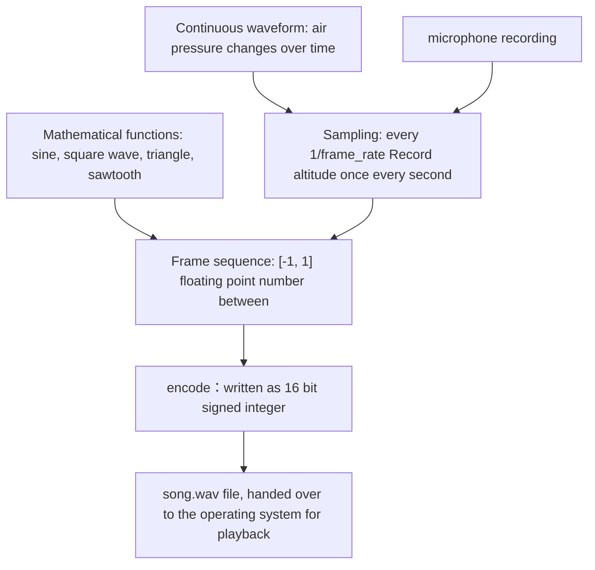
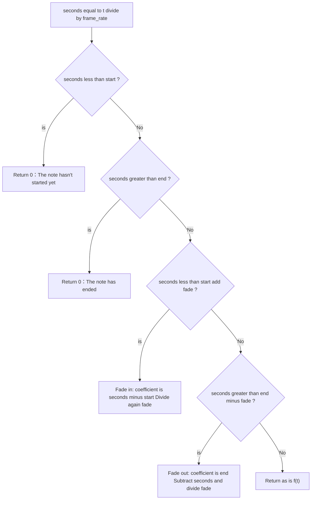
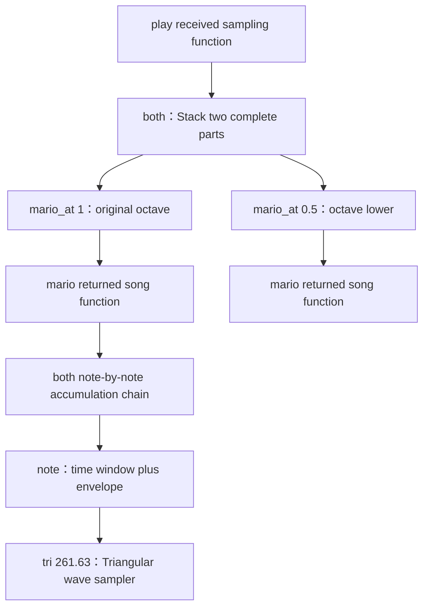

> **courses**: UC Berkeley CS61A · Structure and Interpretation of Computer Programs(Fall 2024)
> **This lecture**: Lecture 6 ｜ 14:36 ｜ Station B P 6 ｜ [Original video](https://www.bilibili.com/video/BV1sy411z7nA?p=6)
> **courseware**: No official courseware (elective topics, `pdf_pages = 0`); the main text is replaced with code blocks, formulas and tables to take over the illustrations of the original slides
> **subtitles**: Original English subtitles of station B (14:36, paragraph 157); this note is a Chinese written reconstruction, not a sentence-by-sentence translation
> **Copyright**: The copyright of the course and courseware belongs to the UC Berkeley CS61A teaching team; this article is a secondary arrangement for learning purposes

## Quick overview of this lecture

*(Reference time: 00:00:01 – 00:00:12｜Lecture 6)*

- **Mastered**: The function is a first-class value (can pass parameters and can return), `lambda`  and closure, `make_adder`  This type of higher-order function (Higher-Order Function) returns the function, and the environment diagram reading method of "the name is bound to the value and the function is bound to the parent environment".
- **Main line of this lecture**:
    - A sound is a function of "time → amplitude", so "synthetic sound" is translated into "constructor function";
    - Use frame rate  `frame_rate`  Discretize the continuous function into a frame sequence and write it into  `.wav`  documents;
    - use  `tri`  To create a single waveform, use  `both`  To add two waveforms to get a chord, use  `note`  Cut the waveform into the time window and add fade-in and fade-out;
    - Use time pointer  `z`  with  `both`  are repeatedly accumulated, folding the whole piece into **one** function;
    - use  `mario_at(octave)`  Parameterize the frequency multiplier and complete the transposition in one line of code.
- **Key conclusions**: The whole song is being  `play`  The frame-by-frame call is not preceded by data, but by a **Function not yet evaluated**. This separation of "description" and "evaluation" is where high-order functions are truly valuable.

## 1. The origin of the problem: Why should we work "in function space"?

*(Reference time: 00:00:13 – 00:00:27｜Lecture 6)*

The most common question asked by students is: What are the uses of higher-order functions? `make_adder`  Very cute, but since we still have to figure it out in the end  `x + y`, why not just put  `x`  and  `y`  To add, do you have to go around in a circle first to create a function and then call it to get a number?

Instead of a direct debate, the lecturer took a harder line of evidence: constructing a slightly longer example than usual, in which the definition **pile** function, making the entire program **Always stay in function space**, it is not until the last step of the program that the function is turned into a specific numerical value. This example is sound generation - writing a piece of music into a  `.wav`  file.

There is something about choosing sound rather than continuing to add. In addition, the "function" seems to be a redundant middle layer, because it can be calculated in one step; on the contrary, sound synthesis cannot be completed in one step for any piece of music: it requires waveforms, multiple parts, rhythm, and pitch transposition. Each item is naturally a "numeric to numerical" transformation. When these transformations are all written as functions, combining them only requires writing function calls, without writing any framework code.

Every new function that appears later in this lecture—`tri`, `both`, `note`, `mario_at`——They all only do the same thing: accept a function or number and return **a new function**. In the whole program there are only  `play`  Will truly "ask for value". You can use a table to put these two writing methods together:

| criterion | Evaluate immediately: calculate directly  `x + y` | Function space: `add(x)`  Return  `lambda y: x + y` |
|---|---|---|
| When will the results occur? | The moment of calling | is not evaluated until the last moment |
| Participating combinations | Can only deal with numerical values | Can be combined with any other function |
| Can the parameter structure be reused? | No, rewrite every time | Yes, the closure remembers the previously bound name |
| Ability to express complex structures | Scaling linearly with scale | Isomorphic to the musical structure, almost no growth |
| Debugging mode | Look directly at the return value | Pick a few points to sample and evaluate and then observe |
| Examples of this lecture | Calculate a pitch by hand | `tri` → `both` → `note` → `play`  the entire pipeline |

## 2. How sound becomes digital: waveforms, samples and WAV

*(Reference time: 00:00:28 – 00:01:57｜Lecture 6)*

To do this, you must first have a file format that can implement sound. The lecturer chose  **WAV**(`.wav`): It is a standard format for encoding sound, not used much today because of the large file sizes - it **No compression at all**. The disadvantage is the other side of the advantage: no compression means that the format is extremely simple, so simple that the program can write a few fields in the file header by itself, and then pour the sound into it byte by byte.

The physical form of sound is a **waveform**: Air pressure continuously fluctuates with time, and the waveform has a height at any time, which is called **amplitude**. The computer can't store continuous things, so we have **Sampling**: Only record the height of the wave at some specific moments, turning the continuous curve into a series of points. The lecturer specifically pointed out that the dots on the screen were samples and thanked Wikipedia for providing the schematic image.

How dense should the sampling be? The criterion is not mathematical accuracy, but "the sound is right to the human ear." The instructor said that it is necessary to take enough samples to approximate the waveform structure to a level that sounds comfortable. Here he gave two orders of magnitude: one is tens of thousands of points per second, and the other is that the following 2 seconds of music will call the sampling function more than 20,000 times.

> **Editor's note**: In the subtitles, the lecturer said "11,000 samples per minute", but from the following text, "more than 20,000 calls are required", which obviously means **per second**. The frame rate in the course demonstration file is taken  `frame_rate = 11025`, 2 seconds is 22050 frames, which is completely consistent with "more than 20,000 times".

There are two sources of waves. One is real-world recording, which captures the pressure changes received by the microphone into frames; the other is **Generate from zero by mathematical function**——This is exactly what we do in this lecture, because only the latter needs to write the function. The most commonly used basic waveforms in mathematics are: triangle, sine, square, and sawtooth. They are widely used in all kinds of electronic music. The lecturer chose the triangle wave for demonstration, and the reason was very straightforward: he felt that the triangle wave sounded better than the other three.

| waveform | shape within a period | What parameters determine pitch? | Lecturer's handling |
|---|---|---|---|
| sine wave | Smoothly rise to the peak and then smoothly fall back to the trough | Frequency | Not used |
| square wave | Instantaneous jump between two extreme values | Frequency | Not used |
| triangle | Rise to the peak at a constant speed, then drop back to the valley at a constant speed | Frequency | Adopted because it sounds the best |
| sawtooth | Rising to the peak at a constant speed and falling back to the bottom instantly | Frequency | Used as an intermediate product of the triangle wave |

> **Editor's note**: The second column of the above table is just the mathematical definition of these four waveforms. The lecturer only named them and explained that they all have uses in electronic music, without playing them one by one to compare the timbres. The actual kind of waveform used (triangular wave) is expanded on in Section 3.6.

Draw the entire pipeline, which is the three sections of "continuous waveform → discrete frame → encoding → file":



## 3. Waveform is a function: `tri`, frame rate and sampler

*(Reference time: 00:01:58 – 00:05:26｜Lecture 6)*

### 3.1 First understand the three standard library tools

The instructor did not type the code line by line, but only explained the three parts that this demonstration depends on. The first one is  `wave`  Module, responsible for opening and writing  `.wav`  Documentation, the instructor said "There is a whole module dedicated to dealing with waves, you can read it". The second one is  `struct`  Module, responsible for encoding integers according to the byte format required by WAV files. The third one is  `math.floor`, the opposite of rounding up - it rounds a number to "the largest integer less than the value", and the subsequent triangle wave formula relies on it to fold the phase back into one cycle.

```python
from wave import open
from struct import Struct
from math import floor

frame_rate = 11025
```

### 3.2 Frame rate: Cut continuous time into frames

`frame_rate`  is **Sampling rate**, which answers a very simple question: "How high is the waveform at this moment" recorded how many times per second. This number should not be too small, otherwise the ear will hear a step; nor should it be too large, because a precision that exceeds the resolution of the human ear is just a waste of disk. The demo takes 11025, which is 11025 frames per second.

Once the frame rate is available, "time" is split into two coordinates: frame number  `t`  is **discrete integer**, seconds  `t / frame_rate`  is **continuous time**. All subsequent functions convert back and forth between the two——`tri`  Receive frame number, `note`  Convert the frame number back to seconds to determine note boundaries. This conversion relationship is the foundation of the entire program design and is worth remembering separately.

### 3.3 `encode`: Write the amplitude as two bytes

```python
def encode(x):
    """Encode float x between -1 and 1 as two bytes."""
    i = int(16384 * x)
    return Struct('h').pack(i)
```

The lecturer said something very interesting here: "I recommend you not to read this paragraph." Of course, you can read it if you insist. Its whole job is to put  `[-1, 1]`  The floating point amplitude between is linearly amplified into an integer and then packed into two bytes. What really needs to be remembered is not the details of the bit operations; **contract**: The incoming number must fall within  `[-1, 1]`, the outgoing byte sequence is in a format acceptable to WAV.

> **Editor's note**: Coefficient 16384 is  $2^{14}$, corresponding to about half of the upper limit of 32767 for 16-bit signed integers, deliberately leaving a double margin. This is not a random choice - the total amplitude of multi-voice summing may exceed 1 (see Section 5.4), and leaving a margin can avoid truncation after an integer overflow. In the subtitles, the lecturer said that "you can check the Python documentation" for this part. The function body itself was not pronounced verbatim. It is completed here based on the course demonstration file.

### 3.4 `play`: A loop only responsible for "when to ask"

```python
def play(sampler, name='song.wav', seconds=2):
    """Write the output of a sampler function as a wav file."""
    out = open(name, 'wb')
    out.setnchannels(1)
    out.setsampwidth(2)
    out.setframerate(frame_rate)
    t = 0
    while t < seconds * frame_rate:
        sample = sampler(t)
        out.writeframes(encode(sample))
        t = t + 1
    out.close()
```

three lines  `set...`  Yes Write header: mono, 2 bytes per sample, frame rate 11025. Do four things in the loop: ask  `sampler(t)`  Get the height of this frame, encode it into bytes, write it to a file, and add one to the frame number. The loop condition is  `t < seconds * frame_rate`, that is, "how many frames are there in the whole song" - the lecturer's statement is "start from the beginning of the song and go through all  `t`, that is, the number of frames multiplied by the frame rate in seconds."

The most noteworthy thing about this code is that it **Don't know** thing. it doesn't know  `sampler`  Is it a triangle wave or a chord? I don’t know if it is a closure or a high-order function call nested layer by layer. I don’t know if this function is written correctly. It relies on only two conventions: the parameter is a **function**, the return value falls in  `[-1, 1]`. This is a textbook example of inversion of control: giving the decision of "where the value comes from" to the caller. `play`  Only the responsibility of "when to ask, how many times to ask, and how to save" is retained.

In other words, `play`  That's what it's about **evaluator**: It's responsible for turning descriptions into data, while all design happens elsewhere.

### 3.5 Sampler contract: `[-1, 1]`  what does it mean

The lecturer drew a waveform by hand, and then explained that if that wave was to be synthesized, the values given by the sampler on adjacent frames might be  `0`, `1/2`, `1`, `3/4`, `1/2`, `2/3`...This is the intuitive meaning of "sample": there is only one number in each frame, which tells the sound card how far the diaphragm should be pushed at this moment.

Why use them uniformly?  `[-1, 1]`  Rather than another scale?

- `0`  Indicates mute, `±1`  Represents the upper limit of amplitude. This convention turns "volume" into a multiplier that can be extracted independently. The waveform's **shape** with **loudness** Hence decoupling;
- After normalization, the same waveform function can be used unchanged with another amplitude, without caring about the actual bit depth of the sound card;
- When multiple waveforms are added together, whether the range is exceeded can be immediately seen from the numerical value.

This contract is also the "interface card" of the whole story: as long as it is adhered to, any function is a legal voice.

### 3.6 Triangular wave: how many frames does one cycle take?

The question raised by the lecturer is: How to calculate the sampling value of the triangle? The answer is that you need to know two things first -**Frequency** determine the pitch, **Amplitude** Determine the volume. What remains is a "fairly straightforward" formula: calculate how many time steps it takes for the triangle wave to repeat once, that is, how many frames a cycle occupies, and then fold back time according to this cycle.

frame rate  $f_r$, pitch frequency  $f$, then the number of frames in one cycle is


$$
p = \frac{f_r}{f}
$$


use  $p$  Fold the frame number into a sawtooth phase, and then take the absolute value and fold it back to get a triangle wave:


$$
s(t) = \frac{t}{p} - \left\lfloor \frac{t}{p} + \frac{1}{2} \right\rfloor,\qquad s \in \left(-\tfrac{1}{2}, \tfrac{1}{2}\right]
$$


$$
\tau(t) = 2\,\left|2\,s(t)\right| - 1,\qquad y(t) = A\,\tau(t)
$$


`saw_wave`  That’s it  $s(t)$: It rises at a constant speed and suddenly falls back when it reaches the boundary. It is a sawtooth wave. `abs`  Flip the negative half of the sawtooth up into a back-and-forth shape (this is why  $s$  with  $-s$  The absolute values are the same). Finally multiplied by the amplitude  $A$, the output range is exactly  $[-A, A]$.

```python
def tri(frequency, amplitude=0.3):
    """A continuous triangle wave."""
    period = frame_rate / frequency
    def sampler(t):
        saw_wave = t / period - floor(t / period + 0.5)
        tri_wave = 2 * abs(2 * saw_wave) - 1
        return amplitude * tri_wave
    return sampler
```

This function is a typical **waveform factory**: It accepts two numbers (frequency, amplitude) and returns a sampling function. The frequency and amplitude are remembered by the closure, and each time thereafter  `play`  Calls are only made using the ones recorded in the environment.  `period`  and  `amplitude`  Find a number.

> **Editor's note**: The subtitles only describe the three steps (first create a sawtooth wave, take the absolute value, and multiply the amplitude) without reading out the expression word for word. The above writing method is taken from the course demonstration file and checked with the numerical form printed on-site by the instructor 00:05:49–00:06:07: $t = 0$  time  $s = 0$, $\tau = -1$, output  $-0.3$, exactly the first number that appeared on his screen.

Substituting the first few key phases in, you can see why this curve "looks like a triangle":

| Frame number  $t$ | Phase  $t/p$ | sawtooth  $s(t)$ | fold  $\tau(t)$ | output($A=0.3$) |
|---|---|---|---|---|
| `0` | 0 | 0 | -1.00 | -0.30 |
| `0.25p ≈ 11` | 0.25 | 0.25 | 0.00 | 0.00 |
| `0.5p ≈ 21` | 0.5 | -0.5 | +1.00 | +0.30 |
| `0.75p ≈ 32` | 0.75 | -0.25 | 0.00 | 0.00 |
| `1p ≈ 42` | 1 | 0 | -1.00 | -0.30 |
| `1.5p ≈ 63` | 1.5 | -0.5 | +1.00 | +0.30 |

The rhythm of the triangle wave can be seen from the table: from frame 0 to half cycle  $-0.3$  Rise to  $+0.3$, half a cycle to one cycle and then back down at a constant speed  $-0.3$. The slope is a constant, which is where the word "triangle" comes from.

### 3.7 Pitch: C is 261.63 Hz

The instructor added a line of constants to pin the abstract frequency to a specific note: the frequency of middle C is  `261.63`. His explanation was simple - "It's just a fact of tuning instruments in the modern world." With it, `tri(261.63)`  It's no longer an abstract waveform, but that C on the piano.

> **Editor's note**: 261.63 Hz corresponds to C4 under the twelve-average law (based on A4 = 440 Hz). Equal interval correspondence **fixed multiple of frequency** Rather than a fixed difference, so going up one octave is the frequency multiplied by 2, and going up one semitone is multiplying  $2^{1/12}$——The transposition in section 7.5 is based on this property. The subtitles only read the frequency of C, and the other two tones in the code below are supplemented by the same equal temperament table.

```python
c_freq, e_freq, g_freq = 261.63, 329.63, 392.00
```

## 4. First sound: 100 frames of triangle wave and  `song.wav`

*(Reference time: 00:05:31 – 00:06:30｜Lecture 6)*

Before playing the entire song, the lecturer did something that seemed superfluous: print out the triangle wave. It’s written in three paragraphs:

```python
t = 0
while t < 100:
    print(c(t))
    t = t + 1
```

100 frames is only about 9 milliseconds at 11025 Hz, so short that you can't hear the shape at all; but it's just long enough to see two or three cycles. The period of C is  $11025 / 261.63 \approx 42$  Frame, 100 frames is about 2.4 cycles, so the following will appear on the screen:

- from  `-0.3`  Start (this is the amplitude, the lecturer specifically pointed out "because that is my amplitude");
- all the way up to  `0` (about frame 11);
- Continue to rise to  `+0.3` (About frame 21, half cycle);
- fall back again  `-0.3` (About frame 42, one cycle);
- Repeatedly and then rose to  `+0.3`.

This output corresponds exactly to the table in Section 3.6. If the formula is written incorrectly (e.g.  `floor`  Write one less offset in  `0.5`, or forget to take the absolute value), the printed form will immediately become a monotonous rise or only half a sawtooth. This is how you debug functional programs: if the result doesn’t work, just use **Sampling evaluation** Go look at it - picking a few points and asking for values is much more effective than staring at the code and guessing.

After confirming the form, `play(c)`  will generate  `song.wav`. The lecturer opened the file using the operating system and played it. What he heard was the triangle wave of C - a single tone that lasted for 2 seconds and was stable to the point of being boring.

His evaluation of this result was the turning point of the whole lecture: "Now I can play a sound, and it sounds like a flat sound, but it is something that can continue to be processed." The reason why a single sound is "flat" is because it is a periodic function that has nothing to do with time; and music requires time. **change**——Changes come from superposition, from windows, from transposition, all of which are operations between functions.

## 5. Chords: Addition of Sound Functions

*(Reference time: 00:06:33 – 00:07:48｜Lecture 6)*

### 5.1 What does it mean mathematically for two tones to sound at the same time?

The second question is: What does it mean to have two sounds sound at the same time? The reasoning given by the lecturer is only one sentence, but it is very crucial: a function is needed that can "play" a certain  `f`  with someone  `g`, while  `f`, `g`  themselves are functions; then this new function is "given  `t`, return  `f(t)`  with  `g(t)` "sum" function.

Physically this requires little justification: two sound sources push against the same mass of air at the same time, and the total pressure is the sum of the two, so the amplitudes add up. The mathematical advantage is that it compresses the complex matter of "ensemble" into an addition operation.

> **Editor's note**: The physical basis of the previous sentence is the superposition principle in acoustics. The lecturer only gave the conclusion in the subtitles - "Play simultaneously  `f`  and  `g`, which is to return  `f(t) + g(t)`"——Why can they be added without expansion? This sentence of cause and effect is supplementary.

```python
def both(f, g):
    return lambda t: f(t) + g(t)

play(both(tri(c_freq), tri(e_freq)))
```

The result of the playback is that C and E sound at the same time, a simple second chord.

### 5.2 `return`  must be a function

The lecturer reminded me on the spot: "Don't forget to return a function." This sentence pointed out a specific error pattern. If it is written conveniently

```python
def both(f, g):
    return f(t) + g(t)        # 错误：t 从哪来？
```

The program can't even run because  `both`  There is no such thing in the function body of  `t`——Its formal parameters are  `f`  and  `g`, two **function**, not a number. `t`  It must be done by the new function that returns **when called** introduced, `lambda t:`  That's exactly what he did.

This detail distinguishes the two meanings of "a function is a first-class value": a function can be passed in as a parameter or sent out as a return value; and the function that is returned will also receive the parameters that appear when it is called. `both`  therefore is a **Combinatorial** (combinator): It does not perform calculations, but is only responsible for wiring two functions into a third function.

`both`  There are two other properties worth remembering. They are not taught by the lecturer, but they explain why this writing method is so easy to use:

- **associative law**: `both(both(f, g), h)`  with  `both(f, both(g, h))`  The output of each frame is  $f(t) + g(t) + h(t)$, the sound is exactly the same. Therefore, it is correct to combine multiple parts in batches, and the shape of the program can be expanded and contracted according to the arrangement habits.
- **exchangeable**: `both(f, g)`  with  `both(g, f)`  The output is the same because addition of real numbers is commutative.

> **Editor's note**: There is another premise for the establishment of the law of association - everyone participating in the merger is **pure function**, the same  `t`  Always gives the same value. The sampling function in this lecture does satisfy this point (`tri`  with  `note`  does not change the external state), so you can reorder with confidence. If a sampling function has side effects (such as internal counting), the associativity law will fail in the "call order" detail.

### 5.3 Why not use frame arrays

At this point, we can easily answer a natural question: Since the final number is 22050, why not just calculate it as a list and save it instead of using a function? You can compare it with:

| criterion | frame array  `[y(0), y(1), …]` | sampling function  `lambda t: …` |
|---|---|---|
| Calculate timing | All calculated during construction | Counted when called every frame |
| combination of unknown length | You must know the length before you can create a table | Any combination, the length is  `play`  decide |
| Overlay two voices | Add element by element, need to be of equal length | direct  `f(t) + g(t)`, no need to align |
| intercept a note | Slicing, special handling is required when crossing boundaries | Determine the number of seconds in the function and return  `0` |
| Reuse cost | Each duration must be recalculated | The same function can be used any number of times and in any range |

The array is "the sounds that have been calculated", and the function is "the sounds that know how to calculate". The former loses structural information, the latter keeps it - so  `note`  Can be found in **any** A time window is opened on the waveform, and  `both`  can put **any** The two voices overlap.

> **Editor's note**: This is also the essence of the sentence "Always stay in the function space" in Chapter 1. The cost is equally real: the function version cannot be randomly accessed (without  `y[500]`  This way of writing), debugging can only rely on sampling evaluation, and there is less opportunity for vectorized batch processing in terms of performance. The trade-off is: in the program in this lecture, the number of combinations is much more than the number of evaluations, so delayed evaluation is cost-effective.

### 5.4 Amplitude budget and clipping

`both`  Afterwards, the total amplitude is the sum of the two waveforms. each  `tri`  The amplitude of is  `0.3`, the largest when two are stacked  `0.6`, still stay  `[-1, 1]`  inside, so it sounds clean. But if you stack four or eight parts, or adjust the amplitude to  `0.8`, the sum will exceed  `1`:

- `encode`  will treat it as a larger integer beyond the 16-bit range **overflow**, producing a harsh popping sound;
- Even if there is no overflow, the part exceeding the full scale will be **clipping** (clipping), the top of the waveform is flattened, and the tone becomes dirty.

Therefore, in real synthesis, the number of voices and the amplitude of a single voice must be budgeted together. The entire process of this lecture is used  `0.3`  Making the default amplitude just leaves room for "adding one more layer".

> **Editor's note**: The difference between clipping and overflow, and the rule of thumb that "the total amplitude does not exceed 1" are common common sense in audio engineering. The lecturer did not expand on it; here it is placed  `both`  After that, it is because this budget is only needed when there is an addition.

## 6. Notes and envelopes: `note`  time window and fade in and fade out

*(Reference time: 00:07:49 – 00:10:56｜Lecture 6)*

### 6.1 From "ringing all the time" to "ringing for a while"

`tri`  The generated sound will continue to sound, and music is composed of notes one by one. The instructor's next action is to define a function: it accepts a certain sound  `f`, only let  `f`  in  `start`  Arrive  `end`  sound between, both endpoints end with **seconds** as unit. The method is to create another layer:

```python
def note(f, start, end):
    """Play f for a fixed duration."""
    def sampler(t):
        seconds = t / frame_rate
        if seconds < start:
            return 0
        elif seconds > end:
            return 0
        return f(t)
    return sampler
```

Note the first line  `seconds = t / frame_rate`  Function: The outside world speaks in seconds, `play`  Talk in frame numbers, `note`  It's that translation layer. The lecturer's original words were "First put  `t`  Expressed in seconds, that is  `t`  Divide by the frame rate", and then determine whether this number of seconds falls within the interval - less than the starting point and return  `0`, greater than the end point return  `0`, otherwise it will be called honestly  `f(t)`.

put  `c`  Make a quarter note (`0`  Arrive  `0.25`  Seconds) later, what you hear is "a large section of silence plus a small beep at the beginning". This is because  `play`  The default is 2 seconds, and the note only takes up the first 1/4 second. If you want to hear two sounds, just listen to two  `note`  Stack it up:

```python
song = both(note(c, 0, 0.25), note(e, 0.5, 1))
```

C sounds a quarter note at the beginning and E sounds a half second starting at half a second. This time it sounded "somewhat decent", but it also exposed new problems.

### 6.2 Sonic boom: why steps are heard

The second version the lecturer heard had "a prickly, almost scratchy feel at the beginning and end of each note." This is not an illusion or a problem with the speakers, but the waveform itself is happening at the boundary **jump**:

- The frame at which the note begins, the output starts from  `0`  jump instantly  `f(t)`  some non-zero value;
- The frame where the note ends jumps back instantly from a non-zero value.  `0`.

An ideal step contains infinite high-frequency components in the frequency domain. The speaker diaphragm has no time to follow this sudden change, so it makes a "click" sound - engineers call it click or pop. The lecturer raised the importance of this matter very high: "Making every note sound right is an important part of making music."

> **Editor's note**: In the subtitles, the lecturer only described the listening feeling ("thorny", "like scratching"), "the step contains high-frequency components, and the diaphragm cannot keep up" is a compensation mechanism based on the listening feeling. It is also one of the most common artifacts in sampling synthesis, along with DC offset and quantization noise. There is more than one solution direction - envelope, dither, and oversampling are all possible; this lecture chooses the simplest and most effective one: wiping the boundary jump into a slope.

### 6.3 Use fades to smooth out borders

The modification is to add a short fade in/out (fade) at the beginning and end of each note. The instructor first presses  `0.01`  seconds (one hundredth of a second) to design: Let the amplitude linearly change from  `0`  It rises and then falls linearly at the end.

```python
def note(f, start, end, fade=0.01):
    """Play f for a fixed duration, with a short fade in and out."""
    def sampler(t):
        seconds = t / frame_rate
        if seconds < start:
            return 0
        elif seconds > end:
            return 0
        elif seconds < start + fade:
            return (seconds - start) / fade * f(t)
        elif seconds > end - fade:
            return (end - seconds) / fade * f(t)
        return f(t)
    return sampler
```

The two new branches are each multiplied by a coefficient:

- Fade in section: $\dfrac{\text{seconds} - \text{start}}{\text{fade}}$, from  `0`  Linearly rises to  `1`;
- Fade out segment: $\dfrac{\text{end} - \text{seconds}}{\text{fade}}$, from  `1`  Decreases linearly to  `0`.

This sequence of multipliers has a special name: **envelope**——It is not the waveform itself, but a layer of amplitude control wrapped around the waveform that changes with time. The waveform determines the timbre, and the envelope determines how the sound starts and ends.

The order of determination of the four intervals cannot be changed arbitrarily. The figure below shows the decision chain that must be walked through in this order:



| range of seconds | Return | musical meaning |
|---|---|---|
| `seconds < start` | `0` | It's not its turn yet |
| `seconds > end` | `0` | has ended |
| `start ≤ seconds < start + fade` | Linear multiplier × `f(t)` | Fade in |
| `end - fade < seconds ≤ end` | Linear multiplier × `f(t)` | fade out |
| The rest | `f(t)` | steady state part of the note |

### 6.4 How long is the fade in and fade out?

To make people **hear** The lecturer first explains the difference  `fade`  tune to  `0.1`  Seconds - what you hear at this time is that each note "increases in intensity", as if someone has turned a knob by hand. Then he put  `fade`  Change back to very short:

- In terms of hearing, the notes seem to "start right away", and the attack is still decisive;
- Technically, the magnitude of the slope is suppressed to a very small level, the diaphragm can keep up, and the popping sound disappears;
- The net effect is "two clean beeps."

This back and forth explains  `fade=0.01`  The origin of this default value: it is short enough not to change the character of the note; but long enough to erase the boundary step. The parameters are not in mathematics, but in hearing - this is where audio engineering differs from pure mathematics.

> **Editor's note**: This way of writing has an implicit restriction. The order of judgment is "fade in branch first, then fade out branch". If the duration of a certain note is longer than  `2 * fade`  If it is still short (in this case, less than 0.02 seconds), the two slopes will overlap, the fade-in branch will hit first, and the fade-out branch will never take its turn. The note will be abruptly cut off at full amplitude, and the popping sound will return. When you really want to write extremely short notes, either shrink  `fade`, or let the fade-in coefficient take the smaller of the two  $\min\left(\dfrac{\text{seconds} - \text{start}}{\text{fade}}, \dfrac{\text{end} - \text{seconds}}{\text{fade}}\right)$. The shortest note used by the instructor in the demonstration was one-eighth of a second, which was much larger than the threshold, so this problem was not encountered.

## 7. Arrangement: Fold an entire song into a function

*(Reference time: 00:10:57 – 00:14:07｜Lecture 6)*

### 7.1 A time pointer  `z`  Add one that keeps adding up  `song`

Got it  `tri`, `both`, `note`, arranging music is all about accounting. The lecturer introduces a variable  `z`  Remember "what second of the song are we going to now", from  `0`  Start; every time a note is played, `song`  It was replaced with "the original song plus this sound":

```python
z = 0
song = note(c, z, z + 1/4)              # 第一个音：C，四分音符
z = z + 1/4
song = both(song, note(e, z, z + 1/8))  # 接着一个 E，八分音符
z = z + 1/8
song = both(song, note(g, z, z + 1/4))      # G，四分音符
z = z + 1/4
song = both(song, note(low_g, z, z + 1/4))  # 低八度的 G
```

The key is  `song`  This variable is always saved **a function**, instead of audio data. every time  `both`, but it’s just using the old function with a new layer  `both`  wrapped up, forming a chain of increasingly deeper combinations - until finally handed over to  `play`, it is evaluated frame by frame.

> **Editor's note**: The subtitles record the lecturer's progress and timing of note-by-note progress. The complete sequence of notes typed line by line on the screen is not read word for word. The above paragraph is organized into equivalent writing according to the rhythm he described. The key point is  `z`  Pointers and  `song = both(song, …)`  accumulation mode rather than absolute accuracy of notes. He calculated the total on the spot: "Three quarter notes plus two eighth notes make up exactly one whole second," which is consistent with the upper limit of the loop.  `seconds * frame_rate`  Alignment.

### 7.2 Rest is not a function, it is an empty space

In this set of designs, "rest" is treated very lightly: since it has not been  `note`  The time period covered is automatically  `0`, then rest only requires **Not moving  `song`, only  `z`  push back**. The instructor's approach was to put an eighth note on the E, then go forward an eighth note without any notes - "an eighth note followed by an eighth note."

This reflects the advantages of an interface design: `note`  Use "return outside the range" `0`"defines silence, so "silence" doesn't need to be an object, it just needs that no one speaks. On the other hand, if the audio is made into a frame array from the beginning, silence must be represented by a zero-filled array, and the length and position must be manually aligned.

### 7.3 G an octave lower: Halve the frequency

The tune needs a bass. The lecturer has only one sentence: **halve the frequency**.`tri(g_freq / 2)`  That's G one octave below G.

The reason why this operation is "dividing by two" rather than "subtracting a certain number" comes from the property mentioned in Section 3.7: the frequency of the musical interval is **multiple** Relationship, an octave is exactly 2 times. So dividing an octave flat by 2 and multiplying an octave sharp by 2 are the inverse operations of each other.

### 7.4 Wrapping into functions: `mario(c, e, g, low_g)`

At this point, the entire song can be played, but it is hard-coded: the frequency is a few external constants, and a bunch of numbers have to be changed to change the key. The lecturer then wrapped the entire arrangement into a function and let it receive four note functions——`c`, `e`, `g`, `low_g`——And return the generated  `song`.

This step is methodologically pure: **convert free variables into parameters**. The same function can be used repeatedly many times. The free variable here is frequency. After the parameters are extracted, the reuse method immediately becomes "change a set of pitches and generate it again."

### 7.5 `mario_at(octave)`: Let the magnification be a parameter

The lecturer then added another layer:

```python
def mario_at(octave):
    c, e = tri(octave * c_freq), tri(octave * e_freq)
    g, low_g = tri(octave * g_freq), tri(octave * g_freq / 2)
    return mario(c, e, g, low_g)
```

The four local names are passed in  `octave`  scale frequency and then hand  `mario`  Generate the entire song. The lecturer emphasized his own parameter convention: `octave`  is **magnification** Instead of the sound name - "If  `octave`  Say one octave higher, just write  `2`, which multiplies all frequencies by 2; if you want to go down an octave, divide by 2, or multiply by 1/2".

So the transposition becomes a one-line call: `mario_at(1)`  It's the original tune, `mario_at(1/2)`  It's the same tune an octave lower. The melody, rhythm, and envelope remain completely unchanged because they were written in  `mario`  here, regardless of frequency - this is a clean refactoring: **Parameterize the changing parts and leave untouched parts untouched.**.

### 7.6 Stacked: the same song in two octaves

The final step is to play both octave versions simultaneously:

```python
play(both(mario_at(1), mario_at(1/2)))
```

`both`  The role here has been upgraded from "chord" to "part": it no longer stacks two notes, but two entire pieces of music. The instructor's self-assessment before playing was - Since everything is expressed as a function, functions can be combined in any way.

The structure of the entire piece is therefore that of a tree;  `play`  Only touching the roots:



Each level of the tree just "returns a function", no level produces audio data. The data is only at the bottom  `play`  of  `while`  Appearing in a loop, being asked frame by frame.

### 7.7 Division of labor among three operators

Looking back at the entire pipeline, all musical concepts have been compressed into three higher-order functions:

| criterion | `both(f, g)` | `note(f, start, end)` | `mario_at(octave)` |
|---|---|---|---|
| input | Two sampling functions | A sampling function plus a time interval | a multiplying number |
| output | a new sampling function | a new sampling function | A whole song (sampling function) |
| corresponding musical concepts | Simultaneous voicing, chords, and part superposition | Note duration and envelope | Transpose, octave |
| variable dimension | voice | time | Frequency |
| structural cost | constant | constant | wrap the whole song |

What the three have in common is that they all **No change** The original function is just a new one in the outer layer. This "no modification, just combination" style allows each effect to be reasoned independently - adjusting the envelope will not affect the melody, and changing the octave will not affect the rhythm.

## Summary

*(Reference time: 00:14:11 – 00:14:34｜Lecture 6)*

What the lecturer said at the end was actually the answer to the question at the beginning: This is how to use computers to make music - define a function and use a  `both`  with  `tri`  The ingenious function is built to combine various things, and finally the function is given to  `play`; `play`  in every  `t`  Call it on, write the result to the file, and then there is a song. return to  `make_adder`  Questions: `add(x)`  with  `both(f, g)`  They are two scales of the same ability. The former is only reflected in one number, while the latter is reflected in the entire piece of music.

Transferable methodology:

- **First, distinguish between the "description" and "evaluation" sections.**. Throughout this lecture, all design occurs in the description phase, only  `play`  The loop belongs to the evaluation stage; by drawing this dividing line, the complex system will have a reasonable structure.
- **Find the "closure operator" in the field**. Voicing at the same time is addition, so we have  `both`;note is a time window, so there is  `note`;Transposition is frequency multiplication, so we have  `mario_at`. Good operators turn new requirements into combining old operators rather than writing a new piece of code.
- **Parameterize the "changing parts" and don't touch the "unchanging parts"**.`mario`  Receives four note functions, `mario_at`  Taking a magnification, each of the two levels of parameterization is responsible for only one dimension.
- **The seams of the interface are most likely to cause problems**. The popping sound is not in the waveform formula, nor is it in the sampling rate, but in the frame "cutting from silence to sound"; the envelope is a buffer added to the seam.
- **If the result is not practical, use sampling evaluation to observe.**. The formula of the triangle wave can be verified by printing 100 frames, which is faster than reading the code ten times; the price of delayed evaluation is "invisible results", and the reward is "can be combined in any way".
- **The contract is more important than the realization**.`play`  Only requires "an accepted frame number, return  `[-1, 1]` "Function", the entire music system is based on this agreement.

## Attached: Slide index for this lecture

This lecture is an elective topic and there is no official supporting courseware (`pdf_pages = 0`), so there are no slide pages to index, nor any  `slide_*.png`  Be quoted. This section is a self-examination appendix and does not correspond to any time period in the video, so there is no time anchor. The illustrations in the main text that were originally slides (sampling diagram, waveform superposition, envelope shape, combination tree) have been expressed using formulas, comparison tables, and Mermaid diagrams; the only thing that cannot be replaced with text is the sampling diagram from Wikipedia on the lecturer's screen, and the main text has used words and flow charts to reiterate its structure in Section 2.
