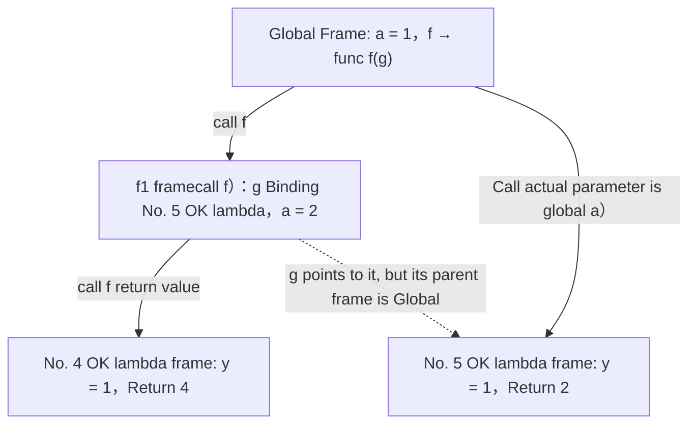
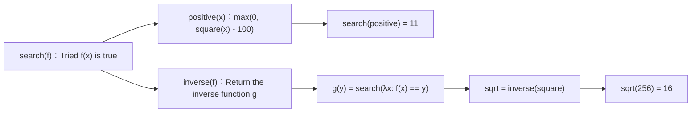
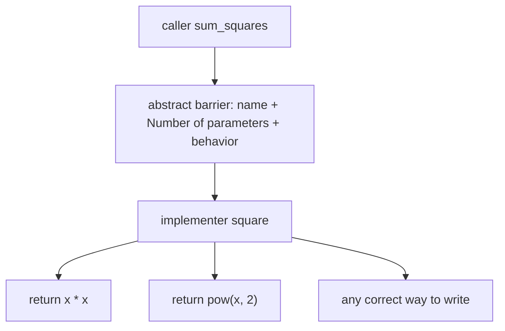

> **courses**: UC Berkeley CS61A · Structure and Interpretation of Computer Programs(Fall 2024)
> **This lecture**: Lecture 7 ｜ 30:05 ｜ Station B P 7 ｜ [Original video](https://www.bilibili.com/video/BV1sy411z7nA?p=7)
> **courseware**: `06-Functional_Abstraction_1pp.pdf` (16 pages, official PDF, page-by-page renderings see text illustrations)
> **subtitles**: Original English subtitles from Station B; this note is a reconstruction of Chinese writing, not a sentence-by-sentence translation.
> **Copyright**: The copyright of the course and courseware belongs to the UC Berkeley CS61A teaching team (the textbook Composing Programs is released under CC BY-NC-SA 4.0); this article is a secondary arrangement for learning purposes

## Quick overview of this lecture

- **Mastered**: Three-piece set of environment diagrams (frame, parent frame, name search along parent frame); functions are values and can be used as parameters and return values; `if`  with  `while`  condition criterion; `def`, `return`  Basic usage; a zero-parameter function for "rolling a die once" in the Hog project.
- **Main line of this lecture**:
    - The frame in which the lambda expression is "born" is the parent frame, thus determining which one it sees.  `a`;
    - `return`  Only do one thing - give the calling expression a value. Once executed, the call ends;
    - use  `while True`  add  `return`  Write "find an integer that satisfies the conditions" as a higher-order function  `search`, and then use it to define inverse functions and square roots;
    - The contract of function abstraction only has two items: "a few parameters" and "what behavior". How to calculate the implementation and what the internal name is, the caller should not know;
    - The name does not affect whether the program is right or wrong, it only affects whether the program can be read by people;
    - Syntax errors, runtime errors, and logic errors each have their own detection mechanisms. Traceback needs to read the entire call chain.
- **Key conclusions**: The parent frame is determined when the function is created (lexical scope), so the inner function can always see the local variables of the outer layer, even if the outer layer has already returned - this is closure.

*(Reference time: 00:00:00 – 00:02:20｜Lecture 7)*

## 1. One week before the exam: Course schedule and review page on the courseware

*(Reference time: 00:00:05 – 00:02:20｜Lecture 7)*

The first two minutes of this lecture do not cover new knowledge, but lay out the schedule for the next ten days: two assignments, a project checkpoint, and a midterm exam. These dates determine where time should be spent during the week and explain why the first half of the courseware is filled with review pages rather than new content.


### 1.1 Timeline for assignments, projects and midterms

Homework 2 is due on Thursday. The Hog project will not be due until next Wednesday, but if you submit it before next Tuesday, you can get an early submission point (early submission point); what you need to keep an eye on is phase one - you can only get a checkpoint if you pass it before this Tuesday. The lecturer said that checkpoint only counts for one point, but one point is still a point and it is worth taking, so it is recommended to complete phase one today.

Midterm is the highlight: Midterm 1 is the following Monday night, a paper-and-pencil exam. All papers from previous years are open to the public, and the format is consistent with previous years (especially the autumn semester of previous years). A paper study guide (study guide) is distributed in the examination room. The content is a slide cut out from the course video: the evaluation and execution rules of various expressions and statements, and an example of an environment diagram. `min`, `max`, `abs`, `pow`  the behavior of these built-in functions, and a larger picture of the environment. You need to read the guide in advance so that you will know where things are when you take the exam.

In addition to the guide, you are allowed to bring one-page, two-sided sheet of notes (one-page, two-sided sheet of notes); the instructor recommends writing examples you find useful on the paper instead of copying definitions. Arrive at 8:00 pm to find your seat and collect your test papers. The exam will start at 8:10 pm. The exam covers up to Lecture 5, and this week's lesson is just practice with that batch of material. Classes will be closed next Monday and there will be no lab next week, but labs this week will be as normal. After finishing this week's lab, discussion, Homework 2 and Hog, I will take the time to do a set of real questions in recent years, and I will be almost ready.


> **Editor's note**: Pages 3–8 of the courseware are the review and practice blocks for this lecture (zero-parameter functions, dice, higher-order loops, conditional expressions, a Fall 2022 real question, truth table). The voice of this video only covers the two-minute announcement and then transitions to lambda. The six pages are not expanded page by page. The following is completed according to the courseware screen and course materials. All reasoning outside the courseware will be marked and can be read as the part "the lecturer did not explain it but the page requires you to know it".

### 1.2 Zero-parameter function: Turn "throw once" into a value

Page 3 is a sectioned page titled  `Zero-Argument Functions`, the text is only one line  `(Demo)`.


A zero-parameter function does not have any formal parameters. To call it, just write a pair of empty brackets, and the return value is the result of "throwing once":

```python
import random

def six_sided():
    return random.randrange(1, 7)   # 1 到 6 的整数，具体写法不止一种
```

expression  `six_sided`  The value of is a function object, `six_sided()`  The value is a point. This pair of brackets is not decoration: without them, what you get is the "dice" itself, not the result of this throw. The reason for writing it as a function rather than a constant is that it should be re-thrown every time it is called - same expression, different results, which is where you need a function rather than a value.

Zero-argument functions are part of the strategy in the Hog project: `repeats(20, six_sided)`  Such a call passes the dice as a parameter, so the handler does not have to know where the points come from. When testing, change a fake dice that says "6 every time", and the output immediately becomes certain, and whether the logic is correct can be verified at a glance.

### 1.3 Dice function and repeats

The next page gives specific tasks: Implementation  `repeats`, return  `n`  The number of "adjacent repeats" in a die roll. The example is a string of 20 results, with 5 adjacent identical places underlined (3 3, 2 2, 2 2, 4 4, 5 5), so  `repeat(20, six_sided)`  Expect to get 5.


```python
def repeats(n, dice):
    count = 0
    previous = 0
    while n:
        outcome = dice()
        if previous == outcome:
            count += 1
        previous = outcome
        n -= 1
    return count
```

Read line by line: `previous`  Remember "the last dice", `outcome`  It is "this one"; if the two are equal, record it once, and then record it regardless of whether they are equal or not.  `previous`  Updated to this one. `n -= 1`  Responsible for the countdown, `while n:`  Use truth value to judge——`n`  When it reaches 0, it becomes false and the loop ends.

The right side of the screen is a frame halfway through execution: `f1: repeats [parent=Global]`, `n = 20`, `dice`  One column has an arrow pointing to a function object. `count = 0`, `previous`  one column  `0`  was crossed out, `outcome = 5`, `Return value`  Still empty. In other words, this frame stops at the first round  `outcome = dice()`  After that: a 5 is rolled, which is different from the initial value of 0, `count`  Still 0. This frame illustrates two things at the same time: formal parameters  `dice`  It contains function objects, so call  `dice()`  It’s just rolling the dice; `previous`  It will be rewritten in place, and the value of the same grid in the environment map changes over time.

Three design details are worth stopping to look at:

1. `previous = 0`  Is the sentinel value. The dice will only produce 1–6, never equal to 0, so the first comparison must be false, and there will be no extra calculation out of thin air. If the die is likely to roll 0, the initial value is wrong and the correct approach is to let  `previous`  Take first  `None`, or handle the first round separately.
2. `previous = outcome`  in  `if`  External and unconditional execution. What it records is the "last dice", not the "last repetition"; write  `if`  Steps that are not repeated will be missed.
3. `while n:`  rely on truth values instead of  `n > 0`. The two ways of writing are equivalent here (`n`  is a non-negative integer), but the former applies the rule "0 is a false value"; once  `n`  may become negative and the two are no longer equivalent.

The text of the courseware is  `repeat(20, six_sided) -> 5`, but the code header reads  `def repeats(n, dice)`. The inconsistency in the singular and plural of nouns does not affect the program, but it just connects to the naming topic later: names are written for people to read. If the same thing is called two names on a page, the reader will have to spend more effort.

### 1.4 Higher-order loop: The loop is written in the returned function

Page 5 is another section page with a title  `Higher-Order Loops`, with one line  `(Demo)`  and a long pythontutor link at the bottom of the page.


The so-called "higher-order loop" means that the boundary of the loop is determined by the parameters of the outer call, and the loop body itself is written in the returned function:

```python
def reprint(n):
    def a(word):
        k = n
        while k:
            print(word)
            k -= 1
    return a

reprint(2)('hey')
```

`reprint(2)`  What is returned is  `a`, at this time  `n`  is no longer in any active frame, but  `a`  Still remember it; `a('hey')`  Print twice  `hey`, the return value is  `None`. The phenomenon of "function remembering outer variables" appears here in advance - it is exactly what we need to draw clearly in Chapter 2, but there is no need to draw the picture yet.

> **Editor's note**: Only the title is projected on this page, `(Demo)`  and link. The above code is restored from the pythontutor link at the bottom of the page, not the projected text; the lecturer's live demonstration content does not appear in the subtitles of this video.

### 1.5 Conditional expression: `if`  expression version of

Page 6 is  `Conditional Expressions Practice`, again only the title.


The form of the conditional expression is

```text
<consequent> if <predicate> else <alternative>
```

For example  `x if x >= 0 else -x`  with  `abs(x)`  Equivalent. it and  `if`  The statements differ in identity: `if`  is a statement, which does not produce a value when executed; a conditional expression is an expression, which must produce a value, so it can appear on the right side of assignment, function arguments, and  `lambda`  in the function body.

Two hard rules to remember: `else`  Branches cannot be omitted (the expression must have a value and cannot be unproduced), and only one of the two branches will be evaluated, so it is best to return the same type of value on both sides. There is another usage reason: `lambda`  The function body of can only be an expression. To write judgments, you can only use conditional expressions. `if`  The statement cannot be entered.

### 1.6 A real question: `(3 and 4) - 5`

A quick question from the first question in the Fall 2022 issue is directly posted on page 7, with only the expression itself on the screen: `(3 and 4) - 5`.


`and`  It is not an operation of "turn both sides into Boolean and then AND". Its evaluation rules are: evaluate from left to right, return the first false value as it is, and return the value of the last operand if all are true. 3 is a true value, so continue to search for 4 and return 4; `4 - 5`  Got  `-1`. Same reason  `0 and 4`  Return  `0`, `'' or 'x'`  Return  `'x'`, `and`  with  `or`  What is returned is always the operand, not the  `True`/`False`.

> **Editor's note**: This page only gives expressions, not answers; the above evaluation process is based on Python  `and`  It is derived from semantics and is not written in the courseware.

### 1.7 Truth tables: which values count as true

Page 8 lists "truth value" on its own page because all the  `while`, `if`, `and`  All depends on it:


| criterion | expression | `bool(x)` | Description |
| --- | --- | --- | --- |
| zero | `bool(0)` | `False` | The integer zero is false |
| non-zero | `bool(-1)` | `True` | A negative number is true as long as it is not zero |
| floating point zero | `bool(0.0)` | `False` | Same as integer zero |
| space string | `bool(' ')` | `True` | The length is one, and it is either empty or true. |
| empty string | `bool('')` | `False` | Empty sequence is false |
| boolean false | `bool(False)` | `False` | Return as is |
| No return value | `bool(print('fool'))` | `False` | Print first  `fool`, then judge  `print`  return value  `None` |

The conclusion can be summarized in one sentence: the only false value is  `False`, `None`, the value zero, the empty string (and the empty container), and everything else is true. Notice the last line: `print`  Side effects occur first (more on the screen  `fool`), its return value is  `None`, `bool`  The verdict is  `None`. Side effects and return values are two different things, as explained in Chapter 3  `return`  will appear again.

## 2. Lambda in the environment graph: the parent frame is determined when the function is born

*(Reference time: 00:02:21 – 00:07:32｜Lecture 7)*

After the announcement, the lecturer just said "Good luck" and then put up the environmental map. The question is very specific: What does the following program print?


```python
a = 1
def f(g):
    a = 2
    return lambda y: a * g(y)

f(lambda y: a + y)(a)
```

The answer is neither 6 nor 3, but 4. To get this 4 right, you must answer a question that only an environment diagram can answer: `a`  It appears five times in these five lines - lines 1 and 3 are written once each, line 4 is read once, and line 5 is read twice - which one is read each time  `a`.

There is only one rule, and the instructor puts it at the top:

**The parent frame of a lambda function is the frame in which the lambda expression is evaluated.**

This rule does not look at who calls it or who it is passed to, only its location in the source code.

### 2.1 First look at where each subexpression is evaluated

- line 5  `lambda y: a + y`: it is  `f(...)`  argument, and this entire line does not have any indentation, so it is evaluated in the global frame → The parent frame of this function object is Global.
- at the end of line 5  `(a)`: It is also part of the global expression and is read globally.  `a`, which is 1.
- of line 4  `lambda y: a * g(y)`: it is in  `f`  In the function body, indent one level, so it is in  `f`  is evaluated in the newly created frame when called → the parent frame is that frame, and in that frame  `a`  Yes 2.

"Evaluate in the global frame without indentation" is the fastest way to determine the parent frame: the indentation structure of the source code is the nested structure of the frame.

> **Editor's note**: This rule is called lexical scope in language implementation. Another design is called dynamic scope. The parent frame is "the frame in which the call occurs", so in this example  `g`  will see  `a = 2`, the result becomes  `2 * (2 + 1) = 6`. Both Python and Scheme use lexical scope, so all the following reasoning is based on the "frame when it was created".

### 2.2 Draw it step by step



1. execute  `a = 1`, appears in the Global frame  `a = 1`.
2. execute  `def f(g)`, appears in the Global frame  `f`, points to a function object (its parent frame is Global).
3. Evaluate expression  `f(lambda y: a + y)(a)`  operator: which itself is a call  `f(...)`. To call  `f`, first find its actual parameters - the lambda in line 5 is evaluated in the global frame, and the parent frame of the obtained function object is Global. At this time, the global  `a`  Still 1.
4. call  `f`: New frame  `f1`, parent frame Global; formal parameter  `g`  Bind to the function object just now; start execution  `f`  function body.
5. execute  `a = 2`: This is an assignment statement, in the current frame  `f1`  Create a new name in  `a`, the value is 2. global  `a`  Not altered, just shadowed.
6. execute  `return lambda y: a * g(y)`: This lambda is in  `f1`  is evaluated inside, so its parent frame is  `f1`;it acts as  `f`  The return value returns to the global.
7. Now the outer layer calls  `... (a)`  With functions, there are also actual parameters: the actual parameters are global  `a`, the value is 1. Call that returned lambda: new frame, parent frame  `f1`, `y = 1`.
8. the function body that executes it  `a * g(y)`: The current frame does not have  `a`, found along the parent frame  `f1`  inside  `a = 2`;The current frame does not have any  `g`, found along the parent frame  `f1`  inside  `g`, which points to the lambda on line 5.
9. call  `g(1)`: Create a new frame, the parent frame is Global (because the function object is marked Global), `y = 1`;Execute  `a + y`, the current frame does not have  `a`, find the global one along the parent frame  `a = 1`, get 2. This 2 is  `g(1)`  value.
10. Return to step 8: `a * g(y)`  i.e.  `2 * 2`, gets 4. This is the value of the entire expression.

You can confirm each step by comparing the line numbers read by the instructor in class: the returned lambda is "the lambda on line 4", the actual parameter lambda is "line five", and the parent frames of the two are  `f1`  with Global.

Two conclusions are worth memorizing:

- **Parameter passing does not change the parent frame.**  The lambda in line 5 is obviously  `f1`  If it is connected as an actual parameter, it can only be passed  `g`  accessed, but its parent frame is still the Global that created it. it "lives" `f1`  Inside, you can "see" the overall situation.
- **The frame does not disappear after returning.** `f`  has returned, `f1`  There is no code running in it, but the lambda in line 4 keeps grabbing  `f1`, so  `a = 2`  is still there; when it is called, `a`  Still taking 2. The function object grabs its parent frame, and this chain is called a closure.

### 2.3 lambda and def are two ways of writing the same thing

The proposition given on page 10 is very hard: "Any program containing lambda expressions can be rewritten to use only  `def`  statement program. "


```python
>>> (lambda f: lambda x: f(f(x)))(lambda y: y * y)(3)
81
```

```python
>>> def twice(f):
...     def g(x):
...         return f(f(x))
...     return g
>>> def square(y):
...     return y * y
>>> twice(square)(3)
81
```

The frame structure and evaluation order of the two programs are completely isomorphic: the outer call handles  `f`  tied into  `square` (or that lambda), the function returned by the inner layer puts  `x`  Tied to 3, the function body is done twice  `f`  call, `3 * 3 = 9`, `9 * 9 = 81`. The difference is only at the grammatical level:

| criterion | `lambda`  expression | `def`  statement |
| --- | --- | --- |
| identity | Expression, which can appear anywhere a value is required | Statements can only be on separate lines |
| function body | Can only be an expression | There can be multiple statements, loops, `return` |
| name | Do not bind names unless assigned to variables | Bind name in current frame |
| Creation time | Creates a function object when evaluated | Execute to this  `def`  Create a function object when |
| Debuggable information | `__name__`  is  `<lambda>` | `__name__`  is the function name |
| Suitable for the occasion | One-time, inline, as parameter or return value | Needs reuse, needs documentation strings, needs recursive self-reference |

"Can be rewritten" does not mean "should be rewritten". `twice`  This kind of thing that needs to be called repeatedly is written as  `def`  better to read; while  `f(lambda x: f(x) == y)`  This kind of judgment will never be mentioned separately after being passed in. Writing it as lambda instead leaves the focus on the parameter position.

### 2.4 A real question: `funsquare`  Six candidate implementations of

Page 11 is question 4(a) in the Fall 2022 issue: `funsquare`  accepts a single argument function  `f`, returns a single parameter function  `f2`, so that for any  `x`, `f2(x)`  with  `f(f(x))`  Behavior is the same.


```python
>>> triple = lambda x: 3 * x
>>> funsquare(triple)(5)   # 等价于 triple(triple(5))
45
```

The six candidates can be screened according to the two rulers of "signature" and "evaluation in which frame":

| candidate | What is returned | Qualified | Reason |
| --- | --- | --- | --- |
| A | `f(f)`  value | No | Pass the function object as a parameter  `f`, `triple`  Will multiply a function and report an error directly; what is returned is not a function |
| B | a zero-argument lambda | No | call  `funsquare(triple)(5)`  An extra actual parameter was given, and the number of parameters was incorrect. |
| C | a single argument function  `g` | No | The function itself is correct, but  `funsquare`  There are more signatures  `x`, `funsquare(triple)`  Already reported an error |
| D | `lambda x: f(f(x))` | is | one parameter, return function, and  `f`  in  `funsquare`  In the frame, the parent frame of the inner lambda is exactly that frame |
| E | `f(f(x))`  value | No | The signature has one more parameter, and the value returned is not a function. |
| F | `def g(x): return f(f(x))`  return after  `g` | is | Isomorphic to D, just use  `def`  write |

The answers fall on D and F, which are related to page 10  `twice`  It's the same shape. A, B, and E made the mistake of changing "returning function" to "calling function" or "returning zero-parameter function"; C's mistake was in the signature. This question actually tests not lambda, but "the return value should be a function that has not been called yet."

### 2.5 A trap: `snap`  with  `chat`

Page 12 is the first question in the Spring 2020 issue, two lines of code, two questions:


```python
>>> snap = lambda chat: lambda: snap(chat)
>>> snap, chat = print, snap(2020)
```

There are two places on the page  *What is displayed here?*: The first part asks what will be displayed after the second line is executed, and the second part asks what will be called later.  `chat()`  Show nothing.

The second line is multiple assignment. The rule is to evaluate all the right sides and then bind them uniformly. right  `print`  is a built-in function, `snap(2020)`  Then you need to call the lambda in the first line: create a new frame, `chat = 2020`, parent frame Global; function body  `lambda: snap(chat)`  is evaluated in this frame, so the parent frame of the inner lambda is this frame, and it remembers  `chat = 2020`. Binding begins only after evaluation is completed: global  `snap`  become  `print`, global  `chat`  Become that inner lambda.

then  `chat()`  Called: Create a new frame, the parent frame is  `snap(2020)`  In that frame, the function body is  `snap(chat)`. Both names are not in the current frame, search along the parent frame: `chat`  Find 2020 on the first level; `snap`  To find Global, which is now  `print`. So execute  `print(2020)`, the screen is  `2020`.

Here, the two names in the same function body have completely different binding timings: `chat`  It is a formal parameter, and the closure remembers 2020 when it is created; `snap`  It is the global name. It was not checked until the moment it was called. What was found was the rewritten one.  `print`. The environment map is very clear - the former comes from a grid in the parent frame, and the latter is checked all the way to Global before landing.

> **Editor's note**: This page only says "What is displayed here?" without giving an answer; the above derivation and conclusion  `2020`  The editor made it up according to the rules of environment diagrams (you can check it by running it in Python). Two points that are easy to miss: First, the right side of the assignment is evaluated first and bound later, so  `snap(2020)`  inside  `snap`  It’s still the original lambda; the second is  `snap`  with  `chat`  The naming method makes people think that they are all taken from the overall situation. In fact,  `chat`  Occluded by the parent frame of the inner lambda.

## 3. Calling expressions and return: How does a value come out of the function body?

*(Reference time: 00:07:35 – 00:10:20｜Lecture 7)*

### 3.1 What does the call expression do?

Page 13 is a section page with the title  `Call Expressions`, which formally lists the mechanical steps used in Chapter 2. Evaluate a calling expression  `f(x)`  In four steps:

1. Evaluate operator and get a function object;
2. Evaluate each operand and get the actual parameters;
3. Call: Create a new frame, the parent frame is the "parent frame remembered by the function object", bind the formal parameters to the actual parameters;
4. The function body is executed in the new environment until it encounters  `return`  Or the function body ends.


Step three is the whole key: **The parent frame of the new frame is not "the frame in which the call occurred", but "the parent frame remembered by the function object itself"**. That expression in Chapter 2 evaluates to 4 because  `g`  Remember Global instead of  `f1`.

### 3.2 Where are names bound?

Page 14 divides "binding names" into three ways:

- Assignment statements (such as  `y = x`) bind the name in the current frame;
- `def`  The statement binds the name in the current frame;
- The calling expression binds the name (and the formal parameter) in the newly created local frame.


The example at the bottom of the same page uses all three:

```python
h = lambda f: lambda x: f(f(x))
h(abs)(-3)
```

The first line is the assignment statement, `h`  tied to Global; second line  `h(abs)(-3)`  It is a nested call: the first call to create a new frame, `f = abs`;The second call creates a new frame, `x = -3`, function body  `f(f(x))`  Evaluated in this frame, `f`  found along parent frame  `abs`, `abs(-3) = 3`, again  `abs(3) = 3`, the result is 3.

| frame | parent frame | binding |
| --- | --- | --- |
| global frame | None | `h` → That two-layer lambda |
| `h(abs)`  frame | Global | `f = abs`;The return value is  `lambda x: f(f(x))` |
| Frame of inner function call | `h(abs)`  frame | `x = -3`; Evaluating  `f(f(x))` |

Below the courseware is a three-column comparison of the same thing. The left column is the two lines of code above  `h = lambda f: lambda x: f(f(x))`  with  `h(abs)(-3)`;The middle column is the content of the inner frame after two nested calls: `f = abs`, `x = -3`, evaluating  `f(f(x))`;The right column is another way of writing  `h = lambda f: f(f(x))`, only one formal parameter, `x`  Not in any call frame, must come from the global - as long as the call  `h(abs)`  The whole world already had  `x = -3`, `abs(abs(-3))`  Still gets 3.

The comparison point in the three columns is one sentence: **The number of parameters determines how many names are in the new frame, and the rest must be found along the parent frame.**. left column handle  `x`  Make the formal parameter and leave it in the right column as a global parameter. The results of the two writing methods are the same, but the content in the frame is different. The table is a little less intuitive than the picture, but it is faster to look up: if you want to know which frame a name is in, first look for the position where it is assigned/bound.

### 3.3 What exactly does return do?

`return`  There is only one responsibility: **Give the calling expression a value and end the call**. When it is executed, control returns to "the frame in which the calling expression was evaluated". The called frame exits along with the local name in it, and the calling expression has a value from now on.

Four inferences:

- A call will only execute one  `return`. It ends when you reach the first one, even if there are more after that  `return`  It won't be executed either.
- The function body has not been encountered until the end  `return`, the value of this call is  `None`.
- `return`  It can be followed by any expression, which is evaluated first and then returned; `return None`  with  `return`  Equivalent.
- `return`  What ends is the entire function, `break`  Only exit the current loop. To finish work early, `return`  It's cleaner than "setting a mark and then judging it layer by layer".

Chapter 7  `TypeError`  It will prove the second point from the opposite side: write one less  `return`, the function returns quietly  `None`, the error will wait until it explodes elsewhere.

### 3.4 Example: Print numbers until d is encountered

The next example is  `while`  and  `return`  Putting it all together: Given a non-negative integer  `n`  and numbers  `d`, printing starting from the ones digit until printing out  `d`  Just stop. `34567`  with  `5`  should print  `7`, `6`, `5`, and then end.

```python
def end(n, d):
    """Print the digits of N in reverse order until D is found."""
    while n > 0:
        last = n % 10
        n = n // 10
        print(last)
        if last == d:
            return None
```

`n % 10`  Take the last digit, `n // 10`  Cut off the last digit, and the two actions combined are "split n into the last digit and the rest." After printing, check whether it is equal to  `d`, that’s right  `return None`  End the entire function immediately; otherwise continue to the next round.

It would be another way to write all the numbers in a variable and return them all, but that would defeat the point of the example: **The exit of a loop can be found inside the loop body, while  `return`  is the only way to bring it out of the function**. If written as  `break`, the function will continue to execute  `break`  The following statement; written as  `return`, the function ends on the spot.

> **Editor's note**: This code is not in the courseware, the lecturer typed it on the spot; the subtitles only give the oral process ("while n is greater than 0, remove the last digit and print it, and return None when d is encountered"). The sentence "End of 3, 4, 5, 6, 7 is all the digits..." in the subtitles is actually a call to  `end(34567, 5)`  As a result of being misheard, the function name can be determined from this. Function bodies and docstrings are restored according to oral and course style, `return None`  Write according to what the lecturer says orally; write alone  `return`  The effect is the same.

### 3.5 Division of labor between return and while

`while`  Responsible for "repeating until the condition is not established", `return`  Responsible for "ending early and delivering results". The two combine to form three common shapes: the loop runs normally and then at the end  `return`(`repeats`); the loop condition is always true, relying on  `return`  Exit (next chapter's  `search`); if special circumstances are found in the loop, advance the  `return` (this example). The only difference between the three shapes is "where the exit is and who decides it." It is worth thinking about which type it belongs to before writing the loop.

## 4. Use brute force search to write functions: search and inverse functions

*(Reference time: 00:10:22 – 00:15:27｜Lecture 7)*

### 4.1 Write "try until the conditions are met" as a function

This chapter starts with a seemingly useless function:

```python
def search(f):
    x = 0
    while True:
        if f(x):
            return x
        x += 1
```

It tries each integer one by one starting from 0 and the first one lets  `f(x)`  for truth value  `x`  That's the answer. `while True`  It is a deliberate infinite loop: the loop itself does not know how long it will take to find, and the exit condition is hidden in the loop body, which is determined by a  `return`  Finished - This is the second shape mentioned in Section 3.5.

Let’s start with the simplest criterion:

```python
def is3(x):
    return x == 3
```

`search(is3)`  Return 3. It's really useless at this point, it's just a constant written in a loop. The real value lies in: `search`  It doesn't know what it's looking for, it just knows "give me a criterion function and I'll try it until it tells the truth."

### 4.2 Change the criterion and change the question

Change the criterion to "square minus 100 and then get non-negative":

```python
def positive(x):
    return max(0, square(x) - 100)
```

`max(0, ...)`  Press the negative value to 0, so  `positive`  Always non-negative. `2`, `3`, `4`, `10`  Both get 0 because their square minus 100 is not positive; `11`  gets 21 because  `121 - 100 = 21`.`search(positive)`  So it returns 11.

The square root of 11 differs only by one from 100: the search stops at "the first integer for which the result is positive," and  `10 * 10`  Exactly equals 100, and after subtraction is 0, 0 is a false value, so 10 is skipped. This is not a bug, but standard behavior of "threshold search" - the criterion is  `> 0`  instead of  `>= 0`, boundary points are naturally excluded.

Just change the criterion from "whether it is equal to 3" to "whether it is positive", `search`  It changed from a toy to a tool for "finding the square root of a number". This is the usage of higher-order functions: make the changing parts (criteria) into parameters, and write the unchanged parts (try one by one) into functions.

### 4.3 Inverse functions: write once, use everywhere

To be precise, change the criterion to "the function value is equal to the target value":

```python
def inverse(f):
    def g(y):
        return search(lambda x: f(x) == y)
    return g

sqrt = inverse(square)
```

`inverse`  Accepts any unary function  `f`, returns its inverse function  `g`: `g(y)`  Find that satisfaction  `f(x) == y`  integer. take  `f`  for  `square`, you get a square root function——`sqrt(256)`  Got 16, `sqrt(4)`  Get 2, and  `square(16) = 256`, `square(2) = 4`  Exactly opposite to each other.



This piece of code, which is less than ten lines long, is worth mentioning in its own right: squares can take the square root, cubes can also take the square root, any function that "maps integers to integers" can get the inverse function for free, and  `search`  Only written once. This is what abstraction brings **Isomorphism problem normalization**- seemingly different problems (finding square roots, finding cube roots, solving  `f(x) = y`) is reduced to the same shape, written once and used everywhere.

The cost should also be made clear. this  `sqrt`  Only valid for perfect square numbers: `sqrt(2)`  I will keep trying because there are no integers  `x`  such that  `x * x == 2`, `search`  Will never return. It's still a linear scan, `sqrt(10**6)`  Gonna try a million times. For a truly usable square root, you have to read the section on Newton's method in the textbook; but in situations where "it's enough", a few lines of code can be exchanged for a correct concept demonstration, which is cost-effective.

### 4.4 Shorter version

The lecturer finally asked: `search`  Can it be shorter? The answer is yes:

```python
def search(f):
    x = 0
    while not f(x):
        x += 1
    return x
```

"As long as  `f(x)`  If the value is still false, add one, and then return after exiting the loop."——Put  `if`  with  `return`  Moved to the loop condition.

| criterion | Version A (judgment in loop) | Version B (loop within condition) |
| --- | --- | --- |
| loop condition | `while True` | `while not f(x)` |
| export | in the loop  `return` | Unify after loop ends  `return` |
| Readability | At a glance, "find and return" | Shorter, but hides "find" in the condition |
| Risk of endless loop | An infinite loop when the criterion is never true | Same as above, same risks |
| Suitable for the occasion | After you find it, you have to do other things | Just to get that value |

The two versions have the same semantics, but B has two fewer lines. The advice given by the lecturer is more valuable than this code: After writing a function, you might as well stare at it for a while to see if there is any place where the logic can be simplified - this is not to save a few words, but because the shorter version often exposes "what is really being repeated" more clearly.

## 5. Function abstraction: what the caller needs to know

*(Reference time: 00:15:28 – 00:17:32｜Lecture 7)*

### 5.1 Definition

The definition given by the lecturer is very simple: **Function abstraction is to give a name to a calculation process, and then refer to this process as a whole, without caring about its internal implementation.**

```python
def square(x):
    return x * x

def sum_squares(x, y):
    return square(x) + square(y)
```

`sum_squares`  is called in the body of  `square`. The question is not "can it run?" but "what does it need to know?" `square`  to use it correctly."

> **Editor's note**: The subtitle records the name of this function as "some squares", which according to pronunciation and course convention should be  `sum_squares`;The lecturer only explained its body "call by dictation" `square`", without giving the function body verbatim. The above two-parameter sum of squares is the smallest example for discussion and does not affect the following four questions.

### 5.2 Four questions

| need to know | question | Conclusion | Reason |
| --- | --- | --- | --- |
| want | `square`  How many parameters does it accept? | one | You cannot construct a call without knowing the number of parameters. This is the only hard interface. |
| Don't | Its intrinsic name is  `square` ? | No need | intrinsic name is only for people to check the function; as long as it is in the current environment  `square`  It is enough that the name points to a function |
| want | Does it count as square? | want | The entire value of abstraction lies in the behavioral contract. If you don’t know the behavior, you can’t use it. |
| Don't | it is used  `mul(x, x)`  Does it count? | No need | Any correct implementation will allow  `sum_squares`  continue working |

The lecturer talks about items 3 and 4 in opposition to each other because beginners are most likely to confuse the two: **You need to know "what it does", you don't need to know "how it does it"**. The former is a contract and the latter is a realization.

To prove Article 4, `square`  can be replaced by any equivalent notation - use the built-in  `pow(x, 2)`  Rewrite it, or some weird but correct algorithm; maybe even tie it to a new function (`square = lambda x: pow(x, 2)`), as long as the behavior is right, `sum_squares`  Not a single line needs to be changed. User-defined or built-in, it makes no difference to the caller.

### 5.3 Abstract barrier

Drawing a line between "what the caller knows and what it doesn't know" is the abstraction barrier:



The meaning of barrier is **Allow both sides to evolve independently**. The implementer can change the algorithm, internal auxiliary functions, and performance. As long as the behavior remains unchanged, the callers on the barrier will not be affected. The caller can change the usage and combination method. As long as the contract is adhered to, the implementer will not be affected. Once the caller crosses the barrier to rely on implementation details (such as assuming  `square`  It must be called internally  `mul`, so I don’t write it myself  `x * x`  And write  `mul(x, x)`), the two sides are welded together. If you change any one side, you must change the other side at the same time.

The name of this line in engineering is "interface", and the name in this course is "function signature plus documentation string". To determine whether the barrier has been crossed, there is a simple test: **If the entire implementation is replaced, does the caller need to change it?**  If you want to change it, it means the dependency is leaked.

### 5.4 Case: Strategy function in Twenty-One

Pages 15 and 16 are the demo pages of the Twenty-One project, which can be used as examples of abstract barriers.


Four sentences of game rules: Two players take turns to act; each time you can add 1, 2 or 3 to the current total; the total starts from 0; the game ends when the total reaches or exceeds 21, **The player who pushes the total past 21 loses.**.

The arrow diagram in the lower part of the page is an upside-down state tree: `20` (Red) One step to get there  `21+`; `19`, `18`, `17` (Green) Everyone can go there in one step  `20`; `16` (Red) No matter adding 1, 2 or 3, you can only end up at 17–19; `15`, `14`, `13` (Green) can walk again  `16`;further to the left is  `12` (red). Red and green alternate because "whose turn it is" is alternating.

> **Editor's note**: This page only draws pictures and does not explain the colors. Push according to the rules: If the person standing at 20 adds 1, 2, or 3, the total will reach or exceed 21, and the person who pushes past 21 loses, so 20 is a bad state of "lose in your turn"; if the person standing at 19 adds 1, the opponent will be sent to 20, so 19 is a good state. So red = whoever takes the turn loses, green = one step to get to red. `12`, `16`, `20`  The same color shows that this game has a rhythm of period 4.


Page 15 gives only title  `Twenty-One Environment Diagram`, the unfinished picture. The program to draw is in the link on the next page:

```python
def play(strategy0, strategy1, goal=21):
    n, who = 0, 0
    while n < goal:
        if who == 0:
            n = n + strategy0(n)
            who = 1
        elif who == 1:
            n = n + strategy1(n)
            who = 0
    return who

def two_strat(n):
    return 2

def noisy_strat(who, s):
    def strat(n):
        choice = s(n)
        print('Player', who, 'added', choice, 'to', n, 'to reach', choice + n)
        return choice
    return strat

play(noisy_strat(0, two_strat), noisy_strat(1, two_strat))
```

`play`  There are only two requirements for the strategy: accept the current total, and return a number to be added to the total (1, 2, or 3 according to the game rules). it doesn't know  `two_strat`  Always add 2, don’t know  `noisy_strat`  will print—exactly the answers to the four questions in Section 5.2. `noisy_strat`  is a wrapper: it accepts any policy  `s`, returns a new strategy  `strat`, the new strategy does the same thing, but prints a line along the way. put  `two_strat`  Change it to the input function of a human player, change it to a random strategy, change it to a strategy that can hold grudges, `play`  Not a single line needs to be changed.

There are six types of frames in the environment graph:

| frame | parent frame | name inside |
| --- | --- | --- |
| Global | None | `play`, `two_strat`, `noisy_strat` |
| `noisy_strat(0, two_strat)`  frame | Global | `who = 0`, `s = two_strat`;return value  `strat` (The parent frame is this frame) |
| `noisy_strat(1, two_strat)`  frame | Global | `who = 1`, `s = two_strat`;Return value another  `strat` |
| `play(...)`  frame | Global | `strategy0`, `strategy1`, `n`, `who`, `goal = 21` |
| `strat(n)`  frame | Corresponding  `noisy_strat`  frame | `n` (current total), `choice` |
| `two_strat(n)`  frame | Global | `n`;return 2 |

two  `strat`  have different parent frames, which is the most noteworthy part of this picture: they are composed of two different  `noisy_strat`  Call create so one remembers  `who = 0`, another remembers  `who = 1`, what is printed out is "Player 0" and "Player 1". Same code, two closures, two pieces of state—the rules from Chapter 2 become visible output here:

```text
Player 0 added 2 to 0 to reach 2
Player 1 added 2 to 2 to reach 4
Player 0 added 2 to 4 to reach 6
...
```

Used by both people  `two_strat` , the total increases by 2 each time, and ends when it reaches 22 (player 0 took step 11, and pushed past 21, so player 0 loses). `play`  When exiting the loop  `who`  has been flipped to another bit, so it returns the winner.

> **Editor's note**: The code of this page is not printed in the body of the slide, but is hung in the query string of the pythontutor link at the bottom of the page; restore it according to the link content above, `play(noisy_strat(0, two_strat), noisy_strat(1, two_strat))`  The output is the shape actually run in Python. The subtitles of this video do not mention Twenty-One, so this section is a complete case based on courseware.

### 5.5 When should we extract a layer of functions?

Arranging the examples used in this lecture together, the criterion of "should one layer be extracted?" emerges:

- **The same calculation appears a second time**. The expression for the hypotenuse is in  `if`  and assignment once, it should be given a name (Chapter 6); `square`  Be  `sum_squares`  If called more than twice, it should not be inlined into  `x * x`.
- **This calculation needs to be replaced**. The dice must be able to be replaced with fake dice (test), `square`  To be able to replace  `pow` (Contrast), the strategy must be able to be replaced by  `noisy_strat` (log). Anything that "may be changed in the future" is worth turning into a parameter or function.
- **This calculation needs to be delayed**.`search(lambda x: f(x) == y)`  The criterion here is not to evaluate now, but to wait.  `search`  Try something  `x`  Evaluate only then. To delay, you have to wrap the calculation into a function.
- **The caller should not know the implementation**.`sum_squares`  shouldn't know  `square`  Multiplication or exponentiation; `play`  It should not be known whether the policy will print or not. The less you know, the freer you are to change.
- **This logic needs a self-explanatory name**.`take_turn`  Than  `play_helper`  More descriptive of "what it does", the name itself is the documentation.
- **This logic needs to be tested or debugged separately**. Extract it to give it its own input and output; the "error occurred in Chapter 7" `h`, error reporting but pointing to  `g`" example, the root cause is  `h`  It is not viewed as an independent unit.

> **Editor's note**: The above six items are criteria that summarize the scattered examples in this lecture. The lecturer did not list them one by one. On the other hand, we should also remind you: when there is only one call and no second implementation can be seen, extracting it will only add one more layer of jumps. People who read the code have to go to two places to spell out the whole picture - abstraction also has a cost, and the cost is the indirection layer and the jump back and forth when reading.

## 6. Names are written for people to see.

*(Reference time: 00:17:32 – 00:23:07｜Lecture 7)*

### 6.1 The name does not affect right or wrong, but affects the combination.

No matter what name you choose, the result of the program will not change; but the name determines whether others can read it and whether it can be combined into a larger program. The lecturer's original words are: The name usually has no impact on the correctness of the program, but it has a great impact on the "combination" and "whether others can understand it."

Three rules: the name should convey the meaning of the bound value **meaning or use**;The details of the value (is it a number or a string, what are the units) are better written into the function's docstring rather than squeezed into the name; function names usually convey **Effect**(`print`  Indicates there is output), **behavior**(`triple`  means three times) or **return value**(`abs`  represents absolute value), all three are reasonable naming angles.

### 6.2 Five groups of rewrites

| criterion | Don't write like this | Write like this | Reason |
| --- | --- | --- | --- |
| Boolean value | `true_false` | `rolled_one` | The name should say "which fact it represents" rather than "the value is a Boolean" |
| Abbreviation | `d` | `dice` | Single letters are nowhere to be found in large programs |
| Calling relationship | `play_helper` | `take_turn` | Named by "what it does" rather than "who it is called by" |
| Type | `my_int` | `num_roles` | The type can be seen from the value, and the purpose must be written in the name. |
| Confusing characters | `l`, `I`, `O` | `k`, `i`, `m` | In some fonts, it is difficult to distinguish between 1 and 0. |

The second and third lines are two directions of the same truth: `d`  If it’s too short, readers have to guess; `play_helper`  It’s too long and talks about relationships rather than functions. `take_turn`  It's also better because it implies "this function belongs to more than just  `play`"-Other functions can also call it, because its name describes behavior, not ownership.

### 6.3 Which values deserve names?

You don't have to name each intermediate value; compound expressions exist for that. But there are two situations where a name should be given:

The first is **The same compound expression appears repeatedly**. The hypotenuse of a right triangle must be at  `if`  Once in the assignment and again in the assignment, you should first store a name and then reference it in two places. The advantage is not just short: the algorithm will need to be changed in the future (for example, to  `math.hypot`), only one change.

The second is **The expression is too long for humans to read**. quadratic formula  `(-b + (b*b - 4*a*c) ** 0.5) / (2*a)`  In such a line, it takes the reader time to see the structure; the discriminant  `b*b - 4*a*c`  Take a commission  `discriminant`, both roots become readable immediately. The criterion for splitting is "whether this subexpression has independent meaning", not "whether this line exceeds 79 characters".

### 6.4 Long and short names

The name can be long as long as it explains what the code is doing. `average_age = sum(ages) / len(ages)`  Better than "an obscure expression with a comment": the comment will expire, the name will not, and the name will be visible at the call site.

Conversely, a short name or even a single letter will work, provided it stands for **Generic quantity**: `abs(x)`  inside  `x`  It can be any real number; a count variable in a loop; a parameter in a mathematical formula; a formal parameter when wrapping a generic function. In these positions, `x`  Than  `the_input_value`  Clearer because it doesn't carry any superfluous implications.

### 6.5 Agreement and freedom

The usage of some letters has developed into cross-linguistic conventions: `i`, `j`, `k`, `n`  Commonly used for integers and counting, `x`, `y`  Commonly used as real numbers, `f`, `g`, `h`  Commonly used as functions. By following these conventions, readers can take one less step to think about.

But the lecturer specifically added at the end: These are just practical suggestions, and you don’t have to memorize them or follow them; writing a program is a creative activity, and as long as the program is understandable to others, you can do whatever you want. The reason why conventions are worth learning is just because it allows "everyone to understand faster."

## 7. Three types of errors and how to read traceback

*(Reference time: 00:23:09 – 00:30:03｜Lecture 7)*

### 7.1 Three kinds of errors, three kinds of discovery mechanisms

| criterion | when was discovered | Typical example | who discovered |
| --- | --- | --- | --- |
| syntax error | before program execution | Unmatched brackets, `1 / * y`, `def`  Missing colon | Python interpreter |
| runtime error | When executing to the line with the error | `None - None`, divide by zero, type mismatch | Python interpreter with traceback |
| logical error | never discovered automatically | Write one less step, write the opposite condition, and return the wrong value | only test |

The syntax error is "wrong form": every left bracket must have a right bracket, `+`  It must be sandwiched between two expressions and cannot appear at the beginning. The runtime error is "execution cannot continue": the interpreter finds that a certain instruction cannot be completed during execution, so it prints a traceback to report what the program was doing when the error occurred and which line to look at. Logic errors are the most troublesome: the program runs from beginning to end, but the result is wrong. The only way to find out is to write tests and confirm that the tests really describe the expected behavior.

### 7.2 Syntax error: The reported line is not necessarily the line that needs to be changed.

The instructor typed a piece of code for three-layer calls on the spot:

```python
def f(x):
    return g(x - 1)

def g(y):
    return abs(h(y) - h(1 / y))

def h(z):
    return z * z

print(f(12))
```

First type one on line 5  `1 / * y`. Python rejects it before executing:

```text
  File "ex.py", line 5
    return abs(h(y) - h(1 / * y))
                            ^
SyntaxError: invalid syntax
```

`^`  pointing  `*`. This type of error is best fixed because the location is accurate.

Trouble is of another kind. Suppose line 5 is missing the last closing parenthesis (`abs(...`  not closed), Python reports **Line 7**:

```text
  File "ex.py", line 7
    def h(z):
        ^
SyntaxError: invalid syntax
```

There's nothing wrong with line 7 itself. The real reason is in line 5: `abs(`  is not closed, the interpreter thinks that it is still stopped in that call, so it changes the subsequent  `def`  Reject as "statement appears in call parameters" - a function definition cannot appear in the middle of an unfinished call. The lecturer's statement is: the line reported is just an interpreter **be the first to discover** problem place.

> **Editor's note**: The above error report is what the lecturer saw on site (the error report  `line 7`). Newer CPython (from 3.10) will directly give unclosed parentheses  `SyntaxError: '(' was never closed`  And points to the line where the opening bracket is located; the error reporting position changes with the version, but the experience of "the reported line is not necessarily the line that really needs to be changed" remains unchanged. If you encounter this error, first go to **on** Look at a few lines and look for parentheses, quotation marks, and indentations.

### 7.3 Runtime error: traceback reads from the innermost layer outwards

put  `h`  of  `return` (Line 8) Delete, `h`  It becomes:

```python
def h(z):
    z * z
```

It calculates the square, throws it away, and the function returns  `None`. The program can run, but it explodes after reaching line 5:

```text
Traceback (most recent call last):
  File "ex.py", line 10, in <module>
    print(f(12))
  File "ex.py", line 2, in f
    return g(x - 1)
  File "ex.py", line 5, in g
    return abs(h(y) - h(1 / y))
TypeError: unsupported operand type(s) for -: 'NoneType' and 'NoneType'
```

`TypeError`  means "operating on things that cannot be operated on". Here both operands are  `None`, while  `None`  There is only one value, so it is equivalent to writing  `None - None`.

The reading is very fixed: **Start with the innermost layer (last piece)**. The last piece says "Line 5, `g` "in", there  `h(y) - h(1 / y)`  Got two  `None`. But the real problem is in line 8 -`h`  less  `return`. Traceback gives "the location where the problem was found", not "the location where the problem was caused". The two are often not in the same place.

Looking backwards, you can also read the entire call chain: the outermost layer is line 10  `print(f(12))`, it wants  `f(12)`  value, so adjust  `f`; line 2 of  `f`  want  `g(11)`  value, so adjust  `g`; line 5 of  `g`  Adjusted twice  `h`, both times we get  `None`, exploded when subtracted. This chain is exactly the reverse process of the four steps in Section 3.1.

### 7.4 Second example: divide by zero, the problem is at the call point

fixed  `h`  Then change the actual parameters: `print(f(1))`. This time the report is

```text
Traceback (most recent call last):
  File "ex.py", line 10, in <module>
    print(f(1))
  File "ex.py", line 2, in f
    return g(x - 1)
  File "ex.py", line 5, in g
    return abs(h(y) - h(1 / y))
ZeroDivisionError: division by zero
```

Still line 5, but wrong for a completely different reason: `f(1)`  let  `x = 1`, `g`  received  `y = 0`, so  `1 / y`  become  `1 / 0`. Line 5 is not wrong per se, it is  `y = 0`  There is no way; what should be changed is the actual parameter on line 10, or give  `g`  Add a layer of protection.

This is the second lesson of traceback: **The same error line can correspond to completely different causes.**. To distinguish between "this line is done wrong" and "this line is fed the wrong thing", you need to read the entire call chain - from the outermost layer, see how this value becomes 0 step by step.

### 7.5 Logic errors: only rely on testing

The third type of error does not even have a traceback. The program finished running, but the result was wrong and there was no prompt. The only way is to write tests and use known inputs to compare known outputs; if the test fails, it means "the behavior is not as expected." The lecturer did not conduct a test in class, but made the direction clear: this kind of mistakes will not be exposed by themselves and can only be caught through testing.

### 7.6 Three experiences in reading traceback

- Look at the last line first to determine the error type (`SyntaxError`, `TypeError`, `ZeroDivisionError`), the type determines what to look for.
- Look at the last piece to determine "where it was found"; then look up the chain to determine "where the value came from."
- For syntax errors, look up a few lines to find parentheses; for runtime errors, don't rush to change the line where the error is reported. First ask, "Is the value received in this line correct?"

## Summary

- To judge the behavior of a function, first ask "in which frame it was created" rather than "where it was called"; the parent frame is determined when it is created and does not change thereafter.
- When you can't figure out where the name comes from, draw the frames and arrows: each call to a new frame, each function object a line pointing to the parent frame, and the name is looked up along the parent frame.
- Only one call is executed at a time  `return`, its function is to give a value to the calling expression and end the call; before finishing the function body,  `return`, the value is  `None`.
- Make the changing parts into parameters and the unchanged parts into functions: `search`  Just write it once, `is3`, `positive`, `inverse(square)`  have become instances of it.
- The abstract contract is "number of parameters + behavior", and the implementation method is on the other side of the barrier; judging whether it has crossed the line depends on whether the caller wants to change it after replacing the implementation.
- Naming first answers "what does it represent/do", and then consider the length; repeated compound expressions and expressions that are too long to read deserve a name, and generic quantities can use single letters.
- Read the traceback from the innermost layer outward: the innermost layer is "where the problem is found", and the outermost layer is "where the value comes in".
- Among the three types of errors, syntax errors and runtime errors are reported by the interpreter, while logical errors can only be discovered by testing.

## Attached: Slide index for this lecture

| page | content | Appear location |
| --- | --- | --- |
| 1 | Title Page Functional Abstraction | §1 |
| 2 | Announcements: Homework and Midterm | §1.1 |
| 3 | Zero-Argument Functions (section pages) | §1.2 |
| 4 | Dice Functions: `repeats`  frame with environment | §1.3 |
| 5 | Higher-Order Loops (section pages) | §1.4 |
| 6 | Conditional Expressions Practice (section pages) | §1.5 |
| 7 | Fall 2022 Midterm 1 Question 1 | §1.6 |
| 8 | True and False Values | §1.7 |
| 9 | Lambda Expressions Practice (sectioned page) | §2 |
| 10 | Lambda and Def | §2.3 |
| 11 | Fall 2022 Midterm 1 Question 4(a) | §2.4 |
| 12 | Spring 2020 Midterm 1 Question 1 | §2.5 |
| 13 | Call Expressions (sectioned pages) | §3.1 |
| 14 | Assigning Names to Values | §3.2 |
| 15 | Twenty-One Environment Diagram (sectioned page) | §5.4 |
| 16 | Twenty-One Rules | §5.4 |

The voice sequence of the video is "announcement → lambda environment diagram → call and return → search → abstract → naming → error". Pages 3-8 of the courseware are pre-exam review and practice pages (zero-parameter functions, dice, higher-order loops, conditional expressions, real questions, truth tables), and pages 15-16 are demonstration pages for the Twenty-One project. These two sets of pages are not explained sentence by sentence in this video. The text is completed based on the courseware images and course materials, and the explanations are marked in the corresponding positions as supplements by the editor.
