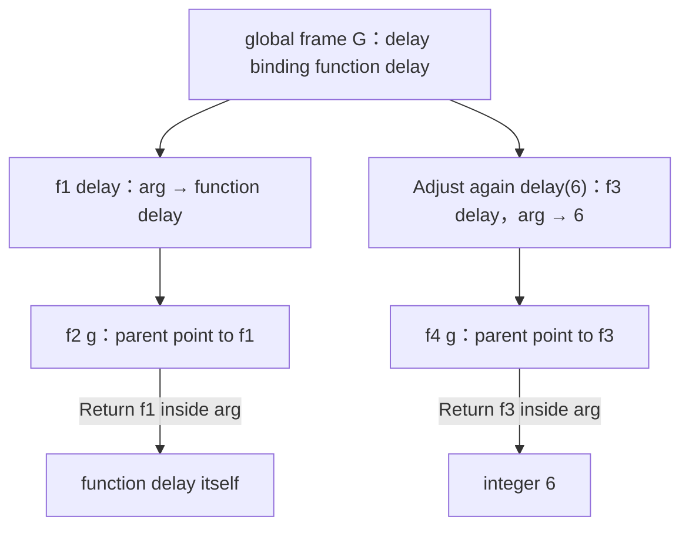
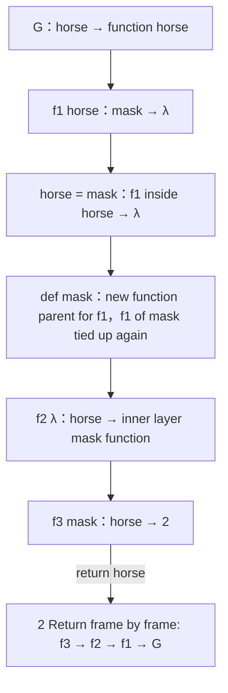
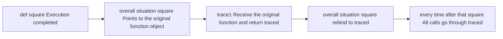

> **courses**: UC Berkeley CS61A · Structure and Interpretation of Computer Programs(Fall 2024)
> **This lecture**: Lecture 8 ｜ 34:16 ｜ Station B P 8 ｜ [Original video](https://www.bilibili.com/video/BV1sy411z7nA?p=8)
> **courseware**: `07-Function_Examples_1pp.pdf` (14 pages, official PDF, page-by-page renderings see text illustrations)
> **subtitles**: Original English subtitles from Station B; this note is a reconstruction of Chinese writing, not a sentence-by-sentence translation.
> **Copyright**: The copyright of the course and courseware belongs to the UC Berkeley CS61A teaching team; this article is a secondary arrangement for learning purposes

## Quick overview of this lecture

- **Mastered**: The evaluation order of calling expressions, `def`  Only create functions without execution bodies, high-order functions can receive and return functions, and how to draw frames and parent frames in the environment diagram (Lecture 2–7).
- **Main line of this lecture**:
    - Practice "Inferring Interactive Output" with four past questions: `print`  return value, `delay`, `pirate`, and  `horse`  with  `mask`  The exchange question.
    - The four questions seem to be asking about output, but they are actually asking about the same thing: where is a certain name? **current moment** Points to which value in which frame.
    - A set of reusable function implementation processes: read the description → check the example → read the template → assign a value to the name → write the code → back-check.
    - to  `remove_digit`  For example, let's go through the derivation of "three wrong attempts → find the correct bit weight".
    - Decorator: `@trace1`  with  `square = trace1(square)`  Completely equivalent.
- **Key conclusions**: Value, side effects, and name binding are three things; every line that appears on the screen is a side effect and has nothing to do with the value of the expression; when implementing a function, first mark each name of a specific example with a value on the paper before moving the keyboard.

*(Reference time: 00:00:01 – 00:34:11｜Lecture 8)*

> **Editor's note**: Courseware for this lecture  `07-Function_Examples_1pp.pdf`  It does not completely coincide with the video content. The main thread of the video is real test exercises, function implementation process and decorators; the courseware also includes Twenty-One demonstration, currying and Newton's method (the last group of pages is marked OPTIONAL). These groups of pages do not have corresponding oral paragraphs in the video and are placed at the end of the text.  `附录`  Restore by screen, citing sources everywhere. All paragraphs in the text that quote information other than the video are marked with "Editor's Note" or "Editor's Supplement."

## 1. Course Start Notice: Midterm Examination and Review Suggestions

*(Reference time: 00:00:01 – 00:01:53｜Lecture 8)*


This lecture begins by nailing next week’s schedule: **Monday exam**, so there are no classes on Monday and no experiments (lab) next week. The only activity is the exam in the evening. Entrance to the exam begins at 20:00, and the exam officially begins at 20:10; the ten minutes in between are not wasted, they are used to make people sit down and hand out paper test papers. This process almost always takes this long in Berkeley's exam room.


Why is the first midterm scheduled so early? There are two reasons. The first is to return the approved papers before the add-drop deadline. If students find that the course does not meet expectations, they still have time to adjust the class schedule; the second is to give feedback as early as possible to let everyone know whether they are keeping up. In other words, the primary function of this exam is physical examination, not screening.

The score structure also supports this judgment. There is one course  **exam recovery policy**: As long as you do well in the final exam, you can get back up to 90% of the points you lost in the first midterm; and the score of midterm 1 itself is lower than midterm 2 and the final. So it's not a high-stakes exam.

So what does it test? Half of it is the understanding of the language itself - why this code runs like this; the other half is using the tools I have learned to solve problems. The questions in midterm 1 only use the content that has been taught in class. Learning more Python will not bring any advantage, but it will make it easy to complicate simple questions. Three hard skills are clearly named:

- Able to draw environment diagrams;
- Be able to predict the behavior of Python, that is, "what will this code print and what will its value be";
- Can implement functions to turn a text description into runnable code.

The test preparation suggestions are also specific: finish the optional questions in the lab, go through the discussion questions, and do the same for homework and project questions. The last one is the most important and the easiest to ignore——**Get enough sleep before the exam**. Solving problems depends on your level of wakefulness. If you sleep enough, the same problem will be much easier.

As for the lecture itself: most of the time is used to go through the previous years' real questions together; there is also a small section about  **decorators**  The lecturer made it clear that he would not be tested on the content, but it is a natural extension of higher-order functions and is also a common way of writing in real code, so it is worth talking about now.

## 2. Interactive output: first distinguish between "value" and "screen"

*(Reference time: 00:01:54 – 00:04:28｜Lecture 8)*


The most common question type in past papers is called  **what would Python print**: Given a few lines of code, ask what you will see if you enter an expression in the interactive interpreter. It is the same as "what is the value of this expression"**two different questions**, and most of the points lost come from confusing the two.

### 2.1 Three rules

- `print`  always return  `None`. Its job is to display the actual parameters and show that this thing is **side effects**, not a return value.
- `print`  When displaying multiple arguments, separate them with spaces.
- The interactive interpreter only interprets the value of an expression **No** `None`  echo it; the value is  `None`  Just show nothing. want to see  `None`, it must be explicitly  `print`  Come out.

The lecturer's fixed opening is to give a minimal environment, which will be used in the following examples:

```python
def square(x):
    return x * x

from operator import add, mul
```

Then start asking: `5`, `print(5)`, `print(print(5))`  What each will display and what its value is.

### 2.2 From  `5`  Arrive  `print(print(5))`

`5`  The evaluation is 5, and the echo is also 5. This step is not controversial.

`print(5)`  Evaluates as  `None`, but 5 is displayed during the call. So what you see on the screen is 5, but the value of the expression is still  `None`——Just because the value is  `None`, the interpreter will not echo an additional  `None`.

`print(print(5))`  is a nested calling expression. According to the evaluation rules of calling expressions: evaluate the operator first  `print`, then evaluate the operand  `print(5)`. Evaluating the operands prints 5 and gives  `None`; then put the outer layer  `print`  Act on this  `None`  on, so another line is displayed  `None`;The value of the entire expression is still  `None`. On the screen are two lines:

```text
5
None
```

Put the three situations side by side and the difference is clear:

| expression | appears on the screen | value of expression |
|---|---|---|
| `5` | `5` | `5` |
| `print(5)` | `5` | `None` |
| `print(print(5))` | `5`  with  `None`  two lines | `None` |

> **Editor's note**:interactive interpreter "does not echo  `None`"It's CPython  `sys.displayhook`  Determined, it belongs to the interpreter behavior, not  `print`  characteristics. The same expression written in a script file will only appear on the screen  `print`  The generated lines will not be echoed; this is a common reason why "try in REPL" and "run script" have different results. When asked about "interactive output" in the exam, it defaults to REPL.

The value of this question lies in establishing a conditioned reflex: see  `print`  Just ask two things at the same time - what it prints and what it returns. The next three questions will use this reflection to its extreme.

## 3. `delay`: Defer an evaluation to the next call

*(Reference time: 00:04:31 – 00:09:19｜Lecture 8)*

The second question is a function with only five lines, but it is one of the most important patterns in the entire CS61A:

```python
def delay(arg):
    print('delayed')
    def g():
        return arg
    return g
```

`def`  Inside  `def`, and then return the inner function - this shape will appear repeatedly in subsequent recursions, decorators, and even interpreters. It works because of one rule: **When the function is created, its parent frame is the first frame at that time (the current frame)**. So  `g`  The parent frame is  `delay`  frame, `g`  appeared in  `arg`  will be found along the parent frame chain  `delay`  formal parameter; wait until  `g`  When called, `delay`  It has returned long ago, but the frame is still there because  `g`  Keep pointing at it.

The description given by the lecturer is: `delay`  It is a function that "receives any parameters and returns a zero-parameter function", and the returned function will hand over what was originally passed in.

### 3.1 Disassembly  `delay(delay)()(6)()`

This is a whole calling expression, and the operator itself is a calling expression, so the operator must be calculated first before the outermost call can be made. The brackets are peeled off layer by layer from left to right:

1. `delay(delay)`: New frame  `f1: delay`, formal parameters  `arg`  bind to function  `delay`  itself; print  `delayed`;return  `g` (parent frame  `f1`).
2. closely followed  `()`: call  `g`, new  `f2: g` (parent frame  `f1`), return  `f1`  inside  `arg`, that is, the function  `delay`.
3. `delay(6)`:Create new  `f3: delay`, `arg`  Binding 6; print  `delayed`;return new  `g` (parent frame  `f3`).
4. final  `()`: call this  `g`, return  `f3`  inside  `arg`, that is 6.

Arrange the four frames generated by these two calls according to the parent-child relationship:



There are two lines on the screen  `delayed`, then echo 6:

```text
delayed
delayed
6
```

The value of the entire expression is 6. Note that the last 6 is **echo**, no  `print`  Printed - because it's not  `None`.

### 3.2 Replace with  `print(delay(print)(4))`

For the same shape, if the parameters are replaced by the function itself, the difficulty will immediately rise to a higher level:

1. `delay(print)`: print  `delayed`, returning a "will  `print`  hand it over" `g`.
2. `g()`: hand over  `print`  function.
3. `print(4)`: Display 4, return  `None`.
4. Outer layer  `print`  received  `None`, display it.

```text
delayed
4
None
```

value is  `None`, so there is no additional echo. The subject of the previous question is numbers, and the subject of this question is functions; but the order of evaluation, the parent-child relationship of frames, and the division of labor between "printing" and "return value" have not changed a word.

### 3.3 What this example really teaches

`delay`  It is the smallest "delay" model: it stores the value in the parent frame of the function object and does not hand it over until someone calls it. It is certainly not a complete lazy evaluation - the editor adds: true lazy evaluation also needs to cache the results and avoid repeated calculations - but it exposes the mechanism cleanly enough: **Closure is not syntactic sugar, it is a direct consequence of "the function remembers where it was born"**.

## 4. `pirate`: Formal parameter masking makes the outer name permanently invalid

*(Reference time: 00:09:22 – 00:13:30｜Lecture 8)*

The third question  `delay`  Move the structure as it is, and only change the body of the inner function:

```python
def pirate(arg):
    print('matey')
    def plunder(arg):
        return arg
    return plunder
```

The lecturer specifically emphasized: It is related to  `delay`  difference **It's not the name that's different, it's the inner layer  `def`  The sentences say different things**. This sentence is worth copying in your notes - the behavior of the function is determined by the body, the name only affects readability.

### 4.1 `plunder`  no delay

`plunder`  There is only one sentence in the body  `return arg`, so  `plunder(2)`  2 immediately, without any delay. More importantly: `plunder`  formal parameters **also called  `arg`**. Name lookup always starts at the current frame, so in  `plunder`  frame check  `arg`  The formal parameter will be hit immediately, **Never reach** `pirate`  the one in the frame  `arg`. The outer binding is therefore not reachable on this path.

The result is  `pirate`  The real semantics of is condensed into one sentence: no matter what is passed in, it returns **identity function**——A function that returns the actual parameters unchanged.

### 4.2 Two calls

Look first  `add(pirate(3)(square)(4), 1)`:

1. `pirate(3)`  Print  `matey`, return  `plunder`;
2. `plunder(square)`  Return  `square`——Not 3, nor  `pirate`  in frame  `arg`;
3. `square(4)`  Got 16;
4. `add(16, 1)`  Got 17.

appear first on screen  `matey`, and then echo 17.

Look again  `pirate(pirate(pirate))(5)(7)`, disassemble from the innermost layer outward:

1. `pirate(pirate)`  Print  `matey`, returns an identity function;
2. `pirate(<恒等函数>)`  Print another one  `matey`, returns another identity function;
3. `<恒等函数>(5)`  return 5;
4. `5(7)`  trigger  `TypeError: 'int' object is not callable`.

The error occurs at the last step, not earlier. The expression is not type-checked during evaluation, and the problem is only revealed when 5 is actually placed in the operator position and Python tries to call it.

### 4.3 `delay`  with  `pirate`  comparison

| criterion | `delay` | `pirate` |
|---|---|---|
| What does the inner function return? | in outer frame  `arg` | own parameters  `arg` |
| The moment the inner function is called | Get the value stored in the outer frame | Get the actual parameters passed in this time |
| Outer layer  `arg`  Is it reachable? | Reachable and the only channel | Unreachable, obscured by the parameter with the same name |
| Whether to print each call | Print  `delayed` | Print  `matey` |
| actual semantics | Lazy-evaluated minimal model | Identity function |

The skeleton of the two pieces of code is exactly the same, the only difference is "who is written in the inner function body". This is exactly why environment diagrams exist: just look at the code, `arg`  The word looks the same in both places; only by drawing the frames do you know where it points.

### 4.4 Supplementary exercise: Rebound global names in Lab 02 Q2


> **Editor's note**: This page is from the courseware. There is no corresponding explanation paragraph in the subtitles of the video. The courseware divides this code into three pieces. Next, put them into a section according to the line order of the REPL, and gradually deduce the output; the conclusion is drawn strictly according to the rules of the environment diagram, and no settings outside the courseware are introduced.

```python
def cake():
    print('beets')
    def pie():
        print('sweets')
        return 'cake'
    return pie

def snake(x, y):
    if cake == more_cake:
        return chocolate
    else:
        return x + y

chocolate = cake()
chocolate
chocolate()
more_chocolate, more_cake = chocolate(), cake

snake(10, 20)
snake(10, 20)()

cake = 'cake'
snake(10, 20)
```

Deduction step by step:

1. `cake()`  Print  `beets`, returns the inner function  `pie`, so  `chocolate`  point to this  `pie`.
2. Evaluate individually  `chocolate`, display  `<function cake.<locals>.pie at ...>`——The function object uses "outer function name + `<locals>` + inner function name", which is the qualified name given by Python to the function inside the closure.
3. `chocolate()`  Print  `sweets`, return string  `'cake'`.
4. `more_chocolate, more_cake = chocolate(), cake`  The right side of is evaluated from left to right: calculate first  `chocolate()`, print  `sweets`, value  `'cake'`  tied to  `more_chocolate`;calculate again  `cake`  This name, at this moment it is still **function object**, tied to  `more_cake`.
5. `snake(10, 20)`  judge  `cake == more_cake`: Both point to the same function object at this moment, if the condition is true, return  `chocolate` (i.e.  `pie`  function).
6. `snake(10, 20)()`  Call it again on the returned function: print  `sweets`, got  `'cake'`.
7. execute  `cake = 'cake'`, global name  `cake`  Rebound to string.
8. Ask again  `snake(10, 20)`: `'cake' == <函数>`  For a holiday, go  `else`, return  `10 + 20 = 30`.

The three test points of this question are related to Chapter 5  `horse`  That example has the same origin: `==`  Comparatively **value** (Function object equality means the same object); `more_cake`  What is saved is the value before the name is changed, and it is rebind later.  `cake`  You won't go back and change it;  `snake`  The one in the body  `cake`  The global frame is checked again every time it is called, so it sees new values.

## 5. `horse`  with  `mask`: Extreme case of different frames with the same name

*(Reference time: 00:13:32 – 00:19:08｜Lecture 8)*

The fourth question is what the lecturer calls "one of my favorite questions I have ever asked":

```python
def horse(mask):
    horse = mask
    def mask(horse):
        return horse
    return horse(mask)

horse(lambda horse: horse(2))
```

The whole difficulty is not in the syntax, but in the  `horse`  with  `mask`  These two names refer to different things in different frames. The person doing the question must always remember three things: which frame you are in now, what this name is tied to in this frame, and where you want to go back when you return.

### 5.1 Initial state of global frame

After the module layer is executed, there are two things in the global frame:

- name  `horse`  bind to function  `horse`, its parent frame is the global frame;
- call the one in the expression  `lambda horse: horse(2)`  It is created at the module layer. The parent frame is also a global frame and is passed in as an actual parameter.  `horse`.

### 5.2 Frame-by-frame deduction

1. call  `horse(λ)`: New  `f1: horse` (parent frame  `G`), formal parameters  `mask`  bound to λ.
2. execute  `horse = mask`: Assignment statements are permanently modified **current frame**, so in  `f1`  name  `horse`  Tie to λ.
3. execute  `def mask(horse)`: `def`  There are two steps. The first step is to create a new function  `mask`, the parent frame is **current frame  `f1`**;The second step, in  `f1`  name  `mask`  Rebind to this new function. A name can only have one value in the same frame. The original binding pointing to λ is overwritten and cannot be found thereafter.
4. execute  `return horse(mask)`: at this moment  `f1`  inside  `horse`  is λ, `mask`  It is the inner function just defined, so this call is "λ" acting on the inner layer  `mask`  on".
5. New  `f2: λ` (parent frame  `G`), formal parameters  `horse`  bind to inner layer  `mask`  function. The body of λ is  `horse(2)`, so use  `f2`  inside  `horse`  To call, that is, to call the inner layer  `mask`.
6. New  `f3: mask` (parent frame  `f1`), formal parameters  `horse`  Binding 2. inside the body  `return horse`  Returns 2; this 2 is along  `f3 → f2 → f1 → G`  All the way back as the return value.

The origin of the three frames can be drawn as a chain:



| frame | created by | key binding | what does it prove |
|---|---|---|---|
| `f1: horse` | `horse(λ)` | `mask → λ`, then  `horse → λ`, and then  `mask → 内层 mask` | Assignment and  `def`  Only the current frame is changed |
| `f2: λ` | `return horse(mask)`  inside  `horse` | `horse → 内层 mask` | The parent frame of λ is  `G`, regardless of who calls it |
| `f3: mask` | λ in vivo  `horse(2)` | `horse → 2` | inner layer  `mask`  The parent frame is  `f1`, but it only uses formal parameters |

The final result is 2, and no error is reported. This question pushes "different frames with the same name" to the limit: in the same source code, `horse`  successively refers to three different things (global function, λ, integer 2), `mask`  It also refers to two (λ, inner function) one after another. Being able to follow along shows that the rules of the environmental map have been internalized.

### 5.3 Review: three actions

- **`def`  It's two steps**: Construct function (parent frame = current frame), and then bind the name to the current frame. When drawing a picture, first draw the function object and then point the arrow over it.
- **Assignment only changes the current frame**: `horse = mask`  What changed is  `f1`  inside  `horse`, not the global one.
- **Name lookup starts from current frame**: Going up the parent frame chain, the first hit binding wins; the parent frame superscripted on the function value is the one it is bound to. **Create** the frame in which it is located, not the frame in which it is **call** The frame at which it is located.

## 6. From description to code: `remove_digit`  five-step process

*(Reference time: 00:19:10 – 00:29:20｜Lecture 8)*


The other half of the real question is "implementing a function": you are given a text description, a few examples, and a template that may have spaces, and you are asked to write code that can run on paper. The lecturer gave a set of processes, the value of which lies in turning "thinking time" into "effective thinking time" instead of staring blankly.

### 6.1 Questions and Examples

`remove_digit(n, digit)`: `n`  is a non-negative integer, `digit`  is a single digit from 0 to 9; returned by  `n`  All in **not equal to** `digit`  A new integer composed of digits, the order of the digits remains unchanged.

- `remove_digit(231, 3)`  Return  `21`;
- `remove_digit(243132, 2)`  Return  `4313`——Remove all 2s, and keep the remaining 4, 3, 1, and 3 in their original relative order.

### 6.2 Five-step process

- **Read description**, first figure out "what to achieve" rather than "how to write a loop".
- **Check examples**, and pick the simplest one as the main example. Checking is not formalism: technical descriptions can easily be ambiguous, and examples are the only thing that calibrates understanding. If you think the result should be another number when reading the description, but the example gives another number, then your understanding is wrong and must be corrected on the spot.
- **Read template**. If a template is helpful, use it; if a template makes people more confused, write it according to your own ideas first, and then change it into the shape of the template after you write it correctly - there is a code that can run, and aligning the template is just a mechanical job.
- **Before writing code, mark each name in the main example with a specific value**, including input, output, and intermediate variables you plan to introduce.
- **Write code, run the main example, and confirm that the returned things are correct** (type pair, value pair), and finally back-check with other examples, especially the one that is longer and easier to miss branches.

### 6.3 Templates

The template skeleton given in the video is roughly like this (leave the underline blank):

```python
def remove_digit(n, digit):
    kept, digits = 0, 0
    while n > 0:
        last = n % 10
        n = n // 10
        if last != digit:
            ...
    return kept
```

> **Editor's note**: The blank spaces in the template in the video are described verbally, and the subtitles do not read each line verbatim. The above paragraph is organized according to the lecturer’s dictation: `kept`  with  `digits`  Initialized to 0 together; each round of loop first  `n`  The last digit of  `last`, and then take this one from  `n`  Cut off (`n % 10`  with  `n // 10`  It is the bit-getting mode repeatedly used by CS61A); and then determine whether this bit should be retained. `...`  is a statement to be filled in.

The template itself reveals the intent: `kept`  Responsible for collecting results, `digits`  Responsible for recording "how many have been saved". The latter is not a variable that appears out of thin air; its existence implies that the results are assembled bit by bit.

### 6.4 Label the examples

choose  `n = 231`, `digit = 3`, expecting to return 21. Start by writing the value of each name on a piece of paper: `kept = 0`, `digits = 0`.

- First round: `n = 231`, `last = 1`, `n`  becomes 23. `1 != 3`, keep 1.
- Second round: `n = 23`, `last = 3`, `n`  becomes 2. `3 == 3`, skip.
- Round 3: `n = 2`, `last = 2`, `n`  becomes 0. `2 != 3`, keep 2.
- The cycle ends, `kept`  Should be 21.

### 6.5 Four attempts

First try, the most intuitive way to write:

```python
kept = kept + last
```

Score 1 on the first round and 3 on the second round. Numbers are treated as sums, and positional rights are completely lost.

Second try, push the old result one position to the left:

```python
kept = kept * 10 + last
```

first round  `0 * 10 + 1 = 1`;Second round  `1 * 10 + 2 = 12`. 12 is not 21 - because the numbers are taken out from right to left, the 1 taken first is the low position, but it is pushed to the high position, and the order is reversed.

Third try, enlarging the new number:

```python
kept = kept + last * 10
```

10 in the first round, 10 in the second round  `10 + 20 = 30`. The position power is programmed to 10, which is only valid for the second position.

In the fourth attempt, the right to give up the seat follows the "reserved digits":

```python
kept = kept + last * 10 ** digits
digits = digits + 1
```

First round: `1 * 10 ** 0 = 1`, `kept = 1`, `digits = 1`. Skip 3 in the second round. Round 3: `2 * 10 ** 1 = 20`, `kept = 21`. Got 21.

| Writing method | Results from the first two rounds | Reason for failure |
|---|---|---|
| `kept = kept + last` | 1, then 3 | Adding numbers as sums loses bit weight |
| `kept = kept * 10 + last` | 1, then 12 | The low bit obtained later is put into the high bit, and the order is reversed. |
| `kept = kept + last * 10` | 10, then 30 | The position is written down as 10, and only the second position is correct. |
| `kept = kept + last * 10 ** digits` | 1, then 21 | Correct: The bit weight increases with the number of reserved bits. |

The lecturer's summary of this derivation is worth remembering: There is always "a moment of invention" in this type of problem - here it is "using 10" `digits`  The power puts the current bit in the correct position." But as long as the structure (loop positioning, conditional judgment, accumulation) is right, the invention only needs to happen in two or three lines, and can be tried out step by step using examples.

### 6.6 Backtesting with longer examples

The main example only uses three digits, so it is easy to miss branches. Replace with  `remove_digit(243132, 2)`, go through it bit by bit:

| The last bit taken out | Whether to retain | `digits` (after reservation) | `kept` |
|---|---|---|---|
| 2 | No | 0 | 0 |
| 3 | is | 1 | 3 |
| 1 | is | 2 | 13 |
| 3 | is | 3 | 313 |
| 4 | is | 4 | 4313 |
| 2 | No | 4 | 4313 |

The result is 4313, consistent with the example given in the question. Check again with the extreme case of "don't delete any numbers": `remove_digit(231, 4)`  231 should be returned unchanged, because every digit is preserved - 1 occupies the ones place, 3 occupies the tens place, and 2 occupies the hundreds place, which is exactly restored. This kind of "borderline example" can catch  `digits`  The initial value is written incorrectly (starting from 1 will make all bit weights one higher), or the loop condition is written as  `n >= 0`  This leads to problems such as infinite loops.

### 6.7 Another way of thinking: treat it as a decimal first

The lecturer also mentioned a completely different approach: don’t think about spelling integers, first let  `kept`  Divide by 10 each time, so by subtracting 3 from 231 we get  `2.1`;Finally multiplied by 10 (`digits - 1`) to the power, move the decimal point back, and round to an integer. This solution can also get the correct answer, but it has to deal with floating point errors and is less readable.

Its meaning is not "another solution", but to explain: **There is often more than one correct answer to the same question**. But no matter which path you take, you can't get around the strategy (here, position) that you must invent yourself, and a structured process ensures that you spend time in the right direction.

### 6.8 Courseware Page 8: `nearest_prime`  with docstring


> **Editor's note**: The example used in this section of the video is  `remove_digit`, and page 8 of the courseware prints a variant of Question 3(b) of Fall 2022 Midterm 1  `nearest_prime`. The two questions test the same process. The list on the right side of the page just breaks down the process dictated by the lecturer in more detail: read descriptions, check examples, read templates, label names, write code, check return values, and verify with other examples. Below, the title, docstring and skeleton are transcribed according to the original text of the courseware; the video does not explain the complete solution to this question.

Topic: Implementation  `nearest_prime(n)`, `n`  is an integer greater than 5, returns the distance from  `n`  nearest prime number; if two prime numbers are far apart  `n`  Just as close, return the larger one. hypothesis  `is_prime(n)`  Already implemented.

```python
def nearest_prime(n):
    """Return the nearest prime number to n.
    In a tie, return the larger one.

    >>> nearest_prime(8)
    7
    >>> nearest_prime(11)
    11
    >>> nearest_prime(21)
    23
    """
    ___
    while True:
        if ___:
            ___
        if ___:
            k = -k
        else:
            ___
```

Here's  `___`  It's the spaces on the courseware, not the code. The purpose of the skeleton is not difficult to guess: start from a certain offset and test repeatedly  `n`  adjacent integers on both sides until a prime is hit; `k = -k`  This line says that the offset changes sign midway. As for how to fill in the blanks, the courseware leaves it up to the students.

That part is worth talking about alone.  `"""..."""`. it is  **docstring (documentation string)**: The first string literal in the function body, `help()`  will display it as is. Among them  `>>>`  The first few lines are  **doctest**——Write interactive sessions directly into the document, each line  `>>>`  Followed by the expression, the next line is followed by the desired echo. This is not decoration: `doctest`  Modules can find these fragments and actually execute them, turning "examples in documents" into "tests that automatically fail" (Editor's addition: `python -m doctest -v 文件名.py`  ready to run).

The value of doctest is that it forces the author to answer "what is right" first. Before writing the implementation, first  `nearest_prime(8)`  Writing down the return value 7 is equivalent to nailing the specifications first; but once deviation is achieved, the example will immediately report an error. Its limitations should also be known: the comparison is **text**, so the string is returned  `'7'`  and returns an integer  `7`  Neither of them can pass the other party's example, which happens to be a machineized check of "the return type must be correct".

> **Editor's note**: The following is an implementation completed by the editor based on the skeleton idea. It is only used to illustrate the solution and does not belong to the classroom content.

```python
def nearest_prime(n):
    k = 0
    while True:
        if is_prime(n + k):
            return n + k
        if is_prime(n - k):
            return n - k
        k = k + 1
```

Three details determine whether it can pass as an example. `k`  Starting from 0, then  `n`  It will be returned in the first round when it is a prime number - this corresponds to the doctest  `nearest_prime(11)`  Return 11. Check first  `n + k`  Check again  `n - k`, so when the distances are equal, the larger one is returned, which satisfies "the larger one in a tie". `k`  Increment at the end of the loop, otherwise you'll be stuck in the same round forever once both branches miss.

## 7. Decorator: hand the function to the function and tie it back to the original name

*(Reference time: 00:29:21 – 00:34:11｜Lecture 8)*

This last section is outside the scope of the exam, but it is a convergence of all the tools in this lecture. First prepare two ordinary functions:

```python
def square(x):
    return x * x

def sum_squares_up_to(n):
    total, k = 0, 1
    while k <= n:
        total, k = total + square(k), k + 1
    return total
```

`sum_squares_up_to(5)`  is 1 + 4 + 9 + 16 + 25 = 55.

### 7.1 `trace`  The effect

Demonstrated in class  `trace`  It is a decorator provided in the course code. give  `square`  After adding it, each call will first print a line "Calling", and then print another line when returning; give  `sum_squares_up_to`  Also after adding, a summation will make every internal  `square`  All calls are displayed. The lecturer said: You can see "all the things that have happened."

There's nothing mysterious about its implementation. Next, write a version that only supports single-parameter functions.  `trace1`:

```python
def trace1(fun):
    def traced(x):
        print('calling', fun, 'on argument', x)
        return fun(x)
    return traced
```

Read line by line: `trace1`  receive a function  `fun`; internal definition  `traced`, it only takes one parameter (so it is called  `trace1`); `traced`  Print first, then  `x`  hand over  `fun`, and put  `fun`  return value **Return as is**;finally  `traced`  Hand it over. `traced`  The parent frame is  `trace1`  frame so it remembers  `fun`  Which function is it - this is why it can "wrap any function".

### 7.2 Use  `@`  use it

```python
@trace1
def square(x):
    return x * x
```

thereafter  `square(12)`  Will print first  `calling <function square ...> on argument 12`, and then echo 144.

Add to both functions:

```python
@trace1
def square(x):
    return x * x

@trace1
def sum_squares_up_to(n):
    total, k = 0, 1
    while k <= n:
        total, k = total + square(k), k + 1
    return total
```

At this time  `sum_squares_up_to(5)`  The output becomes a call tree: first  `sum_squares_up_to`  itself is called, then  `square`  Called sequentially by 1 to 5, and finally 55. The five calls originally hidden in the loop are revealed by a layer of packaging.

### 7.3 Equivalent explicit writing

```python
square = trace1(square)
```

`@trace1`  written in  `def square`  above, with this line **Exactly equivalent**, the execution order is:

1. Execute first  `def square`, in the global frame  `square`  Point to the original function;
2. Then rebind the same name to  `trace1(原函数)`  return value (i.e.  `traced`) on.

These two steps can be represented by a chain of arrows:



From this moment on, there is no name in the global frame pointing to the original function - it only lives in  `traced`  In the parent frame of  `fun`  This name holds. This and  `delay`, `pirate`  The mechanism is the same thing, but the direction is reversed: before it was "hide the value into the closure and wait to be retrieved", here it is "hide the function into the closure and wrap it up".

### 7.4 Why invent?  `@`

Since  `square = trace1(square)`  also works, why does Python still provide  `@`? The lecturer gave three reasons:

- Less typing, especially when there are multiple decorators stacked on the same function;
- The decoration information is written at the function definition. People who read the code can see "who has processed this function" at a glance without having to look down for the assignment statement;
- There is a more practical reason: not all Python programmers understand higher-order functions, but everyone can understand the "magic" of decorators.

> **Editor's note**: Decorators can be superimposed, multiple  `@`  from closest  `def`  Starting from the one, it is applied in order from bottom to top; the wrapped function usually also uses  `functools.wraps`  Keep the name and docstring of the original function, otherwise  `square.__name__`  will become  `traced`, `print(square)`  will also be displayed  `<function trace1.<locals>.traced ...>`. Both of these points are outside the scope of this lecture and will be encountered when writing the implementation.

## Summary

*(Reference time: 00:00:01 – 00:34:11｜Lecture 8)*

- **Every line on the screen is a side effect**: `print`  Show actual parameters, return  `None`;REPL only returns non- `None`  value. Before asking "what is the output", first ask "what is the value".
- **Nested  `def`  create closure**:The parent frame of the inner function is **the frame that defines it**, not the frame in which it was called; this is why it remembers the outer variables after the function returns.
- **Parameters with the same name will obscure the outer name**: Name lookup always starts at the current frame, so the outer binding may never be reachable -`pirate`  Therefore it degenerates into an identity function.
- **`def`  It is a two-step process, and the assignment only changes the current frame.**: Constructor (parent frame = current frame) and then bind the name; `horse = mask`  What was changed was in the local frame  `horse`, not the global one.
- **Three things should be marked on the environmental map**: The parent frame of the frame, the arrow for each name, the parameters of the function object and the parent frame. Different frames with the same name is the only real difficulty with this type of problem.
- **To implement the function, first run an example on paper**: Label each name with a value, and then write the code; the main example should be simple enough to be followed by the brain, and a longer example should be used for the backtest.
- **The general shape of the positional rights problem is  `kept + last * 10 ** digits`**: Think clearly "which reserved bit is this" first, and the bit rights will appear naturally; the directions of three wrong attempts (adding, multiplying by old value, and multiplying by fixed 10) are all wrong in the same place.
- **The decorator is  `f = deco(f)`  syntactic sugar for**: It moves the "wrapper function" to the definition, turning high-order functions from tricks into readable declarations.

## Attached: Slide index for this lecture

*(Reference time: 00:00:01 – 00:34:11｜Lecture 8)*

| page | content | Appear location |
|---|---|---|
| 1 | Title page: Function Examples | §1 |
| 2 | Announcements transition page | §1 |
| 3 | Call Expressions section page | §2 |
| 4 | Lab 02 Q2: `cake`, `pie`, `snake`  The output inference of | §4.4 |
| 5 | Twenty-One Environment Diagram Section Page | Appendix A |
| 6 | Twenty-One Rules and Victory and Loss Status Charts | Appendix A |
| 7 | Function Implementation Practice section page | §6 |
| 8 | `nearest_prime`  Template and implementation process checklist | §6.8 |
| 9 | Currying Sectioned Pages | Appendix B |
| 10 | Currying: `make_adder`  with  `add`  universal correspondence | Appendix B |
| 11 | Newton's Method (OPTIONAL) section page | Appendix C |
| 12 | Background on Newton's method: zero points and square roots | Appendix C |
| 13 | Newton's method iteration: tangent and update formulas | Appendix C |
| 14 | Interactive results for √2 using Newton's method | Appendix C |

## Appendix: Slides not shown in class

*(Reference time: 00:34:08 – 00:34:11｜Lecture 8)*

> **Editor's note**: Pages 5, 6, 9-14 of this lecture do not have corresponding spoken passages in the video - the video ends at the motive of the decorator. The following is restored based on the courseware screen: the rules, formulas and interactive sessions are taken verbatim from the page text; the page footer has a Python Tutor link, and the source code is decoded and used to complete the demonstration code; where the courseware does not provide a function body, it is marked with "Editor's Supplement".

### A. Twenty-One: Write the strategy as a function


Twenty-One is a two-player game with only four rules:

- Two players take turns to act, and each round can add 1, 2, or 3 to the current total;
- The total starts at 0;
- The game ends when the total reaches 21 or more;
- The last person to add up loses.


The state diagram in the lower half of the page is the essence of this lecture. The green number means "Whoever's turn it is to go wins", and the red number means "Whoever's turn it is to go loses":

- **20 is red**. When it's your turn, the total is already 20. No matter you add 1, 2 or 3, the total will reach or exceed 21, and the person who added last loses, so you must lose.
- **16 is red**. Starting from 16, you can only go to 17, 18, and 19; and 19 can add 1 to 20, 18 can add 2 to 20, and 17 can add 3 to 20 - your opponent can always return the losing position to you.
- And so on. Push this picture to the left, the rule is  **Multiples of 4 are guaranteed to lose** (12, 16, 20...), the rest are must-win positions. The total starts at 0, and 0 is a multiple of 4, so the first player loses as long as neither party makes a mistake.

The demo code is given in the Python Tutor link in the footer of the courseware (the editor compiled the source code according to the link):

```python
def play(strategy0, strategy1, goal=21):
    n, who = 0, 0
    while n < goal:
        if who == 0:
            n = n + strategy0(n)
            who = 1
        elif who == 1:
            n = n + strategy1(n)
            who = 0
    return who

def two_strat(n):
    return 2

def noisy_strat(who, s):
    def strat(n):
        choice = s(n)
        print('Player', who, 'added', choice, 'to', n, 'to reach', choice + n)
        return choice
    return strat

play(noisy_strat(0, two_strat), noisy_strat(1, two_strat))
```

`play`  is a higher-order function: its two arguments are not numbers, but **Strategy**——"Given the current total, return the number added in this round" function. variable  `who`  It always means "the next person to move"; when the loop exits, the person who just added the number has pushed the total over the line, so  `who`  Just the winner.

`noisy_strat`  Also a higher-order function: it receives a strategy  `s`, returns a packaged new strategy; the new strategy prints the process when making decisions, and then returns it as it is.  `s`  choice. `who`  with  `s`  all stay  `strat`  In the parent frame of , this is the most practical form of closure——**Add a layer of logging to an existing function without changing its code**.

When both players use "always add 2", the output is 11 lines (the editor deduced according to the code, the video is not shown):

```text
Player 0 added 2 to 0 to reach 2
Player 1 added 2 to 2 to reach 4
Player 0 added 2 to 4 to reach 6
Player 1 added 2 to 6 to reach 8
Player 0 added 2 to 8 to reach 10
Player 1 added 2 to 10 to reach 12
Player 0 added 2 to 12 to reach 14
Player 1 added 2 to 14 to reach 16
Player 0 added 2 to 16 to reach 18
Player 1 added 2 to 18 to reach 20
Player 0 added 2 to 20 to reach 22
```

`play`  Return 1: Player 0 is forced to push the total to 22, and Player 1 wins. This is consistent with the conclusion of the state diagram - 20 is the inevitable defeat, and whoever stops the total at 20 will fail to themselves.

### B. Currying: Split multi-parameter functions into one-way pipelines


The courseware inserts a page of currying review after the function implementation, with only two lines of code:

```python
def make_adder(n):
    return lambda k: n + k
```


Both expressions yield 5, but the evaluation paths are different (`add`  from §2  `from operator import add, mul`):

```python
make_adder(2)(3)   # 5
add(2, 3)          # 5
```

`make_adder(2)`  Returns a function that "remains one parameter", and the second bracket is the moment when the addition is actually performed; `add(2, 3)`  Then take both parameters at once and give the answer directly. The page writes this correspondence into one sentence: **Currying is the process of transforming a multi-parameter function into a single-parameter higher-order function**, which returns a function that continues to receive the remaining parameters.

This correspondence can be written as code (editor’s addition):

```python
def curry2(f):
    def g(x):
        def h(y):
            return f(x, y)
        return h
    return g
```

`curry2(add)(2)(3)`  Also gets 5. It is the same thing as the currying mentioned in Lecture 5. The courseware is just a review here: there is no essential gap between multiple parameters and "one parameter at a time", only one layer of closure is missing.

### C. Newton's Method: Use tangent to approach zero point


The last four pages of the courseware are a paragraph labeled  **OPTIONAL**  Elective content: Use Newton's Method to find the roots of equations. It's outside the scope of the exam, but it's one of the most beautiful uses of "function as argument" - the entire algorithm takes a function and calls it over and over again until the result is good enough.


Define the object first. function  `f`  The \*\*zero\*\* is satisfying  `f(x) = 0`  input  `x`. to  `f(x) = x² − 2`  For example, its positive zero point is at  `x ≈ 1.414213562373095`, which is √2. Generally, `f(x) = x² − a`  The positive zero point of is √a - so "finding the square root" is translated into "solving the equation  `x² = a`", and then translated as "make change". This is the application scenario of Newton's method: calculating square roots, cube roots, or even anything that can be written as  `f(x) = 0`  problem.


The method itself is surprisingly simple. given function  `f`  and an initial guess  `x`, repeat three steps:

1. Calculate the function value at the guess point  `f(x)`;
2. Find the slope of the tangent line at that point  `slope(f, x)`;
3. put  `x`  Update to the intersection of the tangent line and the x-axis: `x - f(x) / slope(f, x)`.

Geometrically, this is replacing the curve with a tangent: the point where the tangent intersects the x-axis is usually closer to the true zero point than the original guess. When  `f(x) = 0` (or close enough to 0). Written as a formula, it is


$$
x_{k+1} = x_k - \frac{f(x_k)}{f'(x_k)}
$$


to  `f(x) = x² − 2`, initial value  `x = 1`  For example, in four rounds, the error was reduced to more than ten decimal places:

| rounds | `x` | `f(x)` | `f'(x)` | next round  `x` |
|---|---|---|---|---|
| 0 | 1.0 | -1.0 | 2.0 | 1.5 |
| 1 | 1.5 | 0.25 | 3.0 | 1.4166666666666667 |
| 2 | 1.4166666666666667 | 0.006944444444444642 | 2.8333333333333335 | 1.4142156862745099 |
| 3 | 1.4142156862745099 | 6.007304882871267e-06 | 2.8284313725490198 | 1.4142135623746899 |

in the table  `f'(x)`  One column is calculated according to the analytical derivative 2x, which is convenient for hand calculation verification; the one used in the course is  `slope(f, x)`  This value is approximate. The convergence speed is the most amazing thing about Newton's method (Editor's addition: it is a quadratic convergence near the zero point, and the significant figures in each round are approximately doubled). Four rounds are enough.


The last page brings the abstraction to the scene of use:

```python
f = lambda x: x*x - 2
find_zero(f)
```

echo  `1.4142135623730951`, with  `math.sqrt(2)`  The last digits are the same. Functions here are pure arguments: `find_zero`  It doesn't care whether the incoming signal is square, cubic or anything else. It is only responsible for pushing the guess to zero according to Newton's method.

> **Editor's note**: Courseware only provides  `find_zero(f)`  call with  `slope(f, x)`  This name is not given to the function body. The following is an implementation consistent with the semantics of the page, for reference and reading, and is not part of the courseware content.

```python
def slope(f, x, dx=1e-8):
    return (f(x + dx) - f(x)) / dx

def find_zero(f, guess=1.0, tolerance=1e-12):
    x = guess
    while abs(f(x)) > tolerance:
        x = x - f(x) / slope(f, x)
    return x
```

`slope`  Use the difference quotient to approximate the derivative: take a minimum  `dx`, using the slope of the line connecting two points to pretend to be the slope of the tangent line. This is the key to "no need for analytical derivation". Use this implementation to ask  `x² − 2`  The zero points of will be obtained  `1.414213562373095`, which is completely consistent with the zero point marked on page 12 of the courseware; the zero point echoed on page 14 of the courseware  `1.4142135623730951`  There is an extra last bit, and the difference comes from the derivatives being approximated and floating point rounding, not the algorithm itself. The real code also needs to add an upper limit to the number of iterations in the loop, otherwise it will continue forever when encountering a non-convergent function.
