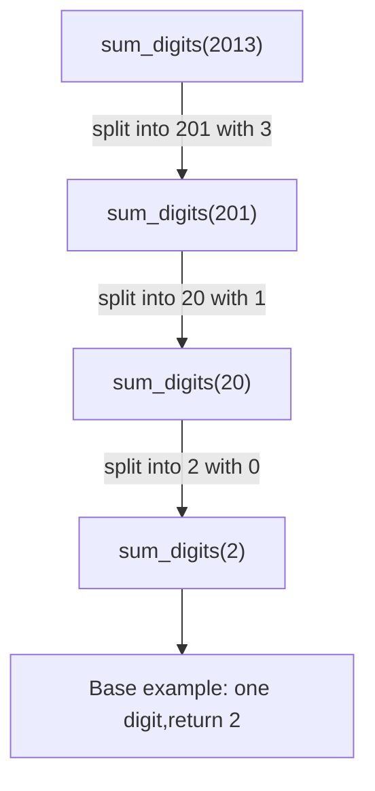
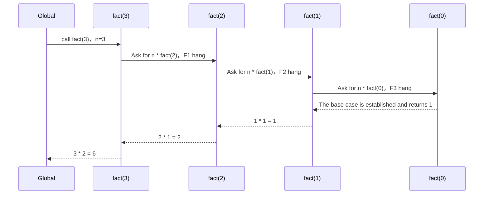
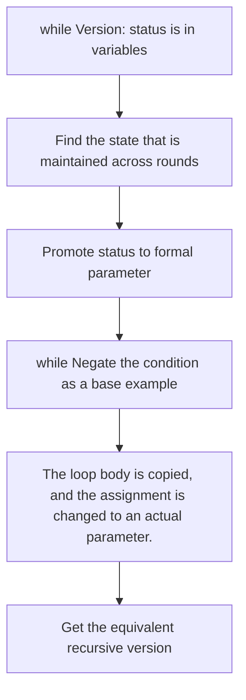

> **courses**: UC Berkeley CS61A · Structure and Interpretation of Computer Programs(Fall 2024)
> **This lecture**: Lecture 9 ｜ 37:49 ｜ Station B P 9 ｜ [Original video](https://www.bilibili.com/video/BV1sy411z7nA?p=9)
> **courseware**: `08-Recursion_1pp.pdf` (11 pages, official PDF, page-by-page renderings see text illustrations)
> **subtitles**: Original English subtitles from Station B; this note is a reconstruction of Chinese writing, not a sentence-by-sentence translation.
> **Copyright**: The copyright of the course and courseware belongs to the UC Berkeley CS61A teaching team; this article is a secondary arrangement for learning purposes

## Quick overview of this lecture

*(Reference time: 00:00:00 – 00:00:02｜Lecture 9)*


- **Mastered**: `def`  The evaluation order of the calling expression, formal and actual parameters, and the life cycle of a call are reviewed using the environment diagram; `if`  with  `while`  Two control structures, and the division of labor of "expressions have values and statements do things".
- **Main line of this lecture**:
    - The environment model allows function bodies to reference their own names; `print_all`  Explain that "mentioning oneself" and "calling oneself" are two different things.
    - The skeleton of a recursive function: **base case** Calculate directly, **recursive case** Change the problem to a smaller similar problem and then call yourself.
    - The environment graph spreads the recursion into a set of non-overlapping frames: the same function is called multiple times, but each time  `n`  belong to different frames.
    - Iteration is a special case of recursion, so there is a fixed recipe for translation between the two: state across rounds becomes formal parameters, and assignments become actual parameters.
    - Correctness depends on **leap of faith**: Prioritize the base case, and then use the recursive call as "already correct function abstraction".
- **Key conclusions**: Writing recursion only requires answering two questions - "What does the smallest problem look like" and "How to make the problem simpler"; the rest of the accounting work is left to the calling frame.

## 1. Course start announcement: projects, mid-term and second half

*(Reference time: 00:00:03 – 00:03:48｜Lecture 9)*


This lecture begins with a transactional announcement, which points to the same thing: the course has entered the middle, and there is still more than half of the content to follow. Three notifications are arranged in order of urgency—homework, midterm, and course selection.

Hog projects are due Wednesday. If you complete it today, you can get bonus points for early submission; extension requests will be automatically approved by the system within 24 hours, and longer requests will require manual review. The advice given by the lecturer is to complete it by the deadline, preferably in advance: the bonus points are only superficial reasons, the real reason is that the content of this course is layered on top of each other, and defaulting on a project will delay the experiments and homework in the following weeks.

Just after the midterm, the lecturer added three points of explanation. First, as a whole, the results this time are good. Second, there is a lesson in the course called  **exam recovery**  Policy (written in syllabus): If you do well in the final exam, you can get back up to 90% of the marks from the first midterm - "failure in the midterm" is not the end point. You will still have the opportunity to make up for it if you truly learn the material before the end of the semester. Third, exams sometimes provide useful information: it may indicate that a change in study style is needed, or it may indicate that the course is not the best fit. Everyone's path in education is different, and this isn't the only good lesson at Berkeley.

If you decide to change courses, the course with the highest overlap with this course is Data C88C: it roughly covers three of the four units of CS61A, but covers a semester; it is currently close to full, and may be expanded if there is a waiting list. CS10 also has a handful of openings. It is up to the students to decide whether to change. If you have any questions, you can send them to Ed, find core staff, or write directly to the lecturer.

For those who decide to stay, I only have one piece of advice: **Don't be left behind** (TLDR, don't fall behind). If you are dissatisfied with your scores, the most useful thing to do is to keep up with or even get ahead of the class - watch lecture videos, participate seriously in labs and discussions, and practice learned concepts repeatedly with homework and projects, so that by the time you take the exam, you can be said to be "good at solving problems, familiar with language rules, and without too many surprises." On the other hand, those who have done well in the exam should not relax now: most of the content of this course is still coming, and it comes quickly; historically, many students looked at the scores in the first midterm and thought "I'm fine", took a break, and were caught off guard by the second midterm. It’s the same for all students: complete assignments on time and start when the assignment is posted, not the day it’s due.

## 2. Self-reference: You can write your own name in the function body

*(Reference time: 00:04:03 – 00:09:50｜Lecture 9)*


The environment model has a less obvious but crucial corollary: **The function's own name can be referenced in the function body**. This is not a syntax privilege, but a natural consequence of the timing of evaluation.

execute  `def`  statement, only one thing really happens: the function body is "squirreled away" (the instructor's word is squirreled away), waiting for future calls, and no expression in the body is evaluated. By the time the function is actually called and the body starts executing, the name will already be in the global frame and it will have been bound to a function object. The name search goes along the environment chain and what is retrieved is the function itself.

```python
def print_all(k):
    print(k)
    return print_all

print_all(1)(3)(5)
```

`print_all(1)`  First print 1, then put  `print_all`  This name is looked up and used as the return value. The return value is the function object, so it is followed by  `(3)`  Just another call to this function, printing 3; another  `(5)`, print 5; the expression ends.

It is worth emphasizing that this function **self mentioned but not called**, so it won't run forever. How many times it is called depends entirely on the outer calling expression  `print_all(1)(3)(5)`  Determine, the output is the actual parameters of the three calls. This example shows that "self-reference" itself is harmless; what is dangerous is "calling yourself again unconditionally in the body" - that is how infinite recursion is written, and the base example to be discussed later is used to cut it off.

### 2.1 `print_sums`: Let each frame remember the "sum so far"

The second example is a bit more difficult: write a function that prints **Cumulative sum so far**. it cannot return  `print_all` (that function no longer exists), instead returns an internal function defined in body  `next_sum`.


```python
def print_sums(n):
    print(n)
    def next_sum(k):
        return print_sums(n+k)
    return next_sum

print_sums(1)(3)(5)
```

`n`  is the sum so far, `k`  is the next number; the summation occurs at  `n+k`  In this expression——`print_sums`  I am only responsible for printing. `next_sum`  Responsible for connecting the two paragraphs. execute  `print_sums(1)(3)(5)`  Print three lines: 1, 4 (i.e. 1 + 3), 9 (i.e. 1 + 3 + 5). The courseware gives another longer example: `print_sums(3)(4)(5)(6)`  Print 3, 7 (3 + 4), 12 (3 + 4 + 5), 18 (3 + 4 + 5 + 6).

Environmental diagrams make this clearer than words can. `f1`  is  `print_sums(1)`  frame: `n`  Binding 1, a function is also defined in the frame  `next_sum`, its parent environment is  `f1`; `f1`  The return value is this  `next_sum`  function object. `f2`  is  `next_sum(3)`  frames, only  `k = 3`, the parent environment is  `f1`, so  `n+k`  inside  `n`  Coming  `f1`  Search inside and get 1, which adds up to 4, and then call it with 4  `print_sums`, produce  `f3`.`f3`  inside  `n = 4`, also returns a new  `next_sum` (parent environment  `f3`); this  `next_sum`  Be  `(5)`  generated after calling  `f4`, `k = 5`, parent environment  `f3`  inside  `n = 4`, `4 + 5 = 9`, so  `f5`  inside  `n = 9`, print 9.

There are three drawn on the right side of the courseware  `next_sum`  function objects, they **Not the same object**, the difference is only that the parent environment points to  `f1`, `f3`, `f5`. The parent environment determines what the "sum so far" is - this is what a closure looks like in an environment graph. The lecturer concluded: `print_sums`  Only the cumulative sums 1, 4, and 9 are seen in the frame. `next_sum`  In the frame, we only see 3 and 5 that are passed in directly, each performing its own duties.

| criterion | `print_all` | `print_sums` |
| :--- | :--- | :--- |
| What to return | The function itself, the same function object | Newly defined in body  `next_sum` |
| Where does the state exist? | Nowhere to save, all calls share the global frame | Each call generates a new frame, `n`  It’s the cumulative sum |
| The parent environment of the new function | Not applicable | call  `print_sums`  The frame (`f1`, `f3`, `f5`) |
| What to print | The actual parameters of this call | The cumulative sum of this call |
| Who decides the number of calls | outer calling expression | Outer calling expression (return value continues to be called) |

> **Editor's note**: The word the lecturer used in the subtitles is memorize, which means to record the intermediate results in the actual parameters and pass them down with the call; this is not the same thing as memoization (caching historical evaluation results to avoid repeated calculations) often said in computer science. Do not mix these two words in your notes. The former is "manual transfer of ledgers", and the latter is "automatic check of ledgers".

### 2.2 Class exercise: Two functions that return functions to each other

The subtitles cut directly to "Recursive Functions" at 00:09:50, without explaining page 5 of the courseware. This page is a question about "what is printed on the last line":


```python
def add_next(n):
    print(n)
    return lambda f: subtract_next(n + f)

def subtract_next(n):
    print(n)
    return lambda f: add_next(n - f)

add_next(2500)(500)(1000)(24)
```

The answer to the courseware is  **2024**.`add_next`  with  `subtract_next`  They don't call themselves, but each returns a lambda, and then calls it in the lambda. **the other party**; What really determines where the chain goes is the string of actual parameters hanging after the calling expression.

> **Editor's note**: The content of this page does not appear in the subtitles. The following derivation is obtained by the editor based on the courseware code and is not the original text of the class. `add_next(2500)`  Print 2500, the returned lambda is executed after being called with 500  `subtract_next(3000)`, prints 3000; its return value is executed after being called with 1000  `add_next(2000)`, print 2000; execute after being called by 24  `subtract_next(2024)`, print 2024. The four lines of output are 2500, 3000, 2000, 2024, and the last line is exactly 2024. The value of this exercise is: **"Function returns function, function calls the other party" you can write a stateful call chain without recursion.**, recursion just puts the construction process of this chain into the function body.

## 3. Recursive functions: base case and recursive case

*(Reference time: 00:09:52 – 00:17:00｜Lecture 9)*


There is only one definition of recursive function: **Call your own function in body**, can be called directly or indirectly. When executing the body of a recursive function, you may need to apply the same function again - this sentence looks like a loop definition at first, but the "call a new frame each time" in the environment model makes it fall into place: the same function object is applied multiple times, and each application has its own frame.

Recursion doesn't just belong to computer science. The example given by the lecturer is  **Sierpinski triangle**: A Sierpinski triangle is made up of three smaller Sierpinski triangles, and the defined thing itself appears in the definition. This kind of self-similar structure is everywhere in art, nature, and mathematics. Recursive functions just move this description method into the program.

### 3.1 Starting from a specific problem: the sum of numbers

The first complete example is to find a positive integer **sum of numbers**:The answer for 2013 is 2 + 0 + 1 + 3 = 6. Why write a function specifically for this? The lecturer gave two reasons.

One is divisibility: an integer A is divisible by 9 if and only if the sum of its digits is also divisible by 9. The second is input verification: credit card numbers are very long, and manual input will always make mistakes, so there is a digit in each card number. **Checksum digit**——The 16th digit of the 16-digit card number is not part of the account number, but is calculated from the remaining 15 digits; if this digit does not match the recalculated result, it means that the number was entered incorrectly. The real verification algorithm is slightly more complicated than "adding the digits" (the Luhn algorithm will be given later in this lecture), but training starts with the simplest sum of numbers.

The constraints are: **Not allowed  `while`**. The sum of numbers can originally be written in a loop. After the loop is disabled, the only way left is recursion.

### 3.2 Three-step derivation

The first step is to build a building block: split the positive integer into "parts except the last digit" and "last digit". The former is obtained by dividing 10, and the latter is obtained by taking the remainder of 10.

```python
def split(n):
    """Split positive n into all but its last digit and its last digit."""
    return n // 10, n % 10
```

`2013`  by  `split`  get  `(201, 3)`. The reason why this step is critical is that it replaces a multi-digit number into two parts: "remove the last digit" and "the last digit", and the former is a smaller, same type of problem.

The second step is to connect the problem: If you can already find the sum of the numbers 201, then the sum of the numbers 2013 is its result plus 3. Pay attention here **Can't** write  `sum_digits(n)`——That is equivalent to asking the same question again; what is being asked is about  `201`  problem, a smaller problem.

The third step is to find the smallest situation: a single digit does not need to be split, `n < 10`  When the sum of the numbers is itself, the answer to 7 is 7. This situation can be calculated directly without any recursive calls, it is the exit of the entire chain.

The three steps combined are the code:

```python
def sum_digits(n):
    """Return the sum of the digits of positive integer n."""
    if n < 10:
        return n
    else:
        all_but_last, last = split(n)
        return sum_digits(all_but_last) + last
```

`sum_digits(2013)`  The expansion of can be drawn as a call tree: each level reduces the number of actual parameters by one until only one is left.



As the tree grows upward, the answer spreads downward: `sum_digits(2)`  return 2; `sum_digits(20)`  Get 2 + 0 = 2; `sum_digits(201)`  Get 2 + 1 = 3; `sum_digits(2013)`  We get 3 + 3 = 6. every layer  `last`  They are all left in the frame of that layer and added after the sub-call returns.

> **Editor's note**: This courseware only has 11 pages. `split`, `sum_digits`, `fact`, `fact_iter`, `luhn_sum`, `sum_digits_iter`  These functions were all typed out by the instructor on the spot in the editor, and there is no corresponding code page in the courseware. The code in the main text is restored sentence by sentence according to subtitles (for example  `split`  From the two sentences "divide by 10" and "take the remainder of 10", it can be reduced to  `n // 10, n % 10`), docstring and blank lines are added by the editor for readability and do not belong to the classroom screen.

### 3.3 Anatomy of recursive functions

The courseware splits the recursive function into two parts. This division is worth memorizing.

- `def`  The line is the same as an ordinary function: a function name and a set of formal parameters.
- This is usually followed by a conditional statement to check **base case**. The base case is a minimalist version of the problem - here is the "only one digit" situation, and summing is a trivial action, directly  `return n`.
- If it is not in the base example, it means the problem is still complicated (`n`  There are several people), enter **recursive case**, its evaluation requires recursive calls.
- The actual parameters of the recursive call must be **simpler question**: Starting from 2013, only 201 needs to be processed next time. The fewer digits, the closer to the base case.

| criterion | base case | recursive case |
| :--- | :--- | :--- |
| when to enter | The condition hits "the simplest kind of problem" | The condition didn't hit |
| How to evaluate | Calculate and return directly without recursive calls | Contains at least one call to itself |
| Actual parameter scale | minimum (`n < 10`, one digit) | Strictly smaller than the current problem (`201`  for  `2013`) |
| role in the whole | Provide a known answer, terminating the recursion | Change big problems into small ones |
| How to write this example | `if n < 10: return n` | `sum_digits(all_but_last) + last` |

### 3.4 Why recursion must stop

Recursion can be terminated by two conditions being met at the same time. First, **The actual parameters of each recursive call are strictly smaller**: `sum_digits`  The mileage is reduced by one digit each time. `fact`  inside  `n`  Decrease one each time. Second, there is a problem **The lower bound cannot be smaller**: Positive integers will not become infinitely small, one digit is the end. Put the two together, any legal input will fall into the base case after passing through a limited number of layers at most, and the chain will be automatically broken.

On the other hand, as long as the first one is destroyed, the recursion will immediately become an infinite loop. Write the recursive case as  `sum_digits(n)` (the actual parameters are not reduced), `n < 10`  If it is never true, the function will always call itself.

> **Editor's note**: Python will not really run "forever" - the interpreter has an upper limit on the call depth (CPython defaults to about 1000 levels), and it will be thrown if it exceeds  `RecursionError: maximum recursion depth exceeded`. This upper limit also explains the "space cost of recursion" to be discussed later: each layer of unreturned calls occupies one frame.

> **Editor's note**: The course textbook also gives two exercises after finishing this section: `is_even` / `is_odd`  Use mutual recursion to determine parity (`is_even(n)`  Return  `is_odd(n - 1)`, `is_odd`  On the contrary, both are  `n == 0`  at the end), and  `count_partitions`  Count the number of ways to split a positive integer into the sum of several positive integers. They are related to  `sum_digits`  The difference is that **Called recursively more than once**, so it is more worthwhile to use the criterion "whether the actual parameters are strictly smaller" to check one by one: no matter how many branches there are, as long as each branch is on a smaller problem, the terminability will not be affected.

## 4. Recursion in environment graph: `fact`  How the frames are expanded and retracted

*(Reference time: 00:17:03 – 00:23:22｜Lecture 9)*

Environment diagrams are the best tool for understanding recursion. Another example: factorial, $n! = n \times (n-1) \times \cdots \times 1$.

```python
def fact(n):
    if n == 0:
        return 1
    else:
        return n * fact(n - 1)

fact(3)
```

`fact(3)`  should be  $3 \times 2 \times 1 = 6$. The instructor walked through this process step by step in the Python Tutor, which is worth repeating frame by frame, because the entire mechanism of recursion is hidden in these steps.

1. `fact(3)`  Called in the global frame to create F1, `n`  Bind 3. 3 is not equal to 0, so count  `n * fact(n - 1)`.
2. Calculate the left side of the multiplication sign first to get 3; then calculate the right side  `fact(n - 1)`, among which  `n - 1`  Yes 2. This step needs to be called  `fact`  itself, while F1's  `return`  The statement has not been executed yet, so F1  **hang**, etc. The result of sub-call.
3. Create F2, `n`  Bind 2. 2 is not equal to 0, the same applies  `n * fact(n - 1)`;need on the right  `fact(1)`, F2 hangs.
4. Create F3, `n`  Bind 1. 1 is not equal to 0, the right side requires  `fact(0)`, F3 hangs.
5. Create F4, `n`  Binding 0. `0 == 0`  Established, hits the base case, and returns 1 directly. This is the first real return value in the entire chain.
6. Return to F3: `fact(n-1)`  The value of is 1, `n`  is 1, `1 * 1 = 1`, F3 returns 1.
7. Return to F2: `n`  is 2, `2 * 1 = 2`, F2 returns 2.
8. Back to F1: `n`  is 3, `3 * 2 = 6`, F1 returns 6. entire expression  `fact(3)`  The value is 6.

Entering is falling layer by layer, and returning is rising layer by layer. The direction is exactly the opposite: the last called F4 returns first, and the first called F1 returns last. Freeze the moment when execution reaches its deepest point, with four frames alive at the same time:

| frame | bound  `n` | Expressions that have not been completed yet |
| :--- | :--- | :--- |
| F1(`fact`, parent environment Global) | 3 | `3 * fact(2)` |
| F2(`fact`, parent environment Global) | 2 | `2 * fact(1)` |
| F3(`fact`, parent environment Global) | 1 | `1 * fact(0)` |
| F4(`fact`, parent environment Global) | 0 | None: base case, direct  `return 1` |

This "fall-recovery" process is more intuitive by using a sequence diagram:



### 4.1 Four things that can be read from this picture

- **The same function is called multiple times**. The call of F1 comes from the global frame, and the three calls of F2, F3, and F4 all come from  `fact`  interior.
- **Different frames are responsible for saving the actual parameters of different calls.**. That's why the computer won't get confused if the same function is called multiple times, even layer by layer - the evaluation model prepares a separate frame for each call.
- **`n`  The value depends on the current environment**. There are four in the picture  `n`, belonging to four frames respectively; any containing  `n`  The expression may evaluate to different things in different circumstances. When reading recursive code, "this  `n`  Which level is "compared" to this one?  `n` "How many" is more important.
- **Each call solves a smaller problem**.`n`  Decrease all the way, and when it reaches 0, there is only one sentence left.  `return 1`, workload ratio  `n`  1 is less, and so on.

### 4.2 Space cost of recursion

The lecturer added a key observation on the screenshot that stopped at the deepest point: At this time, it is returning from the last call, but **The previous calls have not returned yet.**. This sentence is the source of the cost of recursion - each pending call must retain its own frame, because there are unused frames in it.  `n`  and the unfinished multiplication.

thus  `fact(n)`  At the moment when it reaches the base instance, it exists in the memory at the same time  $n+1$  frames (global frame plus  $n$  layer call); these frames will not be released one by one until the chain goes back. The depth of the recursion is the magnitude of the space: frames stacked one above another form a stack.

> **Editor's note**: The word "call stack" is not used in the courseware and subtitles, nor is it given.  $O(n)$  The complexity notation; the above two sentences are the terms and magnitudes of the semantic complement of the environment diagram according to the editor. The upper limit of Python's call depth (approximately 1,000 layers) is the limit of this kind of space overhead. Therefore, particularly deep recursions are often rewritten as iterations in actual projects - this is also the translation recipe discussed in the last section of this lecture.

## 5. Recursion and iteration: two ways of writing the same factorial

*(Reference time: 00:23:25 – 00:26:20｜Lecture 9)*

The same thing can be done with a loop. The iterative version of factorial requires two variables: one to remember "the product multiplied to the present" and one to remember "the next number to be multiplied in".

```python
def fact_iter(n):
    total, k = 1, 1
    while k <= n:
        total = total * k
        k = k + 1
    return total
```

`total`  is the factorial so far, `k`  is the next number to be multiplied into; as long as  `k`  no greater than  `n`, just  `k`  ride in  `total`, again  `k`  plus one. at the end of the loop  `total`  That’s it  $n!$. According to the lecturer’s description, `k`  Take 1, 2, 3, 4... in sequence and multiply them one by one.

The recursive version has only one mathematical definition: $n!$  in  $n = 0$  is 1 when  $n$  multiply by  $(n-1)!$. Written as a formula:


$$
n! = \begin{cases} 1 & n = 0 \\ n \cdot (n-1)! & n > 0 \end{cases}
$$


The iterative version corresponds to continuous multiplication:


$$
n! = \prod_{k=1}^{n} k
$$


Both formulas are correct, but they look different. The lecturer's original words are: The recursive version not only takes less time to explain, but also writes fewer characters, and it is easier for others to follow the logic when reading this code.

The difference is **number of names** The most obvious. `fact_iter`  There are four names in it: `n`, `total`, `k`, `fact_iter`; `fact`  There are only two: `n`  and  `fact`. The two extra names are the costs of "accounting": `total`  record the result, `k`  Record progress. The recursive version offloads accounting to frames—progress is represented by the depth of the call, and intermediate results are represented by expressions pending at each level.

| criterion | recursion  `fact` | Iterate  `fact_iter` |
| :--- | :--- | :--- |
| name required | `n`, `fact`  two | `n`, `total`, `k`, `fact_iter`  four |
| Where does the state exist? | In frame: one per layer  `n`  and an unfinished multiplication | In the variable: `total`  with  `k`  rewritten every round |
| The corresponding mathematical definition | $n! = n \cdot (n-1)!$, $0! = 1$ | Multiply  $\prod_{k=1}^{n} k$ |
| code length | four lines | Six lines |
| what does it read like | definition itself | Operating steps of a machine |
| space cost | The depth is  $n$  exist simultaneously  $n$  frames | There are only two more variables, and  $n$  irrelevant |

This table also explains the lecturer’s judgment: **Iteration is a special case of recursion**. What can be expressed by loops can be expressed by recursion (it takes a few more frames); what can be expressed by recursion may not be expressed directly by loops (such as the subsequent traversal of the tree structure). Therefore, when translating between the two, "recursion → iteration" is usually more difficult, while "iteration → recursion" has a fixed routine.

## 6. Leap of Faith: How to Believe a Recursive Function is Right

*(Reference time: 00:26:23 – 00:28:50｜Lecture 9)*

The base example can be verified at a glance: `fact(0)`  Return 1 directly, consistent with  $0! = 1$  definition. But why do you believe it?  `n`  Is it also correct for other values? The lecturer included a photo here of his friend Kevin sitting on the edge of a very high cliff - that's what it feels like when writing a recursive function.

Trust can be built in steps, and there are only three steps.

1. **Verification base case**. This step makes it easy later: the correctness of at least one batch of inputs has been determined. `n == 0`  The behavior of the function is correct.
2. **put  `fact`  Treat as functional abstraction**. see  `fact(n - 1)`  When calling this time, don't deduce how it runs internally; just think about it **what to do**——for any  `n`, which returns  $(n-1)!$. This abstracts away the implementation details and leaves only the contract.
3. **Verify the current layer under this assumption**.`fact(n)`  Return  `n * fact(n-1)`; If the assumption in step 2 is true, then what this call returns is  $n \cdot (n-1)!$, and this is exactly  $n!$  definition.

Let’s go through the specific numbers: $4!$  Is it equal to  $4 \times 3!$? Yes $24 = 4 \times 6$. The generalized statement is: **First assume that the function is correct for the simpler case in the recursive call, and then verify that "if the simple case is correct, then the current problem is also correct."**. The lecturer summarized it into one sentence - first prove that it is  `n - 1`  works normally, which shows that it is suitable for  `n`  Works fine.

> **Editor's note**: "If P(n−1) holds, then P(n) holds, and P(0) holds, then holds for all n" is the structure of mathematical induction. The inductive proof in mathematics class, the abstract barrier when writing code, and the leap of faith here all use the same "layered hypothesis" reasoning method: first pin down a minimum situation that is known to be correct, and then prove that "as long as the next layer is correct, this layer is also correct." The course names this strategy a recursive leap of faith. The name itself is not a mathematical term, but it describes the above three steps.

The actual usage of this strategy is **Use it to check your code before writing it**: After writing the recursive function, first ask whether the base case covers all the minimum inputs, then ask whether the recursive call really works on smaller problems, and finally ask "Assuming that the sub-call returns the correct answer, does the combined operation of this layer give the correct answer?" If you pass all three questions, the function is basically correct; if you fail to pass any question, the error must be at that level.

## 7. Mutual recursion and Luhn’s algorithm

*(Reference time: 00:28:55 – 00:33:43｜Lecture 9)*

\*\*Mutual recursion\*\* refers to two different functions calling each other. As mentioned earlier, recursion can occur indirectly, and here is how it occurs indirectly. It is exactly used to implement the credit card verification mentioned at the beginning of this lecture.

The courseware quotes Wikipedia's description of Luhn's algorithm: starting from the rightmost digit (check digit) and going to the left; double the number every other digit; if the doubled result is greater than 9, add the digits of the product; finally, sum all the numbers.

Use first  `1 3 8 7 4 3`  Go through it all. From right to left, the positions alternate: not doubled, doubled, not doubled...

| Which number from the right? | original number | local operation | Numbers included in the total |
| :--- | :--- | :--- | :--- |
| 1 (rightmost, check digit) | 3 | Not doubled | 3 |
| 2 | 4 | Doubled, 4 × 2 = 8 | 8 |
| 3 | 7 | Not doubled | 7 |
| 4 | 8 | Double, 8 × 2 = 16 \> 9, then 1 + 6 | 7 |
| 5 | 3 | Not doubled | 3 |
| 6 | 1 | Doubled, 1 × 2 = 2 | 2 |
| total | 6 bits | — | 30 |

$2 + 3 + 7 + 7 + 8 + 3 = 30$, is a multiple of 10, so this number passes the check. **A valid credit card number whose Luhn sum must be a multiple of 10.**

This algorithm can catch two types of errors. The first type is a single-number typo: once the number changes, the sum is almost certainly no longer a multiple of 10. The second category is two adjacent **Swap** (transposition): Change the positions of 4 and 7. In most cases, the result is no longer a multiple of 10. It is these two types of errors that humans are most likely to make when manually entering long numbers, so the check digit is worth existing.

Code and  `sum_digits`  Almost isomorphic, except that each time a bit is processed, a function needs to be changed:

```python
def luhn_sum(n):
    if n < 10:
        return n
    else:
        all_but_last, last = split(n)
        return luhn_sum_double(all_but_last) + last

def luhn_sum_double(n):
    all_but_last, last = split(n)
    luhn_digit = sum_digits(2 * last)
    if n < 10:
        return luhn_digit
    else:
        return luhn_sum(all_but_last) + luhn_digit
```

`luhn_sum`  Deal with the "non-doubled" bits: add the last bit as it is, and leave the rest to  `luhn_sum_double`.`luhn_sum_double`  Handle the "to be doubled" bit: calculate first  `luhn_digit = sum_digits(2 * last)`——Note that it directly reuses the building blocks of Section 3, 16 is handed over to  `sum_digits`  That gives you 7 - then add this digit and give the rest back to  `luhn_sum`. The two functions call each other to form an alternating relay.

The base case can appear in two functions, or it can appear in only one of them; in this example, there are both (judge individually  `n < 10`). The instructor checks with two small examples: `luhn_sum(2)`  Yes 2; `luhn_sum(32)`  Here 3 is doubled to 6, and 6 is not greater than 9. Add 2 to get 8. Run it with a valid MasterCard number and the Luhn sum you get is a multiple of 10, such as 20. The lecturer made a joke in passing: If you find it too troublesome to calculate by hand, you can also send him your card number and he will help verify it.

> **Editor's note**: The words "LUN algorithm" and "Lund sum" appearing in the subtitles are because the speech recognition misheard Luhn, and the correct spelling is Luhn (the checksum algorithm proposed by IBM's Hans Peter Luhn); the text is uniformly written as Luhn. The description of the "valid MasterCard number" in the courseware is "the number itself is not valid, but falls within the number range used by MasterCard", which is only used to demonstrate the algorithm and is not a real usable card number.

## 8. From iteration to recursion: turn status into parameters

*(Reference time: 00:33:46 – 00:37:46｜Lecture 9)*


Sometimes it is necessary to rewrite a recursive function into an iteration (for example, to get around the depth limit). This is difficult, but not unsystematic; in the opposite direction - `while`  Rewritten as recursive - almost copyable, because **Iteration is a special case of recursion**. The clues in both directions are the same set: **Those states that are maintained across each cycle**. The instructor turned this clue into a recipe: find the states that need to be maintained in each iteration and pass them on as actual parameters.

Let's look at "recursion instead of iteration" first. to  `sum_digits`  For example, observe what is passed in and what is returned in each recursive call. These two clues indicate what needs to be named in the iterative version: what is passed in is "the number that has not yet been summed" (formal parameter  `n`), what is returned is "the current accumulated partial sum".

```python
def sum_digits_iter(n):
    digit_sum = 0
    while n > 0:
        n, last = split(n)
        digit_sum = digit_sum + last
    return digit_sum
```

`digit_sum`  Remember the partial sum, `n`  Remember which numbers are left to deal with; each round  `n`  Cut into small pieces, handle  `last`  add  `digit_sum`, returns when the loop ends  `digit_sum`.

In turn, translate this iterative version into a recursive version: two states that change across rounds  `n`  with  `digit_sum`  Directly into two formal parameters; `while n > 0`  Negate to get the base case  `n == 0`;The loop body is copied, except that the two assignments are replaced by actual parameters of the recursive call.

```python
def sum_digits_rec(n, digit_sum):
    if n == 0:
        return digit_sum
    else:
        n, last = split(n)
        return sum_digits_rec(n, digit_sum + last)
```

By comparison, the formula is mechanical:

| Iterative version of parts | The recursive counterpart |
| :--- | :--- |
| `while n > 0:` | `if n == 0: return digit_sum` (Conditional negation) |
| Initialization before loop  `digit_sum = 0` | initial call  `sum_digits_rec(n, 0)` |
| in the loop  `n, last = split(n)` | The first argument of the recursive call  `n` |
| `digit_sum = digit_sum + last` | The second argument of the recursive call  `digit_sum + last` |
| `return digit_sum` | Return value of base case |

The lecturer summarized this rule into one sentence: **Assignment becomes the actual parameter of the recursive call**. This transformation holds true for almost any iterative implementation.



### 8.1 Box and Pyramid: The order of statements is the order of output

The next three pages of courseware use the same set of transformations for "functions with side effects".


```python
def boxes_iter(k):
    """ prints out k boxes.
    >>> boxes_iter(4)
    [][][][]
    """
    while k > 0:
        print("[]", end="")
        k -= 1
    return


def boxes_r(k):
    """ prints out k boxes.
    >>> boxes_r(4)
    [][][][]
    """
    if k == 0:
        return
    else:
        print("[]", end="")
        boxes_r(k-1)
    return
```

The iterative version uses a counter  `k`  Count and hit; the recursive version combines "hit a box" and "hit again  `k-1`  boxes", the base case is "do nothing when 0 boxes are ticked". `print`  of  `end=""`  Let the boxes stay on the same line, the function itself has no return value, and the side effects are the entire product.


```python
def pyramid_iter(k):
    """ prints out a pyramid of k height.
    >>> pyramid(4)
    []
    [][]
    [][][]
    [][][][]
    """
    i = 1;
    while i <= k:
        print(" ") # new line
        boxes_r(i)
        i += 1
    return


def pyramid(k):
    """ prints a pyramid of k height.
    >>> pyramid(4)
    []
    [][]
    [][][]
    [][][][]
    """
    if k == 0:      # base case
        return
    else:
        pyramid(k-1)   # print a pyramid of k-1 height
        print("")      # skip a line,
        boxes_r(k)     # print out k boxes.
    return
```

Iterative version counts from height 1 to  `k`, wrap each layer and type again.  `i`  box. The recursive version thinks in another direction: height  `k`  of pyramid = height  `k-1`  Pyramid + blank row + one row  `k`  box. So the code becomes three steps: first draw the small ones recursively, then wrap the lines, and finally draw the whole row.


The inverted pyramid (with the widest row at the top) requires changing the direction of the loop in the iterative version: from  `k`  Start counting down and hit each layer first  `k`  box and then wrap.

```python
def pyramid_iter(k):
    """ prints out a pyramid of k height.
    >>> pyramid(4)
    [][][][]
    [][][]
    [][]
    []
    """
    while k > 0:    # start with k boxes
        print(" ")  # new line
        boxes_r(k)
        k -= 1      # decrement k
    return
```

The recursive version just swaps the order of the last two statements:

```python
def pyramid(k):
    """ prints a pyramid of k height.
    >>> pyramid(4)
    [][][][]
    [][][]
    [][]
    []
    """
    if k == 0:      # base case
        return
    else:
        boxes_r(k)     # print out k boxes.
        print("")      # skip a line,
        pyramid(k-1)   # print a pyramid of k-1 height
    return
```

Fight first  `k`  a box, then wrap the line, and then draw the height  `k-1`  For a small pyramid, the output is the widest row at the top. The annotation of the courseware here makes this comparison very straightforward: recursive version **Just swap the order of the two lines of statements**, iterative version **Have to fiddle with variables**——The same thing, recursion writes the "order" in the code, and iteration writes the "order" in the direction of the counter.

> **Editor's note**: Pages 8–10 do not have corresponding explanations in the subtitles of this video (after 00:25:47, the subtitles talk about the leap of faith, Luhn algorithm, and iterative/recursive translation, and the words "boxes" or "pyramid" do not appear in the whole process). The codes and comments on the above three pages are organized verbatim according to the courseware screen. The explanation text is added by the editor and is not the original words of the class. In addition, the iterated version on page 9 of the courseware says:  `print(" ")` (a space plus a newline), the recursive version is written as  `print("")` (Empty string plus line break), both visually appear as line breaks, which is an inconsistency in courseware layout, and the text remains as it is.

### 8.2 Discussion question: Rewrite Twenty-One as recursive


The last page of the courseware is a discussion question: Put  `play`  Rewritten to not include  `while`  recursive function and answer two questions - do I need to define a new internal function? Why? What is a base case and what does a base case return?

Original version:

```python
def play(strategy0, strategy1, goal=21):
    """Play twenty-one and return the winner.

    >>> play(two_strat, two_strat)
    1
    """
    n = 0
    who = 0  # Player 0 goes first
    while n < goal:
        if who == 0:
            n = n + strategy0(n)
            who = 1
        elif who == 1:
            n = n + strategy1(n)
            who = 0
    return who
```

There are two states maintained across rounds: accumulated points  `n`  And who should take action now?  `who`. According to the recipe in the previous section, they should become formal parameters; but  `play`  The three formal parameters of  `strategy0`, `strategy1`, `goal`  They are all "rules", not "states", and cannot be used to record these two values. So **A new internal function is required**, its parameters are exactly  `n`  with  `who`. The base case is  `while n < goal`  Negation: `n >= goal`  When the game ends, return directly  `who`, that is, the winner.

```python
def play(strategy0, strategy1, goal=21):
    """Play twenty-one and return the winner.

    >>> play(two_strat, two_strat)
    1
    """
    def f(n, who):
        if n >= goal:
            return who
        if who == 0:
            n = n + strategy0(n)
            who = 1
        elif who == 1:
            n = n + strategy1(n)
            who = 0
        return f(n, who)
    return f(0, 0)
```

Outer layer  `play`  Just do one thing: use the initial state  `0`  and  `0`  Start the inner function. The cycle becomes a pair  `f`  Recursive call, two assignments  `n = ...`, `who = ...`  became  `f(n, who)`  The actual parameter - it is the rule of "assignment changes to actual parameter".

> **Editor's note**: This page also does not appear in the subtitles (the video ends after explaining the translation rules of iteration and recursion). The code is organized verbatim according to the courseware screen; the above explanations about "Why internal functions are needed" and "What is the base case" are answers to two questions raised by the editor based on the courseware, not the original text of the class.

## Summary

*(Reference time: 00:37:41 – 00:37:46｜Lecture 9)*

- **Recursive function = base case + recursive case**: The base case is the smallest problem that can be directly calculated without recursive calls; in the recursive case, replace the current problem with a smaller similar problem and then call itself. If one of the two components is missing, the function will either not terminate or cannot answer the general situation.
- **Actual parameters of recursive calls must be strictly smaller**: one less digit, `n`  minus one, `k`  Minus one - As long as each step shrinks the problem and the problem has a lower bound, the recursion will definitely land on the base case and terminate.
- **Environment graphs are recursive microscopes**: A recursive call leaves a frame, which stores the actual parameters of this layer and the expressions that have not yet been calculated; entering is falling layer by layer, and returning is rising layer by layer. same one  `n`  Can have different values in different frames.
- **The space cost of recursion is proportional to the depth**: All pending calls occupy frames with a depth of  $n$  Just stack  $n$  layer; Python’s upper limit of call depth (about 1000) is its direct limitation, and iteration is commonly used in engineering to avoid it.
- **Iteration is a special case of recursion**:The recursive version only requires  `n`  The two names are the same as the function name, and accounting is given to the frame; the iterative version requires additional maintenance.  `total`, `k`  This type of variable, but it does not take up space as the scale grows.
- **Taking a leap of faith is the way to prove it**: Prioritize the base case, then treat the recursive call as "already correct function abstraction" (you only need to know what it should return, no need to deduce how to implement it), and finally verify that "if the sub-call is correct, then the combination of this layer is correct".
- **Mutual recursion is just calling yourself indirectly**: `luhn_sum`  with  `luhn_sum_double`  Alternate relays, each managing half of the bits; the base case can appear in one function or both.
- **The translation recipe can be memorized**: Find the state maintained across rounds → Promote to formal parameter → `while`  The condition is negated as the base example → the loop body is copied and the assignment is changed to the actual parameter. There's no universal recipe for doing it the other way around (recursive instead of iterative), and it's usually harder.

## Attached: Slide index for this lecture

*(Reference time: 00:00:00 – 00:37:46｜Lecture 9)*

| page | content | Appear location |
| :--- | :--- | :--- |
| 1 | Title page Recursion | Quick overview of this lecture |
| 2 | Announcements announcement page | §1 |
| 3 | Self-Reference section page | §2 |
| 4 | `print_sums`  Code, output and environment diagrams | §2.1 |
| 5 | Exercise: `add_next`  with  `subtract_next`  call alternately | §2.2 |
| 6 | Recursive Functions (Demo) section page | §3 |
| 7 | From Iteration to Recursion section page | §8 |
| 8 | `boxes_iter`  with  `boxes_r`  Base case/recursive case of | §8.1 |
| 9 | `pyramid_iter`  with recursion  `pyramid` | §8.1 |
| 10 | Inverted pyramid: swap the order of two lines of statements | §8.1 |
| 11 | Discussion questions: `play`  recursive rewriting of | §8.2 |
