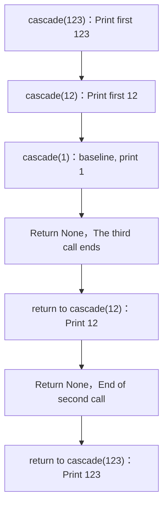
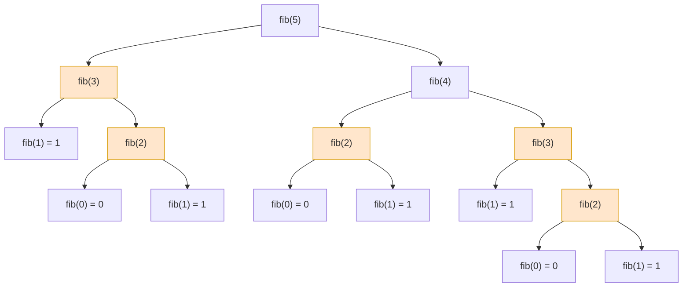
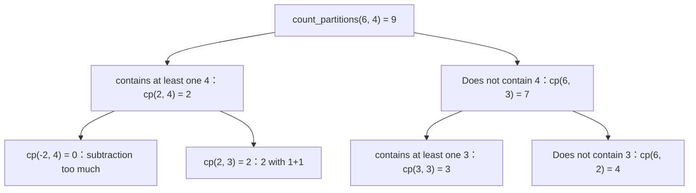

> **courses**: UC Berkeley CS61A · Structure and Interpretation of Computer Programs(Fall 2024)
> **This lecture**: Lecture 10 ｜ 32:14 ｜ Station B P 10 ｜ [Original video](https://www.bilibili.com/video/BV1sy411z7nA?p=10)
> **courseware**: `09-Tree_Recursion_1pp.pdf` (14 pages, official PDF, page-by-page renderings see text illustrations)
> **subtitles**: Original English subtitles from Station B; this note is a reconstruction of Chinese writing, not a sentence-by-sentence translation.
> **Copyright**: The copyright of the course and courseware belongs to the UC Berkeley CS61A teaching team; this article is a secondary arrangement for learning purposes

## Quick overview of this lecture

- **Mastered**: The skeleton of the recursive function - the base case and the recursive case; the "leap of faith" of recursion, that is, the assumption  `f(n-1)`  Already correct on simpler inputs, just responsible for spelling out with it  `f(n)` (Lecture 9); and higher-order functions can pass functions as actual parameters and return new functions in the function body (Lecture 4–7).
- **Main line of this lecture**:
    - use  `cascade`  Put the execution rule "the call must return first" onto the environment diagram to see clearly the recursive **chronological order**, rather than just looking at the return value.
    - from  `inverse_cascade`  I saw a kind of recursion that is not written in the body of its own function: calling itself indirectly through a higher-order function.
    - Give the definition of tree recursion - initiate to yourself in the function body **more than once** Call - and use  `fib`  Draw the call tree.
    - use  `trace` "Run" the call tree and explain  `fib(35)`  Why does it take so long to calculate: What is slow is not the large number, but the fact that the same sub-problem is recalculated repeatedly.
    - use  `count_partitions`  Demonstrates where tree recursion really comes into play: treat "choose or not choose the largest piece" as a dichotomy, and then add the two types of results.
- **Key conclusions**:Tree recursion = exploring two (or more) disjoint alternatives in a recursive situation and then merging the sub-results. A call expands into a tree, **The number of nodes determines the time, and the tree height determines the number of frames active at the same time.**; When the same subtree is expanded repeatedly, exponential waste occurs.

*(Reference time: 00:00:00 – 00:32:11｜Lecture 10)*

## 1. Course opening notice: Why tree recursion deserves special practice

*(Reference time: 00:00:00 – 00:01:09｜Lecture 10)*

The main topic of this lecture is **Tree Recursion**——One call will expand into the recursion of multiple sub-calls. The courseware begins with a one-page title and a one-page notice.


There is only one thing to explain before the class starts, but it determines the rhythm of the next few days: **The recursive job will be released this Friday**. This assignment is not light, and recursion is a technology that only officially debuted this week. It usually requires a lot of practice to truly master, so the first suggestion is to start as early as possible.

This is followed by a positive response to "What is the use of recursion?" Early examples of recursion often looked like they were a bit fussy - whether it was printing a string of numbers, adding an integer, writing  `while`  It can be solved by looping three lines, so why go around in a circle and call yourself? The lecturer acknowledges this perception and then makes a promise to be fulfilled in this lecture: **In the example that appeared today, it is much easier to use recursion than not to use recursion.**. This is not "recursion can also be done", but "such problems will be difficult to write without recursion".

The judgment criteria also emerged: what recursion is really good at is **Break a complex calculation into two or more pieces**. This sentence just predicts the title of this lecture - split into **piece**, the result is linear recursion (each call only generates a new call); split into **More than two pieces**, the result is tree recursion. The step from one block to multiple blocks is a double leap in the way of thinking and cost estimation.

The intuition to solve problems doesn’t happen overnight. The lecturer gave a very real reassurance here: If these contents do not become clear immediately, it is completely normal; many students have struggled with this hurdle and finally crossed it. All they need is proper concentration and investment.

## 2. Recursion review: `cascade` "Wait for it to return" in

*(Reference time: 00:01:13 – 00:06:29｜Lecture 10)*


Before entering tree recursion, the courseware takes a step back to review something that is often ignored: **Understand the order of recursive calls**. The return value is just the result; explaining the behavior of a recursive function—what it prints first, what it prints last, and when it starts “going up”—must rely on the order of calls.

There is only one execution rule that supports all of this: **When you initiate a function call, you must wait for it to return before you can do anything else.**. If a call is followed by statements, those statements will not be executed until the call returns. This rule may seem like a cliché, but in recursion it is magnified into the shape of an entire call tree.

`cascade`  This is an example used to crystallize this rule. It receives a positive integer  `n`: if  `n`  less than 10, print it directly; otherwise print it first  `n`, and then compare "the number remaining after removing the last digit" (i.e.  `n // 10`, integer division discards the remainder) calls itself recursively, and finally prints it again  `n`.

> **Editor's note**: this lecture  `cascade`, `inverse_cascade`, `f_then_g`  The three codes only appear in the editor opened by the instructor on site, and are not included in the courseware PDF. The following code is restored sentence by sentence according to the subtitle dictation (print first  `n`, recurse, and print again  `n`, the baseline is  `n < 10`), the structure is subject to oral description, please verify the details with the computer running results.

```python
def cascade(n):
    if n < 10:
        print(n)
    else:
        print(n)
        cascade(n // 10)
        print(n)
```

Let’s look at the simplest input first. `cascade(5)`  Falling into the baseline situation, only one appears on the screen  `5`. Replace it with a five-digit number where each digit is exactly 1 to 5, and the output becomes a symmetrical ladder:

```text
12345
1234
123
12
1
12
123
1234
12345
```

The attribution of these nine lines is worth counting line by line. The lonely one in the middle  `1`  from the baseline situation  `print(n)`;The remaining eight lines are from  `else`  Two in the branch  `print(n)`——Printing once for each layer when descending, and printing again for each layer when ascending. There is only one reason why a beautiful nested structure can be formed: **All downward cascading occurs before the last print**.

Next, use the environment map to confirm this process of "first falling, then rising". execute  `cascade(123)`: The original call checks the baseline and it is not established, so print  `123`. There is only one line on the screen at the moment  `123`, all the rest will be generated by that recursive call.

recursive call  `cascade(12)`  Will **finish first**, and then it is the original call's turn to continue. The so-called "complete" means that it prints itself again  `12`, adjust again  `cascade(1)`, and  `1`  Falling on the baseline is printed - this is the bottom drop. The rising direction is determined by the return value: the third call  `cascade(1)`  Executed all the way to the end of the function body, never encountered  `return`  statement, so return  `None`.

> **Editor's note**: The function body in Python is executed but not encountered  `return`, the return value is  `None`. This is exactly the point to be made here - a recursive function does not necessarily "return" a meaningful value, it may only be responsible for producing side effects.

Back to the second call. it stops at execution  `cascade(n // 10)`  On that line, the awaited value is finally available (`None`), so continue to execute the last  `print(n)`, a second one appears on the screen  `12`. This call also does not have  `return`, also returns  `None`. The original call can finally continue, printing the last  `123`, and then end.

There is a key moment in the whole process: **The second call has returned, but the first call has not ended yet.**. At this time, the first call has already printed  `123`, has also been obtained through recursion  `12`, `1`, `12`  These three lines are output, but its own last line has not yet been written. Any statement that appears after the recursive call will not be executed until after that moment.

This yields two observations that can be directly reused:

- each  `cascade`  The frames all come from a different call; as long as the return value has not yet appeared, the call has not ended, and the code behind it will hang.
- A statement placed in a recursive call **before** Still **after**, determines whether it belongs to the "descending stage" or the "rising stage". Each of the three lines of output belongs to its own owner: the third call prints  `1`;The second call prints two  `12`, one in  `1`  before, one in  `1`  After that; the first call prints first  `123`, and finally print it again  `123`.

Compress this call and return into a timeline, and the sequence is clear at a glance:



## 3. Two kinds  `cascade`, and an “inverse  `cascade`”

*(Reference time: 00:06:31 – 00:11:06｜Lecture 10)*

`cascade`  It’s not like you can only write it that way. Observe it and you will find: Baseline situation printing  `n`, the recursive case also prints  `n`, then bring this printing to the front of the function, and the two situations will naturally merge - there is nothing to do in the baseline situation, so  `if`  Only need to handle recursive cases.

```python
def cascade(n):
    print(n)
    if n >= 10:
        cascade(n // 10)
        print(n)
```

> **Editor's note**: In the subtitles, the lecturer stated the condition as “when  `n`  greater than 10", but to make this writing method borderline equivalent to the original version, the condition should be  `n >= 10`. original pair  `n = 10`  Will print  `10`, `1`, `10`  Three lines; if written  `n > 10`, only one will be printed  `10`, two editions in  `n = 10`  No longer equivalent. Written here according to semantics  `n >= 10`.

The running results are consistent with the original version, and the definitions are shorter; if the number is larger, the graphics will only be more beautiful.

So which of the two versions is better? One version separates the baseline situation and the recursive situation and clearly tells the reader what to do in each situation; the other version finds the common ground between the two and tries not to repeat himself. The instructor’s judgment criteria are conditional: **If two implementations are equally clear, usually choose the shorter one**, because others read it faster. But in this case, the longer version is actually clearer - it spreads out the two things in the order of "baseline first, recursion second", which is the usual order for reading recursive functions. Therefore, when learning to write recursive functions, it is recommended to organize the code according to the long version, although it is not necessary.

Both are recursive functions, but the one on the left has a typical structure. Please keep one principle in mind when choosing: **Programs are first written for humans to read, and then handed over to computers for execution.**. If you're hesitating between the two, ask yourself - if this was code written by someone else, which version would you rather read.

| criterion | Situation version (baseline / recursion separated) | Combined version (print first, then judge) |
|---|---|---|
| Lines of code | 6 lines | 5 lines |
| repeated statements | `print(n)`  Appear three times | `print(n)`  appears twice |
| Handling the baseline situation | A separate branch, written explicitly | Implicit in "no more recursion" |
| reading comprehension | Look at the baseline first, then look at the recursion | We must first see what the two branches have in common |
| Lecturer’s choice | The first choice for teaching and beginners | When equally clear, shorter ones are given priority. |
| Potential border risks | None | The condition is written as  `n > 10`  time  `n = 10`  One less line |

The last paragraph of the review is an exercise: write an "inverse" `cascade`". incoming  `1234`  The expected output is  `1`, `12`, `123`, `1234`, and then reduce it layer by layer: `123`, `12`, `1`. In other words, first grow up from small to large, and then shrink back from large to small.

The lecturer did not ask to write it from scratch, but gave him a ready skeleton and narrowed the difficulty into one place:

```python
def inverse_cascade(n):
    grow(n)
    print(n)
    shrink(n)
```

`grow`  Responsible for printing growth stage (`1`, `12`, `123`), the middle line  `print(n)`  Print the longest one, `shrink`  Responsible for the contraction phase. The question then becomes: `grow`  with  `shrink`  How to define?

Both are related to the higher-order function below. It receives two functions  `f`, `g`  and a number  `n`: As long as  `n`  If it is not 0 (in numbers, 0 is the only false value), call it first in order  `f`, call again  `g`.

```python
def f_then_g(f, g, n):
    if n:
        f(n)
        g(n)
```

The challenge is to use it to define  `grow`  and  `shrink`: Both are unary functions, you need to choose them yourself.  `f`, `g`  Who are they, and what are the actual parameters passed to them. The lecturer paused here for a few seconds to allow time to think, and then gave the following version:

```python
def grow(n):
    return f_then_g(grow, print, n // 10)

def shrink(n):
    return f_then_g(print, shrink, n // 10)

inverse_cascade(1234)
```

```text
1
12
123
1234
123
12
1
```

`grow`  Why is it "long first and then print"? Because the printing needs to be done from small to large, the smaller ones must be completed first, so for the smaller ones  `grow`  must be ranked  `print`  before - then  `f`  is  `grow`, `g`  is  `print`.`shrink`  Just the opposite: print out the current largest one first, and then process the smaller one, so  `f`  is  `print`, `g`  is  `shrink`. Once the order is changed, the direction of the output is completely reversed.

Look again  `n // 10`  This layer. `f_then_g`  use **same one** `n`  to call  `f`  and  `g`, so the passed in  `n // 10`  Determines "who should be processed at this layer": `grow(1234)`  Got it  `n // 10`  is  `123`, it first recurses  `grow(123)` (There are more below  `grow(12)`, `grow(1)`, `grow(0)`), then  `print(123)`;The printing order is therefore  `1`, `12`, `123`, exactly increasing. `grow(0)`  Do nothing because  `f_then_g`  in  `n`  When it is 0, skip it directly——`if n:`  This line is the brake for the entire recursion.

One last point worth noting: `grow`  with  `shrink` **My own name does not appear in my body**, the recursion is through  `f_then_g`  happened. The definition of recursion can therefore be relaxed a bit - as long as the function is called again during the evaluation of the function body (even if there are several functions in between), it is still recursive.

## 4. Tree recursion: `fib`  with its call tree

*(Reference time: 00:11:15 – 00:15:45｜Lecture 10)*


The definition is short: **Tree recursion refers to making more than one call to the function itself when executing the function body of a recursive function.**. The calculation process grown in this way is tree-shaped: there is a root, several branches under the root, and each branch has thinner branches.

The most typical example is Fibonacci numbers - almost every course on tree recursion will cover it. Numbering starts from 0: the 0th number is 0, the 1st is 1, the 2nd is also 1; thereafter each number is the sum of the previous two numbers: 0, 1, 1, 2, 3, 5, 8, 13...

```python
def fib(n):
    if n == 0:
        return 0
    elif n == 1:
        return 1
    else:
        return fib(n - 2) + fib(n - 1)
```

The two baseline cases (0 and 1) are defined directly, and the rest all follow the "sum of the first two numbers". The reason why it is tree recursion is just to look at the recursion situation: to calculate  `fib(n)`, in the function body  `fib`  Two calls were made.

The call tree looks like this. root is  `fib(5)`; Its two child nodes are  `fib(3)` (i.e.  `n - 2`  which one) and  `fib(4)` (i.e.  `n - 1`  That one); unfold all the way to the leaves of the baseline:



Highlighted in orange are nodes that have been expanded repeatedly: `fib(3)`  Appeared twice, `fib(2)`  Appeared three times, `fib(1)`  Appeared five times. The whole tree has a total of 15 nodes, that is  `fib(5)`  Required 15 times  `fib`  call.

The order of traversal is also very particular. To settle  `fib(5)`  Have to calculate first  `fib(3)`. To settle  `fib(3)`  Have to calculate first  `fib(1)`, it immediately returns 1 - this is the entire calculation **The first return value obtained**. Then  `fib(0)`, `fib(1)`  also returns, so  `fib(2)`  It's possible to return: 1 plus 1 gives 2, `fib(3)`  Also returns 2. So far  `fib(5)`  The left half of the  `fib(4)`  Not even a line has been counted.

On the right half is a bigger tree, which is about to unfold itself again  `fib(2)`  with once  `fib(3)`. Wait until both of them return, `fib(4)`  Got 3, `fib(5)`  Only then can we add 2 and 3 to get 5. The left subtree is calculated first, then the right subtree is calculated, and finally merged - this order of "left, right, merge" is true for every node, which is why the call tree can be "climbed" layer by layer.

| criterion | linear recursion (`cascade`, factorial) | tree recursion (`fib`, `count_partitions`) |
|---|---|---|
| Number of self calls in recursive situations | at most 1 time | 2 times or more |
| The shape of the calculation process | One chain, plus two sections, descending and ascending | A tree with branches spreading with depth |
| Total number of calls versus input | Linear, approx.  `n`  times | Exponentially, `fib`  approx.  $1.618^{n}$ |
| Number of simultaneously active frames (space) | approximately equal to depth  `n` | No more than tree height  `n` |
| Main difficulties | Starting and ending conditions and statement sequence | How to break a problem into two disjoint parts |
| Typical examples | `cascade`,bitwise summation  `sum_digits` | `fib`, `count_partitions` Tower of Hanoi |
| When to use | There is only one way to move each step | Each step involves enumerating between several choices |

## 5. use  `trace`  Extracting the call tree: the cost of duplication

*(Reference time: 00:15:48 – 00:21:02｜Lecture 10)*

Let’s look at the values first. The results for the baseline scenario are as expected: `fib(2)`  Got 1, `fib(3)`  Got 2, `fib(5)`  Got 5. Keep going up, `fib(8)`  Got 21, `fib(10)`  Got 55, `fib(20)`  Already 6765, `fib(30)`  It's 832040. Arrive  `fib(35)`, the screen did not respond for a long time - the lecturer's original words were: It is working really hard, I thought the computer was very fast.

`fib(35)`  The final result is 9227465. The number itself is not that big, and an arithmetic operation takes far less time; what is slower is **call**.

> **Editor's note**: put each  `fib(k)`  A frame counts as one call, and the number of calls meets  $T(0) = T(1) = 1$, $T(n) = T(n-1) + T(n-2) + 1$, the solution is  $T(n) = 2F(n+1) - 1$, among which  $F$  are Fibonacci numbers. The following table is calculated according to this formula, which is used to convert "it feels slow" into a comparable number.

| `n` | `fib(n)`  value | needed  `fib`  Number of calls | Intuitive feeling |
|---|---|---|---|
| 5 | 5 | 15 | Can be counted at a glance |
| 10 | 55 | 177 | `trace`  It can also fill a whole screen |
| 15 | 610 | 1973 | The output line has extended beyond the page |
| 20 | 6765 | 21891 | The value is still very small and has been called 20,000 times. |
| 25 | 75025 | 242785 | Starting to lag obviously |
| 30 | 832040 | 2692537 | need to wait a while |
| 35 | 9227465 | 29860703 | About 30 million calls |

To make the tree visible, a tool is needed. The lecturer provided  `trace`, from the  `ucb`  module import. it's called **decorator**——Write on the line before the definition of the objective function, ending with  `@`  At the beginning, it is used to change the behavior of the function: when it is called, it prints a line, and when it returns, it prints a line with the return value, so "who was called when and what was handed back" are all spread out on the screen.

```python
from ucb import trace

@trace
def fib(n):
    if n == 0:
        return 0
    elif n == 1:
        return 1
    else:
        return fib(n - 2) + fib(n - 1)
```

call  `fib(0)`  when, `trace`  Given the two lines "called" and "return 0", `fib(1)`  Likewise: the baseline trajectory is the simplest. `fib(2)`  It’s different: it adjusts internally first  `fib(0)`, adjust again  `fib(1)`, both return 0 and 1 respectively, and the sum is 1. Finally  `fib(2)`  Return 1. `fib(3)`  has a richer structure: it calls  `fib(1)`  with  `fib(2)`, while  `fib(2)`  I brought a complete internal calculation with me.

> **Editor's note**: `ucb.trace`  The real output is an indented nested form, with each level indented one more level to express "who is waiting for whom". The specific character format is provided with the project  `ucb.py`  shall prevail; here we only describe the shape and do not draw it to avoid discrepancy with the real output.

Arrive  `fib(5)`, a real tree unfolds before your eyes: first  `fib(3)` (return to 2), then  `fib(4)` (Returns 3, which is quite a bit of work in itself). `fib(10)`  is much larger - it consists of  `fib(9)`  with  `fib(8)`  composed, while  `fib(8)`  There are still  `fib(6)`, `fib(4)`, `fib(2)`, each layer comes with a complete recursive structure. `fib(15)`  At this time, the output lines have extended beyond the page, and the end cannot be seen.

So the problem is not "the computer is slow", but the tree **Repeat**. `fib`  will be called many times with the same actual parameter, and the same value will be recalculated each time; in  `fib(5)`  In the example of `fib(3)`  That calculation was done completely twice. The ideal approach is to do the calculation once, write down the result, and use it directly next time - this will be covered formally in the next few weeks of this course (in a more general context, this technique is called memoization). The lecturer specifically added a qualification: **Don’t think that tree recursion must be slow just because of this section.**, it certainly doesn't have to be slow, it's just that this implementation is; the Fibonacci sequence itself also has much faster algorithms.

> **Editor's note**: Two quantities can be read directly from the call tree - time is for the entire tree **Number of nodes** (one call per node), the space is tree **height** (The number of simultaneously active frames is at most equal to the depth). `fib`  The depth is only  `n`, so its space is linear; but the price it saves on space is that it repeatedly recalculates the same subtree in time. This is the most frequently cited example when discussing “time for space” later.

## 6. Counting division: Use "Is there the largest piece" to make two points?

*(Reference time: 00:21:06 – 00:27:49｜Lecture 10)*


The following example is the most important in this lecture, and the reason is: it is a **It is difficult to write recursion without tree** tree recursive process. I said earlier that early examples of recursion often seemed like fuss, and this section will make good on the promise that it's "really easier."

positive integer  `n`  use **no more than  `m`  part of** The number of partitions (partition) is the  `n`  The number of ways to write the sum of several positive integers, each part of which does not exceed  `m`. The lecturer added a stipulation that was not written in the main text of the courseware: these parts should be **increasing order** Arrange.

> **Editor's note**: The definition in the courseware only says "sum of positive integer parts up to m", and the "increasing order" was added verbally by the lecturer. This agreement cannot be omitted - without it, `2 + 4`  with  `4 + 2`  will be treated as two different divisions, and the count will be doubled immediately.

`count_partitions(6, 4)`  All nine types of:

- `2 + 4 = 6`
- `1 + 1 + 4 = 6`
- `3 + 3 = 6`
- `1 + 2 + 3 = 6`
- `1 + 1 + 1 + 3 = 6`
- `2 + 2 + 2 = 6`
- `1 + 1 + 2 + 2 = 6`
- `1 + 1 + 1 + 1 + 2 = 6`
- `1 + 1 + 1 + 1 + 1 + 1 = 6`

This is an exhaustive list. Note two things: there are  `2 + 4`, no  `4 + 2` (Descending order is not a new method); each part does not exceed 4, so  `1 + 5`  Not among them - it does break up the 6, but uses more than the upper limit. The courseware draws a row of small round blocks next to each division to draw the "grouping": two blocks plus four blocks, one block plus four blocks... Graphics and text are two presentations of the same thing.

The task of the function is just to tell you how many types there are, and it is not required to list the divisions, so  `count_partitions(6, 4)`  Should return 9.

The strategy is **recursive decomposition**: Express the original problem using simpler examples of similar problems. The watershed here is  `m = 4`:

- Use at least a 4;
- Not a single 4 is used, that is, only parts not exceeding 3 are allowed.

These two categories **Disjoint** (One contains 4 and one does not contain 4). Together they cover all nine types, so they can be counted separately and then added together.

The first type is easier to calculate: since there must be a 4, what remains after removing it is "divide 2 with parts not exceeding 4", that is  `count_partitions(2, 4)`. Among the nine types, there are two that fall into this category——`2 + 4`  with  `1 + 1 + 4`, after removing 4, they are exactly two divisions of 2 (`2`  with  `1 + 1`). The second category is "divide 6 by parts not exceeding 3", i.e.  `count_partitions(6, 3)`, seven types in total. 2 + 7 = 9.

| Group | Specific division | values |
|---|---|---|
| Contains at least one 4 | `2 + 4`, `1 + 1 + 4` | 2, that is  `count_partitions(2, 4)` |
| Does not include 4 (only use parts no larger than 3) | `3 + 3`, `1 + 2 + 3`, `1 + 1 + 1 + 3`, `2 + 2 + 2`, `1 + 1 + 2 + 2`, `1 + 1 + 1 + 1 + 2`, `1 + 1 + 1 + 1 + 1 + 1` | 7, that is  `count_partitions(6, 3)` |

These two sub-problems are still the same type of problem and can be solved in the same way. `count_partitions(6, 3)`  Then press "Do you use a 3" to divide into two groups: those who use 3, take away the 3 and then count "use parts not exceeding 3 to divide 3"; if not, count "use parts not exceeding 2 to divide 6". Each layer is cut in this way until the number reaches 0 or there is no way to go.



The role played by tree recursion here can be summarized in one sentence: **It is a technique for exploring different options**. The two options split the set to be counted in half, recurse each, and finally combine the results of the two halves. **Add**——Because what needs to be counted are all alternatives. This is related to  `fib`  Here "adding two sub-results" is the same action, the difference is only in the meaning of "select": `fib`  The selection is "the first two numbers", and the selection here is "whether to use parts of this size".


## 7. write out  `count_partitions`: Recursive case and three baselines

*(Reference time: 00:27:51 – 00:32:11｜Lecture 10)*

Once you have the recursive plan, all that's left is to translate it into code. The lecturer first writes the recursive case - that is, a direct transcription of the reasoning just now:

```python
    else:
        with_m = count_partitions(n-m, m)
        without_m = count_partitions(n, m-1)
        return with_m + without_m
```

Two variable names are two groups: `with_m`  Count "at least one" `m`” situation (first put  `m`  Take it away, what's left  `n - m`  Still usable no more than  `m`  part); `without_m`  Count "one" `m` "neither use" (some upper limits are reduced to  `m - 1`). Adding the two together covers everything without missing anything.

Next, fill in the baseline situation. There are three questions in total, each answering the question "When should I stop asking further questions?":

- **`n == 0`  returns 1**. There is one way to divide 0 - add nothing.
- **`n < 0`  Returns 0**. The division of negative numbers does not exist; reaching this step indicates that a previous subtraction was overdone, and this path should not be counted.
- **`m == 0`  Returns 0**. No positive number can be made from parts of size 0.

`n < 0`  This one is especially worth stopping at. It is not a mathematical “answer”; **Pruning criteria**: When recursively decomposing, you will always find a dead end such as "trying to use too large parts to make up a too small number". `n < 0`  Make these branches return to 0 immediately, rather than continuing to expand on negative numbers.

> **Editor's note**: of these three baselines **sequence** Not casually. `n == 0`  must be ranked  `m == 0`  before: otherwise  `count_partitions(0, 0)`  Will hit first  `m == 0`  Returning 0 conflicts with the convention that "0 has a partition (empty sum)". The courseware is exactly as per  `n == 0`, `n < 0`, `m == 0`  arranged in order.

Complete implementation:

```python
def count_partitions(n, m):
    if n == 0:
        return 1
    elif n < 0:
        return 0
    elif m == 0:
        return 0
    else:
        with_m = count_partitions(n-m, m)
        without_m = count_partitions(n, m-1)
        return with_m + without_m
```

Use a simpler example than 6 to verify: `count_partitions(5, 3)`. Its five divisions are  `1 + 1 + 1 + 1 + 1`, `1 + 1 + 1 + 2`, `1 + 2 + 2`, `1 + 1 + 3`, `2 + 3`, so the answer should be 5.

The original call split into two branches: a number "divide 2 by no more than 3 parts" (`count_partitions(2, 3)`), a number "divides 5 by parts not exceeding 2" (`count_partitions(5, 2)`).

Cut the one on the left again: `count_partitions(2, 3)` = `count_partitions(-1, 3)` + `count_partitions(2, 2)`. The first item is 0 - it is impossible to use parts of size 3 to make up 2. The subtraction is overdone and returns 0 directly; the second item is 2 (`2`  itself and  `1 + 1`). So the left side gets 2.

The one on the right: `count_partitions(5, 2)` = `count_partitions(3, 2)` + `count_partitions(5, 1)`. The previous item is 2 (`1 + 2`  with  `1 + 1 + 1`, only the part not exceeding 2 is allowed); the latter item is 1 (only 1 can be used, `1 + 1 + 1 + 1 + 1`  the only one). So the right side gets 3.

2 + 3 = 5, consistent with the exhaustive result. It is these two branches that are gradually unfolded in the demonstration: two types using 2, one using all 1s, plus the type obtained by using 3 previously, and finally added.

> **Editor's note**: with  `fib`  different, `count_partitions`  The two sub-calls of go in two different directions - one decreases  `n`, one decreases  `m`, there are far fewer cases of repeated expansion of the same pair of arguments, so it won't be as  `fib`  That's an exponential explosion. Its upper limit of recursion depth is  `n + m`(`m`  Each level can be reduced by at most 1, `n`  minus at least 1 for each level), while  `n < 0`  with  `m == 0`  The two baselines will cut off invalid branches in advance; what really determines the running time is how many legal branches are on the tree.  `(n, m)`  combination.


## Summary

*(Reference time: 00:00:00 – 00:32:11｜Lecture 10)*

- **First ask "When will the call return?"**: The output order of a recursive function is determined by whether the statement is placed before or after the recursive call. The printing order can be deduced without understanding the return value.
- **tree recursion = more than one self-call in a recursive case**: A call grows into a tree. The number of nodes is the time and the height of the tree is the number of active frames at the same time. The two should be estimated from different perspectives.
- **The core action of recursion is decomposition**: Split a complex calculation into two or more pieces, each piece is a smaller instance of the same problem, and finally merge the sub-results - addition corresponds to "counting all alternatives", and sequential execution corresponds to "process first and then finish".
- **Duplicate subtrees are a waste**: `fib`  The slowness is not because the numbers are large, but because the same sub-problem is expanded repeatedly; "calculate it once and write it down" can push the exponential level back to linearity.
- **The baseline situation should cover the "overdone" path**: `n < 0`  Returning 0 is not a mathematical answer, but a pruning criterion; the order between baselines also carries semantics.
- **Recursion is not necessarily written in its own body**: `grow`  with  `shrink`  Pass  `f_then_g`  Indirect recursion, as long as the function is called again during the evaluation of the function body, it is recursive.
- **Abstraction over tracking**: Tracing is only possible for small examples; what is really used when writing recursion is "assume  `f`  is already correct in simpler situations" principle.

## Attached: Slide index for this lecture

*(Reference time: 00:00:00 – 00:32:11｜Lecture 10)*

| page | content | Appear location |
|---|---|---|
| 1 | Title page: Tree Recursion | §1 Beginning |
| 2 | Announcements transition page | §1 |
| 3 | Recursion Review transition page | §2 Beginning |
| 4 | Three ways to determine the correct implementation of recursion | Appendix §App.1 |
| 5 | Real questions  `streak`: Adjacent digits are equal | Appendix §App.2 |
| 6 | Mutual Recursion transition page | Appendix §App.3 |
| 7 | Mutual Recursion Example: Fill in the prime factor count of the answer | Appendix §App.3 |
| 8 | Fill-in-the-blank version of mutual recursion example | Appendix §App.3 |
| 9 | Mutual recursion: The prime factor tree of 120 circles 15 and 5 | Appendix §App.3 |
| 10 | Tree Recursion transition page | §4 Beginning |
| 11 | Count division: `count_partitions(6, 4)`  nine kinds of | §6 |
| 12 | Counting division: dichotomy with and without 4 | §6 |
| 13 | `count_partitions`  Complete implementation | §7 |
| 14 | Real questions  `count_park`: Parking plan count | Appendix §App.4 |

## Appendix: Slides not shown in class

*(Reference time: 00:31:55 – 00:32:11｜Lecture 10)*

> **Editor's note**: Courseware pages 4–9 and 14 in the video of this lecture **There is no corresponding explanation paragraph**——Subtitles from  `cascade`  Go directly to the topic of tree recursion and stop at the end  `count_partitions(5, 3)`  Demonstration, there was no correctness argument, `streak`, mutual recursion and  `count_park`  oral broadcast. According to the specifications of this project, such pages are concentrated at the end of the text and appear once page by page; the following content is strictly restored based on the courseware screen, and any supplementary reasoning is marked separately.

### Appendix.1 Three ways to judge the correct implementation of recursion


The courseware summarizes "how to know that a recursive implementation is correct" into three methods, and their weight is not the same.

- **Tracing**: Draw the entire calculation process. It only works for very small examples -`fib(5)`  The 15 calls can still draw, `fib(20)`  More than 20,000 times cannot.
- **Induction**: Check first  `f(0)`, and then check "As long as  `f(n-1)`, …, `f(0)`  All correct, `f(n)`  That’s right.” This is the only real means of proof.
- **Abstract**: Assumption  `f`  It is already correct in the simpler example, just use it to implement it  `f`. This is **write** The kind of recursion you actually use is the "recursive leap of faith" that the course emphasizes repeatedly - you don't have to know how the recursive call works the moment you write it down, you just need to trust that it will give the correct answer on smaller inputs.

| criterion | Tracing | Induction | Abstract |
|---|---|---|---|
| what is produced | a specific execution record | a proof of correctness | A working implementation |
| Scope of application | minimal input | Any input | Any input |
| What to rely on | Environment graph and call tree patience | Baseline and "Scale Does Get Smaller" | Reliability of recursive calls |
| main cost | The combination explodes and quickly expires. | Need to write invariants | May mask errors in decomposition |
| position in course | Debugging and understanding | Argument | Design and writing |

All three have a common implicit premise: the baseline situation is really correct, and each recursive call is getting closer to the baseline. Without any one of them, no matter how beautifully structured the branch is, it will only get the wrong answer, or it will never come back.

### Attachment 2  `streak`: Leave "adjacent digits are equal" to the next layer to check


This is an A+ question from Spring 2024 Issue 1: Determine whether all the digits of a positive integer are the same.

```python
def streak(n):
    """Return True if all the digits in positive integer n are the same.

    >>> streak(22222)
    True
    >>> streak(4)
    True
    >>> streak(2222322)  # 2 and 3 are different digits.
    False
    """
    return (n >= 0 and n <= 9) or (n > 9 and n % 10 == n // 10 % 10 and streak(n // 10))
```

The two spaces are  `n % 10 == n // 10 % 10`  with  `streak(n // 10)`. The courseware prompts are: `//`  Do integer divisions and discard remainders, `%`  make the remainder; `1234 // 10`  Got  `123`, `1234 % 10`  Got  `4`.

The reading is like this: single digit (`n % 10`) and tens digit (`n // 10 % 10`) If equal, and the remaining number after discarding the ones digit is still  `streak`, then the whole number is  `streak`. The baseline is "a single number from 0 to 9" and it must be true. The recursive call is placed in  `and`  on the right side of , so once the adjacent two digits are unequal, the entire  `and`  It becomes a short circuit  `False`, **No more unnecessary recursion**——This is a pure function writing method, with no loops and no accumulated variables.

By the way, it is **linear recursion**: There is only one self call per layer, and the tree is a chain rather than a tree. I put it here to illustrate that "tree" is not the only shape of recursion - even if it does not produce branches, recursion can still naturally express the process of "peeling off bits one by one".

### Appendix.3 Mutual recursion: two functions call each other


Mutual recursion has a short definition: if  `f`  call  `g`, while  `g`  call again  `f`, these two functions are mutually recursive.

The example used in the courseware is "numbers with different factors": find  `n`  How many are there **different** Prime factors. 51 = 3 × 17, there are two; 27 = 3 × 3 × 3, there is only one different prime factor; 120 = 2 × 2 × 2 × 3 × 5, there are three.


```python
def unique_prime_factors(n):
    """Return the number of unique prime factors of n.

    >>> unique_prime_factors(51)   # 3 * 17
    2
    >>> unique_prime_factors(27)   # 3 * 3 * 3
    1
    >>> unique_prime_factors(120)  # 2 * 2 * 2 * 3 * 5
    3
    """
    k = smallest_factor(n)
    def no_k(n):
        "Return the number of unique prime factors of n other than k."
        if n == 1:
            return 0
        elif n % k != 0:
            return unique_prime_factors(n)
        else:
            return no_k(n // k)
    return 1 + no_k(n)
```

`smallest_factor`  Only the function header and documentation string are printed on the courseware, and the complete implementation is hidden in the source code encoded by the Python Tutor link at the bottom of the page:

```python
def smallest_factor(n):
    "The smallest divisor of n above 1."
    if n % 2 == 0:
        return 2
    k = 3
    while k < n:
        if n % k == 0:
            return k
        k += 1
    return n
```

The flavor of mutual recursion is in  `no_k`  inside. it is nested in  `unique_prime_factors`  The inner function in the frame, so the outer binding is visible  `k`. The logic is divided into three situations:

- Divided by 1: there are no other prime factors, return 0.
- `n`  no longer  `k`  Divisible by: `k`  This family has been used up, and the problem has degenerated into "from  `n`  Count again with different prime factors", so call  `unique_prime_factors(n)`, from which the smallest prime factor can be found again.
- Can still be  `k`  Divisibility: remove one more  `k`, continue to use the same  `k`  Check, that is  `no_k(n // k)`——Recursively handed over **inner function itself**.

outer layer  `return 1 + no_k(n)`  put  `k`  Count itself as 1 and leave the rest to  `no_k`. So  `unique_prime_factors`  call  `no_k`, `no_k`  call again  `unique_prime_factors`, the two functions treat each other as the source of the "simpler case".


This page and the previous page are the "before answering" state of the same code: the three underlined positions correspond to  `return unique_prime_factors(n)`, `return no_k(n // k)`  with  `return 1 + no_k(n)`. The value of filling in the blanks lies in distinguishing **Which recursion is asking which question?**: `no_k`  That sentence  `unique_prime_factors(n)`  It’s “count again by changing prime factors”, `no_k(n // k)`  It means "continue dividing by the same prime factor". The two have similar shapes and opposite semantics. If they are written backward, they will fall into an infinite loop or a multiplicity.


On the right side of the courseware, the decomposition of 120 is drawn as a tree: 120 is split into 2 and 60, 60 is split into 2 and 30, 30 is split into 2 and 15, 15 is split into 3 and 5; 27 is split into 3 and 9, and 9 is split into 3 and 3. Red box marks  `15`  This layer - it was rejected once by "Can it be divisible by 2", so the control of the entire section was returned  `unique_prime_factors`  Start again; the small box inside the box is marked again  `5`, that’s the new one  `k`. This picture depicts the mutual recursion of "jumping out and jumping back" as two re-enters on the tree.

### Attachment 4  `count_park`: Three-step recursive mid-term questions


At the end of the courseware, there is a question from Spring 2023 Midterm 2, No. 5, which is just used to test the model of this lecture. Question meaning: In a row of parking spaces, a motorcycle occupies 1 parking space (recorded as  `%`), the car occupies 2 adjacent parking spaces (denoted as  `<>`), spaces are recorded as  `.`. The given length is  `n`  For a row of parking spaces, find the number of parking options. It is allowed to be completely empty or partially empty.

```text
count_park(1)  → 2    # '.' 或 '%'
count_park(2)  → 5    # '..'、'.%'、'%.'、'%%'、'<>'
count_park(4)  → 29
```

The point of recursion is **The leftmost square**. This square has three fates: empty, parked with a motorcycle, or as the front half of a car. The first two types only consume 1 grid, and the rest  `n - 1`  The grid continues as it is; the third type consumes 2 grids at a time, leaving  `n - 2`  Grid:

```python
def count_park(n):
    if n < 0:
        return 0
    elif n == 0:
        return 1
    else:
        return count_park(n-2) + count_park(n-1) + count_park(n-1)
```

thus  `count_park(2) = count_park(0) + count_park(1) + count_park(1) = 1 + 2 + 2 = 5`; `count_park(3) = 2 + 5 + 5 = 12`, `count_park(4) = 5 + 12 + 12 = 29`, consistent with the example given in the question.

> **Editor's note**: This recursive formula  $f(n) = 2f(n-1) + f(n-2)$ (Among them  $f(0) = 1$, $f(-1) = 0$) The generated sequence is 1, 2, 5, 12, 29, 70...usually called Pell numbers. it is better than  `fib`  One more branch, but still in the same family: one call produces multiple calls to itself, and the results are added together.

with  `count_partitions`  By comparison, we can see two typical forms of the action of "decomposition": `count_partitions`  use **Capacity limit** Make two points (use or not  `m`), `count_park`  use **How many spaces does the leftmost end occupy?** Doing three points (0 grid, 1 grid, 2 grid) ultimately boils down to "adding up the numbers of several disjoint types of solutions." This is also the most worthwhile lesson to take away from this lecture: the difficulty of tree recursion is never writing recursive calls, but finding a **Cut the set into disjoint pieces** angle.
