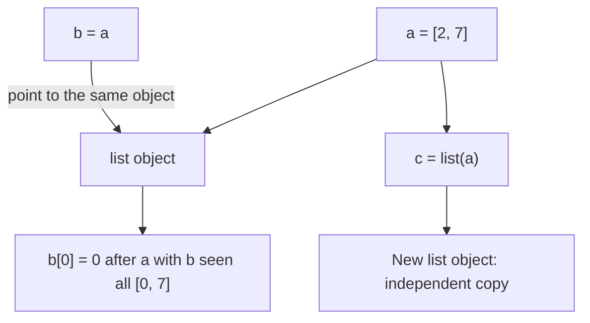
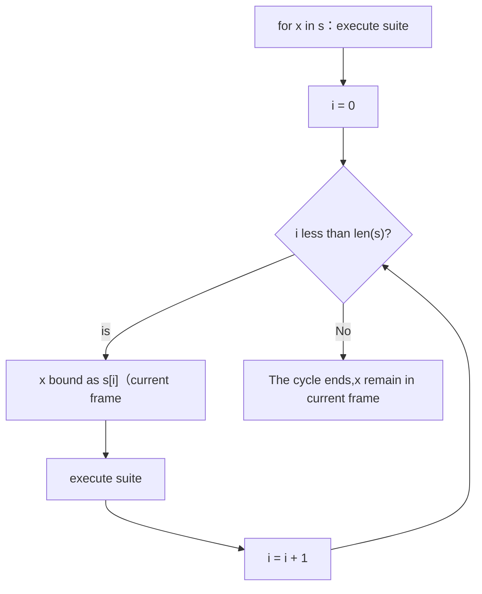
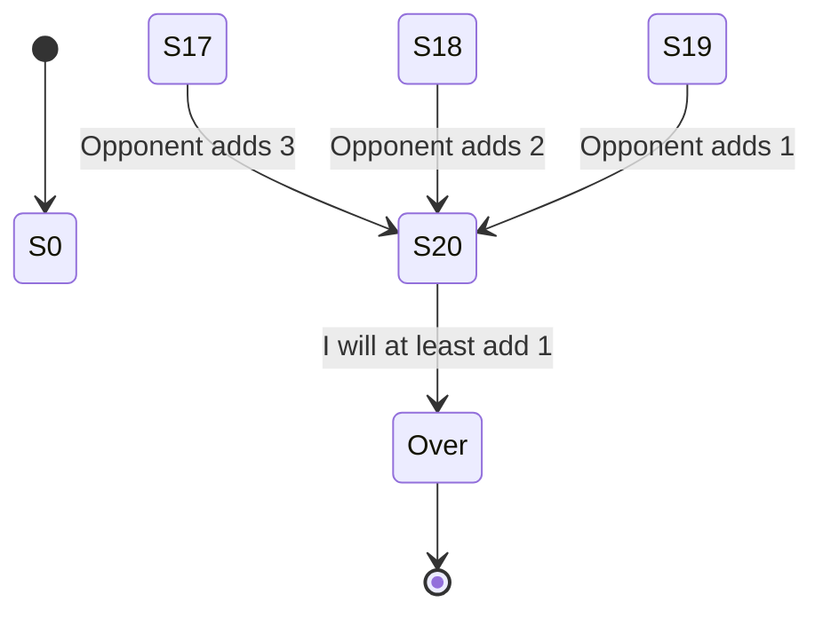

> **courses**: UC Berkeley CS61A · Structure and Interpretation of Computer Programs(Fall 2024)
> **This lecture**: Lecture 11 ｜ 22:15 ｜ Station B P 11 ｜ [Original video](https://www.bilibili.com/video/BV1sy411z7nA?p=11)
> **courseware**: `10-Sequences.pdf` (12 pages, official PDF, page-by-page renderings see text illustrations)
> **subtitles**: Original English subtitles from Station B; this note is a reconstruction of Chinese writing, not a sentence-by-sentence translation.
> **Copyright**: The copyright of the course and courseware belongs to the UC Berkeley CS61A teaching team; this article is a secondary arrangement for learning purposes

## Quick overview of this lecture

- **Mastered**: The evaluation order of expressions and calling expressions, `def`  and environment graphs, recursion and tree recursion (Lecture 8–10). The data processed so far is basically "single values" such as numbers, Boolean values, and strings.
- **Main line of this lecture**:
    - `list`  Is Python’s container type: literal construction, subscript index, `len`, `+`  with  `*`, and why the index is defined as "the offset from the beginning".
    - Containers can be nested, so "whether a certain value is in the container" becomes an independent question; `in` / `not in`  Only element-wise equality comparisons are performed, subsequences are not searched.
    - `for`  statement frees traversal from the boilerplate code of hand-written indexes by **current frame** Binds loop variables and does not create new frames.
    - `range`  The length and element selection can be given by just a pair of integers, so it is also a sequence——**Sequences are capabilities, not types**.
    - List comprehensions squeeze "mapping + filtering" into an expression, `divisors`  This is what it looks like after being loaded into the function.
- **Key conclusions**: As long as a value supports "find length" and "press to get elements", it can be iterated as a sequence; `for`, `range`, and derivation expressions are syntactic sugar for this protocol. `list`, `tuple`, `str`, `range`  Just different implementations of the same agreement.

*(Reference time: 00:00:01 – 00:22:12｜Lecture 11)*

## 1. Entrance to the sequence: `list`  Literals, indexes and  `len`

*(Reference time: 00:00:01 – 00:00:53｜Lecture 11)*

`list`  It is Python's built-in data type and is used almost everywhere in the entire language: functions need to return multiple results, programs need to read a batch of data, and algorithms need to maintain a queue to be processed. They are all used. This lecture starts from the smallest construction method, and installs the "sequence" abstraction layer by layer.


Used to construct a list **list literal**: Use commas to separate several elements in square brackets. To bind it to a name, just an ordinary assignment statement:

```python
odds = [1, 3, 5, 7]
```


> **Editor's note**: The video of this lecture is from  `list`  The content starts directly without leaving any announcement in the subtitles. Page 2 of the courseware is the opening announcement page of this class. It is kept here in page number order and no speculation will be made on the content of the announcement.


> **Editor's note**: The PDF of this courseware only retains the section pages and the second half of the content pages. `list`  The examples in this paragraph were entered live by the instructor. The following code and output are restored according to the subtitle dictation; the dictation does not take the smallest self-consistent example for all individual values ​​(such as the specific values ​​of two inner elements of a nested list), and does not change any conclusions.

get  `odds`  After that, to get the elements use **element selection**: Write the subscript in square brackets. Check the number of elements using built-in functions  `len`:

```python
>>> odds[0]
1
>>> odds[1]
3
>>> odds[2]
5
>>> odds[3]
7
>>> len(odds)
4
```

There's something here that stumbles almost everyone for the first time: the last element's index is 3, and the number of elements is 4. The explanation given by the lecturer is not a formula that can only be memorized by rote like "Python starts counting from 0", but a more useful mental model——**The subscript is the offset from the beginning**.

- Offset 0 is the beginning itself.
- Offset 1 is the first element after the beginning.
- Offset 2 and 3 and move back two and three steps respectively.

So "the subscript of the last element = length − 1" is no longer a rule to memorize, but "the last element leaves the head with  `len - 1`  A direct translation of "step". This model will be implemented repeatedly later: in §6  `range(-2, 2)`  The 3rd element of is  `-2 + 3 = 1`, using exactly the same sentence - starting point plus offset. If you understand the subscript as "position number", you will get a bunch of special cases; if you understand it as "offset", you will get a formula.

## 2. Element selection expression: Who to count first, then what to look at

*(Reference time: 00:00:55 – 00:02:49｜Lecture 11)*

Element selection is not a "value symbol", but a **expression**, so it obeys the expression evaluation rules discussed in the previous lectures. write down  `odds[2]` , Python first evaluates the expression that gives the list on the left side of the square brackets, then evaluates the subscript expression in the square brackets, and finally uses the two values ​​to look up the table.

Since both positions are expressions, you can put anything on either side, or you can combine the results of a selection:

```python
>>> odds[3] - odds[2]
2
>>> odds[odds[3] - odds[2]]
5
```

The second line is worth pausing for: `odds[3] - odds[2]`  Figure it out first  `7 - 5 = 2`, this 2 is regarded as a subscript, so we get  `odds[2] = 5`. The evaluation order is "left first, then inner, then lookup table" without any ambiguity. It can be nested like this because the subscript position only requires "evaluating an integer" and not "writing it as a number".

Each element in a literal can also be an expression. Two lists are equal as long as the evaluated lists on both sides are equal:

```python
>>> [1, 8, 2, 8] == [1, 4 + 4, 2, 8]
True
```

That is to say  `digits = [1, 8, 2, 8]`  with  `digits = [1, 4 + 4, 2, 8]`  What is bound are equal values. Whether to write numbers or calculations only affects whether the reader can see "this 8 is the square of 4" at a glance, but does not affect the program behavior.

There is another way to write the element by clicking on it: `operator`  in module  `getitem`, the effect is exactly the same.

```python
>>> from operator import getitem
>>> getitem(odds, 2)
5
```

`getitem(odds, 2)`  The "subscript" is downgraded from syntax to an ordinary parameter, so the matter of "getting the element by subscript" itself can be passed around as a function - the same idea as the "function is the value" mentioned earlier. This also explains why Python divides operators and functions into two sets of writing methods: the syntax form is short to read, and the function form can be combined.

Combine two lists using  `+`, to repeat a list use  `*`:

```python
>>> digits = [1, 8, 2, 8]
>>> [2, 7] + digits * 2
[2, 7, 1, 8, 2, 8, 1, 8, 2, 8]
```

`digits * 2`  First copy the 4 elements into 8, `[2, 7] + ...`  again  `2, 7`  Continuing from before, we get a list of 10 elements. There are two points that must be distinguished here.

- `+`  with  `*`  all **generate new list**, the original  `digits`  with  `[2, 7]`  Not a single element has changed.
- `*`  Copied is **element reference**, no difference is seen for lists containing only integers; when the elements themselves are mutable, there is a difference between "copying" and "sharing" (see §3.5).

`operator`  There is a corresponding one in the module  `add`  with  `mul`, with  `+`, `*`  Equivalent:

```python
>>> from operator import add, mul
>>> add([2, 7], mul(digits, 2))
[2, 7, 1, 8, 2, 8, 1, 8, 2, 8]
```

### 2.5 Slicing: the interval version of element selection (Editor’s supplement)

> **Editor's note**: This section is not within the scope of the oral broadcast of this lecture, and is a completion of sequence operations in the official reading. Placed here because slicing and element selection share the same "offset" model.

To take one element at a time, use subscripts; to take a continuous section, use **slicing**, written as  `s[start:end]`:

```python
>>> digits = [1, 8, 2, 8]
>>> digits[1:3]
[8, 2]
>>> digits[:2]
[1, 8]
>>> digits[2:]
[2, 8]
>>> digits[-1]
8
>>> digits[:]
[1, 8, 2, 8]
```

`start:end`  with  `range(start, end)`  Use the same agreement: including the starting point and not including the end point. `digits[1:3]`  Get the two elements of subscript 1 and 2, the length is  `3 - 1 = 2`, with  `range`  The length formula is exactly the same. Omitting the starting point defaults to 0, omitting the end point defaults to the end, omitting both sides results in a **new list** (For a copy, see §3.5). Negative subscripts count backwards from the end, `digits[-1]`  is the last element, which is equivalent to  `digits[len(digits) - 1]`.

## 3. Nested lists and  `in`: Container within a container

*(Reference time: 00:02:51 – 00:05:55｜Lecture 11)*

The elements of a list do not have to be integers and can be any value, including another list.

```python
pairs = [[10, 20], [30, 40]]
>>> pairs[1]
[30, 40]
>>> pairs[1][0]
30
```

Appeared here **Combining expressions**: `pairs[1]`  It is an element selection itself, and the result is a list, followed by  `[0]`  Make a second selection on it. Reading from left to right, it means "take the 1st element first, and then take the 0th element of that element".

`pairs`  There are two levels: two outer elements, each of which is a two-element list. The lecturer emphasized that this is exactly what lists are -**A list is a value that represents "a collection of other values"**. Once this is acknowledged, "Does a certain value appear in this set" becomes a question that must be answered, and Python is prepared for it.  `in`  operator.

```python
>>> digits = [1, 8, 2, 8]
>>> 1 in digits
True
>>> 8 in digits
True
>>> 5 in digits
False
>>> 5 not in digits
True
```

`in`  The evaluation process is the same as element selection: first evaluate the left side (the value you are looking for), then evaluate the right side (the container being searched), and then determine whether the left side appears on the right side. `8`  Appeared twice, the answer is still  `True`——`in`  The question is "does it exist", not "how many times does it appear"; if you want to count, you have to write the loop yourself, §4  `count`  That's exactly what it does. `not in`  is another operator, meaning  `not (x in s)`.

`in`  Just do **Element-wise equality comparison**, there are three common misunderstandings on this point, and the lecturer dismantled them one by one.

- **The types must be truly equal.** `'1' in digits`  is  `False`, because the string  `'1'`  with integers  `1`  Not equal; `in`  Won't put it first  `'1'`  Convert it into numbers and compare.
- **It does not search for subsequences.** `[1, 8] in digits`  is  `False`, despite  `1`  with  `8`  indeed appeared adjacent to each other; `digits`  The elements of are four integers, none of which is equal to the list  `[1, 8]`.
- **But if there is really an element in the container equal to it, the answer is  `True`.** `[1, 2] in [[1, 2], [3, 4]]`  for  `True`, because  `[1, 2]`  Is a first-level element of the outer list. The deeper you go, the more it becomes  `False`——`[1, 2] in [[[1, 2]]]`  The first-level element of is  `[[1, 2]]`, no  `[1, 2]`.

In one sentence: `in`  It doesn't "drill into the structure to find anything that looks like a match", it just takes out the first-level elements of the container one by one and compares them with the target. This decision of "not doing a recursive search" seems to be a hassle-free decision, but the price is that it cannot express "searching at any depth"; for that kind of needs, you can only write your own recursion, which is the craft practiced in Chapters 8–10.

| the expression being tested | result | Reason |
|---|---|---|
| `1 in [1, 8, 2, 8]` | `True` | There is an integer 1 in the first-level element |
| `'1' in [1, 8, 2, 8]` | `False` | Strings are not equal to integers, `in`  No type conversion |
| `[1, 8] in [1, 8, 2, 8]` | `False` | Do not search subsequences, only compare first-level elements |
| `[1, 2] in [[1, 2], [3, 4]]` | `True` | `[1, 2]`  Exactly a first-level element |
| `[1, 2] in [[[1, 2]]]` | `False` | The first level element is  `[[1, 2]]`, it doesn’t count if you go deeper. |
| `5 not in [1, 8, 2, 8]` | `True` | Equivalent to  `not (5 in digits)` |

In terms of complexity, `in`  The semantics directly determines its cost: each determination is a linear scan, and the list has  $n$  elements, it is judged once  $O(n)$  comparison. put  `in`  Put it into another loop that traverses the same list, and the whole thing will become  $O(n^2)$——This is the motivation that is mentioned repeatedly when we talk about sets and dictionaries later.

### 3.5 Alias and copy: two names, one data (Editor’s supplement)

> **Editor's note**: Variability and side effects will not be formally discussed until subsequent lectures. This is only used to illustrate the most easily misunderstood point of "container as value"; the code is supplementary to this note and is not included in this lecture.

The assignment statement is bound to **value**, and lists are mutable objects, so the same list can be pointed to by multiple names:

```python
a = [2, 7]
b = a
b[0] = 0
>>> a
[0, 7]
```

`b = a`  No elements are copied, it just makes  `b`  point to  `a`  The list object that has been pointed to. The relationship "one object, multiple names" is called **Aliasing**. The arrows drawn as two names in the environment diagram converge into the same list:



To truly obtain an independent piece of data, one must **Copy**: `list(a)`  or  `a[:]`  will create a new list and change it later  `c`  will not affect  `a`.

```python
c = list(a)
c[0] = 5
>>> a
[0, 7]
>>> c
[5, 7]
```

Nested structures make this even more subtle: `nested = [a, a]`  The two positions here point to the same  `a`, change  `nested[0][0]`  will change at the same time  `nested[1][0]`; and  `a * 2`  What is copied is only two pointing to the same  `a`  citation, not two  `a`. §2 says  `*`  Copy the element reference and place it here. This clue will be picked up later when we talk about variability, shallow copy and deep copy.

## 4. `for`  Statement: Incorporate the traversal boilerplate code into the grammar

*(Reference time: 00:05:59 – 00:09:44｜Lecture 11)*

Sequences are so basic in calculations that the language designers simply created a new statement for "traversing a sequence". In order to explain clearly what it solves, the lecturer first honestly wrote the version without it: count how many times a certain value appears in the sequence.

```python
def count(s, value):
    """Count the number of times value appears in s.

    >>> count([1, 2, 1, 2, 1], 1)
    3
    """
    total, index = 0, 0
    while index < len(s):
        element = s[index]
        if element == value:
            total += 1
        index += 1
    return total
```

Read it step by step: `total, index = 0, 0`  It is multiple assignment, one statement sets the initial value for two names; `while index < len(s)`  Ensure that the subscript does not cross the boundary; `element = s[index]`  Get the current element; `if element == value`  Decide whether to add up; `index += 1`  Advance the subscript one space. Only five steps  `if`  That step is the real logic of this question, and the other four steps are purely mechanical actions of "walking the list from beginning to end."

`total += 1`  is an enhanced assignment statement, meaning "put  `total`  Rebind to its original value plus 1". it is better than  `total = total + 1`  Short and harder to write incorrectly; in Python  `-=`, `*=`  There are corresponding writing methods for a whole set of operators. The lecturer first used it here, and then pointed out what really should be eliminated: the main body of this realization is only  `if`  Those two lines, the rest are in service of "traversal". And traversal is so common that it deserves its own dedicated statement.

```python
def count(s, value):
    """Count the number of times value appears in s.

    >>> count([1, 2, 1, 2, 1], 1)
    3
    """
    total = 0
    for element in s:
        if element == value:
            total += 1
    return total
```

Read them side by side, `for`  One line replaces three things: initializing the subscript, checking whether the subscript is out of bounds, and advancing the subscript at the end of each loop. Can't find it in the code anymore  `index`, the reader doesn’t have to maintain it in his or her mind. The lecturer read this version into one sentence: first write down "how many times have I seen  `value`", and then  `s`  For each element in , if it is equal to  `value`  Just add one to the count. The results of doctest are consistent with hand calculation——`1`  in  `[1, 2, 1, 2, 1]`  If it appears 3 times, a test passes.

`while`  Version's failure mode is worth remembering: Forgot to write  `index += 1`  It’s an infinite loop; write the condition as  `index <= len(s)`  will be thrown when the subscript is equal to the length  `IndexError`; put  `total`  The initial value written in the loop will be cleared every round. `for`  Taking these three types of errors out of the writer's field of vision at once is not a matter of style, but a type of bug that changes from "possible" to "impossible".

| criterion | `while`  Version | `for`  Version |
|---|---|---|
| Requires explicit subscripting of variables | need (`index`) | No need |
| Termination condition | handwriting  `index < len(s)` | Automatically judged by statements |
| each advance | handwriting  `index += 1` | automatically advanced by statement |
| Which frame is the loop variable bound to? | current frame | Current frame (also does not create a new frame) |
| Typical errors | If you forget to advance, there will be an endless loop; the boundary is written as  `<=`  is out of bounds | These two types of errors basically do not exist |
| Applicable scenarios | The position itself is required, or the step size is irregular | Just need to access the elements one by one |

## 5. `for`  Execution model and sequence unpacking

*(Reference time: 00:09:47 – 00:13:03｜Lecture 11)*

`for`  There are only three semantics of , and once they are clarified, there should be no more black boxes.

```text
for <name> in <expression>:
    <suite>
```

1. Evaluate header expression  `<expression>`, it must give a **Iterable value (iterable)**.
2. For each element in the sequence: put  `<name>`  Bind to that element and then execute  `<suite>`.
3. Binding occurs at **The first frame of the current environment**, no new frame is created; therefore, after the loop ends, the name still remains in that frame.

In Article 1, the lecturer deliberately left a hole in the word "iterable value": this term will not be precisely defined in a few weeks. For now, it is enough to understand it as "a sequence". Later, we will see that there are things that can be iterated outside of sequences. This processing method itself is worth learning - first give a sufficient partial definition, and then add a precise version when the tools are available. It is easier for people to get started than pursuing completeness from the beginning.

The loop variable is tied to **current frame** Instead of a new frame, it's  `for`  Key difference from function calls. That is, loops do not provide any scope isolation: after the loop ends  `element`  It can still be accessed after the function body, and its value is the last element. The environment map shows "the current frame has one more binding", and no new frame appears in the whole process.

Article 2 is  `for`  with  `while`  Source of equivalence. put  `for`  Expanded into "the subscript is initialized to 0 + loop + subscript plus one", the semantics are completely unchanged:



This picture explains why  `for`  Only applicable to things "the element can be obtained by pressing the cursor": both appear in the expansion  `s[i]`  with  `len(s)`. And  `range`  Exactly both are provided (§6), so it can be  `for`  Traverse. must appear in the expansion  `s[i]`, also explains why "iterable" can be directly understood as "sequence" at this moment: we will see it later  `for`  It can also traverse objects that do not contain elements and do not support subscripts. At that time, the expansion method will require a different mechanism.

The second clever thing is the header syntax: `for`  You can write in place of the name **multiple names**, as long as each element of the sequence itself is of fixed length.

```python
pairs = [[1, 2], [2, 2], [3, 2], [4, 4]]
same_count = 0
for x, y in pairs:
    if x == y:
        same_count += 1
```

`pairs`  Each element of is a pair of numbers, `for x, y in pairs`  Just split them into two names, `x`  with  `y`  Bind to the two elements of each pair separately, rather than to the pair itself. Go through: `(1, 2)`  does not wait; `(2, 2)`  equal, `same_count`  becomes 1; `(3, 2)`  does not wait; `(4, 4)`  equal, `same_count`  becomes 2. This way of writing is called **sequence unpacking**.

multiple assignment  `x, y = pair`  Completely isomorphic: several names on the left require several values on the right, one-to-one correspondence. Therefore, it also inherits the premise of multiple assignment——**Length must match**. If you match a tuple with three names, an error will be reported; unpacking cannot be used when the length of the elements is not fixed, which is why the lecturer emphasized that "only valid for fixed-length sequences".

## 6. `range`: Use two integers to represent a sequence of integers

*(Reference time: 00:13:05 – 00:16:37｜Lecture 11)*


`range`  is another sequence type: it is a sequence, but not a list. It is used to represent a sequence of consecutive integers - to be precise, `range`  It can represent a more general sequence of integers. This lecture only deals with the continuous increasing sequence.


The lecturer's drawing method is worth repeating: imagine a number line filled with integers, `range(-2, 2)`  is cut out on this number line **a limited period**, from  `-2`  Count to the right  `2`  before. Both arrows on the diagram point to the gap to the left of the number: `-2`  Falling within this range, `2`  is blocked from the range.

Including the starting point and excluding the end point may seem like a weird convention at first, but it makes both things easier at the same time.

- **length**: `结束值 − 起始值`.`range(-2, 2)`  The length is  `2 - (-2) = 4`, exactly on the number axis  `-2, -1, 0, 1`  Four.
- **Element selection**: `起始值 + 下标`. Subscript 0 is  `-2`, subscript 3 is  `-2 + 3 = 1`.

Neither formula is needed  `+1`  or  `-1`  of tinkering, which is exactly what the half-open range pays off. If changed to "including both ends", the length must be written as  `end - start + 1`, element selection must also be specially processed on the border, the extra  `+1`  It will be scattered everywhere where it is used. There is no right or wrong in the agreement itself, its value lies in "one less exception".

thus  `range`  It satisfies the sequence protocol: it has length and can be pressed to retrieve elements. The lecturer concluded based on this——**it has  `len`  and element selection, so it must be a sequence, even if it is not a list**. This sentence is the crux of this lecture: Sequence is not a specific type, but a set of abilities; `list`  It is a realization of this set of abilities, `range`  It's another kind.

Want to see  `range`  What elements are there, just call **List constructor  `list`**:

```python
>>> list(range(-2, 2))
[-2, -1, 0, 1]
>>> list(range(4))
[0, 1, 2, 3]
```

`list`  It is a built-in function (constructor). If you call it on a sequence, you will get a list containing all the elements of the sequence. `range(4)`  When only a number is given, it is treated as the end value and the start value is implicitly 0 - this is the same rule as slicing to omit the start value.

```python
>>> range(5, 8)
range(5, 8)
>>> list(range(5, 8))
[5, 6, 7]
```

Note the echo on the first line: `range(5, 8)`  The value obtained is still  `range`  Objects, not lists, appear on the screen  `range(5, 8)`  Just a representation of it. To see the element, you must explicitly call  `list`. The lecturer particularly emphasized that if you already understand  `range`  semantics, `[5, 6, 7]`  can be directly derived; call  `list`  just for **Confirm**, rather than "generating" the sequence.

> **Editor's note**: `range`  The reason why it can be represented by only two integers is that it does not save the elements, but calculates them according to the formula each time - the length is subtracted and the elements are added. This behavior of "computing on demand and not materializing" is called lazy in Python. It has two practical consequences: `range(10**12)`  Takes up almost no memory; `range`  The object cannot be modified in place and cannot be used.  `+`  splice another  `range`. These two items are not included in the oral broadcast of this lecture and are supplementary to the judgment of "not a list".

### 6.5 Comparison of four built-in sequences (Editor’s supplement)

> **Editor's note**: This lecture has only expanded  `list`  with  `range`.`str`  with  `tuple`  are the other two implementations of the same set of sequence protocols in subsequent lectures. They are placed side by side here in advance to implement "sequence is a capability rather than a type"; the table is as follows  `str`, `tuple`  The relevant lines are from the official reading and are not included in the oral broadcast of this lecture.

| criterion | `list` | `tuple` | `str` | `range` |
|---|---|---|---|---|
| Literal writing | `[1, 3, 5]` | `(1, 3, 5)` | `'135'` | `range(1, 6, 2)` |
| Is it variable? | mutable | immutable | immutable | immutable |
| element type | arbitrary | arbitrary | Can only be characters | Can only be an integer |
| `len` | Yes | Yes | Yes | Yes (obtained by subtraction) |
| Subscripting and slicing | Yes | Yes | Yes | Yes (the slice is still  `range`) |
| `+`  Splicing | support | support | support | Not supported |
| `*`  Repeat | support | support | support | Not supported |
| `in`  semantics | Elements are equal | Elements are equal | substring matching | Integer equality |
| memory cost | Proportional to the number of elements | Proportional to the number of elements | Proportional to the number of characters | Constant, independent of length |
| Typical uses | universal container | Fixed-length records, immutable data | text processing | Counting loops, integer sequences |

`str`  with  `list`  The most easily overlooked difference is that  `in`  This line: `'ab' in 'abc'`  is  `True`, because the string  `in`  looking for **substring**; and  `[1, 2] in [[1, 2], [3, 4]]`  looking for **element**. Same thing  `in`, the type of the value on the right determines what question it is asking. This difference will be encountered repeatedly when processing text later.

`tuple`  is written almost the same as  `list`  The same thing, except that the square brackets are replaced by round brackets; once constructed, it cannot be modified, in exchange for the guarantee that "it will not be changed by others" (and it can be used as a dictionary key). These four types of construction, traversal, and slicing are written in exactly the same way because they share the same protocol. To determine whether a piece of code is written "sequence-oriented", just look at whether it relies on a method of a specific type - just use  `len`, subscript and  `for`  The code can still run in another sequence.

## 7. use  `range`  Driving loops: summation and the "underscore" convention

*(Reference time: 00:16:38 – 00:18:35｜Lecture 11)*

`range`  The most common usage is to give  `for`  Provide a sequence of integers, since what many loops really need is an increasing sequence of integers.

```python
def sum_below(n):
    total = 0
    for i in range(n):
        total += i
    return total

>>> sum_below(5)
10
```

`range(5)`  given  `0, 1, 2, 3, 4`, loop to accumulate these five numbers: `0 + 1 + 2 + 3 + 4 = 10`. There is no subscript in the whole process, and there is no  `len`——`i`  It is the required data itself, not a "tool used to obtain data". this is  `for ... in range(n)`  with "`while`  Division of labor with subscript ": the former traverses **value**, the latter traverses **location**.

Sometimes the loop just has to "do it n times" and the integers themselves are useless:

```python
for _ in range(3):
    print('Go Bears!')
```

`range(3)`  There are three elements, the loop body is executed three times, and three lines appear on the screen.  `Go Bears!`. The loop variable is bound, but it is never used in the loop body. The lecturer gave an agreement: **Use a single underscore  `_`  as name**, so that people who read the code can tell at a glance "I don't plan to use this value." written as  `x`  It's also fully capable of running, but  `x`  It will make people think it is meaningful and then look for where it is used; `_`  then explicitly declare "just a placeholder is needed here".

> **Editor's note**: `_`  There is no special status at the grammatical level in Python, it is just a legal identifier; "indicates not used" is a community convention, and the interactive interpreter will additionally use it to save the result of the previous expression. The two do not conflict with each other, but do not regard the behavior of the interpreter as language semantics.

### 7.5 Built-in aggregation: `sum`, `min`, `max` (Editor’s addition)

> **Editor's note**: The following three built-in functions are not included in this lecture and belong to the standard library comparison of §7 handwriting loop.

`sum_below`  Hand-written an accumulation loop, and Python has built-in  `sum`:

```python
>>> sum(range(5))
10
>>> sum([1, 3, 5, 7, 9])
25
>>> min([1, 3, 5, 7, 9])
1
>>> max([1, 3, 5, 7, 9])
9
```

`sum`  Add the elements sequentially starting from 0, `min` / `max`  Scan once to get the minimum/maximum value. All three accept any iterable object, including  `range`. Their relationship to handwriting loops is worth remembering: **I wrote it by hand first to know what happened in the loop; then I used built-in functions because the standard library version is faster and harder to write errors.**  In addition, `sum`  It is required that the elements can be added, `min` / `max`  The elements are required to be comparable, and feeding the wrong type will throw an error at runtime instead of quietly returning a strange result.

## 8. List comprehension: put  `for`  write expression

*(Reference time: 00:18:38 – 00:21:13｜Lecture 11)*


List comprehension is a powerful method in Python **combination** Form: It starts from an existing sequence and calculates a new list based on an expression.


The complete syntax is:

```text
[<map exp> for <name> in <iter exp> if <filter exp>]
```

Short version without filtering:

```text
[<map exp> for <name> in <iter exp>]
```

The responsibilities of the four sections can be divided as follows: `<iter exp>`  Given the data source, `<name>`  is the binding name for each round, `<map exp>`  Decide "what this element becomes", `<filter exp>`  Decide "whether this element should be left or not". During execution, the interpreter sequentially binds names to each element of the source sequence, checks filter conditions, evaluates mapping expressions, and loads the filtered results into a new list in the original order.

```python
odds = [1, 3, 5, 7, 9]
>>> [x + 1 for x in odds]
[2, 4, 6, 8, 10]
```

The pronunciation is "right  `odds`  every one in  `x`, calculate  `x + 1`": 1 becomes 2, 3 becomes 4, and so on. Mechanically, `x + 1`  This expression is evaluated repeatedly, each time  `x`  Bind to different elements - this is exactly  `for`  What the loop is doing is that the results are automatically collected into a list, and no additional finishing actions are required.

The courseware also demonstrates an example of "mapping subscripts into letters": the source sequence is a number of subscripts. `<map exp>`  It is to select letters from the letter sequence by pressing the subscript, and the result of spelling out is exactly the word.  `DEMO`. This example illustrates  `<map exp>`  Can be any expression, including yet another element selection - the derivation does not require that the mapping be an arithmetic operation.

With the addition of filter conditions, the derivation can "retain only some elements":

```python
>>> [x for x in odds if 25 % x == 0]
[1, 5]
```

`25 % x`  is the remainder operation, `%`  Called the modulo operator (modulo); `25 % x == 0`  express  `x`  Divisible by 25. `odds`  inside  `1`  with  `5`  satisfied, `3`, `7`, `9`  None were satisfied, so only two were left. Pay attention here  `<map exp>`  That’s it  `x`  Itself - the derivation allows "only screening without replacement".

The two sections can also be combined, filter first and then replace:

```python
>>> [x + 1 for x in odds if 25 % x == 0]
[2, 6]
```

Not get it first  `[1, 5]`  plus one, but for each passing  `x`  Calculate directly  `x + 1`. The order is always "filter first, then map", even though  `if`  Written at the back; this is a common confusion caused by the inconsistency between syntax position and execution order. Remember "`if`  It's a guard, and guarding precedes processing" is all.

| composition | grammatical position | function | Example |
|---|---|---|---|
| data source | `<iter exp>` | Provides an iterable sequence | `odds`, `range(2, n)` |
| Binding name | `<name>` | Each round points to an element | `x`, `e` |
| mapping expression | `<map exp>` | Determine output elements | `x + 1` |
| filter expression | `<filter exp>` | decide whether to keep | `25 % x == 0` |

> **Editor's note**: Derivation and "`for` + "Include results list one by one" are two equivalent ways of writing, the latter requires a list  `append`  method (variability is officially discussed in Lecture 15), the equivalent loop writing method is shown in the code block below. Another easily overlooked difference is scope: `for`  statement binds the loop variable to **current frame**, and the derivation in Python 3 has its own scope, inside  `x`  Will not leak to the outer layer——`[x for x in odds]`  After execution, the outer layer  `x`  Still the same as before execution (or still undefined).

```python
result = []
for x in odds:
    if 25 % x == 0:
        result.append(x + 1)
```

## 9. Case: `divisors`——Put the derivation into the function

*(Reference time: 00:21:14 – 00:22:12｜Lecture 11)*

The derivation itself is an expression, and of course it can be used as the return value of a function:

```python
def divisors(n):
    """Return the divisors of n.

    >>> divisors(1)
    [1]
    >>> divisors(4)
    [1, 2]
    >>> divisors(9)
    [1, 3]
    >>> divisors(8)
    [1, 2, 4]
    """
    return [1] + [x for x in range(2, n) if n % x == 0]
```

Take it apart and look at three designs.

- `[1]`  Take it out separately and put it on the head. 1 can divide any positive integer and is a trivial solution that "always holds true". If you strip it out of the loop, the loop can start from 2, which may not hold true.
- `range(2, n)`  The upper bound of  `n`  instead of  `n + 1`, relying on the "exclusion end point": candidate factors only reach  `n - 1`, `n`  You will not appear in the results. The agreement of the half-open interval directly eliminates a boundary judgment here.
- `n % x == 0`  It's all logic. There is no accumulation, no temporary variables, and the function body is only one line.

The results are consistent with hand calculations: 1 has only 1 as a factor (a special case); 4 has 1 and 2; 9 has 1 and 3; 8 has 1, 2, and 4; 12 and 18 have more factors. These are listed to see the pattern——**Factors always appear in pairs**, which is also the entrance to optimize it later.

> **Editor's note**: Trial division is  $O(n)$  of. If  $d$  is  $n$  factor, then  $n/d$  Also, so just enumerate to  $\sqrt{n}$, and then collect each factor together with its pair. This optimization is not included in this lecture. It is written here as a reminder.  `divisors`  There's room; implementing it requires concatenating two lists and dealing with the duplication caused by perfect squares, which is an extended exercise at the end of this lecture.

## Summary

- A sequence is a set of **Ability** instead of a type: there  `len`, can  `s[i]`, is enough to be  `for`  Traverse. `list`  with  `range`  are two implementations of the same protocol, `tuple`, `str`  It's the other two.
- The correct mental model for subscripts is **offset**. "Last subscript = length − 1" and "`range`  The i-th element = starting point + i" are two ways of writing the same sentence.
- The half-open interval (including starting point and excluding end point) eliminates the need for length and element selection.  `±1`  patch, this is  `range`, slice, `range(4)`  Omit the agreement that the three starting points are shared.
- Operators should be distinguished: `+`  splicing, `*`  Repeat, both **generate new list**; `*`  What is copied is the element reference, which will be shared when the element is mutable.
- `in`  Only perform element-by-element equality comparison: no type conversion, no subsequence search, and linear scan every time.
- `for`  Three semantics of: evaluating the header to get an iterable object, element-by-element binding **in current frame**, execute suite; it is equivalent to "subscript initialized to 0 + loop + subscript plus one".
- `while`  Still  `for`, the criterion is "the loop needs position or only value"; use if position is needed  `while`  or  `range`  Add subscripts and traverse directly as long as the value is needed.
- List comprehensions are the expression version of "map + filter": `<iter>`  Give data, `<name>`  binding, `<map>`  processing, `<if>`  Guard, guard before processing.
- When encountering tasks such as "count, sift, change", first write it on paper  `while`  version, and then rewrite it as  `for`, and finally compressed into a derivation - this chain of rewriting is the methodology of this lecture.

*(Reference time: 00:00:01 – 00:22:12｜Lecture 11)*

## Attached: Slide index for this lecture

| page | content | Appear location |
|---|---|---|
| 1 | Title page Sequences | §1 |
| 2 | Announcements opening announcement page | §1 |
| 3 | Sectioned Page Lists | §1 |
| 4 | Section page Ranges | §6 |
| 5 | The Range Type: Semi-open interval, length and selection formula | §6 |
| 6 | Sectioned Page List Comprehensions | §8 |
| 7 | List comprehension syntax (including short version) | §8 |
| 8 | Example: Two Lists pair filter example | Appendix |
| 9 | Sectioned page Example: Promoted | Appendix |
| 10 | First in Line: `promoted`  The two-stage derivation of | Appendix |
| 11 | Sectioned Page Example: Twenty-One | Appendix |
| 12 | Twenty-One Rules and Good and Bad Status | Appendix |

*(Reference time: 00:00:01 – 00:22:12｜Lecture 11)*

## Appendix: Slides not shown in class

*(Reference time: 00:18:38 – 00:22:12｜Lecture 11)*

> **Editor's note**: The three example questions (Two Lists, Promoted, and Twenty-One) on pages 8, 10, and 12 of the courseware do not have corresponding oral broadcasts and demonstrations in the 22-minute video. The video is in Section 9.  `divisors`  Then it ends. According to unified standards, these pages are concentrated at the end of the text and appear once each; the following explanation is based on the ideas of the courseware text, not the original words of the class.


The question gives two equal-length and related lists: `xs`  are all candidate values, `ys`  is for each  `x`  The calculated results require "picking out those corresponding  `y`  less than 10  `x`".

```python
xs = range(-10, 11)
ys = [x*x - 2*x + 1 for x in xs]
```

`ys`  Every item of  `(x - 1) ** 2`, so "less than 10" is equivalent to  `x - 1`  fall on  $-3$  Arrive  $3$  between, the answer should be  `[-2, -1, 0, 1, 2, 3, 4]`, consistent with the response of the courseware. To align the subscripts of the two lists, the most direct way to write it is to traverse using the subscripts:

```python
xs_where_y_is_below_10 = [xs[i] for i in range(len(xs)) if ys[i] < 10]
```

`len(xs)`  Yes  `range`  It can also be used, `xs[i]`  works too - that's exactly what `range`  It is another realization of "sequence": the same derivation template is still valid when changing the data source. This kind of problem of "two equal-length lists are linked by subscripts" is very common in data sorting, at the cost of having to maintain the subscripts yourself; shorter writing methods need to be used  `zip`  Tools like this belong to the follow-up content, and among the existing tools in this lecture, the subscript method is the standard solution.


`promoted`  receive sequence  `s`  with single parameter function  `f`, returns an element with the same elements, but "`f(e)` "True" elements are all sorted first in the new list; the relative order within the two groups remains unchanged.

```python
def promoted(s, f):
    """Return a list with the same elements as s, but with all
    elements e for which f(e) is a true value placed first.

    >>> promoted(range(10), odd)  # odds in front
    [1, 3, 5, 7, 9, 0, 2, 4, 6, 8]
    """
    return [e for e in s if f(e)] + [e for e in s if not f(e)]
```

The answer is the addition of two derivations: the first collects all let  `f(e)`  is true for the element, the second one uses  `not f(e)`  Collect the remaining elements, `+`  Put the two paragraphs together. The source of stability is simple - the two derivation equations are  `s`  The original order of output, splicing only occurs between segments, and the order within the group is naturally not destroyed. The price is to traverse it twice  `s`, and  `f`  will be called  $2n$  times; if  `f`  It's very expensive. This way of writing should be replaced by traversing it once and adding two cumulative lists.

> **Editor's note**: doctest assumptions in the courseware  `odd`  has been defined, e.g.  `def odd(x): return x % 2 == 1`.`promoted`  itself right  `f`  There are no restrictions, just that it returns a value that can be judged true or false.


The rules of Twenty-One are: two players take turns adding 1, 2 or 3 to the current total; the total starts at 0; the game ends when the total reaches 21 or more; **The last person to add up loses**. The key observation given in the courseware is "some states are good and some states are bad", and the state 20 is highlighted on the diagram - "When it is your turn, this is bad".



There is only one step in reasoning: if the total is already 20 when it is someone's turn, no matter he adds 1, 2 or 3, the total will immediately reach or exceed 21, the game is over, and the "last person to add" is himself - so he must lose. So 20 is **bad state**;Conversely 17, 18, 19 are **good condition**, because starting from them you can add 3, 2, and 1 respectively, leaving 20 for your opponent. By working backwards along this chain of "pushing the bad state onto the opponent", you can determine whether opening 0 is a win or a loss. This idea of "good or bad state + backward reasoning" is the common starting point of recursion and dynamic programming, and is also the modeling method used repeatedly later in this course.
